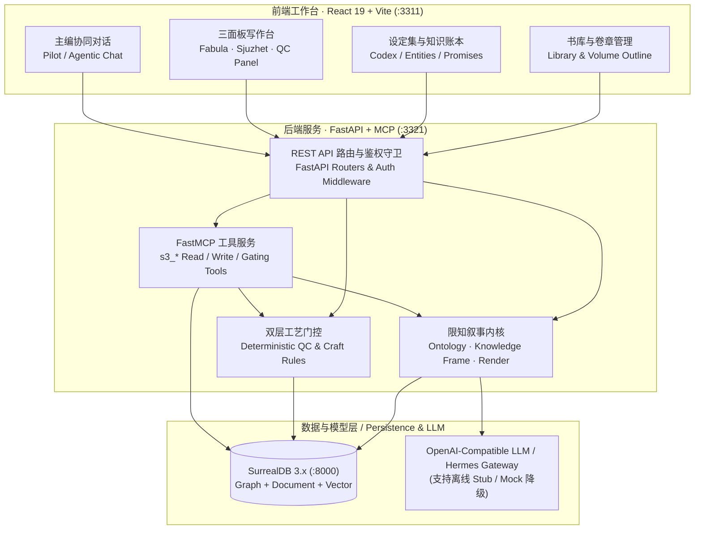

# Scribe Writing System · 铜炉写作系统 (`scribe3`)

[](LICENSE)
[](https://www.python.org/)
[](scribe3/web)
[](https://surrealdb.com/)

**铜炉写作系统（Scribe Writing System / `scribe3`）** 是一套面向长篇小说创作、限知叙事推演与拆文精修的开源人机协同创作工作台。系统基于 **故事本体 v2（Story Ontology v2）** 构建，通过「渲染前知识帧投影（Pre-render Epistemic Frame Projection）」从物理结构上杜绝角色视角越界（POV Leak），并提供从世界观设定、卷章大纲、角色限知推演、正文协同撰写、双层质量门控（Craft & Compliance Gates）到拆文分析与整书导出的完整闭环。

**Scribe Writing System (`scribe3`)** is an open-source, ontology-driven long-form fiction workbench and epistemic narrative engine. Built on **Story Ontology v2** and backed by SurrealDB, FastAPI, React, and MCP (Model Context Protocol), it enforces strict character-level point-of-view (POV) boundaries via pre-render epistemic frame projection, eliminating perspective leaks structurally before prose generation.

---

## 目录 / Table of Contents

- [核心特性 / Key Features](#核心特性--key-features)
- [系统架构 / System Architecture](#系统架构--system-architecture)
- [快速启动 / Quickstart](#快速启动--quickstart)
- [环境变量说明 / Environment Variables](#环境变量说明--environment-variables)
- [拆文与写作工作流 / Deconstruction & Writing Workflows](#拆文与写作工作流--deconstruction--writing-workflows)
- [测试与 E2E 验收指南 / Testing & E2E Verification](#测试与-e2e-验收指南--testing--e2e-verification)
- [目录结构 / Repository Layout](#目录结构--repository-layout)
- [开源协议 / License](#开源协议--license)

---

## 核心特性 / Key Features

1. **三帧限知叙事引擎（Tri-Frame Epistemic Projection）**
   - 区分 **持续体（`Entity`）**、**发生体（`Event`）**、**双时态事实（`Fact`）** 与 **显式知识边（`KnowledgeEdge`）**。
   - 支持 **世界真相帧（World Frame）**、**角色限知帧（Character Frame）** 与 **读者帧（Reader Frame）** 实时投影与戏剧反讽（Dramatic Irony）计算；角色未知的设定或事件在物理上不会进入其渲染 Prompt。
2. **双表面三面板创作工作台（Dual-Surface Workbench）**
   - **作品与卷章管理**：支持多书库管理、卷契约（Volume Contract）、章节契约（Chapter Spine / Beats）与版本快照对比。
   - **设定集（Codex）与因果账本**：管理角色、世界规则、伏笔承诺（Promise Plant / Advance / Payoff）及超期告警、母题（Motif）与声音档案（Voice Profile）。
3. **人机协同写手与 MCP 工具门控（Agentic Co-Writing & MCP Gating）**
   - 内置 FastMCP 服务端（`scribe3/mcp/server.py`），将读写工具按会话意图与契约门控（`chapter_contract_gate`）挂载。
   - 默认关闭未经审批的裸 REST 关键字段覆盖（`SCRIBE3_EMERGENCY_REST_WRITE=0`），确保章节推演与正文落库遵循可回溯的版本链。
   - 无商业大模型 API Key 时支持本地 Mock / 演示降级模式，完整跑通创建、推演、正文保存与质量检验闭环。
4. **双层工艺门控与拆文工具链（Dual-Layer Craft Gates & Deconstruction）**
   - **确定性规则扫描**：高频词/紫光词检测、句式结构重复率、AI 套话（Deslop）过滤、限知越界静态校验（`find_leaks`）。
   - **拆文与语料精修**：支持外部样章拆解、节奏张力提取、设定导出（`export_setting_doc.py`）与整书 Markdown / 文本归档导出。

---

## 系统架构 / System Architecture



---

## 快速启动 / Quickstart

### 1. 环境准备 / Prerequisites

- **Python**: `>= 3.11`
- **Node.js**: `>= 20.x`（含 `npm`）
- **SurrealDB**: `>= 3.0`（本地开发或测试均可使用内存模式 `surreal start memory`）

### 2. 克隆与配置环境变量 / Clone & Configure

```bash
git clone git@github.com:liuwenpinghaher-commits/scribe-writing-system.git
cd scribe-writing-system
cp .env.example .env
```

### 3. 启动 SurrealDB 与后端服务 / Start Database & Backend

```bash
# 1) 启动本地 SurrealDB（示例使用内存引擎，生产可替换为 rocksdb://）
surreal start --bind 127.0.0.1:8000 --user root --pass root memory &

# 2) 创建 Python 虚拟环境并安装依赖
python3 -m venv scribe3/.venv
scribe3/.venv/bin/pip install -U pip
scribe3/.venv/bin/pip install -r requirements.txt 2>/dev/null || scribe3/.venv/bin/pip install fastapi uvicorn surrealdb httpx pydantic pydantic-settings fastmcp pytest playwright

# 3) （可选）灌入「焦三/老道」限知叙事演示数据
scribe3/.venv/bin/python -m scribe3.seed_demo

# 4) 启动 FastAPI 后端（默认监听 http://127.0.0.1:3321）
scribe3/.venv/bin/python -m scribe3.app
```

### 4. 启动前端写作台 / Start Frontend Workbench

```bash
cd scribe3/web
npm install
npm run dev
```

打开浏览器访问 `http://127.0.0.1:3311`，即可进入铜炉写作台创建作品、管理设定、切换角色限知视角并撰写章节。

---

## 环境变量说明 / Environment Variables

完整配置模板见根目录 [`.env.example`](.env.example)：

| 变量名 / Variable | 默认值 / Default | 说明 / Description |
| :--- | :--- | :--- |
| `SCRIBE3_SURREAL_URL` | `ws://127.0.0.1:8000/rpc` | SurrealDB RPC 连接地址 |
| `SCRIBE3_SURREAL_NS` | `scribe3` | SurrealDB 命名空间（测试夹具强制使用 `scribe3_test_*` 隔离） |
| `SCRIBE3_SURREAL_DB` | `main` | SurrealDB 数据库名 |
| `SCRIBE3_SURREAL_USER` | `root` | SurrealDB 用户名 |
| `SCRIBE3_SURREAL_PASS` | `root` | SurrealDB 密码 |
| `SCRIBE3_API_PORT` | `3321` | FastAPI 后端服务监听端口 |
| `VITE_DEV_PROXY` | `http://127.0.0.1:3321` | 前端开发服务器 `/api` 代理目标地址 |
| `SCRIBE3_AUTH_ENABLED` | `0` | 是否启用多租户会话鉴权（`0` 本地免登模式，`1` 强制登录鉴权） |
| `SCRIBE3_EMERGENCY_REST_WRITE` | `0` | 应急 REST 直写开关（默认 `0` 禁用直写推演字段，强制走审批/MCP 版本链） |
| `OPENAI_API_BASE` | `http://127.0.0.1:8642/v1` | OpenAI 兼容推理接口地址（支持 Hermes Gateway / vLLM / 云端 API） |
| `OPENAI_API_KEY` | `your-api-key-here` | 推理接口密钥（离线单测与确定性 E2E 无需真实密钥） |

---

## 拆文与写作工作流 / Deconstruction & Writing Workflows

1. **建书与设定初始化（Book & World Setup）**
   - 在书库页新建作品，录入核心母题、世界规则（World Rules）、角色档案（Entities）及初始公开/私密事实。
2. **卷章契约与场景节拍（Volume & Chapter Spine）**
   - 规划分卷弧光与单章纲要（`synopsis`）、本章目的（`purpose_text`）及出场人物列表（`involved_characters`）。
3. **限知帧投影与视角推演（Epistemic Projection & Deduction）**
   - 选定本章视点人物（Focalizer），系统自动计算 `fabula ∩ character_frame`，生成不含剧透的限知上下文卡片。
4. **协同正文生成与工艺门控（Drafting & Craft Gates）**
   - 撰写或生成章节正文，实时运行 8 大工艺引擎与合规门控（字数下限、AI 腔调检测、私密词泄露检测、伏笔推进校验）。
5. **知识回写与整书导出（Ingest & Export）**
   - 章节定稿后执行 `ingest_chapter`，将本章新发生的事件与目击关系回写至 SurrealDB 知识图谱，驱动下一章的限知边界更新；支持随时导出设定集文档与整书稿件。

---

## 测试与 E2E 验收指南 / Testing & E2E Verification

本仓库内置完整的测试隔离守卫（`scribe3/tests/conftest.py` 与 `scripts/e2e_ci.sh`），所有测试自动拉起独立的内存态 SurrealDB 实例并使用 `scribe3_test_*` 命名空间，**绝不触碰或污染任何本地开发库**。

```bash
# 1. 全仓敏感信息零命中扫描（输出 ZERO_SENSITIVE_HITS）
make check-clean

# 2. PR 最低基线测试（MCP 门控回归 + 前端只读组件 Vitest）
make test-baseline

# 3. 创作者核心路径与应急写门控回归
make test-author-paths

# 4. 工艺引擎与正文质量门控回归
make test-craft

# 5. 确定性全栈 E2E 测试（自起临时内存 SurrealDB + FastAPI + 写入回读验证，无外网/LLM 依赖）
make e2e-det

# 6. Playwright 浏览器端到端冒烟测试（自起隔离内存 SurrealDB + 后端 :3321 + 前端 :3311 + Chromium 真实点击闭环）
make e2e-frontend
```

---

## 目录结构 / Repository Layout

```text
.
├── .github/workflows/ci.yml   # GitHub Actions 自动化测试与脱敏扫描流水线
├── .env.example               # 环境变量配置模板
├── Makefile                   # 标准化测试、E2E 与脱敏检查入口
├── scribe3/                   # 铜炉写作系统 v3 核心源码
│   ├── api/                   # FastAPI 路由、主编运行时与业务服务层
│   ├── auth/                  # 会话鉴权、RBAC 与单机免登兼容层
│   ├── mcp/                   # FastMCP 工具定义与写路径门控
│   ├── migrations/            # SurrealDB Schema 迁移脚本 (.surql)
│   ├── playbook/              # 创作剧本与流程编排存储
│   ├── store/                 # SurrealDB 数据访问层（章节/实体/知识边/工艺规则）
│   ├── tests/                 # Pytest 单元测试与确定性全栈 E2E 测试套件
│   ├── tools/                 # 拆文评估、设定导出与预算分析 CLI 工具
│   └── web/                   # React 19 + Vite 前端工作台与 Playwright E2E 脚本
├── scripts/                   # CI E2E 编排脚本 (e2e_ci.sh) 与运维辅助工具
└── docs/                      # 架构文档、设计规范与演进记录
```

---

## 开源协议 / License

本项目采用 [MIT License](LICENSE) 开源，Copyright (c) 2026 Liu Wenping。
欢迎提交 Issue 与 Pull Request，参与贡献前请阅读 [CONTRIBUTING.md](CONTRIBUTING.md) 与 [SECURITY.md](SECURITY.md)。
