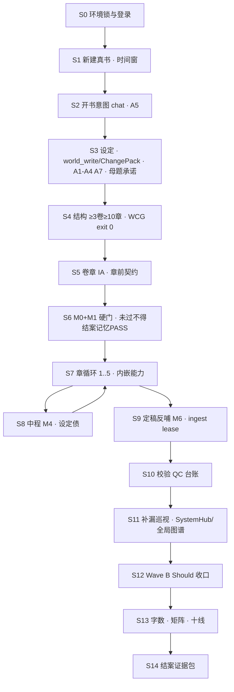
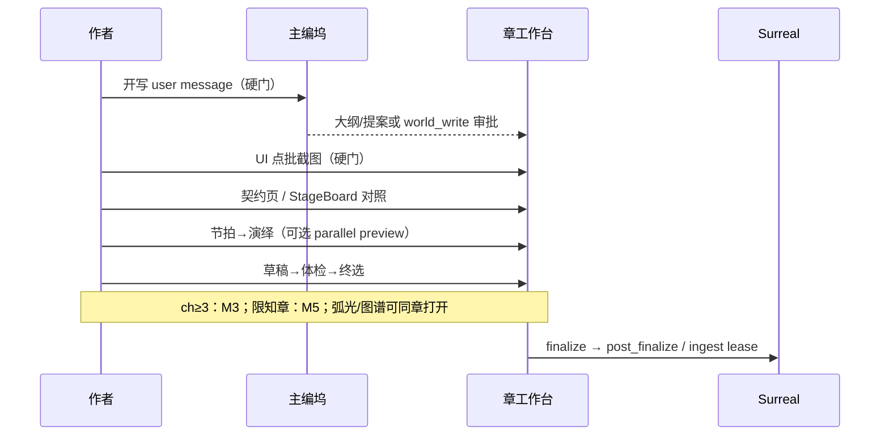

# 铜炉验证方案 · v6.3.4 · 真书 · 对话驱动 + 点批/工作台裁决 · 全能力可验

| 项 | 值 |
|----|-----|
| **文档标题** | 铜炉 Director 旅程验收协议 · 全面更新（全能力 · 真书 · 对话驱动+点批） |
| **版本** | **v6.3.4 rev.2**（见 §命名与前序关系；相对 rev.1 见文末 Revision Summary） |
| **作者** | Grok Design（待人类审定） |
| **日期** | 2026-08-12 |
| **状态** | **Draft rev.2** · 验收/协议设计（非 greenfield 功能） |
| **产品** | 铜炉 / tonglu · 代码 `scribe3/` · 仓库 `/home/admin/projects/scribe-writing-system` |
| **验收环境** | **仅 demo 已部署栈**（公网主入口 **`https://tonglu.qing.blue`**；`www.qing.blue` / `qing.blue` 301 → 主域） |
| **禁止** | Grok 运行机全量 `npm ci` / 本机 Surreal / 第二验收栈 / 脚本灌章冒充体验 PASS |
| **WCG SSOT** | **`scripts/v4_world_complete_gate.py`**（exit 0 前禁止验收向连载） |
| **耐久落库建议路径** | `docs/e2e-director-journey-v634-true-chat-full-capability.md` |
| **摘要** | `/tmp/grok-1000/grok-design-summary-adfa3bbb.md` |

---

## 命名与前序关系

| 版本 | 角色 | 与本版关系 |
|------|------|------------|
| **v6.2** · `docs/e2e-director-journey-5w.md` | 纪律底本：遇障同路、正典全类型闭环、**WCG 以 gate 脚本为准**、约 5 万字 | **纪律与闭环实现真相仍有效**；规模主轴以本版覆盖 |
| **v6.3 / 6.3.1** · `docs/e2e-director-journey-2w-memory.md` | 约 2 万字；记忆主轴 M0–M6；D1–D7 | **记忆子集附录**；**总 PASS 以本版为准**（见 PR-Doc-2 指针） |
| **v6.3.2** · 同上 §2.4 | 真 chat 铁律；`v632_true_chat_journey.py` | **路径纪律继承**；落库方式须对齐 **SPA 三通道**（§SPA 作者通道真相），不得仅脚本 ChangePack 冒充 SPA |
| **v6.3.3** · `docs/plans/2026-08-10-v633-revalidation-quality-delta.md` | 变更复验 F1–F12 | **能力清单吸收**；**禁止**作体验总 PASS |
| **捷径禁令** · `docs/e2e-journey-5w-v5-shortcut-ban.md` | 黑名单 | 全文继承 + 本版追加 |
| **记忆质量 / 人盲** | to-9.5 · human-blind protocol | 诚实边界强制 |
| **校验 / 台账 / 做厚 / SESSION** | 08-10～08-11 plans | 映射矩阵 V/Q/H 等 |

**为何叫 v6.3.4 而非 v6.4：** 仍是 6.3 家族（对话驱动 · 记忆 · 真书），相对 6.3.3 是「补全能力矩阵 + 拉回 SPA 体验主路径」的修订号。仓库与结案字段钉 **v6.3.4**。

```text
6.2 成功 ≈ 对话+点批 → 约 5 万可读好书 + 正典闭环
6.3.x 成功 ≈ 同上路径 → 约 2 万字 + 记忆真有用
6.3.3 做到 ≈ 变更探针 + 常工程/pilot（≠ SPA 体验 PASS）
6.3.4 成功 ≈ 作者打开旅程 + 主编对话驱动 + 点批/工作台裁决
           → 写完一本真书（可见字约 2 万；结构壳满足 WCG）
           → 全能力矩阵在真实写章阶段被触达并留证
           → 可复述「我聊了天、点了批/放行，没用脚本灌章」
```

**v6.3.2 记忆子集地位：** 仍可用于「只关心记忆线」的工程对照或附录探针；**不得**单独宣称铜炉 v6.3.4 **总 PASS**。总 PASS 协议 = 本文。

---

## Overview

2026-08-09～08-11 合入章节 lease、卷章 IA、弧光、校验 hybrid、QC 扩维、knowers×leaks、做厚 H1–H11、System Hub、图谱抽屉、TurnBind 等。v6.3.2 钉真 chat；v6.3.3 做变更复验但缺 `00-author-path`，**不能**当体验总 PASS。

本版 **v6.3.4 rev.2** 目标：

1. **全能力可验**（Must/Should/Could + 分波）；以代码与 **WCG 脚本** 为 SSOT。  
2. **真书**新 slug；真实连载。  
3. **主编对话驱动 + 点批/工作台裁决**（非「禁止点工作台」）；禁止表单直写正典与脚本灌章。  
4. **真实写作流程**，能力嵌在 **写章 S7** 内，非章后演示点一点。  
5. 证据可拆穿；**不宣称** 人盲 ≥9.5。

**工期诚实（rev.2）：** 真人 SPA 全量（Wave A+B）估 **3–5+ 人日**；非 1.5–3 人日。可分波：仅 Wave A → 最高 **PARTIAL**，两波齐才总 PASS。

---

## Background & Motivation

### 痛点

| 痛点 | 事实 |
|------|------|
| 验收碎片化 | 多 plan 无「一书内全触达」 |
| v6.3.3 假绿路径 | `docs/evidence/v633-reval-20260810/` **无** `00-author-path.md` |
| v632 ≠ SPA | 脚本显式 `change-pack(use_llm)`；浏览器主路径更偏 **resolve→world_write 审批** |
| WCG 硬 | `v4_world_complete_gate.py`：**≥3 卷、≥10 章、母题≥3、承诺≥3、丰满角色…** |
| 讨论非 agentic | `ChiefDock.jsx` **`agentic: false` 写死**（防跨书串库） |

### 为何必须更新 6.3

不更新 → 继续用工程复验或错误「1 卷」规格撞 WCG 红；不写 SPA 三通道 → 执行者「只口述等 ChangePack」设定落不进 L1。

---

## Goals & Non-Goals

### Goals

1. **全能力可验**（矩阵 + 分波）。  
2. **真书**新 `book_*`（创建时间 ∈ 证据窗）。  
3. **对话驱动 + 点批/工作台裁决**（§路径内 UI 白名单）；意图/设定/结构/开写/改稿/中程变更/记忆探针进主编线程或可追溯种子。  
4. **真实写作流程**；能力在 S7 写章内触达。  
5. **WCG SSOT = gate 脚本** exit 0 先于连载验收。  
6. 证据可审计；诚实质量边界。

### Non-Goals

- 不宣称人盲 **≥9.5**。  
- 不把 v632/v633/pilot/serial 当体验总 PASS。  
- 不默认打开 DRAMA/EVENT_DRIVE/STAGE_HARD/PARK 硬门 / EMERGENCY。  
- 不在 Grok 机全量 npm / 本机 Surreal。  
- 不穷尽调用 94 个 MCP 工具（验能力面与路径）。  
- **不**要求 SPA 默认开启 `/chat/agentic-stream`（当前禁用）。

---

## SPA 作者通道真相（产品实现 · 强制阅读）

> 代码锚：`scribe3/web/src/ChiefDock.jsx`、`lib/orchestrateSend.js`、`WriteChat.jsx`、`DeduceStage.jsx`；后端 `api/routers/director.py`、`canon_loop.py`、`misc_routes.py`。

### 三通道

| 通道 | 触发 | 实现 | 作者可见 | 正典/正文落库 |
|------|------|------|----------|----------------|
| **discuss** | 主编坞闲聊/讨论意图 | `GET /chat/stream`；**`agentic: false` 写死** | 对话气泡 | **不直接写 L1**；可附 orch proposal / 可选 change_pack 载荷 |
| **world_write** | `/orchestration/resolve` 命中写世界，或种子点名 `s3_add_*` | **`api.runWrite`**（Hermes 全写 + **工具审批卡**） | 审批卡批准/拒绝 | **主设定落地路径之一**：批准后 MCP `s3_*` → Surreal |
| **prose_write** | 章阶段写稿 | **`/chat/write`** + stageProposal 落中区 | 提案卡/用此版 | 正文/草稿进章字段 |

### 合法设定落地（C1 多选一 · 须可追溯 chat/种子）

| 路径 | 说明 | 体验 PASS |
|------|------|-----------|
| **(a) ChangePack** | 讨论原文 → `POST /canon/change-pack`（`use_llm`/`source=discussion`）→ 待确认/收件箱点批 → apply | ✅ 若 SPA 或明确作者触发；v632 脚本对照 ≠ 单独 SPA PASS |
| **(b) world_write 审批** | 对话/「让主编…」种子 → resolve → runWrite → **审批卡点批** `s3_*` | ✅ **SPA 主路径之一** |
| **(c) 定稿候选** | finalize → PostFinalize / pending-claims → 点批 | ✅ 定稿反哺 |
| **禁止** | 无 chat/种子的批量 `proposal/apply` 拼 ops；表单失焦改正典；EMERGENCY REST | ❌ |

### agentic 辨析（勿混淆）

| 概念 | 是否 SPA 默认 | 本版矩阵 |
|------|----------------|----------|
| **`/chat/agentic-stream`** | **禁用**（ChiefDock `agentic:false`） | Ch3 = **Could**（若将来开启） |
| **world_write + Hermes 审批写世界** | **常用主路径** | **设定 Must 的落地方式 (b)**，**不是**「可选 agentic」 |
| 讨论附带 change_pack | API 存在；**前端几乎无一键主按钮** | 工程/部分 orch 路径；不得假设「只聊自动出包」 |

### 浏览器如何触发 world_write（S3 执行要点）

1. 旅程「继续」/ 章前契约 **「让主编写…」**（`focusChiefWithSeed`，文案常含 `s3_add_*` 提示）。  
2. 作者在主编坞发送意图明确的设定指令（角色/母题/卷章结构）。  
3. 观察是否出现 **审批卡** → **批准**；Codex/目录回读确认。  
4. 打开 **设定收件箱 / 待确认设定**（CanonInbox / PendingClaims）处理候选。  
5. 若仅 discuss 无审批、设定未落库 → **继续发 world_write 向指令或种子**，禁止 curl 代 `s3_add_*` 冒充作者。

---

## 路径内 UI 控件白名单（Issue 15）

| 允许（路径内） | 禁止（体验 FAIL） |
|----------------|-------------------|
| 作品库 **新建** | 旧书改名 / 复用脏 slug |
| **旅程看板** 站位/WCG/字数/债 | serial pilot 无 chat 灌章 |
| **主编坞** 发送（discuss / 触发 world_write） | 表单失焦批量改正典 |
| **审批卡** 批准/拒绝/过期 | EMERGENCY 世界写 |
| **大纲放行 / 用此版 / 终选 / advisory 接受** | safe_beats / prose_pure / 离线 prose 灌库 |
| **待确认设定 / 收件箱 / pending-claims 点批** | 无 chat 脚本拼 ops |
| **章工作台** 阶段切换、契约页、节拍/演绎 UI 点批 | 后台 seed 假记忆 |
| **Issue「让主编处理」** 种子后再聊 | curl **代聊** |
| **只读** Codex/目录/正文/Inspector/图谱 | 只 curl 绿当 UI Must PASS |
| System Hub **≤5 分钟只读**（不改危险设置） | 为凑绿关 fabric / 开 emergency |

**表述修正：** 「唯一合法作者路径」= **对话驱动生产意图 + 白名单 UI 裁决**，**不是**「禁止点击工作台」。

---

## 强制路径（不可协商）

### 会话铁律

1. `GET /api/chat/threads?work=<slug>` 有线程；建议作者可见轮次 **≥60** 或覆盖阶段清单（开书/设定/结构/每章开写/探针/中程/改稿）。**数量不是充分条件**——禁止闲聊垫数。  
2. **硬门（主编线）：每章定稿章（1–5）≥1 条「开写」user message**，thread 导出可对 **seq / 时间戳**；缺任一章 → **主编线 FAIL**。  
3. 正典落库须可追溯到 **chat 原文或 UI 种子**（world_write 审批或 ChangePack `source=discussion` 等）；禁止无追溯 ops。  
4. `00-author-path.md` 诚实；脚本主写 → 主编线 FAIL。  
5. `GET https://tonglu.qing.blue/api/capabilities`：`memory_fabric_v1=true`，`emergency_rest_write=false`。  
6. chat/种子时间 **早于** 对应 apply / finalize。  
7. **每章 ≥1 次 UI 点批截图**（大纲放行 **或** 终选 **或** 候选批准之一）；纯 pilot step+approve 无截图 → 最高 **PARTIAL**，不得体验总 PASS。  
8. **slug 必须本次新建**：`works.created_at`（或等价）∈ 证据时间窗；禁止旧书改名。旧验收 slug 黑名单示例：`book_7b918ca0`、`book_013bcb3b`、`book_aa57f17e`、`book_052a2adb`——**充分条件是时间窗，名单非穷尽**。

### `00-author-path.md` 模板

```markdown
# 00-author-path · v6.3.4
- slug / 书名 / 新建时间（须 ∈ 证据窗）
- 作者是否真人坐浏览器：是 / 否（否 → 最高 engineering PARTIAL）
- 通道使用：discuss / world_write 审批 / prose_write / ChangePack（勾选实际用过的）
- 是否仅对话+白名单 UI：是 / 否（列例外）
- v632/v633/pilot：用途（禁止/对照）
- 每章开写 chat：seq → message_id 或时间戳（1..5 全填）
- 每章 UI 点批截图路径：ch01..ch05
- EMERGENCY / safe_beats / 离线灌库：0 次
```

---

## 真书规格（WCG SSOT）

### 原则

| 项 | 规格 |
|----|------|
| **结构/设定完成门** | **`python3 scripts/v4_world_complete_gate.py --slug <book>` → exit 0** 为唯一 WCG SSOT |
| **可见定稿字数** | **[18000, 24000]** 去空白（~2 万）；**不**回到 5 万门禁 |
| **intent.total_word_goal** | **40000–60000** 整数（脚本硬检；推荐 **45000**） |
| **本轮定稿章** | **第 1–5 章** finalize；第 6–10 为结构壳（有 synopsis，可不写正文） |
| **卷** | **≥3 卷**（gate：`volumes.ge3`）——**不是 1 卷** |
| **章壳** | **≥10 章** + 每章 synopsis 去空白 **≥40**；≥8 章 synopsis 提及角色名 |
| **书名模板** | `炉灰记·v6.3.4·真chat全能力·YYYYMMDD-HHMM` 或新名；**新 slug** |
| **故事宇宙** | **KD-15：默认沿炉灰记锚**（A1–A7 对照）；允许新宇宙但须重写锚文件 |

**禁止：** 协议私自写「1 卷即可 WCG 绿」而不改 gate / 不部署 `--profile`。若未来降 WCG，须 **先改脚本并 demo 部署**，再改协议。

### WCG 可勾选表（与 `v4_world_complete_gate.py` 对齐）

| check 名 | 条件 | 作者侧怎么做（对话+审批） |
|----------|------|---------------------------|
| `intent.reader_feeling` | 去空白 ≥10 | chat 口述读者感受 |
| `intent.emotional_arc` | ≥4 | 情绪弧 |
| `intent.red_lines` | ≥3 行或长度≥20 | 红线 |
| `intent.total_word_goal` | int ∈ [40k,60k] | 规划字数 |
| `characters.count>=4` | ≥4 角色 | 设定 |
| `characters.codex_full(...)` | **≥4** 角色含 appearance/personality_detail/surface_goal/deep_need/fear/backstory | 丰满字段，勿只给名字 |
| `characters.has_protagonist` | importance=protagonist | 标明主角 |
| `relations.ge3_or_graph_edges` | ≥3 | 合法关系边 |
| `world_rules_or_propositions.ge3` | ≥3 | 规则/命题 |
| `facts.ge5_or_graph` | facts≥5 或图命题节点≥5 | 事实/命题 |
| `faction_item_term.two_categories` | faction/item/term 至少两类有实体 | 势力/物件/术语 |
| `promises.ge3` | **伏笔/承诺 ≥3** | `s3_plant_promise` 等 |
| `motifs.ge3` | **具名母题 ≥3** | `s3_add_motif` 等 |
| `volumes.ge3` | **≥3 卷** | 结构 chat / world_write |
| `chapters.ge10` | **≥10 章** | 结构壳 |
| `synopsis.ge40chars.ge10` | 1–10 章各 synopsis ≥40 字 | 梗概 |
| `synopsis.mentions_character.ge8` | ≥8 章梗概含角色名 | 写梗概时带名 |

**审计命令（只读证据，不代写）：**

```bash
export API_BASE=https://tonglu.qing.blue
python3 scripts/v4_world_complete_gate.py --slug book_xxx --out .../00-world-complete-gate.json
# 必须 pass=true / exit 0
```

### 脚手架其它纪律（继承 6.3.1）

- 关系词表合法（禁「债主/债权人」等）。  
- 物件：`artifact` vs **`state`**；A6 只 supersede `state`。  
- 禁止为 WCG 灌非法边/短梗概/双真。

---

## 真实写作流程阶段图（rev.2 重排）

### 总览：能力嵌写章，S11 仅补漏



### S7 单章（每章强制嵌能力）



| 阶段 | 作者动作 | 系统期望 |
|------|----------|----------|
| S0 | 登录 tonglu | health/capabilities |
| S1 | 新建 | 新 slug + 时间窗 |
| S2 | 意图+A5 | 线程+intent 批 |
| S3 | 设定全类型+母题+承诺+丰满角色 | world_write 审批和/或 ChangePack；收件箱点批 |
| S4 | 「三卷十章壳，本轮写 1–5…」 | **WCG 脚本 exit 0** |
| S5 | 契约页 | 齐套 soft |
| S6 | M0+M1 | **硬门：未过 M1 不得宣称过程记忆并进入结案记忆 PASS** |
| S7 | 每章开写+点批+内嵌 IA/Stage/可选 parallel/弧光/Inspector | 全链；禁 safe_beats |
| S8 | A6 变更 | supersede 单真 |
| S9 | 批候选 | M6；ingest status |
| S10 | Issue/post-check | coverage 诚实；QC 扩维 |
| S11 | Hub≤5min；全局图谱补漏 | 不改危险设置 |
| S12–S14 | Wave B + 结案 | 矩阵 schema |

---

## 完成定义与分波

### 总 PASS 公式

```text
总 PASS ⇔ Wave A ∧ Wave B
Wave A ⇔ 旅程 ∧ 主编(每章开写+UI点批) ∧ 设定(WCG exit0) ∧ 正典闭环
        ∧ 真路径 ∧ 工艺 ∧ 质量底线 ∧ 规模 ∧ 缺陷
        ∧ 记忆(M1∧M3∧M5 且 ≥5/7) ∧ 矩阵 Must 全绿（含 Must-if 规则）
Wave B ⇔ Should 计分 ≥80%（见下）∧ 证据 schema 合法
仅 Wave A → 最高 PARTIAL（可写「Must 旅程完成」），不得总 PASS
```

### Should 计分（KD-13）

\[
\text{ShouldRate} = \frac{\#\{\text{Should: PASS}\}}{\#\{\text{Should: PASS}\} + \#\{\text{Should: FAIL}\}}
\]

- **SKIP 不入分母**。  
- 总 PASS 要求 ShouldRate **≥ 0.80**。  
- **允许 SKIP 的环境条件**（须写 `skip_reason`）：

| 条件 | 可 SKIP 的示例 ID |
|------|-------------------|
| Hermes 演绎网关不可用/超时且记入 runtime-baseline | H1, H2, H3 |
| 端点 404 未部署 | H6, H9, 部分 debug |
| 非 admin 且项需 admin | SH4 |
| 本旅程未触发该故障 | Ch4（已是 Could）、Drm2 用 vacuous |
| 功能旗默认关且协议不要求打开 | H5, 硬门类 |

- Hermes/网关类 **失败 → FAIL 计入分母**（吃 20% 额度）；**仅当 baseline 声明网关不可用** 才可 SKIP（不得既声称网关正常又 SKIP）。

### 工期

| 模式 | 估计 |
|------|------|
| Wave A only（PARTIAL） | ~2–3 人日 |
| Wave A+B 总 PASS | **3–5+ 人日**（含 LLM 不稳重试） |
| 工程对照 v632 | 不计体验 PASS |

### 条件优先级语义

| 标记 | 含义 |
|------|------|
| **Must** | 总 PASS 硬门 |
| **Must-if-triggered** | 触发则硬门；**未触发 → PASS-vacuous（N/A）不挡**，须在 matrix 记 `status=N/A` + 说明 |
| **Should** | 入 ShouldRate |
| **Could** | 不入总 PASS 公式；有则记 |

---

## 全能力验证矩阵

> **证据类型：** `UI` = 必须截图/屏幕录制；`API` = 只读审计可；`UI+API` = 两者。标 **UI** 的 Must **无截图不得 PASS**。

### A. 旅程 / 建书 / 意图

| ID | 能力 | 优先级 | 阶段 | 证据 | 作者动作 | 期望 | PASS | 假绿禁令 |
|----|------|--------|------|------|----------|------|------|----------|
| J1 | 登录健康 | Must | S0 | API | 浏览器登录 | 进作品库 | `https://tonglu.qing.blue/api/health` 200 | 假 health |
| J2 | 新建真书 | Must | S1 | UI+API | 点新建 | 新 slug∈时间窗 | `01-book.md` | 旧书改名 |
| J3 | 旅程看板 | Must | S1–S13 | UI | 打开旅程 | 站位可见 | 截图 | 只 curl |
| J4 | 开书意图 | Must | S2 | UI | chat 主题/红线/2 万可见字 | 线程有意图 | 非空 chat | 无 chat set_intent 脚本 |
| J5 | 字数目标 | Must | S2–S4 | API | 规划 45k | goal∈[40k,60k] | WCG intent 项 | 混淆可见字与 goal |

### B. 正典闭环

| ID | 能力 | 优先级 | 阶段 | 证据 | 期望 | PASS | 假绿禁令 |
|----|------|--------|------|------|------|------|----------|
| C1 | 设定合法落地 | Must | S3 | UI+API | **(a) ChangePack discussion 点批 或 (b) world_write 审批落库**，可追溯 chat/种子 | Codex 有实体 | 无追溯 ops；假设只聊自动出包 |
| C2 | 待确认/收件箱点批 | Must | S3/S9 | UI | 人批 L1 | 截图点批 | 静默 L1 |
| C3 | 全类型≥4 类 | Must | S3–S9 | UI+API | 人物/规则/物件/关系/母题/承诺等 | ≥4 类 | 仅人物 |
| C4 | 中程改设定 | Must | S8 | UI+API | 聊天+批后再生效 | 与 M4 | 说说就算 |
| C5 | PostFinalize | Must | S9 | API+UI | ≥2 章候选路径 | body json | 仅 unit |
| C6 | 设定债 | Should | S4/S8 | API | debt 诚实 | 非 5xx | 假无债 |
| C7 | 收件箱 UI | Should | S3/S9 | UI | 可点批 | 截图 | API 批当 UI PASS |
| C8 | supersede 单真 | Must | S8 | API | 无双真注入 | prefetch | 双真 |

### C. 记忆（继承 6.3 · 硬门语言恢复）

#### 锚 A1–A7 → `01-memory-anchors.md`

| 锚 | 类型 | 炉灰记对照 | 站 |
|----|------|------------|-----|
| A1 | 专名 | 覃灰七 | 设定 |
| A2 | 物件 | 三棱铜匙+炉心印 | 设定 |
| A3 | 规则 | 铜炉未冷不得念亡者真名 | 设定 |
| A4 | 关系 | 一炉香债（合法边） | 设定 |
| A5 | 过程偏好 | 铜腥/炉灰；禁系统流 | intent |
| A6 | 中程 | 完整→缺口 | ch2 后 |
| A7 | 限知 | 仅冷锅婆知侧门 | 设定+POV |

| ID | 探针 | 优先级 | 阶段 | 证据 | PASS 要点 | 假绿禁令 |
|----|------|--------|------|------|-----------|----------|
| M0 | fabric | Must | S0/S6 | API | fabric true | 关 fabric |
| M1 | 跨话轮 | Must | **S6 硬门** | UI | 隔≥3 轮命中 A5 | 后台 seed |
| M2 | 正典 Codex | Must | S3 | UI+API | A1–A4 可见 | 只库有 |
| M3 | 跨章正文 | Must | **S7 ch≥3** | UI | 正文自然回指 | 作者复述锚 |
| M4 | 变更单真 | Must | S8 | API+UI | 新值+无双真 | 双真 |
| M5 | 限知 | Must | **S7 限知章** | UI | 定稿不泄 | 换 POV 逃避 |
| M6 | 定稿复用 | Must | S9→下章 | UI+API | 存+批+用 | 只存不批 |

**记忆线：** PASS ⇔ M1∧M3∧M5 且 M0–M6 中 ≥5 PASS。  
**硬门：** **未完成 M1 → 不得宣称过程记忆可用，且结案记忆线不得 PASS**（可继续写章记缺陷，但总 PASS 失败）。  
**未完成 M3 → 不得宣称跨章记忆可用。**

#### D1–D7 → `12-quality-d1-7.md`（地板；≥9 须人盲）

同 6.3.1 七维；结案 **记忆四问** 强制。

### D. 卷章 IA

| ID | 优先级 | 阶段 | 证据 | 要点 |
|----|--------|------|------|------|
| I1 章前契约 | Must | **S5/S7 每章** | UI | 齐套 soft 截图 |
| I2 让主编种子 | Must | S5/S7 | UI | 种子后须有后续 chat/审批 |
| I3 volume_intro | Should | S4 | UI | 有或空说明诚实 |
| I4 focus | Should | S7 | API | 可观测 |
| I5 final soft banner | Should | S7 | UI | soft 不硬拦 |
| I6 结构 | Must | S4 | UI | 话术：**「三卷十章壳，本轮定稿 1–5」**；WCG 脚本绿 |

### E. 戏剧 / 节拍 / 压力

| ID | 优先级 | 阶段 | 证据 | 要点 |
|----|--------|------|------|------|
| Drm1 节拍 | Must | S7 | UI | ≥3 非空 soft；有节拍再演绎 |
| Drm2 接地失败纪律 | **Must-if-triggered** | S7 | UI+日志 | **未触发 → N/A + 声明**；触发 → STOP 同路径、**禁 safe_beats** |
| Drm3 演绎分列 | Must | S7 | API | scene_truth≠prose 合并 |
| Drm4 压力 | Should | S7/S10 | API | findings 路径 |
| Drm5 戏剧真空 | Could | S7 | API | 触发即验 |

### F. 做厚（嵌 S7 + 补漏）

| ID | 优先级 | 阶段 | 证据 | 要点 |
|----|--------|------|------|------|
| H1 parallel plan | Should | **S7 至少 1 章** | UI | plan 200 |
| H2 parallel preview | Should | **S7** | UI+API | stub∉ok_count；网关挂→SKIP+baseline |
| H3 full deduce | Could | S7 | UI | 显式 mode=deduce |
| H4 StageBoard | Should | **S5/S7** | UI | 双真源不静默盖 |
| H5 EVENT_LED | Could | S10 | API | soft only |
| H6 budget-probe | Could | S11 | API | 未部署 SKIP |
| H7 Cron 诚实 | Could | S11 | UI | timer≠开关 |
| H8 Benchmark | Could | S11 | UI | 可达 |
| H9 /debug/locks | Could | S11 | API | 未部署 SKIP |
| H10 Inspector 八块 | Should | **S6/S7** | UI | 非假 0 |
| H11 soft 非 403 | Must | S7/S11 | API | stage GET 200；parallel 非世界写 403；**禁开 EMERGENCY 绕** |

### G. QC / 台账

| ID | 优先级 | 阶段 | 证据 | 要点 |
|----|--------|------|------|------|
| Q1 coverage | Must | S10 | UI | 诚实空态截图 |
| Q2 PRODUCT_QC | Must | S10 | API | total==sum 扩维键 |
| Q3 post-check | Must | S7/S10 | UI+API | degraded 诚实 |
| Q4 review det | Should | S10 | API | skipped 含 llm |
| Q5 degen 可见 | Should | S10 | UI | 进 issues |
| Q6 skipped chips | Should | S10 | UI | 未合入则 SKIP |
| Q7 让主编处理 | Must | S10 | UI | seed 截图 |
| Q8 faction 全书 | Could | S10 | UI | 非第 0 章 |

SSOT：`scribe3/qc_product_keys.py`。

### H. 限知 / knowers

| ID | 优先级 | 阶段 | 证据 | 要点 |
|----|--------|------|------|------|
| K1 A7 叙事 | Must | S7 | UI | =M5 |
| K2 knowers API | Should | S9 | API | 可构造 |
| K3 leaks×knowers | Should | S10 | API | degraded 非丢 |
| K4 真相史 | Should | S8 | UI | 演变可读 |
| K5 命题树 | Should | S5 | UI | 滤噪 |
| K6 fact source | Should | S9 | API | 有 source |

### I. 管线 / ingest

| ID | 优先级 | 阶段 | 证据 | 要点 |
|----|--------|------|------|------|
| P1 finalize 门 | Must | S7 | UI+API | 非无检灌 |
| P2 ingest 调度 | Must | S9 | API | status 可理解 |
| P3 lease | Should | S9 | API | capabilities 字段 |
| P4 advisory hold | Could | S7 | API | 触发即验 |
| P5 craft gate | Should | S7 | 日志 | blocking 不落 |
| P6 accept 未校验 | Could | — | 声明 | 未滥用 |

### J. 主编 / Hermes

| ID | 优先级 | 阶段 | 证据 | 要点 |
|----|--------|------|------|------|
| Ch1 讨论流 | Must | 全程 | UI | stream 落线程；覆盖阶段 |
| Ch2 写作流 | Must | S7 | UI | prose_write 有正文 |
| Ch3 agentic-stream | Could | — | API | SPA 默认禁用；开启才验 |
| Ch4 审批过期 | Could | 触发 | API | expired≠declined（**触发即验**，不故意超时也可 N/A） |
| Ch5 能力说明 | Should | S11 | UI | Hub 模块可读 |

**注意：** world_write 审批 **不是** Ch3；设定走 C1(b)。

### K. System Hub

| ID | 优先级 | 阶段 | 证据 | 要点 |
|----|--------|------|------|------|
| SH1 总览 | Must | S11 | UI | **≤5 分钟只读巡视**；截图总览；**禁止改 connection/gateway/emergency** |
| SH2 MCP catalog | Should | S11 | UI+API | ~94 tools |
| SH3 data health | Should | S11 | API | ok |
| SH4 RBAC | Could | S11 | API | 非 admin 403 |
| SH5 craft-skills | Could | S11 | API | 200 |

### L. 图谱 / 弧光（写章内优先）

| ID | 优先级 | 阶段 | 证据 | 要点 |
|----|--------|------|------|------|
| G1 节点抽屉 | Should | **S7 或 S11** | UI | 可打开 |
| G2 图谱种子 | Should | S7 | UI | 后续聊 |
| G3 弧光锚 | Should | S3/S7 | UI | lie 或冷启动诚实 |
| G4 arc beat | Could | S7 | UI | 待批增删 |
| G5 pulse/brief | Should | S7 | API | 非「未见跳变=健康」 |

### M. 上下文

| ID | 优先级 | 阶段 | 证据 | 要点 |
|----|--------|------|------|------|
| X1 Inspector | Must | S6/S7 | UI | 八块截图 |
| X2 TurnBind | Should | S3 | API | 有 bind |
| X3 prefetch | Should | M1/M4 | API | 辅助 |
| X4 pending-claims | Should | S3/S9 | UI | 可达 |

### N. 校验 hybrid（吸收 v633 F）

| ID | 旧 F | 优先级 | 阶段 | 要点 |
|----|------|--------|------|------|
| V1 | F1–2 | Must | S10 | coverage 诚实 |
| V2 | F3–4 | Should | S10 | deterministic |
| V3 | F5 | Should | S10 | degen 语义 |
| V4 | F6 | Should | S7/S10 | timeline label |
| V5 | F10 | Should | S10 | causal 三态 |
| V6 | F11 | Must | S0 | health |
| V7 | F12 | Should | S9 | lease 不 500 |

### O. 好书与规模

| ID | 优先级 | 要点 |
|----|--------|------|
| QL1 好书底线 | Must | 人读 checklist |
| QL2 字数带 | Must | [18k,24k] |
| QL3 无 pad | Must | 人判 |
| QL4 人盲 | Could | 不挡总 PASS |

---

## 中程变更与设定债

1. A6：讨论 → 合法落地 (a|b) → **人批** → supersede **state** → 下章。  
2. 禁双真 condition。  
3. 债：debt API/旅程可观察。  
4. 绑定 M4/D4。

---

## 证据包结构

```text
docs/evidence/v634-true-chat-<YYYYMMDD>-<slug>/
  或 artifacts/e2e-journey-v634-true-chat-<YYYYMMDD>-<slug>/
```

### 必填

| 文件 | 谁写 | 说明 |
|------|------|------|
| `00-runtime-baseline.md` | 执行者 | **完整 URL 样例见下** |
| `00-env-lockdown.md` | 执行者 | fabric/emergency/网关可用性 |
| `00-author-path.md` | 作者 | 硬门 |
| `00-stop-log.md` | 遇障 | STOP |
| `00-world-complete-gate.json` | **gate 脚本输出** | pass=true |
| `01-book.md` | 执行者 | slug+**created 时间** |
| `01-memory-anchors.md` | 作者 | A1–A7 |
| `01-intent.md` | 摘录 | |
| **`02-feature-matrix.json`** | 执行者 | **见 schema** |
| `03-structure.md` | 摘录 | 3 卷 10 章 |
| `04-serialize/ch01…ch05.md` | 导出 | |
| `05-ledger.md` | 结案 | 十线+分波 |
| `06-defect-ledger.md` | 全程 | |
| `08-wordcount-rollup.md` | 结案 | |
| `09-final-closure.md` | 结案 | 四问+总裁决 |
| `11-canon-loop-chat.json` | 审计 | |
| `11-canon-loop-body-ch*.json` | 审计 | |
| `12-memory-*` / scorecard / d1-7 | 探针 | |
| `13-capability-audit/` | 摘录 | issues/post-check/hub… |
| `screenshots/` | 作者 | **最低集见下** |
| `99-summary.md` | 结案 | |

### `00-runtime-baseline.md` 强制样例字段

```markdown
# runtime baseline
- entry: https://tonglu.qing.blue
- GET https://tonglu.qing.blue/api/health → { ... 贴关键字段 ok/status ... }
- GET https://tonglu.qing.blue/api/ready → ...
- GET https://tonglu.qing.blue/api/capabilities → flags.memory_fabric_v1,
  flags.emergency_rest_write, flags.ingest_lease, flags.context_inspector_v1, ...
- Hermes deduce preview/full 可达性：ok / degraded / unavailable（影响 H* SKIP）
- 证据窗起止 UTC
- deploy 备注（hot 时间可选）
```

### 截图最低集（与 Must 绑定）

| 截图 | 绑定 |
|------|------|
| 旅程站位 | J3 |
| 新建书/书名 | J2 |
| 每章开写气泡（1–5） | 主编硬门 |
| 每章 UI 点批（1–5） | 主编硬门 |
| 收件箱或审批卡点批 | C1/C2 |
| 章前契约至少 1 章 | I1 |
| Issue coverage | Q1 |
| Context Inspector | X1 |
| SystemHub 总览 | SH1 |
| M1 追问回复 | M1 |

### `02-feature-matrix.json` schema（PR-Doc-3 / PR-Script-0）

```json
{
  "version": "v6.3.4",
  "slug": "book_xxx",
  "wave": "A|B|all",
  "items": [
    {
      "id": "M1",
      "priority": "Must",
      "status": "PASS|FAIL|SKIP|N/A",
      "evidence_type": "UI|API|UI+API",
      "evidence_path": ["screenshots/m1.png", "12-memory-m1.md"],
      "skip_reason": "",
      "notes": ""
    }
  ],
  "should_rate": 0.0,
  "must_failed": [],
  "author_human": true
}
```

**checklist 脚本最低校验（内容级，非仅存在）：**

- 每个 Must：`status` ∈ {PASS, N/A}（N/A 仅 Must-if 且未触发）；无 FAIL；`evidence_path` 非空。  
- `author_human === true` 与 `00-author-path` 含「真人=是」。  
- `08-wordcount` 合计 ∈ [18000,24000]。  
- WCG json `pass===true`。  
- 空文件 / 空 status → 脚本非 0。

---

## 与工程脚本边界

| 工具 | 允许 | 体验 PASS | 推荐 |
|------|------|-----------|------|
| 浏览器对话+白名单 UI | 写书 | **唯一总 PASS** | 主路径 |
| 只读 curl / WCG 脚本 | 证据 | 否 | 鼓励 |
| v632 | 对照 | **否** | engineering PARTIAL |
| v633 / v63_memory | 回归 | **否** | 禁止总 PASS |
| pilot 在开写 chat 后 | 辅助 | **无每章 UI 点批截图 → PARTIAL** | 慎用 |
| serial / 灌库 / EMERGENCY | — | 否 | 禁止 |

---

## 人评 / 人盲

| 层 | 强制 | 关系 |
|----|------|------|
| 路径诚实+UI 截图 | 总 PASS | author-path |
| 好书底线 | 总 PASS | closure |
| 记忆四问 | 记忆 PASS | |
| 人盲 ≥9.5 | 仅质量冲刺 | 不挡本版总 PASS |

---

## 失败与回滚纪律

同 6.2：STOP → 真路径修 → 同路径回归。Must 红阻塞总 PASS。禁止改旧证据造绿。

---

## Alternatives Considered

### Alt-1 全 API 自动化（v633 极端）

可重复但假绿；**否决为总 PASS**。

### Alt-2 全人手无清单

不可审计；**否决**。

### Alt-3 Hybrid 一次跑满（本版主方案）

真人 SPA + 矩阵 + 只读证据；工期 **3–5+ 人日**；分波见 Alt-5。

### Alt-4 五万字再叠全能力

成本高边际低；**不作为门禁**。

### Alt-5 分波：Wave A Must 旅程 + Wave B Should 附录（**采纳为执行策略**）

| | 说明 |
|--|------|
| **做法** | Wave A 先出 PARTIAL（Must+记忆+WCG+5 章）；Wave B 补 Should≥80% 与 Hub/parallel 等 |
| **利** | 可执行；避免一天内假绿跳项 |
| **弊** | 总 PASS 变慢 |
| **与「一次总 PASS 才算数」** | **产品结案仍要求 A∧B**；分波是 **执行节奏**，不是两个独立「总 PASS」。禁止只交付 Wave A 对外宣传总 PASS |
| **否决「永久只做 Wave A」** | 会退化回能力不触达 |

---

## Security & Privacy

密钥不进证据包；Hub 只读；emergency 关；限知审计脱敏；一书一库。

---

## Observability

threads、capabilities、ingest/lease、coverage、tool_trace_status、Inspector、字数。

---

## Rollout Plan

1. 审定 → `docs/e2e-director-journey-v634-true-chat-full-capability.md`  
2. PR-Doc-2 指针（模板见下）+ **SESSION「主验收协议」= v6.3.4** + docs/README 挂链  
3. 证据模板 + matrix schema  
4. 可选 checklist 脚本（内容校验）  
5. demo 开跑 Wave A → B → 结案  
6. 缺陷回流产品 PR  

### PR-Doc-2 文首标准指针（5 行模板）

```markdown
> **总 PASS 协议（现行）**：[v6.3.4 真书·对话驱动·全能力](./e2e-director-journey-v634-true-chat-full-capability.md)  
> 本文档降为：**记忆子集 / 纪律附录**，单独跑完 **不得** 宣称铜炉 v6.3.4 总 PASS。  
> WCG SSOT：`scripts/v4_world_complete_gate.py`  
> 体验路径：SPA 对话 + 点批/工作台；禁止脚本灌章冒充。  
> 工程对照：`scripts/v632_true_chat_journey.py` ≠ SPA PASS。
```

适用于：`e2e-director-journey-2w-memory.md`、`e2e-director-journey-5w.md`（规模附录说明）、`plans/2026-08-10-v633-revalidation-quality-delta.md`。

---

## Risks

| 风险 | 严重度 | 缓解 |
|------|--------|------|
| 按旧「1 卷」做 S4 | 高 | WCG 脚本 SSOT 表 |
| 只 discuss 不 world_write | 高 | §SPA 通道 + C1(a\|b) |
| 工期低估跳 Should | 高 | 3–5+ 日；分波；Should 计分 |
| 一句开写+全 auto pilot | 高 | 每章 UI 点批截图 |
| 人盲/9.5 误宣传 | 高 | Non-Goals |
| 矩阵空文件 | 中 | schema 内容校验 |

---

## Open Questions

| ID | 问题 | rev.2 状态 |
|----|------|------------|
| OQ1 宇宙 | 沿锚 vs 新 | **闭合 → KD-15 默认沿锚** |
| OQ2 字数 | 18–24k？ | **闭合：是** |
| OQ3 点批 UI | 路径内？ | **闭合：是 + 白名单** |
| OQ4 agentic | | **闭合：agentic-stream=Could；world_write=设定主路径** |
| OQ5 无真人 | | **闭合：不得总 PASS** |
| OQ6 SH1 Must | | **闭合：Must 但 ≤5min 只读** |
| OQ7 并行故障 | | **闭合 → KD-13** |
| OQ8 对外 v6.4 名 | 可选宣传 | 仓库仍 v6.3.4 |

---

## Key Decisions

| ID | 决策 | 理由 |
|----|------|------|
| KD-1 | 版本 v6.3.4 | 6.3 家族修订 |
| KD-2 | 体验总 PASS = 真书 + 对话驱动 + 白名单 UI 裁决 | 北极星；非禁止工作台 |
| KD-3 | 可见字 ~2 万 / 定稿 5 章；结构壳满足 WCG | 能力可负担 |
| KD-4 | Must/Should/Could + 分波 A/B | 可执行 |
| KD-5 | 只读 API 仅证据 | 防代聊 |
| KD-6 | 不宣称人盲 9.5 | to-9.5 |
| KD-7 | v632 非主执行器 | SPA |
| KD-8 | demo only | 资源规则 |
| KD-9 | 点批/审批卡/工作台 ∈ 路径；表单改正典 ∉ | 对话驱动 |
| KD-10 | 遇障同路 | 6.2 |
| KD-11 | MCP 不穷尽调用 | 作者不可见 |
| KD-12 | 无 author-path/截图硬门 → 不得总 PASS | 可拆穿 |
| **KD-13** | ShouldRate=PASS/(PASS+FAIL)，SKIP 不入分母；网关类按 baseline SKIP 或 FAIL | Issue 3/7/OQ7 |
| **KD-14** | **WCG SSOT = `scripts/v4_world_complete_gate.py`**；协议不私自降级 | Issue 1 |
| **KD-15** | 默认炉灰记锚；新宇宙须重写 A1–A7 | OQ1 |
| **KD-16** | 每章开写 user message + 每章 UI 点批截图为主编硬门 | Issue 6/7 |
| **KD-17** | 条件 Must → Must-if-triggered / N/A | Issue 5 |
| **KD-18** | S7 内嵌 IA/Stage/parallel/弧光；S11 补漏 | Issue 4 |
| **KD-19** | 合法设定落地 = ChangePack **或** world_write 审批（可追溯） | Issue 2 |

---

## PR Plan

| PR | 内容 |
|----|------|
| **PR-Doc-1** | 本文 → `docs/e2e-director-journey-v634-true-chat-full-capability.md` |
| **PR-Doc-2** | 旧文文首 5 行指针；**SESSION 主验收协议=v6.3.4**；docs/README 挂链；6.3.2=记忆附录 |
| **PR-Doc-3** | `docs/evidence/v634-true-chat-TEMPLATE/`：matrix 预填全部 ID、author-path、runtime-baseline |
| **PR-Script-0** | `scripts/v634_evidence_checklist.py`：schema/Must/字数/WCG/真人字段；**不写书** |
| **PR-Prod-*** | 旅程暴露 Must 缺口再开 |

---

## 捷径黑名单（继承 + 追加）

继承 v5 ban 与 6.3 §11，并追加：

- [ ] v633 证据或旧 slug 冒充 v6.3.4 总 PASS  
- [ ] 矩阵绿无正文/无线程/无每章开写 id  
- [ ] Must(UI) 只 curl 无截图  
- [ ] 一句开写 + 全 auto pilot 无点批截图  
- [ ] 关 fabric / coverage 刷绿  
- [ ] stub 计入 ok_count  
- [ ] 开 EMERGENCY 再关毁迹  
- [ ] 旧书改名进时间窗作假  
- [ ] 只 Wave A 宣传总 PASS  
- [ ] 协议写 1 卷绕过 WCG 脚本  

---

## 执行清单（监考）

```text
Wave A
□ S0  health + capabilities 贴 baseline（完整 URL）
□ S1  新书时间窗
□ S2  意图 + A5
□ S3  设定：world_write 审批和/或 ChangePack；母题≥3；承诺≥3；≥4 丰满角色；收件箱点批
□ S4  三卷十章壳 + WCG 脚本 exit 0
□ S5  契约页截图
□ S6  M0+M1 硬门
□ S7  五章：每章开写 chat id + UI 点批截图
      内嵌：契约/StageBoard/可选 parallel/Inspector/弧光或图谱
      ch≥3 M3；限知章 M5；禁 safe_beats
□ S8  M4 单真
□ S9  PostFinalize≥2 + M6 + ingest
□ S10 Q1–Q3 Q7 V1
□ 记忆 scorecard + 四问草稿
□ 字数带检查

Wave B
□ Should 补齐（H* G* 等）至 rate≥80%
□ S11 SH1 ≤5min + 补漏
□ 02-feature-matrix.json schema 合法
□ checklist 脚本绿
□ 09 结案总 PASS 公式
```

---

## References

- `scripts/v4_world_complete_gate.py` — **WCG SSOT**  
- `docs/e2e-director-journey-5w.md` · `docs/e2e-director-journey-2w-memory.md`  
- `docs/plans/2026-08-10-v633-revalidation-quality-delta.md`  
- `docs/e2e-journey-5w-v5-shortcut-ban.md`  
- `docs/plans/2026-08-09-memory-quality-to-9.5-system-design.md`  
- `docs/plans/human-blind-memory-quality-protocol.md`  
- `docs/plans/2026-08-10-verification-capability-audit-and-llm-first-optimization.md`  
- `docs/plans/2026-08-11-tonglu-complete-wiring.md` · `docs/plans/2026-08-11-thicken-residual-optimal.md`  
- `docs/CURRENT_ARCHITECTURE.md` · `docs/SESSION.md`  
- `docs/guides/2026-08-11-writing-context-injection-and-data-generation-full-flow.md`  
- `scribe3/web/src/ChiefDock.jsx` · `lib/orchestrateSend.js` · `system/SystemHub.jsx` · `ChapterMetaPane.jsx`  
- `scribe3/mcp_catalog_build.py` · `qc_product_keys.py` · `ingest_lease.py` · `arc_signals.py` · `parallel_deduce.py`  
- `scripts/v632_true_chat_journey.py` · `scripts/v633_change_revalidation.py`  

---

## Revision Summary（设计文档）

| 版本 | 说明 |
|------|------|
| v6.3.4 Draft rev.1 | 首版全能力矩阵 |
| **v6.3.4 Draft rev.2** | 审查修订：WCG SSOT 全表；SPA 三通道与 C1(a\|b)；Should 计分/分波/工期；S7 内嵌能力；Must-if；每章开写+UI 点批硬门；证据 schema；KD-13…19；Alt-5；路径白名单表述；指针模板 |

---

*完 · rev.2 可审定后落入耐久路径。*
