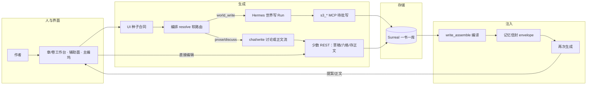
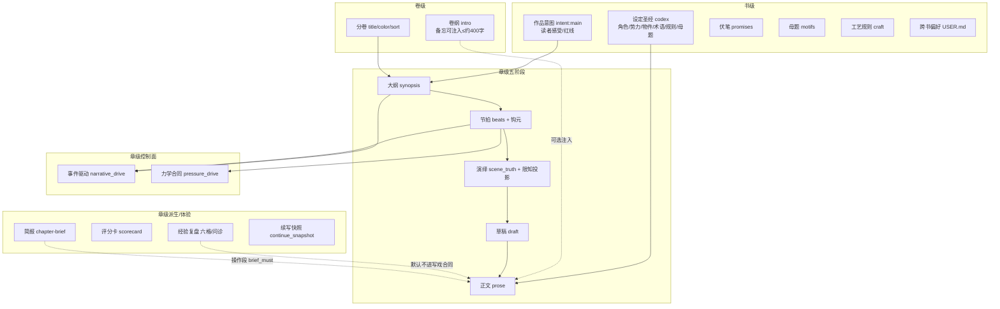
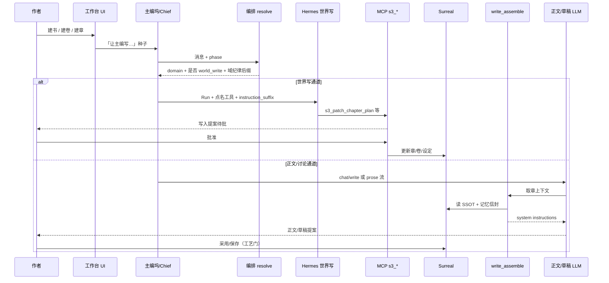
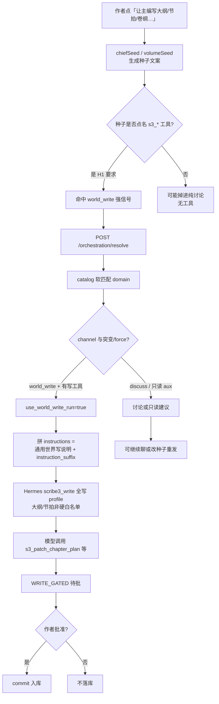
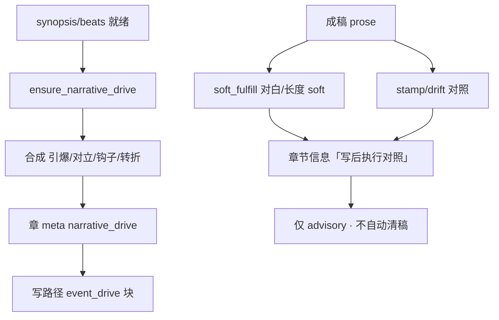
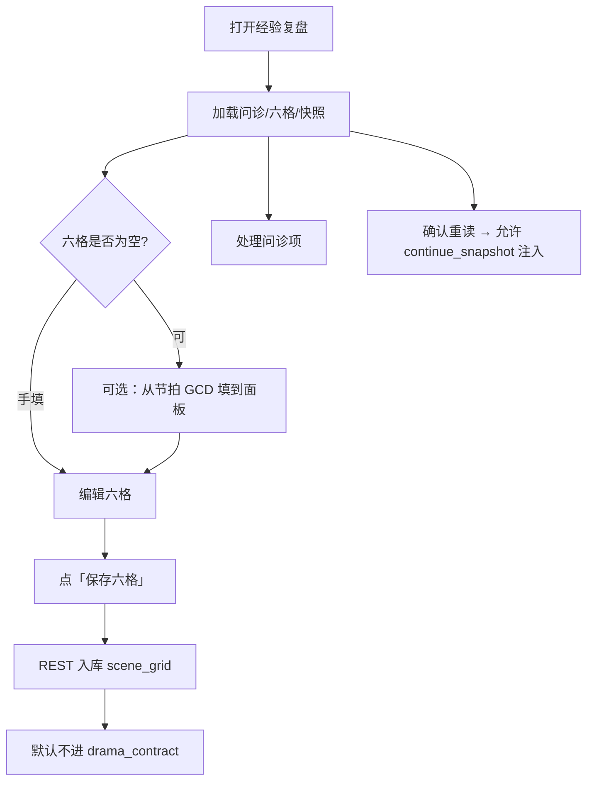
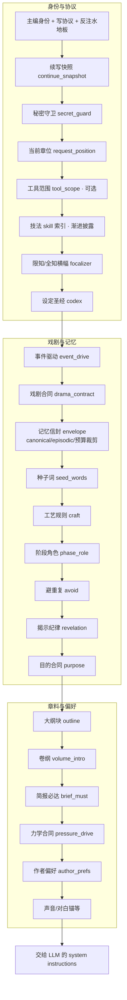
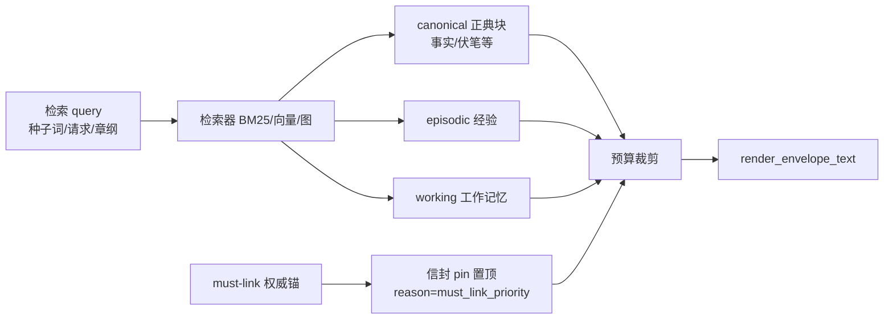
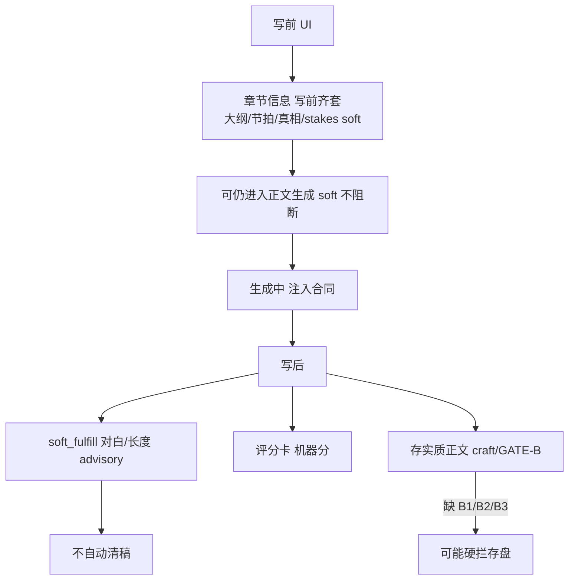

# 铜炉写作全流程：上下文注入与数据生成总览

| 项 | 内容 |
|----|------|
| **产品** | 铜炉（tonglu）/ scribe3 长篇写作工作台 |
| **文档类型** | 系统说明 · 全流程图（注入 + 生成） |
| **日期** | 2026-08-11 |
| **公网入口** | https://tonglu.qing.blue |
| **状态** | 与现网主路径对齐（H1 主编能力模型 + 章/卷 IA + 执行合同） |
| **读者** | 作者产品理解 · 工程实现对照 |

---

## 0. 一页读懂

写作链路可以拆成两件事，它们**并行存在、职责不同**：

1. **数据生成（写库）**  
   作者或主编（LLM）如何产生：卷纲、章大纲、节拍、演绎、草稿、正文、设定、意图等 **权威字段（SSOT）**。

2. **上下文注入（读库 → 提示词）**  
   生成正文/草稿/讨论时，系统如何把书内记忆、合同、设定 **装配成 system instructions**，再交给 Hermes / 聊天写路径。

**产品铁律（贯穿全文）：**

| 铁律 | 含义 |
|------|------|
| 正典多走对话+审批 | 大纲/设定/意图等：主编点名 `s3_*` → 待批 → 你批准才落库 |
| 字段分列 | 大纲 synopsis、节拍 beats、演绎 scene_truth、草稿 draft、正文 prose **禁止合并** |
| 引导 > 硬拦 | soft 提示默认不阻断生成；存实质正文才可能 GATE-B 硬拦 |
| 派生面不写 SSOT | 简报/评分卡/关联：后端算出来给你看，**不是**让 LLM 当「评分卡作者」 |
| 经验复盘是你写 | 六格作者 REST；≠ 力学合同 pressure_drive |

---

## 1. 全书信息地图（中文）

### 1.1 书级 / 卷级 / 章级

### 1.2 权威类型（生成时务必分清）

| 类型 | 中文含义 | 例子 | 谁写 |
|------|----------|------|------|
| **A 权威** | 单一真源，写路径以此为准 | synopsis、beats、scene_truth、prose、intent | 主编待批 / 作者 REST（见下表） |
| **D 派生** | 由权威算出来，可刷新 | 简报、评分卡、narrative_drive（ensure） | 后端算法 / ensure |
| **P 投影** | 体验或视图，默认不顶替戏剧合同 | 经验六格、部分压力指标 | 作者体验 API |
| **S 种子** | 话术种子，可回落不可双权威 | 大纲里的 hook 标签 | 大纲文本 / ensure 回落 |

---

## 2. 端到端总流程（从开书到交章）

### 阶段说明（总览）

| 阶段 | 你在做什么 | 系统在做什么 |
|------|------------|--------------|
| **0 冷启动** | 建书、作品意图、设定骨架、分卷 | 一书一库；意图/设定进 envelope |
| **1 卷** | 卷名/卷纲 | 卷纲可注入写路径（空则跳过） |
| **2 章脚手架** | 大纲→节拍→演绎 | 主编 plan 工具待批；GATE-B 写前软提示 |
| **3 控制面** | 可选 pilot/ensure | narrative_drive / pressure_drive 合成或钉力学 |
| **4 执行稿** | 草稿/正文 | 重注入 + 记忆信封 + 事件驱动/戏剧合同 |
| **5 验收** | 简报读、评分卡看、经验复盘填 | soft 执行对照；工艺门存盘 |

---

## 3. 数据生成全流程（按模块）

> **主编** = 右栏对话协作者（ChiefDock / Hermes Run），不是多个「人格 skill」。  
> **技法 skill** = `craft_skills` 渐进披露，**不是**「大纲 skill / 节拍 skill」。

### 3.1 总表：每个模块怎么生成

| 模块（中文） | 真源字段 | 推荐生成方式 | 写路径 | LLM 是否主写 | 备注 |
|--------------|----------|--------------|--------|--------------|------|
| 作品意图 | `intent:main` | 顶栏「让主编写入」 | `s3_set_intent` 待批 | 是 | **≠ 评分卡** |
| 设定（角色等） | codex 表 | 设定库「让主编补全/新建」 | `s3_patch_*` / `s3_add_*` | 是 | 审批落库 |
| 伏笔/母题 | promises / motifs | 简报决策或设定入口 | plant/patch 等 | 是 | 可与简报 CTA 联动 |
| 分卷信息 | volumes | 卷详情「让主编写入」 | `s3_add/patch_volume` | 是 | 须带 volume_id |
| 卷纲 | `volume.intro` | 同上本地草稿缓冲 | `s3_patch_volume` | 是 | **≠ 章大纲** |
| 章节信息 | title/label/volume | 章节信息页种子 | `s3_patch_chapter_meta` | 是 | 身份字段 |
| 大纲 | `synopsis` | 大纲阶段「让主编」 | **`s3_patch_chapter_plan`** | 是 | GATE-B B1 |
| 节拍 | `beats` | 节拍阶段「让主编」结构 | **plan 待批**；GCD 字段可 REST 微调 | 结构是 | GATE-B B2 |
| 演绎 | `scene_truth` 等 | 演绎阶段 | plan；**硬 profile 可限工具** | 是 | GATE-B B3；≠ 世界命题 |
| 草稿 | `draft` | 编辑器 | `saveDraft` 等 | 辅助 | 非世界状态 |
| 正文 | `prose` | 正文阶段 / 采用提案 | 存盘 + craft gate | 生成 | 脚手架任务禁用 save 冒充大纲 |
| 事件驱动 | `narrative_drive` | ensure / pilot | 系统 meta | **否主路径** | MetaPane 只读三行 |
| 力学合同 | `pressure_drive` | 系统/旗标/后门 | **无主编 s3 主写** | 否 | ≠ 经验复盘 |
| 简报 | 无 SSOT | 打开即 GET | 禁止写简报本体 | 否 | 派生只读 |
| 关联 | 聚合读 | 打开即读 | 改世界走对应写工具 | 否本面 | — |
| 评分卡 | scorecard | 机器计算 | **禁止 LLM 写分** | 否 | ≠ 作品意图 |
| 经验复盘六格 | scene_grid | **作者手填** + 可选从节拍抄 | REST PUT | 否 | 见 §3.9 |
| 续写快照 | continue_rite | 系统快照 | 读后注入 | 否 | 可进写路径身份层 |

### 3.2 主编世界写：种子 → 路由 → 审批（详细）

**逐步解释：**

1. **种子合同（UI）**  
   大纲/节拍/演绎种子必须写明例如：  
   `使用工具 s3_patch_chapter_plan(seq=…, field=synopsis)`，并声明  
   **禁止用 s3_save_chapter 完成本章脚手架**。  
   目的：工具选择 + 与 Codex 种子对称，不是「能不能进 Hermes」的门槛本身。

2. **编排 resolve（软路由）**  
   - 读 `orchestration/catalog.py` 的 domain 列表。  
   - `write_tools` 用于**评价提案/软名单**，**不是** Hermes MCP 的物理 include 过滤器。  
   - 现网：**仅演绎等硬 profile** 会真裁工具；大纲/节拍走**全写 profile + 软纪律**。  
   - 点名 `s3_patch_chapter_plan` + 「节拍」→ 应路由 **`chapter.beats`**；+「大纲」→ **`chapter.outline`**。  
   - 「解读评分卡」→ **`aux.scorecard` 只读**；「经验复盘六格」→ **`aux.experience` 只读**。

3. **instruction_suffix（域纪律）**  
   世界写 Run 会**清空 phase**，故域纪律不能依赖 phase，而靠 resolve 下发的后缀拼进 instructions（例如：本域请写 synopsis / beats，禁止 save 完脚手架）。

4. **审批**  
   写工具默认门控：未批准不得声称已落库。

### 3.3 五阶段各自的生成细节

#### （1）大纲 synopsis

| 项 | 说明 |
|----|------|
| 界面 | 章阶段「大纲」 |
| 生成 | 主编种子 → `s3_patch_chapter_plan` field=synopsis |
| 可内嵌标签 | 压力级、chapter_role、stakes/赌注、钩话术等（parse_chapter_meta） |
| 写前软门 | GATE-B B1：非空；过短 soft warn；高压缺 stakes soft warn |
| 注入时 | domain `outline`：synopsis + beat.text 摘要，**不**把完整 GCD 表再抄一遍 |

#### （2）节拍 beats

| 项 | 说明 |
|----|------|
| 界面 | 章阶段「节拍」 |
| 结构增删 | 主编 `s3_patch_chapter_plan` field=beats |
| 字段微调 | 作者可对 GCD/text **REST 直存**（产品节奏）；结构仍建议对话 |
| 戏剧合同 | 写路径 domain `drama_contract`：GCD 执行摘要（唯一结构化戏剧钉） |
| 钩子 | `beats_meta.chapter_hook` 优先；与 narrative_drive end_hook 同链种子 |

#### （3）演绎 scene_truth

| 项 | 说明 |
|----|------|
| 界面 | 章阶段「演绎」 |
| 生成 | 主编 plan 写 scene_truth / 限知投影 |
| 硬门控 | 可走 `scribe3_deduce*` 受限工具集（与大纲全写不同） |
| 禁止 | 用 `s3_add_fact` 冒充场景真相；场景真相 ≠ 世界命题 |

#### （4）草稿 draft

| 项 | 说明 |
|----|------|
| 界面 | 「草稿」 |
| 生成 | 编辑器为主；可讨论辅助 |
| 落库 | 作者保存草稿通道，**非**世界写 MCP 主路径 |
| 注入 | phase_role 草稿句：限知与糙稿允许 |

#### （5）正文 prose

| 项 | 说明 |
|----|------|
| 界面 | 「正文」 |
| 生成 | 写路径 LLM + 完整注入；或 loop/pilot |
| 落库 | 采用提案 / 存盘；触发 craft / GATE-B 等 |
| 旁路 | agent 可能有 `s3_save_chapter`（脚手架任务软禁） |

### 3.4 卷信息 / 卷纲

- **卷纲**是作者备忘与可选注入，**不是**第 N 章大纲。  
- 未分卷是暂存分组；创建正式卷后才有卷档案。

### 3.5 事件驱动 narrative_drive 与执行合同

- **生成**：系统 ensure / pilot，不是作者表单。  
- **露出**：章节信息只读三行 + soft-status API。  
- **再生成**：有正文默认 skip；强制重写或显式 resteer 才清路径。

### 3.6 简报（派生）

| 项 | 说明 |
|----|------|
| 触发 | 打开辅助「简报」→ `GET /chapter-brief` |
| 内容 | 弧光指令、伏笔窗口、开环账本、待激活角色等 |
| 写入 | **不写简报本体**；CTA 如「让主编兑现伏笔」走 promise 工具 |
| 注入 | 写路径 `brief_must`：操作必达段；已与 drama/purpose 去重 |

### 3.7 关联（聚合读）

- 设定/素材/伏笔/限知边界等**只读聚合**。  
- 要改世界：跳设定库或主编对应 domain，不在本面「生成关联 SSOT」。

### 3.8 评分卡（机器派生）

- 打开辅助「评分卡」→ 计算/展示硬约束与软参考。  
- **禁止**「让 LLM 写评分卡当分」。  
- 改读者感受/红线 → 顶栏**作品意图** `s3_set_intent`。

### 3.9 经验复盘（作者填写 · 详解）

| 区块 | 谁填 | 怎么存 |
|------|------|--------|
| 修订问诊信 | 系统出题；你标记已读/豁免 | 体验状态 API |
| 六格 goal…decision | **你填**；可从节拍 GCD **单向预填** | `PUT scene-grid` source=author |
| 续写重读 | 系统要求；你确认 | ack + 快照 |

**与 LLM：** 默认**不是**主编自动写满六格；主路径是作者。

---

## 4. 上下文注入全流程（写路径编译）

当进入**草稿/正文生成**或需要完整写指令时，核心入口：

`write_assemble._assemble_write_instructions_v1`（及讨论侧相关组装）

### 4.1 注入流水线（顺序有业务含义）

### 4.2 每一层在说什么（详细）

| 顺序 | domain / 段 | 中文职责 | 数据从哪来 | 去重/注意 |
|------|-------------|----------|------------|-----------|
| 1 | 身份+协议 | 你是主编、硬红线、怎么交稿 | 固定模板 | 不灌事实 |
| 2 | continue_snapshot | 续写前你确认过的重读提示 | 经验 continue_rite | ≠ 六格、≠ PDC |
| 3 | secret_guard | 秘密字段防泄 | 设定 secret 标志 | 生成路径更严 |
| 4 | focalizer | 限知或作者全知 | 章 focalizer | 与 epistemic 门一致 |
| 5 | codex | 本书设定圣经 | codex 表 | 限知隐前史；势力三档可见性 |
| 6 | **event_drive** | 本章冲突/事件导航 | narrative_drive | 空则空；旗标控制 |
| 7 | **drama_contract** | 拍级 GCD 执行摘要 | beats | **唯一**结构化戏剧钉 |
| 8 | **envelope** | 记忆与正典大包 | context_assembler | 含 must-link 置顶钉；预算裁记忆不裁戏剧 |
| 9 | seed_words | 本轮种子词 | 请求/UI | — |
| 10 | craft | 本书工艺规则 | craft_rules | — |
| 11 | phase_role | 规划/节拍/演绎/草稿/正文侧重 | phase | outline↔plan 映射 |
| 12 | purpose | 目的合同+教训 | purpose 工具 | brief 已 pop 避免双份 |
| 13 | outline | 大纲+拍文字摘要 | synopsis + beat.text | 不抄完整 GCD 表 |
| 14 | volume_intro | 所属卷纲摘要 | volume.intro | 空跳过；约 400 字 |
| 15 | brief_must | 伏笔/开环/心跳操作段 | assemble_chapter_brief | 已去 drama/purpose/injection 回显 |
| 16 | pressure_drive | 力学钉 | pressure_drive 旗标 | ≠ 经验六格 |
| 17 | author_prefs | 跨书文风偏好 | USER.md | 不进正典 |

**核心戏剧链（请记住）：**

> `event_drive → drama_contract → envelope(+must-link 钉) → purpose → outline → brief_must → pressure_drive`

### 4.3 记忆信封 envelope（简图）

- **must-link 去重**：信封已 pin 全文时，brief 不再重复贴同一大段（`SCRIBE3_INJECT_DEDUP`）。  
- **剧透门**：限知章用 known_from / project_frame，不把焦点者不知的秘密灌进生成。

### 4.4 讨论路径 vs 写路径

| 路径 | 何时 | 注入特点 |
|------|------|----------|
| **世界写 Hermes** | 改设定/大纲/卷等 | 全写工具 + 种子点名 + instruction_suffix；phase 常被清空 |
| **chat/write 讨论** | 聊结构、改稿意见 | 阶段角色、部分简报；少挂完整 envelope |
| **正文/草稿生成** | phase draft/final | **完整 v1 编译** + envelope + 戏剧链 |

### 4.5 主编讨论时的「轻注入」

讨论侧仍会带：章位、简报摘要、相关设定等（具体块随入口），但**改库**必须再走写工具待批，不能只靠模型嘴炮。

---

## 5. 写前 / 写后门闩（与生成的关系）

| 门 | 时机 | 硬/软 | 说明 |
|----|------|-------|------|
| 契约 soft | 写前 UI | 软 | 不建议开写，可不挡对话 |
| GATE-B | 存实质正文 | 硬（工艺） | synopsis/beats/scene_truth |
| soft_fulfill | 写后 | 软 | 执行合同；与 full_check 同源 |
| 评分卡 | 写后看 | 展示 | 不替代意图 |

---

## 6. 一条「理想章」时间线（叙事版）

1. **书级**  
   设作品意图 → 铺角色/母题/世界规则（主编待批）。

2. **卷**  
   建卷、写卷纲备忘（可选注入）。

3. **第 N 章大纲**  
   种子点名 plan → 批准 → synopsis 含冲突与 stakes。

4. **节拍**  
   展开 GCD 节拍与章钩 → 戏剧合同真源就绪。

5. **演绎**  
   scene_truth + 谁知情 → 限知可生成。

6. **ensure 事件驱动**  
   系统合成引爆/对立/钩子（可刷新）。

7. **草稿/正文**  
   装配：事件驱动 + 戏剧合同 + 信封 + 大纲 + 简报必达 +（可选）PDC → LLM 交稿。

8. **你验收**  
   读简报、看评分卡、**手填**经验六格、看执行 soft 对照；需要则强制重写而非静默清稿。

---

## 7. 常见误区

| 误区 | 正解 |
|------|------|
| 每个模块一个 skill | 一个主编 + catalog 软路由 + 点名工具 |
| 评分卡 = 作品意图 | 评分卡只读机器分；意图是 s3_set_intent |
| 经验复盘 = 力学合同 | 六格是作者复盘；PDC 是写路径力学钉 |
| 简报可以当大纲写 | 简报派生；改大纲走 plan 工具 |
| 有 narrative_drive 就等于正文按戏写 | 还需注入 + soft_fulfill；有稿不默认重生 |
| 上下文越多越好 | domain 去重 + 预算裁剪；双份 drama 会稀释注意力 |

---

## 8. 代码锚点（便于工程对照）

| 主题 | 路径 |
|------|------|
| 写指令编译 | `scribe3/api/services/write_assemble.py` · `_assemble_write_instructions_v1` |
| 记忆信封 | `scribe3/context_assembler.py` · `context_engine` |
| 章前简报 | `scribe3/brief.py` · `assemble_chapter_brief` |
| must-link | `scribe3/memory_must_link.py` |
| 事件驱动 | `scribe3/narrative_drive.py` |
| 力学合同 | `scribe3/pressure_drive.py` |
| 执行 soft | `scribe3/execution_contract.py` |
| 主编种子 | `scribe3/web/src/lib/chiefSeed.js` · `volumeSeed.js` |
| 编排路由 | `scribe3/orchestration/catalog.py` · `resolve.py` |
| 经验复盘 API | `scribe3/api/routers/experience.py` |
| 章 IA 设计 | `docs/plans/2026-08-10-chapter-writing-ia-optimal.md` |
| 主编 H1 | `docs/plans/2026-08-11-chief-module-generation-skill-vs-mcp.md` |
| 名词表 | `scribe3/GLOSSARY.md` |

---

## 9. 修订记录

| 日期 | 说明 |
|------|------|
| 2026-08-11 | 初版：贯穿生成与注入的中文全流程图与分模块说明 |

---

*文档结束 · 与铜炉主路径实现对齐 · 2026-08-11*
