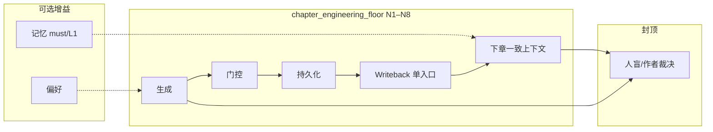
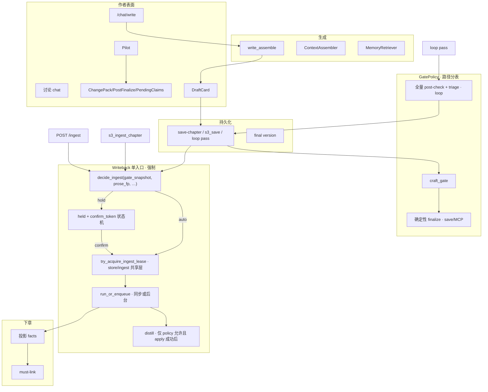

# 设计文档：「写好一章」全流程闭环改进方案

| 项 | 值 |
|----|-----|
| **文档标题** | scribe3 「写好一章」全流程最完善改进方案 |
| **副标题** | 生成 → 门控 → 接受 → 持久化 → 可控写回 → 下一章上下文；与记忆质量 rev.4 对齐 |
| **作者** | Grok Design（基于 deep-research-5 + 既有记忆质量分析） |
| **日期** | 2026-08-09 |
| **修订** | **rev.D** · active-hold 优先于 W2 checkpoint；PR-1 migration + bg 独立连接；force→distill |
| **状态** | Proposed · 复审 3 open 已收口；可按 PR-1→2 开工 |
| **产品** | scribe-writing-system / scribe3 |
| **验证环境** | demo 已部署栈 `https://www.qing.blue`（不另起 Surreal / 本机全量 npm） |
| **前序** | `docs/CURRENT_ARCHITECTURE.md` · `docs/plans/2026-08-09-memory-quality-best-plan-v4.md` · `docs/plans/2026-08-09-memory-quality-to-9.5-system-design.md` (rev.4 Accepted) · F2 主路径审计结论 |
| **约束** | 不上 Graphiti 全量；不重写 fabric；不换 Surreal；工程可关 open loop，文学 9.5 须人评 |

---

## Overview

scribe3 已具备可交付的「写一章」工程主路径（F2）：

```text
# 主路径（DraftCard 日常）
/chat/write
  → write_assemble / CreativeContextEngine + MemoryRetriever
  → SSE ⟦PROPOSAL⟧
  → DraftCard accept
  → POST /save-chapter
      （craft 门 + 确定性 finalize 门 + 落库 + soft QC 报告 + _enqueue_ingest）

# 重要旁路（同属「写好一章」闭环，必须同写回策略 · 见 Writeback W 全表）
loop draft_loop → pass → _finalize（同步 ingest_chapter + distill）
select_finalize / checkpoint(final) → _enqueue_ingest
dedup / polish / semantic_repair 落 final → _enqueue_ingest
restore-version?reingest → _enqueue_ingest
POST /ingest「反哺设定库」手动反馈 → 同步 ingest
story-import 批量 → 逐章同步 ingest
accept_unverified → enqueue 重放（store 路径 force 重放）
MCP s3_save_chapter（无 craft、无 enqueue）→ 须 s3_ingest_chapter 显式回写
pilot idle→…→finalized + PostFinalize L1 候选（不静默 apply）
```

**问题不在「能不能写完一章」**，而在：

1. **工程闭环有洞**：进程内 `_pending_ingest` 挡不住 **MCP∥HTTP** 交错 purge（生产默认单 uvicorn worker，跨进程爆点主要是 MCP 与 app）；误接受即污染知识；文档与真实现漂移。
2. **质量语言错位**：craft/finalize 绿 ≠ 文学质量；**loop/全量 post-check** 上 discipline 解析 fail-open；AI-taste 软过；save 路径 advisory 可定稿且 **几乎总 auto-ingest**。
3. **记忆被高估**：轨 2 基线综合 **~7.0–7.3/10**、`lead_A−B = 0.5`、`pass_rule_met=false`（`artifacts/ab-minimal-book_aa57f17e-ch6-track2-goal/` · rev.4）；**记忆不是可读章节的必要条件**。
4. **讨论 vs 写作双栈** 正典读路径未共享单真投影。
5. **作者反馈与正典 UX** 未闭环（无 PreferenceSignal；ChangePack/PostFinalize SPA 残余）。

本设计给出**目标架构**、**好章 vs 好记忆条件分离**、**Writeback 单入口**、按 blast × 质量的优先程序与可合并 **PR Plan**。记忆 rev.4 为注入/测量子层；本章是 **整章管线 + 质量闭环**。

### 一句话策略

> **先堵住「误接受 → 脏知识 → 后章崩」：一切客观知识回写经同一 IngestPolicy + 共享租约；再收紧门控诚实与 UI；再对齐讨论读路径。文学 9.5 只做人门。**  
> 主用户故事 P0 = **MCP∥HTTP 同章不双 purge**，不是「已上多 worker」。

---

## Background & Motivation

### 现行主路径与旁路（代码锚点）

| 阶段 | 实现 | 文件/符号 |
|------|------|-----------|
| 写作 SSE | `_stream_write` + ProposalParser | `api/services/write_stream.py` |
| 指令组装 | `_editor_write_system` / codex / 铁律 / must | `api/services/write_assemble.py` |
| 上下文 envelope | `ContextAssembler` + `MemoryRetriever` | `context_assembler.py` · `memory_retrieval.py` |
| 草稿接受 | DraftCard → applyProposal | `web/src/editor/DraftCard.jsx` |
| **存稿（主）** | craft → **确定性** finalize → save → soft QC（落库后）→ `_enqueue_ingest` | `misc_routes.save_chapter` |
| 定稿门（确定性） | `check_finalize_for_save` → `collect_deterministic_post_for_prose`（**不打 LLM discipline**） | `finalize_gate.py` |
| 全量体检 | `/post-check`：含 discipline（parse_failed fail-open→degraded） | `api/routers/write.py` |
| 修复环 | blocking 回炉 / advisory **不落库** / pass→finalize+**同步** ingest | `loop.py` · `chapters.py` `_finalize` |
| Pilot | 状态机 + PostFinalize 候选 | `pilot.py` · `pilot_runtime.py` |
| 知识写回 | `ingest_chapter` → `purge_ingest` → apply；成功后 `distill_chapter` | `ingest.py` · `ingest_bg.py` · `lesson.py` |
| MCP 存稿 | `check_finalize_for_save` **仅**；**无 craft**；**不** enqueue | `mcp/tools_write.s3_save_chapter` |
| MCP 回写 | `s3_ingest_chapter` 直调 `ingest_chapter`（**不经** app `_pending_ingest`） | 同上 |
| 进程内去重 | `_pending_ingest` set；注释：生产默认单 worker | `api/app_impl.py` ~219–223 |
| 正典 L1 | ChangePack / PostFinalize 人批 | `canon_loop.py` · `api/routers/canon_loop.py` |
| 作者偏好 | Hermes `USER.md` | `author_prefs.py` |
| ingest 状态 API | `GET /ingest/status` **已存在** | `api/routers/ingest_import.py` · `build_ingest_status_row` |

### Pilot 状态机

```text
idle → outline_proposed → beats_ready → deduced → drafting → checked → delivered → finalized
```

- `finalize` ∈ `CONSTITUTION_APPROVE`（永远 approve）。
- loop `advisory`：**不落库**；与 save 路径「advisory 可存」**不同**（见 §门控三路径表）。
- 定稿后 `body_confirmed_report`：`silent_l1_write: false`。

### 爆点（Blast radius）

| 失败模式 | 作者可见 | 下游污染 |
|----------|----------|----------|
| F2 生成失败 | 无 prose | 本章空 |
| craft 409（HTTP only） | 存稿被拦 | 无 final / 无 ingest |
| finalize blocking | 409 / MCP blocked | 同左 |
| knowledge lag / ingest 失败 | 角标 / `ingesting` | 后章帧滞后 |
| 误接受 + **任一路径** auto-ingest | 正文已定 | purge 重写客观账本；**distill 教训进 lesson（purge 不回滚）** |
| **MCP∥HTTP** 同章 ingest | 偶发脏/丢 | 今日无共享锁；进程内 set 无效于 MCP |
| multi-worker（未来） | 同左 | 同上；今日生产默认单 worker |
| MCP `s3_save_chapter` | 可无 craft 落 final | 须另调 ingest；易漏或双跑 |
| `purge_ingest` | 清本章 ingest 产出 | **lesson 保留**；`relation_touch` 按 **chapter** 整章删（含无 ingest_seq 的手动行） |

### 质量现实（必须诚实）

| 事实 | 含义 | 作用路径 |
|------|------|----------|
| craft 绿 ≠ 文学 | 脚手架齐套 | save /（目标）MCP |
| **save 定稿门 = 确定性 post** | 无 discipline LLM；无 `parse_failed` 信号 | `check_finalize_for_save` |
| **discipline parse_failed fail-open** | 没查 ≠ 没病；degraded→最高 advisory | **全量 `/post-check` / loop triage**，**不是** DraftCard 日常 save 门 |
| soft QC 在 save **落库之后** | 不挡 final；今日 **总是** enqueue（除非在途去重） | `misc_routes.save_chapter` |
| Memory ~7.0–7.3，lead **0.5**，`pass_rule_met=false` | 记忆边际有限 | rev.4 artifact |
| 记忆非成章必要条件 | 成稿可靠模型+synopsis+铁律/codex | 设计推论 |

### Open loops

1. Doc drift  
2. Discussion vs writing 双栈  
3. Ingest 竞态（**主：MCP∥HTTP**；副：未来多 worker）  
4. Canon SPA UX  
5. Scene–Sequel 默认不挡  
6. PreferenceSignal / author_prefs  
7. soft-pass 与 auto-ingest 耦合  
8. 记忆被高估  

---

## Goals & Non-Goals

### Goals

1. **Writeback 单入口（W1–W14）**：一切客观知识回写（enqueue 与同步、HTTP 与 MCP、手动反哺、import、unverified）经 `decide_ingest` + `acquire_lease` + `run_or_enqueue`。  
2. **目标架构**可审计：生成→门→接受→持久→**可控**写回→下章上下文。  
3. **条件分离**：好章地板 vs 记忆质量；字段名不混用。  
4. **门控路径诚实**：save / loop / MCP **三表**，不混 discipline。  
5. **与 rev.4 集成** must/L1 为增益；不定义成章完成。  
6. **文档单真** `CURRENT_ARCHITECTURE` + 本设计 + 代码。

### Non-Goals

| 非目标 | 理由 |
|--------|------|
| Graphiti / fabric 重写 / 换库 | 约束 |
| 第二套 Surreal / Grok 机全量 npm | 主机规则 |
| 工程内文学 9.5 / 双盲交付 | 人盲封顶 |
| 记忆 `memory_engineering_gate` / lead≥1.5 作写章完成门 | 记忆非必要 |
| Scene–Sequel **默认**硬挡 finalize | 连载摩擦 |
| L1 静默 apply | 宪法 |
| 一次重写讨论为完整写作 envelope | 增量投影即可 |
| 宣称 purge = 知识完全可回滚 | lesson / relation_touch 例外 |

---

## 必要与充分条件：好章 vs 高记忆

### 定义

| 概念 | 定义 |
|------|------|
| **可读/可交付章** | 作者愿定为 final：连贯、无限知崩、无明显设定自打脸、工艺不红 |
| **好章** | 可读 + 作者/人盲声音与戏剧门槛 |
| **高记忆质量** | rev.4 七维人盲 ≥9.5；machine lead 仅对照 |

### 好章 · 必要条件（`chapter_engineering_floor`）

> **命名强制**：成章工程地板字段前缀 **`chapter_engineering_floor`**。  
> **禁止**与 rev.4 记忆侧 **`memory_engineering_gate`**（lead 中期门槛）混用或同清单勾选完成。

| # | 必要条件 | 现网 | 本设计 |
|---|----------|------|--------|
| N1 | 稳定生成路径 | 有 | 保 |
| N2 | 接受→落库版本语义清晰 | 有 | 保 |
| N3 | craft 门 fail-closed（HTTP 实质正文；**MCP 目标对齐**） | HTTP 有 / MCP **无** | PR-2b |
| N4 | 限知 blocking 不静默过（确定性 leaks 等） | finalize 有 | 保 |
| N5 | 设定单真不双写互斥进 prompt | 大体有 | rev.4 Slice-1 |
| N6 | **误接受后客观账本默认可 hold；purge 可清 ingest 账本；lesson 不随 purge 回滚（明示）** | **弱** | P0 IngestPolicy + 文档诚实 |
| N7 | 后章投影一致；ingest 无交错 purge | MCP 洞 | P0 共享租约 |
| N8 | 大纲/节拍/铁律进写路径 | 有 | 保 |

### 好章 · 充分条件

```text
好章 ≈ chapter_engineering_floor(N1–N8)
      + 模型与 steer + 作者审稿
      + （可选）记忆 must/state/伏笔
      + （可选）偏好 / 戏格
```

**记忆高 ≠ 充分也不必要。**

### 高记忆 · 必要条件（rev.4，字段 `memory_*`）

M1 真值槽 · M2 注入投影+L1 · M3 可归因消融 · M4 写回分层 · M5 人盲。

### 关系图



### 设计推论

1. P0 = 写回单入口 + 共享租约（**MCP∥HTTP**），不是再刷记忆探针。  
2. 日常写章完成 = 主路径冒烟 + 门控诚实 + 写回状态可见；**不含** `memory_engineering_gate`。  
3. rev.4 并行，指标分字段。

---

## Proposed Design

### 目标架构



### 架构原则

| # | 原则 | 说明 |
|---|------|------|
| C-P1 | **Writeback 单入口** | **一切**客观知识回写（见下表）经 `decide_ingest` + lease + run；**不只** save-chapter |
| C-P2 | **门控诚实 · 路径分表** | save 确定性 ≠ loop 全量；禁止混谈 discipline 在 save 门 |
| C-P3 | **写回可控 · 回滚有界** | hold/confirm；purge 清客观 ingest 账本；**lesson 明示不回滚** |
| C-P4 | **共享租约在 store/ingest 层** | **禁止**仅改 `app_impl._pending_ingest`；MCP 与 HTTP 同 API |
| C-P5 | **认知投影共享** | 讨论读单真；不假装限知生成 |
| C-P6 | **记忆可选增益** | fabric 可关仍成章 |
| C-P7 | **质量字段前缀分离** | `chapter_*` vs `memory_*` |
| C-P8 | **文档单真** | CURRENT + 代码 |

---

### Writeback 单入口表（函数级 · C-P1 落地 · rev.C 全量枚举）

> **强制：** 生产路径上**禁止**旁路直调 `ingest_chapter` / 裸 `_enqueue_ingest`。  
> 工具/单测可直调，但须标注非产品路径。  
> **distill_chapter 不得**在入口旁路单独调用——只允许在 `run_or_enqueue` 成功 apply 后按 policy 触发。

**唯一编排 API（模块 `scribe3/ingest_policy.py` + `scribe3/ingest_lease.py` + Store 方法）：**

```text
decide_ingest(
  st, work, seq, *,
  gate_snapshot: GateSnapshot,
  # GateSnapshot 字段:
  #   path: "save"|"loop"|"mcp_save"|"mcp_ingest"|"http_ingest"|"checkpoint"|
  #         "select_finalize"|"dedup"|"polish"|"semantic_repair"|"restore"|
  #         "story_import"|"unverified_replay"|…
  #   craft_allowed: bool | None
  #   finalize_verdict: "pass"|"advisory"|"blocking"|…
  #   danger_draft: bool
  #   soft_qc: dict | None     # 报告-only；默认不进 hold（KD17）
  #   ai_grade: str | None     # "heavy" 等；见下「ai_heavy 与 save 门」
  #   degraded_stages: list    # 仅 loop/全量 post-check 有意义
  prose: str,
  prose_fp: str | None = None,
  force: bool = False,         # force 覆盖 hold / same_fp skip；须审计
  source: str,                 # 与 path 对齐，写入日志
) -> DecideResult
  # action: auto | hold | skip
  # skip_reason: same_prose_fp | policy_off | already_ok | …
  # hold_reason: advisory_gate | danger_draft | ai_heavy | user_hold | policy_confirm | …
  # confirm_token?: str

try_acquire_ingest_lease(st, work, seq, owner, ttl) -> AcquireResult
release_ingest_lease(st, work, seq, owner) -> None   # finally 必达
heartbeat_ingest_lease(st, work, seq, owner) -> None # running 续期

run_or_enqueue(st, work, seq, *, mode: "sync"|"bg", owner, force=False,
               source: str = "", gate_snapshot: GateSnapshot | None = None,
               prose: str = "") -> RunResult
  # 顺序钉死:
  #   1) same_prose_fp 预检（非 force）→ skip，不占锁
  #   2) decide_ingest（含 active-hold 硬规则 · 见下）→ hold/off 则写/保留 hold 字段，return
  #   3) try_acquire_ingest_lease
  #   4) ingest_chapter（purge 前再校验 lease owner）
  #   5) distill 条件（KD18 · 见下）满足且 apply 成功（非 parse_failed）→ distill_chapter
  #   6) finally release_lease
  #
  # mode=bg（强制 · 对齐现 _bg_ingest P2-3）:
  #   - 禁止复用请求级/共享 st
  #   - 内部 SurrealStore(ns="scribe3", db=work) 独立连接
  #   - finally st.close()（与今日 _bg_ingest 一致）
  # mode=sync: 可用调用方 st（loop / POST /ingest 同请求）
```

#### `decide_ingest` 硬规则（rev.D · 防 hold 被第二跳冲掉）

```text
# Active hold supersedes（KD18 前置 · 对一切 W 入口生效）
if not force and source not in ("confirm",):
  if chapter has active hold:
    # active := ingest_hold_reason 非空
    #          AND hold_until 未过期（若字段空则视为仍有效直至 confirm/过期策略）
    #          AND ingest_prose_fp_at_hold == current prose_fp
    → return action=hold (or skip_held), enqueued=false
    # 禁止 auto；不得 purge；不得 distill
    # 保留原 confirm_token（不重新签发，除非已过期）

# Missing gate_snapshot 安全默认
if gate_snapshot is None or gate_snapshot.finalize_verdict is None:
  if source/path in ("checkpoint", "restore", …) and not force:
    # 禁止把「无 verdict」当成 pass
    # 首选 A: 调用 check_finalize_for_save 填满 snapshot 再走策略
    # 若无法跑门（无 prose 等）→ 安全默认 hold（held_reason=missing_gate_snapshot）
    # 禁止默认 auto
  # 例外：loop 路径必须自带全量 triage snapshot（W5）
  # 例外：confirm/force 显式放行

# 正常策略 auto_if_pass / confirm / off …
```

**前端「存为正文」双跳（生产主按钮 · `WriteLayout.jsx` ~L900–904）：**

```text
persist → api.saveChapter  (W1 · 可 hold + token)
       → api.checkpoint(kind='final')  (W2 · 今日无 gate，会 _enqueue_ingest)
```

| 规则 | 行为 |
|------|------|
| W1 已 hold 且 prose_fp 未变 | W2 **必须** active-hold supersede → **不 enqueue** |
| W2 无 snapshot | 不得默认 pass；填满 snapshot **或** hold |
| PR-2 必测 | `save(advisory)→hold` 后立刻 `checkpoint(final)` → 仍 held、`enqueued=false` |
| PR-3 可选 | hold 时前端跳过 checkpoint 的 ingest 语义（后端规则已足够；可减一次空跑） |

**生产调用点全表（grep 门禁对象 · 以代码符号为准）：**

| # | 入口（文件 · 符号） | 今日机制 | 目标 |
|---|---------------------|----------|------|
| **W1** | `api/routers/misc_routes.py` · `save_chapter` | 几乎总 `_enqueue_ingest` | `decide` → auto/hold → bg |
| **W2** | `api/routers/write.py` · `checkpoint` · `kind=final`（**「存为正文」第二跳**） | 无 craft/finalize，总 `_enqueue_ingest` | **active-hold 优先**；缺 snapshot → 填满或安全 hold；**禁止**无快照当 pass |
| **W3** | `api/routers/chapters.py` · `select_finalize`（及同类终选） | `_enqueue_ingest` | 同策略；gate 来自终选 finalize |
| **W4a** | `misc_routes.dedup_chapter` 真改写落 final | enqueue | 同策略；snapshot 从 finalize 决策带入 |
| **W4b** | `misc_routes` polish 路径落 final | enqueue | 同 W4a |
| **W4c** | `misc_routes` **semantic repair** 落 final（`_enqueue_ingest` ~L711） | enqueue | 同策略；gate 来自 semantic_repair_gate + 可选 post-check |
| **W5** | `chapters` loop **`_finalize` 同步** `ingest_chapter` + `distill_chapter` | 进程 set 后直跑 | `decide`+lease+**sync**；pass→auto；**distill 仅经 run** |
| **W6** | `ingest_import` · `POST /ingest`（前端 **「反哺设定库」手动反馈**） | 进程 set + 同步 + distill | decide（作者显式意图：默认 **force_confirm_bypass 或 auto 视产品**；见下）+ lease；`force` 可覆盖 hold |
| **W7** | `mcp/tools_write.s3_ingest_chapter` | **无锁**直跑 | **必须** decide+lease；held 且无 force → `{code:"held"}` 拒绝 |
| **W8** | `mcp/tools_write.s3_save_chapter` | 不 ingest | 返回 `ingest.action/required`；**禁止**内联慢抽取 |
| **W9** | `chapters.restore_chapter_version` · `reingest=true` | `_enqueue_ingest` | 同策略；恢复正文后的 gate_snapshot 用确定性 finalize |
| **W10** | 统一终选 / 已 `same_prose_fp` 路径 | skip | `decide` → skip（不占锁） |
| **W11** | `ingest_import.story_import` 批量逐章 `ingest_chapter` | 同步无 app 租约 | 每章经 lease+decide；import 语义默认 **auto**（作者整包导入意图）但**必须占锁** |
| **W12** | `ingest_import.accept_unverified_ep` → `_enqueue_ingest` 重放 | enqueue | 经单入口；force 重放语义保留（角色已接受） |
| **W13** | `store/unverified_ingest.accept_unverified` 内 **force** `ingest_chapter`（若仍走 complete_fn 同步路径） | force 直跑 | **废弃旁路**或改为调用 `run_or_enqueue(..., force=True)`；禁止 store 层静默双路径 |
| **W14** | `ingest_bg._bg_ingest` / `_enqueue_ingest` | 进程 set | **变为** `run_or_enqueue` 的 bg 实现；不再是第二策略源 |

**W6「手动反馈」产品语义（钉死）：**

| 场景 | 行为 |
|------|------|
| 作者点「反哺设定库」且章为 held | UI 优先走 `POST /ingest/confirm`（带 token）；或 `POST /ingest?force=1` 显式覆盖并审计 |
| 作者点反哺且无 hold | `decide` → auto + lease + sync（≈今日） |
| 与自动 bg 撞车 | lease `already_pending` → 409 诚实（今日已有类似语义） |

**非生产（不进 W 门禁，文档声明）：** `tools/bt_render.py`、pytest 直调 `ingest_chapter`。

**Key Decision（KD13）：IngestPolicy 作用域 = 一切客观知识回写（W1–W14），不只 save-chapter。PR-2 grep 门禁覆盖上表符号。**

---

### 门控三路径表（禁止混谈）

| 路径 | 门控输入 | 今日写回 | 目标 IngestPolicy 输入 |
|------|----------|----------|------------------------|
| **A. save-chapter** | `evaluate_save_craft_gate` + `check_finalize_for_save`（**确定性** post：degeneration / ai_grade / leaks；**无** LLM discipline）+ soft QC **落库后报告-only** | 几乎总 auto enqueue | `finalize.verdict` + `danger_draft` +（可选）soft_qc 报告字段；**无** discipline.parse_failed |
| **B. loop finalize** | 全量 post-check + `loop.triage`（含 discipline；parse_failed→degraded→最高 advisory） | **仅 pass** 同步 ingest；advisory **不落库** | pass → `auto_if_pass` 的 auto；needs_human 不写回；degraded 在 pass 合成路径上已变为 advisory **不落库**故通常无 ingest |
| **C. MCP s3_save_chapter** | **仅** finalize（无 craft） | 不 enqueue | **强制 craft（KD16）** + 同 finalize；返回 policy；ingest 走 W7 |

**关于 discipline fail-open（修正原笼统表述）：**

- **不在** DraftCard 日常 save 门上出现 `discipline.parse_failed`。  
- 在 **loop / 全量 post-check**：保持「LLM 挂掉不因假 blocking 卡死创作」；parse_failed 记 `degraded_stages`，triage **不得** 合成干净 pass（现有逻辑：关键 stage 降级 → 最高 advisory）。  
- **若**未来要在 save 上消费「最近一次 post-check degraded」：须 **显式扩展**（缓存 `chapter.last_post_check` 或可选跑 discipline）——**非 P0**；P0 不假装 save 已有该信号。

**soft QC 与 hold（KD17 / Q1 拍板）：**

- soft_qc（跨章复读等）**默认不**触发 hold（保持创作流；成功标准 **不得** 写「soft QC 高危不 silent ingest」）。  
- soft_qc 仅：响应字段诚实展示 + UI 提示「建议人工扫一眼再反哺」。  
- **会 hold 的集合（默认）**：`finalize.verdict == advisory` · `danger_draft` · `ai_heavy_hold`（见下）· 用户显式暂缓 · 策略 `confirm` 全局。

**ai_heavy 与 save 门（避免实现误读）：**

| 情况 | `collect_deterministic_post` + `triage` | IngestPolicy |
|------|----------------------------------------|--------------|
| `ai_grade==heavy` 且非短文密度降档 | 通常 → **blocking** → **save 409**，根本不 ingest | 不适用 |
| `ai_grade==heavy` 但短文降 **advisory**（`loop.triage` 2-B） | 可存 | **hold**（`hold_reason=ai_heavy`） |
| 其他 | — | 按 verdict / danger |

即：**hold 的 ai_heavy 只覆盖「已允许落 final 的 heavy」**，不是「所有 heavy 都先存再 hold」。

**结构性缺口（修正后）：**  
在 save 路径上，真正导致「瑕疵稿 + silent auto-ingest」的是：**advisory 可存且总 enqueue**、**danger_draft 可存且 enqueue**、**短文降档后的 ai heavy advisory 仍 enqueue**。loop 路径 advisory 已不落库。MCP 无 craft 可落无脚手架 final。**另：** W4c/W11/W12 等旁路今日也不经策略。

---

### 分层详设

#### 1) 生成层

与 rev.4 PR-4 对齐：must 同源、帧过滤、codex 软上限、restated_canon 作废质量分不挡生成。不强制合并双注入 envelope。

#### 2) GatePolicy（落 final）

```text
blocking     → 拒
advisory     → 允许落 final（HTTP）；UI 二次确认（行为变更 · KD14）
danger_draft → 允许；危标；默认 hold ingest
craft 拒     → 拒（HTTP 已有；MCP 目标强制）
```

#### 3) IngestPolicy（客观知识）

```text
SCRIBE3_INGEST_POLICY:
  auto          — 总是 auto（紧急/兼容；回滚开关）
  confirm       — 总是 hold，须 confirm 或 force
  off           — 永不自动；仅显式 /ingest 或 force
  auto_if_pass  — 默认产品（统一名 · 废弃文案 auto_if_gate_pass_else_confirm）
                  finalize.verdict==pass 且非 danger 且非 ai_heavy → auto
                  否则 hold（见 hold 集合）

L1 正典: 永不 auto apply

distill 契约（KD18 · 钉死，防实现分叉）:
  allow_distill := apply 成功（非 parse_failed / 非 skipped）AND (
      effective_action == auto
      OR source == "confirm"     # 作者确认回写
      OR force == true           # 作者/运维显式强反哺 · 视为采纳写回
  )
  hold 未 force/confirm → 禁止 distill（即使误跑到 run 中途也不得调用）
  force 成功 apply → **允许 distill**（与「hold 期间禁 distill」不矛盾：force 已离开 hold 态）
```

#### 4) 接受与持久化

- DraftCard accept 保持；可选「暂缓知识回写」→ 强制 hold。  
- save / MCP save 响应：

```json
{
  "status": "saved",
  "seq": 12,
  "finalize_gate": {"verdict": "advisory", "code": "advisory_accepted"},
  "craft_gate": {"allowed": true},
  "ingest": {
    "action": "hold",
    "policy": "auto_if_pass",
    "held_reason": "advisory_gate",
    "enqueued": false,
    "confirm_token": "<opaque>",
    "confirm_expires_at": 1710000000
  }
}
```

#### 5) Lease 状态机（跨进程 · 共享层）

**部署现实（KD13 补充）：** 生产默认 **单 uvicorn worker**（`app_impl` 注释）。P0 主用户故事 = **MCP `s3_ingest_chapter` ∥ HTTP `_bg_ingest`/`POST /ingest`/loop 同步** 同章不双 purge。多 worker 为同一机制的自然扩展，不是「已发生的现状」。

**实现落点（强制）：** `scribe3/ingest_lease.py` + **SurrealStore 方法**（如 `try_acquire_ingest_lease` / `release_ingest_lease`）。  
**禁止**仅扩展 `app_impl._pending_ingest` 当唯一锁。进程内 set 可作 **同进程快速路径**，但 acquire 成功必须以 DB 租约为准。

**存储拍板（KD 默认）：** 使用独立记录表 `ingest_lease`（id 确定性 `work:seq`），**不**塞 chapter 大字段冲突；chapter 上仅冗余展示字段可选。

**Schema 迁移（PR-1 必交付 · 仓内惯例）：**

| 文件 | 内容 |
|------|------|
| `scribe3/migrations/NNN_ingest_lease.surql` | `DEFINE TABLE ingest_lease …`；字段 work/seq/owner/until/state/prose_fp/heartbeat_at；唯一 id=`work:seq` 或复合索引 |
| 可选同批 | chapter 上 hold 展示冗余字段可放 **PR-2** 迁移（`ingest_hold_*`） |

**demo 热更顺序：** 先 apply migration（或部署脚本跑 DEFINE）→ 再滚后端代码开 `SCRIBE3_INGEST_LEASE=1`；回滚关 lease 时表可保留。

**状态机：**

```text
idle ──try_acquire──► leased ──start_run──► running ──success|fail|parse_failed──► released
                         │                      │
                         │                      └── process kill / TTL ──► expired（可被新 owner 抢占）
                         └── release without run ──► released
```

**原子 acquire 原语（Surreal 3.2.x）：**

```text
# 伪代码 · 实现可选其一，单测钉死「并发第二方失败」
def try_acquire_ingest_lease(st, work, seq, owner: str, ttl_sec: int) -> dict:
    now = time.time()
    until = now + ttl_sec
    # 方案 1（推荐）: CREATE ONLY 确定性 id；冲突则读现有
    #   CREATE ONLY type::record('ingest_lease', $id) SET
    #     work=$w, seq=$s, owner=$o, until=$until, state='leased', prose_fp=$fp?
    #   若 create 失败: SELECT；若 until < now → UPDATE 抢占（WHERE until < $now AND id=$id）
    #   抢占成功仅当 CAS：UPDATE … WHERE until < $now RETURN AFTER
    # 方案 2: 单条 UPDATE chapter SET lease=… WHERE lease_until IS NONE OR lease_until < $now
    # 失败语义: {ok:false, code:"already_pending", owner, until}
    # owner 格式: "http:{pid}:{request_id}" | "mcp:{pid}:{session}" | "loop:{pid}"
```

**与 `ingest_prose_fp` / same_prose_fp 的顺序：**

```text
1) 计算 prose_fp(prose)
2) 若 chapter.ingest_prose_fp == prose_fp 且 ingest_status==ok 且非 force
     → decide = skip(same_prose_fp) · **不占锁** · 不 purge
2b) **active hold + matching prose_fp** 且非 confirm/force
     → decide = hold/skip_held · **不占锁** · 不 purge · 不 distill
3) decide_ingest 策略（含 missing snapshot 安全默认）hold/off → 不占锁
4) decide auto 或 confirm/force 已通过 → try_acquire
5) 成功后 ingest_chapter（内部仍可二次校验 fp 防 TOCTOU）
6) allow_distill（KD18）→ distill；finally release_lease
```

**TTL 抢占与「另一进程仍在跑 LLM」：**

- TTL 默认 1200s；超时后新 owner 可 acquire。  
- **风险**：旧进程仍可能 purge——**严重度高**。缓解：  
  (a) running 状态心跳 `lease_heartbeat` 每 60s 续期；  
  (b) release 时校验 owner；  
  (c) ingest 入口 purge 前再读 lease，owner 不匹配则中止；  
  (d) 指标告警 `lease_steal_while_running`。  
- force-clear：管理 API / 运维，写审计日志。

**迁移期：** 双写——先 DB lease，成功后再加进程 set；读路径以 DB 为准。稳定后进程 set 可删。

**回滚：** `SCRIBE3_INGEST_LEASE=0` 关闭 DB 校验 → **双 purge 回归风险明示**；仅紧急；R0 验收不得长期关。

#### 6) purge / distill 诚实边界（N6）

**`purge_ingest(seq)` 实际 DELETE 列表**（`store/chapters.py`）：

| 对象 | 键 | 备注 |
|------|-----|------|
| knows / reader_knows | `ingest_seq=seq` | |
| proposition | `ingest_seq=seq`，无他章引用才删 | 跨章复用保护 |
| char_state | `ingest_seq=seq` | |
| ingest_unverified | `seq` 且 status=pending | accepted/ignored 保留 |
| voice_evolution_flag | `ingest_seq=seq` | |
| motif_instance | `ingest_seq=seq` | |
| promise_touch | `ingest_seq=seq` | 手动 NONE 不动 |
| **relation_touch** | **`chapter=seq`（整章）** | **无 ingest_seq；手动同章也会被冲** |
| event + involves/causes/causal | `ingest_seq=seq` | MCP 手动 event 不动 |

**明确不在 purge 范围：**

| 对象 | 后果 |
|------|------|
| **lesson / distill_marker** | 误接受且已 distill → **purge/重 ingest 不自动撤销** |
| 作者/MCP 审批正典、ingest_seq=NONE 边 | 保留 |
| 素材库 | 保留 |

**N6 目标态表述（替换夸大「可回滚知识」）：**

> 写回默认在高风险 gate 下 **hold 不发生**；已发生则可 `purge_ingest` **客观账本** 后重抽；**lesson 不随 purge 回滚**——须产品文案 + 可选 P1「distill 挂 policy / 废 lesson API」。P0：**hold 期间禁止 distill**。

#### 7) confirm_token 状态机

**落库字段（chapter）：**

| 字段 | 含义 |
|------|------|
| `ingest_policy_at_save` | 当次策略枚举 |
| `ingest_hold_reason` | 空=无 hold |
| `ingest_hold_token_hash` | sha256(token) 单次性 |
| `ingest_hold_until` | epoch；过期 410 |
| `ingest_prose_fp_at_hold` | 签发时正文 fp；变更后 token 作废 |
| `ingest_status` | 现有：ok / failed / parse_failed /（展示）pending；**hold 时建议 status 展示 `held` 或沿用 unknown + hold_reason** |

**签发：** `decide`→hold 时生成 `secrets.token_urlsafe(24)`，只返回明文一次，库只存 hash。

**`POST /ingest/confirm` 契约：**

```text
body: { seq, confirm_token, work? }
200: { ok, enqueued|ran, ingest_status }
409: lease already_pending | gate 重检 blocking（confirm 时可选轻量重跑确定性 finalize；默认 **不**重跑 craft，防作者卡死）
410: token 过期 / 哈希不匹配 / prose_fp 已变（须重新 save 得新 token）
404: 无 hold 状态
```

**单次性：** 成功 confirm 后清空 token_hash；重复 confirm → 410 或 skip same 在途。

**`GET /ingest/status`：** **已存在**，非新建。扩展 `build_ingest_status_row`：

```json
{
  "seq": 12,
  "ingest_status": "held|pending|ok|failed|parse_failed|unknown",
  "ok": false, "failed": false, "pending": false,
  "held": true,
  "hold_reason": "advisory_gate",
  "hold_until": 1710000000,
  "lease": { "state": "idle|leased|running", "owner": null, "until": null },
  "ingest_error": ""
}
```

#### 8) MCP 对称（拆分决策）

| 项 | 决策 | PR |
|----|------|-----|
| **(a) craft 门强制进 MCP save** | **是（KD16）**；与 HTTP `evaluate_save_craft_gate` 同调用；blocking → 不落库 | PR-2b |
| **(b) ingest** | save 不内联；返回 `ingest.action/required`；`s3_ingest_chapter` **强制** lease + 尊重 held（`force=true` 仅运维/显式） | PR-1 lease；PR-2 policy 字段 |

今日：**已有** finalize 共用；**无** craft；**无** 共享锁。文档禁止写成「已对称」。

#### 9) 讨论 vs 写作 · `get_epistemic_bundle` API sketch

```text
# scribe3/epistemic_bundle.py

def get_epistemic_bundle(
  st, *,
  chapter: int | None,
  focalizer: str = "",
  for_generation: bool = False,  # 讨论恒 False
  char_cap: int = 800,
) -> dict:
  """
  返回:
  {
    "facts_resolved": [{"entity","attr","value","source_id","drama"?}],  # resolve_injection_facts 后
    "conflicts_dropped": int,
    "main_cast": [...],
    "open_promises_summary": str,
    "iron_laws_present": bool,   # 讨论可摘要存在性，全文仍走既有铁律块
    "char_cap": 800,
    "source": "epistemic_bundle_v1",
    "focalizer": "",
    "mode": "author_omniscient" | "limited"
  }
  """
```

**注入锚点：** `_editor_system` 内固定标记段  
`## 正典单真摘要（epistemic_bundle · 讨论只读）`  
在 `_codex_block` / facts 转储附近组装；**与 envelope 去重**：讨论路径不重复贴完整 must 清单。  
**调用点文件清单（PR-5）：**

- `write_assemble._editor_system`（主）  
- `misc_routes.chat_stream` / `chat_agentic_stream`（若直接拼 system 则经 `_editor_system` 已覆盖）  
- 单测：`tests/test_epistemic_bundle.py`  

**token：** `char_cap` 硬截断；超长记 `truncated:true`。

#### 10) Canon SPA

同前：ChangePackCard + PostFinalize 抽屉 + PendingClaims 统一入口。API 已有；**web 无组件**（仅 PendingClaimsPanel）。PR-4 可与 P0 并行；demo 热更用 capabilities flag `canon_spa_v1`。

#### 11) Scene–Sequel

默认不挡；strict opt-in 保留；IngestPolicy 不依赖 SS。

#### 12) PreferenceSignal Phase-A

同前；不自动改 USER.md。

#### 13) 质量语言

| 层 | 字段 | 用途 |
|----|------|------|
| 成章工程 | `chapter_engineering_floor` | N1–N8 / 本 PR 完成 |
| 记忆工程 | `memory_engineering_gate` | rev.4 lead 中期 |
| 记忆机器 | `machine_pass_rule_met` | heuristic |
| 人盲 | `human_pass_rule_met` | 唯一 9.x |

**禁止** UI「质量优秀」当 craft/finalize 绿。推荐：「工艺门 / 定稿门:pass|advisory / 知识回写:已排队|待确认|held」。

**PR-3 文案审计清单（文件级 · 以仓内路径为准）：**

| 文件 | 关注点 / 现网锚点 |
|------|-------------------|
| `web/src/WriteLayout.jsx` | save 后 `finalize_gate` / `danger_draft` / `api.ingestStatus` / 「反哺设定库」；`QC {n}` 与 `detector_errors` 已有 fail-loud；**扩** held / confirm / 勿 advisory 全绿 |
| `web/src/editor/DraftCard.jsx` | 接受流程；二次确认入口 |
| `web/src/SelectionPanel.jsx` | `advisory {n} 条`；对齐 held |
| `web/src/ChapterStudio.jsx` | 草稿质检结果态；degraded 禁「干净」 |
| `web/src/studioDocks.jsx` | 反哺失败角标；扩 held |
| `web/src/views/OverviewView.jsx` | 文案 **「✓ 各章质检干净」**（~L127）—— held/failed 章不得计入干净 |
| `web/src/views/InsightView.jsx` | 同上 **「✓ 各章质检干净」**（~L781） |
| `web/src/NorthStarPanel.jsx` | advisory_scores 软参考，勿当门绿 |
| `web/src/api.js` | `ingestStatus` 扩字段；新 `ingestConfirm` |

---

## API / Interface Changes

### 后端

| 接口 | 变更 |
|------|------|
| 全部 W1–W14 | 经 `decide_ingest` + lease（含手动反哺 / import / unverified） |
| `POST /save-chapter` | 响应 `ingest.*`；可选请求 `ingest_mode` |
| `POST /ingest/confirm`（**新**） | token 状态机 |
| `GET /ingest/status` | **已有**；扩 held/lease 字段 |
| `s3_save_chapter` | +craft；+ingest 策略字段；仍不内联 ingest |
| `s3_ingest_chapter` | lease + held 拒绝；`force` 显式 |
| `GET /capabilities` | `ingest_policy_default`、`ingest_lease`、`canon_spa_v1`、MCP craft flag |

### 环境变量

| 键 | 含义 | 默认 |
|----|------|------|
| `SCRIBE3_INGEST_POLICY` | `auto` \| `confirm` \| `off` \| `auto_if_pass` | `auto_if_pass` |
| `SCRIBE3_INGEST_LEASE` | `1` 开 DB 租约 | `1` |
| `SCRIBE3_INGEST_LEASE_TTL_SEC` | TTL | `1200` |
| `SCRIBE3_MCP_CRAFT_GATE` | MCP 强制 craft | `1` |
| `SCRIBE3_SAVE_ADVISORY_CONFIRM_UI` | 前端二次确认 | `1`（可关回旧「一点存=审阅」） |

---

## Data Model Changes

| 实体 | 变更 |
|------|------|
| **`ingest_lease` 表（拍板）** | id=`work:seq`；owner；until；state；optional prose_fp；heartbeat_at |
| `chapter` | `ingest_policy_at_save`；`ingest_hold_reason`；`ingest_hold_token_hash`；`ingest_hold_until`；`ingest_prose_fp_at_hold`；既有 `ingest_status` / `ingest_prose_fp` |
| `pref_signal` 可选 | Phase-A |
| **不改** | fabric 八块；proposition 主模型 |

---

## 优先程序：blast × quality

| ID | 主题 | B | Q | P | loop | 依赖 |
|----|------|---|---|---|------|------|
| **P0-A** | 共享 lease（store 层）+ MCP ingest 占锁 | 5 | 4 | 20 | 3 | 无 |
| **P0-B** | `ingest_policy.py` + **全部** W1–W14 改写 + confirm API | 5 | 5 | 25 | 3,7 | P0-A |
| **P0-C** | 诚实 UI + confirm 流 + 文案清单 | 3 | 5 | 15 | 7 | P0-B |
| **P0-D** | MCP craft 对齐 | 3 | 4 | 12 | craft 洞 | 可与 P0-B 同 PR-2b |
| P1-C | Canon SPA | 3 | 4 | 12 | 4 | API 已有 |
| P1-B | epistemic_bundle 讨论 | 3 | 3 | 9 | 2 | 投影已有 |
| P1-A | 文档 | 2 | 3 | 6 | 1 | 行为稳定后 |
| P1-D | PreferenceSignal | 2 | 3 | 6 | 6 | 无 |
| P2-A | rev.4 must/L1 | 2 | 4 | 8 | 8 | 并行 |
| P2-B/C | restated / SS 提示 | 1 | 2 | 2 | 5 | 可选 |
| P3 | 人盲分字段 | 1 | 5 | 5 | 宣称 | 样章 |

**执行序（以本表为准，Gantt 若冲突以本表为准）：**  
P0-A → P0-B（含 W 全表）→ P0-D 可并 B → P0-C → P1-C → P1-B → P1-A / P1-D → P2 并行 → P3。

**demo 热更窗口：** P0 章管线优先占用；rev.4 P2-A 错峰或同窗口但分 PR 可回滚（KD 并行约定）。

---

## Alternatives Considered

- **A** 更强门控 + 总是 auto-ingest → 污染面大。  
- **B** 永不 auto → lag 默认过大。  
- **C（推荐）** Gate 与 IngestPolicy 解耦 + **全入口** + 共享 lease。  
- **D** 只刷记忆 → 不关 open loop 3。  
- **E** Graphiti → 否决。

---

## Security & Privacy

| 项 | 处理 |
|----|------|
| L1 静默 | 禁止 |
| confirm_token | 短 TTL；hash 存库；绑 prose_fp；单次性 |
| danger / skip gates / force ingest | 审计日志 |
| MCP/HTTP force | 文档标危；默认 false；**force 成功 apply → 允许 distill（KD18）** |
| 偏好≠正典 | 不变 |
| lease force-clear | 运维 + 审计 |

---

## Observability

| 信号 | 用途 |
|------|------|
| `decide_ingest` action/reason | 策略审计 |
| lease acquire/steal/release | MCP∥HTTP 竞态 |
| hold → confirm 转化率 | UX |
| distill_skipped_due_to_hold | lesson 卫生 |
| `chapter_engineering_floor` checklist | PR 完成 |

### 每 PR 冒烟（demo 已部署 · curl/日志）

见 PR Plan 各条「完成定义」。

---

## Rollout Plan

| 阶段 | 内容 | 验证 |
|------|------|------|
| R0 | P0-A lease；行为仍接近总 auto | **MCP∥HTTP 同章二次 already_pending**；无双 purge |
| R1 | P0-B `auto_if_pass`；pass 章无感 | advisory save → held；**存为正文第二跳 checkpoint 不冲 hold**；loop pass 经单入口 |
| R2 | P0-C UI + MCP craft | 手点 confirm；MCP 无脚手架 被拒 |
| R3+ | P1… | 同前 |

**回滚：** `INGEST_POLICY=auto` + 可选 `INGEST_LEASE=0`（**明示双 purge 风险**）。  
`SAVE_ADVISORY_CONFIRM_UI=0` 恢复「一点存=审阅」旧 UX（仍可 hold ingest 若策略要求）。

---

## Open Questions（已给默认 · 可改口）

| # | 问题 | 默认 |
|---|------|------|
| Q1 | soft_qc 是否 hold？ | **否**；仅展示（KD17） |
| Q2 | PreferenceSignal 存储 | Phase-A JSONL |
| Q3 | 讨论 bundle 预算 | 800 字 |
| Q4 | deliver 已 ingest，finalize 再跑？ | same `prose_fp` → skip |
| Q5 | AI heavy hold？ | **是** |
| Q6 | confirm 是否重跑 craft？ | **否**（默认） |
| Q7 | rev.4 vs P0 热更 | **P0 优先** |

---

## Key Decisions

| ID | 决策 | 理由 |
|----|------|------|
| **KD1** | 方案 C：Gate 与 IngestPolicy 解耦；默认 `auto_if_pass` | 污染 vs 流畅 |
| **KD2** | P0 共享租约在 **store/ingest 层**；主故事 **MCP∥HTTP** | 生产单 worker；MCP 是真跨进程 |
| **KD3** | 好章地板 ≠ 记忆；字段 `chapter_engineering_floor` vs `memory_engineering_gate` | 防假完成 |
| **KD4** | L1 永不 auto；知识可条件 auto | 宪法扩展 |
| **KD5** | discipline parse_failed：**仅** loop/全量 post-check 语义；**不**假装在 save 门；loop 已有 degraded→非干净 pass | 路径诚实 |
| **KD6** | Scene–Sequel 默认不挡 | 连载 |
| **KD7** | 讨论 = 共享读投影，不复制限知 envelope | 产品语义 |
| **KD8** | 不上 Graphiti / 不重写 fabric | 约束 |
| **KD9** | 只冒烟 demo 已部署 | 主机规则 |
| **KD10** | 文档 CURRENT 单真 | 关 drift |
| **KD11** | PreferenceSignal 不自动改 USER.md | 偏好≠正典 |
| **KD12** | soft QC 不升 blocking | 创作流 |
| **KD13** | **IngestPolicy 作用域 = W1–W14 一切客观回写**（含反哺/import/unverified/semantic_repair） | 关 C-P1 空洞 |
| **KD14** | advisory 存稿 UI 二次确认 = **可选破坏性变更**；默认开 `SAVE_ADVISORY_CONFIRM_UI=1`；可关回旧「一点存=审阅」；**ingest hold 与 UI 确认独立**（策略 hold 仍可在无二次 UI 时生效） | 迁移 |
| **KD15** | loop pass 同步 ingest **纳入** `auto_if_pass`（经单入口）；失败时正文已落库 → status failed + 可重试；不回滚正文 | 与今日一致 |
| **KD16** | MCP save **强制 craft**（与 HTTP 同函数） | 防无脚手架 final |
| **KD17** | soft_qc **默认不 hold**；成功标准不写 soft_qc 禁 silent | 与 Q1 一致；hold 集合见上 |
| **KD18** | **Active hold supersedes** 一切自动写回（含 W2 checkpoint）；缺 snapshot 禁止当 pass；**force/confirm 成功 apply → 允许 distill**，纯 hold 禁止 | 前端「存为正文」双跳；防 silent 冲 hold |

---

## Integration with Memory Quality rev.4

| rev.4 | 关系 |
|-------|------|
| 三层 gate | 记忆侧字段名保持；本章用 `chapter_engineering_floor` |
| must/L1 | P2 增益 |
| 消融 B1–B3 | 独立实验 |
| 写回 extra | 与 distill policy 卫生一致 |
| 人盲 | P3 分表 |
| PR checklist | **禁 9.5**；**禁**把 `memory_engineering_gate` 写入「写好一章完成」 |

**基线引用：** `artifacts/ab-minimal-book_aa57f17e-ch6-track2-goal/` · 综合 ~7.0–7.3 · lead_A−B=**0.5** · `pass_rule_met=false` · 人盲未做。

---

## References

- `docs/CURRENT_ARCHITECTURE.md`  
- `docs/plans/2026-08-09-memory-quality-to-9.5-system-design.md`  
- `docs/plans/2026-08-09-memory-quality-best-plan-v4.md`  
- `scribe3/finalize_gate.py` · `loop.py` · `pilot.py`  
- `scribe3/api/services/ingest_bg.py` · `write_assemble.py`  
- `scribe3/api/routers/misc_routes.py` · `chapters.py` · `ingest_import.py`  
- `scribe3/store/chapters.py`（`purge_ingest`）  
- `scribe3/mcp/tools_write.py`  
- `scribe3/api/app_impl.py`（`_pending_ingest` 单 worker 注释）  

---

## What stays non-goal（汇总）

1. Graphiti / fabric 重写 / 换库  
2. 第二验证环境 / Grok 机重活  
3. 工程内 9.5  
4. 记忆 lead 当写章完成门  
5. L1 静默  
6. SS 默认硬挡  
7. 讨论大爆炸改 envelope  
8. purge = 完全知识回滚（lesson 例外）  
9. 仅改 save-chapter 假装关 open loop 3  

---

## PR Plan

### PR-1 · 共享 ingest 租约（store 层）+ MCP ingest 占锁  
- **标题：** `fix(ingest): Surreal lease shared by HTTP and MCP`  
- **文件：**  
  - **新** `scribe3/ingest_lease.py`  
  - **新** `scribe3/migrations/NNN_ingest_lease.surql`（DEFINE TABLE/INDEX；**必列**）  
  - `scribe3/store/` mixin（`try_acquire_ingest_lease` / `release` / `heartbeat` · **MCP 与 HTTP 同落点**）  
  - `api/services/ingest_bg.py`（`mode=bg` 独立 `SurrealStore` + finally close，对齐现 `_bg_ingest`）  
  - `mcp/tools_write.py` · `s3_ingest_chapter`  
  - `api/routers/chapters.py`（loop 同步）· `ingest_import.py`（`POST /ingest`、story_import）  
  - 单测：并发 acquire + **bg 独立连接断言**  
- **依赖：** 无  
- **热更：** 先 migration → 再后端；`SCRIBE3_INGEST_LEASE=1`  
- **不做：** craft 门；IngestPolicy hold（默认仍 auto，但有锁）  
- **完成定义：**  
  1. **MCP∥HTTP 竞态：** 同章二次 → `already_pending`；**无二次 purge**  
  2. loop ∥ 手动 `POST /ingest` 同锁  
  3. same_prose_fp 先于占锁  
  4. `mode=bg` **新连接** + close（与 `_bg_ingest` 一致）；单测钉死  
  5. migration 在 demo 已 apply；TTL/心跳/回滚说明入 CHANGELOG  
- **demo 冒烟：** HTTP ingest 后立即 MCP/HTTP 同章 → pending  
- **禁止假完成：** 只测双点 save；只加进程 set；**无 .surql**  

### PR-2 · IngestPolicy 单入口改写全部 W1–W14 + confirm  
- **标题：** `feat(ingest): decide_ingest choke point + auto_if_pass + confirm API`  
- **文件：** `scribe3/ingest_policy.py` · **W1–W14** · `misc_routes` · `write.py` checkpoint · `chapters` · `ingest_import` · `ingest_bg` · `mcp` · `POST /ingest/confirm` · models · capabilities · 可选 `migrations/NNN_ingest_hold_fields.surql`  
- **依赖：** PR-1  
- **完成定义：**  
  1. grep 门禁：生产树无入口旁路裸 `ingest_chapter(` / `_enqueue_ingest(`  
  2. advisory save → hold + token；confirm → 200 → status ok  
  3. danger_draft / 可存 ai_heavy → hold  
  4. pass save → auto（≈今日）  
  5. loop pass → sync 经 decide；advisory 仍不落库  
  6. `s3_ingest_chapter` held 无 force → 拒绝  
  7. **hold 不 distill**；**force/confirm 成功 apply → 允许 distill（KD18）**  
  8. W6/W11/W12–W13/W4c 经单入口  
  9. **「存为正文」回归：** `save(advisory)→hold` 后立刻 `checkpoint(final)` → **仍 held、`enqueued=false`、无 purge**（active-hold supersede）  
  10. W2 缺 snapshot：填满 finalize **或** 安全 hold，**禁止**当 pass  
- **禁止假完成：** 只改 save 响应；漏 W2/checkpoint；hold 被第二跳冲掉  

### PR-2b · MCP craft 门（可与 PR-2 同发或紧随）  
- **标题：** `feat(mcp): evaluate_save_craft_gate on s3_save_chapter`  
- **文件：** `mcp/tools_write.py` · 单测  
- **依赖：** 无硬依赖 PR-1；建议与 PR-2 同列车  
- **完成定义：** 与 HTTP **同一** `evaluate_save_craft_gate`；blocking → 不落库；响应含 `craft_gate` + `ingest` 策略字段（仍不内联 ingest）  
- **KD16 · GatePolicy 对齐**  

### PR-3 · 门控诚实 UI + confirm 回写  
- **标题：** `feat(web): held ingest UX + advisory confirm + honest badges`  
- **文件：** 见 §13（含 `views/OverviewView.jsx` / `InsightView.jsx`「✓ 各章质检干净」）  
- **依赖：** PR-2  
- **完成定义：** held「待确认回写」；confirm→`/ingest/confirm`；advisory 二次确认（可 flag 关）；held/failed 不亮「质检干净」  
- **禁止假完成：** 只改文案不调 confirm API  

### PR-4 · Canon SPA 最小闭环  
- **标题：** `feat(web): PostFinalize drawer + ChangePack card`  
- **文件：** 新组件 · `ChiefDock.jsx` · `api.js` · flag `canon_spa_v1`  
- **依赖：** 后端 API 已有；可与 P0 并行  
- **完成定义：** 定稿后可见 L1 点批；讨论 ChangePack 批准/拒绝  

### PR-5 · 讨论 epistemic_bundle  
- **标题：** `feat(context): get_epistemic_bundle in _editor_system`  
- **文件：** `epistemic_bundle.py` · `write_assemble._editor_system` · 单测  
- **依赖：** `resolve_injection_facts` 等已在仓  
- **完成定义：** 讨论 system 含锚点段；schema 字段齐；char_cap 截断  
- **执行序：** P1-C 后或并行，**不**抢在 P0 前  

### PR-6 · 文档收敛  
- **标题：** `docs: chapter writeback single source + archive drift`  
- **文件：** `CURRENT_ARCHITECTURE.md` · `03-写作主链路.md` 头注  
- **依赖：** PR-1/2 行为稳定  

### PR-7 · PreferenceSignal Phase-A  
- **标题：** `feat(prefs): PreferenceSignal capture`  
- **文件：** pref 模块 · DraftCard reject · 可选 API  

### PR-8 · 记忆 must/L1（rev.4）  
- **标题：** `feat(memory): unified must + L1 watermark`  
- **并行**；完成定义用 **memory_*** 字段；**禁止**写入写章 P0 完成清单  

### PR-9 · restated_canon + SS 提示  
- **标题：** `chore(quality): restated void + SS tips`  

### PR-10 · 人盲分字段  
- **标题：** `docs+artifacts: human blind slots (chapter vs memory)`  
- **完成定义：** 模板含 `chapter_*` 与 `memory_*` 分表；无人盲不得报 9.5  

---

## 成功标准（本章管线）

| 层 | 标准 |
|----|------|
| 工程 | 无 MCP∥HTTP 双 purge；**W1–W14** 经单入口；**active hold 不被 W2 冲掉**；held 可 confirm；lease 可观测 |
| 产品 | 三态：正文 final / 客观知识 / 正典 L1；lesson 不随 purge；「存为正文」hold 仍需确认回写 |
| 质量语言 | 无 degraded 假绿；无 9.5；无 `memory_engineering_gate` 冒充写章完成 |
| soft_qc | **不**作为 silent-ingest 已关闭的证据 |
| 验证 | demo 冒烟；PR-1 MCP∥HTTP + migration；PR-2 **save hold→checkpoint 不 enqueue** |

---

## Appendix · 审查核验清单（rev.D）

| 审查要求 | 文档落点 |
|----------|----------|
| IngestPolicy 全入口 + 单 choke point | Writeback W1–W14 + `decide_ingest`/`run_or_enqueue` |
| **Active hold supersedes / W2 存为正文** | `decide_ingest` 硬规则 + W2 行 + PR-2 用例 9 · **KD18** |
| Lease 原子 + **migration** + **bg 独立连接** | §5 + PR-1 文件/完成定义 |
| **force/confirm → distill** | IngestPolicy distill 契约 · KD18 |
| save 确定性 vs loop discipline 三表 | 门控三路径 A/B/C + KD5 |
| MCP craft = GatePolicy | §8 + PR-2b + KD16 |
| N6 / purge / lesson / relation_touch | §6 |
| confirm_token 状态机 | §7 |
| 字段 chapter_* vs memory_* | N 节 + Integration |

---

*文档结束 · rev.D*
