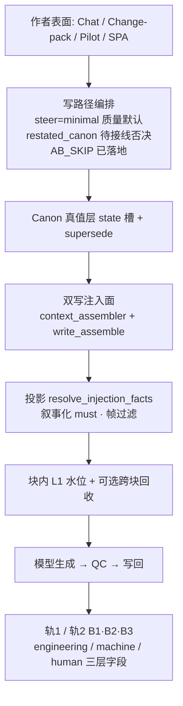
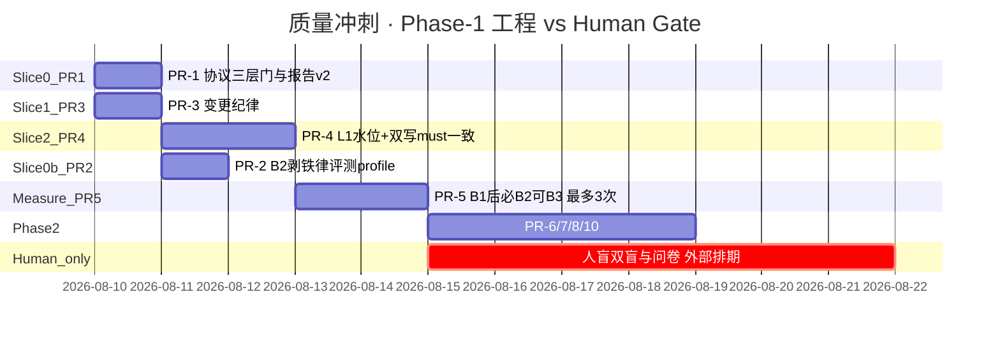
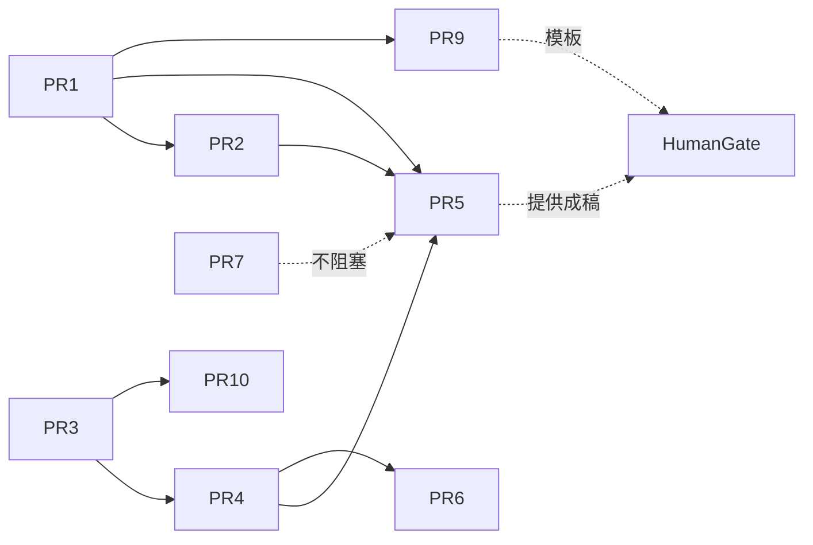

# 七维记忆质量系统性优化设计：从综合 ~7.3 逼近 ≥9.5（人盲封顶）

| 项 | 值 |
|----|-----|
| **文档标题** | scribe3 七维记忆质量（D1–D7）系统性优化设计 |
| **副标题** | 工程可审计路径 + **人盲质量封顶**；machine 门 ≠ 质量 9.5 |
| **作者** | （待填） |
| **日期** | 2026-08-09 |
| **状态** | **Accepted rev.4**（Open Questions 全拍板 · 最大化真实分） |
| **产品** | scribe-writing-system / scribe3（铜炉）· MEMORY_FABRIC + SurrealDB + pilot 写路径 |
| **验证环境** | demo 已部署栈 `https://www.qing.blue`（不另起 Surreal / 本机全量 npm 验收） |
| **基线证据** | `artifacts/ab-minimal-book_aa57f17e-ch6-track2-goal/` · 综合 ~7.3 · lead_A−B = **0.5** · `pass_rule_met=false`（heuristic 布尔，**非**人盲） |
| **前序** | `docs/plans/2026-08-09-memory-quality-rootcause-plan.md` · `docs/plans/2026-08-09-memory-quality-best-plan-v4.md` · PR-A/B/C + Wave 叙事化 must-link |
| **约束** | 不上 Graphiti 全量产品；不重写 fabric；不做新大框架；**禁止**因 M0–M6 绿或仅 heuristic 宣称任一维 ≥9.5 |

---

## Overview

当前 demo 上，长篇共写系统在「记忆工程地板」已大体打通：fabric 可开关、注入面有单真投影、`no_must_facts` 轨 2 消融可跑、usage_digest 可展示 `conflicts_dropped`。但七维**质量语言**综合仍约 **7.0–7.3/10**，轨 2 A/B 的 `lead_A_minus_B = 0.5`，且 **heuristic `pass_rule_met` 从未为 true**。根因不是「库没记」或「探针不够绿」，而是整条链——**真值槽位 → 注入产品形态 → 双写路径（assembler + write_assemble）→ 上下文预算 → 写作环/铁律旁路 → 写回 → 测量协议与人评**——的系统性错位。

本设计提出一条**不换库、不重写 fabric** 的增量路径，用**三层闸门**把工作拆开（见下）。核心判断有两层：

1. **「探针更绿」的边际收益已接近零**；≥9.5 必须人盲。  
2. **在现有 `score_pair` heuristic 下，仅强化 A 几乎不可能让 lead≥1.5**（A 的 echo/contra 已近顶，B 均分约 4.1 时 lead 理论上限约 **0.9**）。若坚持「不改 scorer、不降 lead 阈值」，则 **B 纯化（B2/B3）必须进入 machine 门主路径实验**，不能只写「可选诊断」。

### 成功定义分层（强制阅读）

| 层 | 字段名（建议写入 scores/artifact） | 含义 | 是否等于「质量冲刺完成」 |
|----|-----------------------------------|------|--------------------------|
| **工程成功** | `engineering_gate` | lead≥1.0 且 A 三项均 ≥4.0（heuristic）；无假绿；AB 终态 settings 干净 | **否** |
| **机器对照通过** | `machine_pass_rule_met` | 三项≥4.5 且 lead≥1.5（**纯 heuristic 布尔**，即今日 `pass_rule_met` 语义） | **否** |
| **质量 9.x / 9.5** | `human_pass_rule_met` | 人盲三项同门槛（或协议约定量表）+ 分维人证 | **是（唯一）** |

- **PR 合入 / 轨 2 重跑绿 ≠ 质量冲刺完成。**  
- 所有 ≥9.x 宣称**只读** `human_pass_rule_met`（及分维人证）。  
- 工程 PR 描述 checklist：**不得出现任维 ≥9.5**。

---

## Background & Motivation

### 当前状态（必须锚定）

| 指标 | 实测值 | 来源 / 读法 |
|------|--------|-------------|
| 综合粗评 | **~7.3 / 10** | `12-quality-d1-7-rescore.md` |
| 轨 2 A 均分 | 4.600（coh 4.0 / echo 4.8 / contra 5.0） | `scores.json` |
| 轨 2 B 均分 | 4.100（coh 3.5 / echo 3.8 / contra 5.0） | 同上 |
| **lead A−B** | **0.5** | 同上 |
| `pass_rule_met` | **false** | **heuristic 布尔**（代码 `score_pair`）；**不含**人覆核 |
| 锚点差分 | A：三棱铜匙=2、缺口=4；B：皆 **0** | 同上 |
| usage-preview | A/B 响应 **HTTP 200** | **仅表示接口可达**，不是注入条数，也**不能单独证明** fabric ON |
| 轨 2 B 未关 fabric 的有效证据 | ablation=`no_must_facts` + 脚本 finally 前 fabric 保持 ON；双方 digest 仍有 global/铁律类源；B 无 must/fact 压力钉（见 usage 结构 / omitted） | 应写入 AB 退出断言，**禁止**用裸 HTTP 200 验收 |
| scorer | `heuristic_v1_not_human_blind` | 书专用锚点；非人盲 |

分维（本轮重评）：

| 维 | 分 | 封顶原因摘要 |
|----|-----|--------------|
| D1 诚实 | 6.5 | 未写入对抗未完成；conflicts 能力有但人证不足 |
| D2 铁律 | 8.0 | **global** `intent:author_constraints` + write_assemble 铁律块在；B 铜腥仍高=旁路；无人抽 5 章 |
| D3 正典叙事 | 7.5 | 轨 2 echo 拉开 +1.0；仍非人读非清单满分 |
| D4 变更一致 | 8.0 | 样书无双真；无人评「改过像改过」 |
| D5 少喂连贯 | 7.5 | minimal 成稿；lead 仅 0.5 |
| D6 限知 | 6.5 | 问卷模板有、**无人答** |
| D7 增益 | 7.0 | 可归因增益可见；**`machine_pass_rule_met=false`** → 工程不得报 D7≥9；**人盲未做** → 不得报 ≥9.5 |

### 痛点

1. **作者可感知增益不足**：关 must+facts 后 B 仍能成稿且矛盾满分；A 只在物件回指上「略好」。  
2. **非记忆旁路抬高 B 地板**：synopsis、**global 铁律**（`red_lines` / 铜腥类感官）、write_assemble 圣经块、模型常识；（历史）pilot 版本 restore——轨 1 关 fabric 时 lead 常 0.0–0.5。  
3. **测量与质量语言错位**：M 绿 ≠ 七维；heuristic 吃字数与书锚计数；与人感不等价。  
4. **人评缺位**：无法合法宣称任一维 ≥9.5。  
5. **machine 门与 scorer 包络冲突**：在现公式下「只强化 A + 不改 scorer + lead≥1.5」三者不可同时当真（见下一节）。

### 根因栈

```text
R1 真值槽位错位     collapse 键=(entity,attr)；变更常另开 attr / 嵌态进 value
R2 注入冲突          must 曾并列互斥〔必需〕（D4 双真已大体修，需防回归）
R3 steer/验收脱节    强 steer 灌锚 vs 产品/质量默认 minimal
R4 认知模型薄        scrub 明文 ≠ who-knows-when；部分路径已 partition，缺口在旁路与 fail-soft
R5 写回污染          章后提取/升格；global 已 main_cast，仍需扫其它入口
R6 量表错位          M 绿 / heuristic ≠ 人盲；且 heuristic lead 包络极窄

+ 非记忆旁路：
  · pilot 版本 restore（AB_SKIP_VERSION_RESTORE **已缓解**）
  · global 铁律 + write_assemble 铁律/圣经 **不随 no_must_facts 关闭**
  · synopsis + 模型基线
  · detect_author_restated_canon **仅协议/单测，生产路径未接线**
```

---

## Goals & Non-Goals

### Goals

1. **系统策略**：架构 + 业务 + 产品效果一体路线，使 D1–D7 有**可审计**逼近 ≥9.5 的路径（**终点含人盲**，非纯工程）。  
2. **解释天花板**：为何 ~7.3 / lead 0.5 是探针高原；并给出 **heuristic 可达包络**。  
3. **有序工程**：Slice + **机门 / 人门分离**；每工程切片可 demo 热更冒烟。  
4. **诚实边界**：无人评时各维封顶；`machine_pass_rule_met` ≠ 质量 9.5。  
5. **政策决策**：pass_rule 分层字段；B 臂在 **machine 门**下的必选/可选；scorer 是否降级为哨兵。

### Non-Goals

- 不上 Graphiti 全量；不换 Surreal；不重写 MEMORY_FABRIC 八块宪法切分。  
- 不为验收再起第二套 Surreal / 本机全量 npm。  
- 不把 M0–M6 再刷一轮当质量交付。  
- 不把 LLM-as-judge 当作唯一封顶。  
- **不在工程 PR 内「完成双盲」或承诺 1.5 周内人盲出分。**

---

## Heuristic 分数分解与可达包络（阻塞级）

依据 `scripts/run_memory_ab_minimal.py` → `score_pair`（`heuristic_v1`），三项均分：

\[
\mathrm{avg}=\frac{\mathrm{coherence}+\mathrm{canon\_echo}+\mathrm{contradiction}}{3},\quad
\mathrm{lead}=\mathrm{avg}_A-\mathrm{avg}_B
\]

### 分项公式（摘要）

| 项 | 起点 | 加/减分条件 | 封顶 |
|----|------|-------------|------|
| **coherence** | 2.0 | +1.0 if 字数≥3000；+0.5 if ≥3800；+0.5 if ≥4500；+0.5 if 无「沈拾灯」 | 5.0 |
| **canon_echo** | 1.5 | 覃灰七≥3 →+0.8；匙≥1 **或** 缺口≥1 →+1.0；铜腥/炉灰≥1 →+0.7；冷锅婆≥1 →+0.5；香债≥1 →+0.3 | 5.0 |
| **contradiction** | 5.0 | 完整无缺∧缺口 −2；完整无缺∧synopsis 含缺口 −1.5；沈拾灯 −2；A7 全文 −1.5 | ≥1.0 |

**注意：** coherence **几乎只吃字数档 + 禁串书名**；与 L1 预算、叙事 must **无直接计分因果**。L1 最多间接帮助「写更长/更稳」碰字数档。  
按 `score_pair` 累加：起点 2.0 +1.0(≥3000) +0.5(≥3800) +0.5(无沈拾灯) = **4.0**；再要到 **4.5** 必须再触发 **+0.5（字数≥4500）**。基线 A=4105 已满足 ≥3800 与无沈，**差的就是未触 ≥4500**——与 must 形态无关。

### 基线分解（book_aa57f17e ch6）

| | A | B |
|--|---|---|
| 字数 | 4105 → coh 档：2+1+0.5+0.5(无沈)=**4.0**（未 ≥4500） | 3346 → 2+1+0.5=**3.5** |
| echo 贡献 | 覃灰七+匙/缺口+铜腥+冷锅婆+香债 ≈ **4.8** | 覃灰七+铜腥+冷锅婆+香债（无匙/缺口）≈ **3.8** |
| contra | 5.0 | 5.0 |
| avg | 4.6 | 4.1 |
| lead | **0.5** | |

### A 天花板

- echo 已 4.8，最多再 +0.2 → 5.0。  
- contra 已 5.0。  
- coh 最大 5.0（字数≥4500 且无沈拾灯）。  
- **A avg 上限 = 5.0**。

### 仅强化 A、B 维持 4.1 时的 lead 包络

| A 状态 | avg_A | B=4.1 时 lead |
|--------|-------|----------------|
| 基线 | 4.6 | 0.5 |
| coh→4.5（字数≥4500），echo/contra 不变 | ≈4.767 | **≈0.67** |
| A 全满 5.0 | 5.0 | **0.9** |

**结论：在 B 均分保持 ≈4.1 时，lead 理论上限 ≈0.9 ≪ 1.5，也达不到 engineering 的 1.0。**  
「优先只做 L1/强化 A」**不能**作为 `machine_pass_rule`（lead≥1.5）的充分策略；对 `engineering_gate`（lead≥1.0）也**不够**，除非 B 同时下降。

### 要 lead≥1.5 时 B 必须多低

| 目标 lead | 若 avg_A=5.0 | 若 avg_A=4.6（基线） |
|-----------|--------------|---------------------|
| ≥1.0 | B≤4.0 | B≤3.6 |
| ≥1.5 | B≤3.5 | B≤3.1 |

B 基线 echo=3.8 的堆法（无匙/缺口时仍可得）：覃灰七(+0.8)+铜腥(+0.7)+冷锅婆(+0.5)+香债(+0.3)+底 1.5=**3.8**。  
在 contra 仍 5.0、coh 仍 ≥3.5 时，要把 B avg 压到 ≤3.5，需要 **明显打掉 echo 与/或字数**——接近 **B2（剥剧情铁律/铜腥源）+ 往往还要 B3（评测 synopsis 脱敏）**，而不是「B 臂定义维持 B1 不动」。

### B2 单独对 lead 的包络（必须读）

假设 B2 去掉铜腥/炉灰类铁律贡献（echo −0.7：3.8→3.1），B coh/contra 仍 3.5/5.0：

| | B avg | vs A=4.6 lead | vs A=5.0 lead |
|--|-------|---------------|---------------|
| B1 基线 | 4.1 | 0.5 | 0.9 |
| **仅 B2** | ≈ **3.87** | ≈ **0.73**（**仍 &lt; G-eng 1.0**） | ≈ **1.13**（过 eng，**仍 &lt; G-mach 1.5**） |

**结论：B2 单独通常不够 `engineering_gate`（在 A 保持基线时），更不够 `machine_pass_rule`。** 冲 lead 的强制 escalation 必须含 **B3**（或接受方案 G），不能停在 B2。

### 策略含义与 Phase-1 成功定义（rev.3 钉死）

```text
路径 α · 坚持 scorer 不变 + 尽力冲 machine_pass_rule
  → Phase-1 测量强制：B1 →（lead 未过门）B2 →（仍未过）B3，均计入「最多 3 次真写章」
  → 仍可能门全红：合法结束，进入 Open Q5 / 方案 G——**不**算 Phase-1 失败

路径 β · 坚持产品 B1 + 少动 B
  → 不承诺 G-eng/G-mach；heuristic 可降 soft gate（方案 G）

路径 γ · 改 scorer
  → 不作为首选
```

#### Phase-1 成功定义（不含 G-mach 必过）

| 必达（工程交付） | 尽力而为（数字记录，失败不挡结案） |
|------------------|-------------------------------------|
| PR-1 三层 gate 字段 + 报告 v2 + settings 终态断言 | `engineering_gate` 通过 |
| PR-3 双真回归绿 | `machine_pass_rule_met` 通过 |
| PR-4 L1 水位 + 双写 must 一致 + 可归因退出 | 任意 lead 提升相对 B1 基线 |
| PR-2 B2 profile 可开关、测试钉死 keep 默认 | — |
| PR-5：**按 escalation 跑完预算内 AB**，产出包络验证表 | — |
| 纪律：无假 9.5、无人盲宣称 | — |

**禁止**实现者默认「做完 B2 应过 lead」。G-eng/G-mach 失败 → 记数 + **Open Q5 → 方案 G**，Phase-1 仍可标 **工程交付完成**。

KD6：**产品体感优先强化 A；machine lead 强制 B1→B2→B3 escalation（3 次内）；仍不够则方案 G——禁止假装 L1 或单 B2 达标。**

---

## 为何 ~7.3 与 lead 0.5 是「探针更绿」的天花板

| 层 | 状态 | 再堆探针边际 |
|----|------|--------------|
| 链路通 / 注入 / 消融 | 已绿 | ≈0 |
| 单真 / 双真 | 大体绿 | 小（防回归） |
| heuristic lead≥1.5 | 受 **scorer 包络** 锁死 | 探针测不到；要 B 纯化或改门 |
| 人盲 ≥9.5 | 未做 | **探针永远不能代替** |

---

## Proposed Design

### 一句话策略

> **锁真值地板 → 双写路径注入一致 → 在块语义内做 L1 水位线 → 为 machine 门做 B 纯化/脱敏实验 → 认知旁路收口 → 写回扫尾 → 人盲封顶。**  
> 禁止：再堆探针、圣经 steer 刷 A、用 M/`machine_pass_rule` 宣称 9.5、把「只强化 A」写成 lead≥1.5 的充分条件。

### 目标逻辑架构



### 架构原则

| # | 原则 | 说明 |
|---|------|------|
| P-A1 | 单真槽位 | `state` + `STATE_SLOT_ATTRS` 互 supersede |
| P-A2 | 读路径投影 | 注入只消费 `resolve_injection_facts*` |
| P-A3 | 注入是产品 | 戏剧压力句；**assembler 与 write_assemble 同源** |
| P-A4 | **块感知** L1 水位 | 见下方算法；**不是**「episodic 与 state 抢同一 top-k 池」的误述 |
| P-A5 | 认知帧 | 有 focalizer 时 partition；标清 fail-soft 缺口 |
| P-A6 | 测量可归因 | 消融面显式集合；B1/B2/B3 分报 |
| P-A7 | 写回分层 | 新建角色 extra；global main_cast 已有，扫其它升格口 |

### 关键代码触点：已落地 / 缺口 / 本设计增量

| 模块 | 已落地 | 缺口 | 本设计增量 |
|------|--------|------|------------|
| `fact_surface.py` | `STATE_SLOT_*`、`resolve_injection_facts_with_stats`、互斥对 | 变更 API 边缘路径；历史 open 双行 | 回归探针质量化；可选 offline close |
| `memory_must_link.py` | ablation 三态；`format_*_as_drama`；age 加权；`must_link_limit` 默认 **10**、clamp 3–24；`detect_author_restated_canon` **纯函数** | restated **未接**写路径/AB；limit 在 write_assemble 调 `must_link_limit(8)` 与 assembler(10) 不一致 | 统一 limit 默认；restated 接线（独立切片）；帧过滤与 write 路径对齐 |
| `context_assembler.py` | 八块 `BLOCK_BUDGETS`；`_pin_must_link`；ablation 滤 fact；`_main_cast_names`；`_canonical_all_facts` 在 **有 focalizer** 时 `partition_facts_for_focalizer`（fail-soft log）；`_filter_must_anchors_for_frame`；global **铁律** `intent:author_constraints` | 无 focalizer 全知仍转储（设计如此）；partition **fail-soft**；无跨块 L1 水位线字段；铁律在 **global 不随 no_must_facts 关** | L1 水位线（见伪代码）；digest 暴露 `l1_fill`；评测 profile 可剥铁律 |
| `api/services/write_assemble.py` | `_brief_must_sections_write_block` 独立 `collect_must_anchors`；铁律/红线进 editor system；codex 圣经块 | **与 assembler 并行双注入**；must limit(8)；**未见** partition 后再钉 must；铁律与圣经抬 B | **PR-4 必含**：统一 must API、帧过滤、limit；验收抓 pilot 真路径 |
| `epistemic_guard.py` | partition / banners / secret surface | 问卷人答；部分旁路 | 旁路清单收口；D1/D6 人门模板 |
| `memory_gain.py` | `comparison_protocol` v2；usage_digest + conflicts | 报告字段三层门；脚本仍写 ab_v1 | PR-1 对齐 v2 + 三层字段 |
| `canon_apply_store.py` | 新建角色默认 `importance=extra` | 其它 ingest/升格口 | PR-7 扫 `canon_loop` / pilot 应用路径 |
| `scripts/run_memory_ab_minimal.py` | track 1/2；AB_SKIP；heuristic；finally 恢复 | 协议名 v1；无 restated 检查；无 B2/B3；无 settings 终态断言；HTTP 200 易被误读 | PR-1/2/5 规格 |
| pilot / v63 | AB_SKIP env | restated 否决 | 见 restated 切片 |

### 业务逻辑

#### 1) 设定变更（D4）

同前：状态类 → `normalize_state_attribute` → supersede 同 entity 状态槽 → 注入零双真。人评「改过像改过」才允许 D4≥9.5。

#### 2) 开写指令（D5）与 restated_canon（**待接线，非已缓解**）

质量验收默认 `SCRIBE3_MEMORY_STEER_MODE=minimal` + `minimal_chapter_steer`。

**`detect_author_restated_canon` 接线规格（机器门可交付，与 AB_SKIP 分离）：**

| 项 | 规格 |
|----|------|
| **现状** | 函数在 `memory_must_link.py`；单测 `test_memory_must_link.py`；`comparison_protocol` 文案提及；**`app_impl` / pilot / `run_memory_ab_minimal` 未调用** |
| **检测点（建议）** | （1）AB 脚本：A/B 开写前对 **steer 文本** post-hoc；（2）可选 pilot step：若 `mode=manual` 且 body 超阈值锚命中 |
| **否决语义** | **不阻断生成**（避免卡作者）；**作废质量分**：`scores.json` 增加 `void_reason: "restated_canon"`，`engineering_gate`/`machine_pass_rule_met` 强制 false |
| **产物** | artifact `void_reason`；日志一行；usage 可选 `quality_void` |
| **非目标** | 与 `AB_SKIP_VERSION_RESTORE` 混谈「已缓解」——后者 **已落地**，前者 **未做** |

#### 3) 注入优先级与双写路径

生产实际有两路：

1. **Context envelope**（`context_assembler`）：focus → **global（铁律+伏笔+main cast）** → **canonical（must pin + facts）** → recent → procedural → …  
2. **Write instructions**（`write_assemble`）：editor system（铁律/圣经）+ `_brief_must_sections_write_block` + outline/brief 操作段。

**目标：** 戏剧 must 只通过共享函数组装（文本一致、limit 一致、帧过滤一致）；禁止一路叙事化、一路清单化；AB 验收必须对 **pilot 真写路径** 做 digest/抓包，不能只用 usage-preview。

#### 4) 消融臂定义（B0–B3）

| 臂 | A | B | 用途 |
|----|---|---|------|
| **B0 / 轨1** | fabric ON | fabric OFF | 产品总开关体感 |
| **B1 / 轨2 现状** | must+facts | `no_must_facts`（**保留 global 铁律**） | 产品叙述主对照 |
| **B2** | 同 B1-A | B1-B + **剥全部 red_lines 写路径注入**（见铁律 ADR 清单；评测 profile） | machine 纯化第 1 步（常仍不够 G-eng） |
| **B3** | 同 A | B1-B 或 B2-B + **评测 synopsis 脱敏**（仅冲突一句） | machine 纯化第 2 步（**Phase-1 escalation 强制可跑**，计入 3 次预算） |

D2 与 D7 **分报**：B2/B3 跑的是 D7 归因，不在该臂上宣称 D2 铁律仍进文。  
**默认 B3 叠在 B2 上**（strip 铁律 + 脱敏 synopsis），以最大化压 B；报告字段 `b_arm=b2|b3`、`synopsis_profile=full|desensitized`。

#### 5) 限知（D6）

- **已有：** `partition_facts_for_focalizer` 在 `_canonical_all_facts`（有 focalizer）；must `_filter_must_anchors_for_frame`。  
- **缺口：** partition **fail-soft**（异常只 warning，facts 可能全量）；write_assemble must **未**走同一帧过滤；无 focalizer 全知转储仍含 secret 标注可见（产品语义，但评测需标明）。  
- **增量：** 收口旁路；评测 fail-loud 开关可选；问卷人答。

### L1 预算：可实现语义与伪代码（回应「硬预留」）

#### 澄清误述

当前架构是 **八块分预算**（默认每块顶格和为 10_000），**不是**单一 top-k 池。因此「Episodic 挤掉 state」**不会**以「recent 与 canonical 抢同一排序列表」的方式发生。真实挤出场景包括：

| 机制 | 说明 |
|------|------|
| **块内裁剪** | `canonical` 内 candidate + must pin 后按 token 裁到 `BLOCK_BUDGETS["canonical"]=2800`；若 must 未 pin 头部、噪声 fact 过多，**关键 state 可能在块内被裁掉** |
| **总额下调** | `token_budget` &lt; 八块之和时，**靠后块整块省略**（recent/procedural…）；canonical/global 在前，一般仍在——但若未来调序会变 |
| **双写洪水** | write_assemble 的 codex 圣经 + brief **不在** envelope 预算内，可淹没 must 信号（对模型注意力） |
| **global 内排序** | 铁律/伏笔/角色同块；条数膨胀时靠后项可能被块预算裁 |

**「L1」定义（本设计）：** 对写作质量关键的 **global 子集 + canonical 子集**，在**各自块内**享有水位线保护；可选从 **recent** 回收 token 补给（总额紧张时）。

#### L1 成员（source_id / reason）

| 优先级 | 成员 | 所在块 | 识别 |
|--------|------|--------|------|
| L1-a | 作者铁律 | **global** | `source_id=intent:author_constraints` 或 `reason=author_constraint_must_follow` |
| L1-b | 开放伏笔摘要 | global | `promises:open` |
| L1-c | 主角层 | global | `characters:main` + `main_cast_only` |
| L1-d | must 压力锚 | **canonical** | `must_link*` / `reason=must_link_priority` |
| L1-e | 投影后 state 类 fact | canonical | attr∈ state/condition/status 或 drama state 句 |

Episodic/working → **recent**，不进入 L1。

#### 挂载点（与现网对齐）

现网路径：`assemble` → 填 `items`（canonical 已 `_pin_must_link`，must 在列表**头部**）→ `_allocate` → 各块 `_truncate_items(header, items, BLOCK_BUDGETS[name])`（**按列表顺序**贪心截断）。

| 决策 | 规格 |
|------|------|
| **调用点** | `ContextAssembler._allocate` **入口**：对 `global` / `canonical` 先 `reorder_l1_first(items[name])`（或完整 `protect_l1` 预裁），再调用现有 `_truncate_items` |
| **与 must pin 关系** | must 已在头部 → L1 重排 **idempotent**：已在前的 must/铁律保持相对序，仅把误排在后的 state 类 fact **稳定上移**到非 L1 噪声之前 |
| **不**默认改八块顺序或 total token 门 | 跨块从 recent 回收 → Phase-2 可选 |

#### `_is_state_fact_item` 定义

```text
def _is_state_fact_item(it: _Item) -> bool:
    """canonical 块内：非 must 的 state 类事实，仍享 L1 水位。"""
    sid = str(it.source.source_id or "")
    reason = str(getattr(it.source, "reason", "") or "")
    text = it.text or ""
    if "must_link" in sid or reason.startswith("must_link"):
        return False  # 已由 must L1 覆盖
    # fact 源：source_id 形如 fact:… 或正文含「当前状态」叙事句
    if not (sid.startswith("fact:") or "fact:" in sid or "·" in text):
        return False
    # 状态槽：attribute 片段或叙事化 format_fact_as_drama 产出
    state_markers = (
        "·state", "·condition", "·status", "当前状态",
        "外观状态", "state:", "condition:",
    )
    if any(m in text for m in state_markers):
        return True
    # 互斥态词（与 fact_surface 对齐的最小集）
    return any(k in text for k in ("缺口", "完整无缺", "残缺", "冷死", "未冷"))
```

#### 算法（最小可实现）

```text
# 文件: context_assembler.py

L1_GLOBAL_IDS = {"intent:author_constraints", "promises:open", "characters:main"}

def _is_l1_global(it: _Item) -> bool:
    return (it.source.source_id in L1_GLOBAL_IDS
            or getattr(it.source, "reason", "") == "author_constraint_must_follow")

def _is_l1_canonical(it: _Item) -> bool:
    sid = str(it.source.source_id or "")
    reason = str(getattr(it.source, "reason", "") or "")
    if "must_link" in sid or reason.startswith("must_link"):
        return True
    return _is_state_fact_item(it)

def reorder_l1_first(items: list[_Item], is_l1) -> list[_Item]:
    """稳定分区：L1 保持原相对序在前，非 L1 在后。idempotent。"""
    l1 = [it for it in items if is_l1(it)]
    rest = [it for it in items if not is_l1(it)]
    return l1 + rest

def _allocate(self, items):  # 改动点
    # 1) L1 重排（global / canonical）
    if "global" in items:
        items["global"] = reorder_l1_first(items["global"], _is_l1_global)
    if "canonical" in items:
        items["canonical"] = reorder_l1_first(items["canonical"], _is_l1_canonical)
    # 2) 既有：按块 _truncate_items（顺序截断 → L1 已在前则优先保留）
    # 3) 记 l1_fill：截断后统计仍在 kept 中的 L1 条数 / token
    ...
```

**单测（PR-4 必带）：** 构造 canonical 列表 = `[噪声 fact, state fact, must]` 乱序 → 重排后 must+state 在噪声前 → `_truncate_items` 预算仅够 2 条时 **噪声被丢、state/must 保留**。

**write_assemble 侧（非 envelope）：** 对 `_codex_block` / 圣经段设 **软上限字符数**（settings），避免双写洪水；must_prefix 置顶且与 assembler 同源。**B2 不 strip `_codex_block`**（见铁律 ADR）。

**usage 数据结构：**

```json
"l1_fill": {
  "global": {"l1_items": 3, "tokens_used": 400, "cap": 1200},
  "canonical": {"l1_items": 8, "tokens_used": 900, "cap": 2800}
}
```

### 铁律通道 ADR（D2 证据 vs D7 消融）

| 问题 | 决定 |
|------|------|
| 铁律存在哪里？ | **global** 升格段 + **write_assemble `_editor_system` 两处 red_lines**；**不是** procedural 块主路径 |
| `no_must_facts` 是否关铁律？ | **否**（刻意保留，B1 产品臂） |
| B2 strip 关什么？（**完整清单**） | 见下表；**默认不**改库内 `red_lines` 存储；**不**迁移铁律出 global |
| 是否关整段还是铜腥子串？ | **整段 red_lines 原文不进写路径**（可测）；不做脆弱子串「只关铜腥」 |
| B2 时 D2？ | **该臂不做 D2 通过声明**；D2 人抽只在 **铁律注入 ON** 的稿上做 |
| 产品默认？ | **keep**；测试钉死 B1 vs B2 差异 |
| settings | `SCRIBE3_MEMORY_IRON_IN_ABLATION=keep` \| `strip_on_track2_b` |
| digest | `omitted` reason=`ablation_strip_iron` |

#### B2 strip 实现清单（PR-2 验收用）

| # | 位置 | 代码锚点 | strip 行为 |
|---|------|----------|------------|
| 1 | assembler global | `source_id=intent:author_constraints` / `reason=author_constraint_must_follow` | **跳过**该 `_Item`；记 omitted |
| 2 | write_assemble | `_editor_system` 独立 **`constraint` 块**（【作者铁律·写作宪法】…） | **不生成**整块 |
| 3 | write_assemble | `_editor_system` **北极星行内** `绝不背叛的红线:{intent['red_lines']}`（与 constraint **并列的第二注入点**） | 子句改为 `绝不背叛的红线:—` 或整段省略 red 字段；**禁止**只删 constraint 而留下行内全文 |
| 4 | write_assemble | `_codex_block`「本书设定圣经」 | **B2 不 strip**（可含世界规则/感官；若实验需要单列 **B2b**，不进默认 B2） |
| 5 | assembler global | `intent:main` 北极星摘要行内 `红线=…` | strip 时 **同步**将红线显示为 `—`（与 #3 一致，防第二通道） |

**单测：** strip profile 下，组装得到的 editor system **字符串不包含** `red_lines` 原文（用样书红线固定串断言 `not in`）；keep 下则包含。  
**风险：** 若只做 #1+#2 而漏 #3/#5 → 铜腥类旁路实验 **假阴性**，浪费 AB 预算。

### 分维杠杆与无人评上限

| 维 | ≥9.5 | 系统杠杆 | 无人评上限 |
|----|------|----------|------------|
| D1 | 对抗 + conflicts 可见 | 接线 restated；digest；对抗脚本 | ≤6.5–7 |
| D2 | 人抽 5 章铁律进文 | global 铁律 ON 稿；标明依赖 brief/global | ~8 工程 |
| D3 | 人读非清单 + 轨2 echo 差 | 双写叙事化；L1 must | ~8 |
| D4 | 零双真 + 人感 | 变更纪律 | ~8–8.5 |
| D5 | A 显著优于 B（人） | 与 D7 共用稿 | 机可测 lead |
| D6 | 问卷否≥80% | partition 旁路收口 | ≤6.5 |
| D7 | **`human_pass_rule_met`** | B2/B3 冲 machine；人盲封顶 | machine 未过不得报 ≥9；人盲未过不得 ≥9.5 |

### 拉开 lead：修订后的工程手段

| 杠杆 | 对 heuristic lead | 对产品体感 | 优先级 |
|------|-------------------|------------|--------|
| A 字数≥4500（coh+0.5） | lead +≈0.17 | 弱 | 低（投机） |
| A 侧 L1 / 双写一致 | **不直接**进公式；锚点差分可稳 | **强** | 产品主路径 |
| **B2 剥铁律（完整双点）** | echo 约 −0.7 → lead 常仍 &lt;1.0 | 评测 | escalation **第 1 步**（必做） |
| **B3 synopsis 脱敏** | 进一步压 B 基线 | 评测 | escalation **第 2 步**（B2 不够则 **必做**） |
| 改 scorer | 可刷 lead | 不增真实贡献 | 不首选 |
| 人盲 | 不进 heuristic | **质量唯一** | 封顶 |

**PR 退出禁止**把「lead≥1.0/1.5」写成 L1 单 PR 的必然交付；改为可归因指标（见 PR Plan）。

---

## API / Interface Changes

| Key / 字段 | 行为 |
|------------|------|
| `SCRIBE3_MEMORY_FABRIC_V1` | 轨1 B 关 |
| `SCRIBE3_MEMORY_ABLATION` | none / no_must / no_must_facts（B1） |
| `SCRIBE3_MEMORY_IRON_IN_ABLATION` | `keep`（默认）/ `strip_on_track2_b`（B2） |
| `SCRIBE3_MEMORY_STEER_MODE` | minimal 质量默认 |
| `SCRIBE3_MUST_LINK_LIMIT` | 已存在；**统一** assembler/write 默认 10（改 write 侧 default 8→与 settings 一致） |
| scores.json | `engineering_gate`, `machine_pass_rule_met`（=现 pass_rule_met 语义）, `human_pass_rule_met`（默认 null）, `void_reason` |
| AB 退出断言 | `GET settings` ablation=none fabric ON；B 跑中读回 ablation；digest 结构；**禁止**仅 HTTP 200 |

---

## Data Model Changes

- 逻辑槽位 `state` 同前；规则文本存 **intent.red_lines**（既有），不新造 procedural 表字段。  
- 「规则 procedural vs canon」澄清：写作宪法 = intent 红线 → **global 注入**；工艺 lessons → **procedural** 块——勿混。  
- 写回：`canon_apply_store` 已 extra；PR-7 检查 `canon_loop` apply / pilot 升格是否绕过。

---

## Alternatives Considered

### A · 只刷 M 探针  
否决为主路径（边际 0）。

### B · Graphiti 全量  
否决（约束 + 痛点不在库）。

### C · 降低 pass_rule lead 阈值  
否决为**对外**主张；对内可用 engineering_gate。

### D · 本设计：注入一致 + L1 水位 + B2/B3 冲 machine + 人盲  
**采纳**（修订后含 scorer 包络诚实）。

### E · LLM-as-judge 唯一封顶  
否决；可辅助。

### F · 评测 synopsis 脱敏（B3）为一等 machine 方案  
- **优点：** 不关铁律也能压 B 基线；对「记忆贡献」更干净。  
- **缺点：** 与真实连载「有大纲」不完全同分布。  
- **结论：** **与 B2 并列**为 machine 主路径实验；报告必须标 `synopsis_profile=desensitized`。

### G · heuristic 降级为 soft gate；主机器证据 = 锚点差分 + digest；质量 = 人盲  
- **优点：** 避开 lead 0.9 包络死局；诚实。  
- **缺点：** 失去单一 lead 数字 KPI。  
- **结论：** 若 α 路径（B2/B3）多轮仍无法稳定 machine_pass，**升级为默认测量政策**（与 KD3 对照：正式「三项+lead」可保留为 **human 层** 或弃用 machine lead，改为 human-only lead）。

### H · 改 scorer 降铜腥权重 / 书无关锚  
- **优点：** 易抬 lead。  
- **缺点：** 刷分风险。  
- **结论：** 仅允许 **书无关锚点协议** 作为后续，且与人盲绑定；禁止为过 machine 门临时改阈值。

---

## Security & Privacy

| 威胁 | 缓解 |
|------|------|
| secret 进 prompt | partition + must 帧过滤 + scrub；收口 write_assemble |
| digest 泄露 value | `build_usage_digest_from_manifest` 只 label；前端 Codex 叶 secret 不展值（`codexTree.js` / `CodexDetail.jsx`）；**契约**：usage-preview 单测断言无 raw secret value |
| 消融误留 | AB **finally** + PR-1 验收 `GET /api/settings` 终态；异常路径也恢复 |
| B2 当产品默认 | 测试钉死 keep；settings 默认 keep |

---

## Observability

| 信号 | 用途 |
|------|------|
| `conflicts_dropped` | D1/D4 |
| `l1_fill` | L1 水位 |
| `omitted.reason` ∈ {ablation_no_must_facts, ablation_strip_iron, budget_after_l1} | 对照纯度 |
| 三层 gate 字段 | 防误读 |
| AB 终态 settings 冒烟 | 防误留 |

---

## Rollout Plan

### 时间盒（修订）

| 阶段 | 范围 | 日历 |
|------|------|------|
| **Phase-1 主路径（约 1–1.5 周工程）** | PR-1 + PR-3 + PR-4 + PR-2(B2 profile) + PR-5（**B1→B2→B3 escalation**，≤3 次真写章） | 不含人盲；**成功定义见上节（不含 G-mach 必过）** |
| **Phase-2** | PR-6 旁路收口、PR-7 写回扫尾、PR-8 D1、PR-10 清洗；方案 G 若启用 | 随后 |
| **Human Gate** | 双盲 + D6 问卷 + D2 五章 + D4 人感 | **外部排期，不进 1.5 周承诺** |

### Gantt（与 PR Plan 对齐；人机分泳道）



**说明：**  
- PR-3 ∥ PR-1；PR-2 ∥ PR-4（均依赖 PR-1）。  
- **PR-5 依赖 PR-4 与 PR-2**（Gantt `after p4 p2`）：无 B2 profile 不得宣称「已做 lead 纯化重跑」。  
- PR-5 **强制 escalation**（见 Slice-2m / PR-5）：不是「可选若冲 lead」。

### 闸门（仅两档机器 + 人门）

| 闸门 | 条件 | 主体 |
|------|------|------|
| **G-eng `engineering_gate`** | lead≥**1.0** 且 A 三项均 ≥**4.0**；无 void；settings 终态干净 | 机器 |
| **G-mach `machine_pass_rule_met`** | 三项≥**4.5** 且 lead≥**1.5**（heuristic） | 机器 |
| **G-hum `human_pass_rule_met`** | 人盲达协议 | **人** |
| G-dualtruth | 变更后 prefetch 无互斥短语 | 机器 |
| G-attr | 锚点差分（匙/缺口 A&gt;0 且 B=0 等）+ digest 结构 | 机器（**不**替代 lead） |

**删除**中间档 coh≥4.3；中期不再写「A coh≥4.5 作为 engineering 条件」。A coh≥4.5 仅作为 **G-mach 的子条件之一**（与协议一致）。

回滚：settings `ablation=none`、`IRON=keep`、fabric ON；热更上一 backend。

---

## 有序工作程序

### Slice-0 · 测量（PR-1，0.5–1 天）

- 三层字段；报告 `memory_gain_ab_v2`；human 空槽模板；AB 终态 settings 断言；finally 覆盖异常。  
- **退出：** 字段齐全；裸 200 不再当 fabric 证明；**不**要求 lead。

### Slice-0b · B2 profile（PR-2，可与 Slice-2 并行）

- 按铁律 ADR **完整清单** strip（assembler author_constraints + write_assemble **constraint 块 + 北极星行内 red_lines** + global intent:main 红线字段）；**不** strip `_codex_block`。  
- digest `ablation_strip_iron`；单测 editor 串不含 red 原文。  
- **退出：** B1 vs B2 行为测试钉死；默认 keep。

### Slice-1 · 真值（PR-3）

- 变更纪律 + 双真回归；conflicts 稳定。

### Slice-2 · 注入一致 + L1（PR-4）

- `_allocate` 入口 `reorder_l1_first` + 既有 `_truncate_items`；`_is_state_fact_item` 按定义；**write_assemble + assembler** must 同源；limit 统一。  
- **退出（可归因，非 lead）：**  
  - A usage/pilot 抓包：must 压力句存在且非 entity·attr=value 表；  
  - B1：digest/omitted 证明无 must/fact；  
  - `l1_fill` 有值；噪声 fact 单测绿；  
  - **禁止**把 lead≥1.0 写进本 PR 退出。

### Slice-2m · 测量重跑（PR-5）

**强制 escalation（计入「最多 3 次」真写章，顺序固定）：**

```text
Run1: B1（ablation=no_must_facts, iron=keep, synopsis=full）→ 记基线 lead
  若 engineering_gate 已过且不冲 G-mach → 可停（少见）
Run2: 若 lead < 1.0（或目标含冲 G-mach）→ **B2 必做**（iron=strip，完整清单）
Run3: 若仍 lead < 1.0，或目标冲 G-mach 且 lead < 1.5 → **B3 必做**
      （synopsis 脱敏；默认叠 B2 strip）
若 3 次用尽仍未过门 → 结案记录包络表 + 触发 Open Q5 / 方案 G
      Phase-1 工程交付仍算完成（见 Phase-1 成功定义）
```

- **退出：** 包络验证表（每臂 avg/lead/锚点）；声明 G-eng/G-mach 是否通过；**禁止**「质量完成」；**禁止**只跑 B1 耗尽 3 次。

### Slice-3 · 认知旁路（PR-6，Phase-2）

- 列路径矩阵：assembler known / must filter / write_assemble must / 全知转储；补 write 帧过滤；评估 fail-loud 开关。

### Slice-4 · 写回（PR-7，Phase-2）

- 见 PR-7 文件清单。

### Slice-5 · 人门（Human Gate，非工程日估）

- 双盲、问卷、五章铁律、改过像改过；更新 rescore **由人填写**。  
- 工程仅提供模板（PR-1/PR-9 docs）。

### restated 切片（可并入 PR-1 或独立小 PR）

- 见业务逻辑 §2 接线表。

---

## 无人评时什么不可能

| 声明 | 仅工程？ |
|------|----------|
| 任维 **≥9.5** | **不可能** |
| D7 质量 ≥9.5 | 需 `human_pass_rule_met` |
| D7 工程报 ≥9.0 | 需 `machine_pass_rule_met`（仍 **不是** 9.5）；且不得用其对外称质量 9 |
| D6/D1 高分 | 需问卷/对抗人证 |
| 锚点差分、双真消失、三层字段 | 可以 |
| heuristic lead≥1.5 | **仅当 B 足够低或改门**；非 L1 充分 |

**纪律：** 缺人评维封顶 6–7；有工程无矛盾可报 7.5–8.5；**永不** M/heuristic 单独写 9.5。

---

## pass_rule 与 B 臂政策（修订）

| 层 | 阈值 | 用途 |
|----|------|------|
| engineering_gate | lead≥1.0 且 A 三项≥4.0 | 迭代是否有效 |
| machine_pass_rule_met | 三项≥4.5 且 lead≥1.5 | 机器对照（**不**=质量完成） |
| human_pass_rule_met | 人盲同门槛或协议量表 | **唯一** ≥9.5 |

- 对外「记忆在扛」叙述仍以 **B1** 为产品故事。  
- **冲 machine 门：Phase-1 内强制 B1→B2→B3**（3 次预算）；B2 单独通常不够 G-eng。  
- 3 次后仍不稳 → **方案 G**（不阻塞 Phase-1 工程结案）。  
- **不降**对外 lead 1.5 作为「记忆很强」的宣传替代品去对标 0.5。

---

## Risks

| 风险 | 缓解 |
|------|------|
| 只做 A 却承诺 machine 门 | 本文包络 + PR 退出禁 lead 必然 |
| B2 营销尴尬 | 分报轨/臂；对外主讲 B1 体感 |
| 双写不一致 | PR-4 强制 write_assemble |
| 消融误留 | settings 终态冒烟 |
| 人排期拖死 7.x | Human Gate 外置；工程先 G-eng |
| 时间盒乐观 | Phase-1 缩 PR；最多 3 次 AB |
| 本机 OOM | 只热更 demo |

---

## Open Questions（已全部拍板 · 2026-08-09 · 产品定案）

> 原则：**最大化真实七维分与作者可感增益**；贴合真实长篇写作；**不再为「省事/省资源」裁方案**。下列决策为最终，工程按此执行。

| # | 原问题 | **拍板（最优）** | 对分数的作用 |
|---|--------|------------------|--------------|
| OQ1 | 生产默认 steer | **产品默认 `SCRIBE3_MEMORY_STEER_MODE=minimal`**（连载/写章主路径）。`full` 仅显式「作者粘贴设定模式」开关。验收与生产一致。 | 解除 R3 验收/生产脱节；D5/D7 测的即用的；禁止用 full 圣经刷分 |
| OQ2 | B2 是否上 UI | **B2/B3 仅评测与运维**：settings/脚本/质检面板「记忆贡献诊断」，**不进作者默认写章 UI**。产品路径铁律始终注入。 | 真实场景作者需要铁律；B2 只用于可归因测分，不损害 D2 产品体验 |
| OQ3 | 人盲规模 | **双盲成稿对照：≥2 名独立评者**，同 synopsis 轨 2 A/B 各 1 章（可加第 2 章作稳健性）；三项 1–5 + 主观「记忆在扛」Y/N。**D6 问卷 ≥5 人次**（可含作者自测），目标「否」≥80%。允许 LLM-as-judge **预筛**，**不得**单独封顶。 | 唯一能解锁 **≥9.5 宣称**；无此则所有维封顶 ≤8.5 叙事 |
| OQ4 | 方案 H 时间表 | **Phase-1 内与 PR-1 同批落地 scorer v2**：书无关/可被模型空写的锚（如单纯「铜腥」计数）**降权或不计入 canon_echo 主分**；主分改为 **物件态/专名/开放债/关系** 锚 + 可选语义相似。 | 减少 B 组靠感官词刷分；**直接抬可归因 lead**，贴合「记得世界」而非「记得词」 |
| OQ5 | B 纯化失败是否切 G | **是，立即**：B1→B2→B3 用尽仍 `machine_pass_rule` 未过 → **启用方案 G**：heuristic 降 soft gate；**主机器证据** = 锚点差分 + usage_digest + 双真探针；**质量对外** 只认人盲。不再无限重跑 A/B 耗 token。 | 避免假阴性卡死；把预算转给人盲与产品注入 |
| OQ6 | 历史双真 offline close | **做**：demo 主样书（含 aa57 / 4c7815eb 等）**离线扫描互斥 open 行并 close**，投影兜底保留。排进 **PR-10 升为 Phase-1 必选**（与 PR-3 同波）。 | D4 地板与注入面长期干净；减少「旧数据毒化」 |

### 额外加码（用户要求「无约束、最大化分数」）

| # | 决策 | 理由 |
|---|------|------|
| OQ7 | **Phase-1 后立刻排人盲**（不等人「有空再说」）；工程 PR-5 产出成稿即进入 Human Gate | 9.5 瓶颈在人证，不在再堆绿 |
| OQ8 | **restated_canon 生产接线**：写章质量路径检测到作者粘贴圣经 → 记 void + UI 提示，不计入质量分 | 防刷分、逼记忆真扛 |
| OQ9 | **质量默认路径与 SPA 一致**：验收禁止「仅 pilot 脚本强 steer」冒充产品 PASS | 真实场景即 SPA/chat+minimal |
| OQ10 | 若人盲后 lead 主观仍弱 → **下一迭代加大 L1/must 叙事与跨章债**，而非改阈值骗 machine 绿 | 真实增益优先 |

---

## Key Decisions

| # | 决策 | 理由 |
|---|------|------|
| KD1 | 主路径 = 注入一致 + 可归因对照 + 人盲封顶；不换库 | 根因与约束 |
| KD2 | 产品叙述主证 = 轨2 B1；machine 纯化 = **B1→B2→B3** 强制 escalation（3 次内） | B2 单独常 lead≈0.73&lt;1.0；需 B3 |
| KD3 | machine_pass_rule 阈值不降；**Phase-1 成功不含 G-mach 必过**；质量只认 human | 包络诚实；防程序跑完门全红却算失败 |
| KD4 | 禁止 M/heuristic 宣称 ≥9.5；PR checklist 禁写 ≥9.5 | R6 |
| KD5 | D4 继续 state+投影；9.5 要人感 | 双真≠人感 |
| KD6 | 产品强 A；machine **B1→B2→B3** 后仍不够 → **立即方案 G**；禁 L1/单 B2 宣称过 lead | 包络算术 + OQ5 |
| KD7 | 铁律 global + write_assemble **双点 red_lines**；B2 清单含北极星行内；不 strip codex；D2/D7 分报 | `_editor_system` 371–372 行 |
| KD8 | 验证默认 demo 已部署栈；**不限制**必要的 demo 机加重验收（人盲、多臂 A/B） | 最大化真实分 |
| KD9 | **已落地：AB_SKIP**。**待做：restated 生产否决**（OQ8） | 拆分 |
| KD10 | LLM-as-judge 仅预筛；**双盲 ≥2 人 + D6≥5 人次** 才可报 ≥9.5 | OQ3 |
| KD11 | 三层 gate；PR-5 绿 ≠ 质量完成 | — |
| KD12 | Phase-1 = PR1+2+3+4+5+**10**+**scorer H**；**人盲紧接 PR-5** | OQ4/6/7 |
| KD13 | L1 = `_allocate` 前 `reorder_l1_first` + 既有 `_truncate_items`；`_is_state_fact_item` 已定义 | rev.3 Issue 4 |
| KD14 | **生产默认 minimal steer**；full 为可选「粘贴设定」 | OQ1 · 真实写长篇 |
| KD15 | **B2/B3 不进作者写章主 UI**；仅质检/settings | OQ2 · 产品铁律体验 |
| KD16 | **scorer v2 书无关锚降权** 进 Phase-1 | OQ4 · 直接抬 lead 可归因性 |
| KD17 | 历史互斥行 **offline close 必做** | OQ6 · D4 长期干净 |

---

## References

- `docs/plans/2026-08-09-memory-quality-best-plan-v4.md`  
- `docs/plans/2026-08-09-memory-quality-rootcause-plan.md`  
- `artifacts/ab-minimal-book_aa57f17e-ch6-track2-goal/{scores.json,12-quality-d1-7-rescore.md}`  
- `scribe3/fact_surface.py`, `memory_must_link.py`, `memory_gain.py`, `context_assembler.py`, `epistemic_guard.py`  
- `scribe3/api/services/write_assemble.py`（`_brief_must_sections_write_block`）  
- `scribe3/canon_apply_store.py`（extra 默认）  
- `scripts/run_memory_ab_minimal.py`（`score_pair`）  
- 前端 secret：`scribe3/web/src/codexTree.js`, `CodexDetail.jsx`

---

## PR Plan

每个 PR：**入口函数 / 前后行为 / demo 冒烟 / 回滚**。工程 PR **退出标准不含「完成双盲」**。

### PR-1 · 测量协议纯度、三层门字段、报告 v2 + scorer H

- **标题：** `fix(memory): AB report v2, three-tier gates, scorer v2 anchor weights`
- **文件：** `scripts/run_memory_ab_minimal.py`；`scribe3/memory_gain.py`；`score_pair` 锚点权重；可选 `scripts/quality_d17_report.py`
- **行为前→后：** 报告 `memory_gain_ab_v1`→`v2`；`pass_rule_met` 保留兼容并 **别名** `machine_pass_rule_met`；新增 `engineering_gate`、`human_pass_rule_met=null`、`void_reason`；finally 后 settings 断言；usage 禁止裸 200 证 fabric；**scorer v2：铜腥等书无关锚降权，state/专名/开放债加权**（OQ4）
- **依赖：** 无  
- **冒烟：** scores 键 + 同稿 scorer v1/v2 差分日志  
- **回滚：** 回旧脚本  
- **同 PR：** restated post-hoc `void_reason`；默认文档声明生产 **minimal**（OQ1）  
- **checklist：** 描述不得出现 ≥9.5  

### PR-2 · B2 剥铁律评测 profile（machine 纯化第 1 步）

- **标题：** `feat(memory): strip all red_lines injection points on track-2 B profile`
- **文件：**  
  - `context_assembler.py`：`_global_items` 跳过 `intent:author_constraints`；`intent:main` 行内红线改 `—`  
  - `write_assemble.py`：`_editor_system` **同时**去掉 `constraint` 块 **与** 北极星行内 `绝不背叛的红线:{red_lines}`  
  - settings / `SCRIBE3_MEMORY_IRON_IN_ABLATION`；`run_memory_ab_minimal.py --b-strip-iron`  
  - 单测：strip 下 editor 串 `red_lines` 原文 `not in`  
- **行为前→后：** keep=现网双通道注入；strip=双通道清空；**不** strip `_codex_block`  
- **依赖：** PR-1  
- **冒烟：** strip+no_must_facts → usage 无 author_constraints；抽 editor system 无红线原文；恢复 keep  
- **回滚：** `IRON=keep`  
- **说明：** 包络上 B2 常仍不够 G-eng；**不**在本 PR 承诺 lead

### PR-3 · 变更纪律与双真回归

- **标题：** `fix(canon): state-slot supersede on all mutation paths + dual-truth probe`
- **文件：** `canon_apply_store.py`；`store/facts_knowledge.py`；`fact_surface.py`；相关 tests；`scripts/probe_d4_single_truth.py`  
- **依赖：** 无（∥ PR-1）  
- **冒烟：** demo 样书变更后 prefetch 无互斥短语对  
- **回滚：** 热更旧 backend  

### PR-4 · L1 水位 + 双写 must 一致

- **标题：** `feat(context): L1 reorder before truncate + unify write_assemble must`
- **文件：**  
  - `context_assembler.py`：`_allocate` 入口 `reorder_l1_first`；`_is_state_fact_item`；`l1_fill` 进 manifest（**保留** `_truncate_items` 语义）  
  - `api/services/write_assemble.py`：`_brief_must_sections_write_block` 同源 format/limit/帧过滤  
  - `memory_must_link.py`：可选 `build_must_prefix`  
  - tests：噪声在前时 state/must 仍保留；`test_context_mount_write.py`  
- **依赖：** 建议 PR-3；弱依赖 PR-1  
- **退出（禁止 lead 必然）：** must 文本一致；limit 一致；B1 无 must；`l1_fill`；L1 单测绿  
- **冒烟：** pilot usage-preview + instructions 含〔压力〕  
- **回滚：** 热更回退 / flag 关重排  

### PR-5 · demo 轨 2 重跑（测量，非功能）

- **标题：** `test(memory): track-2 AB B1→B2→B3 escalation (max 3 chapter writes)`
- **文件：** 包络验证表 → `docs/SESSION.md` 或 plans；可选 artifacts 摘要  
- **依赖：** **PR-4 已部署**；**PR-2 已部署（硬依赖，非可选）**；**不依赖 PR-7**  
- **行为（强制）：**  
  1. **B1 必做**（记基线）  
  2. 凡目标含 G-eng 或 G-mach，或 B1 lead&lt;1.0 → **B2 必做**（完整 red_lines strip）  
  3. B2 后仍 lead&lt;1.0，或冲 G-mach 且 lead&lt;1.5 → **B3 必做**（脱敏 synopsis，默认叠 B2）  
  4. 三次用尽未过门 → 记录 + Open Q5 / 方案 G；**Phase-1 工程仍可结案**  
- **退出：** 每臂数字表；G-eng/G-mach 真假；**不**声称质量完成；**不**双盲；**不**默认「B2 应过 lead」

### PR-6 · 限知旁路收口（Phase-2）

- **标题：** `fix(epistemic): close write_assemble must frame gaps; document fail-soft paths`
- **文件：** `write_assemble.py`；`context_assembler.py`（评估 fail-loud 开关）；`epistemic_guard.py`；`probe_d6_epistemic.py`  
- **已有：** partition 在 `_canonical_all_facts`；must `_filter_must_anchors_for_frame`  
- **增量：** write must 帧过滤；路径矩阵进文档/测试  
- **依赖：** PR-4  
- **冒烟：** 限知章 usage 无帧外 secret 明文  

### PR-7 · 写回扫尾（Phase-2，**不阻塞 PR-5**）

- **标题：** `fix(memory): audit character promotion paths beyond main_cast/extra default`
- **文件（已定位线索）：**  
  - `canon_apply_store.py`（已 extra——回归钉死）  
  - `canon_loop.py`：`build_post_finalize_report` / apply 路径是否建角色  
  - `canon_inbox.py` / ingest 提取升格  
  - pilot 应用 change-pack 入口  
- **依赖：** 无强依赖；不挡 PR-5  
- **冒烟：** prefetch `characters:main` 仅 protagonist+major  

### PR-8 · D1 对抗 harness + conflicts 可见

- **标题：** `feat(quality): D1 unknown-lore harness; surface conflicts_dropped in usage UI if missing`
- **文件：** 脚本/手册；`memory_gain.py`；前端若缺卡片则最小改（优先 API 已有 digest，UI 检索 `usage` / Inspector 相关组件；**无则仅 API 验收**）  
- **依赖：** conflicts 稳定（PR-3/4）  
- **冒烟：** digest 含 conflicts 字段  

### PR-9 · 人盲协议文档与模板（工程只交文档）

- **标题：** `docs(quality): human double-blind protocol; scoring caps; PR checklist ban ≥9.5`
- **文件：** `docs/plans/` 或 e2e 文档；`human_blind_scores.template.json`；`memory_gain.comparison_protocol` 注释  
- **依赖：** PR-1 模板  
- **退出：** 文档可执行；**执行双盲是人，不是本 PR merge**  

### PR-10 · 历史互斥行清洗（Phase-1 必选 · OQ6）

- **标题：** `chore(canon): offline close mutually exclusive open facts on demo books`
- **依赖：** PR-3  
- **范围：** demo 主样书；互斥短语对 close 旧 open 行；写审计日志  
- **冒烟：** 清洗后 prefetch 无双真  

### 依赖总览（修订）



**关键路径：** `PR-1 → PR-4 → PR-5` **且** `PR-1 → PR-2 → PR-5`（PR-5 **硬依赖** PR-2）；`PR-3 ∥ PR-1`。B3 为 PR-5 脚本能力（synopsis 脱敏开关），不单开阻塞 PR。

---

## Revision note

### rev.2
启发式包络；Gantt/PR/人机泳道；触点三列；restated；L1 初稿；铁律 ADR；write_assemble 入 PR-4；三层 gate；Phase-1/2；F/G；KD6/KD9。

### rev.3
- Phase-1 B1→B2→B3；B2 strip 含北极星 red_lines；Gantt/L1/summary 对齐。

### rev.4（产品定案 · Open Questions 全拍板）
- OQ1–OQ10：默认 minimal、B2 仅评测、人盲规格、scorer H、立即 G、历史清洗、人盲紧接 PR-5、restated 生产、SPA 一致路径。
- KD14–KD17 写入；PR-1 增 scorer v2；PR-10 升 Phase-1；Human Gate 紧接 PR-5。
1. **Phase-1 成功定义**不含 G-mach 必过；**强制 B1→B2→B3** escalation（3 次内）；B2 单独包络 lead≈0.73 写明。  
2. **B2 strip 清单**覆盖 write_assemble 北极星行内 red_lines + intent:main；明确不 strip codex。  
3. Gantt PR-5 `after p4 p2`；PR-5 文案去「若冲 lead」软表述。  
4. L1：`_allocate` + `reorder_l1_first` + `_truncate_items`；`_is_state_fact_item` 定义；idempotent/单测。  
5. coh→4.5 笔误：仅 ≥4500。  
6. 配套 summary 同步 rev.3。

---

*本文为 Draft **rev.3**。在未完成人盲前，任何对外材料不得宣称七维任维 ≥9.5。`machine_pass_rule_met=true` 亦不得等同「质量冲刺完成」。Phase-1 结案不要求 G-eng/G-mach 必绿。*
