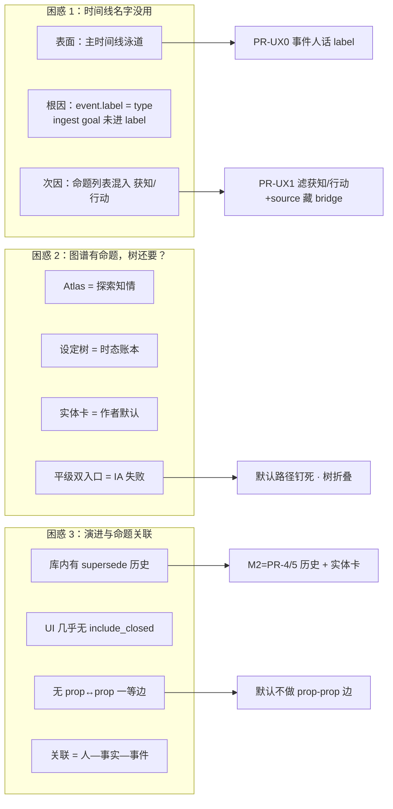
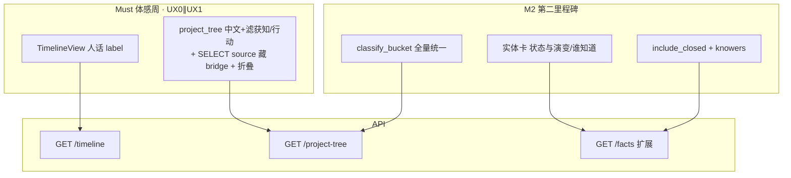
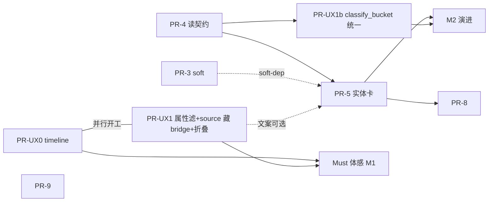

# 命题 / 世界真相 · 作者体验优先再优化设计（v2 · rev.4.2）

| 项 | 值 |
|----|-----|
| **文档标题** | 命题 / 世界真相系统：Author-UX-first 再优化（v2） |
| **产品** | 铜炉（tonglu）/ scribe3 |
| **作者** | Grok Design（待人审签） |
| **日期** | 2026-08-09 |
| **状态** | Draft（**rev.4.2** · 用户拍板最优体感默认：UX1 source 藏 bridge；相对 rev.4.1 / rev.3 升级） |
| **文档真源** | **仓库耐久副本** `docs/plans/2026-08-09-proposition-author-ux-v2-optimization.md` 为实现与评审唯一准绳；`/tmp/grok-1000/grok-design-doc-a4f8d147.md` 仅会话 scratch，改设计须同步 commit 耐久路径（或改完后 `cp` 覆盖 scratch） |
| **基线（PR-4/5 规格真源）** | `docs/plans/2026-08-09-proposition-full-chain-optimization.md`（**rev.3**）——见下文「规范性引用」 |
| **代码根** | `/home/admin/projects/scribe-writing-system`，主实现 `scribe3/` |
| **约束** | demo SurrealDB **3.x only**；不另起第二套库/第二 Surreal；Grok 主机不做重 npm；验收 = **已部署 demo 冒烟**；UI 中文产品名「铜炉」 |
| **明确不做的宣称** | **不**因本改造单独宣称文学质量 ≥9.5；不替代 D1–D7 质量探针 |

---

## Overview

作者在 demo 上的三个**现存**困惑（对话已核实数据）不是「引擎表设计错了」，而是 **三条不同表面同时漏出了工程师腔 + 噪音 + 重复入口**：

1. **主时间线**（AppRail「时间线」）里满屏「行动」「揭露」等类型词——这是 **事件呈现问题**（泳道是 event/arc/promise/relation，**不是** proposition），不是命题泳道坏了。  
2. **关联（Atlas）**里已有「角色—knows→命题」节点，设定树又有「命题」分类——作者感到 **平级双份**；引擎两边都需要，**UI 把两种用途做成两个主入口**才是 IA 失败。  
3. **看不到演进**、也不清楚「命题之间怎么关联」——`supersede` + `valid_from/to` 已在库内，但 **作者 UI 几乎无历史读**；命题↔命题 **无一等公民边**，关联路径是 **人—事实—事件**。

v1（rev.3）已正确拍板 **「引擎保留 + 产品重表面」**，并钉死树真相源、`include_closed`、knowers 极性、`classify_bucket`、KD-1…10。**v2 不推翻该主路径**，而是用用户三点 **重写优先级与体感切片**：先让作者「看懂、不脏、知道去哪」，再补全实体卡终局与 bridge 治理。

**一句话主路径：** 内部 `proposition`/`knows`/`facts_at`/D4/D6 **语义冻结**（见下「冻结边界」）；作者默认走 **实体卡「状态与演变 / 谁知道」**；全局「世界真相」= **高级账本（折叠）**；Atlas = **知情探索图**；主时间线 **事件 label 人话化**；命题树 **滤 获知/行动 + 按 source 藏 bridge**（见 KD-17，**仍禁止** attribute 启发式滤 bridge）；**默认不做命题—命题一等边**。

**Must 开工顺序（用户拍板 · rev.4.2）：** **并行 PR-UX0 + PR-UX1**（PR-UX1 默认含 tree/list SELECT `source` 藏 `codex_bridge` 的最优路径）；**不**等待 PR-4/5；**不**把历史行 SQL 回填 `source` 当 Must 阻塞。

### 引擎「冻结」边界（防误读 · rev.4.1+）

| **冻结（禁止）** | **允许（不破冻结）** |
|------------------|----------------------|
| 改写半开区间 / supersede 语义 | **additive** 读参数（`entity` / `include_closed` / `with_knowers`） |
| 改 D4 对**注入当前态**的折叠 | 新投影函数（`format_event_timeline_label`、`list_entity_truth_history`） |
| 改 `knows` 方向 / 无闭包 | `list_open_propositions` **SELECT 多列**（如 `source`） |
| 物理 rename 表 `proposition` / 改 `fact:` 前缀 | 树/时间线 **展示层** label 与过滤 |
| 默认开放 `edit_fact` 抹历史 | 特性开关、中文文案、catalog keywords additive |

**一句话：** 冻结 = 不改写时态语义 / D4 注入折叠 / knows 方向 / 表 rename；**允许** additive 读 API 与投影函数。S4（PR-4）扩展 `GET /facts` **不算破冻结**。

---

## Background & Motivation

### 从 v1 继承的引擎事实（仍成立）

| 概念 | 位置 | 职责 |
|------|------|------|
| `Fact` / 表 `proposition` | `ontology.py`、migrations | 实体 · attribute · value @ `[valid_from, valid_to)`；`secret` / `leak_markers`；列 `source`（084）**已存在** |
| `knows` / `reader_knows` | relation + 表 | knower → proposition；无隐式闭包 |
| `facts_at` + D4 | `facts_knowledge.py` / `fact_surface.py` | 注入当前态单真；**现 SELECT 无 source** |
| `list_open_propositions` → **`project_tree`** | `structure.py` | **生产设定树**真相源（分类 label 现为「命题」）；list **不 SELECT source** |
| `knowers_at_chapter` | `recall.py` | 仅 `list[str]` 名；富字段须新查询 |
| ingest | `ingest.py` | `attribute=获知/行动` + 合成 `Event(type="行动", …)`；`motivated_by_goal=action` |
| bridge | `codex_secret_bridge.py` | 写 `source=codex_bridge`；attribute 为势力字段名（非 获知/行动） |
| timeline | `store/events.py` `timeline()` | 四泳道；**事件 `label = ev.type`**；payload 已带 `"goal"` |
| Timeline UI | `web/src/views/TimelineView.jsx` | content：`label \|\| event_type`（**未**用 `goal`） |
| Atlas | `AtlasView.jsx` + `store.graph` | 角色—knows→proposition |
| global_search 事件 label | `api/routers/world_read.py` ~221 | 仍 `ev.type or ev.id`（**非** Week-1 主战场） |

### 用户三点 × 技术分诊（v2 核心）



| # | 作者说法 | **不是** | **是** | 最优修复方向 |
|---|----------|----------|--------|--------------|
| 1 | 时间线里名字没用 | 「命题泳道坏了」 | **事件呈现**：`timeline` 写 `"label": ev.type`（`events.py` ~498）；UI 用 `label \|\| event_type`（`TimelineView.jsx` ~219）；ingest 已写 `motivated_by_goal` **未提成 label** | **PR-UX0** 事件 label 人话化 + **PR-UX1** 命题侧滤 获知/行动；**分轨** |
| 2 | 关联里有命题节点，设定树还要？ | 「删一边引擎」 | **IA 平级双入口** | **KD-12** 三表面；树默认折叠 |
| 3 | 演进？命题关联？ | 「缺文学图谱边」 | **无历史 UI**；关联已是人—事实—事件 | **M2：PR-4/5**；**KD-11** 不做 prop-prop |

### 当前作者卡住点（按体感排序）

| 优先级 | 卡住点 | **Must 体感周**可交付？ | **M2** |
|--------|--------|-------------------------|--------|
| **P0** | 时间线类型词 | **是**（PR-UX0） | — |
| **P0** | 设定树 获知/行动 + bridge 镜像噪音 | **是**（PR-UX1：属性滤 + **默认** SELECT source 藏 bridge） | 终态 `classify_bucket` / UX1b 统一 |
| **P0** | 图谱/树重复感 | **是**（折叠 + 文案） | — |
| **P1** | 看不见 supersede 历史 | **否**（勿承诺本周） | PR-4 + PR-5 |
| **P1** | 「谁知道」列表 | **否** | PR-4 + PR-5 |
| **P2** | bridge 双表象 / 写路径 | 不挡体感 | PR-7 / PR-9 |

### 与 v1 的关系

- v1：**全链条爆炸半径、KD-1…10、读契约、knowers 极性、PR 可合性**——**全部继承**；PR-4/5 **实现规格以 rev.3 正文为唯一真源**（本文只复制不可丢不变量 + 锚点）。  
- v2 补：**分诊、IA 默认路径、Must/Stretch 里程碑、事件 label 单列、bridge 过滤可实现性纠偏**。

---

## Goals & Non-Goals

### Goals

1. **体感周（Must）**：主时间线可读、设定树无 获知/行动刷屏、默认路径口述清晰（成功定义 M1）。  
2. **分诊正确**：事件呈现 vs 命题噪音 **分轨** PR。  
3. **IA 钉死默认路径**：实体卡 > 高级账本 > Atlas。  
4. **第二里程碑（M2）可实现的演进视图**：`include_closed` + 谁知道正确极性（规格 = rev.3，不缩水）。  
5. **引擎安全边界**：见「冻结边界」；爆炸半径可控。  
6. **验收可执行**：仅 demo 已部署栈冒烟。

### Non-Goals

- 不宣称文学 ≥9.5；不替代 D1–D7。  
- **默认不**引入命题↔命题一等边。  
- 不物理 rename / 第二 Surreal / Graphiti。  
- 不在 Grok 机重活。  
- 不默认开放 REST `edit_fact`。  
- 不做档案 ↔ proposition 双向同步（KD-8）。  
- 不把主时间线改成命题泳道。  
- **体感周（Must）不改** `world_read.global_search` 事件 label（与时间线同类问题；标为 **PR-UX0 follow-up / 显式 Non-Goal**，避免当漏项）。  
- **体感周不交付** 完整 PR-4/5（演进可见 = M2 成功线，不计入 Must）。

---

## Key Decisions

### 从 rev.3 **完整继承**（不改义）

| # | 决策（摘要） |
|---|--------------|
| **KD-1** | 引擎保留，产品重表面 |
| **KD-2** | 作者中文「世界真相」等；代码标识不变；catalog keywords **additive** |
| **KD-3** | 树级分类降级为可选/折叠二级；默认实体卡 |
| **KD-4** | bridge 默认策略 **B** |
| **KD-5** | 作者生产隐喻 = 改状态 / 揭示秘密 / 登记知情 |
| **KD-6** | 验收 = demo 已部署冒烟 |
| **KD-7** | 前段零 schema 迁移；用已有 `source` 列 |
| **KD-8** | 权威关系：时态→proposition；人设→实体行；势力 secret→faction，bridge 仅镜像 |
| **KD-9** | 设定树真相源 = 后端 `project_tree`；前端仅缺失时兜底 |
| **KD-10** | 历史读与注入读分离；`include_closed` 不经 D4 |

### v2 **新增 / 加强**（rev.4.1 修订）

| # | 决策 | 相对 v1 | 理由 |
|---|------|---------|------|
| **KD-11** | **默认不做** 命题↔命题一等边；间接经 event/knows | **新** | 痛点是历史 UI |
| **KD-12** | **三表面分工**（下表） | **加强** KD-3 | 回答「树还要吗」 |
| **KD-13** | 事件呈现 vs 命题噪音 **分轨** | **新** | 修错层风险 |
| **KD-14** | **Must 体感**（S0+S1+S2±S3，**含** UX1 source 藏 bridge）可先于 PR-4/5 合入；**M2** 才含 S4/S5 全读契约；完整读模型规格不缩水；**开工=并行 UX0∥UX1** | **重排+收紧** | 消「一周含完整 PR-4+实体卡」过载；最优体感不牺牲 |
| **KD-15** | 事件 label：goal 截断 > **本地 id strip** 的 SUBJ+type > type；**禁止** timeline 内 N+1 查 characters；**禁止** drama 腔 | **钉死 name** | 可实现、可测 |
| **KD-16** | `entity_first` 下 `cat:proposition` **默认不 open** + 副文案；Atlas 图例知情探索 | **加强+锚点** | 消双入口体感 |
| **KD-17** | **滤噪分阶段 + 最优默认**：① **基线** attribute∈{获知,行动,from_knowledge} 必滤；② **bridge 只认 `source==codex_bridge`**，**禁止** attribute 启发式；③ **最优作者体感路径（用户拍板 · 默认做）**：PR-UX1 在 tree/`list_open_propositions` 路径 **SELECT source** 并隐藏 bridge（`safe-partial`，**仍不做** history/knowers/include_closed/EntityTruthPanel）；④ 终态全量 `classify_bucket` 统一 ∈ PR-4/UX1b | **纠偏+最优默认** | 对齐 rev.3 极性；list 现无 source 故 Must 须**显式透传**才能藏 bridge |

### KD-12 · 三表面分工

| 表面 | 导航 | 作者问题 | 数据 | **不是** |
|------|------|----------|------|----------|
| **① 实体卡**（默认） | 设定库 → 角色/势力/物件 | 现在怎样 / 怎么变 / 谁知道 | `include_closed` + knowers（M2） | 全库浏览器 |
| **② 世界真相（高级）** | 设定树 **默认折叠** | 跨实体检索、调试 | `project_tree` 滤噪后 | 日常平级入口 |
| **③ Atlas** | AppRail 关联 | 谁知道什么 · 构图 | `/graph` | 账本编辑器 |

```text
作者默认路径（钉死）
  改真相 / 看演变 / 看谁知道  →  打开实体卡（演变 UI = M2）
  探索「谁知情」构图         →  Atlas
  全库检索 / 引擎行 / 排障   →  世界真相（高级）折叠分类
```

### 命名对照

| 场景 | 作者可见中文 | 引擎/代码 | 备注 |
|------|--------------|-----------|------|
| 设定树分类 | **世界真相**（badge/副文案「高级」） | `ref=proposition` | |
| 实体卡 | **状态与演变** / **谁知道** | open+closed / knows | M2 挂载 |
| Atlas | **知情探索** | graph + knows | |
| 主时间线 | **人话事件摘要** | timeline.label | ≠ 命题 |
| 演绎 | **场景真相** | scene_truth | 禁止混称 |

---

## Proposed Design

### 策略选择

| 方案 | 结论 |
|------|------|
| **B. 引擎保留 + 产品重表面** | **主路径** |
| **B' 体感快车道 = Must** | **S0 + S1（属性滤 + 默认 source 藏 bridge）+ S2 ± S3**；**不含**完整 PR-4/5 / history / knowers |
| **M2 终局读+卡** | S4=PR-4 → S5=PR-5（`classify_bucket` 全量 + 实体卡） |
| Schema 大改 / prop-prop 一等边 / 删树 | **拒绝** |

### 全链条（标注 Must / M2 战场）



### 1）事件呈现：主时间线人话化（困惑 1 · 轨 A · **Must / PR-UX0**）

**现状：**

```498:501:scribe3/store/events.py
                "label": ev.type,
                "goal": ev.motivated_by_goal,
                ...
                "event_type": ev.type,
```

```219:220:scribe3/web/src/views/TimelineView.jsx
        content: esc(ev.label || ev.event_type) + ...
```

**服务端公式（钉死 · KD-15）：**

```python
# scribe3/event_surface.py（推荐）或 truth_surface.py
def format_event_timeline_label(ev) -> tuple[str, str]:
    """返回 (label, label_source) ；label_source ∈ goal|composed|type"""
    goal = (getattr(ev, "motivated_by_goal", None) or "").strip()
    if goal:
        return _clip(goal, 36), "goal"
    et = (getattr(ev, "type", None) or "事件").strip()
    subj = _first_subj_local(ev)  # 见下 · 禁止 N+1
    if subj:
        return f"{subj} · {et}", "composed"
    return et, "type"

def _first_subj_local(ev) -> str | None:
    """仅从 participants 取 SUBJ oid 的本地段，不查 character 表。
    例 role:焦三 → 焦三；与前端 stripRole 一致。无 SUBJ 则 None。"""
    parts = getattr(ev, "participants", None) or {}
    raw = parts.get("SUBJ")
    if raw is None:
        return None
    # SUBJ 可能是 str 或 list（同槽多人取第一个）
    oid = raw[0] if isinstance(raw, (list, tuple)) else raw
    s = str(oid or "").strip()
    if not s:
        return None
    return s.split(":", 1)[-1] or None
```

- `timeline()`：`label, label_source = format_event_timeline_label(ev)`；**保留** `event_type`、`goal` 字段。  
- **热路径禁止** 为每个 event `characters()` / 单条查 name；若未来要显名，仅允许 **一次** bulk map（非 Must）。  
- **前端双保险（乱序部署）：**

```javascript
// TimelineView content / title
const text = ev.label || ev.goal || ev.event_type || ''
```

- 详情：标题用上式；类型 Field 仍显示 `event_type`；goal Field 可保留。  
- **不**加命题泳道。  
- **global_search** 事件 label：Must **不改**；可选 follow-up 复用同一 `format_event_timeline_label`（Issue 8）。

### 2）命题噪音 + 可读标题（困惑 1 · 轨 B · **Must 收窄**）

#### 终态 bucket（继承 rev.3 · **M2 / PR-4 后**）

| source | attribute | bucket | 树默认 |
|--------|-----------|--------|--------|
| `codex_bridge` | * | **bridge** | 隐藏（**只认 source**） |
| `ingest` | * | ingest_noise | 隐藏 |
| null/空 + 获知/行动/from_knowledge | ingest_noise | 隐藏 |
| `author` 等非空 + 获知 | **author**（不藏） | 显示 |
| 其它 | state/author… | 显示 |

`classify_bucket` 伪代码 **唯一终态真源** = rev.3「API / bucket 分类规则」节（与上表一致）。

#### Must（PR-UX1）过滤 —— 属性噪音 **+ 最优默认 source 藏 bridge**（用户拍板 rev.4.2）

```python
NOISE_ATTRS = frozenset({"获知", "行动", "from_knowledge"})

def tree_hide_must(
    attribute: str,
    source: str | None = None,
    *,
    show_engine: bool = False,
) -> bool:
    """Must 树投影隐藏谓词。bridge 只认 source，禁止 attribute 启发式。"""
    if show_engine:
        return False
    src = (source or "").strip() or None
    if src == "codex_bridge":
        return True  # 最优路径：须 list/tree SELECT 到 source
    return (attribute or "").strip() in NOISE_ATTRS
```

| 项 | Must（PR-UX1 · **默认推荐**） | M2（PR-4 / UX1b） |
|----|------------------------------|------------------|
| 滤 获知/行动/from_knowledge | **是**（attribute） | 仍是；`source=ingest` 后更准 |
| 滤 **bridge** | **是**，且 **仅** `source==codex_bridge`（**SELECT source 透传**） | 统一进 `classify_bucket` |
| SELECT source | **默认做**（**仅** `list_open_propositions` / `project_tree` 路径） | **全读路径**（list/facts_at/history） |
| history / knowers / include_closed / EntityTruthPanel | **不做** | **做**（PR-4/5） |
| `format_fact_as_codex_title` 叶标题 | 可选 S3 同 PR | 沿用 |

**对齐 rev.3：**「不得以 attribute 单独滤 bridge」——v2 **仍遵守**；Must 藏 bridge **必须**靠 source 列，**不是**属性名猜测。  
**相对 rev.4.1 变更：** source 透传从「可选最瘦」升为 **最优体感默认推荐做**（用户：「按最优效果」）；Merge 标 `safe-partial`（相对「零读路径改动」基线），但 **开工默认包含**。

**单测必锁：** bridge 行 attribute 为势力字段名（如 origin 类）且 `source=codex_bridge` → 默认树 **隐藏**；`show_engine=1` → 可见。

- **`project_tree`**：label「世界真相」；Must 用 `tree_hide_must`；叶标题建议 `format_fact_as_codex_title`。  
- **`SCRIBE3_TRUTH_UI`**：代码尚无；**Must 硬编码 entity_first 行为**（折叠+滤噪）；flag 接线随 PR-4/UX1b 或 v1 PR-2。

### 3）图 vs 设定 vs 实体卡 + **折叠实现锚点**（困惑 2 · Must）

**产品规则：**

1. 设定库着陆：展开角色等主分类，**不**自动展开世界真相。  
2. 分类副文案：「全库时态账本 · 日常请打开角色卡」。  
3. Atlas 图例知情探索；避免「在此管理命题」。  
4. 实体卡空状态 copy（KD-8）——**M2 挂载面板时**落地亦可，Must 可先只改树侧。

**PR-UX1 折叠 · 实现验收（钉死 3 条）：**

| # | 验收 | 实现锚点 |
|---|------|----------|
| ① | 设定库初次进入：`cat:proposition` / 世界真相 **不在**默认 open 集合 | `ProjectTree.jsx` 的 `expanded` / arborist `initialOpenState`：**显式排除** `cat:proposition`（及 id 变体）；**不要**只改后端 label |
| ② | 分类节点旁可见副文案「高级 · 时态账本」或等价 | 优先 `project_tree` 节点 `meta.subtitle` / `badges`；否则前端对 `ref===proposition` **硬编码** subtitle（Week-1 可接受） |
| ③ | 用户手动展开后 **刷新页恢复默认折叠**（不持久化 open） | **产品钉死**：Must **不**把 proposition 写入 localStorage open 集；手动展开仅会话内存。若现网对 codex 有持久 expand，对 proposition **例外排除** |

**Week-1 不强制** 实现 `SCRIBE3_TRUTH_UI` env；行为 = 硬编码 `entity_first`。

### 4）演进 + 谁知道 + 命题间关联（困惑 3 · **M2**）

#### 状态与演变

```
GET /facts?entity=role:焦三&chapter=N&include_closed=true
```

- 按 attribute 分组；`[from,to)`；排除 bridge（**M2 有 source 后**）。  
- **禁止** history 走 `resolve_injection_facts`。

#### 谁知道

- `GET /facts/{local}/knowers?chapter=N`  
- `with_knowers=1` 批量  
- **禁止** graph-focus 拼装  

#### 命题↔命题（KD-11）

默认不做一等边；间接经 `event.effects` / causal / knows。

### 5）引擎侧小收紧（M2+）

| 项 | 阶段 |
|----|------|
| ingest `source=ingest` | PR-7 |
| bridge 策略 B | PR-7 |
| `edit_fact` emergency | PR-9 可与 Must 并行 |
| chief 种子 | PR-6 |

---

## 里程碑与体感切片（rev.4.1 收紧）

### 两层定义（强制）

| 层 | 名称 | 切片 | 成功线 |
|----|------|------|--------|
| **Must** | **体感周 / Week-1** | **S0 + S1（属性噪音 + 默认 source 藏 bridge）+ S2 + 可选 S3**；**开工=UX0∥UX1 并行** | **M1** 下列 1–4 |
| **Stretch / M2** | **Week-1+ / 第二里程碑** | **S4（=PR-4 全规格）→ S5（=PR-5）**；`classify_bucket` 全量；可选历史行 source 回填 | **M2**：演进可见 + 谁知道极性正确 |

KD-14：**Must 可先合**；**不得**把 S5 写成 Week-1 默认必达。  
**不阻塞 Must：** 历史行 SQL 批回填 `source=ingest`（见已决 Q3）。

### 切片表

| 切片 | 内容 | 层 | 依赖 |
|------|------|----|------|
| **S0** | 时间线 label 人话 + FE `label\|\|goal\|\|event_type` | **Must** | 无（∥ S1） |
| **S1** | 树中文名 + 滤 获知/行动/from_knowledge + **list/tree SELECT source 藏 bridge** | **Must（最优默认）** | 无（∥ S0）；**非** PR-4 |
| **S2** | `cat:proposition` 默认不 open + 副文案 + Atlas 轻文案 | **Must** | 无 |
| **S3** | 叶/详情 `format_fact_as_codex_title` | Must 可选 | 无 |
| **S4** | 全读路径 source + bucket 终态 + `include_closed` + knowers | **M2** | — |
| **S5** | `EntityTruthPanel` 演变 + 谁知道 | **M2** | S4 |

### M1 · 体感周成功定义（可验收 · **不含演进**）

1. **时间线（分层指标，替代含糊 70%）：**  
   - **(a) 可自动化：** 对 `kind=event` 且 payload/`goal` 非空的条目，**100%** 的 `label` 等于 clip(goal)（或 `label_source=goal`）；单测锁。  
   - **(b) 人工冒烟：** 打开 **含 ingest did** 的主故事章，时间线框内文字 **≠** 单独一个「行动」；可见 action 摘要。  
   - **(c) 不考核：** 无 goal、非 did 的手写/MCP 事件回退 type —— **不算 PR-UX0 失败**。  
2. 设定树世界真相默认视图 **无明显**「获知/行动」刷屏；且 **`source=codex_bridge` 行默认隐藏**（有 bridge 数据时；`show_engine` 可还原）。  
3. 作者口述：改状态→角色卡；知情构图→关联；世界真相=高级。  
4. health 绿；无双分类（命题+世界真相各一条）。

### M2 · 第二里程碑成功定义

1. 打开角色卡「状态与演变」可见 supersede **当前+历史**段。  
2. open 行「谁知道」含**他者** knower；不泄 secret value。  
3. 全读路径 `classify_bucket` 统一；树/账本/演变区一致藏 bridge/ingest_noise。  
4. 仅 `chapter` 的 `GET /facts` 行为与现网一致（D4）。  
5. （可选）历史 ingest 行批回填 `source=ingest` 后，无 source 的旧噪音进一步下降——**非** M2 阻塞门。

---

## API / Interface Changes

### 规范性引用（PR-4 / PR-5 · **单独打开 v2 时必读**）

> **唯一完整规格真源：**  
> `docs/plans/2026-08-09-proposition-full-chain-optimization.md`（rev.3）  
>
> | 主题 | rev.3 章节锚点（标题检索） |
> |------|---------------------------|
> | `classify_bucket` 伪代码与表 | 「bucket 分类规则」「展示规则」 |
> | `GET /facts` 兼容矩阵 | 「`GET /facts` 兼容矩阵」 |
> | `include_closed` / history | 「读契约：by-entity + include_closed」 |
> | knowers 单条+批量 JSON | 「谁知道」读模型 |
> | `SCRIBE3_TRUTH_UI` 行为表 | 「特性开关」/ Observability |
> | PR-4 / PR-5 文件清单与用户故事 | 「PR Plan」PR-4、PR-5 小节 |
>
> **实现 PR-4/5 时必须并列打开 rev.3**；本文不重复全文，只锁 **不可丢不变量** 与挂载点。

### 不可丢不变量清单（复制自 rev.3 · 实现检查表）

1. **`GET /facts` 的 `chapter` 保持必填**；缺 chapter → **422**（与现网一致）。  
2. **仅传 `chapter`** → 行为 **100% 等于今日** `facts_at` + **D4** `resolve_injection_facts`。  
3. **`include_closed=true` 必须带 `entity`**；无 entity → **422**（禁止全表扫）。  
4. **`include_closed=true` 历史结果禁止** 再跑 `resolve_injection_facts`（会丢掉被 supersede 的段）。  
5. **「谁知道」禁止** 用 `GET /graph?focus=` 拼装（极性相反）；必须 store `list_knowers_for_proposition` / `with_knowers=1`。  
6. **knower 端点 / 附加字段不返回** proposition `value` / `leak_markers`。  
7. **`bucket=bridge` 只认 `source==codex_bridge`**，禁止 attribute 启发式。  
8. **`classify_bucket` 与树过滤终态** 同一函数真源。  
9. **secret 默认掩码**；reveal 会话级；**禁止** reveal 明文进 PATCH/`edit_fact`。  
10. **MCP 工具名 / `fact:` oid / 表名** 不 rename。

### v2 Must 增量 API / 投影

| 接口 | 变更 |
|------|------|
| `store.timeline` / `GET /timeline` | `label` 人话公式；可选 `label_source` |
| `list_open_propositions` | **SELECT `source`**（供树过滤；不扩 REST 形状亦可仅 store 内用） |
| `project_tree` | 中文 label；`tree_hide_must`（属性噪音 + `source==codex_bridge`）；可选 meta.subtitle |
| TimelineView | `label \|\| goal \|\| event_type` |

### M2 增量（规格细节 → rev.3）

| 接口 | 变更摘要 |
|------|----------|
| `GET /facts` | `entity` / `include_closed` / `with_knowers`；见兼容矩阵 |
| `GET /facts/{local}/knowers` | 富字段 knowers + `reader_knows` |
| facts_at / history / `_fact_item` | 全路径 SELECT `source` + `bucket`（树路径 source 已在 Must 部分落地） |

**无** 新命题关联 REST。

---

## Data Model Changes

- **Must / M2：零 migration**（`source` 列已存在）。  
- **Must：** 仅 tree/list 读路径 SELECT `source`（投影用）。  
- **M2：** 全读路径 source + history/knowers；**不**新增 prop-prop 边。  
- **不**把历史批回填当 Must 阻塞（Q3）。  
- 可选 PR-10：`display_title` additive。

---

## Alternatives Considered

### 1. 只改设定树、不动时间线  
否决为唯一方案（困惑 1 主战场在时间线）。

### 2. 主时间线加命题泳道  
否决；演变在实体卡（M2）。

### 3. 删除设定树命题分类  
否决；改为默认折叠。

### 4. 命题↔命题一等边  
否决（KD-11）。

### 5. Schema rename / 并进 JSON  
否决。

### 6. Must 用 attribute 启发式藏 bridge  
**否决**（与 rev.3 冲突；bridge attribute 非 获知/行动）。正确路径：**SELECT source** 后仅认 `codex_bridge`。

### 7. Must 最瘦（只滤属性、不透传 source）  
**否决为默认**（用户要求最优体感）。可作紧急降级，但 **开工默认 = 属性滤 + source 藏 bridge**。

### 8. 本方案：Must 最优体感（UX0∥UX1 含 source 藏 bridge）+ M2 读契约  
**采用**。

---

## Security & Privacy Considerations

| 威胁 | 要求 |
|------|------|
| secret 进 prompt | 不削弱 D6 |
| 谁知道泄 value | knower 不回 value（M2） |
| reveal | 默认关；禁 PATCH 明文 |
| 时间线 | 不展 secret **value**；effects 仅 id/计数 |
| bridge | 不削弱 `is_faction_bridge_mirror` |

---

## Observability

| 信号 | 落点 |
|------|------|
| `label_source=goal\|composed\|type` | timeline 可选 debug；type 占比高 → ingest 缺 goal |
| 属性滤噪计数 | project_tree dev/meta：hidden_noise_attr |
| bridge 隐藏计数 | **Must（PR-UX1）** list/tree 有 source 后即可 |
| knowers 极性单测 | PR-4 |
| `SCRIBE3_TRUTH_UI` | M2 接线；Must 硬编码 entity_first |

---

## Rollout Plan

| 阶段 | 层 | 内容 | 冒烟（demo 已部署） |
|------|----|------|-------------------|
| **W1** | Must | **并行** PR-UX0（S0）+ PR-UX1（S1+S2±S3，**含** source 藏 bridge） | **UX0：** ① health ② 含 did 章框内 ≠「行动」 ③ 有 goal→label 来自 goal ④ event_type 详情可见 ⑤ 轴/缩放无回归。**UX1：** ⑥ 分类名世界真相 ⑦ 默认无获知/行动刷屏 ⑧ **默认无 bridge 镜像行**（有数据时）⑨ `show_engine` 可还原 ⑩ `cat:proposition` 默认折叠+副文案 ⑪ 仅一条分类 |
| **M2a** | M2 | S4=PR-4 | 同 rev.3 P0b：全路径 source、include_closed、knowers 极性、仅 chapter 兼容、历史不经 D4 |
| **M2b** | M2 | S5=PR-5 | 角色卡演变段+谁知道；演变区无 bridge |
| **M2c** | M2 可选 | 历史行 `source=ingest` 批回填 | **非门禁**；回填后旧噪音进一步下降即可 |
| **P2** | 后 | PR-6/7/8/9 | 种子、**新写入** ingest `source=ingest`（PR-7）、Atlas 跳转、edit_fact |

### 回滚

- 前端静态回滚；timeline 公式回退 `label=ev.type`。  
- 树滤噪关：`show_engine` 或临时跳过 hide。  
- **禁止**删 migration 回滚。

### 验证环境

仅 demo 已部署栈；Grok 机不重活。

---

## Risks

| 风险 | 严重度 | 缓解 |
|------|--------|------|
| 误把时间线当命题只改树 | **高** | KD-13；PR-UX0 独立 |
| **Week-1 塞进完整 PR-4+5** | **高** | Must/M2 拆分；M1 不含演进 |
| **UX1 误用 attribute 滤 bridge** | **高** | KD-17；藏 bridge **必须** `source==codex_bridge`；单测 origin 类 attr |
| list/tree SELECT source 与 facts_at 不一致 | 中 | Must **仅** tree/list 透传；facts_at 全透传属 PR-4；注入路径不依赖树过滤 |
| goal 空仍显示类型 | 中 | 分层指标 (c)；不判失败 |
| 无 closed 却宣称能看演进 | **高** | 演进仅 M2 成功线 |
| 把历史 source 回填当 Must 阻塞 | 中 | **已决 Q3**：Must 不依赖回填；PR-7 写新行 |
| graph ego 当谁知道 | **高** | 不变量 #5 |
| 双分类 / 只改前端 | **高** | KD-9；structure.py |
| 折叠只改后端 label、FE 仍全开 | **高** | S2 三条实现验收 |
| 耐久副本与 scratch 漂移 | 中 | 文首真源约定 |
| prop-prop 需求回流 | 低 | KD-11 |
| 手写 source=author 的「获知」被 Must 属性滤误藏 | 中 | 接受 Must 粗糙；M2 `classify_bucket` 后 `author` 不藏（rev.3 表） |

---

## Open Questions

### 已决（用户 · 最优作者体感 · rev.4.2）

| # | 议题 | **决定** |
|---|------|----------|
| **Q3** | SQL 批回填历史行 `source=ingest` | **Must 不依赖回填、不得阻塞 Must**。新写入写 `source`（**PR-7 / ingest**）。**M2 可选**批回填旧行；非 M2 门禁。 |
| **Q6** | UX1 SELECT source 藏 bridge | **默认采用最优路径**：PR-UX1 **`safe-partial` 默认做**——tree/`list_open_propositions` SELECT `source`，隐藏 `source==codex_bridge`；**仍不做** history/knowers/include_closed/EntityTruthPanel。Must 属性滤保留。**禁止** attribute 启发式滤 bridge。 |

### 未阻塞默认（无需再拍板）

1. **时间线 label 截断：** 默认 **36** 字；产品可后调。  
2. **timeline effects 计数 chip：** Must **不做**；P2/PR-8 后可选。  
3. **`edit_fact` 硬 410：** PR-9 默认 **flag/文档降级**，不本周硬 410。  
4. **世界真相移出 codex 一级：** v2 **仅默认折叠**，不做 IA 大挪。

---

## References

- **规格真源 rev.3：** `docs/plans/2026-08-09-proposition-full-chain-optimization.md`  
- **本设计真源：** `docs/plans/2026-08-09-proposition-author-ux-v2-optimization.md`  
- `scribe3/store/events.py` `timeline`、`ingest.py` `apply_delta`  
- `web/src/views/TimelineView.jsx`、`ProjectTree.jsx`、`AtlasView.jsx`  
- `store/structure.py`、`facts_knowledge.py`（现网 list 无 source；**PR-UX1 将透传**）、`recall.py`  
- `codex_secret_bridge.py`、`api/routers/world_read.py`（global_search）  
- 单测落点：`test_app.py` / `test_store.py` timeline 相关；**新建** `tests/test_event_surface.py`；**不要**改 `tests/test_timeline.py`（critique 时序冲突，与 store.timeline label **无关**）

---

## Key Decisions（汇总）

| # | 决策 |
|---|------|
| KD-1…10 | 继承 rev.3 |
| **KD-11** | 不做 prop-prop 一等边 |
| **KD-12** | 三表面分工 |
| **KD-13** | 事件 vs 命题噪音分轨 |
| **KD-14** | Must=S0–S2±S3（**含** UX1 source 藏 bridge）；M2=S4→S5；开工 **UX0∥UX1** |
| **KD-15** | label：goal > SUBJ 本地 id+type > type；禁 N+1 |
| **KD-16** | proposition 默认不 open + 副文案；刷新不持久 |
| **KD-17** | 属性滤 + **默认** source 藏 bridge；禁 attribute 滤 bridge |

---

## PR Plan

> **可合并性：** `safe` / `safe-partial` / `needs-dep`。  
> **Must 开工顺序（用户拍板）：`并行 PR-UX0 + PR-UX1`**（UX1 默认含 source 藏 bridge）→（可并行 PR-9）→ PR-4 → UX1b → PR-5；PR-3 **软依赖**。

```text
PR-UX0   时间线事件人话 label                         ← Must · 与 UX1 并行
PR-UX1   树文案+属性滤噪+SELECT source 藏 bridge+折叠 ← Must · safe-partial 最优默认
PR-9     edit_fact 治理（可并行 Must）
PR-4     全路径 source/bucket + closed + knowers      ← M2（规格=rev.3）
PR-UX1b  树过滤升级 classify_bucket 全量               ← needs-dep PR-4
PR-3     详情 reveal（soft-dep PR-5）
PR-5     EntityTruthPanel 演变+谁知道                 ← M2 · 硬依赖 PR-4
PR-6/7/8/10  同 rev.3（PR-7：新写入 source=ingest）
（可选）PR-UX0b  global_search label
（可选 M2c）历史行 source 批回填 — 非门禁
```

---

### PR-UX0 · 主时间线事件 label 人话化

- **标题**：`fix(timeline): event label 优先 motivated_by_goal，避免纯类型词`
- **Merge**：`safe`
- **依赖**：无
- **影响文件**：
  - `scribe3/store/events.py`（`timeline` 内 `label=` / 可选 `label_source`）
  - **新建** `scribe3/event_surface.py`（或 `truth_surface.py`）+ **`scribe3/tests/test_event_surface.py`**
  - 既有 timeline 断言：扩展 **`tests/test_app.py` / `tests/test_store.py`** 中 timeline 用例  
  - **`不要`修改** `tests/test_timeline.py`（critique 时序冲突，无关）
  - `scribe3/web/src/views/TimelineView.jsx`：content/title = **`label || goal || event_type`**
- **变更要点**：KD-15；FE 双保险支持只热更一端；不改 event schema；不动 proposition。  
- **冒烟**：Rollout **W1** UX0 条；**与 PR-UX1 并行开工**。  
- **Non-Goal 本 PR：** `global_search`（可另开 UX0b）。

---

### PR-UX1 · 世界真相树：中文 + 属性滤噪 + **默认 source 藏 bridge** + 折叠

- **标题**：`ui+store(truth): 世界真相高级入口、滤获知/行动、source 藏 bridge、默认折叠`
- **Merge**：`safe-partial`（相对「零 SELECT 改动」：含 list/tree source 透传；**相对作者体感目标：默认应做满**）  
- **依赖**：无；**与 PR-UX0 并行开工**（用户拍板）  
- **默认交付（最优路径 · rev.4.2）：**  
  1. attribute∈{获知,行动,from_knowledge} 默认隐藏  
  2. `list_open_propositions` / `project_tree` **SELECT `source`**，隐藏 `source==codex_bridge`  
  3. 中文分类名 + S2 折叠三条 + 可选叶标题  
  4. 单测：bridge 行非 获知/行动 attr 仍被藏；`show_engine` 还原  
- **明确不在本 PR：**  
  - **不**用 attribute 启发式判断 bridge  
  - **不**交付 `include_closed` / knowers / EntityTruthPanel / 全 facts_at source  
  - **不** SQL 批回填历史 `source`（Q3）  
- **影响文件**：
  - **`scribe3/store/facts_knowledge.py`**（`list_open_propositions` SELECT 加 `source`）
  - **`scribe3/store/structure.py`**（投影过滤 + 中文 label）
  - `BinderLayout.jsx` 幂等；`codexTree.js`
  - **`ProjectTree.jsx`**（expanded **排除** `cat:proposition`）
  - `CodexDirectory.jsx` 若共用 expand 则对齐
  - `AtlasView.jsx` 图例（轻）
  - `orchestration/catalog.py` keywords additive
  - 可选：`truth_surface.format_fact_as_codex_title` / `tree_hide_must`
- **实现验收：** S2 ①②③ + 无获知/行动刷屏 + **默认无 bridge 叶** + 单分类中文名。  
- **冒烟：** Rollout **W1** UX1 条（⑧ bridge 隐藏）。

---

### PR-9 · edit_fact 降级（并行）

- 同 rev.3：`safe`。

---

### PR-4 · 读路径 source/bucket + closed + knowers（**M2**）

- **规格真源：** rev.3「PR-4」全文 + 本文不变量 1–10。  
- **Merge**：`safe`（仅 chapter 兼容）。  
- **影响文件（摘要，细节见 rev.3）：**  
  `truth_surface.py`（`classify_bucket`）、`facts_knowledge.py`、`recall.py`（`list_knowers_for_proposition`）、`misc_helpers._fact_item`、`api/routers/codex.py`、极性单测。  
- **冒烟**：M2a / rev.3 P0b。

---

### PR-UX1b · 树过滤升级为 `classify_bucket` 全量真源

- **Merge**：`needs-dep` → **PR-4**  
- **要点：** 用终态 `classify_bucket` 替换 Must 临时 `tree_hide_must`；全读路径 source 已由 PR-4 补齐；ingest_noise 认 `source=ingest`；可选接 `SCRIBE3_TRUTH_UI`。  
- **说明：** bridge 隐藏已在 PR-UX1 最优路径落地；本 PR 做 **规则统一与全路径一致**，非「首次藏 bridge」。

---

### PR-3 · 详情叙事标题 + reveal

- **Merge**：`safe-partial`  
- **与 PR-5：** **软依赖 / 理想并行**——S5 最小演变+谁知道 **不**硬依赖 reveal/详情改版；无 PR-3 也可做 EntityTruthPanel。

---

### PR-5 · 实体卡「状态与演变」+「谁知道」最小（**M2 · 困惑 3**）

- **规格真源：** rev.3「PR-5」+ 不变量 4–6。  
- **Merge**：`needs-dep` → **硬依赖 PR-4**；PR-3 **soft-dep**；UX1 文案可选。  
- **挂载点（从 rev.3 补回，可独立实现）：**  
  - 组件：`web/src/components/EntityTruthPanel.jsx`（或 `CodexDetail` 内 Section）  
  - **Character Detail**：档案字段 Section **之后**、关系/弧光 **之前**  
  - **Faction / Item**：共用面板，`entityId` = `role:` / `faction:` / `item:`  
  - 数据：`GET /facts?entity=&include_closed=true&chapter=&with_knowers=1`  
  - **禁止** `api.graph({ focus })` 填「谁知道」  
  - `layout/targetNavigation.js`：支持 `panel: 'truth'` 滚入  
- **用户故事：** 同 rev.3 PR-5（演变段、无 bridge、他者 knower、主编种子）。  
- **冒烟**：M2b。

---

### PR-6 / PR-7 / PR-8 / PR-10

- 同 rev.3；PR-8：图谱 → `panel: truth`（KD-12）。  
- PR-7：ingest 必写 `source=ingest`。  
- **PR-UX0b（可选）：** `world_read.global_search` 事件 label 复用 `format_event_timeline_label`。

---

### 依赖图



---

## Revision Summary

- **rev.1–3（基线全链文档）：** 爆炸半径、KD-1…10、knowers 极性、include_closed、PR-1…10。  
- **rev.4 / v2 初稿：** 三点分诊、KD-11…17、PR-UX0、体感优先——Week-1 过满、bridge 启发式不实。  
- **rev.4.1（review a4f8d147）：** Must vs M2；UX1 暂不藏 bridge（最瘦）；规范性引用；70%→分层指标；折叠锚点；文档真源。  
- **rev.4.2（用户拍板 · 最优作者体感）：**  
  1. **Q6 已决：** PR-UX1 **默认做** list/tree SELECT `source` 藏 `codex_bridge`（`safe-partial` 最优路径）；仍禁 attribute 滤 bridge；仍不做 history/knowers/EntityTruthPanel。  
  2. **Q3 已决：** Must **不**依赖、**不**阻塞于历史 source 批回填；新写入 PR-7；回填 = M2 可选。  
  3. **开工顺序：** **并行 PR-UX0 + PR-UX1**。  
  4. KD-17 / M1 #2 / W1 冒烟 / PR-UX1 节 / 依赖图同步；次要 Open Q 给非阻塞默认（截断 36、effects 不做、edit_fact flag、仅折叠）。  

---

*正文完 · 实现以 PR Plan + rev.3 规格真源为准；业务代码未在本文档任务中修改。*
