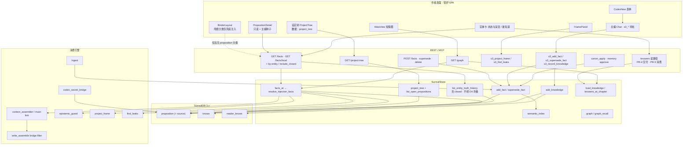
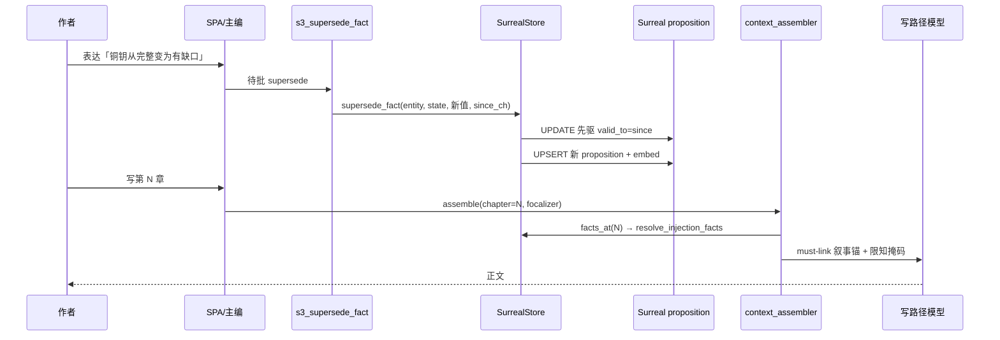
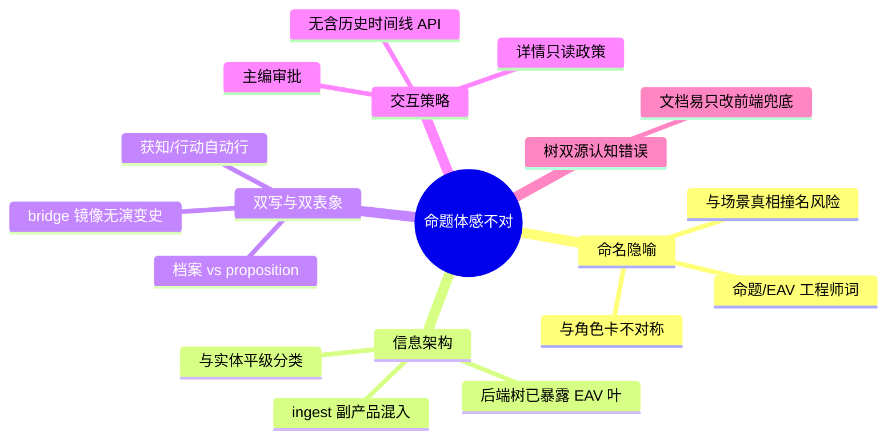

# 命题（proposition / Fact）功能全链条审查与最佳优化方案

| 项 | 值 |
|----|-----|
| **文档标题** | 命题全链条爆炸半径审查 + 产品化优化设计 |
| **产品** | 铜炉（tonglu）/ scribe3 |
| **作者** | Grok Design（待人审签） |
| **日期** | 2026-08-09 |
| **状态** | Draft（rev.3 · residual review：knowers 极性 / bucket / flag / facts 兼容） |
| **代码根** | `/home/admin/projects/scribe-writing-system`，主实现 `scribe3/` |
| **约束** | demo SurrealDB 3.x only；不另起第二套库；Grok 主机不做重 npm；UI 中文产品名「铜炉」 |
| **明确不做的宣称** | 不因本改造单独宣称文学质量 ≥9.5 |

---

## Overview

作者反馈：设定库里的「命题」体感不像角色/势力那种可理解的设定卡，更像把引擎内部的知识帧（EAV 三元组 + 时态 + 知情边）硬暴露成一个设定分类。

技术上，「命题」是铜炉限知与记忆质量体系的**原子真值载体**：`entity · attribute · value @ [valid_from, valid_to)`，配合 `secret`/`leak_markers`、`knows`/`reader_knows`、`facts_at` 时间门与 D4 单真投影。它正确服务引擎，但**产品表面把引擎原语当成了作者心智模型**。

本方案建议走 **「引擎保留 + 产品重表面」**（非贴膏药式改名，也非推翻 Surreal schema）：内部表名/API 标识符保持 `proposition`/`Fact`/`knows` 稳定；作者侧将「命题」降级为**实体卡上的「世界真相 / 状态演变 / 谁知道」**二级能力，主 IA 对齐角色/势力卡；分阶段 PR 可审可合（**并非每条都交付完整产品主收益**，见 PR Plan 依赖表）。

**rev.2 相对初版的关键纠正：**

1. 设定树**生产默认真相源**是后端 `store.project_tree()` → `list_open_propositions()`，不是前端 `codexTree` 兜底注入。
2. 「状态与演变」需要 **含 closed 区间** 的读契约；开区间 API  alone 做不出历史时间线。
3. 过滤 bridge/ingest 必须先让读路径暴露 `source`/`bucket`。
4. 增加 **KD-8 权威关系**；bridge 时态策略显式二选一；PR 重排与可合性声明收紧。
5. **rev.3：** 禁止 graph ego 充当「谁知道」；knowers 数据面升为 PR-4 必做；bucket/flag/facts 兼容矩阵钉死。

---

## Background & Motivation

### 当前引擎角色（已核实）

| 概念 | 代码位置 | 职责 |
|------|----------|------|
| `Fact` | `scribe3/ontology.py` | 状态@时间：entity 的 attribute 在半开区间 `[valid_from, valid_to)` 的取值；`secret` 标记私密底细；`leak_markers` 为破绽词。**注意：数据类无 `source` 字段** |
| `KnowledgeEdge` | 同上 | knower → proposition；**无隐式闭包**；`reader` 走独立表 |
| `World.facts_at` / `SurrealStore.facts_at` | `ontology.py` / `store/facts_knowledge.py` | 章级时间门 + 归档过滤 + D4 `resolve_injection_facts` 单真；SELECT **未取** `source` |
| `list_open_propositions` | `facts_knowledge.py` | 开区间命题列表，供**后端** `project_tree` 与设定树投影 |
| `project_tree` | `store/structure.py` | **生产设定树**；已含 `_cat("proposition", "命题", prop_items, …)` |
| `project_frame` | `scribe3/knowledge.py` | 按 knows 边投影焦点者知识帧（限知主防线） |
| `knowers_at_chapter` | `store/recall.py` | 单命题在章门下的 **角色名** `list[str]`（仅 name，无 id/since/until/via）；Atlas/graph_recall 用。富字段须新查询 |
| `find_leaks` | `scribe3/verify.py` | 帧外 secret 的 value/leak_markers 扫正文 |
| D4 单真 | `fact_surface.py` + `add_fact(supersede_open=True)` | 同键折叠 + 状态槽交叉 supersede |
| D6 限知守卫 | `epistemic_guard.py` | 写路径 prompt 帧外 secret 明文扫描/擦除 |
| bridge 镜像判定 | `codex_secret_bridge.is_faction_bridge_mirror` | 注入侧启发式（`entity_id`+`attribute`）；**非** `source` 字段 |

Surreal 落库（`migrations/001_ontology.surql` 起）：

- 表 `proposition` SCHEMAFULL：`entity`/`entity_id`、`attribute`、`value`、`valid_from`/`valid_to`、`secret`、`leak_markers`；后续 migration 追加 `embedding`、`ingest_seq`、`injection_mode`、`priority`、`archived`、`source`（`084_proposition_source.surql`）等
- 关系 `knows`：`TYPE RELATION FROM character TO proposition`
- 表 `reader_knows`：读者知（`002_reader_frame.surql`）

### 设定树双源（关键事实 · rev.2）

| 源 | 路径 | 何时生效 | 现状 |
|----|------|----------|------|
| **A. 后端主路径** | `GET /project-tree` ← `SurrealStore.project_tree()` ← `list_open_propositions()` | **demo 生产默认** | 已注入 `ref=proposition`、label「命题」 |
| **B. 前端兜底** | `BinderLayout.jsx`：仅当 `codex.children` **不存在** `ref==='proposition'` 时 `push(buildPropositionCategory(facts))`，facts 来自 `api.facts(PROP_SCAN_CHAPTER)` | 旧库/无后端分类时 | 注释写「后端不含」**已过时** |

**产品影响：** 只改 `codexTree.js` label/投影 → 作者在 demo **几乎零可见变化**。改中文名、分组、滤噪音必须动 **`structure.py`（及 list 投影）**，或改为前端 **始终 replace** 同 ref 分类。

### 作者痛点（产品层）

1. **命名与 IA**：树节点「命题」+ 叶标签 `实体·属性 = 值` 是工程师语言，不是作者语言。
2. **与角色/势力卡重叠**：角色档案已有外貌/目标/恐惧等字段；势力 `*_secret` 经 `codex_secret_bridge` 又镜像成 proposition——作者不知道「该写卡上字段还是写命题」。
3. **只读 + 主编审批写**：`PropositionDetail` 明确禁止表单 PATCH；改值必须「让主编超越」——摩擦远高于角色卡体感。**禁 PATCH 的主因是政策**（防 secret null 回写 / 防 `edit_fact` 抹历史），不是「API 不回 valid_*」（批 E-A1 后 `_fact_item` 已回全字段；`CodexDetail.jsx` 头部旧注释过时）。
4. **双/多写路径语义不一致**：MCP `s3_add_fact` 默认 `supersede_open=True`；`edit_fact` REST 可原地改写；`codex_secret_bridge` **绕过** `add_fact`（无 semantic_index / 无 cache invalidation / **值变更 UPDATE 原地、非 supersede**）；ingest 自动生成「获知/行动」类命题。
5. **与「设定卡」心智冲突**：角色/势力是**命名实体 + 档案**；命题是**时态质量三元组**，本不该与前者平级并列在 codex 分类里。

### 与记忆质量工作的关系

`docs/plans/2026-08-09-memory-quality-*` 已把 D4 单真、叙事化 must-link、D6 帧过滤推到写路径。本设计**不重复做质量探针**，而是解决：**正典真值模型正确，但作者表面仍像调试器**。不宣称单独拉到文学质量 9.5。

---

## Goals & Non-Goals

### Goals

1. **作者心智对齐**：设定库主路径 =「实体卡」；世界真相/知情作为实体与图谱上的能力，而非并列的神秘分类。
2. **全链条可解释**：从 UX → API/MCP → store → Surreal → 注入/校验 → Atlas/Frame 有单一叙述与图示。
3. **爆炸半径可控**：优先改产品表面与投影层；引擎表与 `facts_at`/`knows` 契约保持兼容。
4. **增量可交付**：有序 PR；**标明「合入即可用」vs「合入但主收益不完整」**；demo 已部署栈冒烟验收。
5. **限知与 D4 不回退**：secret 门控、supersede 历史、读者知/戏剧反讽能力保持。
6. **树与读契约可实现**：单一树真相源策略 + 含 closed 历史的 by-entity 读模型，使实体时间线可编码。

### Non-Goals

- 不重写 Surreal 为新表名（不把 `proposition` 物理 rename 为 `truth` 等）——成本与迁移风险远大于收益。
- 不上 Graphiti / 第二套知识图 / 第二套 Surreal。
- 不在 Grok 运行机全量 `npm ci` / Playwright / 临时 Surreal。
- 不以本改造单独宣称 D1–D7 或文学分 ≥9.5。
- 不删除 `knows` 或取消时态半开区间语义。
- 不把 emergency REST 世界写重新开放为默认作者路径。
- 不在本方案强制实现档案字段 ↔ proposition 的双向自动同步（见 KD-8）。

---

## Key Decisions

| # | 决策 | 理由 |
|---|------|------|
| **KD-1** | **引擎保留，产品重表面**（推荐主路径） | 全写路径/限知/D4/Atlas 已深度绑定 `proposition`+`knows`；rename schema 爆炸半径极大。作者问题在 **IA 与隐喻**，不在存储原语错误。 |
| **KD-2** | 作者中文名见下方**命名对照表**；代码标识符保持 `proposition`/`fact`/`s3_add_fact`；catalog **additive** keywords | 避免「命题」学术语；兼容旧说法与 MCP。 |
| **KD-3** | **树级分类降级为可选/折叠二级**，默认主路径：打开角色/势力/物件 →「当前真相」时间线 | 与设定卡心智一致；高级入口保留。 |
| **KD-4** | 桥接命题策略见 **PR-7 选项 B 为默认最小路径**（档案镜像无演变史 + 读侧 `source` 标记 + 补 embed/invalidate）；选项 A（真 supersede）仅当产品要求桥接出现在演变时间线时升级 | 现状 bridge 是 UPDATE 原地；强行 A 牵动幂等键/oid。B 先消除 R-Dual 的「看见双份」与召回缺口，不假装有时态史。 |
| **KD-5** | 作者生产真相的**首选隐喻** = 「改实体状态 / 揭示秘密 / 登记谁知情」，底层映射 `add_fact`/`supersede_fact`/`record_knowledge` | 降低 EAV 暴露；不改工具名。 |
| **KD-6** | 验收 = **demo 已部署栈冒烟**（每阶段 3–5 条可执行清单）；非本机全量测试 | 主机资源与 demo 即验证环境。 |
| **KD-7** | Phase 前段 **零 schema 迁移**；`source` 列已存在，只补读写赋值；`display_title` 仍可选 PR-10 | 控制 Surreal 3.x 风险。 |
| **KD-8** | **权威关系（产品契约）**：① **叙事时态状态**（会变、有章、可 supersede）以 **`proposition` 为准**；② **档案字段**（人设/外貌/目标等）为 **非时态人设**，权威在 character/faction/item 行；③ **势力 `*_secret` 字段** 以 **faction 行权威**，`source=codex_bridge` 的 proposition **仅为限知镜像**，UI **只在档案区编辑**，不在「状态与演变」展示 bridge 时间线。P0 文案必须写清，不要求双向同步。 | 直接消解 R-Dual 心智；避免实体卡并排两入口却无权威说明。 |
| **KD-9** | **设定树真相源**：后端 `project_tree` 为**唯一生产投影**（分组/过滤/中文 label 在 store 完成）；前端 `BinderLayout` **幂等**：若已存在 `ref===proposition` **不**再 push；可选后续「前端强制 replace」仅作 feature flag 实验，默认关。 | 避免双源漂移；PR-1/2 必须改 `structure.py`。 |
| **KD-10** | **历史读与注入读分离**：作者演变面板用 **含 closed 行** 的 by-entity 查询，**不**经 `resolve_injection_facts` 折叠；写路径/树「当前态」仍用开区间 + D4。 | 否则 PR-5 时间线无法实现。 |

### 命名对照表（实现 PR 用终稿；产品可再润色措辞）

| 场景 | 作者可见中文 | 引擎/代码标识 | 备注 |
|------|--------------|---------------|------|
| 设定树分类 | **世界真相** | `ref=proposition` / `type=proposition` | 后端 `project_tree` label |
| 实体卡区块 | **状态与演变** | 投影 open+closed propositions | 不含 bridge（KD-8） |
| 实体卡/图谱知情 | **谁知道** | `knows` / `reader_knows` / `knowers_at_chapter` | Phase 见 PR 归属 |
| 详情页标题 | 短中文（见 `format_fact_as_codex_title`） | `attribute`+`value` | **不**用注入腔 `format_fact_as_drama` |
| 高级浏览器 | **世界真相（高级）** | 同树分类折叠入口 | |
| 编排 domain label | **世界真相/状态** | domain 键 `fact.proposition` 不变 | |
| 主编自然语言 | 「世界真相」「状态」「真相」「命题」「事实」均可匹配 | `match_keywords` **保留旧词 + 加新词** | |
| 演绎「场景真相」 | **场景真相**（章级叙事） | deduce / `scene_truth` | **禁止**与设定库「世界真相」混称；文案旁注「章演绎 ≠ 设定库世界真相」 |
| MCP 工具 | 描述可写「登记世界真相」 | `s3_add_fact` 等名不变 | |

GLOSSARY 增补建议（PR-1 可选一行）：

| 中文名 | 规范代码名 | 定义 |
|--------|------------|------|
| 世界真相（作者用语） | `proposition` / `Fact` | 实体在故事时间上的原子状态断言；UI 称世界真相，引擎表名 proposition |

---

## Full-chain map（全链条）

### 逻辑总览



### 写路径（生产）

| 入口 | 文件/符号 | 落库行为 | 作者是否感知 |
|------|-----------|----------|--------------|
| 主编 MCP 新建 | `mcp/tools_write.py` `s3_add_fact` | `add_fact(..., supersede_open=True)` + embed | 是（待批） |
| 主编超越 | `s3_supersede_fact` | 关开区间 + 新 oid | 是 |
| 主编知情 | `s3_record_knowledge` | `add_knowledge`；先 `_check_proposition` | 是 |
| REST emergency | `codex.py` `add_fact_ep` / `edit_fact` / `supersede_fact_ep` | `edit_fact` **原地改**（抹历史风险） | 默认应关 |
| Canon / change-pack | `canon_apply_store._apply_fact` | 状态槽 `supersede_fact`；否则 `add_fact` | 间接 |
| Memory 待审通过 | `api/routers/memory.py` | `store.add_fact` | 间接 |
| 章节 ingest | `ingest.py` | 「获知」「行动」+ `reader_knows`；应写 `source=ingest`（PR-7） | 副产品 |
| 势力 secret 桥 | `codex_secret_bridge.sync_faction_secrets` | 直接 `_execute_write`；已存在则 **UPDATE value**（非 supersede）；`valid_from` 常固定 1；`source=codex_bridge` | 双表象；策略 KD-4/PR-7 |
| Director | `api/routers/director.py` | 映射 s3_* | Agent |

### 读 / 注入 / 校验路径

| 消费方 | 关键调用 | 命题语义 |
|--------|----------|----------|
| **设定树（生产）** | `project_tree` ← `list_open_propositions` | 开区间叶；label 现为「命题」 |
| 设定树（兜底） | `BinderLayout` + `buildPropositionCategory` + `GET /facts` | 仅当后端无 classification |
| 详情 | `GET /facts/{local}` + `_fact_item` | 字段见下表；前端 `getFact` **现不传** reveal |
| 写路径注入 | `context_assembler` + `memory_must_link` | `facts_at` + D4；secret 掩码；bridge 启发式剔除 |
| `write_assemble` | bridge 全知过滤 | `is_faction_bridge_mirror`；改 bridge 须回归 |
| 限知 / 泄露 / D6 | `project_frame` / `find_leaks` / `epistemic_guard` | 冻结 |
| Atlas | `store.graph` | type=proposition |
| Graph RAG | `graph_recall` + `knowers_at_chapter` | embed + knowers |
| 编排 | `catalog` domain `fact.proposition` | label/keywords 需扩 |

### `_fact_item` / 列表响应：现状 vs 增量（rev.2 纠正）

**现状（真实字段）** — `api/services/misc_helpers.py` `_fact_item`：

| 字段 | 有否 |
|------|------|
| `id`, `entity`, `attribute`, `is_secret`, `value`, `valid_from`, `valid_to`, `leak_markers` | ✅ |
| `source` | ❌ 未 SELECT / 未序列化 |
| `archived` | ❌ 列表无；**仅** `get_fact` 额外查 `archived` |
| `bucket`, `display_label` | ❌ |

**增量（PR-4 契约）**：

| 字段 | 说明 |
|------|------|
| `source` | `codex_bridge` / `ingest` / `canon` / `null`（手写/MCP） |
| `bucket` | 服务端枚举：`state` \| `secret` \| `ingest_noise` \| `bridge` \| `author` |
| `archived` | 列表与单条一致可选 |

### 序列：作者改「真相」并影响写作



---

## Blast radius（爆炸半径）

> 若 **rename / 隐藏 / 重构** proposition 相关表面或契约，下列消费者会受影响。严重度：S0 写路径断裂 · S1 限知/安全 · S2 作者 UX · S3 次要/工具。

| 组件 | 路径 | 依赖的契约 | 若破坏则… | 严重度 | 本方案态度 |
|------|------|------------|-----------|--------|------------|
| `store.facts_at` | `facts_knowledge.py` | 表字段 + 时间门 + D4 | 注入/校验坏 | S0 | **冻结** |
| `list_open_propositions` | 同上 | 开区间 | 树/列表空 | S0 | 扩展字段，不改门谓词 |
| **`project_tree`** | **`store/structure.py`** | **prop_items + label「命题」** | **设定树主路径错误/双分类** | **S2** | **重做投影（主战场）** |
| **`BinderLayout` 注入** | **`web/src/BinderLayout.jsx`** | **无 proposition 分类才 push** | **双「命题」分类或零变化** | **S2** | **幂等 + 注释修正** |
| `resolve_injection_facts` | `fact_surface.py` | entity/attr/value/vf | D4 失效 | S0 | 冻结；历史读**不**走此折叠 |
| `project_frame` / `find_leaks` / D6 | knowledge/verify/epistemic | id + knows + secret | 限知事故 | S0/S1 | 冻结 |
| `context_assembler` | 同上 | must-link / 掩码 | 上下文/泄密 | S0/S1 | 只改投影文案侧 |
| **`write_assemble` bridge filter** | **`api/services/write_assemble.py`** | **`is_faction_bridge_mirror`** | **全知转储混入桥镜像 / 漏滤** | **S1** | **改 bridge 必回归** |
| `memory_must_link` / retrieval | | facts_at | 锚/召回断 | S0 | format 注入腔不动 |
| MCP write/read | `mcp/*` | s3_* 名 | Agent 断 | S0 | **保留工具名** |
| REST `/facts*` | `codex.py` | 路径与形状 | SPA 坏 | S2 | 增量字段；路径可加别名 |
| **`web/src/api.js`** | **getFact/facts** | **客户端查询串** | **reveal/列表形状错** | **S2** | **PR-3 必改 getFact** |
| `store.graph` / Atlas | structure + AtlasView | type=proposition | 图谱坏 | S2 | 改展示文案 |
| `codexTree.js` | 前端兜底 | GET /facts 形状 | 仅兜底路径 | S2 | 与后端投影对齐 |
| PropositionDetail | CodexDetail.jsx | getFact | 详情坏 | S2 | 产品改版 |
| catalog/ui_target | orchestration | domain + **keywords** | 编排匹配失败 | S2 | label+keywords |
| chiefSeed | lib/chiefSeed.js | s3_add_fact 映射 | 种子错 | S2 | 话术改、映射留 |
| ingest / bridge / canon | | add_fact / 旁路写 | 生产分叉 | S0/S1 | PR-7 收紧 |
| lifecycle/delete | | object type fact | 孤儿边 | S1 | 冻结 type |
| migrations | 001+084… | SCHEMAFULL | 迁移失败 | S0 | **不 rename 表** |
| 测试 / 探针 | tests / scripts | 符号与 SQL | CI/探针红 | S2–S3 | 随 PR |

### 可安全改动的表面（低爆炸半径）

- 中文 label / catalog keywords（additive）
- `project_tree` 内 prop 分组与过滤（读时）
- 详情 `format_fact_as_codex_title`（**新建**，勿复用 drama）
- Atlas 图例、focusTalk（区分场景真相）
- additive 响应字段 `source`/`bucket`
- 空状态 copy（体现 KD-8）

### 高风险改动（默认禁止）

- 物理 rename `proposition` / `knows`
- 改 `fact:` 前缀
- 取消半开区间 / supersede
- 默认打开 REST 直写
- 以 `edit_fact` 为主路径

---

## Root cause analysis（作者困惑根因）



| 根因 | 证据 | 作者感受 |
|------|------|----------|
| **R-IA** 平级错误 | `project_tree` 含 proposition 分类；`CODEX_CATS` 含之 | 「又一个分类」 |
| **R-Lang** 术语 | 「命题」；EAV 表单 | 「像填数据库」 |
| **R-Dual** 双源真相 | 档案字段 + fact；bridge | 「以谁为准」→ **KD-8** |
| **R-Noise** 生产噪音 | ingest 获知/行动；bridge 行 | 「树很脏」 |
| **R-UX** 只读+主编 | PropositionDetail + chief | 「不好改」 |
| **R-Hist** 无历史读 | 仅 open 区间 API | 「看不到演变」 |
| **R-Engine-leak** | Atlas/Frame 原语外溢 | 「内部概念」 |

---

## Proposed Design

### 策略选择

| 方案 | 描述 | 结论 |
|------|------|------|
| **A. 仅 IA/文案** | 改名，结构不动 | 不够；可作 PR-1 子集 |
| **B. 引擎保留 + 产品重表面** | 内部冻结；实体化 + 树投影 + 读契约 | **主路径采用** |
| **B'. 仅后端树投影**（轻量） | 只改 `structure.project_tree` 分组/过滤/中文 + catalog 文案，**暂不**嵌实体卡 | **风险对冲**：若痛点主要是「树脏/看不懂」，1–2 PR 可验证；再开 PR-5。与 Goals「增量」一致，**推荐在完整 B 之前可交付 B' 作为 PR-1+PR-2 自然结果** |
| **C. Schema 大改** | rename/合并进 JSON | **拒绝** |
| **D. 对作者完全隐藏** | 只自动 | **拒绝** |

### 目标产品模型（作者视角）

```text
设定库
├── 角色「焦三」                    ← 主卡
│     ├── 档案字段（人设 · 非时态 · KD-8）
│     ├── 状态与演变 ★              ← proposition 开+闭区间（排除 bridge）
│     │     · 当前：铜钥状态 = 有缺口（第6章起）
│     │     · 历史：完整无缺 [1, 6)
│     └── 谁知道这些 ★              ← PR-4 数据面 + PR-5 UI（禁止 graph ego）
├── 势力「…」
│     └── 私密档案（只在此编辑）= 底层 bridge 镜像（演变区不展示）
└── （高级·折叠）世界真相浏览器     ← project_tree 分类，滤噪音后
```

**与演绎「场景真相」区分：** 演绎树根节点「场景真相」= 本章 `scene_truth` 叙事；设定库「世界真相」= 跨章 proposition。UI 文案禁止互换。

### 展示规则

1. **当前真相（树/注入）**：`list_open_propositions` / `facts_at`；D4 仅用于注入当前态。  
2. **演变时间线（实体卡）**：**必须** `include_closed=true` 的 by-entity 读；按 `attribute` 分组；每段 `{value, valid_from, valid_to, is_secret, source, bucket}`；**禁止**对历史段跑 `resolve_injection_facts`（会丢掉被 supersede 的段）。当前态可在段列表上再取 `valid_to is null` 或最新 open。  
3. **默认过滤（树与高级浏览器）**——**唯一谓词 = `classify_bucket` 结果**（PR-4 交付；与下方伪代码同一真相源）：
   - `bucket=bridge` → 隐藏（KD-8：在档案区编辑）
   - `bucket=ingest_noise` → 隐藏
   - 其余（`author` / `state` 等）默认显示
   - 「显示引擎行」/ `show_engine=1` → 不过滤 bucket
   - **bridge 只认 `source==codex_bridge`**，禁止 attribute 启发式
4. **详情文案**：`format_fact_as_codex_title`（作者检视腔）；高级区展示 EAV。  
5. **私密**：默认掩码；作者显式 reveal（PR-3 契约）。  
6. **写入**：主编审批；种子业务话术（PR-6 模板）。

### 「谁知道」读模型（**PR-4 交付数据面 · PR-5 消费 UI**）

#### 产品语义（必须正确）

实体卡「谁知道这些」= **谁知道「关于该实体」的命题**，即：

```text
entity E 的 truths = { p | p.entity_id = E }
knowers(p) = { character C | C -knows→ p 且章门有效 } ∪ { reader? }
```

`knows` 边方向是 **knower（角色）→ proposition**（`structure.graph` / migration `FROM character TO proposition`）。

#### 禁止：用角色 ego graph 回答该问题

| 做法 | 实际语义 | 为何错误 |
|------|----------|----------|
| `GET /graph?focus=role:焦三` 再滤 `rel=knows` 且 `dst ∈ entity_truths` | 主要是 **「焦三知道哪些命题」** 的 ego/BFS 邻域 | 与「**谁知道关于焦三的命题**」**极性相反**；滤完最多得到「焦三自己知道的、entity 也是焦三的事实」，**漏掉其他 knower** |
| 无 focus 全图 + 边过滤 | 受 `limit` 截断 | 会丢节点/边，不可作正确性依赖 |

**故：必须有 store 级按 proposition（或 entity 批量）查 knower 的读路径；禁止把 graph-focus 当 PR-5 临时方案或排期兜底。**

#### 现状与缺口

| 能力 | 现状 |
|------|------|
| `knowers_at_chapter(prop_local, ch)` | 返回 **`list[str]` 角色名**；SQL 已取 `since_chapter`/`until_chapter` 但 **丢弃**，且无 knower id / `acquired_via` / reader |
| 文档若写「复用 knowers_at_chapter → 富字段」 | **不对齐**；富字段须 **增强查询或新函数** |

#### 钉死交付（推荐双接口，PR-4 一并做）

**A. 单命题（详情/调试）**

```
GET /facts/{local}/knowers?chapter=N
→ {
    "fact_id": "fact:…",
    "chapter": N,
    "knowers": [
      {
        "id": "role:…",          // meta::tb(in)+meta::id(in)
        "name": "焦三",
        "since_chapter": 1,
        "until_chapter": null,
        "acquired_via": "saw"
      }
    ],
    "reader_knows": true         // reader_knows 表是否有该 proposition 且章门有效（reader 无 until 时：since<=N）
  }
```

- **不**返回 proposition `value` / `leak_markers`（secret 安全）。
- Store：`list_knowers_for_proposition(prop_local, chapter) -> list[dict]`（**增强**现网 SQL：SELECT `meta::id(in)`、`meta::tb(in)`、`in.name`、`since_chapter`、`until_chapter`、`acquired_via`，Python 章门过滤与 `project_frame` 同谓词）。
- `knowers_at_chapter` 可保留为薄封装（只 map name），供 graph_recall 兼容。

**B. 实体卡批量（默认 UI 路径，避免 N+1）**

```
GET /facts?entity=role:焦三&include_closed=false&chapter=N&with_knowers=1
```

或 history 同参：

```
GET /facts?entity=…&include_closed=true&chapter=N&with_knowers=1
```

- 每条 fact item 附加：

```json
"knowers": [ {"id","name","since_chapter","until_chapter","acquired_via"} ],
"reader_knows": false
```

- 服务端 **一次**按 entity 取出相关 proposition id 集，再 `WHERE out IN $props` 查 knows（或按 prop 循环但同请求内批处理），**禁止**前端对每条 fact 打 N 次 graph。
- 演变面板：通常只对 **当前 open** 段展示 knower（`include_closed=true` 时历史段可省略 knowers 或 `with_knowers` 仅 open）；规格：**`with_knowers=1` 时至少为返回列表中每条仍 open 的行填 knowers**；closed 行 `knowers` 可 `[]` 以省成本（文档化）。

**PR 归属：**

| PR | 职责 |
|----|------|
| **PR-4** | store `list_knowers_for_proposition` + `GET /facts/{local}/knowers` + `GET /facts?…&with_knowers=1` 批量附加；单测极性：其他角色知道「关于 E 的 p」必须出现 |
| **PR-5** | UI 只消费 A/B；**不得**调用 graph-focus 拼 knowers |
| **PR-8** | Atlas 文案/跳转、「读者已知」反讽入口；**不**补救 PR-4 数据面 |

**Phase：** 「谁知道」最小列表是 PR-5 **必须**交付（数据面已在 PR-4）；不可降级为「仅 Atlas 跳转」。

### 引擎侧小收紧

| 项 | 建议 |
|----|------|
| `edit_fact` | PR-9：emergency / 可选 flag 拒绝 |
| bridge | PR-7 选项 B 默认 |
| ingest | **建议必做** `source=ingest`（084 已有列，无新 migration） |
| MCP docstring | 作者向别名 |
| catalog | label + keywords |

### `format_fact_as_codex_title`（勿复用 drama）

```python
# 建议位置：scribe3/truth_surface.py 或 web truthProjection.js
# 与 memory_must_link.format_fact_as_drama 分离：后者含「须在情节中可感」等 LLM 指令腔

def format_fact_as_codex_title(entity_id: str, attribute: str, value: str | None, *, is_secret: bool) -> str:
    name = entity_id.split(":")[-1] if entity_id else "未名"
    if is_secret or value is None:
        return f"{name} · {attribute}（私密）"
    return f"{name} · {attribute}：{value[:48]}"
```

---

## API / Interface Changes

### 保持兼容

- 路径 `/facts`、`/facts/{local}`、`/project-tree`、`/graph`
- MCP 工具名与 `fact:` oid
- `facts_at` 的 D4 行为（注入）

### 读契约：by-entity + include_closed（**PR-4 硬规格 · PR-5 硬依赖**）

**端点（二选一，推荐扩展现有）：**

```
GET /facts?entity=role:焦三&include_closed=true&chapter=99999
```

或：

```
GET /truths/by-entity?entity=role:焦三&include_closed=true
```

**查询语义：**

| 参数 | 默认 | 含义 |
|------|------|------|
| `entity` | 无 | 过滤 `entity_id` |
| `include_closed` | **树/列表兼容默认 `false`**；**演变面板显式 `true`** | `false`：仅 `valid_from<=ch && (valid_to is null \|\| valid_to>ch)`；`true`：该 entity 全部非 archived 行（可仍 `valid_from<=ch` 滤「未来」） |
| `chapter` | 99999 | 时间视点 |
| `reveal_secret` | false | 同现网 |

**响应 item（兼容 + 增量）：**

```json
{
  "id": "fact:ab12cd",
  "entity": "role:焦三",
  "attribute": "state",
  "value": "有缺口",
  "is_secret": false,
  "valid_from": 6,
  "valid_to": null,
  "leak_markers": [],
  "source": null,
  "bucket": "state",
  "archived": false
}
```

**分组（服务端可选或客户端）：** 按 `attribute` → 段按 `valid_from` 升序。  
**与 D4：** `include_closed=true` 时 **不**调用 `resolve_injection_facts`。当前态 UI 可对 open 子集再折叠。  
**secret：** 未 reveal 时 value/leak_markers 屏蔽（同 `_fact_item`）。

**Store 草图：**

```python
def list_entity_truth_history(self, entity_id: str, chapter: int = 99999, *, include_closed: bool = True) -> list[dict]:
    # SELECT … entity_id, attribute, value, valid_from, valid_to, secret, leak_markers, source, archived
    # WHERE entity_id=$e AND (archived is null or false)
    # AND valid_from <= $ch
    # AND (include_closed OR valid_to is null OR valid_to > $ch)
    # ORDER BY attribute, valid_from
    # Python: attach bucket = classify_bucket(source, attribute, secret)
```

**bucket 分类规则（单一真相源 · 与展示规则 §3 同一伪代码；PR-2/4 单测锁表）：**

```python
def classify_bucket(source: str | None, attribute: str, *, is_secret: bool = False) -> str:
    """is_secret 不抢 bucket：UI 另读 is_secret 角标。"""
    src = (source or "").strip() or None
    attr = (attribute or "").strip()
    NOISE_ATTRS = frozenset({"获知", "行动", "from_knowledge"})
    if src == "codex_bridge":
        return "bridge"
    if src == "ingest":
        return "ingest_noise"
    # 兼容旧行：仅 source 为空时用 attribute 启发式（手写 source=author 即使 attr=获知也不藏）
    if src is None and attr in NOISE_ATTRS:
        return "ingest_noise"
    if src == "canon":
        return "author"  # 正典手写/应用；不因 attr 名误杀
    # 状态槽与其余作者命题
    if attr in ("state", "condition", "status", "外观状态", "状态"):
        return "state"
    return "author"
```

| source | attribute | bucket |
|--------|-----------|--------|
| `codex_bridge` | 任意 | `bridge` |
| `ingest` | 任意 | `ingest_noise` |
| `null`/空 | 获知/行动/from_knowledge | `ingest_noise` |
| `author` 或其它非空非 bridge/ingest | 获知（手写） | **`author`（不藏）** |
| `null` | state | `state` |
| `null` | 外貌 | `author` |

### Knowers（**PR-4 必做**，非可选）

见「谁知道」读模型：单命题 `GET /facts/{local}/knowers` + 列表 `with_knowers=1`。

### `GET /facts` 兼容矩阵（现网 `chapter` 必填 · PR-4 扩展）

现网：`facts(chapter: int = Query(ge=1), …)` —— **chapter 必填、无默认**。SPA `api.facts(ch)` 依赖此形状。

| 请求 | 行为 | D4 `resolve_injection_facts` |
|------|------|------------------------------|
| **仅 `chapter`（现网）** | **100% 等于今日**：`facts_at(chapter)` → `_facts`；参数校验不变（`chapter>=1`） | **是**（与今同） |
| `chapter` + `entity` + `include_closed=false`（默认） | open ∩ `entity_id`；其余字段同现网 + 增量 `source`/`bucket` | **是**（仅当前态） |
| `chapter` + `entity` + `include_closed=true` | `list_entity_truth_history`；可含 closed 段 | **否** |
| `chapter` + `with_knowers=1` | 在上列结果上批量附 `knowers`/`reader_knows` | 随 `include_closed` |
| 缺 `chapter` | **仍 422**（保持必填）；**不**引入默认 99999，以免静默改变客户端漏参行为 | — |
| `include_closed=true` 且无 `entity` | **422** 或明确拒绝（history 必须 scoped by entity，防全表扫） | — |

**chapter 取值：** 演变/树扫描继续由调用方传具体章或大数（如现网 `PROP_SCAN_CHAPTER`）；服务端不改默认。示例文中的 `chapter=99999` 仅表示「调用方视点」，不是 Query default。

### 写：无强制变更；`edit_fact` 见 PR-9

### 前端 API

```javascript
// web/src/api.js
getFact: (local, { revealSecret = false } = {}) =>
  j('/facts/' + enc(local) + (revealSecret ? '?reveal_secret=true' : '')),
listEntityTruths: (entity, { includeClosed = true, chapter } = {}) =>
  j('/facts?' + params({ entity, include_closed: includeClosed, chapter })),
```

**Reveal 策略（PR-3 钉死）：**

- 默认 `revealSecret=false`
- UI「显示私密」按钮 → 本次详情会话 state；**可选** `sessionStorage` 键 `s3.truth.reveal.{local}`（会话级，非永久）
- **禁止**把 reveal 后的明文提交给任何 PATCH/`edit_fact`
- 解锁不改变列表/树默认掩码

---

## Data Model Changes

### 前段：**无新 migration**

- 使用已有 `source option<string>`（084）
- PR-7：**必写** ingest → `source=ingest`；bridge 已写 `codex_bridge`；MCP/手写保持 null
- Fact 数据类可 **可选** 增加 `source: str | None = None` 以便 facts_at 透传（纯 Python，非 Surreal 迁移）

### 读路径必须 SELECT `source`

`facts_at` / `list_open_propositions` / `fact()` / 新 history 查询均带 `source`。

### Phase 可选 PR-10

`display_title option<string>` additive only。

### 禁止

rename 表、改 knows 端点类型、删 secret。

---

## Alternatives Considered

### 1. 纯文案 rename（IA-only）

快但不解 R-Dual/R-Noise/R-Hist → 仅 PR-1 子集。

### 2. 取消作者可见命题

树干净但秘密/正典不可运营 → 否决。

### 3. 状态折进 character JSON

摧毁 D4/D6/Atlas → 否决。

### 4. 引擎保留 + 实体化表面（B）

主路径；见 Proposed Design。

### 5. **B' 仅后端树投影**（轻量对冲）

- **做法：** `structure.project_tree` 中文「世界真相」+ 按 entity 分组 + 滤 bridge/ingest（依赖 PR-4 source）；**不**做实体卡嵌入。
- **优点：** 1–2 个可合 PR 验证「树脏/术语」是否主痛点；爆炸半径小于 PR-5。
- **缺点：** 不达「设定卡心智」终局。
- **决策：** **采用为 B 的前半段**（PR-1→PR-4→PR-2 完成后即具备 B' 可验收态）；PR-5 再实体化。

### 6. 前端始终 replace 命题分类

可单一前端真相源，但与 KD-9 默认后端投影冲突；仅 flag 实验。

---

## Security & Privacy Considerations

| 威胁 | 要求 |
|------|------|
| 帧外 secret 进 prompt | 不削弱 D6/assembler |
| 图谱/谁知道泄 value | knower API 不回 value；Atlas 锁文案 |
| reveal | 默认关；会话级；禁 PATCH 明文 |
| MCP U-003 | 读工具无 reveal 参数 |
| 删除 | lifecycle + 主编 |
| bridge 改写 | 不得削弱 `is_faction_bridge_mirror` / U-003；PR-7 回归 write_assemble |

---

## Observability

| 信号 | 落点 |
|------|------|
| add_fact supersede 失败 warning | 现有 store 日志 |
| D6 error + hits | 现有 |
| **truth_projection_stats** | **前端：** dev 下 `console`/面板计数 `{hidden_bridge, hidden_ingest, shown}`；**可选** store debug：`list_open_propositions` 返回 `meta.filtered`（仅 `?debug=1` 或 settings）——**不做**空话 usage_digest 大工程 |
| Atlas 节点文案 | 人工冒烟 |

### 特性开关（对齐现有模式）

- 环境/热设置：`SCRIBE3_TRUTH_UI=entity_first|legacy_tree`（默认 `entity_first`）
- 读：`settings.get_setting` / `os.environ`（同 `SCRIBE3_MEMORY_STEER_MODE`）
- 网关：若有 settings 只读列表则暴露该键（`settings_gateway` 模式），无则仅 env
- 前端：`localStorage['s3.truth.ui']` 可覆盖（优先于服务端默认，便于作者对比）

#### `SCRIBE3_TRUTH_UI` 行为映射（实现必遵）

| 值 | 后端（`project_tree` / list 投影） | 前端 |
|----|-----------------------------------|------|
| **`entity_first`（默认）** | 树默认 **应用** bucket 过滤（藏 bridge/ingest_noise）；可选响应 `meta.truth_ui`；叶可按 entity 分组 | **挂载** `EntityTruthPanel`；全局「世界真相」分类 **默认折叠**（高级入口仍在） |
| **`legacy_tree`** | 与 **今日** 相同：不过滤 bucket、不强制分组（或仅改中文 label 仍显示全叶，由 PR-1 文案独立） | **平铺** 世界真相分类（不折叠）；**可隐藏** `EntityTruthPanel`（不挂载或 `display:none` 由 flag 门控） |

| 接线 PR | 门控内容 |
|---------|----------|
| **PR-2** | 后端过滤/分组读 `SCRIBE3_TRUTH_UI`；`legacy_tree` 跳过滤噪 |
| **PR-5** | 前端 `EntityTruthPanel` 与全局分类折叠读同一 flag（及 localStorage 覆盖） |
| PR-1 | 仅文案；**不**依赖 flag（两模式下中文名均可） |

`show_engine=1`（或 UI「显示引擎行」）在 `entity_first` 下临时关闭过滤，**不**等于切到 `legacy_tree`（legacy 还关闭实体卡优先 IA）。

---

## Rollout Plan

### 阶段与冒烟（demo 已部署 · 可执行）

**通用前置：** `curl -sS https://www.qing.blue/api/health`（或现网 health 路径）→ ok；浏览器登录作者账号。

| 阶段 | 内容 | 冒烟清单（3–5 条） |
|------|------|-------------------|
| **P0 = PR-1 (+PR-9 可并行)** | 全表面中文 + catalog keywords + structure label | ① health 绿 ② 设定树分类名=「世界真相」（仅一条，无双分类）③ 主编说「登记世界真相」能匹配 domain（日志/工具路由）④ Atlas 图例中文 ⑤ 旧词「命题」仍能匹配 catalog |
| **P0b = PR-4** | source/bucket + history + knowers | ① `GET /facts/{id}` 含 `source` ② `include_closed=true` 返回历史段 ③ 仅 `chapter` 与现网一致 ④ secret 掩码 ⑤ 历史不经 D4 ⑥ `GET /facts/{local}/knowers` 含**他者** knower ⑦ `with_knowers=1` 批量 |
| **P0c = PR-2** | 树过滤/分组（吃 PR-4） | ① 树无大量「获知/行动」叶（有数据时）② 显示引擎行可还原 ③ 仍一条分类 ④ 按实体分组可读 |
| **P1a = PR-3** | 详情叙事标题 + reveal | ① 私密行默认锁 ② 点解锁后见明文 ③ 无 PATCH ④ 标题无「勿当设定点名」腔 |
| **P1b = PR-5** | 实体卡时间线 + 谁知道最小 | ① 打开角色见「状态与演变」② 可见历史段 ③ knower 短列表不泄密 ④ 全局树折叠高级 |
| **P1c = PR-6** | 新建话术 | ① CodexNew 标签业务化 ② chief 种子含 entity/since |
| **P2 = PR-7/8** | bridge/ingest source + Atlas | ① 新 ingest 行 source=ingest ② 势力改 secret 不在演变区双显 ③ 图谱文案 |
| **P3 = PR-10** | 可选 display_title | 仅有需求时 |

### 回滚

- 前端：回滚静态资源  
- 后端投影/API：兼容字段可留；开关 `legacy_tree`  
- **禁止**删 migration 回滚  

### 验证环境

仅 demo 已部署栈；Grok 机不重活。

---

## Risks

| 风险 | 严重度 | 缓解 |
|------|--------|------|
| 只改前端树 → 零体感 | 高 | KD-9；PR 必含 structure.py |
| 无 closed 读 → 时间线假 | 高 | PR-4 硬依赖 |
| attribute 启发式误伤 | 中 | source 优先；Issue 13 |
| 双入口仍乱 | 中 | KD-8 copy |
| reveal 明文误 PATCH | 中 | PR-3 禁令 |
| bridge 只补 embed 仍无史 | 中 | 选项 B 文档化 + UI 不展示 bridge 时间线 |
| 「场景真相」撞名 | 低 | 命名表 + deduce 旁注 |
| graph ego 当「谁知道」 | 高 | **禁止**；PR-4 knowers API |
| 仅 chapter 行为被改坏 | 高 | 兼容矩阵；chapter 保持必填 |

---

## Open Questions

1. ~~默认中文名~~ → **已用命名对照表作实现终稿**；产品若要改「设定真相」等，可替换表中作者列，**不**阻塞 PR-1 keywords 扩展。  
2. ingest 强制 `source`：实现上 **PR-7 建议必做**（非可选）；是否回溯刷旧行 → 需用户定（读时 attribute 启发式可兜底旧行）。  
3. 档案 ↔ 命题双向同步：KD-8 已定 **不同步**；若未来要同步 → 另 RFC。  
4. ~~reveal 手势~~ → **PR-3 已钉**：按钮 + 可选 sessionStorage；非永久。  
5. FRAME/Atlas 是否统一称「知情图」：建议是，开发者文档保留 proposition。  
6. `edit_fact` 是否 410：PR-9 先 flag/文档；硬 410 需用户定。  
7. ~~「谁知道」降级~~ → **已钉死**：PR-4 交付 knowers 读路径（单条 + `with_knowers`）；PR-5 **必须**消费之。**禁止** graph-focus 拼装与「仅 Atlas 跳转」作为最小交付。

---

## References

- `scribe3/ontology.py`、`store/facts_knowledge.py`、`store/structure.py`（**project_tree**）、`fact_surface.py`
- `knowledge.py`、`epistemic_guard.py`、`verify.py`、`context_assembler.py`、`memory_must_link.py`
- `codex_secret_bridge.py`、`ingest.py`、`canon_apply_store.py`、`api/services/write_assemble.py`
- `mcp/tools_write.py`、`api/routers/codex.py`、`api/services/misc_helpers.py` `_fact_item`
- `web/src/BinderLayout.jsx`、`codexTree.js`、`CodexDetail.jsx`、`api.js`、`AtlasView.jsx`、`FramePanel.jsx`、`DeduceTree.jsx`
- `orchestration/catalog.py` domain `fact.proposition`
- `docs/plans/2026-08-09-memory-quality-*.md`、`GLOSSARY.md`

---

## PR Plan

> **可合并性说明（rev.2）：** 「可独立合入 main」≠「单独交付完整作者主收益」。下表 **Merge** 列：`safe` = 合入无破坏且该 PR 目标完整；`safe-partial` = 可合入但不完整主收益；`needs-dep` = 合入前应先有依赖（或同轨合并）。

### 推荐顺序（重排）

```text
PR-1 文案全表面（含 structure + catalog keywords）
PR-9 edit_fact 治理（可与 PR-1 并行）
PR-4 source/bucket + closed 历史 + knowers 数据面  ← PR-2/5 硬前置
PR-2 树投影过滤/分组（吃 PR-4；= B' 完成态）
PR-3 详情 + reveal（api.js）
PR-5 实体卡时间线 + 谁知道最小（硬依赖 PR-4，理想 PR-2/3）
PR-6 新建/种子业务化
PR-7 bridge/ingest 一致化（source 赋值 + 选项 B）
PR-8 Atlas/Frame 知情图增强
PR-10 可选 display_title
```

---

### PR-1 · 产品文案全表面（含后端树）

- **标题**：`ui+store(truth): 作者表面「命题」→「世界真相」等中文（含 project_tree）`
- **Merge**：`safe`
- **依赖**：无
- **影响文件**：
  - **`scribe3/store/structure.py`**（`project_tree` 分类 label「世界真相」；叶 label 可暂保留 EAV）
  - `scribe3/web/src/codexTree.js`（兜底 label 对齐）
  - **`scribe3/web/src/BinderLayout.jsx`**（注释改为「后端已含；仅缺失时兜底」；断言不双 push）
  - `ProjectTree.jsx` / `ContainerOutline.jsx` / `CodexDetail.jsx` / `CodexView.jsx` / `CodexNew.jsx` 用户串
  - `AtlasView.jsx` / `focusTalk.js` / `sessionClip.js`
  - **`orchestration/catalog.py`**：label →「世界真相/状态」；**`match_keywords` additive**：`("世界真相", "状态与演变", "真相", "命题", "事实", …)` **保留「命题」**
  - `ui_target.py` 中文映射
  - 可选：`GLOSSARY.md` 一行
  - 相关测试字符串
- **变更要点**：只改可见中文与 keywords；type/ref/工具名不变。空状态 copy 体现 **KD-8**（时态状态 vs 人设档案）。
- **冒烟**：见 Rollout P0。

---

### PR-9 · edit_fact 降级（可与 PR-1 并行）

- **标题**：`docs+api: edit_fact 标 emergency；正典路径只 supersede`
- **Merge**：`safe`
- **依赖**：无
- **影响文件**：`api/routers/codex.py`（注释/日志/可选 `SCRIBE3_ALLOW_FACT_EDIT=0` 默认拒非 emergency）、短文档、本设计链接
- **变更要点**：防新调用方抹历史；不改 MCP supersede。

---

### PR-4 · 读路径 source/bucket + by-entity 历史 + **knowers 数据面**（**硬前置**）

- **标题**：`api(truth): source/bucket、closed 历史、knowers 单条与 with_knowers 批量`
- **Merge**：`safe`（对旧客户端：仅 `chapter` 行为不变；新 query 可选）
- **依赖**：无（建议紧随 PR-1）
- **影响文件**：
  - 新建 `scribe3/truth_surface.py`（`classify_bucket` 与展示规则同一伪代码、`format_fact_as_codex_title`、history 纯函数 + **单测锁 bucket 表**）
  - `store/facts_knowledge.py`：SELECT 加 `source`；`list_entity_truth_history`；`fact`/`facts_at`/`list_open_propositions` 透传
  - `store/recall.py`：新增 `list_knowers_for_proposition`（富字段）；`knowers_at_chapter` 可委托之只取 name
  - 可选 `ontology.Fact.source`
  - `api/services/misc_helpers.py` `_fact_item` 增量字段（source/bucket；knowers 仅 when requested）
  - `api/routers/codex.py`：
    - 扩展 `GET /facts`：`entity` / `include_closed` / `with_knowers`；**`chapter` 保持必填**（兼容矩阵）
    - 新增 `GET /facts/{local}/knowers?chapter=`
  - 后端单测：**knowers 极性**（B 知 A 的命题 → 查 entity=A 的 with_knowers 含 B）；禁止回归为「仅 self」
- **变更要点**：见 API 契约 + 谁知道读模型；**历史不经 D4**；**仅 chapter → 行为 100% 同现网**。
- **冒烟**：Rollout P0b + ⑥ knowers 接口返回其他 knower 名 ⑦ `with_knowers=1` 批量无 N 次 graph。
- **说明**：本 PR **不**改树过滤 UI、不挂实体卡；供 PR-2/5 食用。

---

### PR-2 · 树投影：分组 + 滤噪音（B' 完成）

- **标题**：`store+ui(truth): project_tree 按实体分组并默认隐藏 bridge/ingest`
- **Merge**：`needs-dep` → **依赖 PR-4**（source/bucket）；无 PR-4 不得以 attribute 单独滤 bridge
- **影响文件**：
  - **`store/structure.py`**（主）
  - `truth_surface.py` 过滤谓词
  - `codexTree.js` + `lib/truthProjection.js`（兜底路径同规则）
  - `BinderLayout.jsx` 幂等
  - 前端单测
- **变更要点**：默认滤 `bucket in {bridge,ingest_noise}`（`classify_bucket`）；`show_engine=1` 临时关闭过滤。读 **`SCRIBE3_TRUTH_UI`**：`legacy_tree` 跳过滤/不强制分组；`entity_first` 应用过滤与分组。
- **冒烟**：P0c。完成后即 **B' 可验收**。

---

### PR-3 · 详情叙事标题 + reveal

- **标题**：`ui(truth): PropositionDetail 叙事标题与 reveal_secret`
- **Merge**：`safe-partial`（不依赖 PR-4 也可 unlock；有 PR-4 可显示 source）
- **依赖**：PR-1 文案理想
- **影响文件**：
  - `CodexDetail.jsx`（删过时注释；政策禁 PATCH 理由写清）
  - **`web/src/api.js`** `getFact(local, { revealSecret })`
  - `truthProjection.js` / `truth_surface.format_fact_as_codex_title`（**禁止**复用 `format_fact_as_drama`）
  - 测试
- **变更要点**：Reveal 契约见上；主标题作者腔。
- **冒烟**：P1a。

---

### PR-5 · 实体卡「状态与演变」+「谁知道」最小

- **标题**：`ui(codex): 实体详情嵌入真相时间线与 knower 短列表`
- **Merge**：`needs-dep` → **硬依赖 PR-4**（含 **with_knowers / knowers 端点**）；理想已有 PR-2/3
- **影响文件**：
  - 新建组件建议：`web/src/components/EntityTruthPanel.jsx`（或 `CodexDetail` 内 Section）
  - **挂载点：** Character Detail 在档案字段 Section **之后**、关系/弧光 **之前**；Faction/Item 共用同一 `EntityTruthPanel`（`entityId` prop：`role:`/`faction:`/`item:`）
  - `CodexView.jsx` / `CodexDetail.jsx`
  - `layout/targetNavigation.js`：支持 `hash/truth` 或 `meta.panel='truth'` 滚入真相区
  - `web/src/api.js`：`listEntityTruths(..., { withKnowers: true })`
  - 树：高级折叠读 `SCRIBE3_TRUTH_UI`（见行为映射表）
  - **禁止** `api.graph({ focus: entity })` 用于填充「谁知道」
- **用户故事验收：**
  1. 作为作者，打开角色「焦三」，在「状态与演变」看到 supersede 后的**当前 + 历史**段。
  2. 不在该区看到势力 bridge 镜像行。
  3. 每条**当前**真相下看到 **所有** knower（含非本人）；例如角色乙知道「关于焦三」的秘密 → 焦三卡上可见乙；私密不展示 value。
  4. 点「让主编超越」种子带齐 entity。
  5. `SCRIBE3_TRUTH_UI=legacy_tree` 时可不挂载面板。
- **变更要点**：数据 `GET /facts?entity=&include_closed=true&chapter=&with_knowers=1`（chapter 必填）；KD-8 copy。
- **冒烟**：P1b。

---

### PR-6 · 生产入口业务化

- **标题**：`ui(truth): CodexNew/chiefSeed 业务化标签与种子模板`
- **Merge**：`safe`
- **依赖**：PR-1
- **影响文件**：`CodexNew.jsx`、`CodexView.jsx` 字段定义、`lib/chiefSeed.js`、`mcp/tools_write.py` docstring
- **字段 label 映射：**

  | 原 | 新 |
  |----|-----|
  | 主体(实体 oid) | 关于谁（角色/物件等，如 role:焦三） |
  | 属性 | 哪方面状态（如 state/位置） |
  | 值 | 具体内容 |
  | 生效章 | 从第几章起成立 |
  | secret | 私密（限知；非持有者视角不可直说） |
  | leak_markers | 破绽词（出现即算泄密，可选） |

- **种子模板示例：**

```text
请自第 {{since_chapter}} 章起，将「{{entity_label}}」的状态「{{attribute}}」演变为：{{value}}。
使用 s3_supersede_fact（或新真相 s3_add_fact）；secret={{secret}}。
勿使用 edit_fact 原地抹历史。
```

- **与 deduce：** 文案注明勿与「场景真相」混淆。
- **冒烟**：P1c。

---

### PR-7 · bridge / ingest 一致化

- **标题**：`fix(truth): ingest/bridge source 与桥接策略 B（镜像无演变史）`
- **Merge**：`safe-partial`（行为变化需回归限知）
- **依赖**：PR-4 更顺（读得见 source）
- **策略（钉死默认 B）：**
  - **B（默认）：** 保持 bridge UPSERT/UPDATE value；文档化「档案镜像无演变史」；UI 永不在「状态与演变」展示 `source=codex_bridge`；补 **best-effort** `semantic_index` + cache invalidation；注入侧继续 `is_faction_bridge_mirror` + `source` 双保险。
  - **A（不默认）：** 值变更走 supersede + 新 oid；需重做幂等键；仅当产品要求桥接进时间线时另开 PR。
- **影响文件**：`codex_secret_bridge.py`、`ingest.py`（**必写** `source=ingest`）、测试、`write_assemble` 回归
- **冒烟**：P2 相关条；限知章抽检不泄势力 secret。

---

### PR-8 · Atlas / Frame 知情图

- **标题**：`ui(atlas): 知情图文案与实体真相区导航`
- **Merge**：`safe-partial`
- **依赖**：PR-1；理想 PR-5（跳转真相区）
- **影响文件**：`AtlasView.jsx`、`FramePanel.jsx`、`atlasFocus.js`、`focusTalk.js`、可选 `structure.graph` label
- **变更要点**：图例「世界真相/私密」；节点 → `onNavigateToObject` 带 `panel: 'truth'`；不改 graph 数据结构。
- **冒烟**：图谱文案 + 跳转。

---

### PR-10 ·（可选）display_title

- **标题**：`schema(truth): optional display_title on proposition`
- **Merge**：`needs-dep` 产品确认后
- **依赖**：PR-3 上线后仍不够用
- **影响文件**：migration additive、store、UI 回落链

---

## Revision Summary

- **rev.1：** 初版全链审查 + 引擎保留/产品重表面 + PR-1…10。  
- **rev.2：** 吸收首轮 design review —— 树真相源、closed 历史、source/bucket 前置、KD-8/9/10、PR 重排、bridge B、B'、冒烟等。  
- **rev.3（本版）：** 吸收 residual review ——  
  1. **禁止** graph-focus「谁知道」拼装（极性错误）；PR-4 **必做** `list_knowers_for_proposition` + `GET /facts/{local}/knowers` + `with_knowers=1` 批量；对齐 `knowers_at_chapter` 仅 `list[str]` 现状。  
  2. `classify_bucket` 与展示规则统一伪代码（获知/行动仅 source 空时启发式）。  
  3. `SCRIBE3_TRUTH_UI` 行为映射表 + PR-2/5 接线。  
  4. `GET /facts` **chapter 保持必填** 兼容矩阵；仅 chapter ≡ 现网 + D4。  
- 未宣称质量分目标；未改业务代码（仅设计文档）。
