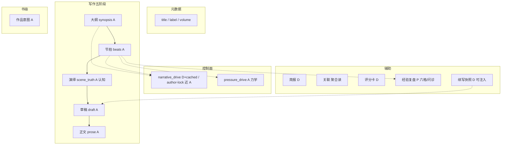
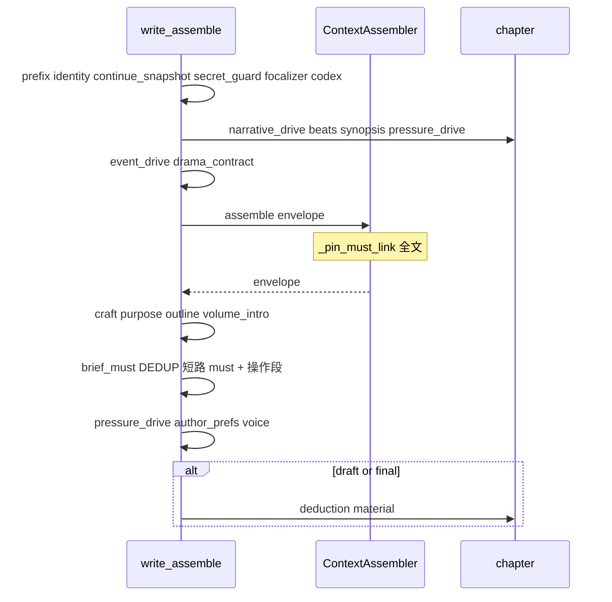
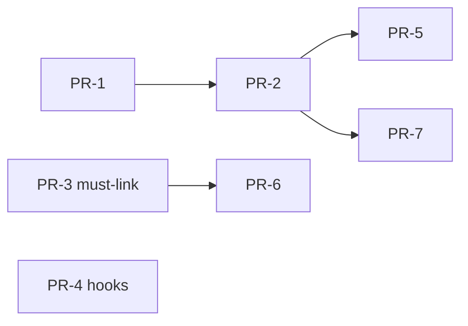

# 设计文档：章写作信息架构最优改进方案

| 项 | 值 |
|----|-----|
| **文档标题** | 铜炉章工作台 IA：分层保留 + 同名消歧 + 注入去重 + SSOT 矩阵 |
| **作者** | Grok Design；**人决签收** 2026-08-10 |
| **日期** | 2026-08-10 |
| **状态** | **Accepted · rev.3.1** · **已实现 PR-1…PR-7（goal 覆盖原 KD-IA-14 仅落仓）** · 2026-08-10 |
| **产品** | scribe-writing-system / scribe3（铜炉） |
| **代码根（优先）** | `/home/admin/projects/scribe-ia-verify-wt/scribe3/` |
| **会话 scratch** | `/tmp/grok-1000/grok-design-doc-40299602.md` |
| **耐久真源** | `docs/plans/2026-08-10-chapter-writing-ia-optimal.md`（与本文件同步） |
| **验收环境** | demo 已部署栈 `https://www.qing.blue`；**禁止**默认再起第二 Surreal；Grok 运行机不做全量 npm/pytest/本机 Surreal |
| **直接输入** | 内部盘点报告（十面分层结论）· NQ 全链路设计 · Narrative Event Engine rev.2.3 · 命题全链 KD-8 · 全网写作工艺与工具 IA 调研 |
| **明确不做的宣称** | **不**因本方案单独宣称文学 ≥9.5；**不**把十面合并成单字段；**不**删除 proposition / 不混 scene_truth 与世界真相 |

---

### 读法（工程师 · 第一周）

1. **概述 + 关键决策** — 改什么、不改什么；人决命名与默认密度。  
2. **SSOT 矩阵 + 注入去重合同** — 真源 / 投影 / 派生；must-link 双栈。  
3. **钩子优先级表（§5.1）** — ensure 必须改 compose，不能只抽 helper。  
4. **界面命名 / 词表 / 渐进披露** — 仅 localStorage；新用户默认 essential。  
5. **PR 计划** — 可独立评审合并的增量（**当前仅落仓，暂不实现**）。  

---

## 概述

铜炉章工作台当前呈现约 **十个信息面**：

| 类型 | 面 | 代码/UI 锚点 |
|------|-----|--------------|
| **写作五阶段** | 大纲 / 节拍 / 演绎 / 草稿 / 正文 | `ChapterStudio.jsx` `PHASES`；`synopsis` / `beats` / `scene_truth` / `draft` / `prose` |
| **辅助只读** | 简报 / 关联 / **评分卡**（旧称北极星）/ **经验复盘**（旧称压力） | `ChapterAuxPanel`；`brief` / Frame / `NorthStarPanel` / `ExperiencePressurePanel` |
| **元数据** | 章节信息 | `ChapterMetaPane`（title/label/volume） |

内部深研结论（地面真值）：这十面 **大多不是事故性副本**，而是 **刻意分层**——五阶段是递进抽象（章级 synopsis → 拍级 GCD 合同 → 认知投影 → 执行稿 → 定稿）；四块辅助是「读着写」；章节信息只管元数据。真正该修的是：

1. **同名不同源**（北极星 = intent vs scorecard；压力 = PDC / metrics / review / 经验六格 / **续写快照** / must-link 文案「〔压力〕」）  
2. **写路径注入双份**（尤其 must-link **双栈**：envelope pin + brief `build_must_prefix`）  
3. **钩子/stakes 多源** + **ensure 与 drama 种子不一致**  
4. **作者心智「十份同一章」**——GLOSSARY 缺产品面  
5. **世界双源心智**——指针到命题方案，本方案不重做引擎  

本方案：

> **保留五阶段 + 辅助面（不塌缩字段）**；用 **SSOT 矩阵 + 注入槽位合同（含 must-link 双栈）+ 命名消歧 + ensure 钩子种子修复 + 渐进披露（localStorage）** 消解重复感与真实双写。

与全网工艺同构：Scrivener Synopsis/Notes/Manuscript；雪花法句→段→场景表→稿；网文章纲/细纲/正文；LLM 多阶段 + 单源注入。

---

## 背景与动机

### 1. 当前系统状态（代码锚点）

**阶段时钟**

```text
ChapterStudio PHASES: outline → beats → deduce → draft → final(prose)
```

- 大纲：`chapter.synopsis` 只读 + 主编种子  
- 节拍：`chapter.beats`（GCD）+ `beats_meta`；作者可保存  
- 演绎：`scene_truth` + 限知；**认知，不写戏**  
- 草稿 / 正文：`draft` 与 `prose` 分列（migration `048`）  

**辅助面**

- 简报：`brief.assemble_chapter_brief`  
- 关联：设定/伏笔/母题/限知  
- 北极星 **面板**：`NorthStarPanel` → **scorecard**  
- 北极星 **意图**：`NorthStarBar` / `s3_set_intent` → `intent:main`  
- 压力 **面板**：`ExperiencePressurePanel` → 问诊 + 六格 + **续写仪式**  
- 压力 **合同**：`chapter.pressure_drive`（PDC）→ `_pressure_drive_write_block`（`SCRIBE3_PDC`）  

**控制面**

| 层 | 文档 | 角色 |
|----|------|------|
| novel-quality-first | `docs/plans/2026-08-10-novel-quality-first-pipeline-optimization.md` | GCD / drama_block |
| Narrative Engine | `docs/plans/2026-08-10-narrative-event-engine.md` | `narrative_drive` 引导 |
| NEE-OI | `docs/plans/2026-08-10-narrative-engine-optimal-improvement.md` | 覆盖/对白（本方案不改其 L2/L3 语义） |
| 命题全链 | `docs/plans/2026-08-09-proposition-full-chain-optimization.md` | 世界真相权威 |

**写路径注入（`_assemble_write_instructions_v1` · 对齐代码 ~1000–1238）**

```text
# prefix / 身份层（I1：非 _editor_write_system）
identity + write_protocol + revision + anti_slop
→ continue_snapshot（domain continue_snapshot · 经验续写）
→ secret_guard → request_position → [tool_scope / craft_skills_index]
→ focalizer → codex（设定圣经单挂，防与 envelope 双份）

# _render_final_input
event_drive → drama_contract
→ envelope（内含 ContextAssembler._pin_must_link：source_kind=canonical、reason=must_link_priority、source_id 常以 must_link 为前缀）
→ seed_words → craft → phase_role → avoid → revelation_discipline → sincerity
→ purpose（实为 purpose + lessons 同块）
→ outline（synopsis + beat.text）→ volume_intro
→ brief_must（**内嵌** build_must_prefix 前缀 + 操作段；已 pop purpose/lessons/injection/drama_contract）
→ pressure_drive（SCRIBE3_PDC 门控）→ author_prefs（USER.md 散文）→ voice_anchor
→ [draft/final: reference_craft / deduction / material_recall]
```

**must-link 双栈（现网事实）**

| 栈 | 路径 | 文案头 |
|----|------|--------|
| A · envelope pin | `ContextAssembler._pin_must_link` → `collect_must_anchors` + `format_must_link_items` | `【戏剧压力·记忆优先…】` / `〔压力〕…` |
| B · brief 前缀 | `_brief_must_sections_write_block` → **再次** `build_must_prefix` | `【戏剧压力·来自记忆/正典…】` / `〔压力〕…` |

已有去重：brief pop 四节（单测锚 `tests/test_context_mount_write.py::test_brief_must_helper_strips_purpose_duplicate_path`）；I1 身份；`_outline_block` **已只**拼 synopsis+text；`_drama_block` 已 resolve `beats_meta.chapter_hook`→末拍 hook。

**钩子裂缝（现网）**：ensure → `compose_narrative_drive_dict(meta=parse_chapter_meta(synopsis))`，`end_hook = meta.hook or prev or summary`，**不读** `beats_meta.chapter_hook`。

### 2. 痛点

| ID | 痛点 | 严重度 |
|----|------|--------|
| P-Homonym-NS | 北极星 = 意图 vs scorecard | P0 UX |
| P-Homonym-PR | 压力 ≥5 实现面（PDC/复盘/续写/metrics/审读 + must-link 文案） | P0 UX |
| P-MustDual | must-link 双栈全文 | P0 工程 |
| P-HookEnsure | drama 与 ensure 钩子源不一致 | P0 工程 |
| P-Glossary | GLOSSARY 无产品面 | P1 |
| P-TenCopy | 作者以为十份同一章 | P1 |
| P-Progressive | 新手与高压同密度 | P2 |

### 3. 全网工艺对照（心智辩护 · 非文学验收条）

| 工艺/工具 | 铜炉映射 |
|-----------|----------|
| Scrivener Synopsis / Notes / Manuscript | 大纲 / 节拍(+演绎) / 草稿·正文 |
| Snowflake | synopsis → beats → draft/prose |
| Swain GCD + Sequel | beats.v2 vs 经验六格（投影） |
| Story Grid 五诫命 / STC beats | 拍级功能时刻，非再抄全书 15 点 |
| 网文章纲/细纲/正文 | synopsis / beats / prose |
| LLM 多阶段 + 单源注入 | domain 槽 + 双栈去重 |

工艺映射 **不**偷换为「对标 Scrivener 即质量」；成功标准 **不含** 文学 ≥9.5。

### 4. 与前序设计边界

| 前序 | 本方案 |
|------|--------|
| NQ | 不重做；引用 GCD/drama |
| NEE | 不重做引擎；**PR-4 仅改钩子种子优先级** |
| NEE-OI | 不改 L2 覆盖 / L3 对白语义 |
| 命题全链 | 不删 proposition；命名指针 |
| 压力设计 | PDC 仍为力学 A；经验面改名 |

---

## 目标与非目标

### 目标

1. 保留五阶段 + 辅助面分层，产品语言解释非十份副本。  
2. 消除同名不同源（北极星 / 压力五面）。  
3. 写路径注入 SSOT：must-link 双栈单全文；brief/outline/drama 合同。  
4. 钩子权威链 + **ensure/compose 与 drama 对齐**。  
5. GLOSSARY 组八 + 旧名/domain 列。  
6. 渐进披露：**仅 localStorage**；**新用户默认 essential**（人决）。  
7. 增量 PR 清单完备；**本轮不实现**；日后 demo 冒烟与假绿防护。  

### 非目标

| 非目标 | 理由 |
|--------|------|
| 合并五阶段字段 | 工艺与 NQ/NEE 反对 |
| 删 proposition / 混 scene_truth | 铁律 |
| 表单墙写世界 | WRITE_GATED |
| Scrivener Binder 大爆炸 | ROI |
| 默认硬开 GATE/DETECT | 引导优先 |
| 本机全量 npm/Surreal 验收 | 主机规则 |
| 文学 ≥9.5 | 人盲未跑 |
| 把 ia_density 塞进 USER.md | author_prefs 是散文 |

---

## 关键决策

| # | 决策 | 理由 |
|---|------|------|
| **KD-IA-1** | 保留五阶段 + 四辅助 + 元数据；禁止合并 synopsis/beats/scene_truth/draft/prose | 盘点 + Snowflake/Scrivener |
| **KD-IA-2** | SSOT 三元：`authoritative` / `projection` / `derived`（+ seed） | 可测 |
| **KD-IA-3** | **人决锁定**：辅助面板正式中文名 = **「评分卡」**（弃用「品质仪表」备选）；顶栏 = **「作品意图」**；经验面板 = **「经验复盘」**；写路径合同 = **「力学合同」**；过渡期可副标「评分卡（北极星）」 | 同名消歧；2026-08-10 人决 |
| **KD-IA-4** | `drama_contract` 唯一 GCD 执行摘要；`outline` 仅 synopsis+text（**现网已是**，PR-3 回归锁）；`event_drive` 章级导航；`brief_must` 禁 purpose/drama/injection；`pressure_drive` 力学钉 | 防双份 |
| **KD-IA-5** | 钩子长期 A = `beats_meta.chapter_hook` → 末拍 hook；synopsis meta.hook / prev_end_hook = S。**PR-4 必须改 `compose`/`ensure` 种子**，不只抽 helper 给 drama | 修 ensure 裂缝 |
| **KD-IA-6** | stakes：章级 drive/synopsis；拍级 cost；purpose=世界验收非文案 | 分层 |
| **KD-IA-7** | 压力族：PDC A；六格 P；**continue_snapshot 可注入但 ≠ PDC**；metrics/review=后验 | 闭合同名表 |
| **KD-IA-8** | 演绎永不戏剧 SSOT；≠ 世界真相 | 铁律 |
| **KD-IA-9** | 密度仅 `localStorage` 键 `s3.ia.density`；**禁止**写入 USER.md。取值 `essential` / `standard` / `full` | 避免假 API |
| **KD-IA-10** | GLOSSARY 组八 + 旧名/domain | D 枢纽 |
| **KD-IA-11** | 验收 = demo 冒烟 + 针对性单测；正文级锚计数防假绿 | |
| **KD-IA-12** | must-link：**权威全文 = envelope pin**（检测用 `reason=must_link_priority` / `source_id` 前缀 / 显式 `must_link_already_pinned`，**禁** `source_kind==must_link`）；`SCRIBE3_INJECT_DEDUP=1` 时 brief 短路；=0 恢复双前缀；必改 `context_assembler.py` | 防只改 helper 假绿与错误谓词恒假 |
| **KD-IA-13** | **渐进披露默认**：`s3.ia.density` **未设置**（新用户 / 首次打开）时 **default = `essential`**；已显式写入的用户保留其值；设置页可切 standard/full | 人决「最优默认」：降噪优先，不藏死能力（「更多」可展开） |
| **KD-IA-14** | 原「仅落仓」；**已被 goal「全部实现」覆盖**，PR-1…PR-7 已合入主路径 | goal 2026-08-10 |

---

## 方案设计

### 1. 信息架构总图



### 2. 工艺映射（作者教育）

| 熟悉说法 | 铜炉 | 写什么 |
|----------|------|--------|
| 章纲 | 大纲 | stakes/钩话术种子 |
| 细纲场景 | 节拍 GCD | 目标-冲突-转折-代价-钩子 |
| — | 演绎 | 谁知道什么 |
| 初稿/定稿 | 草稿/正文 | 执行与落库 |
| Research | 简报+关联 | 读着写 |
| 仪表 | 评分卡 | 非意图编辑 |
| 复盘 | 经验复盘 | 非 PDC |

### 3. SSOT 矩阵

图例：**A** 权威 · **P** 投影 · **D** 派生 · **S** 仅种子。

| 概念 | 字段 | 类型 | 写入方 | 注入 domain | 禁止 |
|------|------|------|--------|-------------|------|
| 章梗概 | `synopsis` | A | 主编/Pilot | `outline` | 作者 patch 直写 |
| 拍级戏剧 | `beats[]` GCD | A | expand/作者 | `drama_contract` | 演绎写戏；brief 抄 GCD |
| 拍摘要 | `beats[].text` | A | 同上 | `outline` | 结构化再抄 GCD 表头 |
| 章钩 | `beats_meta.chapter_hook` | A | expand/UI | drama 钩行 | 与 end_hook 无人知分歧 |
| 末拍钩 | `beats[-1].hook` | S→A | 生成 | 回落 | 第三权威 |
| synopsis 标签钩 | `parse_chapter_meta.hook` | S | 大纲话术 | ensure seed only（PR-4 后） | 并列权威 |
| prev 钩 | inventory `prev_end_hook` | S | 上章 | continuation | 覆盖本章 1–2 |
| 事件驱动 | `narrative_drive` | D+cached；**locked/`source=author` 近 A** | ensure | `event_drive`（`SCRIBE3_NARRATIVE_ENGINE`） | 当拍卡编辑器 |
| 力学合同 | `pressure_drive` | A | bootstrap/主编 | `pressure_drive`（**`SCRIBE3_PDC=1`**） | 双写 beats |
| PDC 文案合并 | `pressure_drive.beats[].text` | P | load_pdc | 可选 | 当第二大纲 |
| 场景真相 | `scene_truth` | A | deduce | deduction | =世界真相/=GCD |
| 限知投影 | deductions | A@rev | deduce | draft/final | stale 当有效 |
| 草稿/定稿 | draft / prose | A | 作者/Pilot | 生成对象 | |
| 目的+教训 | purpose + lessons | A | 工具 | **`purpose` 同块** | brief 再挂任一侧 |
| 简报操作段 | assemble − pop | D | — | `brief_must` | drama/purpose/lessons/injection |
| must-link | anchors | D | 检索 | **全文：envelope pin**（`source_kind=canonical` + `reason=must_link_priority`）；brief 指针或空（DEDUP=1） | 双栈全文；**勿**用 `source_kind==must_link` 检测 |
| 续写快照 | continue_rite | D/P | 读 | `continue_snapshot` | 冒充 PDC/六格 |
| 经验六格 | scene_grid | P | 体验 API | 默认不进写路径 | 与 GCD 双权威 |
| 压力指标 | pressure_metrics | D | post_check | 不进写戏合同 | |
| 审读压力 | type=`pressure` / UI 压力节奏 | D | review | 不进生成合同 | |
| 作品意图 | intent | A | s3_set_intent | envelope 侧 | Panel 当写入面 |
| 评分卡 | scorecard | D | 计算 | 不作写戏合同 | 叫北极星不解释 |
| 世界真相 | proposition | A | 主编/MCP | envelope facts | 混 scene_truth |
| 人设档案 | character/faction | A | 卡 | codex | 无权威说明的双入口 |
| 跨书偏好 | USER.md | A 散文 | 人/append_pref | `author_prefs` | 塞 ia_density |

**脚注：** 钩子 ensure 以 **PR-4 后**优先级为准；must-link「〔压力〕」≠ PDC；outline 反 GCD 为 **回归锁**。

### 3.1 压力同名消歧表（完整）

| 产品称呼（目标） | 代码/实现 | 角色 | 进写路径？ |
|------------------|-----------|------|------------|
| 力学合同 | `pressure_drive` / PDC | 章级力学钉 A | 是（flag） |
| 经验复盘 | ExperiencePressurePanel 六格+问诊 | 体验 P | 六格默认否 |
| 续写快照 | `continue_snapshot` / continue_rite | 续写提示 D | **是**（身份层） |
| 压力指标 | `pressure_metrics` | 后验 D | 否（审读/triage） |
| 审读·压力节奏 | review type pressure / guardIssues | 门禁文案 | 否 |
| 记忆压力锚 | must_link `〔压力〕` | 伏笔/正典锚 | 是（envelope；brief 去重后指针） |

### 4. 写路径注入去重合同

#### 4.1 完整 domain 表

| domain / 段 | 权威来源 | 去重/pop | 禁止再抄 |
|-------------|---------|----------|----------|
| `continue_snapshot` | continue_rite | — | 不当 PDC |
| `secret_guard` / `focalizer` / revelation | 协议 | **永不 pop** | — |
| `codex` | 设定 | I1 单挂 | envelope 整包圣经 |
| `event_drive` | narrative_drive | 空→空 | 完整 GCD 卡 |
| `drama_contract` | beats GCD | 无 GCD→空 | brief/outline 结构化 GCD |
| envelope + must_link pin | assembler（canonical 块内 reason=must_link_priority） | 预算裁记忆 | 身份层 facts 双份 |
| `purpose` | purpose+lessons | brief 已 pop | brief 再挂 |
| `outline` | synopsis+text | 回归锁 | drama 表头特征行 |
| `brief_must` | assemble | pop 四节；must 短路 | — |
| `pressure_drive` | PDC | flag/空合同 | 完整 GCD 列表 |
| `author_prefs` | USER.md | — | 正典 |
| draft/final 块 | 各模块 | stale 不全文 | — |

**核心戏剧链：** `event_drive → drama_contract → envelope(+must pin) → purpose → outline → brief_must(±指针) → pressure_drive`

#### 4.2 规则

| 规则 | 现状 | 目标 |
|------|------|------|
| R1 brief pop | 已有 | 锁 `test_brief_must_helper_strips_purpose_duplicate_path` |
| R2 outline 非 GCD 结构化 | **已是** | **回归锁**；断言对拍现网 `format_drama_block`：标题 `## 本章戏剧合同`；字段 **`目标：` / `阻力：` / `结果：` / `代价：`**（非「冲突/转折」字面），禁裸模糊匹配 |
| R3 event≠drama 职责 | 已有 | 保持 |
| R4 must-link 单全文 | 双栈 | §4.2.1 |
| R5 PDC 不抄 GCD 全文 | 注释约束 | 单测 |
| R6 I1 身份 | 已有 | 保持 |
| R7 query≠canon | 注释 | Inspector |
| R8 continue_snapshot 标经验域 | 已注入未入表 | SSOT+命名 |

#### 4.2.1 must-link 实现合同（PR-3）

**权威全文 = envelope pin**（`ContextAssembler._pin_must_link` 钉入 **canonical** 块头部，参与预算/溯源）。

**现网 `ContextSource` 字段真值（实现必读 · 已核对 `context_assembler.py` ~754–761）**

| 字段 | pin 后实际值 | 说明 |
|------|----------------|------|
| `source_kind` | **`"canonical"`** | 与其它正典同行；**不是** `"must_link"` |
| `reason` | **`"must_link_priority"`** | 识别 must-link pin 的可靠谓词之一 |
| `source_id` | `must_link:header` / `must_link:…` / meta 传入 | 常以 `must_link` 为前缀 |
| `format_must_link_items` meta[`kind`] | `"must_link"` | **仅** format 侧 dict；**未**映射为 `ContextSource.source_kind` |

**禁止：** `source_kind == "must_link"` / 「envelope 已含 kind=must_link」——现网恒假 → 短路永不触发 → 双全文假绿。

**「已 pin」合法检测（任选其一或组合；推荐 A 显式 bool）**

```python
def envelope_must_link_pinned(envelope) -> bool:
    """从已组装 envelope 反查；字段名对齐 ContextSource，非 format meta.kind。"""
    for block in getattr(envelope, "blocks", None) or []:
        for s in getattr(block, "sources", None) or []:
            reason = getattr(s, "reason", None) or (s.get("reason") if isinstance(s, dict) else None)
            sid = str(getattr(s, "source_id", None) or (s.get("source_id") if isinstance(s, dict) else "") or "")
            if reason == "must_link_priority":
                return True
            if sid.startswith("must_link"):
                return True
    return False
```

`SCRIBE3_INJECT_DEDUP=1` 时 brief：

1. 若 **`must_link_already_pinned`**（见下）为真，**不**再输出 `build_must_prefix` 锚正文 → `""` 或一行 `（戏剧压力锚已置于记忆正典块）`。  
2. 共享状态（PR 内钉死一种；**推荐 A**）：  
   - **A（首选）**：`_pin_must_link` 成功钉入至少一行后，由 assemble 路径置 `must_link_already_pinned=True`（或 pin 返回 `(items, pinned: bool)`），**显式传入** `_brief_must_sections_write_block(..., must_link_already_pinned=bool)`——**不**依赖错误的 `source_kind`。  
   - **B**：assemble 后对 envelope 跑 `envelope_must_link_pinned`（`reason==must_link_priority` 和/或 `source_id.startswith("must_link")`），再传入 brief。  
   - **C**：request-local `InjectDedupState.must_link_already_pinned`。  
3. **禁止**只改 `build_must_prefix` 内部而两处仍各调 collect 双写——必须在 **调用点** 短路。  
4. **禁止**用 `source_kind == "must_link"` 作为检测谓词。

`SCRIBE3_INJECT_DEDUP=0`：**恢复 pin 全文 + prefix 全文**（旧生产字节兼容）。

**限知：** `_pin_must_link` 已有 `_filter_must_anchors_for_frame`；`build_must_prefix` 另有 focalizer 过滤——PR-3 对齐口径（Open Q7）。

**不采纳** brief 全文、pin 指针（与 D3 预算/正典头冲突）。

**单测：** 锚正文（`〔压力〕` 后核心串）sha 出现 ≤1；flag=0 允许 ≥2；另测「伪造 envelope 仅 canonical 无 must_link_priority → 不短路」与「reason=must_link_priority → 短路」；挂 `test_context_mount_write.py`。

**影响文件：** `context_assembler.py`、`write_assemble.py`、`memory_must_link.py`、相关 tests。

#### 4.3 序列图



#### 4.4 观测与假绿防护

- 可选 `dedup_report`：pop keys、`must_link_already_pinned`、锚 sha 列表。  
- 验收：**正文锚 sha 集合**，非仅 domain kind 计数。  
- ContextInspector（`context_inspector_v1`）旗开时展示 supplemental `content_digest`，避免无 UI 入口。  
- flag=0 契约写入 PR-3 单测。  

### 5. 钩子 / stakes 收敛

#### 5.1 优先级表（PR-4 改 compose/ensure）

| 优先级 | 来源 | 角色 |
|--------|------|------|
| 1 | `beats_meta.chapter_hook` | 长期 A |
| 2 | 末拍 `hook` | 回落 |
| 3 | synopsis `parse_chapter_meta.hook` | S only |
| 4 | `prev_end_hook` | S continuation；不覆盖 1–2 |
| 5 | summary 截断 | 弱兜底 |

| 路径 | 现网 | 目标 |
|------|------|------|
| `_drama_block` | 已 1→2 | 调共享 `resolve_chapter_hook` |
| compose/ensure | meta.hook or prev or summary | `resolve_end_hook_seed`：1→2→3→4→5 |

共享函数：`drama_beats.py` 或 `chapter_hooks.py`（纯函数）；**禁止** write_assemble ↔ narrative_drive 环依赖。

`SCRIBE3_HOOK_SYNC_WRITE`：默认 0；=1 时强化写 `drive.end_hook`（非 author-lock）；**默认不**回写 `beats_meta`。

```python
def resolve_chapter_hook(ch) -> str:
    meta = ch.get("beats_meta") or {}
    hook = str(meta.get("chapter_hook") or "").strip()
    if hook:
        return hook
    for b in reversed(list(ch.get("beats") or [])):
        if isinstance(b, dict) and str(b.get("hook") or "").strip():
            return str(b.get("hook") or "").strip()
    return ""

def resolve_end_hook_seed(ch, meta_hook="", prev_end_hook="", summary="") -> str:
    primary = resolve_chapter_hook(ch)
    if primary:
        return primary
    for cand in (meta_hook, prev_end_hook, (summary or "")[:40]):
        t = str(cand or "").strip()
        if t:
            return t
    return ""
```

#### 5.2 UI / 5.3 stakes

节拍页单处章末钩子；大纲只读提示结构化钩在节拍。  
stakes：章 drive/synopsis；拍 cost；purpose=世界验收。

### 6. UI / 命名 / 渐进披露

| 现 label | 目标 | tooltip |
|----------|------|---------|
| 简报 | 简报 | 只读组装 |
| 关联 | 关联 | 设定·伏笔·限知 |
| 北极星（旧） | **评分卡**（人决终名；过渡副标可写「评分卡（北极星）」） | **非**作品意图；不是第三份正文 |
| 压力（旧） | **经验复盘** | 六格/问诊/续写；**非** 力学合同（PDC） |

顶栏 `NorthStarBar` **可见中文** → **「作品意图」**；与辅助 tab「评分卡」用 tooltip **互链**：「不是同一个东西」。

阶段职责条：大纲 = 章级种子；节拍 = 戏剧合同；演绎 = 认知（≠写戏、≠设定库世界真相）；草稿 = 执行；正文 = 定稿。

**渐进披露（人决 · KD-IA-13）**

| 档位 | 键值 | 可见范围 |
|------|------|----------|
| 精简（默认） | `essential` | 五阶段 + 简报 + 关联；「评分卡」「经验复盘」收入「更多」 |
| 标准 | `standard` | 四辅助全显（新中文名） |
| 完整 | `full` | + 调试：`narrative_drive` / PDC 原始、去重报告入口 |

- 存储：**仅**浏览器 `localStorage` 键 `s3.ia.density`。  
- **未设置 / 新用户 → 默认 `essential`**（最优降噪）。  
- **禁止**写入 Hermes `USER.md` / `author_prefs`。  
- 云同步（settings_store 等）不在本方案实现（见已决议 Q6）。

帮助句（作者教育）：大纲像 Scrivener 索引卡摘要，节拍像细纲场景卡，演绎像「谁知道什么」的注释层，草稿/正文像手稿正文；简报与关联是参考资料；评分卡是仪表，不是第三份稿。

### 7. GLOSSARY 组八

链到 `docs/plans/2026-08-10-chapter-writing-ia-optimal.md`。列：中文名 | 代码名 | 旧 UI 名 | 注入 domain | 定义。

含：synopsis/beats/beats_meta/scene_truth/draft/prose/brief/intent/scorecard/pressure_drive/经验复盘/continue_snapshot/pressure_metrics/narrative_drive/drama_contract/must_link/proposition/chapter_hook/author_prefs（USER.md）。

### 8. 世界面指针

演绎 UI 旁注场景真相≠世界真相；设定树跟命题方案；不删 proposition。

### 9. 风险

| 风险 | 严重度 | 缓解 |
|------|--------|------|
| 改名迷路 | 中 | 过渡双标 |
| 钩子写回惊喜 | 中 | 默认 `SCRIBE3_HOOK_SYNC_WRITE=0` |
| must-link 误删唯一锚 | 高 | 正文 sha 单测；fail-soft |
| pin 限知更松 | 高 | PR-3 对齐 |
| ensure 改种子扰动旧 drive | 中 | author-lock；与 OI 边界声明 |
| 假绿 domain 计数 | 中 | 正文锚 sha |

### 10–12. 观测 / 安全 / 与正文其它节

观测见 §4.4。安全：不新开世界写；dedup 不 pop 限知/revelation。无新 migration。

---

## API / 接口变更

| 接口 | 变更 |
|------|------|
| REST/MCP 字段名 | 不改章字段 |
| north star API | 可选 `panel_role: scorecard` |
| experience / continue | 文档 role 标明 |
| write_assemble + context_assembler | must-link 短路 |
| narrative_drive compose/ensure | 钩子种子（PR-4） |
| resolve_chapter_hook | 纯函数；无新 HTTP |
| **ia_density** | **仅 localStorage**；无 REST；不扩 author_prefs |

---

## 数据模型变更

本方案 **零 schema migration**。逻辑合同：`beats_meta.chapter_hook` = 钩 A；`end_hook` = D+cached。

---

## 备选方案

### 备选 A：塌缩五阶段为单字段  
拒绝——毁 GCD/状态机/演绎边界。

### 备选 B：全量 Scrivener Binder 重写  
拒绝——前端大爆炸；用职责条借隐喻。

### 备选 C：仅 narrative_drive 为唯一戏剧 SSOT  
拒绝——丢拍级粒度；与 expand_beats/作者手改冲突。

### 备选 D（采纳）：分层保留 + 消歧 + 注入合同 + ensure 钩子修复 + localStorage 披露  

---

## 安全与隐私

世界写仍主编审批；去重不得移除 focalizer/revelation/epistemic；scorecard/intent 分离降误操作。

---

## 可观测性

- 正文 must-link 锚 sha ≤1（DEDUP=1）  
- domain 计数仅辅证  
- PR-4：仅 chapter_hook 时 drive.end_hook 与 drama 一致  
- UI：Bar「作品意图」+ tab「评分卡」互链  
- Inspector 有 dedup 入口  

---

## 上线计划（Rollout）

**当前状态：已实现（goal 覆盖）。** 下列步骤为已执行路径；验收见 demo 热更 + 单元证据。

| 阶段 | 内容 | 回滚 |
|------|------|------|
| T0 | 词表 GLOSSARY + 设计落仓 | git revert 文档 |
| T1 | 界面文案（评分卡 / 经验复盘 / 作品意图） | `SCRIBE3_IA_COPY_V2=0` |
| T2 | must-link 双栈去重 | `SCRIBE3_INJECT_DEDUP=0` 恢复双前缀 |
| T3 | ensure 钩子种子 | 回退 narrative_drive 相关提交 |
| T4 | localStorage 渐进披露（**默认 essential**） | 删除 `s3.ia.density` 键 |
| T5 | 可选 dedup_report 观测 | 关闭观测旗 |

**特性开关（统一 `SCRIBE3_*` 前缀）**

| 开关 | 合入后默认 | 含义 |
|------|------------|------|
| `SCRIBE3_INJECT_DEDUP` | 1 | envelope 全文 + brief 指针；0 = 双前缀全文 |
| `SCRIBE3_HOOK_SYNC_WRITE` | 0 | 1 时强化写 `end_hook` |
| `SCRIBE3_IA_COPY_V2` | 1 | 新中文标签 |

---

## 已决议（原 Open Questions · 人决 2026-08-10）

| # | 议题 | 决议 | 落点 |
|---|------|------|------|
| **Q1** | 辅助面板「北极星」中文终名 | **评分卡**（不采用「品质仪表」） | KD-IA-3；§6 UI 表 |
| **Q2** | 渐进披露 essential 是否默认新用户 | **是**：未设置 / 新用户 **default = `essential`** | KD-IA-13；§6；PR-5 验收 |
| **Q3** | demo 上 must-link 双份率抽样 | **延后至实现 PR-3 开工前**做 3 章抽检；不阻塞设计 Accepted | PR-3 验收前检查项 |
| **Q4** | Outliner 列表「钩子已结构化」小标 | **P2 可选**；不进本方案必做 PR | 非阻塞 |
| **Q5** | 六格「从节拍 GCD 填充」 | **保留为可选 PR-7**；默认单向建议、不反写 beats | PR-7 |
| **Q6** | `ia_density` 云同步 | **本方案不做**；禁止 USER.md；若未来要做另开 settings_store PR | KD-IA-9 |
| **Q7** | pin 与 prefix 限知同口径 | **实现 PR-3 时对齐并单测**；设计合同已要求「同等或更严」 | §4.2.1；Open 工程检查非产品未决 |
| **Q8**（新增） | 下一步是否开工 PR | **只落仓设计，暂不实现** | KD-IA-14；上线计划 = 待启动 |

> 上表议题 **不再开放辩论**；实现阶段若需改默认密度或面板名，须新的书面人决。

---

## 参考

### 仓库内部

- 盘点 report；NQ / NEE / NEE-OI / 命题全链设计  
- `ChapterStudio.jsx` · `ChapterAuxPanel.jsx` · `NorthStarPanel.jsx` · `NorthStarBar.jsx` · `ExperiencePressurePanel.jsx`  
- `write_assemble.py` · `context_assembler.py` · `memory_must_link.py` · `drama_beats.py` · `pressure_drive.py` · `narrative_drive.py` · `brief.py` · `author_prefs.py` · `experience/continue_rite.py`  
- `GLOSSARY.md`；migrations 048/049/114/117/118  
- `tests/test_context_mount_write.py`  

### 业界参考

Scrivener 三层；Snowflake；STC；Story Grid；Swain GCD/Sequel；网文章纲；LLM 多阶段单源注入（心智参考，非验收条）。

---

## PR 计划

> **当前：不实现。** 下列 PR 为日后开工清单（KD-IA-14）。  
> 每 PR 应可独立评审与合并。验收默认：**demo 热更 + 冒烟**，非本机全量测试套件。  
> PR 描述模板勾选铁律：① 不删 proposition ② 不混 scene_truth 与世界真相 ③ 不合并五阶段字段。

### PR-1 · 词表 GLOSSARY + 设计落仓

- **标题（commit）**：`docs: chapter workbench glossary + IA design anchor`
- **中文说明**：增补 GLOSSARY 组八，并把本设计同步进 `docs/plans/`  
- **文件**：`scribe3/GLOSSARY.md`；`docs/plans/2026-08-10-chapter-writing-ia-optimal.md`  
- **依赖**：无  
- **描述**：组八 + 旧名/domain 列 + 设计链。  
- **验收**：链接与 KD 一致。

### PR-2 · 界面命名消歧 + 阶段职责条

- **标题（commit）**：`fe: disambiguate northstar/pressure labels + phase duty lines`
- **中文说明**：辅助 tab「评分卡」「经验复盘」；顶栏「作品意图」；阶段职责一句；默认密度 essential 时的入口降级可与 PR-5 分步  
- **文件**：`ChapterStudio.jsx`；`ChapterAuxPanel.jsx`；`NorthStarPanel.jsx`；**`NorthStarBar.jsx`**；`ExperiencePressurePanel.jsx`；可选 guardIssues 旁注  
- **依赖**：PR-1 弱  
- **验收清单**：  
  1. Bar 可见「作品意图」  
  2. 辅助 tab「评分卡」  
  3. 辅助 tab「经验复盘」；续写/六格 ≠ PDC  
  4. Bar↔Panel tooltip 互链「不是同一个东西」  

### PR-3 · must-link 双栈去重 + outline 回归锁

- **标题（commit）**：`fix: must-link single full-text (envelope pin owns; brief short-circuits)`
- **中文说明**：envelope pin 为全文权威；brief 短路；检测谓词对齐 `reason`/`source_id`  
- **文件**：**`context_assembler.py`**；`write_assemble.py`；`memory_must_link.py`；`tests/test_context_mount_write.py`（+ drama 回归若有）  
- **依赖**：无（∥ PR-2/PR-4）  
- **描述**：KD-IA-12；已 pin 检测用 `must_link_already_pinned` 或 `reason=must_link_priority` / `source_id` 前缀，**禁** `source_kind==must_link`；outline 反 GCD = 回归锁。  
- **验收**：  
  1. demo 热更  
  2. 有伏笔章触发写  
  3. Inspector/日志  
  4. `〔压力〕` 正文 sha ≤1；brief 无 purpose  
  5. `SCRIBE3_INJECT_DEDUP=0` 恢复双前缀  
  6. 不默认全量 pytest  

### PR-4 · 钩子 resolve + ensure/compose 种子

- **标题（commit）**：`fix: chapter_hook SSOT for drama and narrative_drive ensure`
- **中文说明**：共享 `resolve_chapter_hook`；改 compose/ensure 使 end_hook 与 drama 同源  
- **文件**：`drama_beats.py` 或 `chapter_hooks.py`；**`narrative_drive.py`**；`write_assemble.py`；单测  
- **依赖**：与 PR-3 **无硬依赖**；**不改** NEE-OI L2/L3 字段语义  
- **验收**：无 synopsis 钩标签、仅 chapter_hook → ensure 后 end_hook 与 drama 一致；author-lock 保留  

### PR-5 · 渐进披露（localStorage）

- **标题（commit）**：`fe: progressive disclosure (localStorage s3.ia.density)`
- **中文说明**：三档密度；**未设置默认 essential**（KD-IA-13）  
- **文件**：`ChapterStudio.jsx` / `ChapterAuxPanel.jsx`  
- **依赖**：PR-2  
- **描述**：**无** author_prefs / USER.md API。  
- **验收**：新用户（无键）见 essential；可切 standard/full；刷新后 localStorage 保持。

### PR-6 · 可选去重观测报告

- **标题（commit）**：`chore: optional inject dedup_report on write manifest`
- **中文说明**：写路径 Manifest/Inspector 展示 dedup_report  
- **文件**：`write_assemble.py`；`ContextInspector.jsx`  
- **依赖**：PR-3  
- **描述**：挂 trace/supplemental；旗开 UI 有入口。  

### PR-7 · 经验六格 ← 节拍 GCD 单向建议（可选）

- **标题（commit）**：`fe: fill experience grid from beats GCD (one-way)`
- **中文说明**：按钮预填六格；不反写 `chapter.beats`  
- **文件**：`ExperiencePressurePanel.jsx`  
- **依赖**：PR-2  
- **验收**：不反写 beats。

### 依赖图



**建议合并顺序（待启动后）：** PR-1 →（PR-2 ∥ PR-3 ∥ PR-4）→ PR-5 / PR-6 / PR-7。

---

## 成功标准

| 标准 | 类型 |
|------|------|
| 作者能口述五阶段职责 | 产品 |
| 不把评分卡当意图编辑器；Bar=作品意图 | 产品 |
| 压力五面可区分 | 产品 |
| drama/purpose 无 brief 双份 | 工程 |
| must-link 锚 sha ≤1（DEDUP=1）；=0 双前缀 | 工程 |
| drama 与 ensure 同钩子链 | 工程 |
| 五阶段字段仍在；proposition/scene_truth 边界文案在场 | 回归 |

**非成功标准：** 文学分、系统帮助度百分比（归 NEE-OI / 人盲协议）。

---

## 与 Execution Contract / narrative_drive 的关系（交叉引用）

| 层 | 职责 | 章工作台可见面 |
|----|------|----------------|
| **IA 五阶段** | synopsis / beats / scene_truth / draft / prose 分列字段真源 | 阶段页签 + `ChapterMetaPane` 写前齐套 |
| **Narrative Engine** | `narrative_drive` 合成/注入（引爆/对立/钩子） | MetaPane「本章事件驱动」只读三行 |
| **Execution Contract** | 默认 Drama Steer、`soft_fulfill`、stamp/drift；引导优先 | MetaPane「写后执行对照」+ 正文 `ContractSoftBanner` 合一 |
| **GATE-B / craft** | 存实质正文硬门（缺大纲/节拍/真相） | UI soft **≠** 存盘硬门；文案须分清 |

- 设计真源：`docs/plans/2026-08-10-narrative-rootcause-optimal-execution.md`（rev.1.1+）
- 只读 API：`GET /chapter/execution-soft-status` → `chapter_execution_soft_status`（同源 `soft_fulfill_drive`，永不 blocking）
- **不**在前端重算 soft 算法；**不**默认 EVENT_DRIVE_GATE / RESTEER 硬 park
- 高压大纲缺 `stakes:` → 契约门 **warn**（非 error 红灯）

---

*文档结束 · Accepted rev.3.1 · 已实现 PR-1…PR-7 · EC 可见性互指 2026-08-10*
