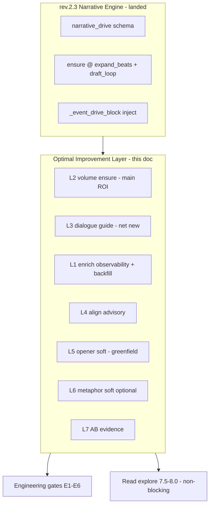
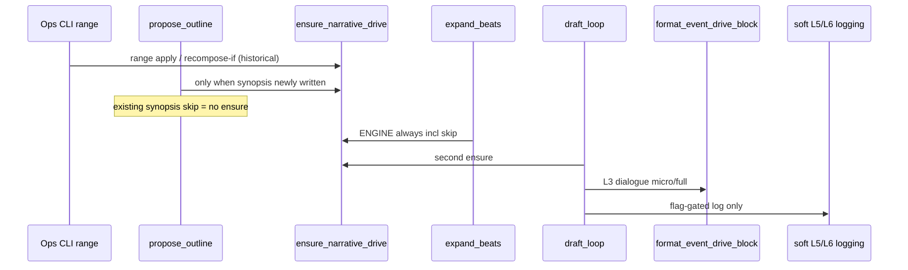
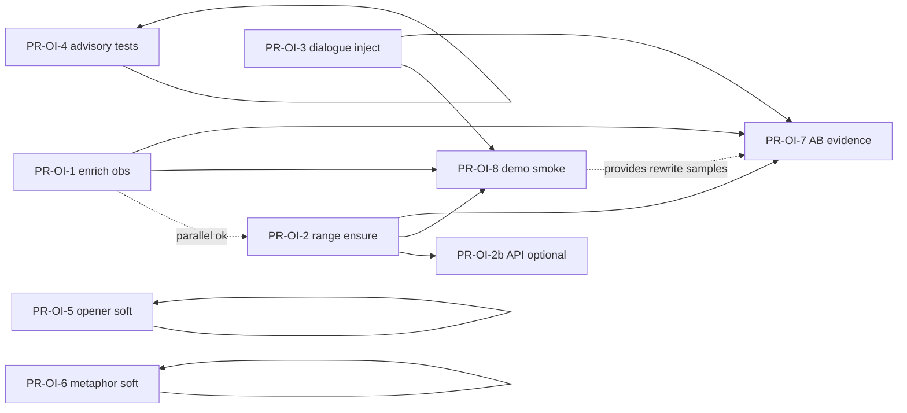

# 设计文档：叙事引擎 · 最优改进层（Optimal Improvement on rev.2.3）

| 项 | 值 |
|----|-----|
| **文档标题** | 在 rev.2.3 叙事引擎之上，以最高性价比将读感从 ~6.8 抬向 7.5–8.0 档 |
| **作者** | Grok Design（待人审签） |
| **日期** | 2026-08-10 |
| **状态** | Draft · **rev.1.1**（评审修订：收窄 L1、钉 backfill/写放大、L3 以对白为净增量、L5 净新建接线、目标分级） |
| **产品** | scribe-writing-system / scribe3（铜炉） |
| **工作区** | `/home/admin/projects/scribe-ia-verify-wt` |
| **文档真源** | 仓库 `docs/plans/2026-08-10-narrative-engine-optimal-improvement.md` |
| **会话 scratch** | `/tmp/grok-1000/grok-design-doc-40ac17bc.md`（须与真源全文一致） |
| **验收环境** | demo 已部署栈 `https://www.example.com`；**禁止**默认再起第二 Surreal；Grok 运行机不做全量 npm/pytest/本机 Surreal |
| **底座（其上的改进层）** | [`docs/plans/2026-08-10-narrative-event-engine.md`](./2026-08-10-narrative-event-engine.md) **rev.2.3**（已合入 main + demo 热更） |
| **前序 NQ** | [`docs/plans/2026-08-10-novel-quality-first-pipeline-optimization.md`](./2026-08-10-novel-quality-first-pipeline-optimization.md) · 证据 [`docs/evidence/nq-quality-smoke-20260810/12-llm-quality-delta-analysis.md`](../evidence/nq-quality-smoke-20260810/12-llm-quality-delta-analysis.md) |
| **引擎后读感基线** | **会话输入**（非正式 evidence 文件）；见 Background 证据纪律 |
| **明确不做的宣称** | **不**宣称文学 ≥9.5；**不**把 GATE/DETECT 硬拦当质量默认；**不**重做引擎 |

---

### 读法（工程师 · 第一周）

1. **## Overview + 产品原则 + ## Key Decisions** — 改什么、不改什么。  
2. **杠杆排序表 + 与 rev.2.3 关系** — 主链是 **L2 覆盖 + L3 对白**；L1 是 enrich/观测/回填，**不是**重写吸收。  
3. **## Proposed Design** — 文件/旗/接线级方案（含最小可 merge 伪码）。  
4. **## 成功指标 + ## PR Plan** — **工程门禁必过** / 读感探索目标不阻断 merge。  

---

## Overview

### 一句话

> **本方案不是新引擎，而是 rev.2.3 叙事引擎上的「最优改进层」。**  
> 在 **引导优先、默认不 park** 的前提下，用高杠杆补强：  
> （1）L1：**观测 + enrich 纪律 + 旧 drive 回填重算**（字段级 absorb **大多已有**，见 KD-OI-2）；（2）**L2 历史章/全卷 ensure 覆盖**（消灭 ch3 无 drive 回潮——最高工程 ROI）；（3）**L3 注入块主增「对白须承载对立」**（逼近句现网已有，压缩复用）；（4）drive↔beats 对齐保持 advisory；（5）开篇 15% 事件痕迹 soft 提示（**净新建**，EVENT_LED 体未实现）；（6）比喻 soft advisory 可选且 **不得** 与冲突硬目标并列；（7）同章 AB 校准仅作 PR 证据。  
> **工程门禁**（覆盖/注入/单测）必过；**读感探索目标** 代理 **~6.8 → 7.5–8.0 档**、帮助度 **~78–82% → 85–88%**（非正式基线，未达不阻断 merge），并 **稳定章间**。

### 产品原则（继承 rev.2.3 · 最高优先级 · 不可妥协）

| # | 原则 | 本改进层工程含义 |
|---|------|------------------|
| **P1** | **只强调一件事**：冲突/事件推动小说 | 所有 PR 标题/验收文案以「有戏」为中心；比喻/POV/氛围 **不**升级为与冲突同等硬目标 |
| **P2** | **引导 > 限制** | 主交付 = 覆盖更全 + 注入更准（对白）+ 可观测 enrich；**默认 advisory** |
| **P3** | **允许服务戏的「跟主角」** | 现网 guide 已含「逼近/兑现」；L3 **不**再堆第二套逼近长句 |
| **P4** | **少规则、少门闩** | 不新开刑典堆；叙事引擎 **GATE/DETECT 保持可选默认关** |
| **P5** | **硬拦极少** | `EVENT_DRIVE_GATE` / `EVENT_LED_DETECT` **不**因本方案翻成质量默认 |

**划界（P4/P5 与 NQ）**：本层 **不翻转** NQ 既有质量目标中的 `DRAMA_GATE` / `PARK_STROLL_BLOCKING` 等；「少门闩」专指 **叙事引擎 GATE/DETECT 子集**，不是宣称质量模式全面不 park。见 KD-OI-10。

### 分层关系（本方案在栈中的位置）

```text
┌─────────────────────────────────────────────────────────────┐
│  本设计 · Optimal Improvement Layer（改进层 / 控制面补强）     │
│  L2 卷级 ensure · L3 对白引导 · L1 enrich/回填 · soft L5/L6  │
└────────────────────────────┬────────────────────────────────┘
                             │ 补强，不替换
┌────────────────────────────▼────────────────────────────────┐
│  Narrative Engine rev.2.3（引导层 · 已落地）                   │
│  narrative_drive · ensure@expand/draft · _event_drive_block  │
│  旗：NARRATIVE_ENGINE=1；GATE/DETECT 默认 0                  │
│  注：EVENT_LED 旗已预留，检测体未实现（见 KD-OI-7）            │
└────────────────────────────┬────────────────────────────────┘
                             │ 引导叠加
┌────────────────────────────▼────────────────────────────────┐
│  novel-quality-first（执行层；含既有 drama/park 质量门）      │
│  beats · drama_block · craft · pressure · soft 双旗          │
└────────────────────────────┬────────────────────────────────┘
                             │ 编排
┌────────────────────────────▼────────────────────────────────┐
│  Pilot · deduce（认知）· 记忆注入 · 系统硬红线                │
└─────────────────────────────────────────────────────────────┘
```

**策略一句话：** 引擎骨架已通；读感瓶颈是 **无 drive 章回潮 + 对白塌方 + 旧合同不可见 enrich** —— 主链 **L2 + L3**，L1 收窄为纪律/观测/回填，**不**重写 compose 吸收路径。

---

## Background & Motivation

### 已落地基线（rev.2.3 · 不可回退）

| 项 | 落点 |
|----|------|
| 设计真源 | `docs/plans/2026-08-10-narrative-event-engine.md` rev.2.3 |
| 核心模块 | `scribe3/narrative_drive.py`（compose / validate / format / align / ensure / inventory） |
| Migration | `118_narrative_drive`（`chapter.narrative_drive`） |
| Pilot 挂点 | `pilot_runtime.expand_beats`（**含 skip**）+ `draft_loop` 入口 `ensure_narrative_drive` |
| 写路径注入 | `write_assemble._event_drive_block` → `format_event_drive_block`；`app_impl` rebind 已含 |
| 旗 | `SCRIBE3_NARRATIVE_ENGINE`（demo=1）；`EVENT_DRIVE_GATE=0`；`EVENT_LED_DETECT=0`（**体未实现**） |
| 验收 | compose/ensure/inject 单测绿；demo 书 `book_013bcb3b` ch2 真 LLM 重写落库 |

### NQ → 引擎后读感轨迹（诚实代理 · 禁止 ≥9.5）

| 阶段 | 读感均分（约） | 系统帮助度（约） | 证据锚 |
|------|----------------|------------------|--------|
| 旧复验 | 3.4 | ~64% | NQ 对照分析（可核） |
| NQ 质量模式 | 5.7 | 70–74% | [`12-llm-quality-delta-analysis.md`](../evidence/nq-quality-smoke-20260810/12-llm-quality-delta-analysis.md) |
| **引擎后（当前）** | **~6.8** | **~78–82%** | **会话任务输入**；**仓库内无同级固化 evidence 文件**（非正式基线） |
| **本方案探索目标** | **7.5–8.0 档** | **85–88%** | 见 ## 成功指标（**不阻断 merge**） |

**证据纪律：**

- 引擎后 ~6.8 / 78–82% **不得**写成「仓库 SSOT 已核验分数」；实施时应用 OI-7/8 再固化到 `docs/evidence/ne-oi-*`。  
- **系统帮助度（操作定义 · 非正式 KPI）**：  
  `help ≈ 0.45 * 冲突推进分 + 0.25 * 悬念分 + 0.20 * 对白戏剧分 + 0.10 * 行走服务戏分`（各 0–10 LLM 分维，再映射到 0–100%：`help_pct = 10 * mean_weighted`）。  
  **仅** LLM 分维加权叙述；**非**工程门禁；禁止与 ≥9.5 文学宣称混用。

引擎后分维 Δ（相对 NQ · **会话输入约数**）：

| 维 | Δ（约） | 要点 |
|----|---------|------|
| 叙事驱动/悬念 | **+3.0** | 注入后钩子更硬 |
| 行走服务戏 | +1.5 | ch2 walk↓；ch3 无 drive 时 walk 回潮（约 27/千字） |
| 冲突/事件推进 | +1.0 | 事件化；仍欠正面交锋 |
| 对白 | **−1.0** | 本轮 ch2 **零引号对白** |
| 比喻 | 密度升（≠更好） | soft 可选；**勿**与冲突同等硬目标 |

### 根因 → 杠杆映射（对齐现网代码）

| 读感症状 | 控制论根因（**代码对齐**） | 现网代码锚 | 本方案杠杆 |
|----------|---------------------------|------------|------------|
| 章间不稳 / ch3 回潮 | ensure 仅 expand/draft **按章触发**；无 range；历史章永不补 | `ensure_narrative_drive(seq)` only | **L2 全卷 ensure（主 ROI）** |
| 悬念/钩子仍软或合同「看起来旧」 | **字段级 absorb 大多已有**（`end_hook=hook or …`、`stakes_line=stakes or …`、if_fail 拆分）；弱戏更常来自 **无 ensure / 大纲无标签 / 已 ok 旧 drive 不重算 / source_refs 不可见** | `compose` ~340–350；`ensure` need ~726–741 | **L1 收窄**：source_refs + `outline_hook_absorbed` + compose 级 `missing_outline_stakes` + **Backfill Policy** |
| 对白塌方 | format **无「对白」**引导；逼近句 **已有** | `guide_full` ~478–481 | **L3 主增对白**；逼近压缩复用 |
| 节拍与戏偏 | align 低压已 advisory | `align_beats_to_drive` | **L4 保持 advisory** |
| 开篇仍偏逛 | EVENT_LED **旗在、体无**；无 soft 探针 | flags only | **L5 净新建 soft**（不假装复用 DETECT） |
| 比喻回潮 | 无密度 soft 进本引擎路径 | NQ 词表证据；`LOG_FIELD_PURPLE_DENSITY` 名 | **L6 soft 可选** |
| 归因不清 | 挂 drive 不重写 ≈ 不涨 | 引擎后对照 | **L7 AB 证据** |

### 硬证据纪律（设计约束）

1. **挂 drive 不重写** ≈ 几乎不涨 → 必须 **注入 + 真生成**。  
2. **无 drive → 回潮** → L2 是稳定性硬前提。  
3. **工程控制面增益 > 文学声口** → 不投 craft 刑典大改。  
4. **L1 勿误判**：实施者 **禁止**按「重写整段 absorb」做无效大改；优先单测锁现有 absorb + 补观测键 + 回填策略。

---

## Goals & Non-Goals

### Goals

#### 工程门禁（PR merge / OI-8 冒烟 **必过**）

1. ENGINE=1 目标书：有 synopsis 的章 **ensure 覆盖率 ≥95%**（L2）。  
2. 可注入 drive 章：写路径 `_event_drive_block` 非空命中 **≥98%**（与 E1 `ensured_ok` 同口径）。  
3. L1 单测：inventory+大纲锁 absorb；`source_refs` 含 outline 标；高压无 stakes → compose warning。  
4. L3 单测：非空 block 含「对白」+（「逼近」或「兑现」）；core 对立行在 220 预算内保留。  
5. align 低压 mismatch 不 park；GATE/DETECT 质量默认保持 0。  
6. 引导优先：新能力可 flag；L5/L6 默认关。

#### 读感探索目标（**方向** · 未达 **不**阻断 merge）

1. 读感均分代理从会话基线 ~6.8 向 **7.5–8.0 档**（OI-8 真重写 1–2 章 + 词表/可选 LLM；失败记 evidence，不改口号硬扛）。  
2. 帮助度代理向 **85–88%**（非正式 KPI，见操作定义）。  
3. 对白：重写章引号对白代理 **不再系统性归零**（相对引擎后 ch2 塌方）。  

**敏感性说明：** 读感抬升 **主要押注 L2 覆盖 + L3 对白 + 真重写**。L1 净字段增量有限（absorb 已有）；L5/L6 **默认关**，不计入「必达」读感账。若仅 L2+L3 未达 7.5，记 evidence 迭代，**不**为此默认开 GATE。

### Non-Goals / 明确不做

| 非目标 | 理由 |
|--------|------|
| **重做叙事引擎 / schema 大版本** | rev.2.3 已够 |
| **把 L1 写成「重写 compose 吸收」** | 现网已吸收；浪费且误导 |
| **刑典堆叠 / 默认 hard park** | 违 P2/P4/P5 |
| **把 POV 切换当引擎** | 相机 ≠ 驱动 |
| **独立 `compose_drive` 状态（本层）** | 仍插入点 A |
| **把 deduce 并入写戏** | 认知边界 |
| **默认开 EVENT_DRIVE_GATE / EVENT_LED 硬拦** | 质量默认禁止；且 LED **体未实现** |
| **比喻硬 cap 与冲突硬目标并列** | 违 P1 |
| **宣称文学 ≥9.5** | 人盲未跑 |
| **改 Pilot STATES/NEXT** | 保持 |
| **Grok 机全量 pytest / 本机 Surreal / 第二套 demo 栈** | 主机纪律 |

---

## 与 rev.2.3 叙事引擎的关系

| 维度 | rev.2.3 引擎 | 本改进层 |
|------|--------------|----------|
| 角色 | 控制面地基 | 覆盖、对白引导、enrich 可观测、soft 观测 |
| 代码 | `narrative_drive.py` 等 | **同一文件族增量** |
| EVENT_LED | 设计有、**代码体未落地** | L5 **不**假装复用；净新建 soft |
| GATE/DETECT 质量默认 | 0 | **保持 0** |
| 产品原则 | 引导优先 | 完整继承 |



**兼容：** 代码默认 `NARRATIVE_ENGINE=0` no-op；`ENGINE=1` 时 L2/L3 引导增强默认开；L5/L6 旗默认关。无新 migration。

---

## Key Decisions

### KD-OI-1 · 本方案是「改进层」不是「引擎 2.0」

**Decision:** 补强 rev.2.3；禁止平行状态机 / 新故事 OS。  
**Rationale:** ROI 在覆盖与对白，不在重架构。

### KD-OI-2 · L1 收窄：字段 absorb 已有；补 enrich 纪律 / 观测 / 回填

**Decision:** **不**宣称 inventory 命中时「可不吸收」stakes/hook。现网 compose 在 `seed_tier != none` 收尾 **始终**：

- `end_hook = hook or prev or _clip(summary, 40)`  
- `stakes_line = stakes or (...)`  
- `if stakes and not if_fail: _split_stakes_fail`  
- `composed_from.outline_stakes = seed_tier == outline_stakes or bool(stakes)`  

**L1 残余可验证项（PR-OI-1 范围）：**

| 残余 | 现状 | 动作 |
|------|------|------|
| `source_refs` | inventory 主种时常仅 `promise:…`，**不**追加 `outline:stakes`/`outline:hook` | 有 meta 字段则 **始终** append |
| `outline_hook_absorbed` | **无**此键 | 有 `meta.hook` 时写 `true` |
| 高压无 meta.stakes | `parse_chapter_meta` 可有 `missing_stakes_high_pressure`，**未必**进 `drive.validation` | compose 级 `validation.warnings += missing_outline_stakes`（advisory） |
| 已落库 `validation.ok=True` 旧 drive | `force=False` 且 fp 未变 → **不**重跑 compose | 见 **KD-OI-4 Backfill Policy**（非默认 ensure 行为） |

**PR-OI-1 验收：** inventory+大纲单测锁 absorb + source_refs/composed_from 新键 + warning；**禁止**暗示整段 compose 重写。  
**Rationale:** 评审对照代码复现 absorb 已成立；误写根因会导致无效大改。

### KD-OI-3 · 种子优先级：inventory 可定 inciting；大纲 enrich 纪律显式化

**Decision:** 保持 inventory 可作 `inciting_force` 主种。在既有收尾 absorb 之上，**显式 enrich 纪律**（实现可抽 `_absorb_outline_fields(drive, meta, prev)` 便于单测，逻辑与现网等价 + 上表残余）：

```text
ALWAYS when meta.stakes:
  stakes_line = meta.stakes; split if_fail if empty; source_refs |= outline:stakes
ALWAYS when meta.hook:
  end_hook = meta.hook; outline_hook_absorbed=true; source_refs |= outline:hook
if high_pressure and not meta.stakes:
  validation.warnings += missing_outline_stakes  # never park
```

**Rationale:** 把「一等公民」从隐式收尾变成可测合同 + 可观测 refs。

### KD-OI-4 · 全卷 ensure + Backfill Policy（消灭 ch3；钉旧 drive 重算）

**Decision:** 新增 `ensure_narrative_drive_range(...)`。  

**消灭 ch3 的主路径 = CLI/range**，**不是** pilot 再走 outline：

| 路径 | 覆盖谁 | 不覆盖谁 |
|------|--------|----------|
| **CLI range（主）** | 历史有 synopsis/beats、从未 expand/draft 的章；finalized 章 | — |
| post-outline ensure | **仅**本步新写出 synopsis 的章 | synopsis 已有 → `propose_outline` **skip**，**不会** ensure |
| expand/draft ensure | 进入该步的章（含 beats skip） | 从不进入 pilot 写路径的章 |

**Backfill Policy（钉死）：**

| 模式 | 何时 | 行为 |
|------|------|------|
| **日常** | 运维重复跑 / 默认 CLI | `force=False`；尊重 lock；仅 need 条件触发（空 drive / ok=False / fp 变 / steer） |
| **OI 上线一次性** | PR-OI-8 checklist 显式 | `--recompose-if outline_hook_missing` **或** `--force`（见下） |
| **author 保护** | 任意模式 | `locked` 或 `source=author` → **跳过**（除非显式 `--force` 且运维确认「强制重算驱动」语义；默认 CLI **不对 author 用 force**） |

**推荐 OI 上线谓词（默认于 PR-OI-8，优于盲目 `--force` 全书）：**

```text
recompose_if(drive) :=
  not drive
  OR (drive.validation or {}).ok is False
  OR not (drive.composed_from or {}).get("outline_hook_absorbed")
     and parse_chapter_meta(synopsis).get("hook")  # 大纲有钩子但旧 drive 未标吸收
  OR "outline:stakes" not in source_refs and meta.stakes
# 仍跳过 author_protected unless --force --include-author (危险；默认关)
```

PR-OI-8 冒烟 checklist **必须写明** 实际使用的 flag（例如 `--recompose-if outline_enrich`），禁止只写「跑了 range」却 `force=False` 导致 ch2 类已 ok 章不更新。

**Rationale:** ensure 对 ok 旧 drive 直接返回；L1 合入后不回填则 enrich 键永不出现。

### KD-OI-5 · L3：主增「对白须承载对立」；逼近句压缩复用现网

**Decision:**

- **净增量** = 对白须承载对立（要求/拒绝/代价至少一种在说话里）。  
- **逼近/兑现/勿空洞巡礼** = 现网 `guide_full` **已有**；L3 **合并进短句**，禁止并列为两段新长引导挤爆 220。  
- `MAX_EVENT_DRIVE_BLOCK` **默认保持 220**；PR-OI-3 **不**先抬到 240/260（OQ-OI-1 关闭为：先 220）。  
- guide_micro ≤ **24 字**（可测）。  

**Rationale:** 避免重复逼近句触发裁核；对白才是引擎后 −1.0 的缺口。

### KD-OI-6 · drive↔beats 对齐保持 advisory

**Decision:** 行为不变；本层不把 align 失败升为质量默认硬拦。低压 mismatch 单测显式 `ok=True`。  
**Rationale:** 引导优先。

### KD-OI-7 · L5 soft opener = 净新建；EVENT_LED 体未实现；不进 blocking

**Decision:**

1. **诚实标注：** `SCRIBE3_EVENT_LED_DETECT` 仅 settings/flags/单测默认值；**全库无** `classify_opener_*` / `measure_event_led_*` / head_span 实现。rev.2.3 DETECT 设计 **未落代码**。L5 **不得**写成「复用已有 DETECT 路径」。  
2. L5 = 新函数 `soft_opener_event_trace` + **唯一**最小接线（PR-OI-5）：  

| 项 | 合同 |
|----|------|
| 旗 | `SCRIBE3_OPENER_SOFT_TRACE` 默认 **0** |
| 触发 | `draft_loop` 写后路径末 **或** `full_check` 入口前，**仅** `logging.getLogger("scribe3.narrative_drive").info` 结构化字段 + 可选写入 chapter journal note（若项目已有 `add_chapter_note`/`pilot_card` 旁路；**无则只 logging**） |
| **禁止** | 改 `is_blocking_issue`；写入 `S1_BLOCKING_TYPES`；`severity=blocking`/`S1` |
| 数据形态（若发 finding） | `type="opener_soft_trace"`，`severity="advisory"`，`detector="opener_soft_trace"`，**永不**进 blocking 桶 |
| 切分 | 自建 `head_span`：`max(ceil(0.15*n), len(first_two_paras))`——**算法对齐** rev.2.3 设计文案，**代码不依赖**未实现的 DETECT |

3. OQ-OI-5 升格为本 KD：**不**复用半接线 EVENT_LED。  

**Rationale:** 评审指出「finding 或 journal」双形态未定会导致无法闭卷实现。

### KD-OI-8 · 比喻 soft 可选，不得与冲突并列

**Decision:** `SCRIBE3_METAPHOR_SOFT_PER_1K` 默认 **0=关**；阈值建议 6；仅 logging/advisory；禁止 park。词表见 §7。  
**Rationale:** P1。

### KD-OI-9 · 同章 AB 校准 = 证据路径，非产品功能

**Decision:** `docs/evidence/ne-oi-ab-*` + 可选脚本；不进 UI/Pilot 状态。  
**Rationale:** 证明注入+生成因果。

### KD-OI-10 · 旗与默认（兼容 + NQ 划界）

| Flag | 代码默认 | ENGINE=1 推荐 | 本层 |
|------|----------|---------------|------|
| `SCRIBE3_NARRATIVE_ENGINE` | 0 | 1 | 不变 |
| `SCRIBE3_EVENT_DRIVE_GATE` | 0 | **0** | **禁止**质量默认 1 |
| `SCRIBE3_EVENT_LED_DETECT` | 0 | **0** | **禁止**质量默认 1；**体仍可后置** |
| `SCRIBE3_OPENER_SOFT_TRACE` | 0 | 0 或试验 1 | soft only |
| `SCRIBE3_METAPHOR_SOFT_PER_1K` | 0 | 0 | 0=关 |

**脚注：** `QUALITY_MODE_TARGETS` 仍含 NQ 的 `DRAMA_GATE=True`、`PARK_STROLL_BLOCKING=True` 等——本层 **不翻转** 这些既有质量门；P4/P5 仅约束 **叙事引擎 GATE/DETECT** 子集。读者勿理解为「质量模式全面不 park」。

### KD-OI-11 · 验收只打已部署 demo

**Decision:** `deploy_demo.sh` + 已部署栈冒烟；禁止第二 Surreal。  
**Rationale:** 全局主机规则。

### KD-OI-12 · propose_outline 标签已有；post-outline ensure 仅增量新章

**Decision:** 不改 STATES。outline 成功写出后 ensure **本章**。  
**明确：** synopsis 已有 → outline **skip** → **不**走 post-outline ensure → 历史空洞 **必须** range/CLI（KD-OI-4）。  
**Rationale:** 避免实施者以为「再跑一遍 pilot outline」即可灭 ch3。

### KD-OI-13 · range ensure 写放大 / 幂等 / demo 操作纪律

**Decision:** 见 Proposed Design §3.5。统计区分 `rewritten` vs `already_ok_skip`；CLI 默认 dry-run；可选 compose fingerprint 幂等跳过写；串行；只打目标 work。  
**Rationale:** 高压默认 + ok=False 会导致每次 range 重写 meta。

---

## Proposed Design

### 1. 杠杆总览与性价比排序

| 序 | 杠杆 | 期望贡献 | 工程成本 | 风险 | PR |
|----|------|----------|----------|------|-----|
| **L2** | 全卷 ensure 覆盖 | **最高**（消回潮） | 低–中 | 写放大（见 §3.5） | **OI-2**（可与 OI-1 并行） |
| **L3** | 注入对白（净增） | **高**（修 −1.0） | 低 | 预算挤核 | OI-3 |
| **L1** | enrich 观测 + 回填 | 中（可观测/旧合同） | 低 | 误做成重写 absorb | OI-1 |
| **L4** | align advisory | 防误伤 | 测试 | — | OI-4 |
| **L5** | 开篇 soft | 中（默认关） | 低 | 接线选错 | OI-5 后置 |
| **L6** | 比喻 soft | 低–中（默认关） | 低 | 误当 KPI | OI-6 后置 |
| **L7** | AB 证据 | 证据 | 低 | — | OI-7 |

**推荐实施序（主链）：** **OI-2 ∥ OI-1** → **OI-3** → **OI-4** → **OI-8**；OI-5/6 后置；OI-7 在 OI-8 真重写后记证据（或并行起草目录）。观测字段名 **并入 OI-1/OI-2**，不单开 OI-0（见 PR Plan）。

### 2. L1 · enrich 纪律 / 观测 / 单测（非重写 absorb）

#### 2.1 现状（代码事实）

`compose_narrative_drive_dict` 在有种子后收尾 **已**吸收 `stakes`/`hook`/`if_fail`（`narrative_drive.py` ~340–350）。  
`composed_from.outline_stakes` 在 `bool(stakes)` 时可为 True。  

#### 2.2 缺口（仅此）

1. inventory 主种时 `source_refs` 常缺 `outline:stakes` / `outline:hook`。  
2. 无 `outline_hook_absorbed`。  
3. 高压无 stakes 时 compose `validation` 无稳定 `missing_outline_stakes`。  
4. 旧 ok drive 不重算 → 见 Backfill Policy。

#### 2.3 最小实现

```python
def _absorb_outline_fields(
    drive: dict,
    meta: dict,
    *,
    high_pressure: bool,
) -> dict:
    """Idempotent enrich; does not re-pick seed_tier."""
    # stakes_line / if_fail / end_hook — keep parity with current compose tail
    # PLUS:
    #   source_refs append outline:stakes / outline:hook
    #   composed_from.outline_hook_absorbed
    #   warnings missing_outline_stakes
    return drive
```

可内联在 `compose_narrative_drive_dict` 末尾，**不必**先大拆函数；抽函数仅为可测。

#### 2.4 单测名（合同）

| 测试名 | 断言 |
|--------|------|
| `test_inventory_seed_absorbs_outline_stakes_hook` | stakes_line/end_hook/if_fail == meta |
| `test_inventory_seed_outline_source_refs` | `outline:stakes`/`outline:hook` ∈ source_refs |
| `test_outline_hook_absorbed_flag` | composed_from.outline_hook_absorbed is True |
| `test_high_pressure_missing_stakes_warning` | `missing_outline_stakes` in validation.warnings；不 raise；ok 策略与现网高压一致 |

### 3. L2 · 全卷 ensure 覆盖

#### 3.1 函数签名（最小可 merge）

```python
def ensure_narrative_drive_range(
    st: Any,
    *,
    seqs: list[int] | None = None,
    force: bool = False,
    steer: str = "",
    recompose_if: str | None = None,  # None | "outline_enrich" | "always" (==force)
    dry_run: bool = False,
    max_seqs: int = 200,
) -> dict[str, Any]:
    """ENGINE=1 batch ensure. Serial. Fail-soft per chapter. Never parks."""
```

#### 3.2 选章

```text
if seqs:
  targets = seqs
else:
  chapters = list(st.list_chapters() or [])  # store/chapters.py list_chapters
  targets = [c["seq"] for c in chapters
             if (c.get("synopsis") or "").strip()
             or c.get("beats")
             or c.get("narrative_drive")]
targets = targets[:max_seqs]  # hard cap
```

#### 3.3 返回统计（观测合同）

| 字段 | 含义 |
|------|------|
| `enabled` | 旗是否开 |
| `total` | 扫描章数 |
| `rewritten` | 本跑调用 update 写出的章 |
| `already_ok_skip` | need=False 跳过 |
| `skipped_locked` | author/locked |
| `empty_seed` | 写后仍 drama_weak / seed_tier=none |
| `ensured_ok` | 可注入（format 非空条件：summary\|wants\|scene_turn） |
| `dry_run_would_write` | dry_run 时将写 seq 列表 |
| `errors` | 异常（截断） |
| `coverage_ratio` | `ensured_ok / max(total, 1)` |

#### 3.4 接线

| 路径 | 行为 |
|------|------|
| CLI `python -m scribe3.tools.ensure_narrative_drive --work …` | **灭 ch3 主路径**；默认 `--dry-run`；`--apply` 才写 |
| `propose_outline` 成功写出 synopsis 后 | ensure **本章** only |
| expand/draft | 保持现网单章 ensure |
| REST OI-2b | 可选后置 |

**禁止：** 每个 pilot step 全卷扫描。

#### 3.5 写放大 / 幂等 / demo 安全（KD-OI-13）

| 规则 | 说明 |
|------|------|
| 默认 dry-run | 打印 `dry_run_would_write`；需 `--apply` |
| `--force` | 显式；文档警告 author 保护默认仍跳过 |
| `--recompose-if outline_enrich` | OI 上线推荐（KD-OI-4） |
| 幂等可选 | `ok=False` 但 `synopsis_fp` + 规范化 compose fingerprint 与库中一致 → **跳过写**（`already_ok_skip` 类计数 `idempotent_skip`） |
| 串行 | 无并行 ensure；无分布式锁则「勿与 pilot draft 同章并发」运维约定 |
| 超时 | CLI 建议 per-chapter try/except；全书 max_seqs=200 |
| **环境** | **仅** demo 已部署栈（SSH `ubuntu@203.0.113.10`，应用目录 `/opt/scribe3/app`，或同机 store 配置指向 demo Surreal）。**禁止** Grok 运行机起 Surreal/第二套 compose |
| authz | CLI **不**暴露公网匿名路由；仅运维在已 SSH 会话或本地指向 demo 的 store 执行 |

#### 3.6 单测名

| 测试名 | 断言 |
|--------|------|
| `test_range_dry_run_no_update` | mock st 无 `update_chapter_meta` 调用 |
| `test_range_skips_locked` | locked drive 计入 skipped_locked |
| `test_range_coverage_ratio` | 统计字段齐全 |
| `test_range_max_seqs` | 截断 |

### 4. L3 · 注入块：对白净增 + 逼近压缩

#### 4.1 文案策略

| 档 | 文案 | 说明 |
|----|------|------|
| guide_full | 优先冲突/事件；**对白须带对立**（要求/拒绝/代价）；跟主角可以，须逼近或兑现当前戏。 | 逼近并入一句，不另起长段 |
| guide_short | **对白承载对立**；逼近戏；冲突优先。 | ≤40 字级 |
| guide_micro | **对白对立；逼近戏。** | **≤24 字** |

现网长句「避免空洞巡礼」可收进 full；short/micro **不**重复堆。

#### 4.2 候选序与预算纪律

```text
MAX_EVENT_DRIVE_BLOCK = 220  # PR-OI-3 不抬升

candidates =
  core + guide_full + cam
  core + guide_short + cam
  core + guide_short
  core[:3] + guide_micro   # 保引爆/对立/代价三行优先于相机
  core[0] + guide_micro

裁剪纪律：
  1) 先丢 cam
  2) 再缩 guide
  3) 最后才砍 core 行（对立/代价优于翻转/钩子）
  4) 若仍超限：硬截断加「…」，但 guide_micro 尽量贴 core 后完整保留
```

#### 4.3 单测矩阵（可测边界）

| 用例 | max_chars | 断言 |
|------|-----------|------|
| 短 core 金样 | 220 | 含「对白」且含「逼近」或「兑现」；对立行在 |
| 长 summary | 220 | 引爆/对立行仍在；可无 cam |
| 压测 | 180 | 对立行优先于相机；guide_micro 优先完整 |
| 空 drive | 220 | 返回 `""`（不注入假合同） |

E4：仅对 **format 非空** block 要求关键词 100%。

#### 4.4 写路径

`_event_drive_block` 签名不变；`app_impl` rebind 勿删。

### 5. L4 · align advisory 锁定

- 单测：`test_align_mismatch_low_pressure_ok_true`（显式）；高压 + GATE 行为保持既有。  
- `QUALITY_MODE_TARGETS`：`EVENT_DRIVE_GATE=False`、`EVENT_LED_DETECT=False`。

### 6. L5 · 开篇 15% soft（净新建）

#### 6.1 纯函数

```python
def soft_opener_event_trace(
    prose: str,
    drive: dict | None = None,
    *,
    head_ratio: float = 0.15,
) -> dict[str, Any]:
    """{ok, head_len, has_force, advisory, evidence_span}. Never parks."""
```

规则：head 命中 `_THREAT_LEX` 或 inciting/opposition 子串 → ok。

#### 6.2 唯一接线（闭卷）

```text
if get_setting(OPENER_SOFT_TRACE) and prose:
    tr = soft_opener_event_trace(prose, drive)
    log.info("opener_soft_trace", extra={...tr, "seq": seq})
    # optional: non-blocking finding only if project already emits advisory findings
    # type=opener_soft_trace severity=advisory detector=opener_soft_trace
    # NEVER S1_BLOCKING_TYPES
```

挂点优先：`full_check` 开头读 chapter prose **旁路 logging**（最小 diff）；**不**要求先实现 EVENT_LED。

#### 6.3 单测

`test_soft_opener_force_lex` / `test_soft_opener_no_force_advisory` / `test_soft_opener_flag_off_noop`。

### 7. L6 · 比喻 soft

#### 7.1 词表（与 NQ 证据对齐）

```python
_METAPHOR_LEX = ("像", "仿佛", "宛如", "犹如", "好似", "似")  # 计数启发式；非语法完备
# per_1k = 1000 * count / max(cn_chars, 1)
```

NQ 证据用语：「像/仿佛/…」；阈值建议 6/千字（证据文亦提 >6 advisory）。

#### 7.2 接线

```python
thr = float(get_setting("SCRIBE3_METAPHOR_SOFT_PER_1K") or 0)
if thr > 0:
    d = metaphor_density_per_1k(prose)
    if d > thr:
        log.info("metaphor_soft_advisory", extra={LOG_FIELD_PURPLE_DENSITY: d, "thr": thr})
```

单测：`test_metaphor_density_counts` / `test_metaphor_soft_zero_disables`。

### 8. L7 · 同章 AB 证据

目录：`docs/evidence/ne-oi-ab-YYYYMMDD/`  

```text
00-plan-link.md
01-flags-snapshot.json    # novel_quality_flags_snapshot()
02-drive-chN.json
03-prose-A.txt / 03-prose-B.txt
04-lex-proxy.md
05-llm-rubric.md          # 可选；禁止 ≥9.5
99-summary.md
```

脚本可选：`scripts/ne_oi_ab_compare.sh` —— `curl` **已部署** `https://www.example.com`（或内网）API，使用运维 cookie/令牌；**不**在 Grok 机起栈。鉴权与现网 journey/smoke 脚本同级（session cookie），路径示例：`/api/.../chapters/{seq}`（以实现时 routers 为准，脚本内常量）。

### 9. 架构与时序



### 10. 与 NQ / pressure 共存

| 组件 | 规则 |
|------|------|
| `_drama_block` | 仍在 event block 后 |
| park_stroll / PDC / drama_gate | 本层不合并 soft opener；**不翻转** NQ 质量目标 |
| craft | 不改 |

---

## API / Interface Changes

| 面 | 变更 | PR |
|----|------|-----|
| `compose` / `_absorb_outline_fields` | source_refs + outline_hook_absorbed + missing_outline_stakes | OI-1 |
| `format_event_drive_block` | 对白引导；220 不变 | OI-3 |
| `ensure_narrative_drive_range` | 新 + dry_run/recompose_if | OI-2 |
| CLI `scribe3.tools.ensure_narrative_drive` | 新 | OI-2 |
| `pilot_runtime.propose_outline` | 成功写出后 ensure 本章 | OI-2 |
| `soft_opener_event_trace` + flag | 新；logging 接线 | OI-5 |
| metaphor density + setting | 新 | OI-6 |
| REST volume ensure | 可选 | OI-2b |
| Migration | **无** | — |
| STATES/NEXT | **不改** | — |

### 注入块示意（L3 后）

```text
## 本章事件驱动（冲突/事件主时钟·优先执行）
- 引爆：… — …
- 对立：… 要 …
- 代价：…
- 钩子：…
## 引导
优先冲突/事件；对白须带对立（要求/拒绝/代价）；跟主角可以，须逼近或兑现当前戏。
```

---

## Data Model Changes

- 无新 Surreal 字段。  
- JSON 可选：`composed_from.outline_hook_absorbed: bool`。  
- 旧 drive 缺键：读时默认 false；**仅** Backfill Policy 触发的 recompose 后补齐。

---

## Alternatives Considered

### Alt-1 · 默认打开 EVENT_DRIVE_GATE + EVENT_LED 硬拦

拒绝（违 P2/P5；LED 体未实现硬开更糟）。

### Alt-2 · 独立 Pilot 步 `compose_drive`

本层不做；phase 2 可选。

### Alt-3 · 仅加强 craft / 反比喻硬门

拒绝作主路径；仅 L6 soft。

### Alt-4 · 本方案（L2+L3 主链 + L1 收窄 enrich + soft 后置）

**采纳。**

### Alt-5 · stakes 独立 DB 列

本层不做。

### Alt-6 · Minimal Control-Plane Fix（只做 L2+L3 + advisory 锁；L1 仅单测）

| 面 | 评价 |
|----|------|
| 优点 | 改动面最小；直接打 ch3 回潮与对白塌方；避免「假 absorb 大改」 |
| 缺点 | 旧 ok drive 的 source_refs/钩子可观测性仍差；OI 上线后无法区分「是否已 enrich」；高压缺 stakes 无 compose 级 warning |
| 结论 | **主链可先 merge OI-2+OI-3**（与 OI-1 并行）；**仍要做收窄版 L1**（单测锁 absorb + refs 键 + Backfill），**不做** compose 重写。若资源极紧，rev.1 可 **先合 OI-2/3/4/8**，OI-1 紧随（不得省略回填策略文档） |

---

## Security & Privacy Considerations

| 威胁 | 严重度 | 缓解 |
|------|--------|------|
| volume ensure 未授权 | 中 | REST 须 authz；**CLI 仅** SSH 至 demo（`ubuntu@203.0.113.10`，`/opt/scribe3/app`）或运维员本地配置 **已指向 demo store** 执行；**不**进公网匿名路由 |
| force 覆盖 author | 高 | 默认 force=False；author 跳过；`--include-author` 默认关 |
| 注入块过长 | 低 | MAX=220 单测锁 |
| soft 误升 S1 | 中 | type 合同 + 禁止改 blocking.py |
| 密钥进 git | 高 | env 仅服务器 |

---

## Observability

| 字段 | 用途 |
|------|------|
| `seed_tier` / `outline_hook_absorbed` / outline source_refs | L1 |
| `coverage_ratio` / `rewritten` / `already_ok_skip` / `dry_run_would_write` | L2 |
| `event_drive_block.chars`（可选 debug） | L3 预算 |
| `opener_soft_trace.*` | L5 logging |
| `purple_density` / metaphor_per_1k | L6 |
| `novel_quality_flags_snapshot()` | AB |

告警：ENGINE=1 且 `coverage_ratio < 0.95` → 跑 range apply。

---

## 成功指标

> **工程门禁必过；读感探索目标不阻断 merge；禁止文学 ≥9.5。**

### A. 工程门禁（PR / OI-8 **必过**）

| ID | 指标 | 目标 | 测法 |
|----|------|------|------|
| E1 | ensure 覆盖率（有 synopsis 章） | **≥95%** | range 报告 `coverage_ratio` |
| E2 | 注入命中率 | 分母 = **E1 `ensured_ok` 同定义**（format 可非空：summary\|wants\|scene_turn）；命中 **≥98%** | 单测 format + 抽样 |
| E3 | L1 source_refs / hook_absorbed / absorb 锁 | **100%** 单测 | test_narrative_drive |
| E4 | L3 非空 block 含「对白」+（逼近\|兑现） | **100%** | 单测矩阵 §4.3 |
| E5 | align 低压 mismatch 不 park | **保持** | 单测 |
| E6 | GATE/DETECT 代码默认与 QUALITY_MODE 引擎子集为 0 | **保持** | flags 单测 |

### B. 词表代理（探索 · 重写后记录）

| ID | 指标 | 方向 |
|----|------|------|
| Lx1 | 引号对白 | 相对引擎后 ch2 零引号 **显著回升** |
| Lx2 | 冲突词/千字 | 不回落 |
| Lx3 | 逛词/千字 | 有 drive 章低于无 drive 对照 |
| Lx4 | 比喻/千字 | **仅记录**；非门禁 |

### C. LLM 分维（探索 · 可选）

| 维 | 探索目标 |
|----|----------|
| 均分 | **7.5–8.0 档**（相对会话基线 ~6.8；**非正式**） |
| 帮助度 | **85–88%**（公式见 Background；**非正式 KPI**） |
| 对白戏剧 | 修复塌方 |

**失败处理：** OI-8 真重写 1–2 章后若未达探索目标 → **记 evidence，不改口号硬扛，不阻断已过工程门禁的 merge**。

### D. 明确非目标

- 文学 ≥9.5  
- GATE park 次数↑  
- 以 finalized 率牺牲戏  

---

## Rollout Plan

| 阶段 | 内容 |
|------|------|
| 0 | 合入 OI-1/2/3/4（轻量单测；内存紧则 CI/demo） |
| 1 | `deploy_demo.sh` 热更 |
| 2 | 目标书 range：先 `--dry-run`，再 `--apply --recompose-if outline_enrich`（checklist 写明） |
| 3 | 抽样 1–2 章真 LLM 重写（L3 注入） |
| 4 | 词表 + 可选 LLM → evidence（OI-7） |
| 5 | OI-5/6 旗按需开 |

回滚：`NARRATIVE_ENGINE=0` 或 revert PR；不 drop migration。

### 风险登记

| 风险 | 严重度 | 缓解 |
|------|--------|------|
| 误把 L1 做成 compose 重写 | 中 | KD-OI-2 收窄；评审对照 ~340–350 |
| 回填 force=False 无效 | 高 | Backfill Policy + OI-8 checklist |
| ok=False 写放大 | 中 | dry-run、幂等 skip、max_seqs |
| 注入挤核 | 中 | 220 + 单测矩阵；对白 micro≤24 |
| soft 进 blocking | 中 | type 合同 |
| 读感探索未达 | 低 | 不阻断 merge |
| 误读质量模式全面不 park | 低 | KD-OI-10 脚注 |

---

## Open Questions

| ID | 问题 | 建议默认 |
|----|------|----------|
| OQ-OI-1 | MAX 是否升 240？ | **否**；PR-OI-3 锁 220 |
| OQ-OI-2 | volume ensure UI？ | 本层仅 CLI |
| OQ-OI-3 | 缺 stakes 是否 park？ | **否** |
| OQ-OI-4 | phase 2 compose_drive？ | 仅强需求 |
| ~~OQ-OI-5~~ | ~~是否复用 EVENT_LED？~~ | **已升 KD-OI-7：不复用** |

---

## References

- [`docs/plans/2026-08-10-narrative-event-engine.md`](./2026-08-10-narrative-event-engine.md)  
- [`docs/plans/2026-08-10-novel-quality-first-pipeline-optimization.md`](./2026-08-10-novel-quality-first-pipeline-optimization.md)  
- [`docs/evidence/nq-quality-smoke-20260810/12-llm-quality-delta-analysis.md`](../evidence/nq-quality-smoke-20260810/12-llm-quality-delta-analysis.md) — NQ 可核证据  
- 引擎后 ~6.8 / 78–82% — **会话输入，非正式 evidence**；固化见 OI-7/8  
- 代码：`scribe3/narrative_drive.py`、`brief.parse_chapter_meta`、`write_assemble._event_drive_block`、`pilot_runtime`、`novel_quality_flags`、`settings`、`store/chapters.list_chapters`、`app_impl` rebind  

---

## PR Plan

> 每 PR **独立可审、可 merge**。验收：**demo 已部署栈冒烟**。

### PR-OI-1 — feat(ne-oi): outline enrich 观测 + source_refs + 单测锁 absorb

| 项 | 内容 |
|----|------|
| **Title** | `feat(ne-oi): outline enrich observability (source_refs, hook_absorbed, warnings)` |
| **Files** | `scribe3/narrative_drive.py`；`scribe3/tests/test_narrative_drive.py`；可选 `novel_quality_flags` LOG 常量 |
| **Deps** | 无（**可与 OI-2 并行**） |
| **简述** | **不**重写 absorb。补 source_refs outline 标、`outline_hook_absorbed`、`missing_outline_stakes` warning；单测锁 inventory+大纲字段吸收。观测字段名一并钉死（原 OI-0 并入）。 |

### PR-OI-2 — feat(ne-oi): ensure_narrative_drive_range + CLI + post-outline ensure

| 项 | 内容 |
|----|------|
| **Title** | `feat(ne-oi): ensure_narrative_drive_range, CLI dry-run/apply, post-outline ensure` |
| **Files** | `narrative_drive.py`；`scribe3/tools/ensure_narrative_drive.py`；`pilot_runtime.propose_outline`；单测 |
| **Deps** | **无硬依赖 OI-1**（可并行；OI-1 未合时 range 仍消灭 **无 drive** 章）。OI-1 合入后 OI-8 用 `--recompose-if outline_enrich` 吃 enrich。 |
| **简述** | 主路径灭 ch3；dry-run 默认；统计 rewritten/skip；max_seqs；post-outline **仅新写 synopsis**；文档强调 skip outline ≠ ensure。 |

### PR-OI-2b — feat(ne-oi):（可选）管理端 volume ensure API

| 项 | 内容 |
|----|------|
| **Title** | `feat(ne-oi): optional REST volume ensure_narrative_drive` |
| **Files** | routers + authz |
| **Deps** | OI-2 |
| **简述** | 后置；不进公网匿名。 |

### PR-OI-3 — feat(ne-oi): event_drive_block 对白引导（220 预算）

| 项 | 内容 |
|----|------|
| **Title** | `feat(ne-oi): dialogue-opposition guidance in event_drive_block` |
| **Files** | `format_event_drive_block`；单测矩阵 |
| **Deps** | 无硬依赖；建议 OI-1/2 后便于联调 |
| **简述** | 主增对白；逼近压缩复用；MAX=220；micro≤24 字。 |

### PR-OI-4 — test(ne-oi): align advisory + GATE/DETECT 默认锁

| 项 | 内容 |
|----|------|
| **Title** | `test(ne-oi): align low-pressure advisory; engine GATE/DETECT quality defaults off` |
| **Files** | tests；QUALITY_MODE_TARGETS 断言（引擎子集） |
| **Deps** | 无；可与主链并行 |
| **简述** | 补低压 mismatch `ok=True`；不翻转 NQ drama/park 目标。 |

### PR-OI-5 — feat(ne-oi): opener soft_trace（净新建 · 非 EVENT_LED）

| 项 | 内容 |
|----|------|
| **Title** | `feat(ne-oi): soft_opener_event_trace logging (non-blocking, greenfield)` |
| **Files** | `soft_opener_event_trace`；settings flag；full_check 或 draft 末 logging |
| **Deps** | 无 |
| **简述** | 标注 EVENT_LED 未实现；type=`opener_soft_trace` advisory only。 |

### PR-OI-6 — feat(ne-oi): metaphor density soft（可选）

| 项 | 内容 |
|----|------|
| **Title** | `feat(ne-oi): optional metaphor density soft advisory` |
| **Files** | density 函数；setting；logging |
| **Deps** | 无 |
| **简述** | 0=关；词表 §7；非 KPI。 |

### PR-OI-7 — docs(ne-oi): 同章 AB 证据

| 项 | 内容 |
|----|------|
| **Title** | `docs(ne-oi): same-chapter A/B calibration evidence` |
| **Files** | `docs/evidence/ne-oi-ab-*`；可选 script |
| **Deps** | **需要** OI-1/2/3 落地 + **demo 真重写数据**（通常在 OI-8 冒烟之后或同时采集）；**不**被 OI-8 代码合入阻塞 |
| **简述** | 非产品功能。 |

### PR-OI-8 — ops(ne-oi): demo 热更 + range backfill + 冒烟

| 项 | 内容 |
|----|------|
| **Title** | `ops(ne-oi): demo deploy, range ensure with recompose policy, smoke` |
| **Files** | evidence 冒烟笔记 |
| **Deps** | **OI-2 + OI-3**（OI-1 建议已合以便 outline_enrich） |
| **简述** | deploy；`--dry-run` 再 `--apply --recompose-if outline_enrich`；checklist 写明 flag；health + 覆盖率 + 抽样注入；**禁止**只靠 pilot outline。 |

---

### PR 依赖图



说明：

- **主链：** OI-2 + OI-3（+ OI-1 并行）→ OI-8。  
- **OI-7** 依赖真重写样本（常来自 OI-8 操作），但 **不是**「OI-8 PR merge 才能开始写 evidence 目录」。  
- **OI-0 取消**，观测常量并入 OI-1/2。  
- OI-4/5/6 可并行后置。

---

## Revision History

| 版本 | 日期 | 说明 |
|------|------|------|
| rev.1 | 2026-08-10 | 初稿 |
| rev.1.1 | 2026-08-10 | 评审修订：L1 收窄对齐现网 absorb；Backfill Policy；range 写放大/dry-run；L3 对白净增；L5 净新建接线；基线非正式；目标分级；PR 依赖图；Alt-6；E2 口径；CLI authz；NQ 划界 |
