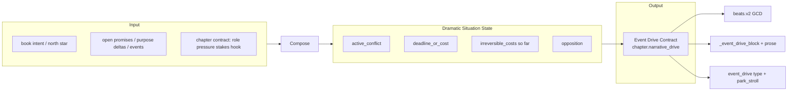
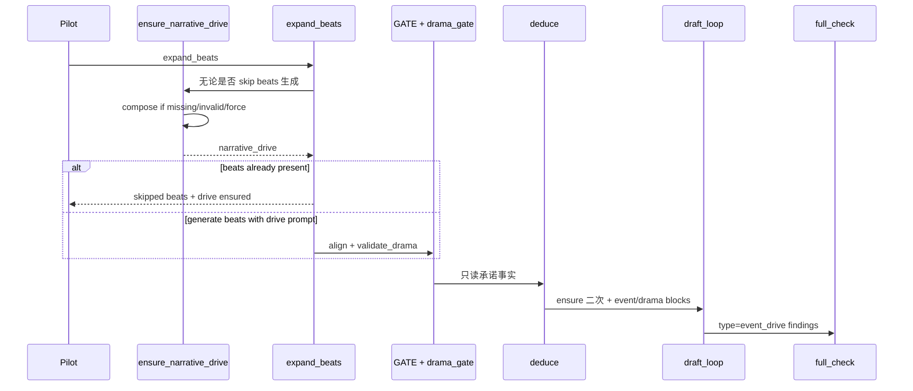

# 设计文档：叙事引擎（冲突/事件驱动 · Narrative Event Engine）

| 项 | 值 |
|----|-----|
| **文档标题** | 用户期望「叙事引擎」：小说由冲突/事件推动，统合现有资源成控制面 |
| **作者** | Grok Design（待人审签） |
| **日期** | 2026-08-10 |
| **状态** | Draft · **rev.2.3**（产品纠偏：**引导优先、少硬拦**；冲突/事件驱动为主，允许服务戏的 POV 跟随） |
| **产品** | scribe-writing-system / scribe3（铜炉） |
| **文档真源** | 仓库 `docs/plans/2026-08-10-narrative-event-engine.md`；`/tmp/grok-1000/grok-design-doc-5a3d3922.md` 为会话 scratch，改设计须同步 commit 耐久路径 |
| **验收环境** | demo 已部署栈 `https://www.example.com`；**禁止**默认再起第二 Surreal；Grok 运行机不做全量 npm/测试 |
| **前序（其上的引擎层）** | [`docs/plans/2026-08-10-novel-quality-first-pipeline-optimization.md`](./2026-08-10-novel-quality-first-pipeline-optimization.md)（beats.v2 GCD、drama gate、craft novel、park_stroll、pressure soft 双旗）· 证据 [`docs/evidence/nq-quality-smoke-20260810/12-llm-quality-delta-analysis.md`](../evidence/nq-quality-smoke-20260810/12-llm-quality-delta-analysis.md) · [`docs/系统文档/03-写作主链路.md`](../系统文档/03-写作主链路.md) · 压力设计 `设计文档/2026-08-09-压力驱动叙事-匀速散步治理.md` |
| **明确不做的宣称** | **不**因本方案单独宣称文学 ≥9.5；换 POV **≠** 叙事引擎；**不**把 deduce 改成写戏 |

---

### 读法（工程师 · 第一周）

1. **## Overview + 产品原则（引导优先）+ ## Key Decisions** — 引擎要什么、**不要**什么硬拦。  
2. **资源统合表 + `narrative_drive` schema** — 谁喂入、怎么引导生成。  
3. **ensure 路径（智能重算）+ 注入引导 + 可选 DETECT**。  
4. **## Open Questions + ## PR Plan** — 增量开工。  

---

## Overview

### 一句话

> **叙事引擎 = 引导面，不是刑具。**  
> 章级 `narrative_drive` 把「本章由什么冲突/事件推」写清楚，**注入** outline→beats→draft，让模型优先写戏；  
> **跟着主角走一段可以**，只要这段是在逼近/兑现冲突或事件，而不是空洞巡礼。  
> 默认 **多引导、少 park**；硬红线仍只留给限知泄露/串书/作者红线等系统安全项。

### 产品原则（rev.2.3 用户纠偏 · 最高优先级）

| # | 原则 | 工程含义 |
|---|------|----------|
| **P1** | **只强调一件事**：冲突/事件推动小说 | 文档、旗、PR、验收文案以「有没有戏」为中心；**不要**把反比喻、反 POV、反氛围写成同等硬目标 |
| **P2** | **引导 > 限制** | 主路径 = 合成 drive + 写路径/steer 注入；**默认 advisory**，不默认整章卡死 |
| **P3** | **允许服务戏的「跟主角」** | 纯空间/感官漫游若 **不服务** 当前 conflict/event → 引导改；若已是追债路上的走、等门前的等 → **允许** |
| **P4** | **少规则、少门闩** | 不堆「禁止开篇类型」长黑名单；不把二选一/中段外力/对齐 Jaccard 等做成默认硬停 |
| **P5** | **硬拦极少** | 默认 **不** 开 `EVENT_DRIVE_GATE` / `EVENT_LED_DETECT` 的 blocking；需要时再显式开（实验/高压作者自选） |

### 用户读感（纳入 · 已更新）

| 反馈 | 工程含义 |
|------|----------|
| 要冲突/事件推小说 | **唯一主目标**：`narrative_drive` 引导生成与可选验收 |
| 跟着主角逛偶尔可以 | **不要**把 POV 跟随当缺陷；只纠「无戏的逛」 |
| 不要那么多限制，要引导 | **GATE/DETECT 默认关**；注入与 prompt 默认开（`NARRATIVE_ENGINE=1` 时） |
| 换视角不够 | focalizer 仍是相机；**不**把切 POV 当引擎交付 |

证据锚仍可用：ch1 香债戏好、ch2 氛围回潮——引擎要做的是 **让更多章像 ch1 那样被戏带着走**，不是给 ch2 加刑。

### 与 novel-quality-first 的分层关系

```text
┌─────────────────────────────────────────────────────────────┐
│  本设计 · Narrative Engine（引导层 / 控制面）                  │
│  narrative_drive = 本章冲突/事件合同 → 注入 beats/draft       │
│  默认：引导与提示；可选：GATE/DETECT 硬拦（作者自选）           │
└────────────────────────────┬────────────────────────────────┘
                             │ 引导 / 可选验收
┌────────────────────────────▼────────────────────────────────┐
│  novel-quality-first（执行层）                                │
│  beats · drama_block · craft · pressure · soft 双旗          │
└────────────────────────────┬────────────────────────────────┘
                             │ 编排
┌────────────────────────────▼────────────────────────────────┐
│  Pilot · deduce（认知）· 记忆注入 · 系统硬红线                │
└─────────────────────────────────────────────────────────────┘
```

**策略一句话：** 统合 outline stakes、债/事件库存、beats、PDC 成 **`narrative_drive`**，**写进 prompt 当导航**；不新堆故事 OS；**不以「反逛刑典」当产品卖点**。

### 引导闭环表（默认 · 何时算「引擎在工作」）

推荐最低集（**引导模式**）：**仅** `NARRATIVE_ENGINE=1`。

| 条件 | 行为 |
|------|------|
| `NARRATIVE_ENGINE=1` | `ensure_narrative_drive`（尽量合成）+ 写路径 **注入** `_event_drive_block`（「本章外力/对立/代价」短段）+ draft steer 提示优先写戏 |
| drive 弱/缺字段 | **advisory** 文案进收件箱/park 旁注；**默认不**停写 |
| 对齐 beats 差 | **advisory**「节拍可更贴 drive」；**默认不** park |
| 开篇偏逛但后文兑现冲突 | **允许**；DETECT 若开，仅 advisory 提示「外力可更早」 |
| 写后完全无局势变化且纯巡礼 | DETECT 若开 → **默认 advisory**；仅 `EVENT_LED_DETECT_HARD=1` 时才 blocking |
| `EVENT_DRIVE_GATE=1`（可选） | 作者自选：高压且 drive 空 → park；**非**质量默认 |
| 代码默认 `NARRATIVE_ENGINE=0` | 行为 = 现状 NQ；字段可写不读 |

**与 drama_gate：** 不抢戏；drive 注入与 GCD 注入 **并存、引导叠加**。合并 park **仅当作者显式开 GATE 族**。

---

## Background & Motivation

### 为什么质量模式仍「像逛」

novel-quality-first 把杠杆前移到节拍 GCD 与后验 park_stroll，但：

1. **GCD 字段是拍级「角色目标卡」**，不强制回答「**本章由什么外力引爆**」。  
   - `goal` 可为「去旧库看看」→ 合法 GCD，仍是 POV 逛。  
2. **synopsis fallback / v1 弱通过** 在部分章仍产出 `beats_source=synopsis_segments`（证据 §5），戏剧合同空 → `_drama_block` 空串（`format_drama_block` 无 GCD 不注入）。  
3. **park_stroll** 抓的是高压章 **空间清单 + 零推进** 组合，**不**抓「低压氛围 + 禁令讨论但无对立选择落地」。  
4. **draft 执行面**仍可能先写巷/炉/嗅觉再触冲突；开篇无「反逛分类学」硬约束。  
5. **世界库存**（promises / purpose deltas / events）与节拍 **并行弱关联**——库存是候选种子，**不是**本章驱动指针；且现网多数章戏剧种子其实在 **synopsis 标签**，不在事件表。

### 根因模型（读感 → 控制论）

| 症状 | 控制论描述 | 现网落点 |
|------|------------|----------|
| 跟 POV 逛 | 生成顺序 = 空间/感官序列 | craft 感官 + recap 巷尾 + 无 inciting_force |
| 换视角无效 | 相机变、驱动对象不变 | `focalizer` 只过滤 frame |
| ch 间戏剧不稳 | 无跨阶段单对象绑定 | beats_meta 与 pressure_drive 分立；outline stakes 未强制进 draft 门 |
| 像「好对话氛围片」 | 有对白/禁令无 **deadline/cost 兑现** | purpose 验 delta；pressure 验 stairs——未验「中段前必须外力」 |

### 产品第一性（不可妥协）

- **驱动 = 冲突/事件**（引导模型写「戏在推」）。  
- **引导优先**：合同进 prompt；**少黑名单、少硬停**。  
- **跟主角可以**：只要局势在变或在逼近变。  
- **不是** 单靠换 focalizer；**不是** 再堆平行系统。

---

## Goals & Non-Goals

### Goals

1. 定义 **Narrative Engine 引导面**：输入 / 状态 / 输出（Event Drive Contract）清晰。  
2. 每章 **戏剧导航对象** `narrative_drive`（合成 + **注入 prompt**）。  
3. 用合同 **引导** outline → beats → draft（缺字段 → **提示**；**默认不 park**；大纲 stakes 一等种子）。  
4. 开篇/正文：**引导写戏**；服务戏的跟主角 **允许**；空洞巡礼 → **建议** 改。  
5. DETECT/GATE：**可选**；默认 advisory；接线完整但默认不启用硬停。  
6. POV = 相机；多场景 POV phase 2。  
7. 代码默认不 silent break；**引导模式只开 ENGINE**。  
8. deduce 纯认知；系统硬红线不变。  
9. ensure：尽量有 drive 可注入（skip expand 也合成）。

### Non-Goals

| 非目标 | 理由 |
|--------|------|
| 用刑典消灭一切「跟着走」 | 用户明确：偶尔可以 |
| 大量默认硬 park / 长黑名单 | 引导优先 |
| 重写 Pilot 拓扑 | 够用 |
| deduce 写戏 | 认知边界 |
| 自动文学 ≥9.5 | 人盲未跑 |
| 全书 plot graph 求解器 | 爆炸半径 |
| 强制网文模板 | 题材可选 |

---

## 现有资源统合清单（Inventory → Engine Role）

| 资源 | 约略位置 | 引擎角色 | 本设计动作 |
|------|----------|----------|------------|
| **Pilot 状态机** | `scribe3/pilot.py` `STATES`/`NEXT`；`api/services/pilot_runtime.py` | **编排时钟** | `ensure_narrative_drive` 挂 expand_beats（**含 skip**）与 draft_loop 入口；不替换 STATES |
| **Outline / synopsis** | `propose_outline`；`brief.parse_chapter_meta` | **一等 stakes 种子** | 确定性拼装 inciting/deadline；**inventory 空不 fail** |
| **Beats v2 GCD** | `drama_beats.py`；`expand_beats`；`beats_meta` | **拍级执行单元** | drive 约束 prompt + `align_beats_to_drive` |
| **Deduce** | `deduce`；`deduce_helpers.py` | **纯认知 · 非驱动** | 禁止 merge |
| **Draft / write_assemble** | `draft_loop`；`_drama_block`；`craft` | **表面生成器** | `_event_drive_block` **在** `_drama_block` **前**；进 `app_impl` rebind 列表 |
| **Pressure / PDC / park_stroll** | `pressure_drive.py`；`pressure_metrics.py`；`loop.triage` | **后验与进度台阶** | bootstrap **优先** drive 种子；event finding **独立 type** |
| **Purpose / arc / intent** | `purpose.py`；`arc_signals.py` | **书级向量 / delta 候选** | `parse_deltas` planned\|carried |
| **Events / promises** | `store/events.py` `events_at`；`store/promises.py` `open_promises`；`volume_signals.overdue_promises_in_range` | **rev.1 库存候选池** | 白名单 API；**非** `event_surface`（仅 label 人话化） |
| **Propositions / facts_knowledge** | proposition UX | **phase 2** | rev.1 **不**依赖；不作 inciting 默认源 |
| **Memory / must-link** | `memory_*`；brief | **注入，不驱动** | 仅锚 opposition/inciting |
| **Review / triage** | `loop.triage`；`full_check` | **校验轨** | 见 soft 接线合同 |
| **Focalizer** | `chapter.focalizer`；`memory_lifecycle` | **相机** | event_owner vs knower |
| **Volume/chapter** | volume intro；meta | **framing** | 不覆盖 drive |

### rev.1 库存只读 API 白名单（函数签名级）

```text
# Pilot 侧装配 → 纯函数 compose 只吃结构化 inventory（便于无 Surreal 单测）

NarrativeInventory = {
  "open_promises": list[dict],      # st.open_promises() → store/promises.py
  "overdue_promises": list[dict],   # volume_signals.overdue_promises_in_range(promises, up_to=seq, ...)
  "purpose_deltas": list[dict],     # purpose.parse_deltas(ch.get("deltas"))
                                    #   过滤 status ∈ {planned, carried}
                                    #   kind ∈ {promise, fact, knowledge}（heat 不作 inciting）
  "events_here": list,              # st.events_at(seq)      # store/events.py / ontology
  "events_prev": list,              # st.events_at(seq-1) if seq>1 else []
  "prev_end_hook": str,             # 上章 beats_meta.chapter_hook 或 narrative_drive.end_hook
}

# 「未关闭事件」rev.1 操作定义（保守）：
#   events_prev/here 中 label/text 命中债/禁/讨/到期词表，且无显式 payoff 标记字段时计入候选；
#   若 Event 模型无 payoff 字段 → 仅作 soft 候选（低于 overdue_promises 与大纲 stakes），
#   不得单独导致 need_inciting_seed。

# 明确排除 rev.1：
#   - event_surface.format_event_timeline_label  （人话化，非库存）
#   - proposition 表全表扫描 / facts_knowledge rank
#   - 任意「接 inventory」隐含 MCP 新端点（装配在 pilot_runtime 内完成）
```

### 现网关键代码锚点

```text
Pilot NEXT:
  idle → propose_outline → outline_proposed
       → expand_beats   → beats_ready     ← ensure_narrative_drive（含 if beats: skip 仍 ensure）
       → deduce         → deduced
       → draft_loop     → drafting        ← 二次 ensure + 注入
       → full_check     → checked         ← event_drive type findings
       → deliver → finalize

expand_beats 现网 skip（必须覆盖）:
  if ch.get("beats"): return {"skipped": "节拍已有…"}  # pilot_runtime ~534–535
  → ensure 须在 return 前执行，或 skip 分支内调用

存储 / 读路径（缺一不可）:
  migrations/118_narrative_drive.surql   # 钉号；现最新 117_beats_meta
  store/chapters.py get_chapter SELECT 须含 narrative_drive + json.loads（同 beats_meta ~306–341）
  update_chapter_meta allowed |= {"narrative_drive"}

写路径:
  write_assemble._assemble_write_instructions_v1：_event_drive_block 在 _drama_block 之前（~1096 区）
  app_impl rebind 列表必须显式加入 _event_drive_block（历史坑：漏 rebind）

MCP（非自动获得）:
  s3_patch_chapter_plan 现参仅 synopsis/beats/scene_truth/deductions/involved
  → 须显式加 narrative_drive 参数，或独立 s3_set_narrative_drive（elicitation）

DETECT 写后硬停（PR-NE-4 必改，否则 EVENT_LED 无效）:
  review/blocking.py is_blocking_issue  ← 真源（loop 仅 alias）
  review/schema.py S1_BLOCKING_TYPES
  review/normalize.py normalize_issue（event_drive+blocking→S1）
  loop.py triage：_detector_by_type 不把 event→pressure_metrics；
                 item.detector = meta.kind；bucket=story

novel_quality_flags:
  扩 NQ_FLAG_KEYS / QUALITY_MODE_TARGETS / snapshot / LOG_FIELD_*
```

---

## Proposed Design

### 1. Narrative Engine 定义（控制面）



| 面 | 内容 |
|----|------|
| **Input** | intent；**大纲结构化字段**；rev.1 白名单 inventory；上章 end_hook |
| **State** | active_conflict、deadline_or_cost、不可逆代价、对立方 |
| **Output** | `narrative_drive`，绑定后续全链 |

**引擎 ≠ Pilot**：Pilot 决定「何时跑哪步」；引擎决定「**这步必须服务什么局势变化**」。

### 2. 单一戏剧真源

| 候选 | 角色 | 是否章级戏剧 SSOT |
|------|------|-------------------|
| `synopsis` | 种子叙述 + 标签 | 否（散文难执法，但是 **compose 一等输入**） |
| `beats` GCD | 拍级执行 | **否**——多拍可一致执行错误驱动 |
| `pressure_drive` | 后验台阶 | 否 |
| `purpose.deltas` | 状态变化清单 | 否——候选种子 |
| **`narrative_drive`** | **章事件驱动合同** | **是（KD-NE-1）** |

- beats **必须**可对齐 drive（质量模式 GATE）。  
- PDC 在 `SCRIBE3_PDC=1` 时 **优先用 drive 种子 bootstrap**；无 drive 时保持旧行为；**不**在 rev.1 强制 rewrite 已有人工 PDC。  
- 人改 beats 与 drive 冲突 → `drive_beats_mismatch`（GATE 时 park）。

### 3. `narrative_drive` 对象（Event Drive Contract Schema）

落库：`chapter.narrative_drive` · `TYPE option<string>` · JSON。

```json
{
  "schema": "narrative_drive.v1",
  "engine_type": "event",
  "version": 1,
  "inciting_force": {
    "kind": "debt_due|taboo_breach|door_opened|third_party_demand|opposition_wants|deadline|discovery_threat|outline_stakes|continuation_hook|other",
    "summary": "冷锅婆当夜索一炉香债，三日不还则收侧门匙",
    "source_refs": ["outline:stakes", "promise:香债"]
  },
  "opposition": {
    "who_or_what": "冷锅婆/香债规矩",
    "wants": "今夜落地抵债或守门",
    "leverage": "旧库匙与侧门"
  },
  "deadline_or_cost": {
    "timer": "三日内",
    "if_fail": "失匙/失门/名入炉册",
    "irreversible_if_pay": "抵债铜匙交出"
  },
  "pov_camera": {
    "focalizer": "覃灰七",
    "event_owner": "冷锅婆",
    "knower_polarity": "limited"
  },
  "scene_turn": "灰七被迫在守门与交出真名线索间二选一，先交匙换三日",
  "end_hook": "炉册上父名未干，禁念真名的戒被灰狸点破",
  "stakes_line": "若失败，灰七失侧门钥且香债滚入父名",
  "anti_stroll": {
    "guidance_opener_hint": ["prefer_event_or_confrontation", "pov_follow_ok_if_serves_conflict"],
    "required_force_before_mid": true
  },
  "beats_binding": {
    "require_conflict_trace": true,
    "min_external_before_mid_beat": true
  },
  "openers_plan": {
    "opener_class": "third_party_demand",
    "first_beat_must": "opposition_on_stage_or_force_felt"
  },
  "multi_scene_pov": null,
  "composed_from": {
    "seed_tier": "outline_stakes|inventory|prev_hook|llm_fill",
    "outline_stakes": true,
    "open_inventory_ids": []
  },
  "validation": {
    "ok": true,
    "errors": [],
    "warnings": [],
    "drama_weak": false
  }
}
```

#### 字段纪律

| 字段 | 必填？ | 说明 |
|------|--------|------|
| `engine_type` | 是 | 质量模式仅允许 `"event"`；其它 → park |
| `inciting_force` | 是（高压/推进） | 可来自 **outline stakes**（kind=`outline_stakes`） |
| `opposition` | 是（高压） | 可从 stakes 句拆「若失败失去…」的施压方/损失面 |
| `deadline_or_cost` | 是（高压） | timer **或** if_fail 其一非空即可 |
| `scene_turn` | 是（高压硬；低压可弱） | 局势翻转一句 |
| `end_hook` | 是 | 对齐大纲钩子 |
| `anti_stroll` | 是 | 禁开篇 + 中段前外力 |
| `multi_scene_pov` | 否 · phase 2 | |
| `validation` | 系统写 | 嵌套，不另开列 |
| `locked` | 否 · 默认 false | `true` = 作者锁定，禁止智能重算覆盖 |
| `source` | 系统写 | `assembled` \| `author` \| `llm_fill`；`author` 视同保护（同 locked 语义，除非强制重算） |
| `synopsis_fp` | 系统写 | 合成时 synopsis 内容指纹（规范化后 hash）；供智能重算比对 |
| `version` | 系统写 | 重算时 `version++`；初合成 = 1 |

### 4. 反逛开篇分类学（可操作规则 · LLM 主路径）

| `opener_class` | 定义 | 引擎态度 |
|----------------|------|----------|
| `third_party_demand` | 他者当章提出要求/威胁 | **推荐** |
| `debt_or_deadline` | 债/期/契约到期压迫 | **推荐** |
| `taboo_or_breach` | 禁令被触或将触 | **推荐** |
| `door_or_seal` | 门/封/钥被开或将开 | **推荐** |
| `binary_forced_choice` | 开篇即两难选项落地 | 推荐；**rev.1 写后硬门不依赖**（见下） |
| `discovery_with_cost` | 发现立刻带代价 | 允许 |
| `continuation_hook` | **复述上章未决威胁/外力**（非街景） | 允许 |
| `pure_spatial_walk` | 沿路点/巷志移动开篇 | **禁止**（高压 blocking） |
| `pure_sensory_tour` | 气味/光影巡礼无阻力 | **禁止** |
| `status_inventory` | 人物/器物清单式亮相 | **禁止**作主导；见「一句」定义 |
| `interior_monologue_essay` | 长段「他知道/想起」议事 | **禁止**作开篇主导 |

#### 检测路径（KD-NE-8 · 用户裁决：尽量 LLM / 全 LLM）

| 层 | 角色 | 何时 |
|----|------|------|
| **Primary · LLM** | `classify_opener_llm` / `measure_event_led_llm`：结构化 JSON `{class, confidence, evidence_span, force_before_mid?, notes?}` | `EVENT_LED_DETECT=1` **且** 既有审查 LLM 旗开（`SCRIBE3_REVIEW_LLM=1` 或项目等价 review-LLM 门） |
| **Deterministic anchors** | 高精短接（可选）：极明显 pure_spatial 开篇词表 / EXT_FORCE 共现 | 可与 LLM **并行 shadow** 记日志；**默认不单独 blocking**，除非 LLM 路径关闭 |
| **Fallback · 确定性** | `classify_opener_rules` / 词表中段外力 | LLM **off** 或 **degraded**（超时/坏 JSON/无 complete_fn） |

**LLM 调用合同**：

```text
输入：head = head_span_text(prose)  # 仍用 max(ceil(0.15*n), first_two_paras) 截断控成本
      + 可选 drive.inciting/end_hook 一行（帮助 continuation vs spatial）
输出 JSON（严格）:
  {
    "class": "<opener_class 枚举>",
    "confidence": 0.0-1.0,
    "evidence_span": "原文摘录 ≤80 字",
    "force_before_mid": true|false|null,   # 中段前外力是否落地
    "follow_pov_stroll": true|false         # 综合逛感
  }
max_tokens：低（建议 ≤256）；temperature 低
缓存：key = prose_fp（去空白正文 hash）+ model_id；命中跳过 LLM
mock：单测注入 mock_complete_fn（同 l1_epistemic / review 模式）
```

**降级纪律（高压 · 禁止静默假绿）**：

```text
if EVENT_LED_DETECT and is_high:
  if LLM on and ok → 用 LLM 结果定 severity
  if LLM off or degraded:
    → 跑 deterministic fallback
    → meta.degraded = true, meta.degraded_reason = ...
    → **不得**因「没跑成 LLM」而省略 finding / 当 pass
    → 若 fallback 亦不确定：至少发 advisory missing_external_force 或
      event_drive_degraded（高压可升 blocking，由旗 SCRIBE3_EVENT_LED_DEGRADED_BLOCK 默认 1 质量模式）
if low pressure:
  degraded → advisory only
```

#### 切分与规则 fallback 操作定义（保留 · 非主路径）

```text
n = 去空白后正文字数
head_span = max( ceil(0.15 * n), len(first_two_paras) )
head = prose 前缀

classify_opener_rules(prose) -> (class, confidence, evidence_span)
  # 供 fallback / shadow；金样与 LLM 输出对齐用同一枚举

status_inventory「一句后立即外力」:
  前 ≤40 字或首句号前可为清单，其后须外力痕迹。

continuation_hook vs pure_spatial_walk:
  命中上章威胁/drive.inciting → continuation；仅地点+感官 → spatial
```

#### 硬规则（分层 · 结果侧）

1. **高压 + DETECT**：LLM 或 fallback 判 `class ∈ FORBIDDEN_OPENERS` → finding **blocking**。  
2. **低压 + DETECT**：同 finding **advisory**。  
3. **中段前外力**：优先信 LLM `force_before_mid=false`；fallback 用前 50% 字 EXT_FORCE 共现。  
4. **`binary_forced_choice`**：不作为唯一 blocking 依据（LLM 可标 class，硬门仍抓外力/逛感）。  
5. 金样含 **「有禁令词但无代价」** 负例；LLM prompt 须明示「题材词复述 ≠ 外力落地」。  

### 5. 合成流水线 + ensure



#### `ensure_narrative_drive(st, seq, *, force=False)`（KD-NE-12 + KD-NE-15 智能重算）

```text
if not narrative_engine_enabled():
    return None

ch = get_chapter(seq)  # 必须已 SELECT+parse narrative_drive
drive = ch.get("narrative_drive") or {}
synopsis = ch.get("synopsis") or ""
fp_now = synopsis_content_fp(synopsis)  # 规范化空白后 hash

# ── force 语义 ──────────────────────────────────────────
# force=True 或 steer 含「强制重算驱动」「【强制重算驱动】」
#   → 覆盖 locked / author（唯一覆盖作者锁路径）
# steer 仅「重算驱动」（无「强制」）且 locked/author → 不覆盖，记 warning

author_protected = bool(drive.get("locked")) or drive.get("source") == "author"
steer_force = steer_has_force_recompute(st, seq)   # 强制*
steer_soft  = steer_has_recompute(st, seq)         # 重算驱动（非强制）

if author_protected and not (force or steer_force):
    # 可校验 validation；不重写字段
    if not drive:
        pass  # 空则下方仍合成
    else:
        return drive  # 作者锁：大纲变更也不自动重算

need = (
    force or steer_force
    or not drive
    or drive.get("validation", {}).get("ok") is False
    or (
        # 智能重算：大纲内容变了 + 非作者锁 + 非 author 源
        fp_now
        and drive.get("synopsis_fp")
        and fp_now != drive.get("synopsis_fp")
        and not author_protected
        and drive.get("source") != "author"
    )
    or (steer_soft and not author_protected)
)

if not need:
    return drive

inv = assemble_narrative_inventory(st, seq)
meta = parse_chapter_meta(synopsis)
prev_hook = inv["prev_end_hook"]
prev_refs = list((drive or {}).get("inciting_force", {}).get("source_refs") or [])
prev_ver = int((drive or {}).get("version") or 0)

new_drive = compose_narrative_drive_dict(
    meta, inv, prev_hook, focalizer=ch.get("focalizer") or "",
    preserve_source_refs=prev_refs,  # 能对齐则保留
)
new_drive["source"] = "assembled"
new_drive["locked"] = False
new_drive["synopsis_fp"] = fp_now
new_drive["version"] = prev_ver + 1 if drive else 1
# validation 由 compose 内嵌

st.update_chapter_meta(seq, {"narrative_drive": new_drive})
return new_drive
```

**智能重算规则（用户裁决 · OQ-7）**：

| 条件 | 行为 |
|------|------|
| drive 空 | 合成 |
| `validation.ok=False` | 重算（非 author 锁） |
| `synopsis_fp` 变化 **且** `locked≠true` **且** `source≠author` | **自动** recompose |
| `locked=true` 或 `source=author` | **不**自动覆盖；除非 steer/参数 **强制重算驱动** |
| 重算成功 | `source=assembled`，`version++`，尽量 **preserve `source_refs`**，写新 `synopsis_fp` |
| 作者 PATCH drive 手写 | 写端应标 `source=author`（或 UI 锁 `locked=true`） |

**与 runbook**：改大纲后 ensure 会智能跟上（非锁）；作者精修过的合同须「强制重算驱动」才冲掉。

**expand_beats 接线（含 skip）**：

```python
def expand_beats(st, seq):
    drive = None
    if narrative_engine_enabled():
        drive = ensure_narrative_drive(st, seq)

    ch = st.get_chapter(seq) or {}
    if ch.get("beats"):
        # 既有 skip —— 但仍已 ensure drive
        out = {"skipped": "节拍已有内容,按既有推进(不覆盖)", "narrative_drive": drive}
        if event_drive_gate_enabled() and drive and not drive.get("validation", {}).get("ok"):
            if _is_high(...):
                return {**out, "pilot_park": format_narrative_park(drive)}
        # 已有 beats：可选 align 检查（GATE 时）
        if event_drive_gate_enabled() and drive:
            al = align_beats_to_drive(ch.get("beats"), drive)
            if not al["ok"] and _is_high(...):
                return {**out, "pilot_park": format_align_park(al)}
        return out

    # ... 生成 beats 时 prompt 前置 format_event_drive_block(drive)
    # 落库后 align + drama_gate（drive 优先合并文案）
```

**draft_loop 入口**：`ENGINE=1` 时再次 `ensure_narrative_drive`；GATE 高压且仍 invalid → park，不进入 `loop_chapter`。

#### 合成算法（种子优先级 · 修订 Issue 1）

```text
compose_narrative_drive_dict(meta, inventory, prev_hook, *, focalizer="") -> dict:

  # 禁止：仅因 events/promises 表空而 fail。
  # fail 仅当：高压且（无可用大纲 stakes/外力句）且（inventory 无可用项）且（无 prev_hook 威胁）。

  1. meta = {stakes, hook, pressure, role, ...}  # parse_chapter_meta
  2. candidates ranked:
       tier A: overdue_promises + open_promises 命中债/禁/讨
       tier B: purpose_deltas planned|carried (kind∈ promise,fact,knowledge)
       tier C: events_prev/here 保守未关闭（soft 候选）
       tier D: meta.stakes + meta.hook + synopsis 外力句   ← 一等公民
       tier E: prev_hook（continuation）
       tier F: pilot_steer 显式外力句

  3. 选取最高 tier 非空项 → 填 inciting_force / opposition / deadline_or_cost
     - 若仅有 stakes 句：kind=outline_stakes；
       opposition.wants / deadline.if_fail 从「若失败…」确定性拆分（规则，可 LLM 润色 summary 一句）
     - composed_from.seed_tier 记录

  4. end_hook：meta.hook 优先；否则 prev 威胁延续；否则 LLM 单行（接地：不得新增大纲外不可逆）

  5. scene_turn：优先确定性模板「因{inciting}导致{stakes代价面}」；可 LLM 压缩

  6. pov_camera 填充

  7. validate_narrative_drive → validation 嵌套

  8. 高压 fail 条件（need_inciting_seed）当且仅当：
       not meta.stakes and not meta.hook_with_threat
       and not tier A/B/F
       and not (tier E with threat lex)
       # events 表空 ≠ fail
```

**LLM 边界**：仅 summary/scene_turn 可润色；无种子高压 → park 提示补大纲 stakes 或登记 promise/purpose，**禁止空编新债种**。

### 6. Pilot 步骤顺序

**用户裁决 · OQ-1（最优方案）**：

| 阶段 | 最优 | 含义 |
|------|------|------|
| **rev.1** | **插入点 A** | `ensure` 挂在 `expand_beats`（含 skip）+ `draft_loop` 入口；**不改** `STATES`/`NEXT`；最低成本使 Event Drive 真成主时钟输入 |
| **phase 2 最优增强** | **插入点 B** | 独立 `compose_drive` → `drive_ready`；`DEFAULT_AUTHZ["compose_drive"]="propose"`；作者要 **显式审合同** 时启用（`SCRIBE3_NARRATIVE_DRIVE_STEP=1` + executor 注册） |

**定案（KD-NE-2）**：rev.1 **固定 A**；B 仅 phase 2，未注册则 no-op + 启动 warning。

**GATE 与 drama_gate 合并 park 伪码（PR-NE-5）**：

```python
def park_after_beats(drive_val, align_val, drama_val, *, high: bool, gate_ne: bool, gate_drama: bool):
    parts = []
    if gate_ne and high and drive_val and not drive_val.get("ok"):
        parts.append("narrative_incomplete:" + ";".join(drive_val.get("errors") or [])[:200])
    if gate_ne and high and align_val and not align_val.get("ok"):
        parts.append("drive_beats_mismatch:" + ";".join(align_val.get("errors") or [])[:200])
    if gate_drama and should_drama_gate_park(drama_val, gate_enabled=True):
        parts.append(format_drama_gate_park_reason(drama_val.get("gaps"), advisory=True))
    if not parts:
        return None
    # 外力/drive 在前，GCD 在后
    return {"pilot_park": " | ".join(parts)}
```

**deduce**：只读 drive 承诺事实提示；不改戏。

**draft_loop 注入顺序**：

```text
_event_drive_block   ≤220 字 · 置顶
_drama_block         ≤400 字 · GCD+MRU
… envelope / frame / craft …
```

### 7. 与 beats / PDC / purpose 的绑定

#### beats 对齐（`align_beats_to_drive` · 阈值写死）

| 规则 | 值 |
|------|-----|
| 重叠度量 | CJK bigram Jaccard（复用 `drama_beats.jaccard_cjk` / `_cjk_bigrams`） |
| 比较对象 | 任一 **scene**（非 bridge）的 `conflict`（空则 `text`） vs `inciting_force.summary + opposition.wants` |
| **默认阈值** | **`ALIGN_JACCARD_MIN = 0.08`**（低阈值防过杀；金样校准） |
| 绕过 | beat 或 drive 上 `source_refs` 非空且同 id 前缀匹配 → 视为对齐成功 |
| 代价对齐 | 全章至少一拍 `cost`/`turn` 与 `deadline_or_cost.if_fail` 有 bigram 交集 **或** 命中 `TURN_COST_LEX`（复用 drama_beats） |
| 钩子 | `end_hook` 与 `chapter_hook`/末拍 hook 任一侧 ≥2 字且 jaccard≥0.06 或子串包含 |
| 满足条件 | **≥1 scene** 冲突可追溯 **且**（高压）代价义务满足 |
| 低压 | alignment 失败 → warning，不 park |

**金样（PR-NE-1 fixtures）**：

| 样例 | 期望 |
|------|------|
| 正：conflict「冷锅婆讨香债」/ drive 香债 | align ok |
| 正：`source_refs: ["outline:stakes"]` 双边 | ok 绕过词重叠 |
| 反：四拍 goal/conflict 皆「去旧库看看/巷里走」/ drive 讨债 | mismatch |
| 反：仅 text 大纲切句无 GCD | mismatch + drama_weak |

**合并 park 文案模板**：

```text
narrative_incomplete:高压章事件驱动未过（可补大纲 stakes 或 PATCH narrative_drive 后继续）。
缺口：缺 inciting/opposition/…。
drive_beats_mismatch:节拍冲突未追溯引爆（可改 beats.conflict 或 source_refs）。
清单:{...}。
drama_incomplete:…（既有 format_drama_gate_park_reason）
```

#### PDC bootstrap（派生承诺 · 可实施）

```text
时机：expand_beats 在 beats 落库后调用 _try_bootstrap_pdc 时传入 narrative_drive

规则：
  if not pdc_env_enabled(): no-op（绑定规则整体跳过）
  if chapter 已有人工 pressure_drive 且非 force：不覆盖（rev.1）
  if drive present:
    cost stair evidence_must_show 优先 = deadline_or_cost.if_fail 或 irreversible_if_pay
    irreversible 种子 = irreversible_if_pay or scene_turn 截断
  else:
    保持现网 synopsis/beat cost 模板行为

实现：扩展 bootstrap_pdc_from_texts(..., narrative_drive: dict | None = None)
独立小步可挂 PR-NE-2a 末或 PR-NE-2c（见 PR Plan）
```

### 8. `_event_drive_block` 文案

```text
## 本章事件驱动（主时钟·必须执行）
- 引擎：event
- 引爆：{kind} — {summary}
- 对立：{who} 要 {wants}（杠杆：{leverage}）
- 时限/代价：{timer}；失败则 {if_fail}
- 章级翻转：{scene_turn}
- 章末钩子：{end_hook}
- 相机：焦点={focalizer}；事件主={event_owner}；限知={knower_polarity}
## 开篇禁令
禁止纯空间游走、纯感官巡礼、状态清单开篇；
前段必须让读者感到外力或到期压迫。
中段前必须有外在阻力/胁迫/时限痕迹（不要求字面「要么」）。
（限知）只写焦点者可感部分；事件主的私密不得越帧。
```

实现：`scribe3/narrative_drive.py`；`write_assemble._event_drive_block`；**必须**列入 `app_impl` rebind。

---

## API / Interface Changes

| 面 | 变更 | 是否自动获得 |
|----|------|----------------|
| Migration **`118_narrative_drive.surql`** | `DEFINE FIELD IF NOT EXISTS narrative_drive ON chapter TYPE option<string>;` | 须 PR 显式 |
| `store/chapters.py` | `allowed` + **get_chapter SELECT 字段** + json.loads | 须显式（仅白名单不够） |
| MCP `s3_patch_chapter_plan` | **显式**加 `narrative_drive` 可选参，或新 `s3_set_narrative_drive` | **非**自动 |
| REST PATCH chapter meta | 随白名单 | 是 |
| Settings REGISTRY | 旗表 + QUALITY_MODE_TARGETS | PR-NE-0 |
| Pilot executor | ensure in expand_beats/draft_loop | PR-NE-2a |
| write_assemble + app_impl rebind | `_event_drive_block` | PR-NE-3 |
| UI | 三行驱动 | PR-NE-7 后置 |

### 特征旗

| Flag | 代码默认 | 质量模式目标 | 作用 |
|------|----------|--------------|------|
| `SCRIBE3_NARRATIVE_ENGINE` | **0** | **1** | ensure + 注入 + length_steer |
| `SCRIBE3_EVENT_DRIVE_GATE` | **0** | **1** | 高压 drive/align 失败 park |
| `SCRIBE3_EVENT_LED_DETECT` | **0** | **1** | 写后 event_drive findings；**LLM 主路径**需 `SCRIBE3_REVIEW_LLM=1`（或等价），否则确定性 fallback |
| `SCRIBE3_EVENT_LED_DEGRADED_BLOCK` | **0** | **1** | 高压 + LLM degrade 且 fallback 不确定时是否 blocking（防静默绿） |
| `SCRIBE3_PILOT_SOFT_EVENT_DRIVE` | **0** | **0** | 仅当 1 时 soft 事件 finding |
| `SCRIBE3_NARRATIVE_DRIVE_STEP` | **0** | **0** | phase 2 独立步；rev.1 **executor 未注册 → no-op + 启动 warning** |

质量模式 demo 片段增量：

```text
SCRIBE3_NARRATIVE_ENGINE=1
SCRIBE3_EVENT_DRIVE_GATE=1
SCRIBE3_EVENT_LED_DETECT=1
# 既有 NQ 质量旗保持：BEATS_V2=1 DRAMA_GATE=1 … SOFT_PRESSURE=0 PARK_STROLL_BLOCKING=1 …
```

---

## Data Model Changes

```surql
-- migrations/118_narrative_drive.surql
-- chapter SCHEMAFULL：新字段须 DEFINE（同 114/117）
DEFINE FIELD IF NOT EXISTS narrative_drive ON chapter TYPE option<string>;
```

- **不**改 `beats` 根类型。  
- **不**嵌进 `beats_meta`（见 Alt-5）。  
- rev.1 不做 `narrative_drive_rev`。

---

## Event-driven generation contract（摘要）

### 必需（高压 + 质量模式）

1. `engine_type = "event"`  
2. 非空 inciting + opposition +（timer ∨ if_fail）——种子可来自 **大纲 stakes**  
3. `scene_turn` 局势变化  
4. `end_hook`  
5. 中段前 external force 痕迹（DETECT）  
6. 开篇非 forbidden（高压 blocking）  

### 禁止开篇

`pure_spatial_walk` / `pure_sensory_tour` / 主导 `status_inventory` / `interior_monologue_essay`

---

## Acceptance & Detectors

### soft-pass / triage / **blocking 谓词**接线合同（KD-NE-6 可实施）

**选定方案 A（写死）**：findings 用独立 `type="event_drive"`（**禁止** `type="pressure"`，否则会被 `pressure_metrics` soft 吞没）。

#### 现网真源（代码核对 · scribe-ia-verify-wt）

| 职责 | 文件 | 现状 |
|------|------|------|
| **blocking 谓词真源** | `scribe3/review/blocking.py` · `is_blocking_issue` | 仅 `degeneration` / `pressure` 特判 + `S1 ∈ S1_BLOCKING_TYPES` |
| **S1 白名单** | `scribe3/review/schema.py` · `S1_BLOCKING_TYPES` | `discipline\|degeneration\|pressure\|llm_review\|leak` — **无 event_drive** |
| **severity 规范化** | `scribe3/review/normalize.py` · `normalize_issue` | `pressure`+`blocking`→S1；**无 event_drive 分支** |
| **入桶** | `scribe3/loop.py` · `triage` | **全部** issues 只经 `is_blocking_issue`（~139–150，KD-14）；`loop._is_blocking_issue` 仅为 re-export alias |
| **detector 投影** | `loop.triage` `_detector_by_type` | `pressure`→`pressure_metrics`；**无 event_drive** |
| **bucket** | `loop._triage_bucket_for` / triage 内 | pressure/park_stroll → story |

> **缺口**：仅发 `type=event_drive` + `meta.severity=blocking` **不会**进 blocking 桶 → `full_check` 不 park → `EVENT_LED_DETECT` 写后半环断。  
> GATE（expand 内 `pilot_park`）不受影响；本小节补的是 **DETECT → triage → full_check** 硬停。

#### 必改点（PR-NE-4 范围 · 写死，不可省）

**1. `scribe3/review/blocking.py` · `is_blocking_issue`（镜像 pressure 分支）**

```python
# 在 pressure 特判旁增加（sev 已读 meta.severity | iss.severity）：
if t == "event_drive" and sev_u in ("S1", "BLOCKING"):
    return True
# 既有：
# if t == "pressure" and sev_u in ("S1", "BLOCKING"): return True
# if sev_u == "S1" and t in S1_BLOCKING_TYPES: return True
```

**2. `scribe3/review/schema.py` · `S1_BLOCKING_TYPES`**

```python
S1_BLOCKING_TYPES = frozenset({
    "discipline",
    "degeneration",
    "pressure",
    "llm_review",
    "leak",
    "event_drive",  # PR-NE-4：兼容仅 S1 路径（normalize 后）
})
```

双保险：特判覆盖字面 `blocking`；白名单覆盖 normalize 后的 `S1`。

**3. `scribe3/review/normalize.py` · `normalize_issue`（与 pressure 对称）**

```python
if type_ == "degeneration" and str(sev_raw or "").lower() == "blocking":
    sev = "S1"
elif type_ == "pressure" and str(sev_raw or "").lower() == "blocking":
    sev = "S1"
elif type_ == "event_drive" and str(sev_raw or "").lower() == "blocking":
    sev = "S1"   # PR-NE-4：与 pressure 同构，供 S1 白名单路径
else:
    sev = map_legacy_severity(...)
```

**4. `scribe3/loop.py` · `triage`**

```python
_detector_by_type = {
    "degeneration": "find_degeneration",
    "pressure": "pressure_metrics",
    "discipline": "findings_schema",
    "llm_review": "findings_schema",
    "leak": "find_leaks",
    # 注意：event_drive **不要**写死成单一 detector；
    # 入桶后 detector = meta.kind（见下）
}

# 构造 blocking item 时：
t = iss.get("type") or ...
kind = (iss.get("meta") or {}).get("kind") or t
if t == "event_drive":
    det = str(kind)  # missing_external_force | follow_pov_stroll | ...
else:
    det = _detector_by_type.get(t, "findings_schema")
item = {"detector": det, "kind": kind, ...}

# bucket：
if t == "event_drive" or t == "pressure" or kind == "park_stroll":
    bname = "story"
```

可选：`_triage_bucket_for` 增加 `if t == "event_drive": return "story"`，与 triage 内分支一致。

**5. post_check / measure 产出形状（上游）**

```text
type = "event_drive"          # 禁止 type="pressure"
meta.kind ∈ {
  "follow_pov_stroll",
  "missing_external_force",
  "forbidden_opener",
  "missing_narrative_drive",
  "drive_beats_mismatch"
}
meta.severity = "blocking" | "advisory"   # 高压 DETECT → blocking；低压 → advisory
meta.soft_class = "event_drive"
# 可选顶层 detector=meta.kind，与 triage 投影一致
```

**6. soft 集合（不变原则 + 与 blocking 正交）**

```text
novel_quality_flags.soft_pass_detectors_for:
  SOFT_PRESSURE → 仅 pressure_metrics / park_stroll
  SOFT_EVENT_DRIVE=0（默认）→ **永不**含 missing_external_force 等 kind 名
  SOFT_EVENT_DRIVE=1 → soft |= EVENT_DRIVE_KINDS

full_check：blocking 入桶后，用 detector 名判断 only_soft；
  event kind 不在 soft 集合 → 仍 pilot_park
```

**禁止**：为省事把 event 改回 `type=pressure`；禁止只改 soft 不改 `is_blocking_issue`（先到不了 blocking 桶）。

#### 验收单测（PR-NE-4 必交 · 双硬门）

```text
# A. blocking 谓词（不依赖 soft 旗）
from scribe3.review.blocking import is_blocking_issue
iss = {
  "type": "event_drive",
  "meta": {"severity": "blocking", "kind": "missing_external_force",
           "soft_class": "event_drive"},
}
assert is_blocking_issue(iss) is True
iss_s1 = {"type": "event_drive", "meta": {"severity": "S1", "kind": "follow_pov_stroll"}}
assert is_blocking_issue(iss_s1) is True
iss_adv = {"type": "event_drive", "meta": {"severity": "advisory", "kind": "forbidden_opener"}}
assert is_blocking_issue(iss_adv) is False

# B. triage 投影
tri = triage({"issues": [iss], "leaks": [], "ai_grade": {}})
assert tri["verdict"] == "blocking"
assert any(b["detector"] == "missing_external_force" for b in tri["blocking"])
assert any(  # story 桶
  True for _ in (tri.get("buckets") or {}).get("story") or tri["blocking"]
)

# C. soft 隔离 + full_check park 前提
# SOFT_PRESSURE=1, SOFT_EVENT_DRIVE=0, SOFT_AI=0
blocking = tri["blocking"]  # detector=missing_external_force
assert full_check_blocking_is_only_soft(blocking, full_check_soft_detectors()) is False
# pilot full_check 路径：only_soft False → 返回 pilot_park（不得 soft-pass）

# D. 回归：pressure 路径不被本 PR 破坏
assert is_blocking_issue({"type": "pressure", "meta": {"severity": "blocking", "kind": "park_stroll"}})
```

### 读感验收

**event-led**：drive.ok +（GATE 时）align.ok + 无 blocking event_drive finding + 高压 park_stroll 不 blocking。  
**follow-POV-stroll**：forbidden opener 或 missing_external_force 或 drive 缺失。

### 检测器表

| Detector | type | 与 park_stroll |
|----------|------|----------------|
| `missing_narrative_drive` | event_drive | 新 |
| `drive_beats_mismatch` | event_drive | 新（写前为主） |
| `forbidden_opener` | event_drive | 新 |
| `missing_external_force` | event_drive | 补低压/无外力洞 |
| `follow_pov_stroll` | event_drive | 增强组合；可与 park_stroll 并存 |
| `park_stroll` | pressure | **保留** 高压空间组合 |

### EXT_FORCE_LEX（初版 · 单测锁定）

```text
逼、讨、欠、到期、否则、若再不、交出、打开、闯、对质、揭发、收走、锁、
不许、禁你、最后期限、今夜必须、三日、抵债
# 注意：单独「债/禁/门」题材词不足以外力——须与动词/胁迫结构共现或对白要求句式
# 金样负例：全文复述「禁触温炉」氛围但无讨债/代价落地 → missing_external_force
```

### 成功标准（demo）

| 指标 | 目标 |
|------|------|
| ch2 冲突词/千字 | ≥ ch1 的 60% 或 ≥10 |
| ch2 逛词/千字 | ≤8 |
| 读感均分代理 | ≥6.5（不宣称 ≥9.5） |
| opener_class | 推荐表 + **人工/代理标注**（非仅词表） |
| finalized | 质量模式可达；thrash 时 **禁止** 开 `PILOT_SOFT_EVENT_DRIVE` 打通 |

### thrash / park runbook（PR-NE-6）

```text
若 pilot_park 含 narrative_incomplete / drive_beats_mismatch / missing_external_force：

1. 读 park 文案缺口清单
2. 作者动作（择一）：
   a. 补大纲标签 stakes: / 章末钩子: 后 steer「重算驱动」再 step
   b. PATCH / s3_set_narrative_drive 手写 inciting/opposition/deadline
   c. s3_patch_chapter_plan 改 beats.conflict 对齐 drive（或 source_refs）
   d. 正文问题：【强制重写】+ 保留 drive（勿关事件门）
3. 禁止：临时 SCRIBE3_PILOT_SOFT_EVENT_DRIVE=1 或把 finding 改 type=pressure 假绿
4. 允许：PILOT_SOFT_AI_GRADE 保持 1（与事件门无关）
5. 记录：evidence 目录记下 park 原因与处置，勿静默 skip
```

---

## POV Policy under Event Engine

| 概念 | 含义 | 存储 |
|------|------|------|
| Event ownership | 施力方 | opposition / event_owner |
| Camera | 正文滤镜 | chapter.focalizer |
| Knower | 可知集合 | frame / deductions |

规则：换 focalizer 不重置 inciting；限知只写可感后果；multi_scene_pov phase 2 共用同一 inciting 链。

---

## Alternatives Considered

### Alt-1 · 只收紧 GCD + park_stroll  
否决：不强制外力；ch2 回潮证据。

### Alt-2 · purpose.deltas 作 SSOT  
否决：无 who-forces-whom；保留候选。

### Alt-3 · 全书 plot graph agent  
否决：爆炸半径。

### Alt-4 · 仅多 POV  
否决：换滤镜≠引擎。

### Alt-5 · 把 drive 嵌进 `beats_meta.narrative_drive`（少 migration）

- **优点**：不新列；与节拍元数据同读。  
- **缺点**：`beats_meta` 已承担 schema/source/drama_validation；SSOT **生命周期**独立（人改 drive 不必然改 beats；ensure-on-skip 不经过 expand 写 beats）；MCP/PATCH 语义混杂；JSON 膨胀。  
- **否决**：独立字段 `chapter.narrative_drive` + migration 118。

### 选定 · Alt-0  
独立 `narrative_drive` 控制面 + 旗控 + ensure + 接线合同。

---

## Security & Privacy

| 风险 | 严重度 | 缓解 |
|------|--------|------|
| 限知泄露 | 高 | 免责 + frame + find_leaks |
| 跨书串 id | 高 | work 作用域 |
| 空编新债 | 中 | 无种子 park；接地 |
| 假绿 soft | 高 | type=event_drive 隔离 |

原则栈（rev.2.3）：

```text
1. 系统硬红线（限知泄露 / 串书 / 作者红线）
2. 冲突/事件引导（narrative_drive 注入）—— 主产品目标
3. 节拍 GCD / 其它 NQ 工具 —— 协助，默认不刑
4. 认知 deduce
5. 可选 GATE/DETECT —— 作者自选，非默认
```

---

## Observability

### LOG_FIELD 常量（PR-NE-0 写入 `novel_quality_flags`）

```python
LOG_FIELD_NARRATIVE_DRIVE_OK = "narrative_drive.ok"
LOG_FIELD_NARRATIVE_ENGINE_TYPE = "narrative_drive.engine_type"
LOG_FIELD_SEED_TIER = "narrative_drive.seed_tier"
LOG_FIELD_OPENER_CLASS = "opener_class"
LOG_FIELD_EVENT_LED = "event_led"
LOG_FIELD_FOLLOW_POV_STROLL = "follow_pov_stroll"
LOG_FIELD_MISSING_EXTERNAL_FORCE = "missing_external_force"
# finding kind 名与 LOG 对齐；journal note 用同一字符串
```

`novel_quality_flags_snapshot()` 并入引擎旗 + `narrative_engine` 复合观测（三旗是否齐套）。  
`pilot_card` 可暂存 `event_led` / `opener_class`（full_check 产物）。

---

## Rollout Plan

| 阶段 | 动作 |
|------|------|
| R0 | 审签 + PR-NE-0 旗/LOG |
| R1 | 118 + 纯函数 + chapters 读写 |
| R2a | ensure + 大纲种子 + expand skip |
| R2b | inventory 装配 |
| R2c | PDC bootstrap 吃 drive（可并 2a 末） |
| R3 | 注入 + rebind |
| R4 | event_drive triage 合同 + 金样 |
| R5 | GATE 合并 park |
| R6 | demo env + thrash runbook |
| R7–8 | UI / phase2 步 |

回滚：关三旗 → NQ-only。

---

## Risks

| 风险 | 严重度 | 缓解 |
|------|--------|------|
| 合成无种子卡死 | 中 | 大纲 stakes 一等；fail 条件收窄 |
| skip 不 ensure | 高 | KD-NE-12 强制 |
| soft 吞 event finding | 高 | type=event_drive + soft 隔离单测 |
| event_drive 未进 is_blocking | **高** | PR-NE-4 必改 blocking/schema/normalize/triage；单测 A–D |
| 双 park 噪音 | 中 | 合并伪码 |
| 词表误伤 / 假绿 | 中 | **LLM 主路径** + 负例金样；fallback 共现；degrade 不静默绿 |
| LLM 成本 / 延迟 | 中 | head 截断；max_tokens≤256；prose_fp 缓存 |
| 智能重算冲掉作者合同 | 中 | locked / source=author；仅强制重算覆盖 |
| 仅 ENGINE 无 GATE 被当成完成 | 中 | 强制闭环表 + 验收口径三旗 |
| 漏 get_chapter SELECT / rebind | 高 | PR 验收清单钉死 |
| thrash 运维不知所措 | 中 | runbook |

---

## Open Questions（已全部裁决 · rev.2.2）

| # | 问题 | **裁决（最终）** | 落点 |
|---|------|------------------|------|
| OQ-1 | 插入点 A vs B | **rev.1 最优 = A**（expand+draft ensure，不改 STATES）；**phase 2 最优增强 = B**（独立 compose_drive HITL） | KD-NE-2 · §6 |
| OQ-2 | 低压是否强制 deadline | 微对立即可；禁 pure walk；DETECT **advisory** | §4 硬规则 |
| OQ-3 | opener 规则 vs LLM | **Primary = LLM** 结构化分类；确定性 = fallback / 可选 shadow；高压 degrade **禁止静默绿** | KD-NE-8 · §4 · PR-NE-4 |
| OQ-4 | drive 进 brief | **是**，≤120 字摘要 | brief 接线 PR-NE-3 可附 |
| OQ-5 | 角色死后 opposition | **手改 drive**（`source=author` / locked） | runbook |
| OQ-6 | HARD_PRESSURE 共用 | **共用** `SCRIBE3_DRAMA_HARD_PRESSURE`（默认 4） | drama_beats 既有 |
| OQ-7 | 改 synopsis 是否自动重算 drive | **智能重算**：fp 变且非锁/非 author → 自动；作者锁须「强制重算驱动」 | KD-NE-15 · ensure |

---

## Key Decisions

| ID | 决策 | 理由 |
|----|------|------|
| **KD-NE-1** | 章级戏剧 **导航对象** = `chapter.narrative_drive` | 让生成知道「戏是什么」 |
| **KD-NE-2** | 插入点 A：expand_beats + draft ensure；不改 STATES | 最小拓扑 |
| **KD-NE-3** | deduce 永不驱动 | 认知边界 |
| **KD-NE-4** | focalizer = 相机；**允许跟主角**只要服务戏 | 用户纠偏 |
| **KD-NE-5** | **默认引导模式**：仅 `NARRATIVE_ENGINE=1`；**GATE/DETECT 默认关** | 引导优先、少硬拦 |
| **KD-NE-6** | DETECT 若开：`type=event_drive` 须进 `is_blocking_issue` 才可能 hard；**默认 DETECT 只 advisory** | 接线完整但默认不刑 |
| **KD-NE-7** | 存储 `118` + option&lt;string&gt; JSON | 先例 |
| **KD-NE-8** | 开篇/逛感：**LLM 提示为主**；服务戏的跟随 **不判失败** | 用户：尽量 LLM、少限制 |
| **KD-NE-9** | 大纲 stakes **一等种子**；库存白名单 | 有戏可合成就合成 |
| **KD-NE-10** | multi_scene_pov / 独立步 = phase 2 | 先稳引导 |
| **KD-NE-11** | 显式开 GATE 时 drive 优先文案；**默认不 GATE** | 可选硬拦 |
| **KD-NE-12** | `ensure_narrative_drive`：尽量有 drive 可注入 | 引导有原料 |
| **KD-NE-13** | PDC：有 drive 优先种子；不覆盖人工 | 派生 |
| **KD-NE-14** | 对齐阈值 **仅 advisory**（默认） | 少硬拦 |
| **KD-NE-15** | 智能重算 drive（锁/作者源不覆盖） | 已裁决 |
| **KD-NE-16** | **产品唯一主目标 = 冲突/事件驱动**；其它质量项不与引擎同级硬推 | rev.2.3 用户纠偏 |


## PR Plan（增量 · rev.2 重排）

| PR | 标题 | 范围 | 验收 | 依赖 |
|----|------|------|------|------|
| **PR-NE-0** | 旗 / LOG / 质量目标 | `REGISTRY`；`NQ_FLAG_KEYS` 扩键；`QUALITY_MODE_TARGETS`；`LOG_FIELD_*`；snapshot；`soft_pass_detectors_for` 预留 event 分支 | 默认值单测；snapshot 含新键 | — |
| **PR-NE-1** | migration **118** + 读写 + 纯函数 | `118_narrative_drive.surql`；chapters **allowed + get_chapter SELECT/loads**；`narrative_drive.py`：validate / compose_dict（**无 I/O**）/ format block / align / **`classify_opener_rules` + `synopsis_content_fp`** / measure 确定性侧 | pytest 无 Surreal；fixtures 香债正/逛旧库反/禁令无代价负例 | PR-0 |
| **PR-NE-2a** | ensure + 大纲种子 + expand/draft | `ensure_narrative_drive`（**智能重算 KD-NE-15**）；skip 路径 ensure；draft 二次；prompt 前置；GATE 可选 | 已有 beats → drive 非空；改 synopsis fp → 自动重算（非锁）；locked+改大纲 → 不覆盖；强制重算 → 覆盖 | PR-1 |
| **PR-NE-2b** | inventory 装配 | `assemble_narrative_inventory`：`open_promises` / overdue / `parse_deltas` / `events_at`；rank tier A–C | 单元 mock st；不强制 proposition | PR-2a |
| **PR-NE-2c** | PDC bootstrap 吃 drive | `bootstrap_pdc_from_texts(..., narrative_drive=)`；不覆盖人工 PDC | 有 drive 时 stair 文案含 if_fail；PDC 关 no-op | PR-2a |
| **PR-NE-3** | 写路径注入 | `_event_drive_block`；**app_impl rebind**；length_steer | 组装单测；rebind 列表断言 | PR-2a |
| **PR-NE-4** | 写后 detectors + **blocking 谓词** + triage + **LLM 分类** | ①–④ blocking/schema/normalize/triage 同 rev.2.1；⑤ post_check event_drive issues；⑥ soft 隔离；⑦ **`classify_opener_llm` / event_led LLM**（`SCRIBE3_REVIEW_LLM` 门）；⑧ 确定性 fallback；⑨ `prose_fp` 缓存；⑩ degrade 高压不假绿 | **单测 A–D**（blocking+soft）+ **E**：`mock_complete_fn` 返回 forbidden_opener → blocking finding；**F**：LLM degraded/off → fallback 仍产出 finding（高压非 pass）；**G**：缓存命中不二次调用 | PR-1,0 |
| **PR-NE-5** | GATE 合并 park | `park_after_beats` 伪码落地；drive 优先文案 | 旗矩阵单测 | PR-2a, drama_gate 既有 |
| **PR-NE-6** | demo env + thrash runbook | 质量片段三旗；evidence 差分；**park→作者动作** 文档 | 已部署 demo 冒烟 ch1–2 | PR-4/5 |
| **PR-NE-7** | UI 三行驱动 | 交付卡 / 节拍旁 | 前端轻测 | PR-2a |
| **PR-NE-8** | phase2 独立步 / multi POV | `STATES`+`NEXT`+**`DEFAULT_AUTHZ["compose_drive"]="propose"`**；executor 注册；旗未注册 → **启动 warning + no-op**（勿断 auto 链） | 仅需求确认后 | PR-6 |
| **PR-NE-9**（可后） | MCP | `s3_patch_chapter_plan` 显式 `narrative_drive` 或 `s3_set_narrative_drive` | 工具 schema 测试 | PR-1 |

**排序**：纯函数与存储完整读写 → ensure 大纲路径 → inventory/PDC → 注入 rebind → 执法 soft 合同 → demo。

---

## Implementation Sketch（关键函数签名）

```python
# scribe3/narrative_drive.py

ALIGN_JACCARD_MIN = 0.08
ENGINE_TYPE_EVENT = "event"
FORBIDDEN_OPENERS = frozenset({
    "pure_spatial_walk", "pure_sensory_tour",
    "status_inventory", "interior_monologue_essay",
})
EVENT_DRIVE_KINDS = frozenset({
    "follow_pov_stroll", "missing_external_force", "forbidden_opener",
    "missing_narrative_drive", "drive_beats_mismatch",
})

def compose_narrative_drive_dict(
    meta: dict,
    inventory: dict,
    prev_hook: str = "",
    *,
    focalizer: str = "",
) -> dict:
    """纯函数：大纲 stakes 一等；inventory 空不 fail。"""
    ...

def validate_narrative_drive(drive: dict | None, *, chapter_pressure: int = 4, role: str = "推进") -> dict:
    ...

def align_beats_to_drive(beats: list, drive: dict) -> dict:
    """阈值 ALIGN_JACCARD_MIN；source_refs 绕过；≥1 scene。"""
    ...

def format_event_drive_block(drive: dict | None, *, focalizer: str = "", max_chars: int = 220) -> str:
    ...

def head_span_text(prose: str) -> str:
    """max(ceil(0.15*n), first_two_paras)。"""
    ...

def synopsis_content_fp(synopsis: str) -> str:
    """规范化空白后稳定 hash（智能重算）。"""
    ...

def classify_opener_rules(prose: str) -> tuple[str, float, str]:
    """确定性 fallback / 可选 shadow。"""
    ...

def classify_opener_llm(
    prose: str,
    *,
    complete_fn,
    drive: dict | None = None,
    cache: dict | None = None,
) -> dict:
    """Primary：JSON {class, confidence, evidence_span, force_before_mid, follow_pov_stroll}。
    max_tokens 低；cache key=prose_fp。"""
    ...

def measure_event_led(
    prose: str,
    drive: dict | None,
    *,
    chapter_pressure: int,
    role: str,
    complete_fn=None,
    review_llm_on: bool = False,
) -> dict:
    """findings type=event_drive；LLM 主路径 + fallback；degraded 标记。"""
    ...
```

```python
# pilot_runtime（概念）
def ensure_narrative_drive(st, seq, *, force: bool = False) -> dict | None:
    """智能重算 KD-NE-15；author/locked 保护。"""
    ...

def assemble_narrative_inventory(st, seq) -> dict:
    """仅白名单 API；rev.1 无 proposition。"""
    ...
```

```python
# novel_quality_flags 扩展 soft
def soft_pass_detectors_for(soft_pressure: bool, soft_ai: bool, soft_event_drive: bool = False) -> frozenset[str]:
    soft = set()
    if soft_pressure:
        soft |= SOFT_DETS_PRESSURE  # pressure_metrics, park_stroll only
    if soft_ai:
        soft |= SOFT_DETS_AI_GRADE
    if soft_event_drive:
        soft |= EVENT_DRIVE_KINDS
    return frozenset(soft)


# scribe3/review/blocking.py — PR-NE-4 必改（真源，非 loop 内联）
def is_blocking_issue(iss: dict | None) -> bool:
    ...
    if t == "pressure" and sev_u in ("S1", "BLOCKING"):
        return True
    if t == "event_drive" and sev_u in ("S1", "BLOCKING"):  # 镜像 pressure
        return True
    if sev_u == "S1" and t in S1_BLOCKING_TYPES:  # 含 "event_drive"
        return True
    return False
```

---

## References

| 文档/代码 | 用途 |
|-----------|------|
| `docs/plans/2026-08-10-novel-quality-first-pipeline-optimization.md` | NQ 下层 |
| `docs/evidence/nq-quality-smoke-20260810/12-llm-quality-delta-analysis.md` | 3.4→5.7 / ch2 |
| `scribe3/pilot.py` | STATES |
| `scribe3/api/services/pilot_runtime.py` | expand_beats skip ~534；bootstrap PDC |
| `scribe3/drama_beats.py` | GCD / jaccard / format_drama_block |
| `scribe3/novel_quality_flags.py` | 旗与 soft |
| `scribe3/loop.py` | triage：issues 仅经 `is_blocking_issue`；`_detector_by_type`；alias `_is_blocking_issue` |
| `scribe3/review/blocking.py` | **blocking 谓词真源**；PR-NE-4 加 event_drive 特判 |
| `scribe3/review/schema.py` | `S1_BLOCKING_TYPES` 加 `event_drive` |
| `scribe3/review/normalize.py` | `event_drive`+blocking → S1 |

| `scribe3/pressure_metrics.py` | park_stroll 高压组合 |
| `scribe3/store/chapters.py` | get_chapter SELECT ~306 |
| `scribe3/store/promises.py` `open_promises` | 库存 |
| `scribe3/store/events.py` `events_at` | 库存 |
| `scribe3/volume_signals.py` `overdue_promises_in_range` | 库存 |
| `scribe3/purpose.py` `parse_deltas` | 库存 |
| `scribe3/api/services/write_assemble.py` | `_drama_block` 置顶区 |
| migrations `114`/`117` → **`118_narrative_drive`** | 存储 |
| MCP `s3_patch_chapter_plan` | 现无 narrative_drive 参 |

---

## 变更记录

| 版本 | 日期 | 说明 |
|------|------|------|
| Draft rev.1 | 2026-08-10 | 初稿 |
| Draft **rev.2** | 2026-08-10 | 评审修订：大纲 stakes 一等种子；ensure-on-skip；event_drive soft 合同；强制闭环表；inventory 白名单；对齐阈值与金样；opener 可操作切分；PR 拆 2a/2b/2c 钉 118/get_chapter/rebind；PDC 派生；thrash runbook；LOG_FIELD；Alt-5；phase2 authz |
| Draft **rev.2.1** | 2026-08-10 | 复审 critical：`type=event_drive` 接入 `review.blocking.is_blocking_issue` / `S1_BLOCKING_TYPES` / `normalize_issue` / `loop.triage` detector 投影；KD-NE-6 与 PR-NE-4 验收单测 A–D（blocking 入桶 + soft 隔离 + full_check park） |
| Draft **rev.2.2** | 2026-08-10 | **用户裁决**：OQ-1 rev.1 最优插入点 A、phase2 增强 B；OQ-3 开篇/逛感 **LLM primary** + 确定性 fallback（高压 degrade 不假绿，`SCRIBE3_REVIEW_LLM` 门，prose_fp 缓存）；OQ-7 **智能重算** drive（synopsis_fp + locked/author 保护 + 强制重算）；Open Questions 表全部 resolved；KD-NE-8/15；PR-NE-4 单测 E–G |
| Draft **rev.2.3** | 2026-08-10 | **引导优先、少硬拦**：主目标仅冲突/事件；允许服务戏的 POV 跟随；GATE/DETECT 默认关 |
