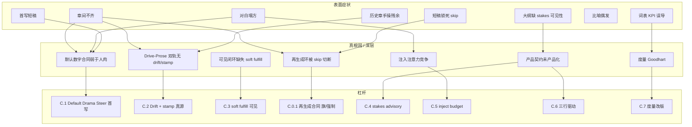
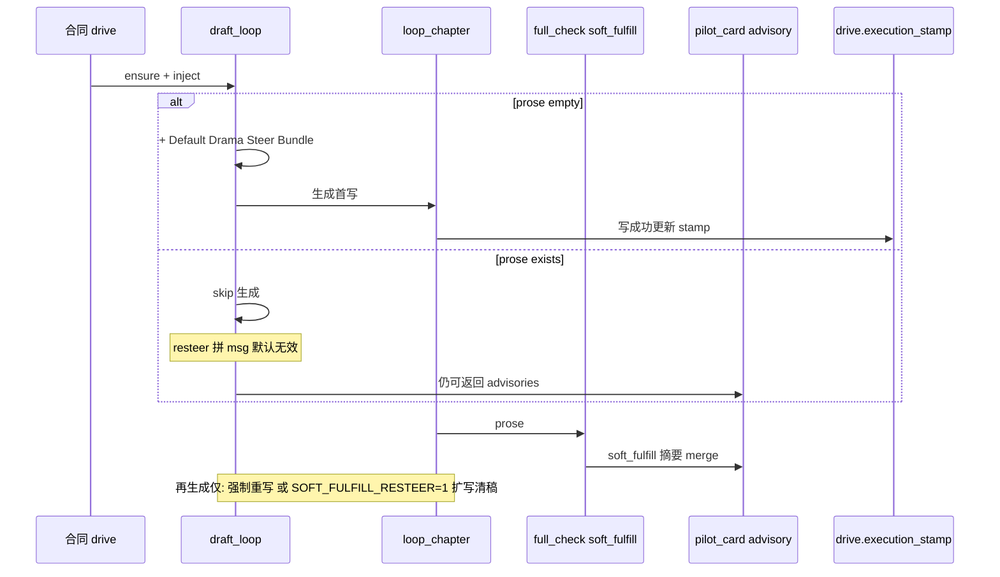
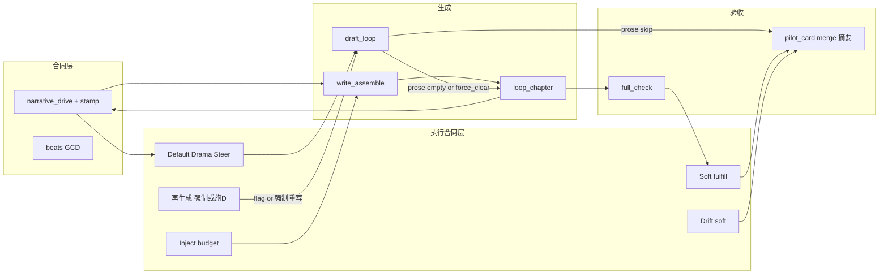

# 设计文档：根因审计 + 执行合同层（Execution Contract）

| 项 | 值 |
|----|-----|
| **文档标题** | 叙事质量瓶颈：真根因审计与最优化「执行合同层」方案 |
| **作者** | Grok Design（待人审签） |
| **日期** | 2026-08-10 |
| **状态** | Draft · **rev.1.1**（评审修订：再生成合同、soft floor 对齐 AB、stamp 真源、归因降级） |
| **产品** | scribe-writing-system / scribe3（铜炉） |
| **工作区** | `/home/admin/projects/scribe-ia-verify-wt` |
| **文档真源** | 仓库 `docs/plans/2026-08-10-narrative-rootcause-optimal-execution.md` |
| **会话 scratch** | `/tmp/grok-1000/grok-design-doc-e1097c4c.md`（须与真源全文一致） |
| **验收环境** | demo 已部署栈 `https://www.qing.blue`；**禁止**默认再起第二 Surreal；Grok 运行机不做全量 npm/pytest/本机 Surreal |
| **底座（其上）** | NQ · 叙事引擎 rev.2.3 · OI rev.1.1（均已落地或主链合入） |
| **证据** | [`docs/evidence/ne-oi-ab-20260810/`](../evidence/ne-oi-ab-20260810/)（ch3 A/pass1/pass2 + ANALYSIS） |
| **明确不做的宣称** | **不**宣称文学 ≥9.5；**不**默认 GATE/DETECT 硬拦；**不**重写 Pilot 拓扑；**不**第二 Surreal |

---

### 读法（工程师 · 第一周）

1. **## Overview + ## A. 根因审计** — 表面问题哪些是真根因、哪一层断了。  
2. **## B. 问题地图 + ## C. 最优化改进方案** — 尤其 **C.0.1 再生成合同** 与 **C.1/C.2/C.3**。  
3. **## Key Decisions + ## PR Plan + ## Open Questions** — 开工与裁决。  

---

## Overview

### 一句话

> **工程控制面（ensure / inject / range / REST）已经显著抬升；文学正文的章间不齐与对白塌方，主因不是「还缺一个 flag」，而是「合同写好了 ≠ 默认生成路径按合同执行完」。**  
> 下一层应做 **Execution Contract（执行合同层）**：把「对白对立 + soft 长度组合条件 + 服务戏跟主角 + 写后轻量对照」固化进 **默认 draft 路径**（引导 / soft / advisory），并补 **Drive–Prose 漂移软提示**、**stamp 可持久真源** 与 **注入注意力预算**——**不**默认 hard park，**不**重做引擎。  
> **诚实边界：** 默认路径增益主在 **首写强度**；已落库短稿的再生成须 **显式旗/作者强制重写**（见 C.0.1），**不**假装 `SOFT_FULFILL_RESTEER`  alone 能穿过 `draft_loop` 的「正文已在则 skip」。

### 产品原则（不可妥协 · 继承 rev.2.3）

| # | 原则 | 本设计工程含义 |
|---|------|----------------|
| **P1** | **只强调冲突/事件推动小说** | 执行合同的验收文案以「有戏」为中心；比喻/声口 **不**升级为与冲突同等硬目标 |
| **P2** | **引导 > 限制** | Default Drama Steer / soft fulfillment / drift 均为 **advisory**；可选 resteer **默认关**；GATE/DETECT **默认关** |
| **P3** | **跟着主角逛可以** | steer 明示「服务戏的跟主角允许」；禁止把 POV 跟随当缺陷；作者 opt-out 对白 Bundle 允许 |
| **P4** | **少规则、少门闩** | 少新系统；挂在 `draft_loop` / `write_assemble` / `full_check` 旁路 |
| **P5** | **硬拦极少** | 不因本方案把 `EVENT_DRIVE_GATE` / `EVENT_LED_DETECT` 翻成质量默认；soft_fulfill **禁止** 接入 triage blocking / park_stroll |

### 分层关系（本方案在栈中的位置）

```text
┌─────────────────────────────────────────────────────────────┐
│  本设计 · Execution Contract Layer（执行合同层）              │
│  默认 drama steer · drive–prose drift soft · soft fulfill   │
│  inject budget · stakes advisory · 度量改版 · 可选三行驱动   │
│  再生成：显式旗/【强制重写】· stamp 真源在 narrative_drive    │
└────────────────────────────┬────────────────────────────────┘
                             │ 默认路径补强，不替换
┌────────────────────────────▼────────────────────────────────┐
│  Optimal Improvement（OI rev.1.1 · 已主链落地）               │
│  L2 range ensure · L3 对白注入 · L1 enrich · L5/L6 soft 可选 │
└────────────────────────────┬────────────────────────────────┘
                             │ 补强
┌────────────────────────────▼────────────────────────────────┐
│  Narrative Engine rev.2.3（控制面 · 已落地）                   │
│  narrative_drive · ensure@expand/draft · _event_drive_block  │
│  GATE/DETECT 默认 0                                          │
└────────────────────────────┬────────────────────────────────┘
                             │ 引导叠加
┌────────────────────────────▼────────────────────────────────┐
│  novel-quality-first（执行层；含 drama/park 质量门）          │
│  beats.v2 · drama_block · craft · pressure · soft 双旗       │
│  注：质量模式 park_stroll 可 hard —— 与 EC soft **职责分离** │
└────────────────────────────┬────────────────────────────────┘
                             │ 编排
┌────────────────────────────▼────────────────────────────────┐
│  Pilot · deduce（认知）· 记忆注入 · 系统硬红线                │
└─────────────────────────────────────────────────────────────┘
```

**策略一句话：** 控制面继续保留；把 **默认 draft 合同** 提到接近「人肉加严 steer」的强度（主增益=首写）；写后 soft 对照 **可见**；已落库失败稿的再生成 **诚实依赖** 作者【强制重写】或 **显式** `SOFT_FULFILL_RESTEER=1` 扩写清稿（默认关）。

### 读感轨迹（诚实代理 · 禁止 ≥9.5）

| 阶段 | 读感均分（约） | 帮助度（约） | 证据 |
|------|----------------|--------------|------|
| 旧 soft | ~3.4 | ~64% | NQ / v633 reval |
| NQ 质量模式 | ~5.7 | ~70–74% | `nq-quality-smoke` |
| 引擎后 | ~6.8 | ~78–82% | 会话 + 部分 OI |
| OI 后有戏章 | ~6.8–7.2 | ~82–86% | ch3 pass2 等 |
| **本层探索目标** | **章间更齐 · 有戏章稳定 7.0–7.8 档** | **~85–90%** | **不阻断 merge** |

---

## Background & Motivation

### 已落地且不可回退的控制面

| 能力 | 代码锚 | 状态 |
|------|--------|------|
| `narrative_drive` 合成/校验/格式化 | `scribe3/narrative_drive.py` | 落地 |
| ensure @ expand（含 skip）+ draft 入口 | `pilot_runtime.expand_beats` / `draft_loop` | 落地 |
| 卷级 / range ensure | `ensure_narrative_drive_range` + CLI/REST | 落地 |
| 写路径 ≤220 注入 | `write_assemble._event_drive_block` → `format_event_drive_block` | 落地（含 L3 对白句） |
| soft opener / metaphor 日志 | `soft_opener_event_trace` / `maybe_log_*` | 落地（旗默认关） |
| NQ 节拍/戏剧/craft/park 旗族 | `novel_quality_flags.py` + `settings.REGISTRY` | 落地 |
| 质量模式 env 真源 | `deploy/prod/env.quality-mode.fragment` + `QUALITY_MODE_TARGETS` | 落地 |

### 最新工程事实（会话 + AB 证据）

同章 AB（`book_013bcb3b` ch3 · [`ANALYSIS.md`](../evidence/ne-oi-ab-20260810/ANALYSIS.md)）：

| 稿 | 字数 | 引号 | walk/千字 | 要点 |
|----|------|------|-----------|------|
| A 旧稿 | 4894 | 23 | 27.0 | 跟猫开篇、氛围向 |
| pass1（OI 默认注入） | **1893** | **1** | 38.6 | **对白塌方 + 短稿** |
| pass2（人肉加严：对白≥4 + 加长） | **2983** | **22** | 25.1 | 对白回来、开篇外力可感 |

**核心观察（本设计第一性事实 · 分层表述）：**

1. **注入 alone ≠ 数字合同** — pass1 已有 event_drive + 对白引导句，仍短稿、近零对白；`length_steer` 已有「连续场景与对话 / 目标 4800–5500」，**无**「对白≥N / 对立下限」可测数字。  
2. **人肉加严 steer 可兑现（单章 AB）** — pass2 证明模型 **能** 写对白与加长；**当前最佳支持假设** 是默认路径缺数字合同是可操作缺口（非全库唯一定因，见 §A Issue 归因纪律）。  
3. **有 `narrative_drive` ≠ 正文已按 drive 写过** — ensure/version 可新，prose 可旧或「新但未履约」。  
4. **词表 conflict 会骗人** — pass2 戏在对白里，conflict/千字仍偏低（0.7 vs A 的 2.9）。  
5. **`draft_loop` 有 prose 则 skip** — 已落库短稿 **不会** 因 soft 建议自动再进 `loop_chapter`；闭环再生成必须单独设计（C.0.1）。  
6. **pass1 短稿更像 early-stop / 服从「宁短」**，而非 `max_tokens` 墙（`loop_chapter` `max_tokens=8192`）。  
7. **工程控制面增益 > 文学章间稳定性** — range/inject 绿不能替代默认路径的执行强度。

### 为何还要再设计一层（不是再加一个 L8 flag）

OI 已解决：**覆盖（L2）**、**注入含对白（L3）**、**enrich 可观测（L1）**、**可选 soft 观测（L5/L6）**。  
**未解决：**

- 默认 `length_steer` **没有**「对白对立最低条数」级可测数字合同；  
- 写后只有 optional logging，**没有**相对 drive 的 soft fulfillment 产品可见摘要；  
- drive 变更只比对 `synopsis_fp`，**不**比对 prose 是否仍匹配合同；  
- 注入栈多块叠加，注意力与裁剪风险真实存在；  
- **已落库失败稿** 在 skip 语义下开环（本 rev 诚实处理）。

---

## Goals & Non-Goals

### Goals

1. **正面回答**：表面问题清单的真/假根因与机制链；指出控制论哪一层断了。  
2. **定义 Execution Contract 层**：默认路径（**首写**）即可用；引导优先；少新系统；可测。  
3. **钉死再生成合同（C.0.1）**：不假装 resteer  alone 穿过 skip。  
4. **Default Drama Steer Bundle**：对白对立最低、长度 **组合** soft、服务戏跟主角 — 旗控，ENGINE=1 质量模式可默认开。  
5. **Drive–Prose Drift Soft + Post-write soft fulfillment**：advisory only；stamp 可持久。  
6. **Inject budget discipline**：合并冗余；对白关键字出现次数可测上限。  
7. **大纲 stakes advisory**：expand 时 warning，不 park（独立小 PR）。  
8. **度量改版**：引号 + soft opener + 组合长度；降级词表 conflict；对立词 experimental。  
9. **工程门禁必过；读感探索不阻断 merge；禁止 ≥9.5 宣称。**

### Non-Goals / 明确不做

| 非目标 | 理由 |
|--------|------|
| 默认开 `EVENT_DRIVE_GATE` / `EVENT_LED_DETECT` 硬拦 | 违 P2/P5 |
| 默认自动清稿重写一切 soft gap 章 | 违 KD-EC-4；误伤定稿 |
| 独立续写/expand API 作为本层必交付 | 若无现成路径则 **Non-Goal**；rev.1 用旗控 clear 或手动强制重写 |
| 重写 Pilot `STATES` / 新故事 OS | 爆炸半径；引擎已够 |
| 宣称文学 ≥9.5 | 人盲未跑 |
| 把比喻/声口升为与冲突同等硬目标 | 违 P1 |
| soft_fulfill gaps 接入 `is_blocking_issue` / `park_stroll` / S1 | 违 P5；与 NQ hard 职责分离 |
| 第二 Surreal / Grok 机全量 npm/pytest | 主机纪律 |
| 重做 compose 吸收路径（OI-L1 已收窄） | 误判根因 |

---

## A. 根因审计（Root Cause Audit）

### 控制论分层（全文档共用）

```text
意图 (product) → 合同 (drive/beats) → 执行提示 (assemble/steer) → 生成 (LLM) → 验收 (metrics/triage)
     P1–P5            narrative_drive        draft_loop +           loop_chapter      full_check /
                      beats GCD              write_assemble                         词表/AB/人盲
```

**当前主断裂点（证据级 · 最佳支持假设）：** 合同层与注入层已通；**执行提示默认缺少可测数字合同**；**验收层缺少「对照合同的 soft 履约」且 KPI 常错位**；**已落库 prose 在 skip 下无 soft 再生成环**。

### 五问 Why（总链 · 章间不齐 / 有 drive 无戏）

1. **Why 章读感不齐？** — 有章像 ch1 有戏，有章像 pass1 短+无对白。  
2. **Why 有章无戏？** — 正文未充分按冲突/事件执行（对白/外力/长度组合失败）。  
3. **Why 有合同仍弱执行？** — 合同在 meta；默认 `length_steer` + ≤220 注入 **缺对白≥N 数字合同**（AB pass1 vs pass2 支持）；另有模型方差/注意力竞争。  
4. **Why 默认缺数字合同？** — 历史优先「宁短勿巷志」防公园病；**未把「履约 soft 下限」写进 draft 默认**；写后无 soft fulfillment 产品面。  
5. **Why 系统难发现/难回修？** — ensure 看 synopsis_fp/drive.ok；有 prose 则 skip；full_check soft 词表/压力；**无 drive↔prose 漂移与履约 soft 可见摘要**；词表 conflict 可假绿/假红。

### A.1 表面问题分类表

| ID | 症状 | 是否真根因 | 机制链（控制面→生成面） | 更深一层（若为症状） | 断裂层 |
|----|------|------------|------------------------|----------------------|--------|
| **P0-1** | **章间不齐** | **部分** | OI-L2 后 ensure **覆盖已非主因**；**默认 draft 数字合同不一致** + **旧 prose 不随 drive 失效** + 模型方差 → 同书章间方差大 | 真缺口 = **默认执行合同不一致** + **无 drift 标记** + **再生成须显式** | 执行提示 + 验收 + 再生成 |
| **P0-2** | **对白默认力度不够** | **是（可操作真根因）** | OI-L3 注入「对白须带对立」≤220；`draft_loop.length_steer` **无**对白条数下限；pass1 引号=1 支持 inject alone 不足。**次因：** 模型忽视、D6 注意力、单次方差、题材外化方式 | 「对白」是 **冲突外化通道**；缺默认数字 steer bundle | **执行提示**（主）；生成方差（次） |
| **P0-3a** | **首写短稿** | **是（生成/服从）** | 首写即交 ~1.5–2k：更像 early-stop / 服从「宁短勿巷志」，**非** max_tokens=8192 截断；缺 soft 组合引导「无戏时勿过短」 | 与 P0-2 耦合 | **执行提示 → 生成** |
| **P0-3b** | **短稿锁死** | **是（编排策略）** | **已有 prose** 时 skip；`_has_drama` 禁止仅因字数清稿 → 短+弱对白稿 **默认不再进生成**，除非【强制重写】/显式 resteer 旗 | 开环；见 C.0.1 | **draft_loop 分支** |
| **P1-1** | **大纲缺 stakes** | **部分** | `parse_chapter_meta` 高压可 `missing_stakes_high_pressure`；compose 可 warning；**expand 路径默认不把 warning 产品化** | 链路断裂在 **可见性** | 合同（弱）+ **产品契约** |
| **P1-2** | **词表代理偏差** | **是（度量真根因）** | walk/conflict/simile 词表驱动 AB 与部分工程叙事；戏在对白/动作时可 **conflict 假低** | Goodhart → 诱导错误工程 | **验收** |
| **P1-3** | **比喻未治理** | **否（症状/次要）** | craft 曾配额；OI-L6 soft 默认关 | 真问题是 **无戏时比喻显眼** | 非主断裂；可选 soft |
| **P2-1** | **历史章需人工 range/重写** | **部分（工程债·大半工具化）** | **OI-L2 range 后 ensure 覆盖已非主因**。残余：`propose_outline` 有 synopsis 则 skip **不** ensure（新写才 ensure）；expand **skip 也 ensure**；draft 入口 ensure。**主残余** = **prose 不随 drive 失效**（D3） | 作者不知「该重写」 | 合同↔正文双轨 |
| **P2-2** | **AB 非等长 / 无人盲** | **否（方法局限）** | 证据协议限制；非运行时 bug | 勿用单章 AB 词表冒充文学定级或全库唯一定因 | 验收方法 |

### A.2 深层问题清单（系统论 · 须有证据）

#### D1 · 执行闭环缺失（真 · 高优先级 · 分两环）

| 环 | 内容 |
|----|------|
| **可见环** | ensure/compose 写合同；写后无产品向 soft 对照 → C.3 advisory card |
| **再生成环** | 有 prose 则 skip → soft 拼 msg **进不了** `LoopChapterReq` → 必须 C.0.1，**不可**写成 resteer 默认生效 |

#### D2 · 默认 steer 弱于人肉数字合同（真 · 最高 ROI · 主在首写）

| 项 | 内容 |
|----|------|
| **证据** | pass1→pass2；`length_steer` 无对白≥N |
| **边界** | 主增益落在 **无 prose 首写** 与 **已 clear 后的重写**；不自动治愈已 skip 的短稿 |
| **杠杆** | C.1 Default Drama Steer Bundle |

#### D3 · 合同与正文双轨（真 · 稳定性）

| 项 | 内容 |
|----|------|
| **症状** | 改 synopsis/drive 后旧 prose 仍可 skip |
| **证据** | ensure 比 `synopsis_fp`；draft 有 prose 则 skip；无 execution_stamp |
| **杠杆** | C.2 Drift Soft + stamp 真源 |

#### D4 · 度量错位（真）

见 C.7；**禁止**用对立短词表再造 Goodhart（C.3 experimental）。

#### D5 · 大纲→种子→戏可见性（部分）

C.4 advisory；独立小 PR。

#### D6 · 多块注入注意力稀释（真 · 中）

C.5 budget + 对白关键字出现次数上限。

#### D7 · 产品契约未产品化（真）

C.6 可选三行驱动。

### A.3 各 P0 问题判决摘要

| 问题 | 判决 | 一句话 |
|------|------|--------|
| 章间不齐 | **部分根因 / 多症状聚合** | 覆盖问题 OI 已修；**剩余主因是默认执行强度、drift、再生成需显式** |
| 对白力度不够 | **可操作真根因（执行提示）** | 注入有句 ≠ draft 默认数字合同；AB 为最佳支持假设 |
| 首写短 / 短稿锁死 | **两段真机制** | 生成服从 vs skip/禁清稿 |
| 大纲缺 stakes | **症状+可见性** | 解析已有 |
| 词表骗人 | **真根因（度量）** | 会诱导堆词 |
| 比喻 | **假根因（相对 P1）** | 次要 soft |
| 有 drive ≠ 正文按 drive | **真根因（双轨+开环）** | 本层核心命题 |

---

## B. 问题地图（Problem Map）



### 因果简图（含 skip）



---

## C. 最优化改进方案（Optimal Improvement Architecture）

### C.0 命名与边界

| 名称 | **Execution Contract Layer（执行合同层）** |
|------|------------------------------------------|
| **做什么** | 把「本章须兑现的戏」落到 **默认首写行为** + **写后 soft 对照可见** + **可选显式再生成** |
| **不做什么** | 不新状态机；不默认 park；不默认自动清稿；不重写 compose；不取代 narrative_drive |
| **挂点** | `pilot_runtime.draft_loop` · `write_assemble` · `full_check` · 纯函数 `execution_contract.py` |
| **旗** | 见 API Flag 表 + KD-EC-14 |

### C.0.1 再生成合同（阻塞级 · 必须先于「闭环已完成」宣称）

现网 `draft_loop` 事实（`pilot_runtime.py` ~L969–1025）：

```text
if prose_now and not force_clear:
    return {"skipped": "正文已在,..."}   # 不组装 length_steer，不调 loop_chapter
force_clear 仅当:
  - 「【强制重写】」(+ 可选字数目标条件)
  - 可见汉字≥N 且 prose_cn < target 且 (无 drama 或 强制重写)
  - 超长压缩等
_has_drama 时禁止「仅因字数不足」清稿
```

**因此下列说法在默认路径下为假，本 rev 禁止再写：**

- 「SOFT_FULFILL_RESTEER 把 hint 拼下轮 msg 即可二次生成」——**skip 在拼 msg 之前**；  
- 「EC-1 合入后已落库短稿自动变好」——**不会**。

#### 采纳策略（组合 · 引导优先）

| 路径 | 默认 | 行为 | 产品定位 |
|------|------|------|----------|
| **A. 首写 Default Drama Steer** | ENGINE=1 时质量模式推荐开 | 仅影响 **prose 为空** 的生成 | **主 ROI** |
| **B. 写后 soft fulfill 可见** | 质量模式推荐开 | full_check 写摘要；**不** clear | 作者看见 gaps |
| **C. 作者【强制重写】** | 现网 | clear + 带 Bundle 重写 | **默认再生成路径** |
| **D. 可选扩写清稿** | **`SCRIBE3_SOFT_FULFILL_RESTEER=0`** | 见下伪码；**显式旗** 才 clear | 实验/运维；非质量默认 |
| **E. 独立续写 API** | — | **本层 Non-Goal**（无现成则不做） | — |

#### 路径 D 伪码（钉在 `if prose_now` **之前**，可测）

```python
# draft_loop 内，读 prose_now / prose_cn 之后、skip 之前

advisories = []
stamp = (ch.get("narrative_drive") or {}).get("execution_stamp")
drift = drive_prose_drift(drive, prose_now, stamp)
if drift.get("drift"):
    advisories.append(drift["advisory"])

# soft_fulfill 对已有 prose 可算（纯函数，不依赖 OPENER 旗）
if soft_fulfill_enabled() and prose_now:
    ful = soft_fulfill_drive(prose_now, drive)  # 直接调纯函数
    advisories.append(ful.get("steer_hint") or "")
    # 可选：merge 进返回值；落库见 C.2/C.3

force_clear = ...  # 现网逻辑

# 路径 D：显式旗 + 组合 gap（对白低 且 过短 且 opener 无 force）——非仅字数
if (
    soft_fulfill_resteer_enabled()  # 默认 False
    and prose_now
    and not force_clear
    and ful  # from above
    and ful.get("collapse_combo")  # quotes < N AND prose_cn < L_soft AND not opener.force_felt
):
    force_clear = True
    # 记 journal: execution_contract_expand_clear
    # 清稿后本轮继续走生成，msg 带 Bundle + ful.steer_hint

if prose_now and not force_clear:
    return {
        "skipped": "正文已在,跳过生成(...)",
        "advisories": [a for a in advisories if a],  # 合同：skip 仍可带 advisories
    }
# else: 组装 length_steer + Bundle → loop_chapter
```

**`collapse_combo`（与 Issue 2 对齐）：**

```text
collapse_combo :=
  quotes < dialogue_min
  AND prose_cn < soft_len_floor
  AND not opener.force_felt
# 有戏的中等长度（如 pass2=2983、引号充足）→ 不触发长度单 gap，不触发 D
```

**ROI 诚实表述：**

| 杠杆 | 工程增益 |
|------|----------|
| C.1 Bundle | **高**（首写 / 强制重写后） |
| C.3 soft fulfill | **中**（可见性；不自动改文） |
| C.0.1 路径 D | **中**（仅旗开时）；默认关则 **不计入「自动闭环」** |
| 宣称「闭环已完成」 | **仅当** 文档+实现同时具备 A+B+C，且 D 标明可选 |

### C.1 Default Drama Steer Bundle（主杠杆 · 最高 ROI · 主在首写）

**问题：** AB 支持人肉数字合同有效；默认路径无对白≥N。

**数字策略（对齐 pass2=2983 · KD-EC-13）：**

| 参数 | 默认 | 说明 |
|------|------|------|
| `dialogue_min` | **4** | 对齐 pass2 加严；opt-out 见 resolve |
| `soft_len_floor` | **2400** | 分界在 pass1~1893 与「可接受中等长」之间；**pass2=2983 不因长度单 gap 失败** |
| aspirational target | 4800–5500 | **与 soft floor 解耦**；禁止把 target 当 soft fail 阈值 |

**优先级句（与「宁短勿巷志」解冲突 · 必须进 Bundle）：**

```text
优先级：戏与对白对立 > 字数。soft 长度下限仅在「缺对白对立且缺事件推进」时提醒加码；
有戏的中等长度允许低于 4800 目标；禁止为达标注水。宁短勿巷志仍然有效。
```

**规范 Bundle 文案（短伪码版 · 唯一真源 ≤200 字；禁止与四行清单双份）：**

```python
def format_default_drama_steer(
    *,
    dialogue_min: int = 4,
    soft_len_floor: int = 2400,
) -> str:
    return (
        f"执行合同：对白≥{dialogue_min}处且须带对立（要求/拒绝/代价）；"
        f"戏优先于字数；仅当缺对白对立/缺事件推进时 soft 下限约{soft_len_floor}字；"
        f"目标仍约4800–5500但禁止注水；跟主角可以，须逼近或兑现本章事件驱动；"
        f"开篇优先外力/对立。"
    )
```

**作者意图解析合同：**

```python
_DIALOGUE_MIN_RE = re.compile(r"对白\s*≥\s*(\d{1,2})")
_LEN_GE_RE = re.compile(r"可见汉字\s*≥\s*(\d{3,5})")  # 现网已有
_OPT_OUT_DIALOGUE = ("禁止对白", "少对白", "日记体", "独白章", "无对白")

def resolve_drama_steer_params(steer: str) -> dict:
    """返回 {enabled, dialogue_min, soft_len_floor, reason}。"""
    d_min, floor = 4, 2400
    if any(k in (steer or "") for k in _OPT_OUT_DIALOGUE):
        return {"enabled": False, "reason": "author_opt_out_dialogue"}
    m = _DIALOGUE_MIN_RE.search(steer or "")
    if m:
        d_min = max(d_min, int(m.group(1)))  # 作者更严则抬升；不自动下调除非 opt-out
    m2 = _LEN_GE_RE.search(steer or "")
    if m2:
        # 作者目标字数用于现网 clear；soft floor 取 min(作者目标, 默认floor) 不抬升惩罚
        pass
    return {"enabled": True, "dialogue_min": d_min, "soft_len_floor": floor}
```

**与现网交互：**

| 现网 | 交互 |
|------|------|
| `length_steer`「宁短勿巷志」 | **保留**；Bundle 内优先级句消解「须 ≥floor」误解 |
| `_has_drama` 禁仅字数清稿 | **保留**；长度 **不单** 触发 clear |
| `format_event_drive_block` 对白句 | DEFAULT_DRAMA_STEER 开时 guide **压 micro**（C.5） |
| 作者 steer | `resolve_drama_steer_params`；opt-out 跳过 Bundle |
| 有 prose skip | Bundle **不运行**；见 C.0.1 |

**接线伪码：**

```python
if narrative_engine_enabled() and default_drama_steer_enabled():
    params = resolve_drama_steer_params(steer)
    if params["enabled"]:
        length_steer += format_default_drama_steer(
            dialogue_min=params["dialogue_min"],
            soft_len_floor=params["soft_len_floor"],
        )
```

### C.2 Drive–Prose Drift Soft

**指纹（钉死）：**

```text
drive_content_fp := sha16( synopsis_fp + "|" + core )
  core := inciting.summary | opposition.who|wants | end_hook | scene_turn | stakes_line
# version 仅辅助日志，**不**单独触发 drift（避免 enrich-only version++ 误报）
# 仅 version++ 且 core 不变 → drift=false（OQ-EC-8）

prose_fp := review.fp.prose_fp  # 与 chapter_analysis._prose_fp 对齐（KD-19）
```

**stamp 真源（KD-EC-12 · 阻塞）：**

| 存储 | 用途 |
|------|------|
| **`chapter.narrative_drive.execution_stamp`** | **真源**（经 `update_chapter_meta` 白名单已含 `narrative_drive`） |
| `pilot_card.execution` / `soft_fulfill` | **仅本轮 advisory 摘要**；必须 **JSON merge**，禁止 naive 整卡 SET 抹掉他键 |

**ensure preserve：**

```python
# ensure_narrative_drive 在 compose 新 drive 后：
prev_stamp = (drive or {}).get("execution_stamp")
new_drive = compose_narrative_drive_dict(...)
if prev_stamp and not force_clear_stamp:
    new_drive["execution_stamp"] = prev_stamp  # recompose 不得丢 stamp
```

**写成功更新 stamp**（`loop_chapter` 落库成功后或 draft 成功回调）：

```json
{
  "drive_content_fp": "…",
  "synopsis_fp": "…",
  "prose_fp_at_write": "…",
  "drama_steer_bundle": "v1",
  "written_at": "ISO-8601"
}
```

**drift 检测点：**

- `draft_loop`：**在 skip 分支也算**，经 `advisories` 返回（C.0.1）；  
- `full_check`：写入 pilot_card **merge** 摘要 + logging。

**禁止：** 因 drift **自动** clear（KD-EC-4）。

**pilot_card merge 合同（现网修复范围 · EC-2/3 必含）：**

```python
def merge_pilot_card(st, seq, patch: dict) -> None:
    """Read-modify-write. Never replace whole card with single-key dict."""
    row = st...  # SELECT pilot_card
    card = json.loads(row or "{}")
    # deep merge patch into card
    st._execute_write("UPDATE ... SET pilot_card=$c", {"c": json.dumps(card)})

# _stage_bucket_counts / deliver 必须改用 merge，或至少：
#   card = prev; card["buckets"] = counts; SET full card
# deliver 已部分 read prev buckets——扩展为保留 execution/soft_fulfill 键
```

**E4 单测：** full_check → deliver 后 `narrative_drive.execution_stamp` **仍在**；pilot_card 上 advisory 键按 merge 策略保留或明确「仅 stamp 真源、card 可丢摘要」。

### C.3 Post-write soft fulfillment（可见闭环 · 默认不 re-generate）

```python
def soft_fulfill_drive(
    prose: str,
    drive: dict | None,
    *,
    dialogue_min: int = 4,
    soft_len_floor: int = 2400,
) -> dict[str, Any]:
    """Advisory only. Never blocking. Never triage/S1."""
    quotes = count_quote_pairs(prose)
    prose_cn = cn_len(prose)
    # 直接调用纯函数，禁止经 maybe_log_opener（其受 OPENER 旗短路）
    opener = soft_opener_event_trace(prose, drive)
    gaps = []
    if quotes < dialogue_min:
        gaps.append("dialogue_low")
    # 长度：仅组合，不对 pass2 类「有对白中等长」单惩罚
    if prose_cn < soft_len_floor and quotes < dialogue_min:
        gaps.append("short_and_dialogue_low")
    if not opener.get("force_felt") and quotes < dialogue_min:
        gaps.append("opener_weak_with_low_dialogue")
    collapse_combo = (
        quotes < dialogue_min
        and prose_cn < soft_len_floor
        and not opener.get("force_felt")
    )
    # 对立词 traces：experimental / debug only，不进默认 gaps 文案（防 Goodhart）
    return {
        "ok_soft": not gaps,
        "quotes": quotes,
        "prose_cn": prose_cn,
        "opener": opener,
        "gaps": gaps,
        "collapse_combo": collapse_combo,
        "steer_hint": format_fulfill_hint(gaps),
        "severity": "advisory",
    }
```

| 检查项 | rev.1 默认 | 说明 |
|--------|------------|------|
| 引号对数 | **主信号** | 进 gaps |
| 开篇外力 | **主信号**（纯函数） | 与 quotes 组合 |
| 长度 | **仅与 quotes 组合** | floor=2400；pass2=2983 且 quotes 高 → 不 length-fail |
| 对立词痕迹 | **experimental / debug** | **不进** 默认 gaps |
| 逛且无戏 | 可选合并一条 | walk 高且 dialogue_low |

**接线：** `full_check` 在 triage 前：

```python
if soft_fulfill_enabled():
    ful = soft_fulfill_drive(prose, drive)  # 非 maybe_log_*
    log.info("soft_fulfill ...")
    merge_pilot_card(st, seq, {"soft_fulfill": summarize(ful)})
# 禁止: is_blocking_issue / park_stroll / S1_BLOCKING_TYPES
```

**与 NQ hard 职责分离（KD-EC-15）：**

| 系统 | 行为 |
|------|------|
| EC soft_fulfill / drift | 仅 advisory 字段与日志 |
| NQ `PARK_STROLL_BLOCKING`（质量模式可 True） | 既有 hard park，**不**因本方案翻转；**不**读取 soft_fulfill gaps |
| 实施红线 | soft gaps **禁止** 并入 `triage` blocking 集合 |

### C.4 Outline stakes gate advisory

`expand_beats`（及可选 outline 成功后）surfaced `missing_stakes_high_pressure` / `missing_outline_stakes` → inbox/card warning；**不** park。  
**PR：** **EC-2b**（与 soft_fulfill 拆分，避免 EC-2 膨胀）。

### C.5 Inject budget discipline / attention

1. **保护序：** 引爆/对立/代价 > 对白引导 > 翻转/钩子 > 相机（现 candidates 链）。  
2. **去重：** `DEFAULT_DRAMA_STEER=1` 时 inject guide **固定 micro**（「对白对立；逼近戏。」），220 留给 core。  
3. **对白关键字出现次数：** assemble 观测 `dialogue_keyword_hits`；单测 **全写路径引导中「对白」出现 ≤2**（Bundle 1 + micro 1；禁止 CRAFT/drama 再堆第三段同义长句——若 craft 已有则 Bundle 保持最短）。  
4. **禁止** 为比喻 soft 抬 `MAX_EVENT_DRIVE_BLOCK` 挤对立行。

### C.6 Author-visible 三行驱动（可选）

`format_drive_three_lines` → brief / 只读 API；非必做 UI 大改。

### C.7 度量改版

| 旧 KPI（降级） | 新主代理 | 探索性 |
|----------------|----------|--------|
| conflict/千字 | **引号对数**；`soft_fulfill.quotes` | LLM 分维 |
| walk 单独 | walk **且** dialogue_low **且** opener 弱 | 人盲 |
| simile | 可选 metaphor soft；不并列冲突 KPI | — |
| 对立词表 | **不**作默认 KPI（experimental） | debug |

AB 模板：保留 `quotes`；注 pass2=2983 与 floor=2400 关系；**诚实注释** conflict 旁证。EC-6 evidence **强制**「非 ≥9.5」脚注。

### C.8 杠杆性价比排序（修订 ROI）

| 序 | 杠杆 | 期望贡献 | 成本 | 风险 | PR |
|----|------|----------|------|------|-----|
| **1** | C.1 Default Drama Steer（**首写**） | **最高** | 低 | 文案打架（已用优先级句） | EC-1 |
| **2** | C.3 soft fulfill 可见 | **高（可见）** | 低–中 | card 覆写（merge） | EC-2 |
| **3** | C.2 drift + stamp 真源 | **高（稳定性）** | 中 | ensure preserve | EC-3 |
| **4** | C.0.1 路径 D 可选 resteer clear | 中（旗开时） | 低 | 误清 | EC-3 或 EC-2 尾 |
| **5** | C.5 inject budget | 中 | 低 | 过度压缩 | EC-1 同 |
| **6** | C.7 度量 | 中 | 低 | 习惯 | EC-4 |
| **7** | C.4 stakes | 中低 | 低 | 噪音 | **EC-2b** |
| **8** | C.6 三行 | 中（作者） | 低–中 | 范围 | EC-5 可选 |

### C.9 架构总图



---

## API / Interface Changes

### 新/扩设置旗

| Flag | 代码默认 | QUALITY_MODE / fragment 推荐 | 含义 |
|------|----------|------------------------------|------|
| `SCRIBE3_DEFAULT_DRAMA_STEER` | `False` | **`True`**（EC-0 写入 fragment） | draft 默认 drama bundle |
| `SCRIBE3_SOFT_FULFILL` | `False` | **`True`** | 写后 soft 履约；**内含 opener 子检查**，不必双开 OPENER |
| `SCRIBE3_SOFT_FULFILL_RESTEER` | `False` | **`False`** | 组合 collapse 时允许扩写清稿；**实验** |
| `SCRIBE3_DRIVE_PROSE_DRIFT` | `False` | **`True`** | drift advisory |
| `SCRIBE3_NARRATIVE_ENGINE` | `False` | `True` | 不变 |
| GATE/DETECT | `False` | **`False`** | **禁止**质量默认 1 |
| `OPENER_SOFT_TRACE` | `False` | `False` | 独立日志旗；SOFT_FULFILL 不依赖它 |

**运行真源：** `settings.REGISTRY` + `NQ_FLAG_KEYS` + `QUALITY_MODE_TARGETS` + **`deploy/prod/env.quality-mode.fragment`**（及 rollback 片段）。仅改 Python 常量 **不等于** demo 质量模式生效。

### 纯函数合同

```python
# scribe3/execution_contract.py

DEFAULT_DIALOGUE_MIN = 4
DEFAULT_SOFT_LEN_FLOOR = 2400  # 非 3200；对齐 AB pass2=2983 不单长度 fail

def format_default_drama_steer(...) -> str: ...
def resolve_drama_steer_params(steer: str) -> dict: ...
def soft_fulfill_drive(prose, drive, **kw) -> dict: ...
def drive_content_fp(drive: dict | None, synopsis_fp: str = "") -> str: ...
def drive_prose_drift(drive, prose, stamp) -> dict: ...
def format_drive_three_lines(drive) -> str: ...
def collapse_combo(ful: dict) -> bool: ...
```

### draft_loop 返回值扩展

```text
skip 时: {"skipped": str, "advisories": list[str]}  # advisories 可空
生成时: 保持 loop_chapter 返回；advisories 可并入 journal
调用方：忽略未知键须 fail-soft（兼容旧客户端）
```

---

## Data Model Changes

| 项 | 策略 |
|----|------|
| **stamp 真源** | `narrative_drive.execution_stamp`；ensure **preserve** |
| **pilot_card** | 仅 advisory 摘要；**merge RMW**；修复 `_stage_bucket_counts` 整卡替换 |
| **禁止** | 为 soft 新建 Surreal 表 |
| **指纹** | `drive_content_fp` + `prose_fp`；version 不单独触发 drift |

---

## Alternatives Considered

### Alt-1 · 默认打开 EVENT_DRIVE_GATE + DETECT 硬拦

拒绝（违 P2/P5；不解决有 drive 仍短+无对白）。

### Alt-2 · 仅抬 MAX_EVENT_DRIVE_BLOCK

拒绝（inject alone 已被 AB 削弱；挤注意力）。

### Alt-3 · 重写 Pilot 拓扑 / 独立续写状态机

拒绝本层范围；续写 API = Non-Goal。

### Alt-4 · 仅 advisory + 手动强制重写（无路径 D）

可作最小集；本设计 **采纳 A+B+C，D 可选默认关**——诚实降级「自动闭环」话术。

### Alt-5 · 本方案 Execution Contract（采纳）

首写 Bundle + 可见 soft + stamp/drift + 可选旗控再生成。

---

## Security & Privacy Considerations

| 威胁 | 缓解 |
|------|------|
| soft 日志泄露全文 | 只记 counts/flags/短 hits |
| 错误 drift / 路径 D 误清 | D 默认关；不因 drift 自动 clear；author lock 保护 drive |
| 旗误开 GATE | 不改 GATE 默认 |
| multi-tenant | 一书一库 `st` 边界 |

硬红线（限知/串书/作者红线）**优先于**执行合同 soft。

---

## Observability

| 信号 | 位置 | 级别 |
|------|------|------|
| `default_drama_steer_applied` | draft_loop 生成路径 | info |
| `soft_fulfill`（quotes, prose_cn, gaps, collapse_combo） | full_check | info |
| `drive_prose_drift` | draft_loop/full_check | info |
| `execution_contract_expand_clear` | 路径 D | info |
| `event_drive_chars` / `dialogue_keyword_hits` | assemble debug | debug |
| `outline_stakes_advisory` | expand | info |

**禁止** soft 字段进入 blocking 观测桶与 park_stroll detector 名。

---

## Rollout Plan

| 阶段 | 动作 |
|------|------|
| **R0** | 代码默认全软旗关 = 现网 OI |
| **R1** | EC-0：REGISTRY + QUALITY_MODE_TARGETS + **env.quality-mode.fragment** 开 DEFAULT_DRAMA_STEER / SOFT_FULFILL / DRIFT；RESTEER=0；rollback fragment 可回退 |
| **R2** | EC-1/2/3 合入；`deploy_demo.sh` 热更 |
| **R3** | EC-6：1 章证据——**前置** 作者【强制重写】或临时 RESTEER=1；记 `docs/evidence/ne-ec-*`；**非** E7 充分条件 |
| **Rollback** | fragment 回滚三旗 → 默认路径回退；stamp 字段残留无害 |

**验收：** 部署 + 已部署栈冒烟；禁止第二 Surreal。

---

## D. 成功指标（分级）

### D.1 工程门禁（必过）

| ID | 指标 |
|----|------|
| E1 | `format_default_drama_steer` 含对白数字、优先级句、soft_len_floor=**2400**；旗关无该束 |
| E2 | ENGINE+DEFAULT_DRAMA_STEER 时 **无 prose** 路径 msg 含执行合同关键词 |
| E2b | **有 prose** 且无 clear 时 **不**调用 loop_chapter；返回可含 advisories |
| E3 | soft_fulfill：短无引号 → gaps；pass2 级（~2983 字 + 高引号）→ **无** `short_and_dialogue_low`；永不 blocking |
| E4 | stamp：ensure recompose **preserve**；full_check→deliver 后 stamp 仍在 |
| E5 | inject：core 保留；DEFAULT_DRAMA_STEER 时 guide micro；对白关键字 ≤2 |
| E6 | GATE/DETECT 默认与 QUALITY 推荐仍 0；soft 不进 triage blocking |
| E7 | demo health + ensure 覆盖 + assemble event_drive 非空（**不**要求自动重写短稿） |

### D.2 探索性读感（不阻断 merge）

| 目标 | 说明 |
|------|------|
| 首写/强制重写章 | 引号 **不再系统性 ≈0** |
| 长度 | **不**要求多数章 ≥4800；soft 只打 **短且无对白** 组合 |
| 帮助度 | 向 ~85–90% 探索 |
| EC-6 | 探索证据；依赖手动/旗重写；**非**工程闭环已自动完成之证明 |

### D.3 禁止

- 文学 ≥9.5  
- 仅用 conflict 词表宣告冲突达标  
- 探索性指标阻塞纯工程 PR  
- 宣称「resteer 默认已闭环再生成」

---

## Risks

| 风险 | 严重度 | 缓解 |
|------|--------|------|
| 实施者假定 resteer 穿过 skip | **高** | C.0.1 红线 + E2b |
| pilot_card 整卡擦 stamp 摘要 | **高** | stamp 真源在 drive；card merge |
| soft floor 再抬回 3200 误杀 pass2 | 中 | KD-EC-13；E3 样例 |
| Bundle 与宁短打架 | 中 | 优先级句 |
| 路径 D 误清高质短章 | 中 | 默认关；collapse_combo 三条件 |
| 对立词 Goodhart | 中 | experimental only |
| 与 park_stroll hard 混读 | 中 | KD-EC-15 职责分离 |
| 模型仍忽视 msg | 中 | 可见 fulfill + 强制重写 |

---

## Key Decisions

### KD-EC-1 · 主命题：可操作缺口在执行默认数字合同与验收可见环

**Decision:** 以机制链 + 单章 AB 为 **当前最佳支持假设**（非全库唯一定因）；主杠杆 = 首写 Default Drama Steer + soft fulfill 可见 + stamp/drift。EC-6 再验。  
**Rationale:** inject 有对白句但无对白≥N；skip 切断再生成；避免把 pass1 方差夸成唯一根因。

### KD-EC-2 · 引导优先；全部新能力默认 non-blocking

**Decision:** advisory/soft；GATE/DETECT 不因本方案变质量默认；soft **禁止** 进 triage blocking / park_stroll。  
**Rationale:** P2/P5。

### KD-EC-3 · Default Drama Steer 主链 ROI 限定「首写 / 清稿后重写」

**Decision:** 质量模式推荐开；代码默认关。  
**Rationale:** 有 prose 时 Bundle 不执行；不夸大工程增益。

### KD-EC-4 · 不因 soft/drift 默认自动清稿

**Decision:** 默认再生成 = 作者【强制重写】；路径 D 仅 `SOFT_FULFILL_RESTEER=1` + collapse_combo。  
**Rationale:** 防误伤；与 Issue 1 合同一致。

### KD-EC-5 · 度量：quotes + 组合条件；降级 conflict；对立词 experimental

**Decision:** 见 C.7 / C.3。  
**Rationale:** D4；避免新 Goodhart。

### KD-EC-6 · 少新系统：`execution_contract.py` + 现网挂点

**Decision:** 不改 Pilot STATES。  
**Rationale:** P4。

### KD-EC-7 · 比喻不进执行合同硬目标

**Decision:** 维持 OI-L6 可选 soft。  
**Rationale:** P1。

### KD-EC-8 · 验收只打已部署 demo

**Decision:** `deploy_demo.sh` + 冒烟；禁止第二 Surreal。  
**Rationale:** 主机纪律。

### KD-EC-9 · 与 OI/引擎文档关系

**Decision:** 本文件在其上；冲突时 P1–P5 优先。  
**Rationale:** 分层。

### KD-EC-10 · 对白是冲突外化；文案绑对立；计数主用引号

**Decision:** Bundle 要求对立语义；**默认 gaps 不靠对立短词表**。  
**Rationale:** 防 Goodhart 复发。

### KD-EC-11 · 再生成三路径写死（Issue 1）

**Decision:** (1) 首写 Bundle (2) 作者强制重写 (3) 可选 RESTEER 旗 + collapse_combo 清稿。禁止文档暗示 msg 拼接到 skip 章会自动再生。  
**Rationale:** 与 `draft_loop` 代码同构。

### KD-EC-12 · stamp 真源 = `narrative_drive.execution_stamp`；ensure preserve；pilot_card 仅 merge 摘要

**Decision:** 见 C.2；E4 含 full_check→deliver。  
**Rationale:** 现网 pilot_card 整卡覆写。

### KD-EC-13 · soft_len_floor 默认 2400；长度 gap 仅组合；target 4800–5500 解耦

**Decision:** 对齐 pass1 塌方分界与 pass2=2983 成功样例。  
**Rationale:** Issue 2；避免成功样例 soft_fail。

### KD-EC-14 · QUALITY_MODE 真接线含 env.quality-mode.fragment

**Decision:** EC-0 必须改 REGISTRY + NQ_FLAG_KEYS + QUALITY_MODE_TARGETS + **fragment + rollback**。  
**Rationale:** demo 运行真源是 env 片段。

### KD-EC-15 · 与 NQ park_stroll hard 职责分离

**Decision:** EC soft 与 stroll hard **并存但字段隔离**；实施禁止把 soft gaps 接入 park 检测器。  
**Rationale:** 质量模式可 hard park 散步；作者体感需文档说明，非混为一谈。

### KD-EC-16 · Bundle 与宁短优先级

**Decision:** 戏与对白对立 > 字数；floor 仅在缺戏/缺对白时提醒。  
**Rationale:** Issue 5。

### KD-EC-17 · SOFT_FULFILL 内联 opener 纯函数

**Decision:** 调 `soft_opener_event_trace`；不依赖 `OPENER_SOFT_TRACE` / `maybe_log_*`。  
**Rationale:** Issue 15。

---

## PR Plan

有序可 merge；每 PR 单测 + 旗默认安全。

| PR | 标题 | 范围 | 门禁 |
|----|------|------|------|
| **EC-0** | 旗注册 + QUALITY 真接线 | `settings.REGISTRY`、`NQ_FLAG_KEYS`、`QUALITY_MODE_TARGETS`、**`deploy/prod/env.quality-mode.fragment`** + rollback 注释/片段；文档锚点 | 导入对齐；fragment 含三旗推荐、RESTEER=0 |
| **EC-1** | Default Drama Steer + inject 去重 | `execution_contract`：format/resolve；`draft_loop` **仅生成路径**接线；format_event_drive micro；对白关键字 ≤2 单测；优先级句 | E1 E2 E5 E6 |
| **EC-2** | soft_fulfill + pilot_card **merge** | 纯函数；full_check 直接调；**修复** `_stage_bucket_counts` RMW merge；deliver 保留 execution/soft_fulfill 键 | E3 E6；禁止 blocking |
| **EC-2b** | outline stakes advisory | expand 小挂；限行数 | 独立小 PR |
| **EC-3** | drift + stamp 真源 + ensure preserve + skip advisories | `execution_stamp`；`drive_content_fp`；draft_loop skip 返回 advisories；可选路径 D 接线（旗默认 0） | E2b E4 |
| **EC-4** | 度量/AB 模板 | floor=2400 注释；pass2 交叉引用；quotes 主指标 | 脚本样例 |
| **EC-5** | （可选）三行驱动 | format_drive_three_lines + brief | 单测 |
| **EC-6** | demo 热更 + 1 章证据 | `deploy_demo.sh`；**前置**【强制重写】或临时 RESTEER=1；`docs/evidence/ne-ec-*`；脚注非 ≥9.5 | E7；**探索**不充「自动闭环」 |

**推荐序：** EC-0 → EC-1 → EC-2 → EC-3 → EC-2b ∥ EC-4 → EC-6；EC-5 可选。

**明确不做：** GATE/DETECT 默认 1；Pilot 拓扑；第二 Surreal；默认 RESTEER=1；全卷自动强制重写 prose。

---

## Open Questions

| ID | 问题 | 建议默认 | 关联 KD | 谁裁 |
|----|------|----------|---------|------|
| **OQ-EC-1** | dialogue_min 4 还是 3？ | **4** | KD-EC-3 | 产品 |
| **OQ-EC-2** | soft_len_floor 2400 vs 2800？ | **2400**（pass2=2983 不单 fail；pass1=1893 组合可命中） | KD-EC-13 | 产品+AB |
| **OQ-EC-3** | 质量模式是否开 RESTEER？ | **否** | KD-EC-4/11 | 产品 |
| **OQ-EC-4** | 新文件 vs 塞 narrative_drive？ | **execution_contract.py** | KD-EC-6 | 工程 |
| **OQ-EC-5** | drift UI 红点？ | rev.1 仅 card/日志/advisories | KD-EC-12 | 产品 |
| **OQ-EC-6** | OPENER 与 SOFT_FULFILL？ | **SOFT_FULFILL 内含 opener；不必双开** | KD-EC-17 | 工程 |
| **OQ-EC-7** | finalized 章 drift 文案强度？ | 轻「建议」 | KD-EC-4 | 产品 |
| **OQ-EC-8** | 仅 version++ 无 core 变是否 drift？ | **否** | KD-EC-12 / C.2 | 工程（已建议默认） |

---

## References

| 文档/代码 | 用途 |
|-----------|------|
| [`docs/plans/2026-08-10-novel-quality-first-pipeline-optimization.md`](./2026-08-10-novel-quality-first-pipeline-optimization.md) | NQ |
| [`docs/plans/2026-08-10-narrative-event-engine.md`](./2026-08-10-narrative-event-engine.md) | 引擎 rev.2.3 |
| [`docs/plans/2026-08-10-narrative-engine-optimal-improvement.md`](./2026-08-10-narrative-engine-optimal-improvement.md) | OI rev.1.1 |
| [`docs/evidence/ne-oi-ab-20260810/`](../evidence/ne-oi-ab-20260810/) | AB；pass2 prose_cn=**2983** |
| `deploy/prod/env.quality-mode.fragment` | 质量模式 env 真源 |
| `scribe3/narrative_drive.py` | compose/format/ensure/soft_opener |
| `scribe3/api/services/pilot_runtime.py` | draft_loop skip/clear；full_check；deliver pilot_card |
| `scribe3/api/services/write_assemble.py` | `_event_drive_block` / assemble |
| `scribe3/store/chapters.py` | `update_chapter_meta` 白名单含 `narrative_drive` |
| `scribe3/brief.py` | `parse_chapter_meta` |
| `scribe3/novel_quality_flags.py` · `settings.py` | 旗 |
| `scribe3/review/fp.py` | `prose_fp` |

---

## Appendix · 用户三问直接答复

### Q1 · 上面列出的问题是真正的根因吗？

| 项 | 答复 |
|----|------|
| 章间不齐 | **部分**——OI 覆盖后主残余是默认执行不一致 + drift + 再生成需显式 |
| 对白力度不够 | **可操作真根因（执行提示）**——缺对白≥N 数字合同；AB 为最佳支持假设 |
| 短稿 | **拆两段**：首写短（生成/宁短）+ 短稿锁死（skip/禁清稿） |
| 大纲缺 stakes | 可见性症状 |
| 词表骗人 | **真根因（度量）** |
| 比喻 | 假根因（相对 P1） |
| 有 drive ≠ 正文按 drive | **真根因**；再生成环须 C.0.1 诚实设计 |

### Q2 · 更深度的问题？

D1 分可见环/再生成环；D2–D7 同前；**再生成被 skip 切断** 为评审后升格的系统点。

### Q3 · 如何最优化改进？

Execution Contract：**首写 Drama Steer（floor=2400 组合条件）** + **soft fulfill 可见** + **stamp/drift（drive 真源）** + **再生成=强制重写或可选旗 D**；引导优先；不默认 hard park；不 ≥9.5；只冒烟已部署 demo。

---

## Revision History

| rev | 日期 | 摘要 |
|-----|------|------|
| 1.0 | 2026-08-10 | 初稿 |
| **1.1** | 2026-08-10 | 评审修订：C.0.1 再生成合同；floor 2400+组合；stamp 真源与 pilot_card merge；pass1 归因降级；宁短优先级；resolve 解析；PR fragment；drift 指纹；对立词 experimental；NQ 职责分离；KD-EC-11…17 |

---

*文档结束 · rev.1.1 · 2026-08-10*
