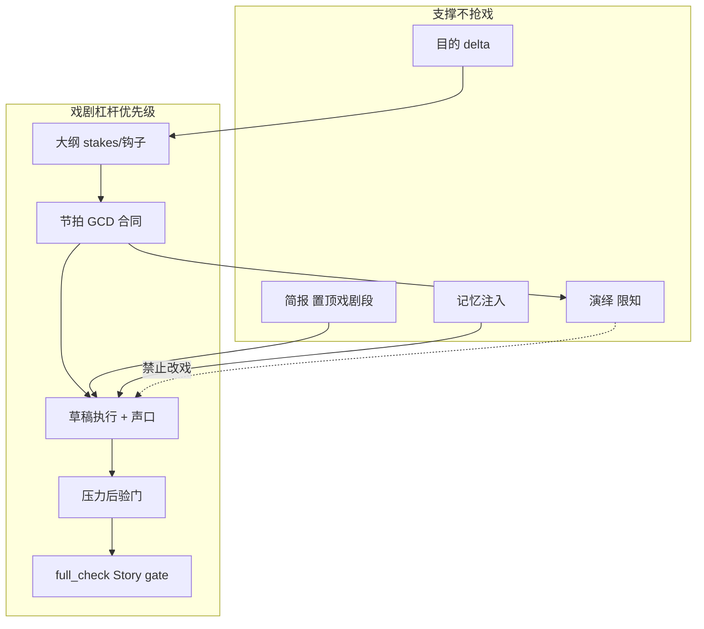
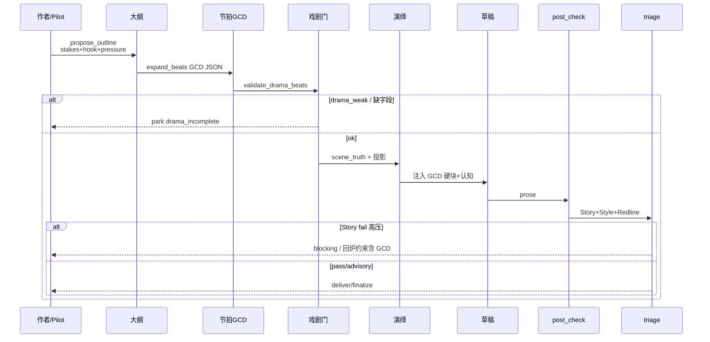

# 设计文档：小说质量第一 · 大纲/节拍/演绎/草稿全链路最优化

| 项 | 值 |
|----|-----|
| **文档标题** | 以「写出最高质量的小说」为第一性需求的主链路与爆炸半径模块改进方案 |
| **作者** | Grok Design（待人审签） |
| **日期** | 2026-08-10 |
| **状态** | Draft · **rev.2.1**（Open Q1/2/5 用户裁决落盘） |
| **产品** | scribe-writing-system / scribe3（铜炉） |
| **文档真源** | 仓库 `docs/plans/2026-08-10-novel-quality-first-pipeline-optimization.md`；`/tmp/grok-1000/grok-design-doc-6ba65db0.md` 为会话 scratch，改设计须同步 commit 耐久路径 |
| **验收环境** | demo 已部署栈 `https://www.example.com`；**禁止**默认再起第二 Surreal；Grok 运行机不做全量 npm/测试 |
| **前序** | `docs/系统文档/03-写作主链路.md` · `docs/plans/2026-08-09-chapter-pipeline-closed-loop-design.md` · `docs/plans/2026-08-10-v633-revalidation-quality-delta.md` · `docs/plans/2026-08-10-verification-capability-audit-and-llm-first-optimization.md` · 记忆质量 rev.4 · **`设计文档/2026-08-09-压力驱动叙事-匀速散步治理.md`（本设计修订：soft-pass 从默认可达性补丁降为显式逃生舱；代码默认仍兼容现网）** |
| **明确不做的宣称** | **不**因本方案单独宣称文学 ≥9.5；人盲协议未跑前禁止用代理分冒充艺术定级 |

---

### 读法（工程师 · 第一周）

1. **执法真值表**（Proposed Design · 压力与 soft-pass）— 必读，修正「只关 soft-pass 即可拦散步」误解。  
2. **存储定案 A + 接地 + `validate_drama_beats` 词表**。  
3. **PR Plan + 代码默认 vs demo 质量 env**。  

---

## Overview

scribe3 的 Pilot 主路径

```text
idle → outline_proposed → beats_ready → deduced → drafting → checked → delivered → finalized
```

在 **工程可交付性**（记忆/真相/校验假绿防护）上已达到约 **64% 代理帮助分**（v6.3.3 · `book_013bcb3b` ch1–5 finalized，合计 ~2.27 万字），但 **文学/声口代理约 3/10**，作者读感集中为四类：

1. **像在公园散步**——匀速场景巡礼，戏剧推进弱；
2. **进不去情境**——缺少「身在局中」的目标-阻力-代价；
3. **比喻过多**——散文/散文诗腔，而非小说叙事；
4. **1–2 的延伸：无冲突、无悬念**。

**证据锚点（可追溯，非文学定级）**

| 代理结论 | 路径 |
|----------|------|
| 工程帮助 ~64%、文学/声口 3.0、pressure soft-pass 备注 | [`docs/evidence/v633-reval-20260810/04-quality-delta.md`](../evidence/v633-reval-20260810/04-quality-delta.md) · [`99-summary.md`](../evidence/v633-reval-20260810/99-summary.md) |
| 连载 ch1–5 · `book_013bcb3b` | [`docs/evidence/v633-reval-20260810/04-serialize/`](../evidence/v633-reval-20260810/04-serialize/) |
| 匀速散步金样病型 | [`artifacts/pressure-gold/bad_walkthrough.md`](../../artifacts/pressure-gold/bad_walkthrough.md) |
| 人盲未跑 / headroom | [`05-headroom.md`](../evidence/v633-reval-20260810/05-headroom.md) · `docs/plans/human-blind-memory-quality-protocol.md` |

根因不在「能不能写出字」，而在 **戏剧设计杠杆装错层级**：

| 阶段 | 当前职责 | 戏剧需求 |
|------|----------|----------|
| **大纲** | 3–5 句 synopsis + 压力级/钩子话术 | 章级 stakes + 不可逆 + 章末钩子 |
| **节拍** | `list[{text}]` 叙事摘要；接地失败则切大纲句 | **GCD/Scene-Sequel 戏剧卡**（主杠杆） |
| **演绎** | `scene_truth` + 限知投影（认知论） | **不是**戏剧设计；保持认知边界 |
| **草稿** | craft 引擎（闲笔/感官/比喻）+ 字数目标 | 执行节拍戏剧；防紫散文、防均铺 |
| **压力 PDC/PSC** | 后验启发式 + **full_check soft-pass** | 应服务「非散步」，但被验收捷径软化 |

**一句话策略：**

> **把「戏剧合同」前移到节拍（结构化 GCD + 代价 + 钩子），演绎只保认知，草稿只执行与声口，压力/校验改成「可拦截的公园病」而非可刷绿的词表；一致性与记忆不得压过戏剧，除硬红线（限知泄露、错书串线、作者红线）。**

---

## Background & Motivation

### 作者反馈与证据对齐

| 作者痛点 | 代码/证据对应 |
|----------|----------------|
| 公园散步 | `pressure_metrics.spatial_inventory` / `time_linear_flag` / `progress_zero_advance`；金样 `artifacts/pressure-gold/bad_walkthrough.md`；ch1 开篇长巷巡礼 |
| 无沉浸 | 节拍无 POV 目标；演绎是「全知真相+限知栏」不是「角色要什么」；draft 浸泡引擎有文案但无节拍目标锚定 |
| 比喻过多 | `craft.ENGINES["metaphor"]` 仍要求「每章 2–4 个」；与「少修辞、多动作」目标冲突；`find_purple_prose` 只拦部分升华句 |
| 无冲突/悬念 | `expand_beats` prompt：「4–7 条动作/转折」**无 GCD 字段**；失败回退 `synopsis_segments` 产生假节拍 |
| 工程绿≠文学绿 | 文学/声口 3.0 未变；`_soft_dets` **无条件** soft-pass（非 flag）；且 `spatial_*` **恒 advisory**，只关 soft-pass **拦不住散步** |

### 当前状态（代码锚点）

| 阶段/模块 | 实现 | 路径 |
|-----------|------|------|
| Pilot 状态机 | `STATES` + `step` | `scribe3/pilot.py` |
| 大纲 | `propose_outline`：3–5 句 + 压力级 + 章末钩子话术 | `pilot_runtime.py` |
| 节拍 | `expand_beats`：LLM 行 → `{text}`；接地失败 → 大纲切句 | 同上 |
| 演绎 | `scene_truth` + 五栏投影；**认知接地** | `pilot_runtime.deduce` · `deduce_helpers.py` |
| 草稿 | `draft_loop` → `loop_chapter`；字数 steer ~5k | `pilot_runtime` · `loop.py` |
| 体检 | `post_check` + `triage`；pilot **无条件** soft-pass `{aggregate_ai_grade, pressure_metrics}`（**现无 flag、无单测**） | `write.py` · `loop.triage` · `full_check` L577–600 |
| 简报 | 弧光/伏笔/因果/目的/母题 | `brief.assemble_chapter_brief` |
| 压力 | PDC 合同 + 确定性 metrics | `pressure_drive.py` · `pressure_metrics.py` |
| Craft | 8 引擎全量注入；PDC 时 idle/sensory 偏科 | `craft.build_craft_block` |
| 大纲注入 | `_outline_block` 注入 synopsis/beats 文本 | `write_assemble.py` |
| 目的合同 | 世界状态 delta 验收（做没做） | `purpose.py` |
| 北极星 | intent / 弧光 focus | `arc_signals` · store `get_intent` |

### 痛点（诚实）

1. **节拍是戏剧真空**：schema 只有 `text`（+可选 `budget`）；prompt 不要求目标/冲突/灾难/代价/钩子。  
2. **接地优先于戏剧**：接地 fail-closed 正确防幻觉，但 fallback 产出「摘要句节拍」——**合法却无戏**。  
3. **演绎与戏剧混淆预期**：作者以为 deduce 会设计戏，实际只做 epistemic 投影。  
4. **Craft 与「公园病」同向**：闲笔≥3、感官签名、比喻 2–4 在**无强节拍目标**时放大巡礼与紫散文。  
5. **压力 soft-pass 交易**：为让 v6.3.3 连载可达 finalized，full_check 对 pressure 不硬停——直接削弱「非散步」执法。  
6. **质量语言分裂**：craft 绿 / finalize 绿 / pressure soft / 文学 3 分并存，作者无法信任「绿=可读」。

---

## Goals & Non-Goals

### Goals

1. **第一性：最大化小说质量**——冲突密度、沉浸（局中目标）、悬念（钩子/信息差）、小说声口（动作/对话/身体 > 比喻/议论）。  
2. **节拍成为戏剧合同真源**：结构化字段 + 生成门 + 草稿注入 + 后验对齐。  
3. **演绎保持认知论边界**，并显式标注「非戏剧阶段」，避免作者误用。  
4. **压力/公园病执法可配置收紧**：默认对高压章恢复 progress/spatial 类门；与验收 soft-pass 解耦。  
5. **Craft 偏科**：小说优先包替换「比喻配额/闲笔均铺」默认。  
6. **爆炸半径模块服务戏剧**：brief 注入 GCD 摘要；北极星/目的含 stakes；UI 展示戏剧卡而非纯摘要行。  
7. **硬红线保留**：限知泄露、错书串线、作者红线 **始终可 blocking**。

### Non-Goals

| 非目标 | 理由 |
|--------|------|
| 人盲 ≥9.5 自动宣称 | 协议未跑；代理≠艺术 |
| 重写 Surreal / Graphiti / fabric | 范围外 |
| 演绎阶段改成「写戏大纲」 | 职责污染；限知接地会碎 |
| 删除记忆/真相/校验工程 | 必要地板；仅改优先级冲突时的裁决 |
| 网文爽点强制模板化全站 | 题材/作者可选 platform 轴，不默认绑架严肃志怪 |
| Grok 机全量测 / 第二套 demo 栈 | 主机规则 |

---

## Craft Synthesis（全网工艺综合 · 须引用）

### 1. Dwight V. Swain · Scene / Sequel

**Scene（行动单元）**：Goal → Conflict → Disaster。  
- Goal：POV **场景级**具体欲望，使角色主动；  
- Conflict：达成路径上的障碍序列；  
- Disaster：目标失败或代价升级——**胜利结束场景会让读者合书**。

**Sequel（反应单元）**：Reaction → Dilemma → Decision。  
- 灾难后必须恢复与抉择，再进入下一 Scene 的 Goal；因果链不断。

**MRU（Motivation–Reaction Unit）**：外在客观刺激 → 内在反应（感觉→反射→理性/言语）分段落，制造「身临其境」。

来源：Swain *Techniques of the Selling Writer*；Randy Ingermanson「Writing the Perfect Scene」综述。

### 2. Beat Sheet / Scene Cards

- **Beat = 有功能的时刻**（Save the Cat 等）：每 beat 有目的，不是「又一段描写」。  
- **Scene card** 实践：目标、冲突、结果、进入/离开情绪、钩子——与 GCD 同构。  
- 章内可用微型 beat sheet（Setup / Catalyst / Midpoint / Payoff）辅助节奏，但 **GCD 是章内最小可执行合同**。

### 3. 悬念 · 赌注 · 沉浸

- 悬念 = 读者 **急切而不确定** 将发生什么；靠 **隐瞒与时间压力**（Gardner 式「发现尸体前」）。  
- 赌注（stakes）与冲突/张力互增强：每场须有 **若失败会失去什么**。  
- 沉浸来自 **POV 过滤的具体感知 + 主动目标**，不是形容词堆叠。

### 4. Show / Don't Tell vs 过度比喻

- 展示：身体、行动、对话、环境载荷。  
- LLM 通病（研究综述）：陈词滥调、**过度隐喻与华丽描写（purple prose）**、冗余说明、**同质化正向、缺少张力**。  
- 编辑闸门应分 **Story gate（戏）** 与 **Style gate（声）**——先戏后辞。

### 5. 中文网文节奏（可选轴，非唯一真理）

- 章末钩子是追读命门；每章至少一个小兑现/小悬念。  
- 冲突/爽点密度可量化讨论（平台不同：番茄钩子更密，起点耐受更高）。  
- 对严肃志怪：**钩子 + 信息差 + 不可逆** 优先于「打脸爽点清单」。

### 6. 对 AI 长篇系统的直接推论

| AI 病 | 工艺解药 | 系统落点 |
|-------|----------|----------|
| 匀速巡礼 / 巷志清单 | Scene 必须有 Disaster 或代价台阶 | 节拍 schema + progress stairs |
| 无张力同质正向 | 强制失败/两难/信息差 | goal/conflict/turn |
| Purple / 散文诗 | 比喻配额↓；动作对话↑；紫检测升权 | craft 偏科 + purple/style gate |
| 注水凑字 | 预算非均匀；密点优先 | `validate_beat_budgets` 真接门 |
| 假绿 | Story gate 与 Style gate 分列 | triage / soft-pass 收窄 |

---

## Per-Stage Audit（分阶段审计）

### A. 大纲（outline / synopsis）

**现状**

- `propose_outline` 要求：3–5 句、发生什么、压力级 1–5、章末钩子；有内容则 skip 不覆盖。  
- `parse_chapter_meta` 可解析压力级 / chapter_role。  
- `_outline_block` 会注入写作 prompt。

**工艺理想**

- 章级：**POV、表层目标、对抗力量、若失败失去什么（stakes）、章末状态变化、章末钩子类型、role/pressure**。  
- 不写满正文；不替代节拍 GCD。

**差距**

| 项 | 现状 | 理想 | 严重度 |
|----|------|------|--------|
| stakes 显式字段 | 无 | 有 | P0 |
| 钩子仅话术 | 文中可能有 | 结构化 hook_type + 一句 | P1 |
| 与 purpose deltas | 并行弱关联 | 大纲 stakes ↔ delta 对齐 | P1 |
| 公园病预防 | 无 | 禁止「游历清单」式大纲通过门 | P1 |

**评分（戏剧贡献 0–10）**：结构 5 · 戏剧 3 · 可执法 2

---

### B. 节拍（beats）— **主杠杆**

**现状**

```text
beats: list[{ "text": str, "budget"?: int, ...? }]
```

- Prompt：「4–7 条，每条一行动作/转折，不写成正文」。  
- `_grounding_review(mode="beats")`：不得新增大纲外不可逆设定。  
- 失败 → `_beats_from_synopsis` 切句 → **叙事摘要假节拍**。  
- `validate_beat_budgets` 存在但 **未成为 expand_beats 硬门**。  
- PDC bootstrap 从 beat **text** 抽，力学不进 grounding 源（正确），但 beat 本身无戏剧字段。

**工艺理想（Scene Card / GCD）**

每 beat（章内 3–7 个）至少：

| 字段 | 含义 |
|------|------|
| `kind` | `scene` \| `sequel` \| `bridge` |
| `goal` | POV 本拍具体目标（可检验） |
| `conflict` | 阻力/对手/环境/信息障碍 |
| `turn` | 转折或 Disaster/Decision 结果 |
| `cost` | 代价/不可逆痕迹（可空仅 bridge） |
| `hook` | 拍末或章末拉力（最后一拍必填） |
| `text` | 一行叙事摘要（兼容旧 UI） |
| `budget` / `density` | 密\|疏 + 字数 |
| `pov` | 可选焦点 |

**差距**

| 项 | 现状 | 理想 | 严重度 |
|----|------|------|--------|
| GCD schema | 仅 text | 全字段 | **P0** |
| 生成 prompt | 摘要行 | 强制 GCD JSON/行协议 | **P0** |
| 门控 | 接地 only | 接地 **且** 戏剧完整度 | **P0** |
| fallback | 大纲切句当 beats | fallback 标 `drama_weak=true` 且 **默认 park 或强制人补** | **P0** |
| 注入草稿 | 拼 text | 注入「目标-冲突-结果-代价-钩子」块 | **P0** |
| 与 PDC stairs | 弱、bootstrap 猜 | beat.cost/turn → evidence 种子 | P1 |

**评分**：结构 2 · 戏剧 1 · 可执法 1 —— **全链路最大洞**

---

### C. 演绎（deduce）

**现状**

- `scene_truth`：全知冷叙「客观发生了什么」；接地回大纲。  
- 投影：看到/知道/以为/做了/没察觉；限知硬边界。  
- **产品定位正确：epistemic，不是 drama design。**

**工艺理想**

- 保持认知棱镜；可选在真相中 **标注已由节拍承诺的不可逆事实**（只引用，不发明）。  
- UI/文案明确：「演绎不改戏，只保证谁知道什么」。

**差距**

| 项 | 现状 | 理想 | 严重度 |
|----|------|------|--------|
| 作者预期管理 | 弱 | 阶段说明 + 禁止用 deduce 补冲突 | P1 |
| 与节拍顺序 | beats→deduce | 戏剧节拍 **先于** 真相固化 | 已基本正确 |
| 空白五栏 fallback | 可交付空投影 | 可；勿当戏剧完成 | P2 |

**评分**：认知 8 · 戏剧 0（**不应加戏**）· 可执法 7

**裁决**：演绎 **保持**；不把 GCD 塞进 deduce prompt（避免限知接地爆炸）。

---

### D. 草稿（draft / draft_loop）

**现状**

- 字数目标 4800–5500；围栏 chapter；brief + outline + deduction + craft + memory。  
- Craft：身体/温度/闲笔/比喻/潜台词/感官/浸泡/留白；PDC 时闲笔偏科。  
- 失败路径：advisory 留版、restore、软通过。

**工艺理想**

- 草稿 = **执行戏剧合同** + MRU 微观节奏 + 小说声口。  
- 禁止：无目标的空间巡礼；装饰比喻堆叠；议论文结尾升华。

**差距**

| 项 | 现状 | 理想 | 严重度 |
|----|------|------|--------|
| 戏剧合同注入 | 仅 text 列表 | GCD 硬块置顶 | P0 |
| 比喻引擎 | 2–4 个/章 | novel 模式 ≤1 或「仅认知必需」 | P0 |
| 闲笔 | 默认 ≥3 均铺 | 偏科默认开（不依赖仅 PDC flag） | P1 |
| 字数压力 | 强 | 保留但次于戏；欠戏禁止靠描写补字 | P1 |
| 围栏不稳 | restore 依赖 | 工程项，非本设计主战场 | P2 |

**ch1 样本症状**（`docs/evidence/v633-reval-20260810/04-serialize/ch01.md`）：巷志、气味反复、走动听味——贴近 `bad_walkthrough` 病型，即令有铜匙锚点，**目标-阻力链仍弱**。

**评分**：执行面 5 · 戏剧约束 2 · 声口约束 3

---

### E. full_check / deliver / finalize

**现状**

- `triage`：leaks / degeneration / AI heavy / discipline S1 / 可选 pressure blocking。  
- Pilot `full_check`：`aggregate_ai_grade` + `pressure_metrics` → **soft-pass**。  
- deliver：低置信自审卡；finalize：版本 + PostFinalize 候选。

**差距**

| 项 | 现状 | 理想 | 严重度 |
|----|------|------|--------|
| pressure soft-pass | 始终对 pilot 软 | **收窄**：仅 `SCRIBE3_PILOT_SOFT_PRESSURE=1` 或低压章；高压默认硬 | **P0** |
| Story vs Style gate | 混在 issues | 分列 verdict 维度 | P1 |
| deliver 读感 | 无「冲突/钩子」自检 | 交付卡增加戏剧三项 | P1 |
| finalize 文学 | 不确定性命中 | 不宣称文学绿 | 保持诚实 |

---

## Blast Radius Audit（爆炸半径）

### 1. 简报 `brief.py`

| 能力 | 戏剧贡献 | 问题 | 改进 |
|------|----------|------|------|
| 弧光指令 | 中 | 有 focus 但无场级 GCD | 注入「本章节拍目标摘要」 |
| 伏笔/开环 | 中-高 | 推进提醒≠冲突设计 | 保留；overdue 决策保持 |
| 因果催收 | 中 | 软三选一 | 保留 |
| 目的 contract | 高（状态变化） | 与 GCD 未绑定 | deltas 对齐 beat.turn/cost |
| 母题 heat | 低-中 | 过热有用 | 保留 avoid_overuse |
| 情绪模块 | 中 | 可助沉浸 | 与 goal 情绪入口/出口对齐 |
| **缺失** | — | **无冲突/悬念段** | 新增 `drama_contract` 段 |

**风险**：brief 过载稀释戏剧块 → 戏剧块必须 **置顶短硬**（≤400 字），其余可裁。

### 2. 关联 / 关系

- 关系陈旧、heartbeat 待激活：助「世界活」但易变巡礼素材。  
- **规则**：关系推进必须挂在某 beat 的 conflict/turn 上，禁止「为刷关系而逛街」。

### 3. 北极星 / 意图 `s3_set_intent` · `arc_signals`

- Intent 是全书方向；arc_beat_focus 管角色谎念。  
- **缺口**：章级「读者必须害怕失去的东西」未结构化。  
- **改进**：intent 可含 `stakes_line`；章大纲强制继承或改写一句。

### 4. 压力 PDC / PSC

| 组件 | 价值 | 问题 |
|------|------|------|
| `pressure_drive` 合同 | 不可逆/岔路/仪式配额/台阶 | bootstrap 证据常模板化（「掌心嵌下的灰印」） |
| `measure_pressure` | 抓散步/磨戏/零推进 | 默认 advisory；pilot soft-pass |
| `SCRIBE3_PDC_BLOCKING` | 可升 blocking | 生产常关 |
| progress fail-soft | 不单独 park | 与「非散步」冲突 |

**改进方向见 Proposed Design §压力收紧。**

### 5. 记忆注入

- 记忆提高连贯，**不自动提高戏剧**（lead 历史有限）。  
- 注入过厚 → 设定表腔 / 巡礼复述。  
- **规则**：must-link 服务冲突相关锚；禁止记忆块教模型「把巷子再走一遍」。

### 6. 校验 / 台账

- purple / spatial / progress 分散；IssueLedger 窄投影（见 verification 设计）。  
- **本设计要求**：Story findings（零推进、无钩子、节拍未兑）进台账可见；与 soft-pass 策略同步文档化。

### 7. UI

- 节拍 UI 若只显示 `text` 行 → 作者看不见 GCD。  
- **需要**：节拍编辑器卡片字段；pilot 停靠原因区分 `drama_incomplete` vs `grounding` vs `pressure`。



---

## Proposed Design

### 原则栈（冲突时裁决）

```text
1. 硬红线：限知泄露 / 错书串线 / 作者红线 / 宪法不替作者放行 advisory
2. 戏剧合同：节拍 GCD + 章钩子 + 不可逆/代价（小说质量第一）
3. 认知诚实：演绎接地、真相可追溯
4. 声口与反紫：novel craft 包
5. 工程闭环：ingest/记忆/假绿防护
```

当 2 与 5 冲突：**不得**为 finalized 率关闭高压章 Story gate（可用 flag 显式选择验收模式）。  
当 2 与 3 冲突：戏剧字段不得引入无来源设定——**先改大纲再改节拍**。

### 目标架构



### 节拍 Schema（`beats.v2`）· **存储定案 A**

> **定案（Issue 4）**：**方案 A**——`chapter.beats` **永远是** `list[dict]`（元素扩字段）。  
> **否决 B**：把包装对象 `{schema, beats, chapter_hook…}` 整体写入 `beats` 会破坏所有 `b.get("text")` 消费者。

**逻辑包装**（仅 API/文档/校验层；**不落库为 beats 根类型**）：

```json
{
  "schema": "beats.v2",
  "beats": [ { "id": "b1", "kind": "scene", "goal": "…", "conflict": "…", "turn": "…", "cost": "…", "hook": "…", "text": "…", "density": "密", "budget": 900, "pov": "覃灰七" } ],
  "chapter_hook": "…",
  "drama_score": {"complete": true, "scene_count": 1, "has_cost": true, "has_hook": true},
  "beats_source": "llm_v2"
}
```

**落库映射**

| 逻辑字段 | 落库 |
|----------|------|
| 每拍 GCD | `beats[i].{id,kind,goal,conflict,turn,cost,hook,text,density,budget,pov}` |
| `chapter_hook` | **同步到** `beats[-1].hook`（若空则回填）；**并**写入 `beats_meta.chapter_hook` |
| `schema` / `drama_score` / `beats_source` / `drama_validation` | **单列** `beats_meta` JSON 串（内嵌全部元数据；**不**另开 `drama_validation` 章列，减 DEFINE 面） |
| `pilot_parked` | **已有**章字段 `pilot_parked`（`pilot.write_state`），**不是** `update_chapter_meta` 白名单项 |

#### SCHEMAFULL：必须小 migration（非「仅白名单」）

> **rev.2 更正**：`chapter` 为 **SCHEMAFULL**（`migrations/004_*` / `048` / `049` 注释）。未 `DEFINE FIELD` 的键会被 **丢弃或写失败**——只改 Python `allowed` **不够**。  
> 先例：`048_four_stage.surql`（beats）、`049_deduction_fields.surql`（scene_truth/deductions）、`114_pressure_drive.surql`（pressure_drive）均为  
> `DEFINE FIELD IF NOT EXISTS <name> ON chapter TYPE option<string>;`

**PR-2 必交 migration**（建议文件名 `1xx_beats_meta.surql`，序号取仓库下一空号）：

```surql
-- scribe3 · beats_meta：节拍 v2 元数据 JSON 串（schema/chapter_hook/beats_source/drama_validation/…）
-- chapter SCHEMAFULL：新字段须显式 DEFINE，否则静默丢弃/报错（同 048/049/114）。
-- 存 option<string> JSON，绕嵌套 object 校验；读端 json.loads（镜像 pressure_drive）。
DEFINE FIELD IF NOT EXISTS beats_meta ON chapter TYPE option<string>;
```

**定案**：`drama_validation` **只嵌在** `beats_meta` 内，**不**单列 DEFINE（除非日后要独立索引再开列）。

**白名单 + store 读写**（`store/chapters.py`，镜像 `pressure_drive`）：

```python
allowed |= {"beats_meta"}  # 仅一列
# 写入：
elif k == "beats_meta":
    if v is None: plain[k] = None
    elif isinstance(v, str): plain[k] = v
    else: plain[k] = json.dumps(v, ensure_ascii=False)
# 读取：get_chapter 对 beats_meta 做 json.loads（坏数据 → {}），与 beats/pressure_drive 同模式
```

**`beats_meta` 逻辑形状**（落库为 JSON 串）：

```json
{
  "schema": "v2",
  "chapter_hook": "…",
  "beats_source": "llm_v2",
  "drama_score": {"complete": true, "scene_count": 1},
  "drama_validation": {"ok": true, "errors": [], "warnings": [], "drama_weak": false}
}
```

**`CHAPTER_HOOK|` 行协议同步**：parse 到 `chapter_hook` → 写入 `beats_meta.chapter_hook` **且**若末拍 `hook` 空则 `beats[-1].hook = chapter_hook`；校验时 `hook_ok = beats_meta.chapter_hook or last.hook`。

**必须改的读点**（元素扩键后 `text` 仍在，但注入/bootstrap 要读 GCD）：

| 读点 | 今日 | 目标 |
|------|------|------|
| `write_assemble._outline_block` | 只拼 `text` | 优先 GCD 摘要；或让位 `_drama_block` |
| `pilot_runtime` bootstrap `beat_texts` | `b.get("text")` | 另取 cost/turn/hook 作 evidence 种子 |
| `DeduceTree.jsx` / 节拍 UI | text / markdown 数组 | 至少展示 goal；完整卡在 PR-8 |
| `mcp` `_normalize_plan_beats` / `s3_patch_chapter_plan` | 强制 `text`，**保留** dict 额外键 | 显式允许 v2 键；文档更正：无 `s3_set_beats`，真工具为 **`s3_patch_chapter_plan`** |
| `pressure_drive.load_pdc` 投影 | 同步 text | 不双写力学进 beats（保持） |
| `material_recall` / `connection` pressure 调用 | text | 可拼接 goal |

**兼容**：旧 `list[{text}]` → 视为 v1，`beats_meta.schema=v1`，`drama_complete=false`。

### 接地审查规格（Issue 3 · 与 fail-closed 对齐）

```text
grounding_source    = synopsis + ("\n\n作者意图:\n"+steer if steer else "")
grounding_candidate = 对每个 beat 拼接:
  text | goal | conflict | turn | cost | hook
  （用换行连接；空字段跳过）
mode                = "beats"（不得新增不可逆设定/人物/物件…）
```

**失败策略**

1. Parse 失败 → 同 prompt **重试 1 次**（补丁：「严格按 KIND|… 输出，禁止散文段落」）。  
2. 接地失败 → **不写** `beats`（保持空或旧值）→ `pilot_park`：`grounding:…`（与 `drama_incomplete` 分因）。  
3. 接地通过但 `validate_drama_beats` 失败 → 可写 beats（可选）+ park `drama_incomplete:…`，或 **不写** 更严（推荐 **不写**，避免假完成）。  
4. **`SCRIBE3_BEATS_SYNOPSIS_FALLBACK`**：代码默认 **1**（兼容）；质量模式 **0**。为 0 时 **禁止** `_beats_from_synopsis` 静默充数。  
5. 人补路径：park 文案含缺口清单 + `PATCH`/`s3_patch_chapter_plan` 示例 JSON（API-first，Issue 15）。

### 戏剧门 `validate_drama_beats`（可执行规格 · Issue 5）

```python
# scribe3/drama_beats.py
HIGH_ROLES = frozenset({"高压", "推进"})
LOW_ROLES = frozenset({"低压", "关系回收", "修炼", "信息整理"})
# 失败/两难/不可逆 · 初版最小中文词表（可增，单测锁定）
TURN_COST_LEX = (
    "失败", "没能", "未能", "两难", "要么", "不可逆", "空过", "代价",
    "暴露", "泄露", "被迫", "来不及", "来不及了", "收不回", "退则",
    "死", "伤", "血", "裂", "断", "锁死", "拒绝", "否认", "崩溃",
)
# 关系张力（低压）
REL_TENSION_LEX = ("误会", "疏远", "试探", "隐瞒", "愧疚", "对峙", "和解未成", "信任")

def _cjk_bigrams(s: str) -> set[str]:
    s = "".join(c for c in (s or "") if "\u4e00" <= c <= "\u9fff")
    return {s[i:i+2] for i in range(len(s)-1)} if len(s) >= 2 else ({s} if s else set())

def synopsis_overlap_ratio(beat_texts: list[str], synopsis: str) -> float:
    """假节拍：全拍 text 与大纲的 Jaccard(CJK bigram)。"""
    bt = _cjk_bigrams("".join(beat_texts))
    sy = _cjk_bigrams(synopsis)
    if not bt or not sy:
        return 0.0
    return len(bt & sy) / len(bt | sy)

# 阈值
OVERLAP_FAKE_THRESHOLD = 0.72   # ≥ 且 全部缺 goal → drama_weak / 高压 ok=False
MIN_FIELD = 4                   # goal/conflict/turn 最短字
```

**优先级**：`role in HIGH_ROLES` **或** `chapter_pressure >= HARD_PRESSURE` → 高压规则。  
`HARD_PRESSURE` 默认 **4**（**用户裁决已定**；可用 `SCRIBE3_DRAMA_HARD_PRESSURE` 覆盖，含改为 3 的实验）。

| 规则 | 高压 | 低压/LOW_ROLES | bridge 拍 |
|------|------|----------------|-----------|
| ≥1 scene 且 G/C/T 各 ≥MIN_FIELD | 硬 | 软 warning | n/a |
| 全章 cost 非空 **或** turn 命中 TURN_COST_LEX | 硬 | 软 | bridge **免 cost** |
| hook：`chapter_hook` 或末拍 hook ≥2 字 | 硬 | 微钩子 ≥2 字硬 | 可空 |
| 仅 text 且 overlap≥0.72 | 硬 fail | warning | — |
| 关系张力：goal/conflict 命中 REL_TENSION 或非空冲突 | — | 硬（至少一拍） | — |

**兼容 flag**：`SCRIBE3_DRAMA_GATE_COMPAT=1` 时 v1 仅 text → `ok=True, drama_weak=True, warnings+=…`（不 park）；与 `DRAMA_GATE=0` 等效于关闭写前门。

**返回**：`{ok, errors[], warnings[], drama_weak, metrics{overlap, scene_count, …}}`。

**Fixtures（Issue 17）**：`scribe3/tests/fixtures/drama_beats/{good_v2,v1_text_only,synopsis_fake}.json` —— PR-1 单测黄金样。

### 大纲合同增量（前移 · 与 PR-2b 对齐）

`propose_outline` / 保存 synopsis 时解析：

```text
压力级:N
chapter_role:...
stakes:若失败，…
章末钩子:…
```

`parse_chapter_meta` 扩展 `stakes` / `hook` 正则；缺 stakes 在高压 → warning（质量模式可升 park）。**实现前移到 PR-2 旁路 PR-2b**，不放 UI 之后。

### 演绎：保持 + 文案

- Prompt：「你不是在设计情节；冲突与转折已在节拍中完成。」  
- 可选：beat.turn/cost 作已承诺事实清单（接地源 = 大纲∪节拍字段并集）。

### 草稿：注入、MRU、craft、字数舵

**`_drama_block`**（置顶；≤400 字 GCD 压缩）：

```text
## 本章戏剧合同（必须执行，禁止风景巡礼）
- 拍1[scene] 目标：… 阻力：… 结果：… 代价：…
- …
- 章末钩子：…
## 微观节奏（MRU · 三行）
1. 先写外在可感刺激（声/物/人动作），再写角色身体反应，再写言语/决定——分段，勿揉成议论。
2. 每场景至少一次「外在阻力动作」（拦/拒/误/迟），禁止只逛地点。
3. 信息差：读者或角色有一方暂时不知的要点，章末可保留未揭。
禁：无目标连续地点句；比喻链凑字；章末「他明白了/正是因为」点题。
（限知章）以上为作者视角合同；只呈现焦点者可感知部分，帧外私密不得道破。
```

限知免责 **复制** `_outline_block` 句式（Issue 14）。

**Craft 引擎选择表（Issue 9）**

| 引擎 | 默认 | `CRAFT_NOVEL=1` | `PDC=1` only | 两者皆 1 |
|------|------|-----------------|--------------|----------|
| idle | `idle` | **`idle_pdc`** | `idle_pdc` | `idle_pdc`（不重复注入两段） |
| sensory | `sensory` | **`sensory_pdc`** | `sensory_pdc` | 同左 |
| metaphor | 含「每章 2-4 个」 | **全文替换** novel 串（无「2-4」） | 默认串 | **novel 串优先** |
| restraint | 含克制/点题禁 | **扩展 1 句** anti_essay 并入 restraint，**不**新增第 9 段长引擎 | 不变 | 同 novel |
| 其余 | 不变 | 不变 | 不变 | 不变 |

优先级：`engine_key = novel_override if CRAFT_NOVEL else (pdc_skew if PDC else default)`。  
单测：`CRAFT_NOVEL=1` 时 `build_craft_block` 断言 **无子串「2-4」**。

**字数舵（Issue 11 · PR-4/5 附带）**  
`draft_loop.length_steer` 追加：

```text
宁短勿巷志凑字；密拍预算优先于凑满 4800；欠戏禁止用气味/街景注水。
```

`loop.build_regen_constraints` 为 `park_stroll` / `drama_beats_incomplete` 增加祈使句。

### Story / Style / Redline 分桶（Issue 8 · 最小 schema）

`loop.triage` 返回扩展（向后兼容旧字段）：

```json
{
  "verdict": "blocking|advisory|pass",
  "blocking": [...],
  "advisory_items": [...],
  "buckets": {
    "redline": [],
    "story": [],
    "style": []
  }
}
```

| bucket | 典型 type/detector | pilot full_check 硬停？ |
|--------|--------------------|-------------------------|
| redline | leaks, degeneration S1, discipline S1, 错书 | **永远是** |
| story | park_stroll, progress_*, drama_*, irreversible（配置下） | `quality_enforcement_on()` 时 |
| style | purple, metaphor_chain, ai_grade, ai_tics | **默认否**（AI soft 旗）；永不因 style 单独破红线逻辑 |

deliver 卡展示三项计数；IssueLedger 对齐 verification 设计时消费 `buckets`（PR-6c 可选）。  
**PR 归属**：结构在 PR-6a；soft 旗 PR-6b；UI 展示可 PR-6c。

### 压力与 soft-pass 政策（关键）· **执法真值表**

> **rev.1 更正（评审 Issue 1）**：现网 **只关 soft-pass 并不会**让 `spatial_inventory` / `time_linear_flag` 硬停。执法是 **三道独立闸**，必须 **同步改 severity + triage + soft-pass 集合**，否则「可 blocking」为过声称。

#### 三道闸（代码现状）

| 闸 | 位置 | 现状 |
|----|------|------|
| **① finding severity** | `pressure_metrics.py` | `spatial_inventory`、`time_linear_flag` **硬编码 `advisory`**；`_sev()` 仅在 `SCRIBE3_PDC_BLOCKING=1` 且 `chapter_pressure≥4` 时对 `irreversible_anchored`、heavy `ritual_overuse`、heavy `progress_stairs_anchored` / `progress_zero_advance` 升 `blocking`——**不含 spatial/time_linear** |
| **② triage** | `loop.triage` + `review.blocking.is_blocking_issue` | 仅 `meta.severity ∈ {S1, BLOCKING}`（及 alias）的 pressure issue 进 blocking 桶 |
| **③ full_check soft-pass** | `pilot_runtime.full_check` L577–600 | **无条件**：blocking 检测器集合 ⊆ `{aggregate_ai_grade, pressure_metrics}` → 降 advisory；**现无** flag、**无单测** |

#### 无 progress 合同时

- `progress_*` / `location_grind_run` / `retreat_no_cost` 在 **无** `pressure_drive.progress` 时为 `n/a`，**不产生 finding**。
- synopsis fallback 路径 **不写** `pressure_drive` → 零推进指标常 n/a。
- **`park_stroll` 必须可在无 progress 时仅靠 spatial + time_linear 触发**（见下）。

#### Detector 执法真值表（目标 · PR-6a/6b）

| detector / kind | 默认 severity（现网） | 升 blocking 条件（目标） | 进 soft-pass 集合？ | 无 `pressure_drive` / 无 progress |
|-----------------|----------------------|--------------------------|---------------------|-----------------------------------|
| `spatial_inventory` | **恒 advisory** | 质量模式：`pressure≥4` 或 `role∈{高压,推进}` → **blocking**（**须改** `_sev`/写死逻辑） | 是（detector=`pressure_metrics`） | **仍可产出 finding** → park_stroll 主锚 |
| `time_linear_flag` | **恒 advisory** | 单独默认 advisory；与 spatial 组合进 `park_stroll` | 是 | **仍可产出** |
| `progress_zero_advance` | advisory；PDC_BLOCKING+p≥4+heavy→blocking | 保持 `_sev`；质量模式不 soft 化 | 是 | **n/a，无 finding** |
| `progress_stairs_anchored` | 同上 | 同上 | 是 | **n/a** |
| `irreversible_anchored` | PDC_BLOCKING+p≥4→blocking | 保持 | 是 | 无合同 n/a |
| `ritual_overuse` | heavy 时可 blocking | 保持 | 是 | 无合同 n/a |
| `location_grind_run` | advisory | 质量模式 heavy 可升 | 是 | 无 progress → n/a |
| `park_stroll`（新） | 不存在 | 见规则；质量模式高压 **blocking** | 是（挂 pressure_metrics） | **可**：spatial∧time_linear 等 |
| `aggregate_ai_grade` | triage 可 blocking | **不**随压力旗关闭 soft | **仅 AI soft 旗** | 无关 |
| leaks / degeneration S1 / discipline S1 | blocking | **永不** soft | **否** | 不变 |

#### `park_stroll` 规则（可无 progress）

```text
high = chapter_pressure >= 4 or role in {"高压", "推进"}
if high and (
    progress_zero_advance
    or (spatial_inventory and time_linear_flag)
    or (spatial_inventory and contract_present and not irreversible_hit)
    or (location_grind heavy and not irreversible_hit)
):
    emit park_stroll
    severity = blocking if quality_enforcement_on() else advisory
```

**明确**：**无 progress 合同时仍可**仅靠 `spatial ∧ time_linear`（高压）拦散步；不得把执法绑定在 PDC progress 上。

#### Flag 笛卡尔默认矩阵

| 场景 | `SOFT_PRESSURE` | `SOFT_AI_GRADE` | `PDC` | `PDC_BLOCKING` | `DRAMA_GATE` | `SYNOPSIS_FALLBACK` | 行为 |
|------|-----------------|-----------------|-------|----------------|--------------|---------------------|------|
| **代码默认（兼容现网）** | **1** | **1** | 沿用 | 0 | **0**（或只记 warning） | **1** | 不静默打破 demo 连载 |
| **产品目标·质量模式（demo env 显式）** | **0** | **1** | 1 | 1 | 1（先 advisory→后 blocking） | **0** | 压力/散步可硬停；AI 仍 soft |
| **验收逃生** | 1 | 1 | * | 0 | 0 | 1 | v6.3.3 可达 |
| **最严人读** | 0 | 0 | 1 | 1 | 1 blocking | 0 | 不跑无人连载 |

`quality_enforcement_on()` ≔ `SCRIBE3_PILOT_SOFT_PRESSURE=0` **且**（`SCRIBE3_PDC_BLOCKING=1` **或** `SCRIBE3_PARK_STROLL_BLOCKING=1`）。

- **PR-6a**：severity/`park_stroll` 可产出 blocking 标记，但 **默认仍 advisory**（未开质量模式）。  
- **PR-6b**：soft-pass 双旗 + 矩阵接到 `full_check`（**可单独回滚**）。

#### soft-pass 拆分（**KD-NQ-11** · 裁决 Open Q4）

| Flag | 控制 | **代码默认** | 质量模式 demo |
|------|------|--------------|---------------|
| `SCRIBE3_PILOT_SOFT_PRESSURE` | 仅 pressure 相关 detector（`pressure_metrics` / `park_stroll`） | **1** | **0** |
| `SCRIBE3_PILOT_SOFT_AI_GRADE` | 仅 `aggregate_ai_grade` | **1** | **1** |

`full_check` 将 `_soft_dets` 改为按旗动态构建；**禁止**单旗绑死 AI+pressure。  
**单测矩阵**（轻量）：`(soft_p, soft_ai) × {only pressure, only ai, both, +leaks}` → park vs advisory。

#### 与「压力驱动叙事」文档

- 交叉引用：`设计文档/2026-08-09-压力驱动叙事-匀速散步治理.md`。  
- **本设计修订**：soft-pass **从默认可达性补丁降为显式逃生舱**；**代码默认值**仍保持可达（上表第一行），**产品目标默认**用 demo env 打开质量模式——避免双真源与 silent break。

### 新/改检测器（Story gate）

| ID | 阶段 | 规则 | severity | 备注 |
|----|------|------|----------|------|
| `drama_beats_incomplete` | **P0 写前** | `validate_drama_beats` 失败 | 质量模式 blocking；默认 warning | 纯函数 |
| `park_stroll` | **P0 写后** | 见执法真值表（**可无 progress**） | 质量模式高压 blocking | 改 severity 代码 |
| `chapter_hook_missing` | P1 | 末 15% 无钩信号；高压可 **warning 升一级**（仍非 park） | **始终 advisory**（含 fanqie/qidian；**暂不**硬 park） | **用户裁决 Q2** |
| `beat_unfulfilled` | **Phase-2** | stairs/evidence 对齐 | advisory | 初版可不做 |
| `metaphor_chain` | **Phase-2** | 连续比喻/purple 密度 | advisory | 初版靠 purple+craft |

**Phase-1 只做** `drama_beats_incomplete` + `park_stroll` + 既有 spatial/time_linear/progress（修 severity）。  
`beats_source`：**持久化**到 `beats_meta.beats_source` ∈ `llm_v2|llm_v1_text|synopsis_segments|author`（Issue 12；N5 审计用）。

复用：`spatial_inventory`、`progress_zero_advance`、`find_purple_prose`。

### Prompt 合同摘要

| 阶段 | 输出合同 |
|------|----------|
| outline | 含 stakes/钩子/pressure/role 的短大纲 |
| beats | beats.v2 行协议或 JSON（模型）；服务端 parse + validate |
| deduce | 不变五栏；输入可含「已承诺转折列表」 |
| draft | 戏剧合同块 + novel craft；围栏正文 |
| check | Story/Style/Redline 分列 |

---

## API / Interface Changes

### 数据字段（chapter）

| 字段 | 如何写 | 说明 |
|------|--------|------|
| `beats[]` | `update_chapter_meta` **已有** | 元素扩 GCD 键；根类型恒为 list |
| `beats_meta` | **migration DEFINE + 白名单** JSON 串 | `{schema, chapter_hook, drama_score, beats_source, drama_validation}` |
| `synopsis` | 已有 | 文内 stakes/钩子标签 |
| `pressure_drive` | 已有 | stairs evidence 可来自 beat.cost |
| `pilot_parked` | `pilot.write_state` **已有列** | 原因前缀 `drama_incomplete` / `grounding` / `pressure` / `full_check`——**勿**当 meta 白名单项 |

### 端点/函数

| 符号 | 变更 |
|------|------|
| `expand_beats` | v2 行协议；GCD 接地；drama 门；fallback 按旗；写 `beats_meta.beats_source` |
| `propose_outline` | stakes/钩子强化（PR-2b） |
| `_drama_block` / `write_assemble` | 新块 + 限知免责 + length_steer |
| `build_craft_block` | NOVEL/PDC 选择表 |
| `full_check` | 双 soft 旗动态 `_soft_dets` |
| `measure_pressure` | park_stroll；spatial 可升 blocking |
| `loop.triage` | `buckets` 三栏 |
| `brief.render_brief` | 置顶戏剧段 ≤400 |
| MCP **`s3_patch_chapter_plan`** | 接受 v2 键（非 s3_set_beats） |
| 前端 | PR-8 全卡；PR-3 后至少 JSON 粘贴/缺口清单 |

### 向后兼容

- 旧书缺 GCD → `drama_weak`；不改已定稿。  
- **代码默认** flag 保持现网可达；质量模式 **demo env 显式**。  
- **小 migration 必须**：`DEFINE FIELD beats_meta … option<string>`（SCHEMAFULL）；**无**表结构大改、无新表。  
- Python：`allowed` 扩 `beats_meta` + dict↔JSON 串（同 `pressure_drive`）。

---

## Data Model Changes

- `chapter.beats`：已是 JSON 串 list（`048_four_stage.surql`）→ **元素扩键不需改 DEFINE**（仍是 string 装 JSON）。  
- **新增列** `chapter.beats_meta`：`option<string>` JSON——**必须** `1xx_beats_meta.surql` + 白名单 + store 编解码；`drama_validation` **嵌其内**。  
- 禁止文档/实现再写「零 migration / 仅白名单即可」。  
- `pressure_drive.progress.stairs[].evidence_must_show` ← `first_ok(beat.cost, beat.turn, beat.hook, template)`（`evidence_ok`）。

### PDC bootstrap 与 progress fail-soft（Issue 13 · KD-NQ-12）

| 不变量 | 裁决 |
|--------|------|
| progress **结构**校验 | **仍** fail-soft：永不单独把 `validate_pdc` 的 ok 改 False / 永不因 progress 字段缺而 GATE park（保持 `pressure_drive.py` 头注释） |
| progress **后验** measure | 可在执法真值表下 blocking（与 GATE park 分离） |
| bootstrap fork | 仍可用 synopsis 种子；**evidence** 优先 `beat.cost → turn → hook → 模板灰印` |

```text
evidence = first_ok(
  (b.cost for b in beats if evidence_ok(b.cost)),
  (b.turn for b in beats if evidence_ok(b.turn)),
  (b.hook for b in beats if evidence_ok(b.hook)),
  template_fallback,  # 仅最后手段
)
```

**回填**：不对 `book_013bcb3b` 强刷；新书/新章生效。

---

## Alternatives Considered

### 方案 A · 仅加强后验 pressure + 禁 soft-pass（不改节拍 schema）

- **优点**：改动小；复用 `pressure_metrics`。  
- **缺点**：生成端仍无戏；回炉成本高；治标。  
- **结论**：作为 PR-0 热修可做，**不能**单独作为质量战略。

### 方案 B · 在演绎阶段塞入戏剧设计

- **优点**：作者感知「演绎=想清楚一场戏」。  
- **缺点**：与 grounding/限知职责冲突；scene_truth 膨胀；失败模式混乱。  
- **结论**：**否决**。

### 方案 C · 节拍 GCD 合同 + craft 偏科 + 压力门收窄（**本方案**）

- **优点**：杠杆在正确层级；兼容认知栈；可增量 PR。  
- **缺点**：要改 prompt/UI/门控；短期 finalized 率下降。  
- **结论**：**采纳**。

### 方案 D · 全量 LLM 文学责编每章打分挡 finalize

- **优点**：语义强。  
- **缺点**：成本高、不稳、假绿/假红；与「确定性锚」哲学冲突。  
- **结论**：作 L2 辅助 advisory（对齐 verification LLM-first），**不**单独作唯一门。

---

## Security & Privacy Considerations

| 威胁 | 缓解 |
|------|------|
| 戏剧字段引入帧外私密 | `_drama_block` 限知免责（同 `_outline_block`）；`find_leaks` 仍 blocking |
| 接地放宽污染世界观 | **不**放宽；candidate 含 GCD 全字段 |
| Flag 误配 | **代码默认兼容**；质量模式仅 demo env；运维真值表 |
| 作者红线 | 不变 hard |

### E1 冲突回归冒烟（PR-4/10）

1. 限知章 + 非空 `_drama_block`：post-check **无** 焦点者道破帧外私密。  
2. 戏剧块与记忆同屏：戏剧置顶；记忆注入 cap 明示（建议 must 块 ≤记忆预算既有策略，戏剧 ≤400 另计）。  
3. soft-pass 开启时 leaks **仍** park。

---

## Observability

| 信号 | 落点 |
|------|------|
| `drama_validation.ok` 比率 | `beats_meta` + 日志 |
| `pilot_park` 原因直方图 | `pilot_parked` 前缀 + journal stage `*_parked` |
| `park_stroll` 计数 | post_check findings / 日志 |
| soft-pass 触发 | **已有** `warning` 日志 `pilot full_check soft-pass`；扩展字段 `soft_p/soft_ai`；可选 journal note |
| purple 密度 | critique 计数 |
| 人盲 | 协议钩子，不自动定级 |

### 日志 / journal 字段名合同（PR-0 · 代码常量）

实现真源：`scribe3/novel_quality_flags.py` 中 `LOG_FIELD_*` / `OBSERVABILITY_FIELDS`。  
后续 PR 写 structured warning / pipeline journal 时 **复用下列键名**，避免多套同义字段。

| 字段键 | 含义 | 典型落点 |
|--------|------|----------|
| `drama_validation.ok` | 戏剧校验是否通过 | `beats_meta.drama_validation`、日志 |
| `drama_weak` | v1/兼容弱戏剧（警告非 park） | `beats_meta`、warnings |
| `beats_source` | 节拍来源（llm / synopsis_segments / …） | `beats_meta`、审计 |
| `pilot_park` | 停靠原因字符串 | step 返回 / journal `*_parked` |
| `park_stroll` | 公园散步组合检测 | findings detector / 计数 |
| `pilot_full_check_soft_pass` | soft-pass **structured / journal 推荐键**（`LOG_FIELD_SOFT_PASS`） | journal note / 扩展日志字段 |
| `soft_p` | 当次是否因 pressure 旗 soft | soft-pass 扩展字段 / journal note |
| `soft_ai` | 当次是否因 AI 味旗 soft | soft-pass 扩展字段 / journal note |
| `purple_density` | 紫散文/比喻密度代理 | critique 计数 |
| `quality_enforcement` | `quality_enforcement_on()` 快照 | 调试 / flag 快照 |

**soft-pass 三套标识（PR-6b 接线前勿混用）：**

| 标识 | 值 | 用途 |
|------|-----|------|
| structured 键 | `pilot_full_check_soft_pass`（`LOG_FIELD_SOFT_PASS`） | journal / 扩展字段 |
| 现网 `kind` | `pilot_full_check_soft_nonblocking`（`LEGACY_SOFT_PASS_KIND`） | `_pilot_quality_warn.kind`；PR-6b 可保留别名 |
| warning message | `pilot full_check soft-pass …`（`LEGACY_SOFT_PASS_LOG_MSG`） | 自然语言日志，非 structured key |

读辅助：`scribe3.novel_quality_flags`（`*_enabled` / `drama_hard_pressure` / `novel_quality_flags_snapshot`）。  
设置 UI 可见旗 **改值暂无运行时效果**（desc 首句「未接线」）；**勿**在 PR-6b/3/5 前当质量模式验收。  
**PR-0 仅接线与文档；不翻转 full_check / craft / expand 行为。**  
质量模式完整 env 另含未登记 REGISTRY 的 `SCRIBE3_PDC=1` / `SCRIBE3_PDC_BLOCKING=1`（见 `QUALITY_MODE_EXTERNAL_ENV`）。

---

## Rollout Plan · 运维真值表（Issue 6–7）

### 代码默认 vs 产品目标（分列）

| Flag | **代码默认**（合并后） | **产品目标·质量模式**（demo `.env`） |
|------|------------------------|--------------------------------------|
| `SCRIBE3_BEATS_V2` | 1（生成可写 v2 字段） | 1 |
| `SCRIBE3_DRAMA_GATE` | **0**（或 `advisory` 模式） | 1（先 advisory 一周再 blocking） |
| `SCRIBE3_DRAMA_GATE_COMPAT` | 1 | 0 |
| `SCRIBE3_BEATS_SYNOPSIS_FALLBACK` | **1** | **0** |
| `SCRIBE3_CRAFT_NOVEL` | 0→可先 0 | **1** |
| `SCRIBE3_PILOT_SOFT_PRESSURE` | **1**（保持现 soft） | **0** |
| `SCRIBE3_PILOT_SOFT_AI_GRADE` | **1** | **1** |
| `SCRIBE3_PDC` / `PDC_BLOCKING` / `PARK_STROLL_BLOCKING` | 沿用/0 | 1 / 1 / 1 |

> **KD-NQ-5 修订**：产品意图是 soft-pass 不作质量默认；**代码默认仍 1**，避免 silent break demo；用 env 打开质量模式。

### Demo 推荐 env 片段（` /opt/scribe3/app` 或 compose；**勿提交密钥**）

```bash
# 质量模式（人读/质量验收）
export SCRIBE3_BEATS_V2=1
export SCRIBE3_DRAMA_GATE=1
export SCRIBE3_DRAMA_GATE_COMPAT=0
export SCRIBE3_BEATS_SYNOPSIS_FALLBACK=0
export SCRIBE3_CRAFT_NOVEL=1
export SCRIBE3_PILOT_SOFT_PRESSURE=0
export SCRIBE3_PILOT_SOFT_AI_GRADE=1
export SCRIBE3_PDC=1
export SCRIBE3_PDC_BLOCKING=1
export SCRIBE3_PARK_STROLL_BLOCKING=1
```

### 一键回滚（恢复 v6.3.3 类可达）

```bash
export SCRIBE3_PILOT_SOFT_PRESSURE=1
export SCRIBE3_PILOT_SOFT_AI_GRADE=1
export SCRIBE3_BEATS_SYNOPSIS_FALLBACK=1
export SCRIBE3_DRAMA_GATE=0
export SCRIBE3_PDC_BLOCKING=0
export SCRIBE3_PARK_STROLL_BLOCKING=0
# 热更/重启 backend 后冒烟 health + 一章 pilot
```

- **Grok 运行机**：不改生产 env、不跑重测。  
- **部署**：`./scripts/deploy_demo.sh` 热更代码；env 改前备份 `.env.production.local`。  
- **兼容窗口**：合并后 ≥1 周代码默认 = 可达；质量模式仅显式 env。  
- **回滚方向口令**：「恢复可达 = soft 旗 **开回 1**」，不是「关 soft 旗」。

### 阶段

1. PR-0 文档/观测/flag 接线（无行为翻转）。  
2. PR-1…5 生成与注入（门默认 advisory）。  
3. PR-6a severity 可标记；PR-6b soft 旗（可单独回滚）。  
4. demo 质量 env 开 2–3 章人读。  
5. 旧书不强制升级节拍。

---

## What to Change vs Keep

### 改

| 项 | 动作 |
|----|------|
| 节拍 schema + expand_beats | 重写合同 |
| synopsis-segment fallback | 质量模式禁止；代码默认仍允许（兼容） |
| craft metaphor/idle/sensory | novel 包 |
| full_check soft-pass | 拆双旗；代码默认 soft 保持；质量 env 关 pressure soft |
| brief 置顶戏剧 | 新增 |
| PDC bootstrap 种子 | 来自 cost/hook |
| UI 节拍卡 | GCD 可见可编 |
| 检测 park_stroll / hook | 新增组合 |

### 保持

| 项 | 理由 |
|----|------|
| 演绎认知模型 | 正确分层 |
| 接地 fail-closed | 防幻觉 |
| 记忆/ingest/lease | 工程地板 |
| purpose deltas | 状态验收 |
| 限知硬红线 | 不可协商 |
| advisory 不自动放行 | 宪法 |
| validate_beat_budgets 思想 | 接真门即可 |

### 逆转/收窄

- **产品语义**：soft-pass pressure **不再是质量默认**（质量模式 env 关 soft）。  
- **代码默认**：仍 soft=1，显式双旗；**不删除**路径。  
- synopsis fallback：质量模式关；代码默认开。  

---

## Implementation-Ready Specs

### 工程师第一周只读这 3 节

1. **执法真值表**（压力与 soft-pass）  
2. **存储定案 A + 接地规格 + `validate_drama_beats` 词表/阈值**  
3. **PR Plan + 代码默认 vs 质量模式 env**

### 1. `validate_drama_beats`（`scribe3/drama_beats.py`）

见上文完整词表 / Jaccard / role 矩阵。签名：

```python
def validate_drama_beats(
    beats: list[dict],
    *,
    chapter_pressure: int = 3,
    role: str = "",
    synopsis: str = "",
    hard_pressure: int = 4,
    compat: bool = False,
) -> dict:
    """{ok, errors, warnings, drama_weak, metrics}"""
```

**Fixtures**：`scribe3/tests/fixtures/drama_beats/good_v2.json`、`v1_text_only.json`、`synopsis_fake.json`。

### 2. `expand_beats` 合同

- 行协议：`KIND|目标|冲突|结果|代价|钩子|摘要|密度|预算` + `CHAPTER_HOOK|…`  
- `grounding_candidate` = 全 GCD 字段拼接  
- parse/ground 各重试 1 次  
- 写 `beats` + `beats_meta`（须列已 DEFINE）；内嵌 schema/chapter_hook/beats_source/drama_validation  
- fallback 仅当 `SCRIBE3_BEATS_SYNOPSIS_FALLBACK=1`

### 3. Feature flags（完整）

| Flag | 代码默认 | 质量模式 | 含义 |
|------|----------|----------|------|
| `SCRIBE3_BEATS_V2` | 1 | 1 | v2 生成 |
| `SCRIBE3_DRAMA_GATE` | 0 | 1 | 写前戏剧门 |
| `SCRIBE3_DRAMA_GATE_COMPAT` | 1 | 0 | v1 弱通过 |
| `SCRIBE3_BEATS_SYNOPSIS_FALLBACK` | 1 | 0 | 大纲切句充数 |
| `SCRIBE3_CRAFT_NOVEL` | 0 | 1 | novel craft |
| `SCRIBE3_PILOT_SOFT_PRESSURE` | 1 | 0 | soft pressure only |
| `SCRIBE3_PILOT_SOFT_AI_GRADE` | 1 | 1 | soft AI only |
| `SCRIBE3_PARK_STROLL_BLOCKING` | 0 | 1 | park_stroll→blocking |
| `SCRIBE3_DRAMA_HARD_PRESSURE` | **4**（裁决） | 4（可用 env 试 3） | 高压阈值；**默认不变 4** |
| `SCRIBE3_PDC` / `PDC_GATE` / `PDC_BLOCKING` | 沿用 | 1/按需/1 | 合同 |

### 4. `park_stroll` / severity 改造清单（PR-6a）

1. `spatial_inventory` / `time_linear` 不再写死 advisory-only：走 `_sev_spatial(cp, role)`。  
2. 组合 emit `park_stroll`。  
3. triage 认 `meta.severity=blocking`。  
4. **不**在 6a 改 soft-pass 默认。

### 5. Brief 段 + 记忆同屏

戏剧 ≤400 置顶；记忆 must-link 服从既有 cap；冲突时 **裁记忆不裁戏剧合同**。

---

## Acceptance Criteria

### 「不是公园散步」

| # | 标准 | 测法 |
|---|------|------|
| N1 | 高压章每章 ≥1 scene beat 含 goal+conflict+turn | 单测 + demo 章 meta |
| N2 | 正文命中 ≥1 代价/不可逆证据或 turn 落地 | pressure stairs / 人读 |
| N3 | 连续地点句无推力 ≥3 不得作为终态（高压） | spatial_inventory / park_stroll |
| N4 | 人读 3 位：5 点量表「戏剧推进」中位 ≥4 | **铜炉新卷**人盲小样（对照 ch1–5 `book_013bcb3b`） |
| N5 | 禁止 synopsis_segments 作为 finalized 章的 beats 来源（flag=0 时） | 审计 beats 来源 |

### 「小说不是散文/议论文」

| # | 标准 | 测法 |
|---|------|------|
| S1 | novel craft 开启时 metaphor 引擎无「2-4 个」配额 | 单测 craft 文案 |
| S2 | purple 命中不高于基线章或下降 | critique 计数对照 |
| S3 | 人读「比喻过多」中位 ≤2/5（越低越好） | 问卷 |
| S4 | 对话+动作可见字占比相对 ch1 基线提升（启发式） | `platform_deterministic` dialogue_ratio 参考 |
| S5 | 禁章末「他明白了/正是因为」类点题（规则或 LLM advisory） | detector |

### 工程不回归

| # | 标准 |
|---|------|
| E1 | 限知泄露仍 blocking；**冒烟**：限知章+戏剧块无帧外直说（PR-4/10） |
| E2 | 接地失败不写 beats、不引入新设定；GCD 字段在 candidate 内 |
| E3 | 记忆线探针不要求本设计升分，但不崩 |
| E4 | **代码默认** soft 双旗=1 + fallback=1 时旧验收脚本可跑通；质量模式单独 env |
| E5 | `beats_meta.beats_source` 可审计；质量模式 finalized 章 ≠ `synopsis_segments` |

---

## Risks

| 风险 | 严重度 | 缓解 |
|------|--------|------|
| finalized 率短期下降 | 中 | 逃生 flag；分 role 门控 |
| 模型不遵守 GCD 行格式 | 高 | 严格 parse + 重试 1 次 + park |
| 戏剧门误杀低压章 | 中 | role 分流 |
| prompt 过载 | 中 | 戏剧块短；裁 idle 说明 |
| 与 verification LLM-first 重复建设 | 低 | Story gate 确定性优先，LLM 仅补 |

---

## Open Questions

| # | 议题 | 状态 | 裁决 |
|---|------|------|------|
| 1 | `HARD_PRESSURE` 默认门槛 | **resolved** | **默认 4**（推荐）；保留 env `SCRIBE3_DRAMA_HARD_PRESSURE` 覆盖 |
| 2 | 章末钩子 severity | **resolved** | **起步始终 advisory**（含 fanqie/qidian，**暂不**硬 park / 不按平台升 blocking） |
| 3 | UI vs API-first | **resolved**（rev.1） | API-first：PR-3 缺口清单 + REST/MCP；UI 全卡 PR-8 |
| 4 | AI soft vs pressure soft | **resolved**（KD-NQ-11） | 双旗拆分；AI 默认 soft=1 |
| 5 | 人盲样本书 | **resolved** | **铜炉新卷（同宇宙）**，便于与 `book_013bcb3b` 对照 |

**未决 open questions：无。** 后续若要对平台钩子升硬或改 HARD_PRESSURE 默认，须新一轮产品决策，不阻塞本设计开工。

---

## Key Decisions

| ID | 决策 | 理由 |
|----|------|------|
| **KD-NQ-1** | **小说质量 > 工程 finalized 率**（硬红线除外） | 作者第一性需求 |
| **KD-NQ-2** | **节拍是戏剧真源**；演绎是认知真源；二者不合并 | 避免职责污染 |
| **KD-NQ-3** | **beats.v2 = GCD+cost+hook**；text 仅兼容摘要 | Swain/Scene card 对齐 |
| **KD-NQ-4** | **synopsis fallback：产品/质量模式关；代码默认开** | 假节拍上游 vs demo 可达 |
| **KD-NQ-5** | **pressure soft 显式旗；产品意图默认关、代码默认开** | 防 silent break；env 开质量模式 |
| **KD-NQ-6** | **Craft novel：比喻降权；idle/sensory 与 PDC 选择表** | 反散文诗；不双注入 |
| **KD-NQ-7** | **triage.buckets = redline/story/style**；先戏后辞 | 可接线最小 schema |
| **KD-NQ-8** | **目的 delta / PDC stairs 对齐 beat.turn/cost** | 单源证据 |
| **KD-NQ-9** | **记忆不定义戏剧完成**；同屏戏剧置顶 | 与章节闭环一致 |
| **KD-NQ-10** | **增量 PR，不改 pilot 状态机拓扑** | 风险可控 |
| **KD-NQ-11** | **soft-pass 拆分：SOFT_PRESSURE vs SOFT_AI_GRADE** | 裁决 Open Q4；AI 默认可达 |
| **KD-NQ-12** | **progress 结构 GATE 仍 fail-soft；后验 measure 可 blocking** | 保持 pressure_drive 不变量 |
| **KD-NQ-13** | **存储定案 A：list 元素扩键 + `beats_meta` DEFINE migration + 白名单** | SCHEMAFULL 先例 048/049/114；否决包装根对象与「零 migration」 |
| **KD-NQ-14** | **执法三闸同步改；无 progress 仍可 spatial∧linear 拦** | 修正过声称 |
| **KD-NQ-15** | **`HARD_PRESSURE` 默认 4**；env `SCRIBE3_DRAMA_HARD_PRESSURE` 可覆盖 | 用户裁决 Open Q1 |
| **KD-NQ-16** | **章末钩子检测始终 advisory**（含番茄/起点平台，暂不硬 park） | 用户裁决 Open Q2 |
| **KD-NQ-17** | **人盲/对照样本 = 铜炉新卷（同宇宙）**，对照 `book_013bcb3b` | 用户裁决 Open Q5 |

---

## PR Plan（有序增量 · rev.1 重排）

| PR | 标题 | 范围 | 验收 |
|----|------|------|------|
| **PR-0** | 文档/flag 接线/观测 | `settings.REGISTRY` 登记旗 + `novel_quality_flags` 读辅助 + 日志字段合同；设计本文入库；**无**行为翻转 | 代码默认 = 现网可达；`python -m py_compile` |
| **PR-1** | `drama_beats` 纯函数 + fixtures 单测 | `drama_beats.py` + `tests/fixtures/drama_beats/*` | 无 LLM 单测绿 |
| **PR-2** | **migration `beats_meta`** + expand v2 + 接地全字段 + fallback 旗 + `beats_source` | `migrations/1xx_beats_meta.surql`；`store` 白名单+编解码；`pilot_runtime` | DEFINE 后 demo 可读写 `beats_meta`；质量模式不写 synopsis 假节拍 |
| **PR-2b** | 大纲 stakes/hook 解析（**前移**） | `parse_chapter_meta` · outline prompt | 正则单测 |
| **PR-3** | `DRAMA_GATE`（默认代码关；开则 **先 advisory**） | park 原因分型；**缺口清单 + MCP/REST 补字段** | API-first 人补路径 |
| **PR-4** | `_drama_block`（MRU 三行）+ brief 戏剧段 + length_steer | `write_assemble` · `brief` · `draft_loop` | 限知免责；注入单测；E1 冒烟步骤 |
| **PR-5** | `CRAFT_NOVEL` 选择表 + metaphor 无「2-4」 | `craft.py` | 子串断言；与 PDC 不双注入 |
| **PR-6a** | spatial/`park_stroll` severity 策略（默认仍 advisory） | `pressure_metrics` · triage buckets 骨架 | 真值表单测；**可无 progress 触发** |
| **PR-6b** | soft 双旗 + full_check 矩阵（**可单独回滚**） | `full_check` soft 动态集合 | `(p,ai)×cases` 单测 |
| **PR-6c** | deliver 卡 buckets 展示（可选） | pilot_card / UI | 三项可见 |
| **PR-7** | PDC bootstrap `first_ok(cost,turn,hook,template)` | `pressure_drive` · pilot | 非仅灰印模板 |
| **PR-8** | UI 节拍 GCD 卡 | web Beats | 手改保存 |
| **PR-9** | （合并入 2b；保留号作缓冲） | — | — |
| **PR-10** | demo 质量 env + **铜炉新卷（同宇宙）** 2 章人读/人盲小样 | `www.example.com`；对照 `book_013bcb3b` | N1–N3 + E1 + N4/S3 问卷；**非**另开作者无关新书 |

**节奏**：PR-0→1→2+2b→3→4∥5→6a→6b（可回滚）→7→8→10。  
**PR-6+ 依赖**执法真值表落地；未完成 6a 不得宣称「可拦散步」。

---

## References

### 工艺（Web）

- Dwight V. Swain, *Techniques of the Selling Writer* — Scene/Sequel GCD  
- Randy Ingermanson, [Writing the Perfect Scene](https://www.advancedfictionwriting.com/articles/writing-the-perfect-scene/) — Scene/Sequel + MRU  
- September C. Fawkes / Helping Writers Become Authors — Scene structure 综述  
- Save the Cat beat sheet 实践（章/场功能时刻）  
- CRAFT Literary, [Crafting Suspense](https://www.craftliterary.com/2017/11/27/crafting-suspense/)  
- Darling Axe / stakes 论述：每场 goal-conflict-disaster  
- arXiv:2409.14509 — LLM 写作 purple prose / 缺张力 / 冗余  
- 网文节奏与章末钩子（maliangwriter、平台差异讨论）  

### 仓库

- `scribe3/api/services/pilot_runtime.py` — propose_outline / expand_beats / deduce / draft_loop / full_check  
- `scribe3/pilot.py` — 状态机  
- `scribe3/brief.py` · `pressure_drive.py` · `pressure_metrics.py` · `craft.py`  
- `scribe3/api/services/write_assemble.py` — `_outline_block`  
- `scribe3/loop.py` — triage  
- `scribe3/purpose.py` · `arc_signals.py` · `deduce_helpers.py`  
- `docs/系统文档/03-写作主链路.md`  
- `docs/plans/2026-08-09-chapter-pipeline-closed-loop-design.md`  
- `docs/plans/2026-08-10-v633-revalidation-quality-delta.md` · `docs/evidence/v633-reval-20260810/`  
- `docs/plans/2026-08-10-verification-capability-audit-and-llm-first-optimization.md`  
- `artifacts/pressure-gold/bad_walkthrough.md`  
- `scribe3/craft_skills/节奏控制.md`  
- `设计文档/2026-08-09-压力驱动叙事-匀速散步治理.md`（本设计修订 soft-pass 默认语义）  
- `scribe3/store/chapters.py` `update_chapter_meta` 白名单 L928–931  
- `scribe3/migrations/048_four_stage.surql` · `049_deduction_fields.surql` · `114_pressure_drive.surql`（SCHEMAFULL 字段先例）  
- `docs/evidence/v633-reval-20260810/`（64% / ch1–5 / soft-pass 备注）  

---

## Revision History

| 版本 | 日期 | 说明 |
|------|------|------|
| Draft | 2026-08-10 | 初稿：工艺综合 + 四阶段与爆炸半径审计 + beats.v2 + soft-pass 收窄 + PR Plan |
| **rev.1** | 2026-08-10 | 评审 18 项：执法真值表；soft 双旗；接地/存储定案 A；词表阈值；PR 重排；代码默认 vs 质量 env；Story buckets；craft 选择表；MRU；fixtures；压力文档交叉引用 |
| **rev.2** | 2026-08-10 | SCHEMAFULL：`beats_meta` 须 `DEFINE FIELD` 小 migration（同 048/049/114）；`drama_validation` 仅嵌 beats_meta；修正「仅白名单/零 migration」；PR-2 含 migration |
| **rev.2.1** | 2026-08-10 | 用户裁决落盘：HARD_PRESSURE=4；章末钩子始终 advisory；人盲样本=铜炉新卷同宇宙对照 book_013bcb3b；Open Q1/2/5 resolved；KD-NQ-15..17 |
