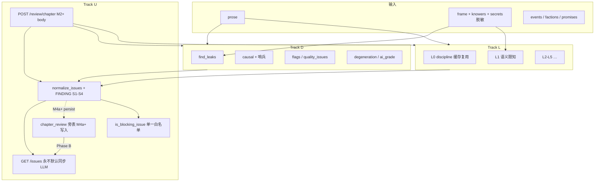
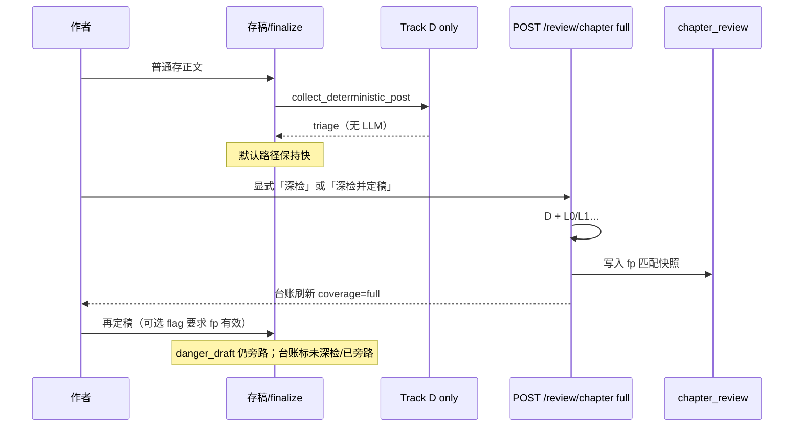
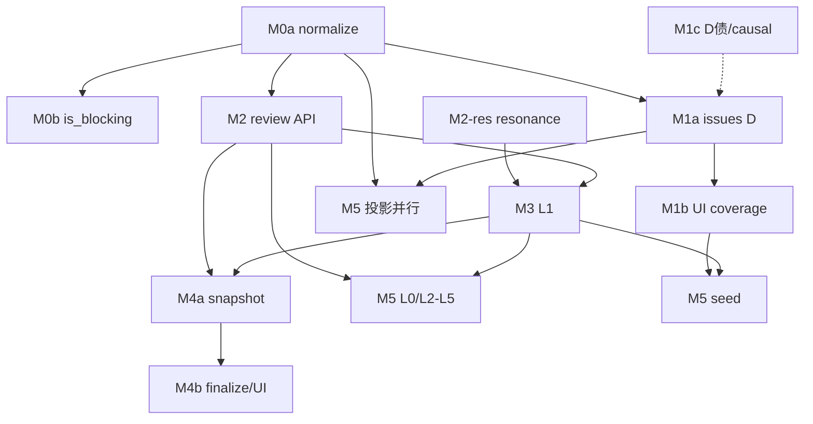

# 铜炉 / scribe3「校验能力」全面审查与 LLM-first 最优改进方案

| 项 | 值 |
|----|-----|
| **文档标题** | 校验能力全面分析审查 + 效果优先的 LLM-first hybrid 最优改进 |
| **产品** | 铜炉（tonglu）/ scribe3 长篇写作工作台 |
| **作者** | Grok Design（待人审签） |
| **日期** | 2026-08-10 |
| **状态** | Draft（**rev.3** · rev.2 + Issue 17–19：`prose_fp` 对齐 `_prose_fp` 16 位 hex；M2 不写旁表 / M4a 才持久化；OQ1→KD-17） |
| **文档真源** | **仓库耐久副本** `docs/plans/2026-08-10-verification-capability-audit-and-llm-first-optimization.md`；`/tmp/grok-1000/grok-design-doc-0512a7d0.md` 与摘要仅为会话 scratch，改设计须同步 commit 耐久路径 |
| **代码根** | `/home/admin/projects/scribe-writing-system`，主实现 `scribe3/` |
| **验收环境** | demo 已部署栈 `www.qing.blue`；**禁止**默认再起第二 Surreal；Grok 运行机不做全量重测 |
| **明确不做的宣称** | **不**因本方案单独宣称文学质量 ≥9.5；不替代 D1–D7 盲评协议 |
| **相关设计** | 章节闭环 `docs/plans/2026-08-09-chapter-pipeline-closed-loop-design.md`（loop/post-check/triage 真源）；本文件管 **校验能力审计与 LLM-first 统一**，闭环设计管 **生成→门闩编排**；重叠处（triage 白名单、degraded）以本 rev.2 的 KD 为准并回写闭环文档 follow-up |

---

## Overview

铜炉已有一套**多入口、多世代**叠加的校验栈：结构查询（`find_leaks` / `causal_complete`）、十余类确定性文风 QC、全量 `/post-check`（QC + 限知 + LLM 纪律 + 开放伏笔 + 设定/跨章/张力/目的合同/压力等）、`/quality` 章缓存、定稿门闩 `finalize_gate`、`codex_validate` 势力一致性、左栏 IssueLedger、工艺门闩 craft-gates、十维 quality evaluator、张力 rubric 等。假绿防护（`degraded_stages`、`qc_causal=-1` 哨兵、`leaks_degraded`、S1 共振表）在 **loop / post-check 核心路径**已相当成熟。

但能力**并不完善**：IssueLedger 相对 post-check 存在**三层窄投影**（见 Background）；语义限知仍依赖 `leak_markers` 字面命中，几乎吃不到 Author-UX v2 / PR-4 的 knowers 富信息；文学 QC 以正则与 n-gram 为主，LLM 纪律仅覆盖 5 类 violations；因果只查图结构不查叙事合理性；severity 在 issue_ledger / Findings Schema / degeneration.blocking 三套并存；产品「校验」与写作「体检」不是同一真相源。

**用户立场（硬约束）**：效果优先于成本，**能用 LLM 的尽量用 LLM** 做语义/文学/限知深层判断；**不是**「为了省钱不用 LLM」，也**不是**「删掉全部规则改纯 LLM」。

**最优方案**：  
**LLM-primary semantic review（Track L）+ deterministic anchors（Track D）+ IssueLedger 统一 schema（Track U）** 的 hybrid 架构；`POST /review/chapter` 为 full/semantic 统一入口；**GET /issues 默认同步永不打 LLM**；severity 以 Findings Schema `S1–S4` 为 canonical；`loop.triage` 与 `_is_blocking_issue` **共用单一白名单函数**。

**完善度总判：不完善。** 分维度评分见 §完善度评分与结论；缺口清单见同节。

---

## Background & Motivation

### 当前状态（代码核实摘要）

| 层 | 路径 | 现状 |
|----|------|------|
| 结构查询 | `scribe3/verify.py` | `find_leaks` / `find_leaks_for_chapter`（secret + leak_markers + 可选演绎「没察觉」）+ `causal_complete` |
| 文风 QC **检测器** | `critique/rules_impl.quality_flags` | **恰 11 键**：repetition / structural / purple / ai_tics / oversaturation / god_view / degeneration / rhythm / adverb / rule_of_three / filler；`quality_issues` 展开 range（源码 docstring 仍写「六类」，**以实现为准**） |
| 文风 QC **产品计数表面** | post_check `qc_breakdown`；章缓存 `qc_issues` | **仍只加五类**（repetition/structural/purple/ai_tics/oversaturation）；扩展键经 `quality_issues` 进 issues，**不进** `quality.total` / 仪表盘弱章排序 |
| 全量体检 | `POST /post-check`（`write.py`） | D 全家桶 + leaks + LLM discipline + 开放伏笔 + setting + cross + tension + orphan + ai_grade + fulfillment + pressure + … + `degraded_stages` |
| 轻护栏 | `POST /check`、`GET /qc` | 停笔静默 / 面板；`/qc` 含 flags 全键 + cross/dup/emotion，但 **台账不消费全键** |
| 因果 API | `GET /causal` | 三态：`no_event_data` + `violations` |
| 质量缓存 | `_compute_chapter_caches` | 五类 + `qc_causal`：无事件 **-1**；**异常路径写 0**（假绿）⚠️；scorecard 路径（`connection.py`）异常写 `None` + degraded（更诚实） |
| 台账 UI | `GET /issues` → `useIssueLedger` → `IssueDirectory` | **三层窄投影**（见下） |
| 定稿门 | `finalize_gate` + `collect_deterministic_post_for_prose` | **默认不打 LLM**（degeneration + QC/ai_grade + 可选 leaks） |
| 写作环 | `loop.triage` | **blocking 规则表**（非固定四项）：leaks / degeneration.blocking / ai_grade heavy / discipline **type 白名单** S1 / optional pressure（`SCRIBE3_PDC_BLOCKING`）；假绿：critical stages 降级禁 pass。**`_is_blocking_issue` 对任意 S1 从 advisory 剔除，与 triage 入 blocking 的 type 白名单不一致** ⚠️ |
| Findings Schema | `critique/_common.py` | `FINDING_SEVERITIES = S1–S4`；`normalize_findings`；与 issue_ledger 的 `error/warning` **未统一** |
| 势力 / 工艺 / 十维 / 张力 / 限知前 | codex_validate；craft-gates；quality/evaluator；tension_check；epistemic_guard | 多为旁路；与 IssueLedger **未合流** |

### IssueLedger 三层窄投影（P0 精确化）

代码：`misc_routes.issue_ledger` 只调 `qc(seq)` + `causal(seq)`；`app_impl._QC_ISSUE_LABELS` **仅 8 键**：

`repetition | cross_repetition | duplicate_lines | structural | emotion_telling | purple | ai_tics | oversaturation`

| 层 | 缺口 | 后果 |
|----|------|------|
| **① source 不全** | 无 leaks / discipline / setting / pressure / post-check 全家桶 / LLM 副线 | 限知泄露、设定问题在左栏不可见 |
| **② qc 源内 label 白名单不全** | 即使 `qc()` 已算 god_view / degeneration / rhythm / adverb / rule_of_three / filler，台账**不投影** | **degeneration 等与 blocking 相关的源在台账消失** |
| **③ 无 coverage 元数据** | `IssueDirectory` 空状态「暂无校验命中。」不区分「全检无病」vs「只跑了 8 键+因果」 | **假绿观感最高** |

→ PR-M1（原 PR-2）验收：**必须**至少把 god_view / degeneration（及完整 flags 可映射键）+ leaks + causal 进台账，并展示 `coverage`；**不能只加 leaks**。

### 痛点

1. 左栏与全量体检 **三层分叉** → 作者信任崩塌。  
2. severity 三套并存 + triage S1 白名单分叉 → 扩展 LLM finding 时易「blocking 空但 advisory 被掏空」或误拦。  
3. 语义限知假绿：markers 不全 / 同义泄露；knowers 未进检测。  
4. 文学与跨章深度不足；已有 LLM 副线（十维/tension/purpose/discipline）重复调用风险。  
5. finalize（D）与 post-check（D+L）不一致；深检产品流未钉死。

---

## Goals & Non-Goals

### Goals

1. 完整能力矩阵（入口、LLM 否、盲区、假绿、检测器 vs 产品计数表面）。  
2. 总判 **不完善** + 分维评分 + 三层缺口清单。  
3. 「为何不全用 LLM」——不在乎成本下的 hybrid 定位。  
4. **可实施** hybrid：canonical severity、GET 两阶段、snapshot/fp、L1 契约、M0–M5 PR。  
5. 已有 LLM 副线 **归一投影优先**，禁止同章同 fp 重复打。  
6. 验收 = demo 冒烟；含强制失败注入；不宣称 ≥9.5。

### Non-Goals

- 不删除全部确定性检测器。  
- 十维 / tension / purpose **分值不进** triage blocking。  
- 不改命题时态 / knows 方向 / D4 冻结边界。  
- 不为验收起第二 Surreal 或本机全量 pytest。  
- **GET /issues 默认同步打 LLM**（明确禁止）。  
- MCP 工具（`s3_find_leaks` 等）本阶段 **不强制** 切同一 normalize（follow-up；矩阵保留只读描述）。  
- 不承诺 LLM 零误报。

---

## 现状完整能力矩阵

> **是否 LLM** = 主判定是否调模型。**检测器 vs 表面**：D 列「产品计数」标明是否进 `qc_issues`/`quality.total`。  
> **归并目标**：已有能力收敛到 Track D/L/U 的去处。

### A. 结构查询型

| 能力名 | 入口 | 实现 | LLM | 盲区 | 假绿 | 归并 |
|--------|------|------|-----|------|------|------|
| `find_leaks` | verify；post-check/check；MCP | frame + secret markers/value 字面 + range | 否 | 同义泄露；knowers 未用 | leaks_degraded / leaks_error ✅ | Track D 锚点 + L1 共振源 |
| `find_leaks_for_chapter` | verify | + 未过期 focal_deduction 盲区短语 | 否 | stale 退化 | 同左 | D + L1 输入 |
| `causal_complete` | verify；`/causal`；缓存 | motivated_by_goal / causal_in / root_reason | 否 | 无叙事合理性 | no_event_data；qc_causal=-1 ✅；**缓存异常→0** ⚠️ | D；L4 之上 |
| 戏剧反讽 MCP | skill 文档 | 读者知/视角不知 | 否 | UI 弱；不进台账 | 低 | follow-up / 非本阶段 MCP |

### B. 文风确定性 QC

| 能力名 | 入口 | 实现 | LLM | 产品计数表面 | 盲区 | 假绿 | 归并 |
|--------|------|------|-----|--------------|------|------|------|
| flags 五类核心 | flags；缓存；post quality | rep/struct/purple/ai/over | 否 | **计入** qc_issues/total | 语义假深刻 | detector_errors | D |
| flags 扩展 6 键 | flags；quality_issues | god_view/degen/rhythm/adverb/r3/filler | 否 | **不计入** qc_issues 五类和；issues 有 range | 声口/人物 | 台账 8 键白名单再砍 ⚠️ | D；**M1 必须投影 degen/god_view** |
| cross/dup/emotion | `/qc`、post-check | n-gram / 整行 / 情感表 | 否 | qc 有；缓存无 | 语义复读 | 同左 | D |
| elegant / parallel / poetic / quotes / watch | 多在 post-check | 各检测器 | 否 | 不进五类和 | 文学误报 | degraded stage | D |
| timeline/constory 等 | post-check | 规则 | 否 | report-only | 语义历法 | 失败常忽略 | D advisory |
| aggregate_ai_grade | check/post | Gate 聚合 | 否 | 独立字段 | 短文 | critical ✅ | D blocking 源 |
| punct_suggestions | post-check | 标点 | 否 | 独立 | 风格 | report-only | D；merge_findings |

### C. 全量体检与写作闭环

| 能力名 | 入口 | LLM | 盲区 | 假绿 | 归并 |
|--------|------|-----|------|------|------|
| `POST /post-check` | write.py | 混合 | 与台账/十维未统一 | critical + leaks_degraded ✅ | → `run_chapter_review` |
| discipline L0 | post-check；chapter_analysis 缓存 | **是** | 仅 5 kinds | parse_failed degraded；默认 S2 | L0；**禁止** GET /issues 同步重打 |
| inherited_open | post-check | 注入 | LLM 可能忽略 | degraded | D 注入 + L0/L5 |
| setting / cross / tension_monotony / orphan | post-check | 否 | 语义 OOC 等 | degraded；setting 不拦 pass | D |
| fulfillment/purpose | purpose.py | 混合 | 仅 deltas | degraded；永不 blocking | **source=purpose**；advisory-only；投影优先 |
| pressure/PDC | pressure_* | 否主 | 文学张力 | env 可 blocking | source=pressure；白名单 |
| `loop.triage` | loop.py | 消费 | 白名单分叉 ⚠️ | critical 禁 pass | **单一 is_blocking_issue()** |
| run_chapter_loop | loop.py | 混合 | 依赖 post 完整度 | 同上 | 消费 review runner |

### D. 因果与质量缓存

| 能力名 | 入口 | LLM | 盲区 | 假绿 | 归并 |
|--------|------|-----|------|------|------|
| `/causal` | world_read | 否 | 无显式 complete 字段 | no_event_data ✅ | D |
| 章缓存 qc_causal | chapters.py | 否 | — | 无事件 -1；**except→0** ⚠️ | M1/M0 旁路：null=失败 |
| scorecard qc_causal | connection.py | 否 | — | except→None+degraded ✅ | 对齐 chapters |
| `/quality` 读 | quality.py | 否 | 五类；`causal: x or 0` 混淆 None | cache_stale ✅ | 展示约定：-1/null/0 |

### E. 产品表面与门闩

| 能力名 | 入口 | LLM | 盲区 | 假绿 | 归并 |
|--------|------|-----|------|------|------|
| IssueDirectory | GET /issues | 否 | **三层窄投影** | 空列表无 coverage ⚠️ | U Phase A/B |
| 护栏 guardOn | WriteLayout；`/check` | 否为主 | 无纪律 | errors ✅ | 保持 D-light |
| 全量体检卡 | postCheck | 混合 | 与左栏不同源 | 依赖前端 | → /review/chapter |
| finalize | finalize_gate | **否默认** | 与 post-check 差 | danger_draft | 存稿 D；**显式深检并定稿** full |
| craft-gates | verify_craft | 否 | 非文学 | 明确 | D 正交 |
| codex_validate | codex_validate | 否 | 叙事势力 | 只读 | D source=codex |
| 十维 evaluator | quality/* | **是** | 与台账隔离 | 独立 | source=quality_dim advisory；**不重复**若已有 judgment |

### F. 世界真相 / 命题

| 能力名 | 入口 | LLM | 盲区 | 假绿 | 归并 |
|--------|------|-----|------|------|------|
| secret + markers | ontology | 否 | 未维护 markers；**bridge 常无 markers** | 漏检 | D `secret_without_markers` + L1 |
| project_frame / knows | knowledge | 否 | 同义泄露 | — | L1 输入 |
| knowers PR-4 | store/recall | 否 | **校验零引用** | — | L1 `build_l1_payload` |
| epistemic_guard | 写路径 | 否 | 不成稿替代 | fail-loud | D 生成前 |
| Author-UX v2 | plans | 否 | 检测未消费 | — | finding→实体卡 |

### G. 已有 LLM 副线 → 归并目标（Issue 8）

| 现网 LLM | 入口 | 归并 | 规则 |
|----------|------|------|------|
| discipline_truncate | post-check / discipline / chapter_analysis 缓存 | **L0** | full review 复用缓存；同 `prose_fp` 禁止双打 |
| tension_check rubric | misc_routes | **source=tension_rubric**；可被 L5 消费摘要 | 同 fp 禁止 L5 再打完整 tension |
| purpose `judge_knowledge_delta` | post-check fulfillment | **source=purpose** | advisory-only；永不 blocking |
| quality evaluator 十维 | quality/* | **source=quality_dim** | 投影已有 judgment；不进 blocking |
| platform/voice_fold/reversal prompts | critique builders | 暂 **不**新建并行 reviewer | 需要时并入 L2/L3 prompt 族，禁止第四套入口 |

---

## 完善度评分与结论

### 总判

# **不完善**

### 分维度（1–5）

| 维度 | 分 | 说明 |
|------|----|------|
| 结构不变量 | 4 | 缺叙事合理性 |
| 限知 / 知识边界 | 2.5 | markers 有效；语义+knowers 弱 |
| 文风 **检测器** | 4 | 11 键 + range |
| 文风 **产品计数/台账表面** | **2.5** | 五类计数 + 8 键台账；degen 不可见 |
| LLM 语义纪律 | 2.5 | 5 kinds；副线未统一 |
| 假绿防护（内核） | 4 | post-check/loop 成熟 |
| 假绿防护（产品台账） | **2** | 无 coverage；空列表假绿 |
| 统一 issue / severity | 1.5 | 三套 severity + 白名单分叉 |
| 命题/knowers 消费 | 2 | PR-4 未进校验 |
| 定稿闭环一致性 | 3 | D vs full 差；深检流未钉 |
| 可观测 | 3.5 | 有 degraded；缺 review 硬超时指标 |
| 跨章/人物 | 1.5 | 几乎空白 |

**加权 ≈ 2.6 / 5 → 不完善。**

### 缺口清单

**P0**

1. 台账三层窄投影 + coverage（M1）。  
2. severity canonical + triage/`_is_blocking_issue` 单一白名单（M0）。  
3. 语义限知 L1 + markers 共振（M3）；markers 债 + bridge 数据质量（含 bridge）。  
4. GET /issues **禁止默认同步 LLM**；两阶段契约（M1/M4）。

**P1**

5. L0 multi-finding / 共享 resonance；L2–L5；因果叙事 L4。  
6. snapshot + finalize 深检产品流（M4）。  
7. 副线投影（purpose/tension/十维）禁重复打。

**P2**

8. qc_issues 是否纳入 degen 等（门闩语义单独评估）。  
9. 主编种子；MCP normalize follow-up。

---

## 为何不全用 LLM（专节）

### 1. 技术理由（与成本无关）

| 维度 | 确定性 | LLM |
|------|--------|-----|
| 可复现 | CI 可钉 | 需 schema + fp 缓存 |
| range | 字符级 | 引文需 locate_phrase |
| 结构不变量 | 图/边/哨兵 | 不适合硬断言 |
| 假绿 | stage 可枚举 | 「ok」≠已跑 |
| 延迟 | 护栏/存稿 | full 可达数十～百秒 |
| 误报 | 可单测调阈 | 默认 S2 + 共振 |
| 安全 | secret 扫 prompt | 禁 value 入模；schema forbid |

**即使成本为零**，纯 LLM 仍破坏 range、结构门、假绿枚举、高频护栏。

### 2. 用户「不在乎成本」下的定位

| 层 | 角色 | 尽量 LLM？ |
|----|------|------------|
| 语义/文学/限知深层/人物/情节 | Track L 主判 | **是** |
| 结构/markers/密度/哨兵 | Track D 锚点 | **否**；LLM 增强不替换 |
| 台账/种子 | Track U | 汇总 |

拒绝：❌ 省钱叙事；❌ 删光规则。  
采纳：**LLM-first semantic + deterministic anchors**。

### 3. 共振与升格（推广现网）

- LLM 默认 **S2**（advisory 语义）。  
- D 同向命中 → 可升 **S1**（再由 triage 白名单决定是否 blocking）。  
- D critical 失败 → **禁 pass**，与 LLM 是否 ok 无关。  
- **blocking 不是存储 severity**，由 `is_blocking_issue()` 派生。

---

## Proposed Design

### 最优架构



### Track D — 保留 / 加强

| 项 | 动作 |
|----|------|
| markers / causal 哨兵 / degen / ai_grade / craft / codex | **保留** |
| `secret_without_markers` | advisory；**bridge 无 markers 高亮**（数据质量 P0 输入） |
| qc_causal | 无事件 **-1**；计算失败 **null** + degraded；**禁止 except→0** |
| `/quality` 展示 | -1=无事件数据；null=计算失败；0=结构完整；**禁止** `x or 0` 抹掉 null/-1 语义（-1 在 Python 为真，但 None 会变 0） |
| D 失败 | 一律 `degraded_sources` |

### Track L — LLM 主攻

| Reviewer | 要点 | 默认 severity |
|----------|------|---------------|
| **L0** | 现 discipline 5 kinds；复用 chapter_analysis 缓存 | S2；共振→S1 |
| **L1** | 见下节可测契约 | S2；共振→S1 |
| **L2–L5** | 文学 / 声口 / 叙事因果 / 跨章 | S2 |
| 十维/tension/purpose | **投影优先**，非新并行主路径 | ≤S3 advisory |

**硬指标（Issue 13）：**

| 参数 | 初值 | 说明 |
|------|------|------|
| `review_deadline_s` | **240** | full 端到端 wall；超时返回 **200** + 已完成部分 + degraded |
| per-reviewer timeout | **180**（对齐 post-check discipline） | 单 reviewer |
| `SCRIBE3_REVIEW_MAX_CONCURRENCY` | **2** | 对齐 quality evaluator |
| 部分失败 | **HTTP 200** | 永不把「没跑完」装成空 issues 全绿；coverage 列 skipped |

### Track U — severity / schema / 台账

#### KD：Canonical severity（Issue 2）

**对外与存储 severity 仅允许：`S1 | S2 | S3 | S4 | info`。**  
对齐 `FINDING_SEVERITIES`（S1–S4）+ 产品 `info`（覆盖提示、coverage 说明）。  
**禁止**把 `blocking` / `advisory` / `error` / `warning` 作为长期存储 severity。

| 来源 | 映射到 canonical | 备注 |
|------|------------------|------|
| issue_ledger 现 `error` | **S2**（默认）；若 kind∈{duplicate_lines, cross_repetition} 且需显眼 → **S2** 保留 title | 旧 error≠自动 S1 |
| issue_ledger 现 `warning` | **S3** | |
| degeneration `meta.severity=blocking` | **S1**，`source`/`kind` 保留 type=degeneration | triage 认 type |
| discipline 共振 | **S1** | 现网 |
| discipline 默认 | **S2** | |
| pressure env blocking | **S1**，type=pressure | 白名单 |
| LLM L* 默认 | **S2** | |
| 十维/tension/purpose | **S3** 或 **S4** | 永不因分值变 S1 |
| 纯提示 / coverage | **info** | |

**blocking 判定（派生，不存）：** 唯一函数：

```python
# scribe3/loop.py（目标态）— 单一真源
S1_BLOCKING_TYPES = frozenset({
    "discipline",      # 现网
    "degeneration",    # meta 已是 S1 时
    "pressure",        # 仅当已标 S1
    "llm_review",      # L1 等共振升 S1 后；kind 可再细分
    "leak",            # 可选：或继续走顶层 leaks 列表
})

def is_blocking_issue(iss: dict) -> bool:
    """triage 入 blocking 与从 advisory 剔除 **必须** 同函数。"""
    meta = iss.get("meta") or {}
    sev = str(meta.get("severity") or iss.get("severity") or "")
    t = iss.get("type") or iss.get("kind")  # normalize 后统一
    if t == "degeneration" and sev.upper() in ("S1", "BLOCKING"):
        return True
    if t == "pressure" and sev.upper() in ("S1", "BLOCKING"):
        return True
    if sev.upper() == "S1" and t in S1_BLOCKING_TYPES:
        return True
    return False
```

- `triage` 组 blocking 列表与 `_is_blocking_issue` **删除分叉**，只调 `is_blocking_issue`。  
- 顶层 `leaks[]` 非空仍单独 blocking（现网①），normalize 时可并行投影 `type=leak` S1。  
- ai_grade heavy 仍走独立判据③（非 S1 issue）。  
- **优先扩展** `normalize_findings` / 其上 `normalize_issues`，**禁止**第三套 severity 枚举。

#### 统一 Issue schema（rev.2）

```json
{
  "id": "issue:{source}:{seq}:{kind}:{hash}",
  "source": "qc|leaks|causal|discipline|llm_review|setting|pressure|craft|codex|purpose|tension_rubric|quality_dim|system",
  "type": "degeneration|discipline|llm_review|leak|pressure|…",
  "kind": "string",
  "severity": "S1|S2|S3|S4|info",
  "title": "短标题",
  "reason": "作者可读说明",
  "chapter": 12,
  "range": [120, 145],
  "text": "命中原文",
  "status": "open",
  "suggested_action": "…",
  "meta": {
    "detector": "find_leaks|L1|…",
    "resonance": false,
    "fact_id": null,
    "confidence": null,
    "track": "D|L",
    "category": "rule_boundary"
  },
  "target_node": {"id": "ch:12", "type": "chapter", "ref": 12, "label": "第 12 章"},
  "fix_action": "rewrite|regenerate|register_entity|null"
}
```

- **`status`（KD-18）**：默认 **每次重算均为 `open`**；**不落库**跨会话 fixed（避免与「检测即真相」冲突）。作者「忽略」若需要，follow-up 用独立 dismiss 表，非本阶段。  
- 兼容：响应可附 `severity_legacy` 短暂双写；UI 分组按 S1–S4|info。

#### GET /issues 两阶段契约（Issue 3）— **硬约束**

| 阶段 | 里程碑 | 行为 | LLM |
|------|--------|------|-----|
| **Phase A** | M1 | 即时跑 **Track D 多源**（扩展 qc 全可映射键 + leaks + causal + secret_without_markers 等已落地 D 项）；返回 `coverage.mode = "deterministic_only"` | **禁止** |
| **Phase B** | M4+ | 若存在 `chapter_review` 且 `prose_fp` 匹配当前正文：合并 snapshot 中 L 轨 findings；`coverage` 反映 snapshot.mode / reviewers_* / fp_match | **不**在 GET 内触发；L 仅来自快照 |

```http
GET /issues?chapter=12&work=main
```

```json
{
  "issues": [],
  "degraded_sources": [],
  "coverage": {
    "mode": "deterministic_only",
    "tracks": ["D"],
    "sources_run": ["qc", "leaks", "causal"],
    "sources_skipped": ["discipline", "llm_review", "quality_dim"],
    "snapshot": null,
    "note": "未跑语义深检；点「全量体检」或 POST /review/chapter"
  }
}
```

- **discipline / L1… 进左栏台账**：仅 **M4 Phase B**（旁表快照 fp 匹配）合并进 `GET /issues`；或作者在体检卡看 **POST `/review/chapter` / post-check 响应**（当次会话）。**永不**因打开左栏而同步打 LLM。  
- **产品窗口（M3→M4 钉死）**：M3 落地后、M4a 前，L1/L0 findings **只存在于 POST/post-check 响应体**，左栏仍为 Phase A `deterministic_only`——**这是预期行为，不是缺陷**。M3 验收看 review API 与 post-check，**不**要求 `GET /issues` 含 L1。  
- 空列表 UI：必须结合 coverage 文案（如「确定性检查无命中 · 未做语义深检」），禁止单独「暂无校验命中。」装全绿。

#### review_snapshot 存储与写入（Issue 4）

| 决策 | 选择 |
|------|------|
| 形态 | **旁表 `chapter_review`**（推荐）：`work` + `seq` 主键/索引；避免 outline 拉大 JSON |
| 字段 | `work`，`seq`，`prose_fp`，`mode`，`issues_json`（或摘要+完整 blob），`degraded`，`coverage`，`model_id`，`rubric_version`，`created_at` |
| `prose_fp`（**单一算法 · KD-19**） | 与现网 `scribe3.chapter_analysis._prose_fp` **完全一致**：`hashlib.sha256((prose or "").encode("utf-8")).hexdigest()[:16]`（**16 位 hex**，非全长 64）。实现须 **共用同一 helper**（推荐抽 `scribe3/review/fp.py` 的 `prose_fp(prose) -> str`，或 `from chapter_analysis import _prose_fp` 并逐步公开）。旁表 **另存 `work`/`seq` 列**，**不**把 work 编进 fp 字符串。纪律缓存键若为 `work|seq|fp`，比对时只比较 fp 段。**禁止**旁表另起 64 位全长导致 L0 复用/KD-20 禁双打对不齐。全长 64 仅当未来**刻意**迁移纪律缓存时再统一升级（非本方案范围）。 |
| 写入启用条件 | **M4a 起**：`run_chapter_review` 成功/部分成功路径写旁表（含 partial：已完成 reviewer + degraded）；post-check 委托 runner 后同样写入。**M2–M3：默认不写库**（见下「持久化时序」） |
| 不写 | 纯 GET /issues；save 默认路径（除非 flag 开 async enqueue——初值 **关**）；**表未 migration 前任何路径** |
| 与 qc_cache_revision | **正交**：qc_* 仍为 D 五类写时缓存；review 旁表不替代 qc_causal |
| finalize 深检有效 | `snapshot.prose_fp == prose_fp(current_prose)`（同一 16 位 helper）且 `mode in {full, semantic}` 且（若要求限知）`L1` ∈ reviewers_run 且 L1 未 degraded |

#### 产品流：存稿 vs 深检并定稿（Issue 11）



- **danger_draft**：仍允许落库；UI 与 coverage 显示「危险旁路 · 未清 blocking/未深检」。  
- **SCRIBE3_FINALIZE_USE_REVIEW_SNAPSHOT=0（初值）**：不阻普通存稿。  
- **=1**：fp 无效 → triage 附加 advisory「未深检」，**不**自动假 pass 为「语义干净」。

### L1 可测契约（Issue 5）— PR-M3 ready

#### 输入构造（禁止 secret 全文）

```python
# 伪代码 scribe3/review/l1_epistemic.py
MAX_SECRETS_PER_PROMPT = 24  # 超出则截断 + degraded 提示 secret_truncated

def build_l1_payload(store, seq: int, focalizer: str, prose: str) -> dict:
    frame = project_frame(store, focalizer, seq)
    items = []
    for f in store.facts_at(seq):
        if not f.secret or frame.knows(f.id):
            continue
        markers = list(f.leak_markers or [])
        # 禁止：value 全文入模。允许：entity_id、attribute、markers、knowers 名
        knowers = store.list_knowers_for_proposition(local_id(f), seq)  # [{id,name},…]
        items.append({
            "fact_id": f.id,
            "entity_id": f.entity_id,
            "attribute": getattr(f, "attribute", None),
            "markers": markers[:12],
            "has_markers": bool(markers),
            "knowers": [{"name": k.get("name")} for k in (knowers or [])][:16],
            "frame_external": True,  # 布尔：帧外私密
        })
    if len(items) > MAX_SECRETS_PER_PROMPT:
        items = items[:MAX_SECRETS_PER_PROMPT]
        truncated = True
    else:
        truncated = False
    deduction = focal_deduction_prose_for_leaks(store.get_chapter(seq), focalizer)
    unaware = unaware_leak_markers(deduction) if deduction else []
    return {
        "focalizer": focalizer,
        "chapter": seq,
        "prose": prose,
        "frame_external_secrets": items,
        "deduction_unaware_phrases": unaware[:20],  # 短语级，非秘密 value
        "truncated": truncated,
    }
```

#### 输出 schema（Pydantic 要点）

```python
class L1Finding(BaseModel):
    model_config = ConfigDict(extra="forbid")
    kind: Literal["semantic_leak", "unearned_knowledge", "frame_violation"]
    evidence: str  # 必须是 prose 子串意图；服务端 locate_phrase
    fact_id: str | None = None
    note: str = ""
    # 禁止字段：secret_value, value, full_secret

class L1Result(BaseModel):
    model_config = ConfigDict(extra="forbid")
    findings: list[L1Finding] = []
```

- `parse_failed` / timeout → `degraded_sources` / `degraded_stages` 名 **`llm_review_l1`**（稳定枚举，非模糊 `L1`）。  
- `locate_phrase` 失败：`range=null`，`meta.confidence` 降低，finding 仍可 S2 展示。  
- 后置：对 `evidence`/`note` 跑 markers 级扫描，防止 echo 帧外 value（若 value 曾误入）。

#### 与 markers 共振（对齐 post-check `_resonance` 哲学）

```text
L1_S1 = (
  finding.kind in {semantic_leak, unearned_knowledge, frame_violation}
  and (
    存在 find_leaks 命中且 (同 fact_id 或 evidence 与 marker range 重叠)
    or 存在 quality_issues god_view.kind in {god_spoiler, explain_causality}
  )
  and not s1_circuit_open(work)
)
→ severity S1, type=llm_review, meta.resonance=true
否则 → S2
```

#### 固定样例（单测 mock complete_fn）

| 样例 | 正文特征 | D | L1 期望 |
|------|----------|---|---------|
| A 共振 | 含 marker 字面 | leaks 非空 | L1 可报；共振 **S1** |
| B 同义 | 无 marker 字面、语义说破帧外私密 | leaks 空 | L1 **S2** semantic_leak；无假绿「无 leak」 |
| C 债 | secret 无 markers | `secret_without_markers` S3 | L1 仍可跑；不因无 markers 跳过帧外项 |

### 与 Author-UX / knowers

1. L1 只消费 knowers **名**；finding.meta.fact_id → 实体卡「谁知道」。  
2. 不改 knows / 时态冻结。  
3. bridge 无 markers → D 债优先可见。

---

## API / Interface Changes

### `POST /review/chapter`

```http
POST /review/chapter?work=main
{
  "seq": 12,
  "prose": "可选；默认已存正文",
  "focalizer": "role:…",
  "mode": "full | deterministic | semantic",
  "force": false,
  "brief": ""
}
```

- `deterministic`：仅 D（≈ Phase A 同源）。  
- `semantic`：D + L1（+ 已开 L 旗）。  
- `full`：D + 所有已启用 L*（**M2 初值可能仅 L0**——coverage **必须**列出未跑 L1…，**禁止**宣称语义限知完备）。  
- 超时：200 + partial + degraded。  
- **持久化时序（Issue 18）：**  
  - **M2–M3：** runner **只返回**统一 response body；对 `chapter_review` 的写入为 **no-op**（或探测表/列不存在则 skip + log，**不得**因无表 500）。**不宣称** Phase B。  
  - **M4a 起：** migration 旁表就绪后，成功/部分成功路径 **启用** 持久化；此后 GET Phase B 可合并 L 轨。  
  - 可选加速：将「建表 + 写路径」拆为 **PR-M2a（前置小 PR）** 再合 M2 runner——若采用，M2 文档「不做」改为「表已由 M2a 提供」；**默认路径仍是 M4a 建表**，避免 M2 范围膨胀。

### 兼容

| 端点 | 行为 |
|------|------|
| `/post-check` | 委托 `run_chapter_review(mode=full)`；保留 legacy 字段 |
| `/check` | D-light；不写 snapshot |
| `GET /issues` | Phase A/B 如上；**永不默认同步 LLM** |

### `loop.triage`

- 表述改为 **blocking 规则表**：leaks 列表 / degeneration S1 / ai_grade heavy / `is_blocking_issue` 白名单 S1（discipline、llm_review、pressure…）/ 假绿禁 pass。  
- 与 closed-loop 设计重叠：以本 KD-13/14 为准。

---

## Data Model Changes

| 存储 | 变更 |
|------|------|
| **旁表 `chapter_review`** | 见上；migration additive |
| `chapter.qc_*` | 保持；qc_causal：**-1 / null / 0** 三态 |
| proposition/knows | 不改 |

---

## Alternatives Considered

### Alt-1 纯 LLM 删规则 — **否决**（毁 range/假绿/结构门）

### Alt-2 只加 prompt — **否决**（不修台账分叉）

### Alt-3 十维进 blocking — **否决**；投影 advisory **部分采纳**

### Alt-4 hybrid + `/review/chapter` — **长期采纳**

### Alt-5 最小统一（Issue 12）— **短期采纳 = M1**

- **做法：** **不**先引入 `/review/chapter`；仅扩展 GET /issues 的 D 多源 + normalize + coverage UI。  
- **优点：** 最小 diff 修 P0 信任；与护栏延迟兼容。  
- **缺点：** 无 snapshot/mode/full 编排；L 轨仍无家。  
- **关系：** Alt-5 = **M1**；Alt-4 runner = **M2+**。读者勿以为必须先上大 runner 才能修台账。

---

## Security & Privacy Considerations

| 威胁 | 缓解 |
|------|------|
| secret 入模/日志 | L1 **禁止 value**；仅 fact_id/entity/markers/knowers 名 |
| 输出 echo | schema `extra=forbid`；无 secret_value 字段；后置 markers 扫 |
| 假绿定稿 | markers blocking 保留；共振 S1；coverage 可见 |
| danger_draft | 显式；台账警示 |
| 越权 | 现有 work 隔离 |

**实现检查清单（PR-M3 测试断言）：**

1. `L1Finding` / `L1Result`：`extra=forbid`，字段集无 `value`/`secret_value`。  
2. `build_l1_payload` 单测：payload JSON 序列化后不包含任一帧外 `f.value` 明文。  
3. mock 模型若返回 value 样字符串 → 后置过滤丢弃或 redact。  
4. 日志 redaction：review prompt 落盘若开启，须走与 chat 相同 secret redactor。  
5. `codex_secret_bridge` 产物进入 `secret_without_markers` 统计（数据债可见）。

---

## Observability

| 信号 | 用途 |
|------|------|
| coverage / degraded_sources | 作者可见 |
| prose_fp / cache_hit | 一致性 |
| `review_latency_ms{reviewer}` | 性能 |
| `review_parse_fail_total{reviewer}` | 质量 |
| s1_circuit_open | 熔断 |
| 告警 | parse_fail 飙升；deadline 命中率 |

**验收强制注入：** mock L1 timeout → 响应 200、`llm_review_l1`∈degraded、coverage.reviewers_skipped 含 L1、issues 不含「假装已语义清白」。

---

## Rollout Plan（里程碑 M0–M5）

| 里程碑 | 目标 | 可停船？ |
|--------|------|----------|
| **M0** | severity 映射 + `normalize_issues` + `is_blocking_issue` 单一白名单 | 是（无行为大变时可合） |
| **M1** | 台账 D 诚实化 + 前端 coverage（Alt-5）；含 god_view/degen；**无 LLM** | **是 = P0 信任修复可交付** |
| **M2** | `POST /review/chapter` + post-check 委托；full 可仅 L0；coverage 列未跑 reviewer；**响应体统一，不写旁表** | 是（API 壳） |
| **M3** | L1 语义限知 + 共振 + 安全清单；**验收看 POST/post-check，左栏仍无 L** | 是（招牌能力） |
| **M4** | **建** `chapter_review` + runner **启用写入** + GET Phase B（L 进左栏）+ finalize 深检 flag/产品流 | 是 |
| **M5** | L2–L5 / 十维·tension·purpose 投影 / 主编种子；可并行 | 分 PR 停 |

**Feature flags 初值（demo）：**

| Flag | Demo 初值 | 说明 |
|------|-----------|------|
| `SCRIBE3_REVIEW_LLM` | **0** 直至 M3 冒烟绿后改 **1** | 总开关 |
| `SCRIBE3_REVIEW_L1`…`L5` | L1 随 M3；其余 0 | |
| `SCRIBE3_L1_CRITICAL` | **0** | L1 失败不进 pass-critical |
| `SCRIBE3_FINALIZE_USE_REVIEW_SNAPSHOT` | **0** | |
| `SCRIBE3_REVIEW_MAX_CONCURRENCY` | **2** | |
| `SCRIBE3_REVIEW_DEADLINE_S` | **240** | |

**回滚：** 关 LLM flag → D + 旧 discipline；忽略旁表即可。

---

## Risks

| 风险 | 严重度 | 缓解 |
|------|--------|------|
| LLM 误报 | 高 | S2 默认；共振；熔断 |
| LLM 漏报泄露 | 高 | markers；secret_without_markers；L1 |
| GET 误加 LLM | 高 | KD 禁止；代码审查 |
| severity 三套回归 | 高 | M0 映射表；禁第三枚举 |
| full 超时 | 中 | deadline；200 partial |
| 台账/post-check 双源 | 中 | M2 委托同一 runner |
| 文学分进 blocking | 高 | Non-Goal |

---

## Open Questions

| # | 问题 | 状态 | 阻塞 |
|---|------|------|------|
| OQ1 | L1 失败是否 critical？ | **已决 KD-17：默认否**（`SCRIBE3_L1_CRITICAL=0`） | — |
| OQ2 | 定稿默认同步 full？ | **已决 KD-16：否；显式深检；snapshot flag 默认关** | — |
| OQ3 | L2–L5 vs 十维合并？ | **开放**；初值 **独立投影十维 + 独立 L2**，禁双打同维 | 阻塞 M5 细节，不阻塞 M0–M3 |
| OQ4 | status fixed 落库？ | **已决 KD-18：不落库，每次 open** | — |
| OQ5 | L5 窗口？ | **开放**；初值建议 **synopsis + open promises 文本**，不做全文近章 | 阻塞 L5 PR |

---

## References

- 代码：`verify.py`、`critique/rules_impl.py`、`critique/_common.py`（FINDING_SEVERITIES）、`api/routers/write.py`、`loop.py`、`finalize_gate.py`、`codex_validate.py`、`misc_routes.issue_ledger`、`app_impl._QC_ISSUE_LABELS`、`quality.py`、`world_read.causal`、`store/chapters.py`、`store/connection.py` scorecard、`store/recall.py` knowers、`quality/evaluator.py`、`useIssueLedger.js`、`IssueDirectory.jsx`  
- `docs/plans/2026-08-09-chapter-pipeline-closed-loop-design.md`  
- `docs/plans/2026-08-09-proposition-author-ux-v2-optimization.md`  
- `docs/craft-first-verification-scheme-v3.md`  
- Hermes skill：`scribe3/hermes_skills/scribe-novel-v2/SKILL.md`

---

## Key Decisions

| ID | 决策 | 理由 |
|----|------|------|
| **KD-1** | 效果优先于成本；语义层尽量 LLM | 用户硬约束 |
| **KD-2** | hybrid：LLM-primary + deterministic anchors；禁删光规则 | range/假绿/结构/护栏 |
| **KD-3** | 禁止用「省钱」解释保留 D | 诚实技术理由 |
| **KD-4** | 单一 Issue schema + normalize；优先扩展 Findings/`normalize_findings` | 禁第三套 |
| **KD-5** | Track D 保留并加强（含 markers 债、qc_causal 三态） | 锚点 |
| **KD-6** | L1 为第一优先新 LLM 投入 | 招牌限知 |
| **KD-7** | LLM 默认 S2；共振才 S1 | 防误杀 |
| **KD-8** | 十维/tension/purpose **分**不进 blocking | loop 宪法 |
| **KD-9** | `POST /review/chapter` 统一 full；post-check 委托 | 渐进 |
| **KD-10** | 台账无 full 快照必须 `deterministic_only` + UI 文案 | 假绿 |
| **KD-11** | L1 消费 knowers；禁 secret value 入模 | Author-UX + 安全 |
| **KD-12** | 验收 demo 冒烟；不宣称 ≥9.5 | |
| **KD-13** | **Canonical severity = S1–S4\|info**；blocking **仅**由 `is_blocking_issue` 派生 | Issue 2 |
| **KD-14** | triage 与 advisory 过滤 **共用** `is_blocking_issue`；S1 白名单可扩展 llm_review | 防掏空/误拦 |
| **KD-15** | **GET /issues 禁止默认同步 LLM**；L 仅 snapshot 或显式 POST review | Issue 3 |
| **KD-16** | 存稿默认 D；深检显式；finalize 用 snapshot flag **默认 0** | OQ2 |
| **KD-17** | L1 失败 **默认不**进 `_PASS_CRITICAL_STAGES`（`SCRIBE3_L1_CRITICAL=0`） | OQ1 写作流 |
| **KD-18** | issue status 每次重算 `open`；**不**落库 fixed | OQ4 |
| **KD-19** | snapshot = **旁表 `chapter_review`**（含 work/seq 列）；**`prose_fp = sha256(utf-8).hexdigest()[:16]`**，与 `chapter_analysis._prose_fp` **同一 helper**；**持久化自 M4a 启用**，M2–M3 runner 写路径 no-op | Issue 4 / 17 / 18 |
| **KD-20** | 新 L 优先 **投影** 已有 LLM 结果；同 prose_fp 禁 tension+L5 / discipline 双打 | Issue 8 |
| **KD-21** | M1=Alt-5 可先交付 P0；不必等 review API | Issue 12 |
| **KD-22** | review_deadline_s=240；per-reviewer 180；concurrency 2；partial→200 | Issue 13 |
| **KD-23** | Demo flag：LLM 总开关 M3 前默认 0；之后按冒烟打开 | 运行默认 |

---

## PR Plan

按 **M0–M5** 编排；每条含 **不做** 边界与 **demo 冒烟**一条。

### M0 — Schema 与 triage 真源

#### PR-M0a: severity 映射 + normalize_issues

- **标题：** `review: canonical S1–S4 severity map + normalize_issues`  
- **影响：** `scribe3/review/schema.py`、`normalize.py`；复用/包装 `normalize_findings`；测试  
- **依赖：** 无  
- **不做：** 不改检测器；不改 GET 多源  
- **冒烟：** 单测映射表 error→S2、warning→S3、degen blocking→S1  

#### PR-M0b: is_blocking_issue 单一白名单

- **标题：** `loop: unify is_blocking_issue for triage and advisory filter`  
- **影响：** `loop.py`；相关测试  
- **依赖：** PR-M0a（type/severity 字段约定）  
- **不做：** 不引入 llm_review 生产 finding（仅白名单预留）  
- **冒烟：** 构造 S1+type=setting **不得** blocking；S1+discipline 必须 blocking  

---

### M1 — 台账 D 诚实化（Alt-5 / P0 可停船）

#### PR-M1a: GET /issues D 多源 + coverage

- **标题：** `issues: Phase A multi-source D ledger + coverage (no LLM)`  
- **影响：** `misc_routes.issue_ledger`；扩展 `_QC_ISSUE_LABELS` 或改走 quality_issues/flags **全键可映射**（**必含 god_view、degeneration**）；leaks；causal；normalize  
- **依赖：** PR-M0a  
- **不做：** **不**调用 discipline/LLM；不读 snapshot（尚无）  
- **冒烟：** demo 章 `GET /issues?chapter=N` 含 coverage.mode=deterministic_only；对含 degen 指纹的正文可见对应 issue  

#### PR-M1b: 前端 coverage 与空状态文案

- **标题：** `web: IssueDirectory coverage + honest empty state`  
- **影响：** `useIssueLedger.js`、`IssueDirectory.jsx`、IssueDetail；WriteLayout 若展示台账摘要可顺带  
- **依赖：** PR-M1a  
- **不做：** 不接 postCheck 自动刷 LLM  
- **冒烟：** 空 issues 时文案含「未做语义深检」类提示；degraded 红区仍在  

#### PR-M1c: secret_without_markers + qc_causal 诚实三态（可与 M0/M1a **并行**）

- **标题：** `verify/store: secret_without_markers; qc_causal null on error`  
- **影响：** `verify.py` 或 D helper；`store/chapters.py`；`quality.py` 展示约定；可选对齐 scorecard  
- **依赖：** **无硬依赖** M0（可先旧 issue 形；合 normalize 后改映射）  
- **不做：** 不跑 L1  
- **冒烟：** 无 markers 的 secret 出现债 issue；注入 causal 计算失败 → 非 0 假绿（null/degraded）  

---

### M2 — Review API 壳

#### PR-M2: POST /review/chapter + post-check 委托

- **标题：** `api: POST /review/chapter runner; post-check wrapper; coverage honesty`  
- **影响：** `scribe3/review/runner.py`（建议含 `prose_fp` helper 对齐 `_prose_fp`）；`write.py`；models；路由  
- **依赖：** PR-M0a  
- **不做：** **不** migration / **不写** `chapter_review` 旁表；**不**宣称 Phase B / L 进左栏；**不**宣称 full=语义完备；M2 full **可仅 L0 discipline**；coverage.reviewers_skipped 必须列 L1…  
- **冒烟：** POST review mode=deterministic 与 GET issues D 源一致；mode=full 时 coverage 显式 skipped L1；无旁表时 review 仍 200  

#### PR-M2a（可选前置）：chapter_review 建表

- **标题：** `store: chapter_review table migration only`  
- **影响：** migrations；空 store 读写探测  
- **依赖：** 无  
- **不做：** 不接 runner 写路径（写路径仍默认 M4a；若本 PR 提前合入，M4a 只接线写入 + Phase B）  
- **冒烟：** 表存在；M2 仍可 no-op 写  


#### PR-M2-res: 提取共享 resonance 模块（可前移小 PR）

- **标题：** `critique: extract discipline resonance table for L0/L1`  
- **影响：** 从 `write.py` 抽 `_resonance` → `scribe3/review/resonance.py`  
- **依赖：** 无（可先于 M3）  
- **不做：** 不改共振布尔语义（除非单测钉死）  
- **冒烟：** 现网 discipline S1 升格行为不变  

---

### M3 — L1 语义限知

#### PR-M3: L1 reviewer

- **标题：** `review: L1 semantic limited-POV + marker resonance + safety tests`  
- **影响：** `l1_epistemic.py`；runner；缓存（`prose_fp` 16 位与纪律缓存对齐）；mock 三样例测试  
- **依赖：** PR-M2；PR-M2-res 建议；PR-M1c 建议  
- **不做：** 不进 L1_CRITICAL 默认；**不**在 GET /issues 触发或要求左栏出现 L1；**不**依赖旁表已存在  
- **冒烟：** `POST /review/chapter`（或 post-check）样例 B 出 issue；payload 无 value；timeout 注入见 Observability；**不**以 GET /issues 含 L1 为门禁  


---

### M4 — 快照与定稿

#### PR-M4a: chapter_review 旁表 + runner **启用写入** + GET Phase B

- **标题：** `store: chapter_review snapshot + enable runner persist + issues Phase B`  
- **影响：** migrations（若未做 M2a）；store；**runner 从 no-op 改为写旁表**；GET /issues Phase B 合并 L 轨 findings  
- **依赖：** PR-M2；PR-M3 建议（有 L 才有意义，可先只存 L0）  
- **不做：** 不在 save 默认写；不改 L1 判定语义  
- **冒烟：** review 后 **GET /issues** coverage 反映 snapshot 且可见 L0/L1（若已跑）；改 prose 后 16 位 fp 不匹配 → 回退 deterministic_only 提示；**此里程碑起**「L 进左栏」才成立  


#### PR-M4b: 深检产品流 + finalize flag

- **标题：** `finalize/ui: explicit deep-review then save; snapshot flag`  
- **影响：** `finalize_gate.py`；WriteLayout 深检按钮；flag  
- **依赖：** PR-M4a  
- **不做：** 默认不阻普通存稿（flag=0）  
- **冒烟：** 深检→快照→台账 full；danger_draft 仍可存并警示  

---

### M5 — 扩展 LLM 与体验（可并行）

#### PR-M5-L0: discipline multi-finding

- **依赖：** PR-M2-res、PR-M3 稳定后  
- **不做：** 不改默认 S2 哲学  

#### PR-M5-L2 / L3 / L4 / L5

- 各独立 PR；L5 与 tension **去重**（KD-20）  
- L4 在 causal D 之上  

#### PR-M5-proj: 十维 / purpose / tension 投影进台账

- **依赖：** M0/M1  
- **可与 L2–L5 并行**  
- **不做：** blocking  

#### PR-M5-seed: 主编种子

- **依赖：** M1 + M3  
- **冒烟：** IssueDetail 一键生成约束文本  

#### PR-M5-fe-cutover（若 M1b 未覆盖体检卡）

- WriteLayout postCheck → `/review/chapter`；展示 coverage  

---

### 依赖简图（rev.2）



---

## 验收（demo 已部署）

| 步骤 | 通过标准 |
|------|----------|
| 部署 | `./scripts/deploy_demo.sh` / hot；不因 GHA 阻塞 |
| 健康 | health/ready |
| M1 台账 | GET /issues 含 leaks（可构造）+ degen/god_view（可构造）+ coverage；空状态非假绿文案 |
| 禁 LLM GET | 打开左栏校验 **不**产生 discipline/L1 供应商调用（日志/计数） |
| causal | 无事件 no_event_data；失败非 0 假绿 |
| M2+ review | coverage 列出 skipped reviewers |
| M3 L1 | **POST/post-check** 样例 B；安全断言；timeout 注入 degraded；**不**要求 GET /issues 含 L1 |
| M4 Phase B | 旁表写入后 GET /issues 合并 L；fp 用 16 位 helper |
| finalize | 默认 D 存稿；深检路径显式 |
| **不验收** | 文学 ≥9.5；本机全量 pytest |

### 测试与冒烟策略（Issue 15）

| 层 | 策略 |
|----|------|
| 单测 | mock `complete_fn`；映射表；is_blocking_issue；build_l1_payload 无 value；三样例 L1 |
| 禁止 | Grok 机全量 pytest / 第二 Surreal |
| 替代验收 | 上表 demo 冒烟 = 默认完成定义 |
| MCP | **non-goal** 本阶段；follow-up 只读投影同一 normalize |

---

## Revision Summary

- **rev.1（2026-08-10）：** 初版矩阵、不完善总判、hybrid、PR 14 项。  
- **rev.2（2026-08-10）：** 吸收 review round-1：三层台账、severity canonical、`is_blocking_issue`、GET 两阶段、旁表/L1 契约、M0–M5、KD-13–23、副线归并、Alt-5、硬超时等。  
- **rev.3（2026-08-10）：** 吸收 review round-2 Issue 17–19：  
  1. **`prose_fp` = `sha256(...).hexdigest()[:16]`**，与 `chapter_analysis._prose_fp` 共用 helper；旁表存 work/seq 列；KD-19 改写。  
  2. **M2–M3 不写旁表**（no-op）；**M4a 建表+启用写入+Phase B**；钉死 **M3 左栏仍无 L** 为预期窗口；PR-M2「不做」、可选 M2a。  
  3. **OQ1 → KD-17**（非 KD-15）。
