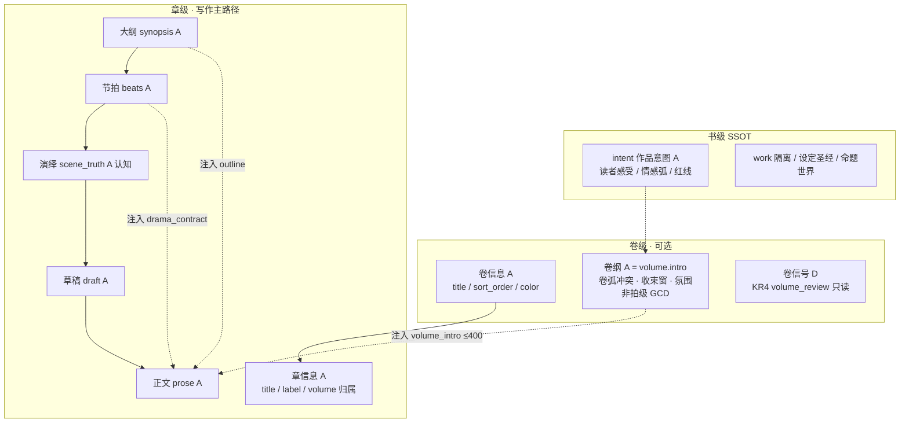
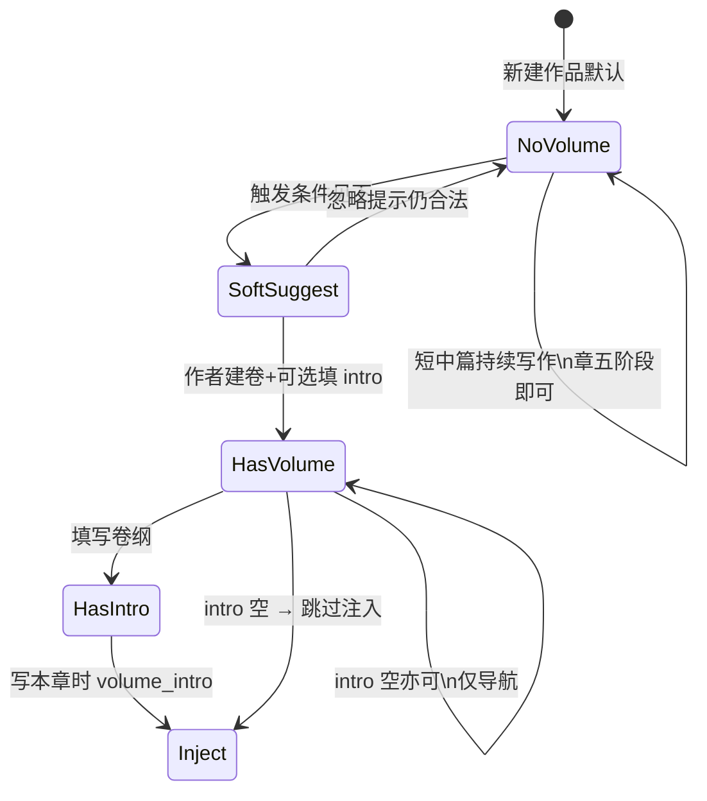
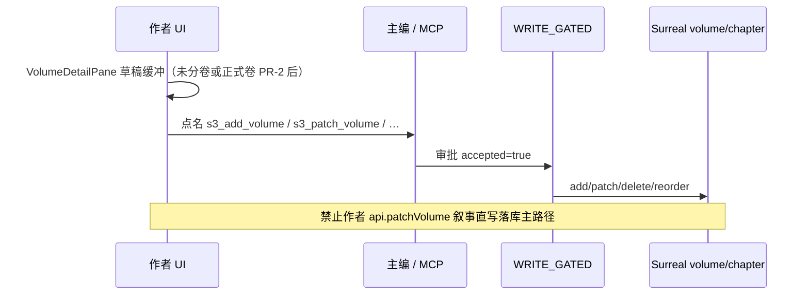
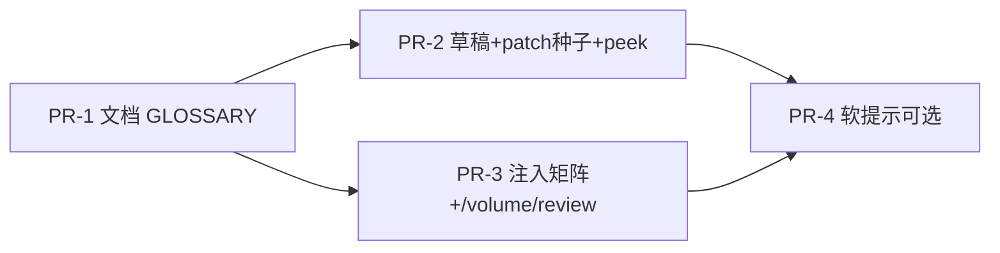

# 设计文档：卷信息 / 卷纲信息架构与渐进启用

| 项 | 值 |
|----|-----|
| **文档标题** | 铜炉卷层 IA：无卷一等公民 · 卷信息 vs 卷纲 · 注入与 WRITE_GATED 对齐 |
| **作者** | Grok Design（系统架构） |
| **日期** | 2026-08-10 |
| **状态** | **Draft · rev.2**（吸收 design review f760d399） |
| **产品** | scribe-writing-system / scribe3（铜炉） |
| **代码根（优先）** | `/home/admin/projects/scribe-ia-verify-wt/scribe3/` |
| **对齐前序** | `docs/plans/2026-08-10-chapter-writing-ia-optimal.md`（章 IA · Accepted rev.3.1） |
| **会话 scratch** | `/tmp/grok-1000/grok-design-doc-f760d399.md` |
| **验收环境** | demo 已部署栈 `https://www.qing.blue`；**禁止**默认再起第二 Surreal；Grok 运行机不做全量 npm/pytest/本机 Surreal |
| **明确不做的宣称** | **不**删 proposition；**不**混 scene_truth 与世界真相；**不**把五阶段合成单字段；**不**因本方案宣称文学 ≥9.5 |

---

### 读法（工程师 · 第一周）

1. **概述 + 现状审计** — 「没卷没事」是否正确；现网 volume 到底有什么。  
2. **心智模型 + SSOT 矩阵** — 书 / 卷 / 章 分层；卷信息 vs 卷纲 vs 章信息/五阶段。  
3. **渐进启用 + 写路径注入** — 何时必须卷、何时可省略；`volume_intro` 预算与去重。  
4. **写入铁律 + 关键决策 + PR Plan** — WRITE_GATED、无 form-wall、验收冒烟。

---

## 概述

章工作台已有「**章节信息**」（`ChapterMetaPane`：title / label / **volume 归属** + 契约摘要）。作者在写短中篇 / 《炉灰记》类单弧作品时常感到：**没建卷也完全写得下去**。这并非产品缺陷，而是与现网数据模型一致的一等公民路径。

本方案回答四个问题：

1. **「没卷没事」是否正确？** — 对单弧 / 短中篇：**正确且应保持**；对多卷长篇 / 跨弧张力：**卷是导航 + 卷级备忘，不是开写硬门闩**。  
2. **卷在产品 / 数据 / 写路径里当前到底有什么？** — 诚实审计见 §现状。  
3. **卷信息 vs 卷纲 vs 章信息 / 章纲** 如何分层、禁止与 synopsis/beats 双写？  
4. **最优设计**：渐进启用、essential 密度藏入口、注入 / SSOT、与章 IA 对齐。

**一句话方案：**

> **无卷默认合法**；`volume` 实体保留为 **Binder 容器 + 可选卷纲（`intro`）**；写路径仅在「有归属且 intro 非空」时注入 `volume_intro`（≤400 字，不得覆盖本章大纲/场景真相）；**不**平行造一套卷级五阶段；跨弧 / 多卷导航压力出现时 **软提示建卷**，永不因缺卷阻断存正文。

---

## 背景与动机

### 1. 用户体感

- 章侧「章节信息」已可用 → 写前契约清晰。  
- 卷侧「卷信息 / 卷纲」存在感弱：短中篇作者几乎不碰；长篇作者需要 Binder 分卷与卷级冲突备忘。  
- 问题核心不是「缺字段」，而是 **职责未说清 + 渐进策略未写死**：何时该建卷、卷纲写什么、和章纲是否重复。

### 2. 网文 / 编辑器工艺对照（心智辩护 · 非文学验收）

| 工艺 / 工具 | 分层 | 铜炉映射 |
|-------------|------|----------|
| 网文总纲 → **卷纲** → 章纲 / 细纲 → 正文 | 书 → 卷弧 → 章 → 拍 | `intent` → `volume.intro` → `synopsis` → `beats` → `draft/prose` |
| harnessNovel 等 AI 写作链 | 世界观 + 大纲 + **卷纲** + 章纲 | 铜炉已有书意图与章五阶段；卷纲 = `intro` 单字段 |
| Scrivener Binder | Folder（Part/Volume）→ Document（Chapter） | `project_tree` 卷节点 → 章节点；`vol:null` = 未分卷 |
| Snowflake / 细纲 | 句 → 段 → 场景表 → 稿 | 卷纲停在「段级弧」，不进拍级 GCD |

工艺共识：**短篇可跳过分卷**；长篇分卷是 **弧与导航**，不是每一章的第二份大纲。

### 3. 与章 IA 边界

| 章 IA（Accepted） | 本方案 |
|-------------------|--------|
| 保留五阶段 + 辅助面；`outline` = synopsis+text | **不**在卷上复制五阶段 |
| `volume_intro` 已在写路径 domain 表（outline 之后） | 固化职责、预算、空路径、与 outline 去重合同 |
| `s3.ia.density` essential 默认 | 卷入口在 essential 下 **不挡章写**；深度卷工作台可弱显 |
| WRITE_GATED / 无 form-wall 世界写 | 卷 create/patch/delete/reorder **同铁律** |

---

## 现状审计（诚实）

### 1. 数据层：有 volume 实体

**迁移** `migrations/044_outline.surql`：

| 对象 | 字段 | 语义 |
|------|------|------|
| 表 `volume` SCHEMAFULL | `title`, `sort_order`, `intro?`, `color?`, `updated` | 卷一等结构对象 |
| `chapter.volume` | `option<record<volume>>` | **NONE = 未分卷**（一等） |
| `chapter.sort_order` | 展示序；**seq 不动** | 卷内 / 未分卷区重排 |

**无**：卷级 beats、卷级 synopsis 分列、卷级五阶段、卷级 scene_truth。  
**卷纲 = `volume.intro` 单字段**（产品文案称「卷纲」；库字段名 `intro`）。

### 2. Store / API / MCP

| 能力 | 锚点 | 备注 |
|------|------|------|
| CRUD 卷 | `store/chapters.py`：`add_volume` / `list_volumes` / `update_volume` / `delete_volume` | 删卷 → 章 `volume=NONE`，**不删章** |
| 建章挂卷 | `create_chapter(..., volume_id=None)` | 可选；幽灵卷 → ValueError |
| 重排 | `reorder_chapters(volume_id\|None, order)` | 未分卷基址 0；防幽灵卷 |
| outline 聚合 | `store/structure.py` `outline()` / `project_tree()` | volumes + chapters + **unassigned** |
| REST | `GET/POST /volumes`，`PATCH/DELETE /volumes/{vid}` | `VolumeReq` / `VolumePatchReq` 含 intro |
| MCP 读 | `s3_list_volumes` | |
| MCP 写（WRITE_GATED） | `s3_add_volume`, `s3_patch_volume`, `s3_delete_volume`, `s3_reorder_chapters`, `s3_patch_chapter_meta`（volume 归属） | `mcp/_common.py` WRITE_GATED |
| 主编目录 | `orchestration/catalog.py` domain `structure.volume` | 关键词含「卷纲」 |

### 3. UI

| 面 | 文件 | 行为 |
|----|------|------|
| Binder 树 | `ProjectTree.jsx` / `ManuscriptDirectory` | 卷 → 章；`vol:null`「未分卷」 |
| 手稿大纲 | `ContainerOutline.jsx` + Corkboard/Outliner | 按卷分 lane；跨卷拖 → 主编种子重排 |
| **卷工作台** | `layout/VolumeDetailPane.jsx` | **正式卷（现网）：** title/color/sort_order/**卷纲 intro** 均为 `ReadOnlyText` +「让主编写入」；**无**本地草稿缓冲（`form` 仅镜像库内值）。空字段靠 emptyAsk「聊聊」、有文靠划选。**未分卷：** 可编辑表单缓冲 +「让主编创建分卷」（种子点名 `s3_add_volume`） |
| 章节信息 | `ChapterMetaPane.jsx` | **仅显示所属卷名**；不展示/不编卷纲；不读 `s3.ia.density` |
| 结构写 | `BinderLayout.jsx` 等 | 禁 `api.addVolume` / `patchVolume` 叙事直写；走 `seedChief*` |
| 正式卷种子（缺口） | `askChiefVolume` → `seedChiefNarrativeWrite('volume', …)` | 文案为泛化「对应 s3_ 写工具」+ 现状快照，**字符串不出现 `s3_patch_volume`**。对比：`seedChiefDeleteVolume` / `seedChiefReorderChapters` / 未分卷创建 **均点名工具**。现网单测只锁「不 REST patchVolume + 有种子」，**不锁工具名** |

现网测试锁定：`detailPane-volume.test.jsx`、`VolumeDetailPane.test.jsx`、`structure-dialogue-write.test.jsx` —— **无「保存卷信息」REST 直写**。

### 4. 写路径注入

```text
# write_assemble._assemble_write_instructions_v1（节选，对齐章 IA）
… → purpose → outline(synopsis+beat.text) → volume_intro → brief_must → pressure_drive → …
```

| 项 | 实现 |
|----|------|
| Helper | `_volume_intro_block`（`api/services/write_assemble.py`） |
| Flag | `SCRIBE3_VOLUME_INTRO_INJECT` 默认开；`0/false/no/off` 关 |
| 预算 | `_VOLUME_INTRO_BUDGET = 400`；body 现用 `_clip(intro, 400)` **字面量**（与常量须保持同值，见 R-Vol-2） |
| 空路径（实现） | **无卷 / intro 空 / flag 关 → 空串**（fail-soft） |
| 文案头 | `## 本卷卷纲摘要(作者备忘·氛围与卷级冲突;不得覆盖本章大纲/场景真相)` |
| domain id | `volume:{vid}:intro` / `volume_intro` |
| 限知 | 有 focalizer 时附作者视角免责（与 outline 同口径） |
| 单测现状 | `tests/test_app.py::test_volume_intro_block_injects_and_empty`：**docstring 写「无卷/空 intro」**，实际只覆盖 **有 intro 注入**、**另一章无卷**、**flag 关**；**未**创建「有 volume 归属且 intro 空」——S2 若只靠此测会**假绿**（PR-3 必补，见注入回归矩阵） |

### 5. 卷级信号（非卷纲 · 勿与 GATE-B 混淆）

`volume_signals.py` / `store_volume_review`：卷内 / 区间 **伏笔超期、母题无回声** 只读信号。

| 名称 | 含义 | 是否阻断写正文 |
|------|------|----------------|
| **GATE-B** | `verify_craft_compliance.gate_b`：章脚手架（synopsis / beats / scene_truth…） | 可硬拦实质正文；**源码无任何 volume 检查** |
| **KR4 / volume_review** | 模块头「门B · KR4」= 伏笔闭环可运营信号；HTTP `GET /volume/review` | **永不 blocking**；不是叙事卷纲 SSOT |

文档与 GLOSSARY **禁止**单独写「门B」无限定——卷信号一律称 **KR4 / volume_review**，章脚手架称 **GATE-B**。

### 6. 「无卷」是否一等公民？

| 检查项 | 结论 |
|--------|------|
| schema 允许 `chapter.volume = NONE` | ✅ |
| Binder `vol:null` 组 | ✅ |
| 建章 / 重排可不带 volume | ✅ |
| 写路径无卷不注入、不报错 | ✅ |
| **GATE-B**（`gate_b` 章脚手架）是否要求 volume | ❌ **不要求**（B1 synopsis / B2 beats / B3 scene_truth…；**无 volume 谓词**） |
| 前端 `evaluateChapterContract` 是否查 volume | ❌ 不查 |
| 章 IA essential 是否依赖卷 | ❌ 不依赖 |

**结论：无卷路径是一等公民，不是残缺态。**

### 7. 「现在没卷没问题」是否正确？

| 作品形态 | 没卷是否 OK | 理由 |
|----------|-------------|------|
| 短篇 / 单弧中篇（如炉灰记体量） | **正确** | 书级 `intent` + 章五阶段足够；分卷增加导航税无收益 |
| 单卷长中篇（心里只有「这一本」） | **正确** | 可选单卷或仍未分卷；卷纲可空 |
| 多卷长篇 / 明确卷高潮与卷末收束 | **建议建卷** | Binder 导航 + 卷级冲突备忘 + 可选 volume_intro 注入 |
| 跨弧张力、卷级伏笔窗口 | **建议建卷 + 填 intro** | 与 **KR4 / volume_review** 复盘同尺度；仍非 GATE-B 硬门 |

**产品正确性：** 作者「没卷也觉得没事」= 系统按设计工作。  
**工艺正确性：** 网文行业亦允许短篇跳过分卷；强行卷会制造假进度与双写诱惑。

### 8. 现状缺口（痛点表）

| ID | 痛点 | 严重度 |
|----|------|--------|
| P-Vol-Glossary | GLOSSARY / 产品词表未钉「卷信息 vs 卷纲 vs 章纲」 | P1 UX |
| P-Vol-Mental | 作者不知「要不要建卷」；ChapterMeta 只显示归属无引导 | P1 UX |
| P-Vol-DualRisk | 若把章 synopsis 抄进 intro → 与 outline 双份注入 | P0 若发生；现网靠文案与预算缓释，缺硬合同文档 |
| P-Vol-Progressive | essential 密度未定义卷入口策略（Binder 仍可见卷，可接受） | P2 |
| P-Vol-Signals-UI | `GET /volume/review` 已有；**UI 未串联**到 VolumeDetailPane（非缺端点） | P2 |
| P-Vol-Schema-Name | 库字段 `intro` vs 产品「卷纲」命名落差 | P3 文档 |
| P-Vol-SeedPatch | 正式卷「让主编写入」未点名 `s3_patch_volume`（与 delete/reorder/建卷不一致） | P0 验收/实现 |
| P-Vol-EditPath | 正式卷改 intro **无可操作草稿路径**（只读 + 泛化种子） | P1 UX |
| P-Vol-TestEmptyIntro | 注入测未覆盖「有卷·intro 空」 | P0 假绿 |

---

## 目标与非目标

### 目标

1. **钉死心智**：书 / 卷 / 章 SSOT；卷信息（元数据）≠ 卷纲（叙事骨架）≠ 章信息 / 五阶段。  
2. **无卷合法**：短中篇默认不建卷；验收不因无卷失败。  
3. **渐进启用**：跨卷 / 跨弧张力时软提示；永不因缺卷硬拦正文。  
4. **写路径合同**：`volume_intro` 注入条件、预算、相对 outline/brief 去重职责。  
5. **写入铁律**：与 WRITE_GATED / 无 form-wall 对齐；**合同化正式卷改 intro 的作者 UX**（本地草稿缓冲 + 点名 `s3_patch_volume` 种子，见 §2.5 / KD-VOL-13/14）；哪些键可本地改、哪些必主编审批。  
6. **与章 IA 对齐**：不合并五阶段；不双写 synopsis/beats；密度键仅 localStorage。  
7. **可交付 PR 切片** + demo 冒烟成功标准（非文学分）。

### 非目标

| 非目标 | 理由 |
|--------|------|
| 卷级五阶段（卷大纲/卷节拍/卷演绎…） | 与章 IA 爆炸重复；ROI 低 |
| 新建 `volume.synopsis` / `volume.beats` 第二权威 | 双写陷阱 |
| 强制所有作品至少一卷 | 违背无卷一等公民 |
| 缺卷 → craft gate 硬拦 | 假门闩伤害短篇 |
| 删 proposition / 混 scene_truth | 铁律 |
| Scrivener 级 Binder 大爆炸重构 | 现网树已够用 |
| 本机全量 npm / Surreal 验收 | 主机规则 |
| 文学 ≥9.5 | 人盲未跑 |
| **新建** `GET /volumes/{vid}/signals`（或平行 signals 路由） | 现网已有 **`GET /volume/review`**；重复路由禁止 |
| PR-1…3 夹带章数阈值横幅引擎 | 属 **PR-4 可选**；catalog 对话建卷已够用 |

---

## 心智模型：书 → 卷 → 章



### 职责分层（禁止双写）

| 层 | 产品名 | SSOT 字段 | 写什么 | 不写什么 |
|----|--------|-----------|--------|----------|
| 书 | 作品意图 | `intent:*` | 全书读者承诺、红线 | 单章节拍、卷细纲 |
| 卷 | **卷信息** | `volume.title/sort_order/color` | Binder 身份、展示序、色带 | 剧情因果 |
| 卷 | **卷纲** | **`volume.intro`（唯一）** | 本卷主冲突、弧线走向、卷末应付的账、氛围基调（**粗骨架**） | 逐章 synopsis；GCD 表；scene_truth；世界命题 |
| 章 | 章节信息 | `chapter.title/label/volume` | 章身份与归属 | 正文、大纲正文 |
| 章 | 章纲 / 五阶段 | `synopsis` → `beats` → `scene_truth` → `draft` → `prose` | 本章展开与执行 | 卷级总账全文重复 |

**铁律：**

- **禁止**把 `synopsis` 整段复制为 `intro` 再注入（→ outline + volume_intro 双份）。  
- **禁止**在 `intro` 写限知帧外剧透当「模型必写事实」（intro **不经 epistemic SQL 门**，仅作者备忘）。  
- **禁止**用卷纲替代 beats GCD。  
- **禁止**卷纲当 proposition / 世界真相。

### 与章 IA SSOT 矩阵增量行

| 概念 | 字段 | 类型 | 写入方 | 注入 domain | 禁止 |
|------|------|------|--------|-------------|------|
| 卷身份 | `volume.title/sort_order/color` | A | 主编 MCP | 不进写戏正文 | 作者 REST 直写叙事 |
| 卷纲 | `volume.intro` | A | 主编 `s3_patch_volume` | **`volume_intro`**（有归属且非空） | 当第二大纲；抄 synopsis 全文 |
| 章→卷归属 | `chapter.volume` | A | `s3_patch_chapter_meta` / reorder | 仅决定是否取 intro | 幽灵卷 |
| 未分卷 | `volume=NONE` + 树 `vol:null` | A 结构态 | 默认 | **不注入** volume_intro | 当错误态 |
| 卷复盘信号 | `volume_signals.*` via **`GET /volume/review`** | D | 只读计算 | 默认不进写路径 | 当 GATE-B；blocking |

---

## 方案设计

### 1. 总原则：渐进启用（Progressive Volume）



#### 1.1 何时 **可省略** 卷（默认）

- 作品预期 **单弧** 或 **≤ ~15–20 章** 且无「第 X 卷」出版结构。  
- 作者心智是「一本书的连续章节」，Binder 未分卷组足够。  
- 写前契约只需章级 synopsis/beats/scene_truth。

#### 1.2 何时 **建议** 建卷（软，非门闩）

> **范围钉死：** 下表是**产品心智**（PR-1 文档即交付）。**UI 阈值横幅 / 自动软提示引擎 = PR-4 可选后置**，**不是** PR-1…3 MVP。实现者**禁止**在 PR-2 夹带章数横幅。对话侧建卷：catalog `structure.volume` **现网已支持**关键词，无需等 PR-4。

| 信号（心智） | 提示文案方向 | 何时实现 |
|--------------|--------------|----------|
| 章数 ≥ N 且仍全部未分卷 | 「章数已多，可用分卷整理 Binder」 | **PR-4 可选**；N 默认倾向 12，**未人决**（Open Q1） |
| 作者对话出现「第×卷 / 卷末 / 下半部」 | 主编可提议 `s3_add_volume` | **现网** catalog，非本方案新 UI |
| 跨大跨度伏笔超期（**KR4 / volume_review**） | 「可按卷复盘伏笔」 | PR-3 可选挂 full 密度只读；非写门 |
| 明确多主角弧并行需分区导航 | 建卷作容器 | 作者主动 / Binder，非自动 |

#### 1.3 何时 **不要** 要求卷

- 存实质正文 / **GATE-B**（章脚手架）齐套。  
- essential 密度下的章工作台主路径。  
- 单测 / 冒烟「无卷作品能写章」。  
- **禁止**把 **KR4 / volume_review** 信号当成 GATE-B 或「缺卷阻断」。

### 2. 卷信息 vs 卷纲：产品与 UI

#### 2.1 命名（与 VolumeDetailPane 对齐）

| 产品中文 | 代码 / 字段 | UI 位置 |
|----------|-------------|---------|
| 卷信息 | title, color, sort_order | `VolumeDetailPane`「卷信息」区 |
| 卷纲 | **intro** | 同区 `ReadOnlyText label="卷纲"` |
| 所属卷 | `chapter.volume` | `ChapterMetaPane` 元数据一行 |
| 未分卷 | `vol:null` | 树 + 未分卷创建流 |

**文档约定：** 对外一律称「卷纲」；代码/SQL 可保留 `intro`；GLOSSARY 加一行 alias（PR-1）。

#### 2.2 卷纲写作模板（作者 / 主编提示，非新 schema）

建议 `intro` 结构（总长建议 **200–800 字**；注入仅取前 400）：

```text
【卷冲突】本卷读者要跟的主矛盾一句话
【人物弧】谁在本卷必须改变 / 不能改变
【应付的账】卷末前应回收的伏笔或承诺（点到为止，不剧透正文措辞）
【节奏】高压段 / 低压段意图（勿列逐章）
【禁区】本卷不碰的线（可选）
```

**明确禁止写入 intro：** 逐章 bullet 复制 synopsis；完整 GCD；未揭示密点当模型可见事实。

模板落点（PR-2）：  
- **VolumeDetailPane** `volume-intro-hint` / emptyHint / 草稿 Textarea placeholder（正式卷草稿缓冲后）；  
- 种子正文可附「请按卷纲模板写 intro，勿抄本章 synopsis」；  
- **不是**暗示现网只读态已有表单编辑。

#### 2.3 与 ChapterMetaPane 关系

- **保持** 章节信息只显示「所属卷」+ 章契约；**不**内嵌编辑卷纲。  
- **可选增强（PR-2）**：若有归属且 intro 非空，且 `volumeMetaPeekVisible(density)` 为真，折叠一行「本卷卷纲摘要」只读 clip **120** 字 + 「打开卷工作台」。  
- **数据源：** 沿用现有 `api.listVolumes()`（ChapterMeta 已拉全量 volumes，含 `intro`）——**不必新 REST**。  
- **文案分工：** 卷工作台 `volume-intro-hint` = 注入/审批说明；ChapterMeta peek = 只读导航摘要。

#### 2.4 essential density 与 `volumeMetaPeekVisible`（对齐 KD-IA-9/13）

现网 `web/src/lib/iaDensity.js` **仅有** `auxVisibleForDensity`（brief/frame/northstar/pressure），**无**卷纲预览规则；ChapterMeta **不读** density。

**PR-2 合同（新增，禁止硬编码散落）：**

```js
// web/src/lib/iaDensity.js
/** essential → false；standard|full → true。未设置 density 按 essential。 */
export function volumeMetaPeekVisible(density) {
  const d = density || loadIaDensity()
  return d === 'standard' || d === 'full'
}
```

| 密度 | 卷相关行为 |
|------|------------|
| **essential**（默认） | Binder 仍可点卷；章工作台 **不**强推卷纲；`volumeMetaPeekVisible` = **false**（ChapterMeta 不展 intro 预览） |
| **standard** | ChapterMeta 可显示卷纲一行预览（peek）；**不含** PR-4 章数横幅 |
| **full** | peek + VolumeDetailPane 可挂 **KR4** 摘要（`GET /volume/review?volume_id=`，PR-3 可选） |

存储仍 **仅** `localStorage` `s3.ia.density`；禁止写入 USER.md。

#### 2.5 正式卷「改卷纲 / 改卷信息」作者 UX 合同（KD-VOL-13）

**现网事实：** 正式卷无本地草稿；「让主编写入」只复述库内现状；作者无法在 UI 起草新 intro 再种子。

**产品选择（推荐 · 本方案锁定）：**

| 键 | 本地（不落库） | 落库 |
|----|----------------|------|
| `title` / `color` / `sort_order` / **`intro`** | **允许草稿缓冲**（受控 Input/Textarea，初始=库内值） | **仅**主编审批后 `s3_patch_volume` |
| 章归属 | 不在本 pane 直写 | `s3_patch_chapter_meta` / reorder |

**交互（PR-2 必做，与未分卷缓冲同构）：**

1. 正式卷「卷信息」区：可编辑草稿（标记「未落库」），**无**「保存到库」REST 按钮。  
2. 「让主编写入」种子 **必须**点名工具（KD-VOL-14）：

```text
请用 s3_patch_volume(volume_id=<vid>, title=…, intro=…, color=…, sort_order=…) 更新分卷。
当前草稿如下（未获批准不得声称已落库）:
title=…
color=…
sort_order=…
intro:
…
```

3. 模板 hint / placeholder 承载 §2.2；空 intro 时 empty 区可附「聊聊怎么写卷纲」。  
4. 划选聊（`SelectionQuoteActions`）可保留作补充，**不**替代点名 patch 种子。  

**拒绝作 PR-2 默认：** 维持纯只读 + 仅泛化 `seedChiefNarrativeWrite`（无法起草 intro，目标 5 落空）。

### 3. 写路径：注入合同

#### 3.1 何时注入

```python
# 伪代码 · 对齐现网 _volume_intro_block
if not SCRIBE3_VOLUME_INTRO_INJECT: return ""
ch = get_chapter(seq)
if not ch.volume: return ""          # 未分卷一等：不注入
intro = volumes[ch.volume].intro
if not intro.strip(): return ""      # 有卷无纲：合法，跳过
return header + clip(intro, _VOLUME_INTRO_BUDGET) + focalizer_disclaimer?
# 现网 clip 字面量 400 与常量必须同值（R-Vol-2）
```

#### 3.2 与 outline / brief 去重职责

| domain | 权威 | 职责 | 相对 volume_intro |
|--------|------|------|-------------------|
| `outline` | synopsis + beat.text | **本章**展开合同 | 卷纲 **不得**复述本章 synopsis 全文 |
| `drama_contract` | beats GCD | 拍级执行 | 卷纲 **不得**列 GCD 表 |
| `volume_intro` | volume.intro | **卷级**氛围 / 弧冲突备忘 | 空则整段省略 |
| `brief_must` | assemble 操作段 | 伏笔/开环操作 | 不抄 intro |

**合同 R-Vol-1：** 注入栈顺序保持 `outline` → `volume_intro`（先章后卷备忘，卷不得覆盖章）。  
**合同 R-Vol-2：** clip ≤ **`_VOLUME_INTRO_BUDGET`（400）**；实现处 `_clip(..., 400)` 字面量与常量 **必须同值**（改一处须双端一致；PR-3 锁测可用常量或双断言）。超长在 UI 提示「注入仅前 400 字」。  
**合同 R-Vol-3：** flag 关 = 全站不注入（运维/A-B）。  
**合同 R-Vol-4：** 文案头必须含「不得覆盖本章大纲/场景真相」（现网已有；回归锁）。  
**合同 R-Vol-5（PR-3 回归矩阵 · 必测，防假绿）：**

| 用例 | 期望 |
|------|------|
| 无卷 | `""`；**无**锚 `本卷卷纲摘要` |
| **有卷 · intro 空** | `""`；**无**锚（**现测缺口，必补**） |
| 有卷 · intro 非空 | 含锚；正文含 intro 片段 |
| 有卷 · intro 超长 | clip 后总长受控；非全文倾倒 |
| flag off | 即使有 intro → `""` |
| 可选 focalizer | 有限知免责句；全知无 |

并修正 `test_volume_intro_block_injects_and_empty` docstring，避免「空 intro」名实不符。

#### 3.3 不在本方案做的注入扩展

- 不注入「邻卷 intro」。  
- 不按章数自动拼接全书所有卷纲。  
- 不把 **KR4 / volume_review** 分数塞进写路径。

### 4. 写入铁律（WRITE_GATED / 无 form-wall）



| 操作 | 工具 | 门控 | 作者 UI（目标态） |
|------|------|------|-------------------|
| 建卷 | `s3_add_volume` | WRITE_GATED | 种子**点名**工具；未分卷可带 intro 草稿 |
| 改卷名/色/序/卷纲 | **`s3_patch_volume`** | WRITE_GATED | 正式卷：**草稿缓冲** +「让主编写入」种子 **必须含 `s3_patch_volume(volume_id=…)`**（PR-2；与 catalog `match_force` 一致） |
| 删卷 | `s3_delete_volume` | WRITE_GATED | `seedChiefDeleteVolume` 已点名；章保留 |
| 章归属 / 卷内序 | `s3_reorder_chapters` / `s3_patch_chapter_meta` | WRITE_GATED | 拖拽种子已点名 reorder |
| 章大纲/节拍 | `s3_patch_chapter_plan` 等 | 既有章路径 | **不**经 volume 表 |

**作者可本地改（不落库）：**  
- 未分卷创建表单（现网）；  
- 正式卷 title/color/sort_order/intro **草稿缓冲（PR-2 目标）**——现网尚无，须交付。  

**作者不可：** 表单墙 REST 直写世界结构绕过主编。  
**REST emergency：** 保留运维；前端主路径禁止（现网测试已锁）。

### 5. 最优方案 + 备选

#### 方案 A（推荐 · Optimal）：单字段卷纲 + 无卷一等 + 渐进软提示

- 保持 `volume.intro` 为卷纲唯一 SSOT。  
- 无卷 / 空 intro 完全合法。  
- 文档 + GLOSSARY + 轻量 UI 提示 + 注入合同回归锁。  
- **不**扩 schema。

**优点：** 与现网 90% 对齐；低风险；符合短中篇；与章 IA 一致。  
**缺点：** 超长篇作者若需要「卷末检查清单结构化」需后续增量。

#### 方案 B（备选）：卷纲结构化 JSON（milestones[]）

- 在 volume 上增 `milestones` / `payoff_window` 等。  
- 注入时格式化为短列表。

**优点：** 可运营卷末验收。  
**缺点：** schema + MCP + UI 膨胀；易与 promise 系统双写；**本阶段不选**。

**Reopen 退出条件（避免误开 schema PR）：** 仅当同时满足：  
(1) 多卷长篇作者**反复**把 checklist / 卷末应付账塞进 `intro` 散文导致注入噪声；  
(2) **KR4 / `GET /volume/review`**（伏笔超期、母题无回声）**无法**表达其卷末账；  
(3) 人决 RFC 批准——再开方案 B。否则维持 intro 单字段。

#### 方案 C（备选 · 拒绝作默认）：强制每书至少一卷 / 卷级五阶段

- 新建作品自动「第一卷」或卷大纲/节拍平行章。

**优点：** Binder 永远整齐。  
**缺点：** 短篇税；与「没卷没事」体感冲突；五阶段爆炸；**明确拒绝作默认**。

#### 方案 D（备选）：取消 volume 实体，仅用 label/tag

**优点：** 更简。  
**缺点：** 破坏现网 outline/corkboard/reorder/注入；长篇导航回退；**拒绝**。

### 6. 风险

| 风险 | 严重度 | 缓解 |
|------|--------|------|
| intro 抄 synopsis → 双份注入 | P0 内容 | 产品模板 + 主编提示 + 文档 R-Vol；可选后续 lint |
| intro 含未揭示剧透被模型写出 | P1 | UI 免责（现网）+ 限知 disclaimer；作者教育 |
| 软提示变硬门 | P1 | 验收条明确「无卷可写」；禁 craft gate 挂钩 volume |
| 误建 volume.beats | P1 架构 | 本方案非目标钉死；Code review |
| essential 藏死建卷能力 | P2 | Binder 始终可达；仅藏预览/信号 |

---

## API / 接口

### 现网（保持）

```text
GET  /volumes
POST /volumes          Body: { title, sort_order, intro?, color? }
PATCH /volumes/{vid}   Body: partial title|sort_order|intro|color
DELETE /volumes/{vid}  → 章 volume 置空

# 卷复盘信号（KR4 · 只读 · 已有 · 非阻塞）
GET  /volume/review?volume_id=&seq_from=&seq_to=
# → store_volume_review / volume_signals（overdue_promises, motifs_no_echo, …）
# 路由：api/routers/ingest_import.py · name=volume_review

MCP:
  s3_list_volumes
  s3_add_volume(title, sort_order=0, intro=None, color=None)
  s3_patch_volume(volume_id, title=?, sort_order=?, intro=?, color=?)
  s3_delete_volume(volume_id)
  s3_reorder_chapters(volume_id=None, order=[...])
  s3_patch_chapter_meta(..., volume_id=?, clear_volume=?)
```

### 本方案 API 策略

| 做 | 不做 |
|----|------|
| PR-3 可选 UI：**复用** `GET /volume/review?volume_id=` | **禁止**新建 `GET /volumes/{vid}/signals` 或平行 signals 路由 |
| 前端薄封装 `api.volumeReview({ volume_id, … })`（若尚无） | 新 schema / 新 MCP 读工具（非必须） |
| 不强制 intro 非空 | 新增卷纲表 |

P-Vol-Signals-UI 的修复是 **UI 串联**，不是缺 store/端点。

---

## 数据模型

### 保持（044）

```surql
-- volume: title, sort_order, intro?, color?
-- chapter.volume: option<record<volume>>  -- NONE = 未分卷
```

### 迁移策略

- **无迁移**（方案 A）。  
- 存量：无卷章保持；有卷无 intro 保持合法。  
- 回填：不需要。

### 若未来方案 B（非本交付）

- 新 migration 加可选字段；intro 仍为散文 SSOT 或 deprecate 需独立 RFC。

---

## 安全与隐私

| 主题 | 处理 |
|------|------|
| 剧透 | intro 不经 epistemic 门；UI 已提示勿写未揭示密点 |
| 审批 | 结构写 WRITE_GATED；防 form-wall 绕过 |
| 删卷 | 不删章正文；归属清空 |
| 多 work 隔离 | 一书一 DB；volume 无跨 work |
| 私密命题 | 卷纲禁止当 proposition 通道 |

---

## 可观测性

| 信号 | 用途 |
|------|------|
| 写路径 fail-soft log：`volume_intro 注入失败` | 已有 warning |
| domain 溯源 `volume:{vid}:intro` | Inspector / 调试 |
| 可选 metrics：`volume_intro_chars` / `volume_intro_skipped_reason`（none/empty/flag） | PR 内轻量，非必须 |
| `volume_review` / `has_stale_signal`（KR4） | 复盘面板，非告警轰炸；**≠ GATE-B** |

告警：**不对**缺卷、空 intro 告警。

---

## 滚动计划 / 回滚

| 阶段 | 内容 |
|------|------|
| PR-1 | 文档 + GLOSSARY 落仓 monorepo **`docs/plans/`**（与章 IA 同级） |
| PR-2 | 正式卷草稿缓冲 + **点名 `s3_patch_volume` 种子** + `volumeMetaPeekVisible` + ChapterMeta peek |
| PR-3 | 注入回归矩阵（含**有卷空 intro**）+ 可选 full 密度挂 **`GET /volume/review`** |
| PR-4（可选） | 章数软提示横幅；**非** MVP |
| 回滚 | 关 `SCRIBE3_VOLUME_INTRO_INJECT`；UI 可 revert；无 schema 回滚压力 |

功能开关：注入 flag 已存在；PR-4 软提示可用 localStorage 或文案开关，无需新服务端 flag。

---

## 成功标准与验收（demo 冒烟 · 非文学分）

**环境：** 已部署 demo（`www.qing.blue` / 约定 SSH 栈）。**禁止** Grok 运行机全量 `npm test` / vitest / 本机 Surreal 验收宣称。

**验收分层：**

| 层 | 用途 |
|----|------|
| **会话默认** | demo 手点 + 必要时 curl 装配/只读 API（S1–S7） |
| **CI / 作者允许环境** | 增量单测（PR-2：1–2 个 jsx；PR-3：注入矩阵）；**非**本机全量 web 套件 |
| **代码审查** | 种子字符串点名工具；无 REST 保存按钮；无新 signals 路由 |

| # | 标准 | 冒烟 / 锁测方式 |
|---|------|-----------------|
| S1 | **无卷作品可写章** | 全书无 volume 或全章未分卷；章工作台显示「未分卷」；大纲/正文可进入 |
| S2 | **有卷无 intro 可写 + 不注入** | 有 volume 归属、`intro` 空；写路径不 500；装配 **无**锚 `本卷卷纲摘要`（**须** PR-3 单测覆盖，非旧测假绿） |
| S3 | **有卷有 intro 注入** | intro 非空；装配含锚；长度受控（≤预算+头）；超长 clip |
| S4 | **写入走主编且点名 patch** | 无「保存卷信息」REST 主按钮；正式卷「让主编写入」种子字符串 **必须含** `s3_patch_volume` 与 `volume_id`（PR-2 交付后；与 delete/reorder 同源）。验收**不**接受仅「叙事审批语义」而无工具名 |
| S5 | **删卷不删章** | 删卷后章在未分卷；seq 不变 |
| S6 | **与 GATE-B 正交** | 无卷时 GATE-B 仍只看 synopsis/beats/scene_truth；无「必须分卷」；**KR4 不冒充 GATE-B** |
| S7 | **词表** | GLOSSARY：「卷纲=`intro`；无卷合法；volume_intro；GATE-B≠KR4」 |

**假绿防护：**

- 不以「存在 VolumeDetailPane」代替 S1。  
- 注入：无卷 **与** 有卷空 intro 均不得出现锚 `本卷卷纲摘要`。  
- S4 不以「有 seed 事件」代替工具名断言。  
- 不宣称文学分。

---

## Open Questions

| # | 问题 | 倾向 |
|---|------|------|
| Q1 | 软提示章数阈值 N=12 是否人决？ | **仅 PR-4**；默认倾向 12，可配置；PR-1…3 不实现横幅 |
| Q2 | ChapterMeta 卷纲预览是否进 essential「更多」？ | **否**：`volumeMetaPeekVisible(essential)=false`；standard+ 展（已合同） |
| Q3 | 是否要 intro 与 synopsis 相似度 lint？ | 后置；先靠模板教育 |
| Q4 | KR4 是否进 VolumeDetailPane full 密度？ | PR-3 可选；**复用** `/volume/review` |
| Q5 | 库字段是否 rename intro→outline？ | **不**；GLOSSARY alias 足够 |

---

## References

- 章 IA：`docs/plans/2026-08-10-chapter-writing-ia-optimal.md`  
- 迁移：`scribe3/migrations/044_outline.surql`  
- Store：`scribe3/store/chapters.py`（volume CRUD）、`store/structure.py`（outline/tree）  
- 注入：`scribe3/api/services/write_assemble.py`（`_volume_intro_block`）  
- MCP：`scribe3/mcp/tools_write.py`、`mcp/_common.py` WRITE_GATED  
- UI：`web/src/layout/VolumeDetailPane.jsx`、`ChapterMetaPane.jsx`、`ContainerOutline.jsx`、`BinderLayout.jsx`  
- 信号：`scribe3/volume_signals.py`；HTTP **`GET /volume/review`**（`ingest_import.py`）  
- 编排：`orchestration/catalog.py` `structure.volume`（`match_force` 含 `s3_patch_volume`）  
- 工艺对照：网文总纲/卷纲/章纲分层；Scrivener Binder Part→Chapter；AI 写作链卷纲设计（行业惯例，非验收条）  
- 审阅：`/tmp/grok-1000/grok-design-review-f760d399.md` → rev.2 已吸收

---

## Key Decisions

| # | 决策 | 理由 |
|---|------|------|
| **KD-VOL-1** | **无卷默认合法**；未分卷是一等结构态，不是错误 | 短中篇体感 + schema + 写路径空串 |
| **KD-VOL-2** | **卷纲 SSOT = `volume.intro` 单字段**；不新建卷级 synopsis/beats/五阶段 | 防与章双写；对齐现网注入 |
| **KD-VOL-3** | **卷信息** = title/sort_order/color；**卷纲** = intro；**章信息** = title/label/volume 归属 | 消歧 |
| **KD-VOL-4** | 写路径仅当「有 volume 且 intro 非空且 flag 开」注入；预算 **400**（常量与 clip 字面同值）；顺序在 outline 之后 | 现网已实现；本方案合同化 |
| **KD-VOL-5** | 卷/章结构写 **全部 WRITE_GATED**；UI 无 form-wall REST 叙事直写 | 与铜炉世界写铁律一致 |
| **KD-VOL-6** | 缺卷 **永不**进入 craft/**GATE-B** 硬拦；**KR4 ≠ GATE-B** | 与齐套字段正交 |
| **KD-VOL-7** | 渐进启用 = **软提示**；**UI 阈值仅 PR-4**；忽略仍合法 | 尊重炉灰记类路径；防 PR-2 夹带 |
| **KD-VOL-8** | essential：`volumeMetaPeekVisible=false`；Binder 卷节点保留 | 对齐 KD-IA-13；补 density helper |
| **KD-VOL-9** | 采用 **方案 A**；拒绝强制分卷与卷级五阶段作默认；B 有 reopen 条件 | ROI + IA 克制 |
| **KD-VOL-10** | 验收 = **demo 冒烟** S1–S7 为主；CI 增量测；非文学分；非本机 Surreal/全量 vitest | 主机与验证规则 |
| **KD-VOL-11** | 禁止 intro 与 synopsis/beats/scene_truth/proposition 职责混淆 | 铁律延伸 |
| **KD-VOL-12** | GLOSSARY alias：`intro` ↔ 卷纲；不 rename 列 | 低成本 |
| **KD-VOL-13** | 正式卷 **本地草稿缓冲** +「让主编写入」带草稿；无 REST 落库 | 可操作改纲；对齐目标 5 |
| **KD-VOL-14** | 正式卷种子 **必须点名** `s3_patch_volume(volume_id=…)`（S4 锁锚） | 与 delete/reorder/建卷及 catalog `match_force` 一致 |
| **KD-VOL-15** | 卷信号 **只**复用 `GET /volume/review`；禁止新 signals 路由 | 防双路由；P-Vol-Signals-UI=UI 串联 |
| **KD-VOL-16** | PR-3 注入矩阵 **必须**含「有卷·intro 空」；修 docstring 假覆盖 | 防 S2 假绿 |

---

## PR Plan

### PR-1 · docs: 卷信息/卷纲 IA 落仓与 GLOSSARY

| 项 | 内容 |
|----|------|
| **标题** | `docs: volume meta vs volume outline (intro) IA + glossary` |
| **文件** | monorepo **`docs/plans/2026-08-10-volume-ia-optimal.md`**（与章 IA 同级，非 `scribe3/docs/`）；`scribe3/GLOSSARY.md`（卷信息 / 卷纲=`intro` / 未分卷 / domain `volume_intro` / **GATE-B≠KR4** / 链 044 与 `_volume_intro_block`） |
| **依赖** | 无 |
| **简述** | 固化 KD-VOL-1…16、无卷一等、注入合同、非目标；**不改**运行时；**不含**章数横幅 |
| **验收** | 文档可检索；GLOSSARY 可检索「卷纲」「volume_intro」「未分卷」 |

### PR-2 · fe: 正式卷草稿 + 点名 patch 种子 + density peek

| 项 | 内容 |
|----|------|
| **标题** | `fe: volume draft buffer + s3_patch_volume seed + volumeMetaPeekVisible` |
| **文件** | `web/src/layout/VolumeDetailPane.jsx`（正式卷草稿缓冲；`askChiefVolume` 种子点名 **`s3_patch_volume`**；模板 placeholder；保留无 REST 保存）；`web/src/ChapterMetaPane.jsx`（`volumeMetaPeekVisible` 下 clip120 intro，数据源 `listVolumes`）；`web/src/lib/iaDensity.js`（**新增** `volumeMetaPeekVisible`）；可选 `web/src/api.js` 无新 REST；**增量** `VolumeDetailPane.test.jsx` 等 **1–2 用例**（锁种子含 `s3_patch_volume`、essential 不展 peek） |
| **依赖** | PR-1 词表 |
| **简述** | 关闭 P-Vol-SeedPatch / P-Vol-EditPath；S4 可验收；essential 默认不 peek |
| **验收** | **默认 demo 手点**：可改草稿 → 种子含 `s3_patch_volume` 与 volume_id → 无保存 REST。**CI（非 Grok 全量 vitest）**：增量 1–2 用例。**禁止**本机会话跑全量 web test 作验收。 |

### PR-3 · test/be: volume_intro 回归矩阵 + 可选 KR4 UI

| 项 | 内容 |
|----|------|
| **标题** | `test: volume_intro matrix incl. empty-intro; fe optional volume/review pane` |
| **文件** | `tests/test_app.py`（扩展/拆分 `test_volume_intro_block_*`：**无卷 / 有卷空 intro / 有 intro / 超长 clip / flag 关**；修 docstring）；可选 `web/src/layout/VolumeDetailPane.jsx` full 密度只读摘要；`web/src/api.js` 薄封装 **`api.volumeReview` → GET `/volume/review`** |
| **依赖** | PR-1；与 PR-2 可并行 |
| **简述** | 关闭注入假绿；**禁止**新 `/volumes/{vid}/signals`；信号只读不进 blocking |
| **验收** | 矩阵测绿（作者 CI / 允许环境）；demo：有 intro 含锚，无卷与有卷空 intro 均无锚。可选 full 密度见 overdue 摘要 |

### PR-4 ·（可选后置）软提示策略

| 项 | 内容 |
|----|------|
| **标题** | `fe: soft suggest create volume when chapter count high` |
| **文件** | `ContainerOutline.jsx` / 未分卷区；可配置 N（Q1） |
| **依赖** | PR-1/2 |
| **简述** | 章数阈值软横幅 + 一键种子建卷；可忽略；**绝不**硬拦；**非** PR-1…3 范围 |
| **验收** | 低于阈值无横幅；高于可忽略并继续写作 |

### 依赖图



---

## Revision Summary

- **初稿** 2026-08-10：现状审计；「没卷没事」正确；方案 A；KD-VOL-1…12；PR-1…4。  
- **rev.2** 2026-08-10（review f760d399）：  
  - S4 / 正式卷种子 **点名 `s3_patch_volume`**（KD-VOL-14）；PR-2 文件表写死。  
  - 正式卷 **草稿缓冲改纲路径**（§2.5 / KD-VOL-13）。  
  - PR-3 **复用 `GET /volume/review`**，删除新 signals 路由（KD-VOL-15）。  
  - 点名注入测 **有卷空 intro** 缺口与回归矩阵（KD-VOL-16 / R-Vol-5）。  
  - `volumeMetaPeekVisible` 签名与 listVolumes 数据源（§2.4）。  
  - §1.2 / PR-4 范围钉死；GATE-B vs KR4 消歧；验收分层防 Grok 全量 vitest；clip 常量同值；方案 B reopen 条件。  
  - Key Decisions 扩至 KD-VOL-16。
