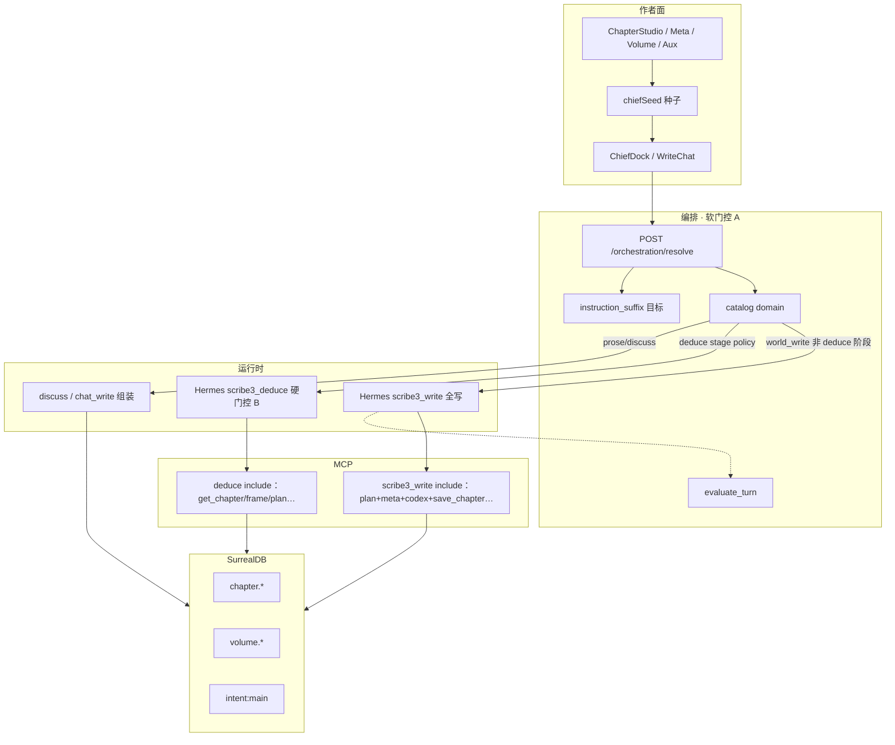
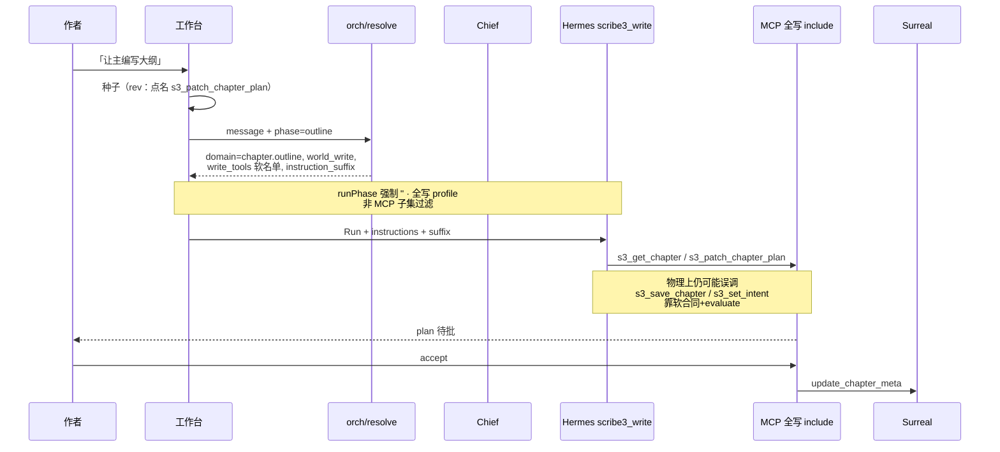

# 设计文档：主编模块生成能力模型 —— Skill 分拆 vs MCP 工具 vs 混合最优

| 项 | 值 |
|----|-----|
| **文档标题** | 铜炉主编：各模块信息生成的能力分层与最优架构 |
| **作者** | Grok Design（系统架构） |
| **日期** | 2026-08-11 |
| **状态** | Draft · **rev.2**（评审修订：软/硬门控诚实分层 · world_write 指令注入 · GATE-B · 节拍 REST KD · 种子动机 · PDC 无 MCP · PR 序列重排） |
| **产品** | 铜炉（tonglu）/ scribe3 |
| **代码根（优先）** | `/home/admin/projects/scribe-ia-verify-wt/scribe3/` |
| **对齐前序** | `docs/plans/2026-08-10-chapter-writing-ia-optimal.md` · `docs/plans/2026-08-10-volume-outline-ia-optimal.md` · `docs/plans/2026-08-10-narrative-rootcause-optimal-execution.md` · `scribe3/AGENTIC_BOUNDARY_DECISION.md` |
| **验收环境** | demo 已部署栈 `https://tonglu.example.com`（及 301 主域）；**只冒烟已部署**；Grok 运行机禁止全量 npm/本机 Surreal |
| **明确不做的宣称** | **不**因本方案宣称文学 ≥9.5；**不**为每模块新建 MCP server；**不**把评分卡当作品意图；**不**把经验复盘当力学合同；**不**假装 catalog `write_tools` 已过滤 Hermes MCP include |

---

### 读法（工程师 · 第一周）

1. **概述 + 软/硬门控 + 能力词典** — skill / MCP / seed / profile / domain 真义；**勿把软白名单当硬隔离**。  
2. **现状审计 + 模块矩阵（含 GATE-B）** — 各面生成、SSOT、写路径、脚手架硬检。  
3. **H1 架构 + 指令注入单源 + 上下文打包** — resolve `instruction_suffix`；world_write 清 phase 事实。  
4. **Key Decisions（含 KD-10…13）+ PR Plan** — 最小可合并切片 = PR-2 + 负向路由；硬 profile 单列可选。

### 工程师一周内最小可合并切片

| 优先级 | 切片 | 说明 |
|--------|------|------|
| **P0 本周可合** | **PR-2 种子点名** + **PR-3 负向路由金句**（可与 PR-1 文档并行） | 不依赖硬 profile / assemble 裁剪 |
| **P1 紧随** | PR-4 `instruction_suffix` + phase_role 映射；PR-7 Aux 文案；PR-8 可执行冒烟（含 GATE-B 只读） | 钉死 world_write 提示注入 |
| **P2 第二波 / backlog** | PR-5 pack 声明；PR-6 **默认不改 draft/final**；**PR-H** outline/beats 硬 profile（可选） | 硬隔离与注入裁剪待 P0/P1 稳后 |

---

## 概述

作者在章/卷工作台会碰到约十个以上「信息面」：卷信息/卷纲、章节信息、大纲/节拍/演绎/草稿/正文，以及简报/关联/评分卡/经验复盘等辅助面。产品问题不是「缺不缺生成按钮」，而是：

> **主编（Chief）生成这些信息时，能力应按什么切分？按 Hermes skill 分拆？按 MCP 工具分拆？还是别的？**

**一句话方案（rev.2 诚实表述）：**

> **一个主编大脑 + 能力目录软路由（`orchestration/catalog.py`：domain / channel / evaluate / 提案）+ UI 种子合同（点名 `s3_*`）+ resolve 下发的 `instruction_suffix`（不依赖 world_write 的 phase）+ 阶段上下文打包（主要服务 `/chat/write` 组装；Hermes 靠工具自拉）**；  
> **硬门控仅存在于独立 Hermes profile 的 `tools.include`**（现网：`scribe3_deduce*`；outline/beats 走**全写** `scribe3_write`）——**catalog `write_tools` 不是运行时 MCP 过滤器**；  
> **禁止**「一模块一 skill 人格」与「一模块一 MCP server」；技法 skill 仅渐进披露；**派生面（简报/评分卡/关联）后端组装、不经 LLM 写 SSOT**。

本方案把 jargon 映射到真实代码，给出逐模块矩阵（含 GATE-B）、软/硬门控分层与增量 PR，避免「把评分卡当意图写」「大纲和卷纲双写」「以为 catalog 已挡住 save_chapter」类事故。

---

## 背景与动机

### 1. 用户体感

- 工作台每个阶段/辅助 tab 都有「让主编生成 / 让主编写入」入口（`ChapterStudio.jsx`、`ChapterMetaPane.jsx`、`VolumeDetailPane.jsx` 等）。
- 作者直觉会问：大纲、节拍、评分卡……是不是该各配一个「专精 skill」？还是各挂一套 MCP？
- 若答错：要么上下文爆炸，要么写路径分裂，要么双写 SSOT，要么**误以为有运行时工具白名单**而漏防写错族。

### 2. 已定产品铁律（不可回退）

| 铁律 | 锚点 |
|------|------|
| 正典写 = 对话 + 审批；禁表单直填业务状态（**节拍 GCD 微调例外见 KD-CM-10**） | `AGENTIC_BOUNDARY_DECISION.md` · 章 IA |
| 写工具（除正文 save 旁路）一律 `WRITE_GATED` + `commit_if_approved` | `mcp/_common.py` · `mcp/gating.py` |
| 五阶段字段保留，不塌缩 | 章 IA Accepted rev.3.1 |
| 评分卡 ≠ 作品意图；经验复盘 ≠ 力学合同 | `GLOSSARY.md` 组八 · `ChapterAuxPanel.jsx` |
| GATE-B：normal 章实质存稿前脚手架硬检 B1/B2/B3 | `verify_craft_compliance.gate_b` |
| 引导 > 硬拦（质量门与脚手架门职责分离） | 执行合同 / NEE |
| 验收 = 已部署 demo 冒烟 | 主机资源规则 |

### 3. 痛点（与能力切分相关）

| ID | 痛点 | 严重度 |
|----|------|--------|
| P-Jargon | skill / MCP / profile / domain 混用 | P0 |
| P-SoftVsHard | 口语「域门控」被当成 Hermes include 过滤；outline/beats 实际全写 profile | P0 |
| P-SeedToolPick | 叙事种子不点名具体 `s3_*` → 模型猜 plan vs meta vs volume；`explicit_book_tool_contract` 匹配不到 | P1 |
| P-PhaseClear | world_write **故意** `phase: ''`，按 phase 拼 Run 提示的路径失效 | P0 |
| P-PhaseRoleGap | `_phase_role_block` 键为 plan/draft/final；UI phase 为 outline/beats/…；讨论路径靠 `WRITE_PHASE` 映射，写 Run 无 phase | P1 |
| P-BeatsAgentic | 节拍 `api.patchChapter` 作者直存 vs AGENTIC「禁表单」未仲裁 | P1 |
| P-NoDriveMcp | `pressure_drive` / `narrative_drive` **无** s3_* 写工具，矩阵却写「明确工具」 | P1 |
| P-GateB | 脚手架可空壳过审批，GATE-B 存稿才 fail | P1 |
| P-AuxAsWrite | 要求 LLM 写评分卡/简报 = 双写语义 | P0 |
| P-ModuleSkillTempt | 误复制 oh-story 一阶段一 skill | P1 |

---

## Goals & Non-Goals

### Goals

1. 可执行的能力分层词典（对应文件/函数）。  
2. 逐模块：生成模式、SSOT、写路径、LLM 是否该写、**GATE-B 关系**。  
3. 选定主架构 H1，并诚实分层 **软门控 vs 硬 profile**。  
4. 钉死 **world_write 指令注入单源**（不依赖被清空的 phase）。  
5. 护栏：双写、错字段、评分卡/意图、**脚手架空壳**、**save 旁路**。  
6. 可独立合并的 PR 序列；标出最小切片与 backlog。

### Non-Goals

- 不重做 Narrative Engine / Execution Contract / 卷 IA 人决。  
- 不新增第二 Surreal / 平行验证环境。  
- 不把 oh-story skill 树原样迁入。  
- **不**把 `s3_save_chapter` 改为待批（保留 agent/正文旁路；用提示 + evaluate 约束脚手架任务勿 save）。  
- 不因本方案宣称文学分数门槛。  
- **P1 不为 outline/beats 强制上硬 profile**（见备选 E / PR-H，延期）。

---

## 软门控 vs 硬门控（实现合同 · 必读）

Hermes Runs API **没有**请求级 MCP 工具过滤（`run_stage_policy.py` 模块头注释原话）。因此：

| 层 | 名称 | 现网能力 | 作用 | 不作用 |
|----|------|----------|------|--------|
| **A · 软门控** | Catalog + 种子 + instructions + `evaluate_turn` + `RunToolContract` | **全阶段** | 路由 channel、required_outcome、UI hint、空谈 incomplete、作者点名工具的终态证据 | **不**从 MCP include 摘掉工具 |
| **B · 硬门控** | 独立 gateway profile 的 `tools.include` | **仅** `deduce` / `deduce_preview`（`scribe3_deduce*`，约 **8645**；`run_stage_policy._POLICIES`） | 物理上不可调用未 include 的写/读工具 | outline/beats/**默认 world_write 不在此列** |

**现网 world_write（大纲/节拍/结构/设定等）** → profile **`scribe3_write`**（约 8644；读+写 include，**含** `s3_save_chapter` 及大量 codex 写工具）。  
**ChiefDock / WriteChat / orchestrateSend**：`useWorldWriteRun` 时 **故意 `phase: ''` / `runPhase = ''`**，注释：*「世界正典写入走全写 profile，避免章级 run_scope fail-closed」*（`ChiefDock.jsx` ~701）。

**catalog `write_tools` / package `tool_allowlist`** 用途（`resolve.py`）：

- `evaluate_turn`：是否调用了 package 声明的写工具 → incomplete / awaiting_approval  
- 提案构建、前端 `evaluationHint`  
- **`use_world_write_run`** 判定（channel=world_write 且 write_tools 非空且 mutation|force）  
- **不会**传入 Hermes 去过滤 MCP include  

```text
软门控（A）                         硬门控（B）
catalog.match → domain              profile.tools.include
seed 点名 s3_* → RunToolContract    仅 deduce* 阶段 policy
instruction_suffix（resolve）       provision overlay
evaluate_turn write_tools 子集
     │                                    │
     └──── outline/beats 仅有 A ──────────┴── deduce 有 A+B
```

---

## 能力模型词典（本系统 jargon → 代码）

| 术语（口语） | 本系统真身 | 代码锚点 | 是否「生成模块信息」主杠杆 |
|--------------|------------|----------|----------------------------|
| **主编 / Chief** | 右栏 LLM 共写体 | `ChiefDock.jsx` / `WriteChat.jsx`；`/chat/write`；Hermes | **是** |
| **Seed prompt** | UI 写入 `s3.chief.seed` 的中文合同 | `web/src/lib/chiefSeed.js` | **是**（意图 + **具名工具**） |
| **Orchestration domain** | 关键词 → channel / 工具名单 / UI / outcome | `orchestration/catalog.py` · `resolve.py` · `POST /orchestration/resolve` | **是（软路由）** |
| **Channel** | `world_write` / `prose_write` / `discuss` | catalog `channel` | 是否 Hermes 写网关 |
| **write_tools / tool_allowlist** | **软**名单：评价与提案，**非** MCP include | `resolve.build_package` / `evaluate_turn` | 软门控 |
| **MCP tool（s3_*）** | FastMCP 读写原语 | `mcp/tools_*.py` | 落库边界 |
| **WRITE_GATED** | 须审批才落库的写工具集合 | `mcp/_common.WRITE_GATED` | **注意：`s3_save_chapter` 不在内** |
| **Hermes profile** | 网关级工具面隔离 | `deploy/hermes/overlay.*.yaml` | **硬**边界 |
| · default | 零工具，~8642 | `overlay.default.yaml` | 速答 |
| · scribe3 | 只读，~8643 | `overlay.scribe3.yaml` | 讨论 agentic 读 |
| · scribe3_write | 读+写全量，~8644 | `overlay.scribe3_write.yaml` | **大纲/节拍等 world_write** |
| · scribe3_deduce* | 受限 include，~8645 | `overlay.scribe3_deduce.yaml` 等 · `run_stage_policy` | **演绎硬门控** |
| **Hermes skill** | 可选工序手册 | `hermes_skills/scribe-novel-v2/SKILL.md` | 弱 |
| **Craft skill** | 技法 md + `s3_skill_read` | `craft_skills/*.md`（4 个）· `craft_skills.py` 定案 B | **否**（技法） |
| **Phase（UI）** | outline→beats→deduce→draft→final | `ChapterStudio` · `_ASSEMBLER_PHASES` | 组装侧重 |
| **WRITE_PHASE 映射** | 讨论/chat_write：outline/beats→`plan`，deduce→deduce | `ChiefDock.jsx` `WRITE_PHASE` | **仅非 world_write** |
| **phase_role** | plan/draft/final 角色句 | `misc_helpers._phase_role_block` | chat_write 组装；world_write 常空 phase |
| **Write assemble** | `/chat/write` instructions 单源 | `write_assemble.py` | **prose/讨论组装**；**不是** Hermes world_write 主链 |
| **instruction_suffix** | **（目标）** resolve 按 domain 下发的 Run/讨论附加纪律 | orch 回包；PR-4 主路径 | 替代「靠 phase 拼提示」 |
| **Backend assemble** | 派生只读 | `brief.assemble_chapter_brief` · `_compute_scorecard` · `project_frame` · `ensure_narrative_drive` | 派生 |
| **GATE-B** | 章脚手架硬检 | `verify_craft_compliance.gate_b` B1/B2/B3 | 存稿门 |
| **RunToolContract** | 作者「使用/调用 + s3_*」→ required_tools 终态证据 | `run_stage_policy.explicit_book_tool_contract` | 防假绿 completed |



---

## 现状审计

### 1. 主编如何被唤起

| 步骤 | 行为 | 锚点 |
|------|------|------|
| 1 | UI `seedChief*` / `focusChiefWithSeed` | `chiefSeed.js` |
| 2 | `s3.chief.seed` + 右栏 chief | sessionStorage + CustomEvent |
| 3 | `orchestrateBeforeSend` → `/orchestration/resolve` | `orchestrateSend.js` |
| 4 | `use_world_write_run` → Hermes 写 profile；**phase 被置空**；instructions = `hermesRunInstructions({phase:''})` 或 orch.instructions | `ChiefDock` / `WriteChat` / `orchestrateSend` |
| 5 | 非 world_write 且有章 phase → `/chat/write`，`WRITE_PHASE` 映射（outline/beats→plan） | `ChiefDock` DiscussionDock |
| 6 | WRITE_GATED → elicitation → 批准 → `commit_if_approved` | `mcp/gating.py` |
| 7 | 回合结束 `evaluate_turn`：write_proposal 无写工具 → incomplete | `resolve.evaluate_turn` |

### 2. 种子合同分层（现网诚实）

| 种子类型 | 点名工具？ | 是否已能进 world_write？ | 真缺口 |
|----------|------------|-------------------------|--------|
| Codex 补全 | **是**（registry 类型优先 `s3_patch_codex`；另表 `CODEX_PATCH_TOOL` 具名 patch） | 是 | — |
| 重排/删卷/真相演变 | **是** | 是 | — |
| `seedChiefNarrativeWrite` | **否**（「对应 s3_ 写工具」） | **是**：「提交写入提案供我批准」∈ `WORLD_WRITE_FORCE`；「更新」∈ mutation；大纲/节拍关键词命中 domain | **猜哪个 s3_***；**`explicit_book_tool_contract` 需「使用/调用 + 具名 s3_*」** 才建 required_tools——当前泛称匹配不到 |
| 卷正式更新 | 常不点名 `s3_patch_volume` | 多半仍 force 进写 | 同工具选择/证据 |

**PR-2 动机（rev.2）不是「否则进不了 Hermes」**，而是：

1. **工具选择正确性**（plan vs meta vs volume vs set_intent）；  
2. **RunToolContract / 终态证据**（点名后假绿 completed 可抓）；  
3. **与 Codex 种子对称**；  
4. 配合 catalog `match_force` 含 `s3_patch_chapter_plan`，避免弱话术 `required_outcome` 被降成 `read_only_advice`（`resolve`：write_proposal 且非 mutation|force → 降级）。

**种子模板（固定两行 + 可选结构提示）：**

```text
请更新第 {seq} 章大纲(synopsis)并提交写入提案供我批准。
使用工具 s3_patch_chapter_plan(seq={seq}, synopsis=…)。未获批准不得声称已落库。
（可选 GATE-B 软提示）请保证 synopsis 非空且足以支撑后续节拍；勿调用 s3_save_chapter 存正文。
```

### 3. 能力目录覆盖（现网）

| domain | channel | write_tools | 备注 |
|--------|---------|-------------|------|
| `intent.northstar` | world_write | `s3_set_intent` | force 含工具名 |
| `structure.volume` | world_write | volume CRUD + reorder | force 含工具名 |
| `structure.chapter` | world_write | add + `s3_patch_chapter_meta` | title/label/volume |
| `chapter.outline` | world_write | **`s3_patch_chapter_meta` + `s3_patch_chapter_plan`** | match_force **空**；关键词含 plan、压力级、chapter_role |
| `chapter.beats` | world_write | `s3_patch_chapter_plan` | match_force 空 |
| `chapter.deduce` | world_write | plan + meta | **硬 profile** 另轨 `run_stage_policy` |
| `prose.generate/revise` | prose_write | **()** | 编排意图无 MCP 写；**运行时**全写 profile 仍可能见 `s3_save_chapter` |
| `qc.review` | discuss | () | 只读 |
| `discuss.general` | discuss | () | 默认 |

**压力级 / chapter_role：** 非独立 DB 列；嵌在 **synopsis（或 beats.text）文案** 中，由 `brief.parse_chapter_meta` 解析（测试锚 `test_parse_chapter_meta_stakes`）。故大纲主写是 **`s3_patch_chapter_plan(synopsis=…)`**；catalog 同时列 meta 便于「顺带改 label/卷归属」类话术，**不是** chapter_role 有独立 patch 字段。PR-2 点名 **plan** 为主；仅当种子目标是 title/label/volume 时点名 meta。

**无独立 domain：** 简报、评分卡、经验复盘、关联、`narrative_drive`、`pressure_drive`。

### 4. Hermes / Skill / 端口

| 层 | 事实 |
|----|------|
| Profile | default 零工具；scribe3 只读；scribe3_write 全写；**scribe3_deduce / deduce_preview 受限** |
| craft_skills | 4 md；定案 B：responses **不**注入原生 skills → 索引 + `s3_skill_read` |
| SOUL | 事实进 Surreal；s3_ 带 work；待批；不写 Hermes memory 剧情 |

### 5. 派生面与合同字段

| 面 | 生成 | LLM 写 SSOT？ |
|----|------|----------------|
| 简报 | `assemble_chapter_brief` | ❌（CTA 可种子 **promise 等世界写**，见 `BriefPanel` / dualwrite-ban） |
| 关联 | frame / 只读 MCP | ❌ 对本面；改设定走 codex domain |
| 评分卡 | `_compute_scorecard` 存稿/lazy | ❌ |
| 经验复盘 | 问诊/六格 REST（作者可 `putSceneGrid`）/ continue_snapshot | ❌ 作 beats/PDC 替代 |
| narrative_drive | `ensure_narrative_drive` → `update_chapter_meta`；**无 s3_* 写工具** | ❌ 主编主路径；系统 ensure |
| pressure_drive | 章表 JSON；pilot/REST `ChapterMetaReq` 可带；**无 catalog domain、无 s3_* 写工具** | ❌ 主编主路径（见 KD-CM-12） |

### 6. 节拍作者直存（现网）

`ChapterStudio.jsx` `BeatsTab`：`api.patchChapter(seq, { beats })`；UI 文案：*「戏剧卡可手改保存；条数增删可由主编审批」*。  
与 `AGENTIC_BOUNDARY_DECISION`「正典上不做节拍业务表单直填」**并列表述张力** → **KD-CM-10 仲裁为方案甲**（见下）。

### 7. 正文双通道

| 通道 | 机制 | 审批 |
|------|------|------|
| **产品主路径** | prose_proposal / 编辑器采用；`saveDraft` → draft 字段 | 作者操作 |
| **Agent 旁路** | `s3_save_chapter`：在 `scribe3_write` include 中；**不在** WRITE_GATED；走 craft/finalize gate | **无** elicitation |

---

## 最优架构（主推荐 H1 rev.2）

### H1：单脑 + 软路由 + 种子/后缀合同 +（有限）硬 profile + 派生组装

| 层 | 职责 | 不做 |
|----|------|------|
| 1. 单主编人格 | 统一 SOUL | 多模块人格 skill |
| 2. Catalog 软路由 | domain / channel / evaluate / hint | **不**伪称 MCP 运行时过滤 |
| 3. 种子 + instruction_suffix | 点名工具、字段 SSOT、禁 save、GATE-B 软提示 | 依赖 world_write 的 phase 参数 |
| 4. MCP 原语 | 字段/实体读写；章脚手架共享 `s3_patch_chapter_plan` | 一模块一 server |
| 5. 硬 profile | **维持 deduce***；outline/beats **P1 不扩展**（PR-H 可选） | 假装 H1 已硬隔离大纲 |
| 6. 阶段打包 | 主服务 chat_write assemble；Hermes 用后缀+工具自拉 | 默认改 draft/final envelope |
| 7. 派生组装器 | brief/scorecard/frame/ensure drive | LLM 当 SSOT 写手 |
| 8. Craft skill | 按需技法 | 剧情进 skill |

### 序列图（现状 · 大纲 world_write）



**目标态（可选 PR-H）** 才会在 outline/beats 换成受限 profile；在此之前序列图必须标注「全写 + 软约束」。

---

## 指令注入单源（消解 world_write 清 phase）

| 路径 | phase 行为 | 角色/域提示来源（目标） |
|------|------------|------------------------|
| world_write Hermes Run | **清空** | **`instruction_suffix` from resolve**（按 domain 生成，**不读 run phase**）+ 种子正文 + 通用 `hermesRunInstructions`（chapter 可带） |
| chat_write 讨论/生成 | `WRITE_PHASE`：outline/beats→**plan** | `_phase_role_block`：**映射** `outline|plan` 同句；**新增** `beats`/`deduce` ≤3 句；draft/final 保持 |
| deduce 硬 Run | stage policy phase | profile 硬门控 + policy required_tools 指引 |

**`_phase_role_block` 映射表（PR-4）：**

| 输入 phase | 角色块 |
|------------|--------|
| `outline` / `plan` | 规划者：事件因果与章骨架；写 synopsis；**勿** save 正文 |
| `beats` | 节拍编辑：GCD/text 可执行；条数结构优先；对齐 GATE-B B2 |
| `deduce` | 认知层：scene_truth/deductions；≠ 世界 fact |
| `draft` | 现网草稿句 |
| `final` | 现网编审句 |
| `''` / 未知 | 空（world_write 默认）→ **完全依赖 suffix** |

**禁止**把「只改 `hermesRunInstructions(phase)`」当作 PR-4 完成定义。

---

## 逐模块矩阵

> **GATE-B**：`gate_b` 对 normal 章 — **B1** synopsis 非空（&lt;40 字 soft warn）；**B2** beats 条数 ≥ min（默认 3，bridge/epilogue 可 1）；**B3** scene_truth 非空（短 soft warn）。实质存稿（含 `s3_save_chapter` / save-chapter）吃 craft gate。

| 产品模块 | SSOT | Gen | 写路径 | LLM-W | GATE-B | catalog / 工具 | 备注 |
|----------|------|-----|--------|-------|--------|----------------|------|
| **卷信息** | volume title/color/sort | 主编提案 | `s3_add/patch_volume` WRITE_GATED | ✅ | — | `structure.volume` | 种子点名 + volume_id |
| **卷纲** | `volume.intro` | 主编提案 | `s3_patch_volume` | ✅ | — | 同上 | ≠ synopsis；注入 ≤400 |
| **章节信息** | title/label/volume/… | 主编提案 | `s3_patch_chapter_meta` / add | ✅ | — | `structure.chapter` | meta 仅身份字段 |
| **大纲** | `synopsis`（内嵌压力级/chapter_role 文案） | 主编→待批 | **主** `s3_patch_chapter_plan(synopsis)`；白名单**另含** meta | ✅ | **B1** | `chapter.outline` | 种子点名 **plan**；meta 仅身份 |
| **节拍** | `beats` (+ beats_meta) | 主编结构 + **作者 GCD 直存（KD-10）** | plan 待批；**REST patchChapter(beats) 字段微调** | ✅ 结构 | **B2** | `chapter.beats` | ≠ 经验六格 |
| **演绎** | scene_truth / deductions / involved | 主编待批 | plan（+meta）；**硬 profile deduce** | ✅ | **B3** | `chapter.deduce` + stage policy | ≠ s3_add_fact |
| **草稿** | `chapter.draft` | 组装/编辑器 | **作者 `saveDraft` 直存（非世界状态）**；prose 通道 | ⚠️ 提案辅助 | — | prose 域 | mig 048 分列 |
| **正文** | `prose` | ① 产品 prose_proposal/采用 ② **agent `s3_save_chapter` 旁路** | ① 作者 ② 无审批+craft gate | ⚠️ | 吃 gate_b 等 | prose write_tools=() | 脚手架任务 **明示勿 save** |
| **简报** | 无 SSOT（投影） | 后端 assemble | 禁止写简报本体；CTA→promise 等 | ❌ 本体 | — | 目标 `aux.brief` 只读 | 交叉：BriefPanel 种子 |
| **关联** | 世界只读视图 | 读工具 | 改世界走 codex/promise | ❌ 本面 | — | 无统一 domain | |
| **评分卡** | chapter_scorecard | 机器算 | **禁止** LLM 写分 | ❌ | — | 目标 aux 只读 | ≠ intent |
| **作品意图** | intent:main | 主编 | `s3_set_intent` | ✅ | — | `intent.northstar` | 顶栏 |
| **经验复盘** | 六格/问诊/续写 | 规则+作者 REST 六格 | **可写六格**；≠ PDC/beats | ❌ 替合同 | — | 只读 advice domain | |
| **力学合同** | `pressure_drive` | 系统/pilot/旗标/REST 后门 | **无 s3_* 主编写工具** | ❌ 主路径 | — | 无 | KD-CM-12 |
| **事件驱动** | `narrative_drive` | `ensure_narrative_drive` | **无 s3_***；store meta | ❌ 主路径 | — | 无 | MetaPane 只读三行 |
| **目的合同** | purpose | 主编 | `s3_register_purpose` | ✅ | — | `purpose.register` | |

### 决策摘要

1. 五阶段脚手架 + 卷/章身份 + 意图 + 设定 → LLM + **WRITE_GATED**（演绎另加硬 profile）。  
2. 简报/关联/评分卡 → 派生只读。  
3. 经验六格 REST 可写；**beats GCD REST 可写（KD-10 甲）**；结构增删走主编。  
4. narrative_drive / pressure_drive → **系统字段，无 MCP 主编写**；未来若做单独立项，勿塞进 aux PR。  
5. 正文产品通道 vs `s3_save_chapter` 旁路并存；软合同禁止脚手架任务 save。

---

## 上下文打包（Context Packing）

### 原则

| # | 原则 |
|---|------|
| C1 | 阶段主槽优先；非当前阶段 clip |
| C2 | 派生面默认不进写包全文 |
| C3 | catalog read_tools = Hermes **自拉取暗示**（world_write 不预装 assemble 全链） |
| C4 | 预算硬顶（volume_intro 400 等） |
| C5 | 切模块换 domain 包/后缀，不换人格 |
| C6 | **消费方分离**：Hermes ← suffix+种子+工具；`/chat/write` ← `write_assemble` domain 槽 |

### 模块包（产品合同）

| 当前模块 | 必带 | 工具拉取 | 禁止默认 |
|----------|------|----------|----------|
| 卷 | 卷列表/intro clip | list_volumes | 全书 prose |
| 章 meta | 契约缺口、卷名 | get_chapter | 全文 GCD |
| 大纲 | intent 摘要、邻章 synopsis clip、open promises | get_intent, list_promises | scorecard 全表、经验六格 |
| 节拍 | 本 synopsis、目标字数 | get_chapter | 多章 prose |
| 演绎 | synopsis+beats 摘要、frame | project_frame… | 评分卡 |
| 草稿/正文 | **assemble 全链**（仅 chat_write/prose） | material/craft | 把 scorecard 当写作 KPI |
| 辅助只读聊 | 一屏派生摘要 | API | 写工具白名单 |

### context_pack schema（PR-5 声明用 · 不承诺裁剪）

```text
context_pack: {
  id: str,                    # e.g. "chapter.outline"
  must_clips: [str],          # 逻辑名：synopsis, intent_summary…
  caps: { name: int },        # 字/token 软顶
  forbid_default: [str],      # scorecard_full, experience_grid…
  hermes_consume: "suffix_only" | "suffix+seed",
  assemble_consume: "none" | "plan_mode" | "write_mode"
}
```

- **PR-5**：catalog 字段 + resolve 回包；消费方 = **instructions 提示 / UI**，**不**改 envelope。  
- **PR-6（backlog）**：仅当存在 outline/beats 的 **chat_write plan 组装** 路径时裁剪；**禁止默认改 draft/final 主链**；验收 = domain 槽列表 diff + demo 冒烟证明 draft envelope 未回退；**禁止** Grok 机全量 pytest。

---

## 护栏（Guardrails）

### G1 写入铁律

- 正典 WRITE_GATED 或明确 prose/draft 作者通道；禁 UI 叙事 REST 直写世界设定（现网 dualwrite-ban）。  
- 种子须进 world_write（force/mutation/orch）；**且**点名工具以建 RunToolContract。  
- 脚手架 domain 的 suffix/种子：**禁止**调用 `s3_save_chapter` 完成本步。

### G2 字段隔离

| 禁止 | 正确 |
|------|------|
| volume.intro → synopsis | 分工具分字段 |
| scene_truth → s3_add_fact | 认知 vs 命题 |
| 经验六格 → beats / pressure_drive | 六格 REST；PDC 系统字段 |
| 评分卡 → s3_set_intent | 意图走 northstar domain |
| LLM 生成简报落库 | assemble；缺料→写 synopsis/promises |
| 空壳 synopsis 以为齐套 | GATE-B B1 soft 提示 + 存稿 hard |

**REST 可写边界（防与「禁双写」混读）：**

| 资源 | 作者 REST | 说明 |
|------|-----------|------|
| 经验六格 scene_grid | ✅ | 非正典戏剧合同 |
| 节拍 beats **字段微调** | ✅（KD-10 甲） | 非增删结构优先主编 |
| synopsis / scene_truth 表单 | ❌ 产品主路径 | 走主编 plan |
| pressure_drive | 无产品入口；REST 属后门/试点 | 非主编 MCP |
| draft | ✅ saveDraft | 非世界状态 |
| materials | ✅ | AGENTIC 素材例外 |

### G3 同名消歧

GLOSSARY：评分卡≠意图；经验复盘≠ PDC；事件驱动=narrative_drive soft。

### G4 路由护栏

- prose 词压弱 world（`match_domain`）。  
- 辅助 tab 默认 discuss / read_only_advice。  
- **负向金句**（PR-3）：「解读评分卡」↛ set_intent；「经验复盘六格」↛ patch_chapter_plan；「北极星」口语需 force/上下文消歧。  
- catalog write_tools ⊆ WRITE_GATED（`test_orchestration`）；**save_chapter 例外不在 catalog 写列表**。

### G5 可观测

| 信号 | 用途 |
|------|------|
| resolve domain/channel/write_tools | 路由 |
| `instruction_suffix` 是否下发 | 注入 |
| MCP commit fields keys | 防错字段 |
| `evaluate_turn` write_tools_called | 空谈 |
| **extra_tools** = `tools_called` 中 s3_* 且 ∉ package.write_tools（且非只读白名单） | **错用审计/告警（目标）**；现网 evaluate 未计数 extra——PR 可先日志 |
| RunToolContract required vs trace | 假绿 |
| GATE-B / MetaPane 齐套 | 脚手架可消费性 |

### G6 GATE-B 脚手架质量（软）

- 种子/suffix：synopsis 非空、beats 达 min、scene_truth 非空的**结构**提示（非文学分）。  
- 批准 plan 后验收：MetaPane 写前齐套或 craft/gate_b 只读可见 pass/warn。  
- plan 工具已有 deductions 覆盖性校验；synopsis/beats **不**在审批前做 GATE-B hard（保持引导优先），但 **warn 可见**。

---

## 安全与隐私

| 项 | 处理 |
|----|------|
| 串书 | s3_* `work`；网关 work-scoped |
| 全知 | `*_reveal` 不进 include |
| 秘密 | 掩码 + frame |
| 审批 | WRITE_GATED |
| save 旁路 | craft/finalize；脚手架软禁 |
| 密钥 | 部署机 |
| Skill | 禁止剧情事实 |

---

## 可观测性

1. 路由：domain/channel/score 结构化日志。  
2. 写入：commit tool+fields。  
3. **错用**：world_write 回合 `extra_tools` 计数（目标；PR-8 可人工看 Chief/网络工具列表）。  
4. 派生：scorecard fail-soft。  
5. incomplete 补救文案带 write_tools 前缀。

---

## 风险

| 风险 | 严重度 | 缓解 |
|------|--------|------|
| 工程师以为 catalog=硬门控 | P0 | 本文软硬分层；代码注释交叉 |
| 全写 profile 误 save/set_intent | 高 | 种子/suffix 禁止句 + extra_tools + evaluate |
| 只改 hermesRunInstructions(phase) 无效 | 高 | suffix 主路径 KD-CM-13 |
| 节拍 REST vs AGENTIC 争论 | 中 | KD-CM-10 甲 |
| PR-6 误伤 draft envelope | 高 | PR-6 backlog；禁改 final 链 |
| 负向路由误伤「北极星意图」 | 中 | force 词 + 金句表 |

---

## Alternatives Considered

| 方案 | 决策 |
|------|------|
| A 多 skill 分拆 | **拒绝** |
| B MCP-per-module / 多 server | **拒绝** |
| C 纯后端一键直写正典 | **拒绝**（派生/ensure 除外） |
| D 单脑+路由+工具无 craft | 可接受子集 |
| **E 按阶段扩展 Hermes profile（推广 deduce）** | **承认一等备选**；**P1 不采纳为默认**：端口/provision/工具子集运维成本高；outline/beats 收益=物理防 save/codex 误写。**结论：硬隔离维持 deduce-only；大纲/节拍靠种子+suffix+evaluate；扩展见可选 PR-H** |
| **H1 混合（软主 + 有限硬）** | **采纳** |

---

## Open Questions

| ID | 问题 | 默认（rev.2） | 状态 |
|----|------|---------------|------|
| OQ-1 | draft 直存 vs 提案 | **draft 允许作者本地/编辑器 `saveDraft`（非世界状态）；定稿 prose 走采用提案或 `s3_save_chapter`+craft gate** | **已定默认** |
| OQ-2 | pressure_drive 产品写入口 | **暂无主编 MCP；系统 ensure/pilot/后门 REST；若做则独立 WRITE_GATED+domain+隔离测（非 aux PR）** | **已定延期** |
| OQ-3 | hermes scribe-novel-v2 默认启用？ | 文档化工序优先；不阻塞 H1 | 开放 |
| OQ-4 | 卷种子点名是否测试硬锁 | **是**（随 PR-2） | 已定 |
| OQ-5 | outline/beats 硬 profile（PR-H）是否上 | **P1 不上**；人决后再开 | 延期 |

---

## Key Decisions

| ID | 决策 | 理由 |
|----|------|------|
| **KD-CM-1** | 主架构 H1：单脑 + catalog **软**路由 + 种子/suffix + 有限硬 profile + 派生组装 | 对齐现网；最小推倒 |
| **KD-CM-2** | 拒绝一模块一 Hermes skill 人格 | 定案 B、SOUL、token |
| **KD-CM-3** | 拒绝一模块一 MCP server；脚手架共享 `s3_patch_chapter_plan` | 审批与校验集中 |
| **KD-CM-4** | 简报/关联/评分卡派生只读 | 消双写 |
| **KD-CM-5** | 经验≠PDC；评分卡≠intent | GLOSSARY/章 IA |
| **KD-CM-6** | 叙事种子 **必须点名** 目标写工具 | 工具选择 + RunToolContract + 对称 Codex；**不是**「进 Hermes」门槛 |
| **KD-CM-7** | 上下文按 domain/phase 包切换 | 可测注意力 |
| **KD-CM-8** | craft_skills 仅技法 | 定案 + SOUL |
| **KD-CM-9** | 验收只冒烟已部署 demo | 资源规则 |
| **KD-CM-10** | **节拍：方案甲** — 保留作者对 GCD/text 字段的 `patchChapter` 直存；**增删条数/改 schema 结构优先主编 `s3_patch_chapter_plan`**；synopsis/scene_truth **不**开作者表单主路径 | 对齐现网 BeatsTab + 章 IA；与 AGENTIC 乙折中：结构对话化、微调不阻塞节奏 |
| **KD-CM-11** | **软门控（A）默认覆盖 outline/beats；硬门控（B）维持 deduce-only**；扩展 stage profile = 可选 PR-H，**不**计入 H1 完成定义 | `run_stage_policy` 现实；避免假完成 |
| **KD-CM-12** | **narrative_drive / pressure_drive：无 LLM 主写 MCP**；ensure/pilot/系统写入；产品入口另案 | tools_write 字段集合事实 |
| **KD-CM-13** | **world_write 域纪律注入主路径 = resolve `instruction_suffix`（+ 种子）**；不依赖 run `phase`；`_phase_role_block` 服务 chat_write 并映射 outline↔plan | ChiefDock/orchestrateSend 清 phase 事实 |
| **KD-CM-14** | 正文双通道写清：产品 prose_proposal/编辑器 vs agent `s3_save_chapter` 旁路；脚手架任务软禁 save | mcp include + 非 WRITE_GATED |
| **KD-CM-15** | GATE-B B1/B2/B3 进入矩阵与冒烟；种子结构软提示；**不**把文学分塞进 gate | verify_craft_compliance |

---

## 迁移策略

1. 文档 + KD 仲裁（本 rev.2）。  
2. 种子硬化 + catalog match_force / 负向金句（**不改 schema**）。  
3. resolve `instruction_suffix` + phase_role 映射。  
4. Aux UI 文案。  
5. 可执行 demo 冒烟（GATE-B 只读）。  
6. pack 声明 →（可选）assemble 裁剪 backlog →（可选）PR-H 硬 profile。  
7. 全程可独立 revert；禁 Grok 机重测。

---

## References

- `orchestration/catalog.py` · `resolve.py` · `proposal.py`  
- `web/src/lib/chiefSeed.js` · `hermesRunIntent.js` · `orchestrateSend.js` · `ChiefDock.jsx`（world_write 清 phase · WRITE_PHASE）  
- `run_stage_policy.py`（无请求级过滤 · deduce policy · explicit_book_tool_contract）  
- `mcp/_common.py` · `tools_write.py`（plan/meta/save_chapter）  
- `deploy/hermes/*` · `craft_skills.py`  
- `write_assemble.py` · `misc_helpers._phase_role_block`  
- `verify_craft_compliance.gate_b` · `brief.parse_chapter_meta`  
- `narrative_drive.py` · `pressure_drive.py` · `AGENTIC_BOUNDARY_DECISION.md` · `GLOSSARY.md`  
- 章 IA / 卷 IA / 执行合同 plans  

---

## PR Plan

> 每条可独立评审合并。验收：已部署 demo 冒烟；**禁止** Grok 机全量 npm/pytest/本机 Surreal。

### PR-1：能力模型文档入库 + GLOSSARY 指针

- **PR title：** `docs: 主编模块生成能力分层 H1 rev.2（软/硬门控）`
- **Files：** `docs/plans/2026-08-11-chief-module-capability-model.md`；`GLOSSARY.md`
- **Dependencies：** 无  
- **Description：** 只文档；含软硬分层、GATE-B、KD-10…15。

### PR-2：叙事/卷种子点名写工具 + GATE-B 软提示 + 禁 save 句

- **PR title：** `fix(chief): 大纲/节拍/演绎/卷纲种子点名 s3_patch_*（RunToolContract）`
- **Files：** `chiefSeed.js`（scope→tool 映射；`seedChapterOutline/Beats`；volume 点名 `s3_patch_volume`）；调用方 MetaPane/Studio/Volume/Outline；`chiefSeed.test.js`
- **Dependencies：** **无**（不依赖 PR-1 即可合）
- **Description：** 动机=工具选择+证据+对称 Codex；模板「使用工具 s3_patch_chapter_plan(seq=…, field=…)」；附结构软提示与勿 `s3_save_chapter`。

### PR-3：catalog 辅助只读 domain + match_force + 负向金句

- **PR title：** `feat(orch): aux 只读 domain、plan match_force、评分卡/经验负向路由`
- **Files：** `catalog.py`；`resolve.py`（若需）；`tests/test_orchestration.py` 金句表
- **Dependencies：** 无（建议与 PR-2 同波）
- **Description：**  
  - `aux.brief` / `aux.scorecard` / `aux.experience`：`read_only_advice`，write_tools=()  
  - outline/beats/deduce：`match_force` 含 `s3_patch_chapter_plan`（及必要中文 force）  
  - 负向：解读评分卡 ↛ intent；六格 ↛ plan；意图句仍 force 到 set_intent  

### PR-4：resolve `instruction_suffix` + `_phase_role_block` 映射

- **PR title：** `feat(orch,write): domain instruction_suffix；phase_role 映射 outline|plan/beats/deduce`
- **Files：** `resolve.py` / director orch 回包；`misc_helpers._phase_role_block`；`orchestrateSend.js` / `ChiefDock` **消费 suffix 拼进 Run instructions**（**不**依赖恢复 world_write phase）；可选单测
- **Dependencies：** PR-3（domain 稳定）优先；suffix 骨架可先合
- **Description：** **完成定义= suffix 进 world_write 主路径**；phase_role 服务 chat_write；映射表见上文。**禁止**仅改 `hermesRunInstructions(phase)` 冒充完成。

### PR-5：context_pack 数据声明 + resolve 下发（不裁剪）

- **PR title：** `feat(orch): domain context_pack 声明与回包`
- **Files：** `catalog.py`；orch 响应；文档 schema
- **Dependencies：** PR-3  
- **Description：** 仅声明 + 提示消费；**不**改 write_assemble envelope。

### PR-6：（Backlog）assemble 裁剪 — 默认不做

- **PR title：** `feat(assemble): plan 路径可选尊重 context_pack（非 draft/final）`
- **Files：** `write_assemble.py` 等  
- **Dependencies：** PR-5；**Issue 1–2 注入点已稳**  
- **Description：** **可选 backlog**。禁止默认改 draft/final；验收 domain 槽 diff + demo 证明正文注入未回退；禁本机全量 pytest。

### PR-7：Aux UI 只读文案与正确 CTA

- **PR title：** `fix(ui): 辅助 tab 只读派生 CTA 导向可写 domain`
- **Files：** `ChapterAuxPanel.jsx` · `NorthStarPanel` · `ExperiencePressurePanel` · `BriefPanel`  
- **Dependencies：** PR-2、PR-3  
- **Description：** 缺料→写大纲/埋伏笔；禁止「生成评分卡」。

### PR-8：demo 可执行冒烟清单（含 GATE-B）

- **PR title：** `docs(ops): 主编模块路由/种子/GATE-B 冒烟清单`
- **Files：** `docs/ops/…` 或 release-smoke 片段；可选 **仅 curl 已部署** 样例  
- **Dependencies：** **PR-2 + PR-3**（路由金句）必达；PR-4 若已部署则加 suffix 检查  
- **Description（checklist）：**  
  1. 登录 demo → 打开有章作品 → 章工作台大纲 tab  
  2. 点「让主编写大纲」→ **断言** `sessionStorage['s3.chief.seed']` 或输入框含 **`s3_patch_chapter_plan`**（浏览器 Application / 或消息气泡原文）  
  3. `curl -X POST https://…/orchestration/resolve` body 例：`{"message":"请更新第1章大纲并使用工具 s3_patch_chapter_plan 提交写入提案","chapter":1,"phase":"outline","activate":true}` → 断言 JSON `package.domain==chapter.outline`、`use_world_write_run==true`、`write_tools` 含 plan  
  4. 负向：`message=请帮我解读本章评分卡` → domain **不是** intent.northstar / 无 set_intent write  
  5. 有脚手架的章：打开 MetaPane 写前齐套或请求 craft/gate 只读 → B1/B2/B3 可见 pass 或 warn（**不**要求本步改门闩）  
  6. （人工）世界写 Run 工具列表：大纲任务 **不应**出现 save_chapter 作为完成步（若出现记缺陷，靠软门控）  

### PR-H：（可选）outline/beats stage profile 硬门控

- **PR title：** `feat(hermes): outline/beats 受限 profile 与 run_stage_policy 扩展`
- **Files：** `run_stage_policy.py`；`deploy/hermes/overlay.scribe3_outline.yaml`（名示意）；provision；ChiefDock 阶段 Run 路由；端口登记  
- **Dependencies：** PR-2–4 稳定；**人决 OQ-5**  
- **Description：** 推广 deduce 模式；include 以 get_chapter + patch_chapter_plan 等最小集；**物理排除** save_chapter/大量 codex。运维成本高，**非 H1 完成条件**。

---

*文档结束 · Draft rev.2 · 2026-08-11 · 评审修订*
