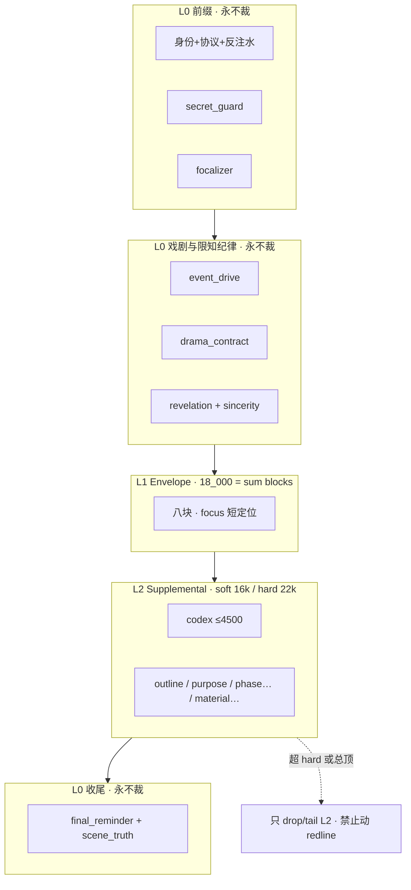
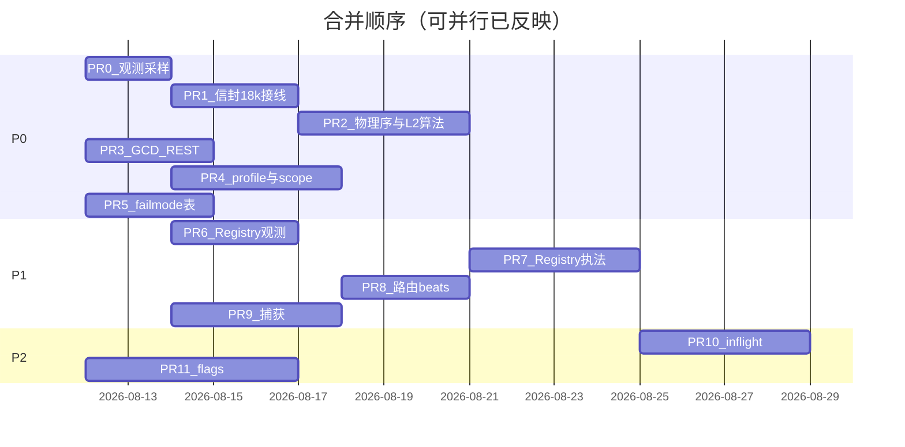

# 设计文档：铜炉写作全流程 · 上下文注入与数据生成 v2 最优改进方案

| 项 | 值 |
|----|-----|
| **文档标题** | 信封预算裁决 · 双层预算 · 写路径段注册表 · 软硬门诚实 · 分波 PR |
| **作者** | Grok Design（系统架构） |
| **日期** | 2026-08-11 |
| **修订** | **rev.2.1** · 关闭 rev.2 复评 minor：全量 segment 层/优先级表 + 显式 soft/hard 布尔式 |
| **状态** | **Draft · rev.2.1** |
| **产品** | 铜炉（tonglu）/ scribe3 长篇写作工作台 |
| **代码根（已核实）** | `/home/admin/projects/scribe-ia-verify-wt` |
| **对齐前序** | `docs/guides/2026-08-11-writing-context-injection-and-data-generation-full-flow.md`；章 IA `docs/plans/2026-08-10-chapter-writing-ia-optimal.md`；记忆质量 L1 `docs/plans/2026-08-09-memory-quality-to-9.5-system-design.md`；主编 H1 `docs/plans/2026-08-11-chief-module-generation-skill-vs-mcp.md` |
| **会话 scratch** | `/tmp/grok-1000/grok-design-doc-f84f38a4.md` |
| **验收环境** | demo 已部署栈（铜炉 `tonglu.example.com`）；**只冒烟已部署**；禁止 Grok 运行机全量 npm / 本机 Surreal / 再起平行栈 |
| **明确不做的宣称** | **不**因本方案宣称文学 ≥9.5；**不**默认把 soft advisory 升 hard park；**不**把评分卡当意图、经验复盘当 `pressure_drive`；成本**不是**约束——以注意力质量与戏剧优先为硬指标 |

---

### 读法（工程师 · 第一周）

1. **概述 + 关键决策** — 10k 信封结论、**18k 块表自洽**、双层预算、codex **物理重排**、软硬门诚实。  
2. **裁决表 + 可执行 L2 裁剪算法** — 数字、物理序、禁止 tail-chop L0。  
3. **运行时接线** — `get_block_budgets` / engine 传参；**仍 generation.v1** 热调。  
4. **H1/H2/H4 边界** — GCD 限长与拍数；Chief **强制 run_scope**。  
5. **PR Plan** — 可独立合并；可并行列。  

---

## 概述

铜炉写路径已收敛到单一编译入口 `write_assemble._assemble_write_instructions_v1`：前缀身份/协议/**codex（现网在戏剧前）** → `_render_final_input` 内 **事件驱动 + 戏剧合同** → **记忆信封 envelope（八块 · 默认 10_000）** → 大纲/简报必达/力学合同/偏好等大量 **supplemental domain**。信封侧有可审计的 `BLOCK_BUDGETS` 与 `token_budget`；**信封外的 domain 几乎无总额门**，总 system instructions 长度实质上无上界（H3）。与此同时，主编脚手架依赖种子文案软禁止 `s3_save_chapter`（H2）、硬 profile 仅演绎阶段存在（H4）、作者微调 GCD 的 REST PATCH 被 emergency 世界写闸默认 403（H1）。

本方案给出**最佳效果**优先的可落地改进：

1. **裁决：10k 信封对写作偏紧**——推荐默认信封总额 **18_000**（**块表之和必须 == 18_000**，禁止静默空额）；主增益在 **canonical / recent**；focus 仅短定位以防与 outline 双份。  
2. **总 prompt 双层预算 + 生成路径物理重排**：codex **移到** drama/envelope **之后**；L2 可执行裁剪优先级；**禁止**对最终串 tail-chop 误伤 `final_reminder`。  
3. **Segment Registry** 统一登记写路径所有注入段。  
4. **软 vs 硬门诚实化**：GCD REST 字段+限长+拍数；脚手架 profile + Chief **强制 `run_scope`**。  
5. **P0 → P1 → P2** 映射 H1–H6 / M1–M12 / L1–L5 与 O1–O19。

**算术不变量（实现必测）：**

```python
assert sum(BLOCK_BUDGETS_V2.values()) == DEFAULT_ENVELOPE_TOKEN_BUDGET == 18_000
```

---

## 背景与动机

### 1. 现网架构（代码事实）

#### 1.1 记忆信封 · 仅管八块

`scribe3/context_assembler.py`：

```text
BLOCK_BUDGETS = {
  focus: 800, global: 1200, canonical: 2800, recent: 1600,
  procedural: 900, reference: 1400, uncertainty: 500, provenance: 800,
}
# 之和 = 10_000 = ContextAssembler(token_budget=10_000) 默认
```

- `estimate_tokens(text) = len(text)`：中文场景 **字符≈token 保守上界**（偏高 → 宁可少放）。  
- `_allocate`：先块内 `_truncate_items`，再按八块顺序受 `token_budget` 门控；默认八块顶格恰好用满。  
- L1 重排 **仅** 在 `_allocate` 入口对 **`global` / `canonical`** 执行（`_reorder_l1_first`）；**recent 等无 L1 重排**（见 KD-B7）。  
- `CreativeContextEngine` 构造 `ContextAssembler(store, retriever)` **未传入** `token_budget`，故写路径恒默认 10k；**无** `SCRIBE3_ENVELOPE_TOKEN_BUDGET`；`_allocate` **直接读模块级** `BLOCK_BUDGETS` 全局常量。

#### 1.2 写路径 · 大量内容在信封外；codex 物理序在戏剧前

`_assemble_write_instructions_v1`（`api/services/write_assemble.py`）**现网真实顺序**：

```text
prefix: identity + write_protocol + revision + anti_slop
      + continue_snapshot + secret_guard + request_position
      + [tool_scope / craft_skills_index] + focalizer
      + codex                                          ← 现网：戏剧之前、无帽
_render_final_input:
  event_drive → drama_contract (≤~400)
  → envelope (≤10k)
  → seed_words → craft → phase_role → avoid → revelation → sincerity
  → purpose → outline (synopsis/beats 各 clip _OUTLINE_BUDGET=1200)
  → volume_intro (≤400) → brief_must → pressure_drive
  → author_prefs → voice_anchor
  → [draft/final: reference_craft / deduction / material_recall]
  → final_reminder / scene_truth(deduce)
```

`_domain_input` 只登记 `ContextSource` digest 供 Manifest——**不裁剪、不共享总额**。  
codex 圣经可膨胀至数千～上万字符，且 **先于** event_drive/drama 进入模型上下文（注意力淹没，见 Issue 2 修复）。

#### 1.3 门控与 profile（与 H1/H2/H4 相关）

| 机制 | 锚点 | 现网行为 |
|------|------|----------|
| Emergency REST 世界写闸 | `app_impl._emergency_rest_write_middleware`；`SCRIBE3_EMERGENCY_REST_WRITE` 默认 **False** | **路径级** 403，不看 body；`PATCH /chapters/{seq}` 一律拦 |
| 放行例外 | archive/restore、`/intent-goals`、materials、save-chapter 等 | **无** GCD 字段白名单 |
| `SCAFFOLD_FORBID_SAVE` | `web/src/lib/chiefSeed.js` | **软文案**；`WRITE_GATED` 不含 `s3_save_chapter` |
| 硬 profile | `run_stage_policy.py` 仅 `deduce` / `deduce_preview` | 未知 phase → `ValueError`；outline/beats 走完整 `scribe3_write` |
| UI `run_scope` | `api.js`：`chapter != null && phase` 时 `chapter:{n}:{phase}` | Chief 世界写注释常走 **全写 profile**；缺 scope 则策略不生效 |
| 限知出口 | `epistemic_guard.guard_write_instructions` | 异常 **fail-soft keep instructions** |
| 同章互斥 | `_loop_inflight` 等 | **进程内 set**；多 worker 失效 |

#### 1.4 检索侧静默缺口（M10）

`focus_bonus` 依赖 `linked_ids`；`_suppress_by_canonical` 依赖 episodic provenance `(entity, attribute)`。捕获未回填时 **静默失效**（telemetry：`unlinked_count` / `unconflictable_count`）。

### 2. 痛点总表（核实后）

| ID | 问题 | 严重度 | 代码锚点 |
|----|------|--------|----------|
| **H1** | 作者微调 GCD 的 REST PATCH 被 emergency 闸 403 | High | `app_impl` `/chapters`；`ChapterMetaReq.beats` |
| **H2** | 脚手架禁 save 仅软文案；write profile 仍含 ungated save | High | `chiefSeed`；`mcp/_common`；hermes include |
| **H3** | 信封预算 ≠ 总 prompt；supplemental 无界；codex 物理前置 | High | `write_assemble` prefix+domain |
| **H4** | 硬 profile 仅 deduce*；UI 未强制 outline/beats scope | High | `run_stage_policy`；Chief Run |
| **H5** | epistemic / must-link / continue_snapshot / drama 等多处 fail-soft | High | 多处 except |
| **H6** | 同章 inflight 进程局部 | High | `app_impl` 三套 set |
| **M1–M12 / L1–L5** | 见 rev.1 表（路由、schema、registry、去重、get_chapter、trace、捕获、缓存、bt_render、token 估算、GATE-B、NEE ensure、flags、PDC 默认） | Med/Low | 同前 |

### 3. 产品原则（不可违背）

- **冲突/事件驱动**；**引导 > 硬停**（默认 soft advisory）。  
- **soft ≠ hard park**，除非显式 flag。  
- 中文产品名：**评分卡 ≠ 意图**；**经验复盘 ≠ pressure_drive**。  
- 验收 = 已部署 demo 冒烟。

---

## 目标与非目标

### Goals

| # | 目标 |
|---|------|
| G1 | 信封与总 prompt **双层预算**；数字可配置；**`sum(blocks)==token_budget`** |
| G2 | **生成路径物理序** 戏剧钉先于 codex；Segment Registry |
| G3 | L0 永不裁；可执行 L2 裁剪；**禁止** final 串 tail-chop |
| G4 | H1–H4 门控诚实（GCD 边界、run_scope、profile） |
| G5 | 分波 PR 可独立合并；PR-0 用 demo 数据校准数字 |

### Non-Goals

| # | 非目标 | 理由 |
|---|--------|------|
| NG1 | 宣称文学 ≥9.5 | 产品禁令 |
| NG2 | 默认全 hard park | 引导 > 硬停 |
| NG3 | P0 上 Redis 分布式锁 | 单 worker；H6→P2 |
| NG4 | 重写检索融合 / 换 embedding | 正交 |
| NG5 | 合并五阶段字段 | 章 IA 已定 |
| NG6 | 讨论/写路径合成一套 prompt | policy 已分 |
| NG7 | Grok 机全量 pytest/npm/本机 Surreal 验收 | 资源规则 |
| NG8 | 第一波 Hermes 多 profile 集群拓扑大改 | 仅 policy+overlay |
| NG9 | **PR-1 升级 `generation.v2` policy 版本** | 避免 `policy_version` 校验炸点；预算走 settings 热调（见接线） |
| NG10 | **PR-1 改 discussion 默认信封** | 讨论维持 10k；列入 PR-11 或后续 |

---

## 信封 10k 裁决（核心问答）

### 结论

> **是，对「最佳写作效果」默认 10_000 偏少。**  
> **推荐默认信封总额：18_000**，且 **`sum(BLOCK_BUDGETS_V2) == 18_000`（无静默空额）**。  
> 主增益：**canonical (+4000) / recent (+2400)**；focus 仅 **+200** 并 **限制为短定位**（完整大纲 SSOT = domain `outline`）。  
> **同时必须**：codex **物理后移** + L2 帽 + 可执行裁剪（否则只加信封仍被设定圣经淹没）。  
> **数字初值**以注意力论证为据；**PR-0 在 demo 长书采样 `budget_report` 后允许微调** L2 soft/hard（开放问题 Q7）。

### 为何不是 32k / 为何不是「块表 16k + budget 18k」

| 选项 | 评价 |
|------|------|
| 维持 10k | 长书 must/state 易被块内裁；**不推荐写作默认** |
| 块表实为 16k 却宣称 18k | **禁止**（rev.1 错误）；总额门会留 2k 空转 |
| **推荐 18k 自洽块表** | 见下表；assert 锁死 |
| 24k | 长书 env 覆盖，非全局默认 |
| 32k | 未做 L2 裁剪前恶化注意力；仅实验 |

### 推荐 `BLOCK_BUDGETS`（默认 generation · **合计 18_000**）

| 块 | 现网 | **推荐** | Δ | 理由 |
|----|------|----------|---|------|
| **focus** | 800 | **1_000** | +200 | **仅短定位**（章号/标题/钩子摘要 ≤400 字符内容策略，见 KD-B6）；**禁止**再灌全文 synopsis/beats |
| **global** | 1_200 | **1_600** | +400 | 铁律 + 开放伏笔 + 主角色；L1 水位 |
| **canonical** | 2_800 | **6_800** | +4_000 | **主增益**：must-link pin + 状态事实 + 帧内命题 |
| **recent** | 1_600 | **4_000** | +2_400 | 近章决策/工作摘要；防失忆续写 |
| **procedural** | 900 | **1_200** | +300 | 已采纳方法/教训 |
| **reference** | 1_400 | **1_600** | +200 | 借鉴非事实；克制 |
| **uncertainty** | 500 | **800** | +300 | 冲突/低信心可见 |
| **provenance** | 800 | **1_000** | +200 | 溯源可摘要化 |
| **合计** | 10_000 | **18_000** | **+8_000** | **验算：1000+1600+6800+4000+1200+1600+800+1000 = 18000** |

**块内裁剪（P0 vs P1 · KD-B7）：**

| 范围 | P0（PR-1） | P1+ |
|------|------------|-----|
| `global` / `canonical` | **保持**现网 `_reorder_l1_first` + `_truncate_items` | 可增强 L1 水位 metric |
| `recent` / 其他块 | **仅**既有检索分序 + `_truncate_items`；**不**假装已有「五级跨块策略」 | 可选块内策略扩展 |
| 跨块 | 仍由八块固定序 + 总额门；**不**因改数字自动实现「recent 优先于 procedural 的跨块回收」 | Phase-2 可选从 recent 回收补给 L1 |

叙事优先级（产品意图，**非** P0 自动实现的跨块算法）：must/铁律/state → 开放伏笔 → recent 高分 → procedural/reference → provenance 细节。

### 总 prompt 双层预算 + **强制物理序**（回应 H3 + Issue 2）

#### 目标物理序（生成 draft/final · **必须单测锁相对序**）

```text
# 顺序 = 下表「物理序」列；每段必有 layer∈{redline,envelope,supplemental}
identity → write_protocol → revision → anti_slop
→ continue_snapshot → secret_guard → request_position
→ tool_scope? → craft_skills_index? → focalizer
→ event_drive → drama_contract
→ envelope
→ codex → seed_words → craft → phase_role → avoid
→ revelation_discipline → sincerity
→ purpose → outline → volume_intro → brief_must → pressure_drive
→ author_prefs → voice_anchor
→ reference_craft* → deduction* → material_recall   # * 仅 draft/final 或按 phase
→ final_reminder → scene_truth? → request_constraint?
```



| 层 | 默认（generation） | 策略 |
|----|-------------------|------|
| **L0 Hard-Redline** | 不计入可裁预算；实测进 `budget_report.l0_est` | **永不**因 token 删除；仅段内自有 clip（drama ≤400） |
| **L1 Envelope** | **18_000** = sum(blocks) | 实例级 `token_budget` + `block_budgets`；**L2 算法不拆 envelope 内部** |
| **L2 Supplemental** | soft **16_000** / hard **22_000** | 见全量 segment 表 + 显式布尔式 |
| **Total 硬顶** | **48_000**（`l0+l1+l2`；**不含**用户 request 正文） | 超顶只裁 L2；L2 已空仍超 → fail-loud metric，**不** tail-chop join 结果 |

> 成本非约束：18k/48k 服务 **注意力与戏剧钉**；优先加 canonical/recent，不无差别灌 codex。

#### 可执行 L2 裁剪算法（PR-2 · 禁止最终串 tail-chop）

**数据结构：** join 前 `list[Segment]`：`segment_id`, `layer`, `text`, `priority`（仅 supplemental；越小越先丢）, `trim`。  
**禁止**先拼整串再 `s[:N]`。

##### 全量 segment 登记表（物理序 · 无隐式跳过）

> **规则：** 物理序中出现的每一段 **必须** 在下表有一行。  
> - `layer=redline` 或 `envelope` → **never** 参与 L2 victim 选择。  
> - `layer=supplemental` → 必有整数 `priority`（小 = 先丢）与 `trim`。  
> - **default_priority 规则（防漏登记）：** 若实现新增 domain 忘记登记 → 视为 `layer=supplemental`, `priority=55`, `trim=drop_whole`，并 **metric `segment_unregistered`**（不得静默当 redline，也不得从 victim 池消失）。

| 物理序 | segment_id | layer | priority / never | trim | 段内 cap / 备注 |
|-------:|------------|-------|------------------|------|-----------------|
| 1 | `identity` | redline | **never** | none | 身份块 |
| 2 | `write_protocol` | redline | **never** | none | |
| 3 | `revision` | redline | **never** | none | `_write_revision_block` |
| 4 | `anti_slop` | redline | **never** | none | |
| 5 | `continue_snapshot` | redline | **never** | none | 可空；失败 soft_empty 但不因预算删 |
| 6 | `secret_guard` | redline | **never** | none | |
| 7 | `request_position` | redline | **never** | none | 当前章位 |
| 8 | `tool_scope` | redline | **never** | none | 可选 with_tools |
| 9 | `craft_skills_index` | redline | **never** | none | 可选 |
| 10 | `focalizer` | redline | **never** | none | 限知/全知横幅 |
| 11 | `event_drive` | redline | **never** | none | 段内 format 自有长度 |
| 12 | `drama_contract` | redline | **never** | none | ≤~400 |
| 13 | `envelope` | envelope | **never**（整包） | Assembler 内裁 | L1；不进 L2 victim |
| 14 | `codex` | supplemental | **90**（最晚动） | tail | **4500** 段内 cap 先做 |
| 15 | `seed_words` | supplemental | **40** | tail | |
| 16 | `craft` | supplemental | **42** | tail | |
| 17 | `phase_role` | supplemental | **50** | drop_whole | 阶段角色短文 |
| 18 | `avoid` | supplemental | **48** | drop_whole | |
| 19 | `revelation_discipline` | **redline** | **never** | none | **钉死 L0**：限知揭示纪律 |
| 20 | `sincerity` | **redline** | **never** | none | **钉死 L0**：焦点真诚块 |
| 21 | `purpose` | supplemental | **70** | tail | 目的合同；偏后丢 |
| 22 | `outline` | supplemental | **65** | tail | synopsis/beats 各 ≤1200 后再 tail |
| 23 | `volume_intro` | supplemental | **25** | drop_whole | ≤400 |
| 24 | `brief_must` | supplemental | **68** | tail | 保留短操作句优先 |
| 25 | `pressure_drive` | supplemental | **72** | tail | 力学钉；尽量晚丢 |
| 26 | `author_prefs` | supplemental | **20** | drop_whole / tail | |
| 27 | `voice_anchor` | supplemental | **30** | drop_whole | |
| 28 | `reference_craft` | supplemental | **12** | drop_whole | 多 fingerprint：从后往前逐条 |
| 29 | `deduction_protocol` | supplemental | **75** | drop_whole | draft/final 演绎协议头 |
| 30 | `deduction_item` / `scene_truth`（写路径注入的真相段） | supplemental | **78** | tail | 多条：从后往前；**deduce 相位**的场景真相终检见序 33 |
| 31 | `material_recall` | supplemental | **10**（最先丢） | drop_whole | |
| 32 | `final_reminder` | redline | **never** | none | **禁止**任何预算路径截断 |
| 33 | `scene_truth`（deduce 终检合同） | redline | **never** | none | 仅 phase=deduce |
| 34 | `request_constraint` | supplemental | **60** | tail | `extra_instructions` |

**L2 victim 选择顺序（仅 `layer==supplemental` 且 `text` 非空）：**  
按 `priority` **升序**；同 priority 按物理序**从后往前**（后出现的先丢）。  
等价速查（priority 升序）：

```text
10 material_recall
12 reference_craft (末条→首条)
20 author_prefs
25 volume_intro
30 voice_anchor
40 seed_words
42 craft
48 avoid
50 phase_role
55 *default_priority*（未登记新段）
60 request_constraint
65 outline
68 brief_must
70 purpose
72 pressure_drive
75 deduction_protocol
78 deduction_item / write-path scene_truth 段
90 codex (段内 4500 之后仍超才 tail)
```

**段内 cap（build 时，先于层循环）：**

| segment_id | 段内硬帽 |
|------------|----------|
| `codex` | `SCRIBE3_CODEX_INJECT_CAP` = **4500** |
| `outline` | synopsis/beats 各 1200 |
| `volume_intro` | 400 |
| `drama_contract` | ~400（redline 自有） |
| `event_drive` | format 内既有 |

##### 伪代码（显式 soft / hard / 总顶 · 实现抄录）

```text
function allocate_prompt(segments, envelope, caps):
  # --- 1) 段内 cap（与层 soft/hard 无关）---
  for s in segments:
    if s.segment_id == "codex":
      s.text = clip(s.text, CODE_INJECT_CAP)   # 4500

  # --- 2) 分层累计（estimate_tokens ≡ len 保守口径）---
  l0 = sum(len(s.text) for s in segments if s.layer == "redline")
  l1 = envelope.total_token_estimate            # Assembler 已约束 ≤ 18k
  l2_segs = [s for s in segments if s.layer == "supplemental"]
  def l2_sum(): return sum(len(s.text) for s in l2_segs if s.text)

  # --- 3) P0b soft：只告警，不 drop ---
  l2 = l2_sum()
  if l2 > SUPPLEMENTAL_SOFT:                   # 默认 16000
    report soft_exceeded(l2=l2, soft=SUPPLEMENTAL_SOFT)
    # 不修改 segments

  # --- 4) P0c hard：L2 超硬帽 或 总 prompt 超硬顶 ---
  # 显式条件（禁止「折算规则」含糊写法）：
  while (l2_sum() > SUPPLEMENTAL_HARD) or (l0 + l1 + l2_sum() > PROMPT_HARD):
    # SUPPLEMENTAL_HARD 默认 22000；PROMPT_HARD 默认 48000
    victim = lowest_priority_alive(l2_segs)
    # = min priority among supplemental with non-empty text;
    #   tie-break: later physical order first
    if victim is None:
      break
    apply_trim(victim)                         # drop_whole 或 tail；append cuts[]
    if not victim.text:
      # 已空则移出活跃池（保留 segment 占位可选，len=0 不计）
      pass

  # --- 5) 仍超总顶且无 victim：fail-loud，绝不切片 join 结果 ---
  total = l0 + l1 + l2_sum()
  if total > PROMPT_HARD:
    fail_loud_metric("prompt_hard_exhausted", total=total, l0=l0, l1=l1, l2=l2_sum())
    # 仍 return 完整 join；由调用方/观测处理，禁止 rendered = rendered[:PROMPT_HARD]

  # --- 6) join ---
  return join(segments in physical order)      # 空 text 段可省略分隔
```

**与分阶段统一：**

| 子阶段 | 行为 |
|--------|------|
| **P0a / PR-0** | 只观测 `budget_report`（各段长度 + layer）；**不裁** |
| **P0b / PR-2 前半** | 物理重排 + codex 段内 cap；`if l2 > SOFT: soft_exceeded` **只告警** |
| **P0c / PR-2 完整** | `while (l2 > HARD) or (l0+l1+l2 > PROMPT_HARD):` 按 priority 表 drop/tail |

### 配置与运行时接线（关闭 Issue 4）

| 键 | 类型 | 默认 | 说明 |
|----|------|------|------|
| `SCRIBE3_ENVELOPE_TOKEN_BUDGET` | int | **18000** | → `ContextAssembler.token_budget` |
| `SCRIBE3_ENVELOPE_BLOCK_BUDGETS_JSON` | json | 见上表 | 覆盖单块；**启动/每次读取后校验** `sum==token_budget`（或显式 `slack` 并 metric；**默认禁止 slack**） |
| `SCRIBE3_SUPPLEMENTAL_TOKEN_SOFT` | int | **16000** | L2 soft |
| `SCRIBE3_SUPPLEMENTAL_TOKEN_HARD` | int | **22000** | L2 hard |
| `SCRIBE3_PROMPT_TOKEN_HARD` | int | **48000** | 总硬顶 |
| `SCRIBE3_CODEX_INJECT_CAP` | int | **4500** | codex 段内帽 |
| `SCRIBE3_GCD_REST_ALLOW` | bool | **true** | H1 开关；0=恢复全闸 |
| `SCRIBE3_EPISTEMIC_FAIL_LOUD` | bool | **false** | H5 质量模式 |
| `SCRIBE3_FOCUS_SHORT_CAP` | int | **400** | focus 块内大纲类文本上限（配合 KD-B6） |

**PR-1 接线规格（落地）：**

1. 新增 `scribe3/context_budget.py`（或 `settings` helpers）：  
   - `get_envelope_token_budget() -> int`：热读 settings/env，默认 18000。  
   - `get_block_budgets() -> dict[str,int]`：默认 `BLOCK_BUDGETS_V2` 拷贝；若 JSON 覆盖则 merge；**校验** `sum(values) == get_envelope_token_budget()`，失败则 log error 并回退内置默认（或 fail-loud 于测试）。  
2. `ContextAssembler.__init__(..., token_budget=None, block_budgets=None)`：  
   - 实例字段 `self.token_budget` / `self.block_budgets`；  
   - `_allocate` **只读实例**，**不**写全局可变 dict（避免测试污染）。  
3. `CreativeContextEngine.__init__` / `compile`：  
   ```python
   ContextAssembler(
       store, retriever,
       token_budget=get_envelope_token_budget(),
       block_budgets=get_block_budgets(),
   )
   ```  
4. **Policy 版本：PR-1 仍 `generation.v1`** + settings 热调预算；**不**在本波改 `ContextRequest.policy_version` 为 v2（避免 `for_task` 与 `request.policy_version` 不匹配 `ValueError`）。预算进 `ContextPolicy.safe_payload` 留待后续独立 PR。  
5. **热读粒度：** 每次 `assemble`/`compile` 调用 `get_*`（settings 已有 cache + invalidate）；**不**在 import 时冻死。  
6. **discussion：** PR-1 **非目标**；讨论路径继续默认 10k（或显式不改 engine 调用方）。  

**兼容：** 测试可 `monkeypatch` env=10000 + 旧块表 JSON；或断言跟新 18k。

---

## 目标架构

### 1. Segment Registry

```python
@dataclass(frozen=True)
class WriteSegmentSpec:
    segment_id: str
    layer: Literal["redline", "envelope", "supplemental"]
    source_kind: str
    priority: int            # L2 内：小 = 先丢
    budget: int | None
    trim: Literal["none", "tail", "head_keep_l1", "drop_whole"]
    phases: frozenset[str]
    fail_mode: Literal["soft_empty", "soft_keep", "loud"]
    builder: str
```

**迁移：** PR-6 只观测（段列表/长度对齐现网**目标序**或过渡双轨）→ PR-7 执法 L2 裁剪；envelope 仍为 Assembler 复合段。

### 2. Soft vs Hard 门

| 能力 | 现网 | 目标 |
|------|------|------|
| 大纲/节拍主写 | MCP plan 待批 | **保持** |
| 作者 GCD 微调 | REST 403 | **字段级 + 限长 + 拍数守恒**（见 H1） |
| 脚手架 save | 软文案 | profile **物理排除** + Chief **强制 run_scope** + 软文案双保险 |
| 限知 | soft keep | soft + metric；可选 loud |
| 同章并发 | 进程 set | P0 日志；P2 store 锁 |

---

## API / 接口变更

| 变更 | 类型 | 说明 |
|------|------|------|
| `GET /capabilities` | 扩展 | `envelope_token_budget`、`block_budgets_sum`、`supplemental_*`、`codex_inject_cap`、`gcd_rest_allow`、`epistemic_fail_loud` |
| `PATCH /chapters/{seq}` | 行为 | 见 H1 收紧规则 |
| envelope_trace | 扩展 | `budget_report`（层用量、cuts、物理序版本、`prompt_token_estimate`） |
| Hermes overlay | 运维 | `scribe3_plan` 或 `scribe3_outline`/`scribe3_beats`：include plan+读，**排除** save/ingest |
| Chief / api Run | 行为 | 脚手架种子 **必须** 带 `run_scope=chapter:{n}:outline\|beats\|deduce` |

### H1：字段级 REST 例外（收紧 · Issue 5）

**开关：** `SCRIBE3_GCD_REST_ALLOW` 默认开；关则行为与现网一致（全 403）。

**实现落点（二选一，推荐 B）：**

- **A：** middleware 对 `PATCH /chapters/{seq}` 在 emergency 关时预读 body JSON，仅 allowlist 则放行，否则 403。  
- **B（推荐）：** middleware 对「纯 GCD 候选」路径仍 403 太粗 → 改为 **路径仍进 handler**，但仅当 `_flag GCD allow` 时 middleware **跳过** `/chapters/{digits}` 的 PATCH；**`patch_chapter` 首行** `assert_gcd_only_or_raise`：非法字段 → **403**（与世界闸同语义），校验失败 → **422**。

**Allowlist body keys（仅此）：**

- `beats`（可选）  
- `beats_meta`（可选，且 **仅**允许键 `chapter_hook`；其他 meta 键 → 403）

**`beats` 数组约束：**

| 规则 | 值 |
|------|-----|
| 拍数 | **必须等于** 库内当前 `len(beats)`（**禁止**增删拍）；空章无拍 → 403「请先经 plan 建节拍」 |
| 允许每拍字段 | `goal`, `conflict`, `turn`, `cost`, `hook`, `text`, `done`（及既有 id 若有只读保持） |
| `text` 硬顶 | **每拍 ≤ 280 字**（字符）；超 → **422** |
| GCD 标量 | 每字段 ≤ **200 字** |
| `chapter_hook` | ≤ **200 字** |
| 禁止字段同包 | `synopsis`, `scene_truth`, `deductions`, `pressure_drive`, `title`, `volume`, `label`, `purpose_text`, `deltas`, … → **403** |

**语义：** 作者微调 **已有** 节拍上的 GCD 格子，**不是** REST 整表重构大纲；结构增删仍走 `s3_patch_chapter_plan` 审批。

**验收单测：**

| 请求 | 期望 |
|------|------|
| 仅改 `beats[i].goal`（拍数不变） | 200 |
| `beats` + `synopsis` | 403 |
| `scene_truth` | 403 |
| `beats[i].text` 超 280 字 | 422 |
| 拍数 3→4 | 403/422 |
| `beats_meta.drama_validation` | 403 |

**产品冲突评估：** 与「结构走 plan」**不冲突**——拍数与结构锁定；仅标量微调。若未来收紧为 MCP-only，设 `SCRIBE3_GCD_REST_ALLOW=0`。

### H2/H4：脚手架硬 profile + **强制 run_scope**（Issue 6）

**后端 `run_stage_policy`：**

| phase | profile | allowed（概念） | 排除 |
|-------|---------|-----------------|------|
| `outline` | `scribe3_plan`（可与 beats 共用） | `s3_patch_chapter_plan`, `s3_get_chapter`, 必要只读 | **`s3_save_chapter`**, **`s3_ingest_chapter`** |
| `beats` | 同上或 `scribe3_beats` | 同上 | 同上 |
| `deduce` | 保持现网 `scribe3_deduce` | 现网集合 | 现网 |

Hermes overlay / `mcp_servers.*.tools.include` 与上表一致；`validate_tool_trace` **fail-closed**。

**前端 / Chief（PR-4 必验 · 否则策略虚设）：**

1. 从 `seedChapterOutline` / `seedChapterBeats` / 章工作台「让主编写大纲|节拍」发起的 Run：**必须** `run_scope=chapter:{n}:outline` 或 `...:beats`。  
2. `api.js` 创建 Run：若种子来自脚手架 contract（`scaffoldToolContract` 非 null），**禁止**省略 phase。  
3. 无 `run_scope` 的书级写 Run：**不得**作为「完成大纲/节拍」的产品主路径（可仍走全写 profile 做世界设定——与脚手架分离）。  
4. 软 `SCAFFOLD_FORBID_SAVE` **保留作双保险**，**不得**再当唯一控制。

---

## 数据模型变更

| 项 | 变更 |
|----|------|
| Surreal | 无强制 migration |
| manifest / turn_bind | 可选 `budget_report`（无正文） |
| settings | 上表 flag 键 |

---

## 问题波次与 O1–O19

| ID | 方向 | 回应 |
|----|------|------|
| O1 | 信封 18k **自洽**块表 + 接线 | 注意力、H3 部分 |
| O2 | 双层预算 + **可执行 L2 算法** + 总顶 | **H3** |
| O3 | Segment Registry | M5/M6 |
| O4 | codex cap + **物理后移** | H3、注意力 |
| O5 | GCD REST 收紧规则 | **H1** |
| O6–O7 | profile + **run_scope 强制** | **H2/H4** |
| O8 | fail-mode 全表 | **H5** |
| O9–O19 | 同 rev.1（inflight、路由、schema、去重、缓存、trace、捕获、flags…） | M/L |

### P0 / P1 / P2

- **P0：** PR-0 采样 → PR-1 18k 接线 → PR-2 物理序+codex cap+L2 算法 → PR-3 GCD → PR-4 profile+run_scope → PR-5 fail-mode 表。  
- **P1：** Registry、去重、get_chapter 缓存、路由/beats/审批、捕获回填。  
- **P2：** inflight 后端、token 精算、flags 全文索引、bt_render。  

**P0 非目标：** Redis 锁、NEE/PDC 默认全开、generation.v2 policy、discussion 改预算。

---

## 备选方案

| 方案 | 结论 |
|------|------|
| A 只加信封不动 L2/序 | **否决**（H3/注意力） |
| B 单池 40k | **否决**（会裁戏剧） |
| C 本方案 18k 自洽 + 物理序 + L2 算法 | **推荐** |
| D 默认 hard park 脚手架 | **否决为默认** |

---

## 安全与隐私

| 风险 | 缓解 |
|------|------|
| GCD REST 滥用 | 拍数守恒、text 280、混写 403、开关可关 |
| 加大预算泄密面 | project_frame + guard；loud 可选 |
| trace 泄露 | 仅计数/id/reason |
| profile 漏 save | include 白名单 + validate_tool_trace |
| 无 run_scope 绕过 | UI 强制 + 验收冒烟 |

---

## 可观测性

| 信号 | 说明 |
|------|------|
| `budget_report` | `l0_est`, `l1_est`, `l2_est`, `prompt_token_estimate`, `cuts[]`, `codex_len`, `physical_order_version`, `soft_exceeded` |
| `l1_fill` | global/canonical L1 占用 |
| fail-soft counters | 见 PR-5 表 |
| `unlinked_count` / `unconflictable_count` | 检索 |
| run_scope / profile | Run 审计 |

---

## 落地与回滚

| 阶段 | 行为 |
|------|------|
| 默认 | 信封 18k 自洽；codex 后移+帽；L2 soft 告警→hard 裁 |
| 回滚信封 | env=10000 + 旧块 JSON |
| 回滚序 | `SCRIBE3_CODEX_AFTER_DRAMA=0`（若需紧急开关；默认 1） |
| GCD | `SCRIBE3_GCD_REST_ALLOW=0` |
| profile | overlay 指回 `scribe3_write` |

### 验收（demo 已部署）

```text
1) capabilities 含预算 flags；assert 报告 block sum == envelope budget
2) write 一次：trace 物理序 event_drive 索引 < drama < envelope < codex；
   codex_len ≤ 4500；无 final_reminder 被截断
3) GCD 单测表全绿
4) 大纲 Run：run_scope=chapter:N:outline；tool trace 无 save
5) GATE-B 存正文、plan 审批仍通
```

---

## 开放问题

| # | 问题 | 倾向 |
|---|------|------|
| Q1 | GCD REST vs MCP | REST 收紧规则默认；可关 |
| Q2 | outline/beats 共 profile？ | 共 `scribe3_plan` 可 |
| Q3 | L2 soft 是否裁 | **已统一**：P0a 观测 → P0b soft 告警+codex cap → P0c hard 裁 |
| Q4 | focus vs outline | **P0 已定 KD-B6**：focus 短定位；outline SSOT |
| Q5 | task 分档 | draft/final 18k；discussion 10k 暂不动 |
| Q6 | 多 worker | P2 |
| Q7 | L2 16k/22k/48k 是否过大/过小 | **PR-0 强制采样后校准**；本文数字为初值 |

---

## 参考

- 代码：`context_assembler.py`、`context_engine.py`、`context_policy.py`、`write_assemble.py`、`app_impl.py`、`run_stage_policy.py`、`mcp/_common.py`、`memory_retrieval.py`、`memory_must_link.py`、`epistemic_guard.py`、`chiefSeed.js`、`settings.py`  
- 文档：全流程指南；章 IA；记忆质量 L1；主编 H1  
- 评审：`/tmp/grok-1000/grok-design-review-f84f38a4.md`

---

## 关键决策（强制）

| ID | 决策 | 理由 |
|----|------|------|
| **KD-B1** | 默认信封 **10k → 18_000**；**`sum(blocks)==18000`**；主增益 **canonical +4000 / recent +2400**；focus 仅 +200 | 算术自洽；写作连贯；非烧配额 |
| **KD-B2** | 双层预算 L1+L2；**L0 永不裁**；冲突时只裁 L2（再考虑 envelope 内部非 L1，由 Assembler） | H3；裁记忆不裁戏剧 |
| **KD-B3** | 总硬顶 48k；codex 帽 4500；**全量 segment→(layer,priority\|never)**；hard 条件为 **`l2>HARD or l0+l1+l2>PROMPT_HARD`**；**禁止** join 后 tail-chop | 无隐式段；防误伤 final_reminder |
| **KD-B4** | PR-1：**settings 热调 + 实例级 block_budgets**；**仍 generation.v1**；engine **必须**传 token_budget | 可回滚；避免 policy 版本炸点 |
| **KD-B5** | 不单池；不默认 32k | 注意力 |
| **KD-B6** | **focus 短定位**（内容策略 ≤~400）；完整大纲 **domain outline 为 SSOT** | 防 P0 双份放大 |
| **KD-B7** | P0 块内策略 = 现网 L1 仅 global/canonical；**不**宣称五级跨块已实现 | 诚实范围 |
| **KD-B8** | **生成路径物理序**：focalizer → **event_drive → drama_contract → envelope → codex(capped)** → … → final_reminder | 注意力；章 IA 戏剧置顶 |
| **KD-G1** | H1：拍数守恒 + 字段 allowlist + text≤280 / GCD≤200；混写 403 | 防 REST 重构节拍 |
| **KD-G2** | H2/H4：受限 profile **排除 save/ingest**；Chief **强制 run_scope**；软文案仅双保险 | 策略否则虚设 |
| **KD-G3** | H5：默认 soft_keep 生成可用；全表 metric；仅白名单点可 loud | 引导优先 |
| **KD-G4** | H6：P0 日志；P2 锁；不阻塞预算 PR | 单 worker |
| **KD-R1** | Registry 先观测后执法 | 降回归 |
| **KD-R2** | 戏剧链 **event_drive → drama → envelope** 冻结；codex **不得**回到此前缀 | Issue 2 |
| **KD-P1** | soft 不默认升 hard；NEE/PDC 不强制全开 | 产品原则 |
| **KD-P2** | 验收只冒烟已部署 demo；PR-0 采样校准 L2 | 数据诚实 |
| **KD-N1** | 不宣称 ≥9.5；评分卡≠意图；经验复盘≠PDC | 产品原则 |

---

## PR 计划（强制 · 可独立合并）

> 每 PR 可单独合并；表含 **可并行** 列。

### PR-0 · 观测基线 + demo 采样（O17、Q7）

| 项 | 内容 |
|----|------|
| **目标** | `budget_report`：envelope 各块、各 domain 字符、prompt 总估、**现网物理序索引**；demo 1–2 本长书采样写入证据目录 |
| **文件** | `write_assemble.py`、trace manifest、可选 Inspector |
| **验收** | 有直方图/表；**不改变** instructions 字节（或仅附加 trace） |
| **可并行** | 与 PR-3 草稿设计并行 |
| **风险** | 低 |

### PR-1 · 信封 18k 自洽 + 运行时接线（O1）

| 项 | 内容 |
|----|------|
| **目标** | `BLOCK_BUDGETS_V2` 默认；`get_envelope_token_budget` / `get_block_budgets`；`ContextAssembler` 实例预算；**`CreativeContextEngine` 传入 token_budget+block_budgets**；assert sum；settings 登记 env 键清单（PR-11 子集） |
| **文件** | `context_assembler.py`、`context_engine.py`、`settings.py`、新 helper、测试、ContextInspector 常量 |
| **验收** | `sum==18000` 单测；engine 路径非默认 10k；env 回滚 10k 可用 |
| **可并行** | 与 PR-3、PR-5 并行 |
| **非目标** | generation.v2 policy；discussion 预算；L2 裁剪 |
| **回滚** | env + 旧 JSON |

### PR-2 · codex 物理后移 + cap + L2 算法（O2、O4、KD-B8）

| 项 | 内容 |
|----|------|
| **目标** | 按目标物理序重排；codex cap；P0b soft 告警；P0c hard 按优先级表 drop/tail；单测锁 `index(event_drive)<index(drama)<index(envelope)<index(codex)<index(final_reminder)`；**禁止** `rendered[:hard]` |
| **文件** | `write_assemble.py`、可选 `write_budget.py`、settings、单测 |
| **验收** | 超大 codex ≤4500；超 L2 hard 时 material 先丢、final_reminder 仍在文末 |
| **依赖** | 建议 PR-1 后；可与 PR-0 采样对照 |
| **可并行** | 与 PR-4 部分并行 |

### PR-3 · GCD REST 收紧（O5 / H1）

| 项 | 内容 |
|----|------|
| **目标** | 拍数守恒 + 字段/限长；验收表全绿；`SCRIBE3_GCD_REST_ALLOW` |
| **文件** | `chapters.patch_chapter` / middleware、`test_emergency_rest_write.py` |
| **可并行** | 与 PR-1 **并行** |
| **依赖** | 无 |

### PR-4 · 脚手架 profile + run_scope（O6、O7 / H2、H4）

| 项 | 内容 |
|----|------|
| **目标** | `run_stage_policy` outline/beats；Hermes include 无 save/ingest；**Chief/api 强制 run_scope**；validate_tool_trace；软文案保留 |
| **文件** | `run_stage_policy.py`、`deploy/hermes/*`、ChiefDock / api.js / 种子路径、测试 |
| **验收** | 大纲 Run 审计含 scope；工具链无 save；无 scope 的脚手架路径产品拒绝或告警 |
| **可并行** | 与 PR-2 部分并行 |
| **注意** | deduce 不变 |

### PR-5 · fail-mode 全表（O8 / H5）

| soft 点 | 默认 | metric | 允许 loud？ |
|---------|------|--------|-------------|
| `guard_write_instructions` 异常 | soft_keep | `epistemic_guard_fail` | **是**（`EPISTEMIC_FAIL_LOUD`） |
| `guard` scrub hits | scrub 后继续 | `epistemic_scrub_hits` | 否（已处理） |
| `_drama_block` / `_event_drive_block` | soft_empty | `drama_block_fail` / `event_drive_fail` | 否（生成可用） |
| `_outline_write_domain` | soft_empty | `outline_inject_fail` | 否 |
| `continue_snapshot` | soft 跳过 | `continue_snapshot_fail` | 否 |
| must-link pin / frame filter | soft；facts 可能降级 | `must_link_pin_fail`；进 omitted/budget_report | **否** P0 loud |
| partition_facts fail-soft | soft | `partition_fail` | 否 |
| TurnBind / memory_trace 落库 | soft | 已有 warning | 否 |

| 项 | 内容 |
|----|------|
| **目标** | 上表接线计数；epistemic loud 开关；must-link 失败至少 **可观测** |
| **文件** | `write_assemble.py`、`epistemic_guard.py`、`memory_must_link`/`context_assembler` 计数、settings |
| **可并行** | 与 PR-1/3 并行 |

### PR-6 · Registry 观测（O3、O14）

| 项 | 内容 |
|----|------|
| **目标** | 段列表对齐 **目标物理序**；无静默丢段 |
| **可并行** | **可与 PR-1 并行**（观测模式） |
| **依赖** | 不强制等 PR-2；若 PR-2 已合则锁新序 |

### PR-7 · Registry 执法 + 去重 + chapter 缓存（O3、O15、O16）

| 项 | 内容 |
|----|------|
| **依赖** | PR-6；L2 算法可迁入 registry |
| **验收** | get_chapter 次数下降；裁剪单测 |

### PR-8 · 路由 / beats / 审批（O10、O11、O13）

| 可并行 | 与 PR-4 后半并行 |

### PR-9 · 捕获回填（O18）

| 可并行 | 与 P0 并行（不阻塞） |

### PR-10 · Inflight 后端（O9 / H6）

| 依赖 | 不阻塞 P0 |

### PR-11 · flags 索引

| 项 | 内容 |
|----|------|
| **目标** | 控制面/GLOSSARY；**PR-1 已附 env 键清单作子集** |
| **可并行** | 与任意波并行 |



---

## 附录 A · 推荐常量快照（实现抄录）

```python
# 默认 generation 信封（算术锁死）
BLOCK_BUDGETS_V2 = {
    "focus": 1000,
    "global": 1600,
    "canonical": 6800,
    "recent": 4000,
    "procedural": 1200,
    "reference": 1600,
    "uncertainty": 800,
    "provenance": 1000,
}
DEFAULT_ENVELOPE_TOKEN_BUDGET = 18_000
assert sum(BLOCK_BUDGETS_V2.values()) == DEFAULT_ENVELOPE_TOKEN_BUDGET

DEFAULT_SUPPLEMENTAL_SOFT = 16_000
DEFAULT_SUPPLEMENTAL_HARD = 22_000
DEFAULT_PROMPT_HARD = 48_000
DEFAULT_CODEX_INJECT_CAP = 4_500
DEFAULT_FOCUS_SHORT_CAP = 400
GCD_BEAT_TEXT_MAX = 280
GCD_FIELD_MAX = 200

# 已有保持
_VOLUME_INTRO_BUDGET = 400
_OUTLINE_BUDGET = 1200  # outline domain 内 synopsis/beats 各上限
# drama_block ≤400

# 物理序版本号（trace）
PHYSICAL_ORDER_VERSION = "write-physical.v2-codex-after-envelope"
```

## 附录 B · 现网 vs 目标对照

| 维度 | 现网 | 目标 |
|------|------|------|
| 信封总额 | 10_000 | **18_000 = sum(blocks)** |
| 块表/总额 | 模块常量；engine 未传 budget | 实例预算 + 热读；assert 自洽 |
| 总 prompt | 无上限 | 双层 + 48k；可执行 L2 表 |
| codex 位置 | prefix，戏剧前 | **envelope 后**，帽 4500 |
| focus vs outline | 易双份 | focus 短定位；outline SSOT |
| GCD REST | 全 403 | 拍数守恒 + 限长微调 |
| 脚手架 save | 软禁止 | profile 硬排除 + **强制 run_scope** |
| 硬 profile | 仅 deduce | + outline/beats |
| epistemic 等 | soft keep | 表驱动 metric + 可选 loud |
| inflight | 进程 set | 接口 + P2 锁 |

## 附录 C · 全量 layer / priority 速查（实现抄录）

```text
# redline NEVER（不参与 victim）
identity, write_protocol, revision, anti_slop, continue_snapshot,
secret_guard, request_position, tool_scope, craft_skills_index, focalizer,
event_drive, drama_contract, revelation_discipline, sincerity,
final_reminder, scene_truth@deduce

# envelope NEVER（整包；内部由 Assembler）
envelope

# supplemental priority 升序 = 先丢（default 未登记 = 55 + metric）
10 material_recall
12 reference_craft
20 author_prefs
25 volume_intro
30 voice_anchor
40 seed_words
42 craft
48 avoid
50 phase_role
55 *unregistered default*
60 request_constraint
65 outline
68 brief_must
70 purpose
72 pressure_drive
75 deduction_protocol
78 deduction_item
90 codex  (after 4500 cap)

# 循环条件（P0c）— 禁止含糊「折算」
if l2 > SOFT: soft_exceeded only          # P0b
while (l2 > HARD) or (l0+l1+l2 > PROMPT_HARD): trim victim
if still over and no victim: fail_loud; do NOT slice join

NEVER → rendered_input[:PROMPT_HARD]
```

---

*文档结束 · Draft rev.2.1 · 2026-08-11 · 基于代码核实 + 评审修订*
