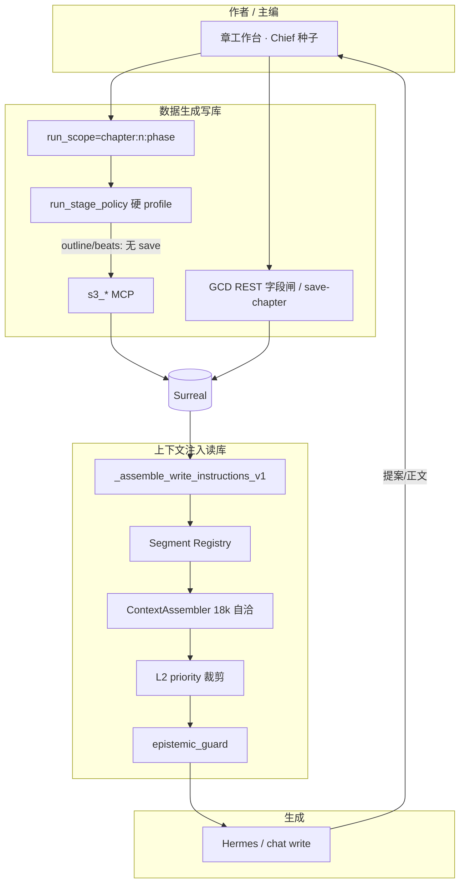
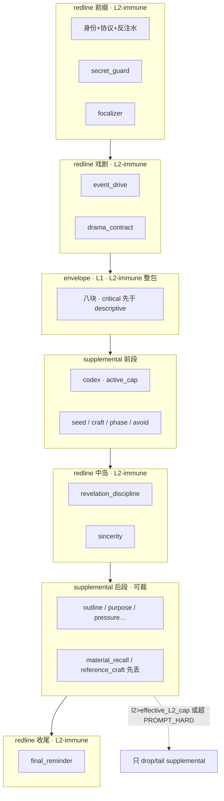
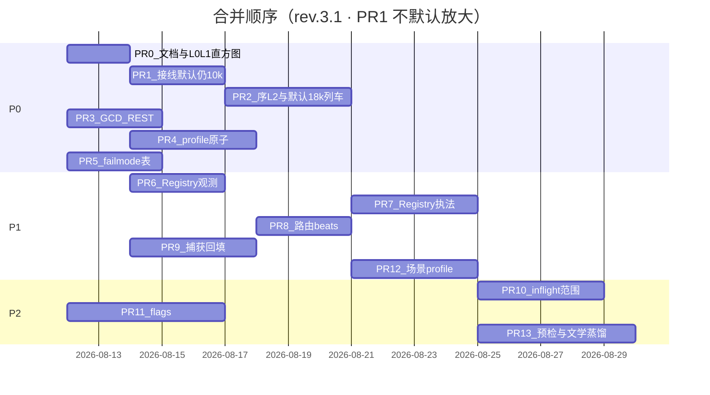

# 设计文档：铜炉写路径 · 小说优先上下文注入与数据生成安全（最优改进）

| 项 | 值 |
|----|-----|
| **文档标题** | 小说第一原则 · 信号密度预算 · 戏剧钉物理序 · 段注册表 · 软硬门诚实 · 分波 PR |
| **作者** | Grok Design（系统架构） |
| **日期** | 2026-08-11 |
| **修订** | **rev.3.1-novel-first** · 承接并 **超编** rev.2.1；**吸收评审** `/tmp/grok-1000/grok-design-review-497b3adf.md`（I-01..I-13） |
| **状态** | **Draft · rev.3.1 · 待合入仓库** |
| **产品** | 铜炉（tonglu）/ scribe3 长篇写作工作台 |
| **代码根（已核实）** | `/home/admin/projects/scribe-ia-verify-wt` |
| **落地路径（PR-0 文档）** | `docs/plans/2026-08-11-novel-first-injection-quality-optimal.md` |
| **会话 scratch** | `/tmp/grok-1000/grok-design-doc-497b3adf.md` · 摘要 `/tmp/grok-1000/grok-design-summary-497b3adf.md` |
| **对齐前序** | 全流程指南 `docs/guides/2026-08-11-writing-context-injection-and-data-generation-full-flow.md`；预算 rev.2.1 `docs/plans/2026-08-11-context-injection-budget-and-quality-optimal.md`；章 IA `docs/plans/2026-08-10-chapter-writing-ia-optimal.md`；记忆质量 L1 `docs/plans/2026-08-09-memory-quality-to-9.5-system-design.md` |
| **验收环境** | demo 已部署栈（铜炉 `tonglu.example.com`）；**只冒烟已部署**；禁止 Grok 运行机全量 npm / 本机 Surreal / 再起平行栈 |
| **明确不做的宣称** | **不**因本方案宣称文学 ≥9.5；**不**默认 soft→hard park；**不**以「省 token / 降成本」为优化目标或约束；评分卡 ≠ 意图；经验复盘 ≠ `pressure_drive` |

---

### 读法（工程师 · 第一周）

1. **第一原则 + 关键决策** — 小说质量硬指标；预算仅服务注意力 / context dilution。  
2. **对外部 O-1..O-12 的裁决表** — 接受 / 改写 / 延期 / 否决。  
3. **数字锁 + 有效 L2 头寸** — 信封 18k 自洽；默认总顶 42k（**初值·PR-0 可回 48k**）；novel-22k **同步 PROMPT_HARD=48k**；**L2-immune** 清单；物理序。  
4. **Proposed Design + Mermaid** — **物理序与层逻辑对齐**；段注册、双层预算、脚手架 profile。  
5. **PR Plan** — PR-1 **默认不放大**直至 PR-2；可独立合并；仓库落地名见 PR-0。

---

## 概述

铜炉写路径已收敛到单一编译入口 `scribe3/api/services/write_assemble.py` → `_assemble_write_instructions_v1`：前缀身份/协议/**codex（现网在戏剧前）** → `_render_final_input` 内 **事件驱动 + 戏剧合同** → **记忆信封 envelope（八块 · 默认 10_000）** → 大纲/简报必达/力学合同/偏好等大量 **supplemental domain**。信封侧有可审计的 `BLOCK_BUDGETS` 与 `token_budget`；**信封外的 domain 几乎无总额门**，总 system instructions 实质上无上界（痛点 **H3**）。

本 **rev.3.1** **不推翻** rev.2.1 的工程骨架（18k 自洽块表、双层预算、codex 物理后移、GCD REST、脚手架 profile、段注册表），而是以 **第一原则** 重新校准目标函数与若干数字；并吸收评审对 **有效 L2 头寸 / Mermaid 物理序 / PR-1 默认放大风险** 的阻塞澄清。

> **写出好的小说**（情感连贯、角色弧光、冲突兑现、限知不泄、跨章一致）。  
> 预算与裁剪的 **唯一合法理由** 是 **注意力质量 / context dilution / Lost-in-the-Middle**，**绝不是**省钱或省 token。  
> **主优化指标 = 戏剧信号密度（signal density for drama）**，不是 token efficiency。

**本方案交付：**

1. **信封 18_000 自洽块表**（继承 rev.2.1；`sum(blocks)==budget` 算术锁）；可选 **novel-quality 22k** 仅加 high-signal 块，且 **同步 `PROMPT_HARD=48_000`**（禁止用更大 L1 挤死 L2 文学段）。  
2. **总 prompt 质量向硬顶默认 42_000（初值）** + 显式公式  
   `effective_L2_cap = min(SUPPLEMENTAL_HARD, PROMPT_HARD - L0 - L1)`；  
   **L2-immune（never-victim）** 清单分 redline / envelope；**禁止** join 后 tail-chop。  
3. **物理序确认**：`event_drive → drama → envelope → codex → … → revelation/sincerity → … → final_reminder`（与现网 `_render_final_input` 后半一致；**Mermaid = 物理序**）。  
4. **外部分析 O-1..O-12**：逐条批判；保留服务小说质量者，否决「压缩换效率」「激活键误伤 must-link」等。  
5. **软引导 > 硬停**（默认）；安全例外：脚手架 **物理排除** `s3_save_chapter`（∉ `WRITE_GATED`）、限知出口可 loud、GCD REST 字段闸。  
6. **P0/P1/P2 + PR 计划**：PR-1 **接线可合但默认仍 10k**，直至 PR-2 物理序+L2 同列车绿灯后再默认放大 18k。

**算术不变量（实现必测）：**

```python
assert sum(BLOCK_BUDGETS_V2.values()) == DEFAULT_ENVELOPE_TOKEN_BUDGET == 18_000
assert sum(BLOCK_BUDGETS_NOVEL.values()) == NOVEL_ENVELOPE_TOKEN_BUDGET == 22_000
# 有效 L2 上界（实现与文档同公式；L0/L1 为 estimate_tokens 累计）
# effective_L2_cap = min(SUPPLEMENTAL_HARD, PROMPT_HARD - l0_est - l1_est)
```

---

## 背景与动机

### 1. 现网架构（代码事实 · 2026-08-11 已核对）

#### 1.1 记忆信封 · 仅管八块

路径：`/home/admin/projects/scribe-ia-verify-wt/scribe3/context_assembler.py`

```text
BLOCK_BUDGETS = {
  focus: 800, global: 1200, canonical: 2800, recent: 1600,
  procedural: 900, reference: 1400, uncertainty: 500, provenance: 800,
}
# 之和 = 10_000 = ContextAssembler(token_budget=10_000) 默认
```

- `estimate_tokens(text) = len(text)`：中文场景 **字符≈token 保守上界**（偏高 → 宁可少放）。  
- `_allocate`：先块内 `_truncate_items`，再按八块顺序受 `token_budget` 门控。  
- L1 重排 **仅** 在 `_allocate` 入口对 **`global` / `canonical`** 执行（`_reorder_l1_first`）；**recent 等无 L1 重排**。  
- `CreativeContextEngine` 构造 `ContextAssembler(store, retriever)` **未传入** `token_budget`，写路径恒默认 10k；**无** `SCRIBE3_ENVELOPE_TOKEN_BUDGET`；`_allocate` **直接读模块级** `BLOCK_BUDGETS`。

#### 1.2 写路径 · codex 物理序在戏剧前；supplemental 无总额

路径：`/home/admin/projects/scribe-ia-verify-wt/scribe3/api/services/write_assemble.py` · `_assemble_write_instructions_v1`

**现网真实顺序（已读源码）：**

```text
prefix: identity + write_protocol + revision + anti_slop
      + continue_snapshot + secret_guard + request_position
      + [tool_scope / craft_skills_index] + focalizer
      + codex                                          ← 现网：戏剧之前、无帽
_render_final_input:
  event_drive → drama_contract (≤~400)
  → envelope (≤10k)
  → seed_words → craft → phase_role → avoid → revelation → sincerity
  → purpose → outline (synopsis/beats 各 clip _OUTLINE_BUDGET=1200)
  → volume_intro (≤400) → brief_must → pressure_drive
  → author_prefs → voice_anchor
  → [draft/final: reference_craft / deduction / material_recall]
  → final_reminder / scene_truth(deduce)
```

`_domain_input` 只登记 `ContextSource` digest 供 Manifest——**不裁剪、不共享总额**。  
codex 圣经可膨胀至数千～上万字符，且 **先于** event_drive/drama 进入模型上下文 → **戏剧钉被设定洪水淹没**（Lost-in-the-Middle 的「前段噪声」变体）。

#### 1.3 门控与 profile（H1/H2/H4）

| 机制 | 锚点 | 现网行为 |
|------|------|----------|
| Emergency REST 世界写闸 | `api/app_impl.py` `_emergency_rest_write_middleware`；`SCRIBE3_EMERGENCY_REST_WRITE` 默认 **False** | **路径级** 403；`PATCH /chapters/{seq}` 一律拦 |
| 放行例外 | archive/restore、`/intent-goals`、materials、save-chapter 等 | **无** GCD 字段白名单 |
| `SCAFFOLD_FORBID_SAVE` | `web/src/lib/chiefSeed.js` | **软文案**；`WRITE_GATED` **不含** `s3_save_chapter` |
| `s3_save_chapter` | `mcp/_common.py` / `tools_write.py` | **`s3_save_chapter` ∉ `WRITE_GATED`**（手稿存正文免审批；代码 **无** `WRITE_UNGATED` 常量）— 脚手架若可见即可直接落 prose |
| 硬 profile | `run_stage_policy.py` 仅 `deduce` / `deduce_preview` | 未知 phase → `ValueError`；outline/beats 走完整写 profile |
| UI `run_scope` | `web/src/api.js`：`chapter != null && phase` 时才带 scope | Chief 世界写注释常走 **全写 profile**；缺 scope 则策略不生效 |
| 限知出口 | `epistemic_guard.guard_write_instructions` | 异常 **fail-soft keep instructions**（`write_assemble` 出口） |
| 同章互斥 | `app_impl`：`_loop_inflight` + `_pending_ingest` + `_chapter_repair_inflight` 等 **多套进程内 set** | 单 worker 注释依赖；多 worker 失效（H6/PR-10） |

#### 1.4 检索侧静默缺口

路径：`/home/admin/projects/scribe-ia-verify-wt/scribe3/memory_retrieval.py`

- `focus_bonus` 依赖 `linked_ids`；捕获未回填时 **恒 0**（telemetry：`unlinked_count`）。  
- `_suppress_by_canonical` 依赖 episodic provenance `(entity, attribute)`；未回填时 **静默失效**（`unconflictable_count`）。  

二者使「焦点相关经验」「正典压 episodic」在真机上常为死代码路径——**直接伤害跨章一致与角色状态可信度**。

### 2. 痛点总表

| ID | 问题 | 严重度 | 对小说的伤害 | 代码锚点 |
|----|------|--------|--------------|----------|
| **H1** | 作者微调 GCD 的 REST PATCH 被 emergency 闸 403 | High | 作者改不了节拍格子 → 冲突无法兑现 | `app_impl` / `chapters` |
| **H2** | 脚手架禁 save 仅软文案；write profile 仍含 ∉WRITE_GATED 的 save | High | 大纲 Run 误存正文 → 阶段污染、弧光错位 | `chiefSeed.js`；`s3_save_chapter` ∉ `WRITE_GATED` |
| **H3** | 信封预算 ≠ 总 prompt；codex 物理前置；supplemental 无界 | High | 戏剧钉被稀释；中段记忆失忆；情感线断裂 | `write_assemble` + `context_assembler` |
| **H4** | 硬 profile 仅 deduce*；UI 未强制 outline/beats scope | High | 同 H2，策略虚设 | `run_stage_policy.py` |
| **H5** | epistemic / drama / outline 等多处 fail-soft | High | 限知泄漏风险；戏剧块空而不知 | 多处 except |
| **H6** | 同章 inflight **进程局部**（loop/ingest/repair 多套 set） | **High**（与 rev.2.1 一致；**排期 P2 非降级**） | 双写竞态 → 正文/体检错位 | `app_impl` 三套 set；生产注释依赖单 worker |
| **M10** | focus_bonus / canonical suppress 静默死 | Med | 状态打架、焦点偏题 | `memory_retrieval.py` |

> **H6 严重度说明（I-07）：** 保持 **High**（双写仍是正确性风险）。rev.3.0 曾误写 Med。排期 **P2** 的理由是：demo/生产当前 **单 worker** 注释已文档化，P0 优先 H3 注意力与脚手架安全；**不**表示问题变轻。

### 3. 产品原则（不可违背）

| # | 原则 |
|---|------|
| P-N1 | **小说第一**：情感连贯、角色弧光、冲突兑现、限知不泄、跨章一致 |
| P-N2 | **预算只服务注意力**：裁剪理由只能是 dilution / Lost-in-the-Middle / 信号密度；**禁止**「为省 token」叙事 |
| P-N3 | **冲突/事件驱动**；**引导 > 硬停**（默认 soft advisory） |
| P-N4 | soft ≠ hard park，除非显式 flag 或安全边界（脚手架 save、世界写闸） |
| P-N5 | 中文产品名：评分卡 ≠ 意图；经验复盘 ≠ pressure_drive |
| P-N6 | 验收 = 已部署 demo 冒烟 |

### 4. 对 rev.2.1 的关系

| 维度 | rev.2.1 | 本 rev.3.1 |
|------|---------|------------|
| 信封默认 | 18k 自洽 | **保持**；novel **22k** + **配套 PROMPT_HARD=48k**（I-01） |
| 总硬顶 | 48k | 默认 **42k 初值**（反 dilution，非成本；**PR-0 证据可回 48k**）；见 D2 头寸表 |
| L2 soft/hard | 16k / 22k | **14k / 18k 初值**；真上界 = `min(HARD, PROMPT−L0−L1)` |
| 物理序 | codex after envelope | **确认冻结**；Mermaid **与段表同序**（I-04） |
| PR-1 放大 | 直接默认 18k | **默认 flag 暗挂 10k** 直至 PR-2（I-03） |
| 目标函数 | 「最佳效果」+ 注意力 | **显式小说第一 + 戏剧信号密度**；否决 token efficiency 指标 |
| 外部 O-1..O-12 | 未系统批判 | **全文裁决** |
| 场景 profile / 激活键 / 压缩层 | 未定 | **O-2 接受改写；O-3 严限；O-11 否决纯压缩** |

---

## 目标与非目标

### Goals

| # | 目标 |
|---|------|
| G1 | 信封与总 prompt **双层预算**；**`sum(blocks)==token_budget`**；数字可配置、可回滚 |
| G2 | **生成路径物理序** 戏剧钉先于 codex；Segment Registry 统一登记 |
| G3 | L0 永不裁；可执行 L2 裁剪；**禁止** final 串 tail-chop |
| G4 | H1–H4 门控诚实（GCD 边界、run_scope、profile 物理排除 save） |
| G5 | 主指标可观测：**戏剧信号密度**、`budget_report`、限知/fail 计数——**不是** tokens_saved |
| G6 | 分波 PR 可独立合并；PR-0 用 demo 数据校准 L2 数字；文档落地仓库路径 |

### Non-Goals

| # | 非目标 | 理由 |
|---|--------|------|
| NG1 | 宣称文学 ≥9.5 | 产品禁令 |
| NG2 | 默认全 hard park | 引导 > 硬停 |
| NG3 | P0 上 Redis 分布式锁 | 单 worker；H6→P2 |
| NG4 | 重写检索融合 / 换 embedding | 正交 |
| NG5 | 合并五阶段字段 | 章 IA 已定 |
| NG6 | 讨论/写路径合成一套 prompt | policy 已分 |
| NG7 | Grok 机全量 pytest/npm/本机 Surreal 验收 | 资源规则 |
| NG8 | 第一波 Hermes 多 profile 集群拓扑大改 | 仅 policy+overlay |
| NG9 | PR-1 升级 `generation.v2` policy 版本 | 避免校验炸点；预算走 settings 热调 |
| NG10 | PR-1 改 discussion 默认信封 | 讨论维持 10k |
| NG11 | **以 token 成本 / 吞吐为 KPI** | 第一原则否决 |
| NG12 | **无差别上下文压缩层**（为塞更多杂讯而摘要） | 见 O-11 否决 |

---

## 外部分析 O-1..O-12：批判与裁决

> 用户声明外部分析「不一定对」。以下以 **小说质量** 为唯一准绳；行业引用（Lost-in-the-Middle、Context Dilution、NovelAI Lorebook、Anthropic context engineering、MemGPT、SCORE）仅作启发，**不作教条**。

| ID | 外部主张（摘要） | 裁决 | 改写后的铜炉立场 |
|----|------------------|------|------------------|
| **O-1** | 全域预算化（消灭无限拼接） | **接受（问题真）** | 即 H3。但 **禁止** 把「min high-signal」说成「shrink for cost」。预算化 = 防止 dilution 与无限拼接，**不是**把 prompt 压到最便宜。 |
| **O-2** | 场景自适应预算（dialogue/action/interior/worldbuild） | **接受 · P1 软 profile** | 同一信封总额内 **重配块权重**（如 action 抬 recent/canonical state，interior 抬 procedural/voice，worldbuild 略抬 codex 段内 cap）。**禁止**因场景把总 envelope 砍半「省 token」。默认 draft/final 仍用统一 18k；profile 是增益旋钮。 |
| **O-3** | 按需激活式注入（activation keys） | **严限 · 默认关闭 hard 门** | NovelAI Lorebook 式激活适合「设定条目海量」；铜炉 **must-link / 铁律 / drama / secret_guard 永远激活**。允许 P2 对 **reference / material_recall / 长 codex 子段** 做 **软激活**（未命中可降 priority 先丢），**禁止**用激活键挡住 must-link 或开放伏笔。漏连 must 比多灌一行设定更致命。 |
| **O-4** | 位置感知排序（Lost-in-the-Middle；canonical 分 critical/descriptive） | **接受 · P0 核心** | 已定物理序把戏剧钉放前、codex 放中后。信封内：**critical**（must pin、state、开放伏笔、铁律）靠前/L1 水位；**descriptive**（氛围、次要设定）靠后先裁。与 `_reorder_l1_first` 同向，P1 扩展 recent 的 critical 标签。 |
| **O-5** | 工具安全分层 profile（outline/beats hard exclude save） | **接受 · P0** | 软文案不够；`s3_save_chapter` **∉ `WRITE_GATED`**（免审批手稿写），必须 profile **物理不可见** + 强制 `run_scope`。 |
| **O-6** | 限知全覆盖 + fail-loud | **接受改写 · 默认 soft + 可观测；质量模式 loud** | 全覆盖是对的；默认 **soft_keep 生成可用**（引导 > 硬停）。`SCRIBE3_EPISTEMIC_FAIL_LOUD` 质量模式可 loud。metric 全表必做。 |
| **O-7** | 段注册表 | **接受 · P0 观测 / P1 执法** | 与 rev.2.1 Segment Registry 一致；防漏登记 `priority=55`。 |
| **O-8** | 事件关系图 | **延期 P2** | 有助跨章因果与冲突兑现，但非注入编译 P0 阻塞项；可挂 narrative_drive / NEE 演进。 |
| **O-9** | 全路径可观测 | **接受 · P0 起** | `budget_report`、物理序索引、cuts、fail-soft counters、unlinked/unconflictable。**禁止**用 tokens_saved 当主面板。 |
| **O-10** | 并发 inflight | **接受 · P0 日志 / P2 store 锁** | 不阻塞预算 PR。 |
| **O-11** | 上下文压缩层 | **否决「为效率而压」；有条件接受文学蒸馏** | **禁止**通用 compressor 把 high-signal 与 low-signal 一并摘要以「塞更多」。仅当 **文学蒸馏** 提升戏剧注意力时可选：例如多章 recap → 「已兑现冲突 / 未决代价 / 角色态度变化」决策 bullet（P2）。蒸馏输出必须可审计、可回退原文条目。 |
| **O-12** | 预审批自动质检 | **接受 soft · 默认不 hard park** | 大纲/节拍/存正文前可跑 advisory 质检（冲突是否空、限知标记、GCD 空洞）；**默认 soft**。仅 GATE-B / craft gate / 安全边界可 hard。 |

### 行业引用如何用

| 引用 | 采用什么 | 拒绝什么 |
|------|----------|----------|
| Lost-in-the-Middle | 物理序、总长硬顶、critical 靠边/前 | 盲目缩上下文「越短越好」 |
| Context Dilution | 信号密度、L2 先丢 material/reference | 用成本曲线定 cap |
| NovelAI Lorebook | 可选软激活（O-3 严限） | 全书设定靠关键词碰运气 |
| Anthropic context eng. | 结构化段、可测预算 | 把工程笔记当正文风格 |
| MemGPT | 分层记忆思想（envelope vs domain） | 运行时反复外挂 I/O 当默认写路径 |
| SCORE 等评测 | 可观测维度启发 | 把分数当意图字段 |

---

## 关键数字裁决（必须拍板）

### D1 · 信封默认

| 项 | 决策 |
|----|------|
| **默认 generation 信封（目标）** | **18_000**（继承 rev.2.1） |
| **生产默认放大时机** | **PR-2 绿后**才把 `SCRIBE3_ENVELOPE_TOKEN_BUDGET` 默认切 18000；PR-1 仅接线，**默认仍 10000**（见 I-03 / PR-1） |
| **算术锁** | `sum(BLOCK_BUDGETS_V2) == 18_000`；**禁止**静默 slack |
| **为何不默认 32k** | 更长默认会 **恶化** 中段注意力；应用 **更好的排序与 L2 裁低信号**，而不是无差别加码 |
| **为何不维持 10k** | 长书 must/state/recent 在块内被裁 → 跨章失忆、状态打架 |
| **novel-quality 可选** | L1=**22_000**（canonical **+2000** / recent **+2000**）且 **必须** 同步 `PROMPT_HARD=48_000`（及 L2 soft/hard 可维持 14k/18k 或随采样微调）；**禁止**「只加 L1、总顶仍 42k」导致系统性挤死 outline/pressure |
| **主增益** | canonical / recent（状态与近章决策）— 服务弧光与连贯，**不是** quota burn |

**推荐 `BLOCK_BUDGETS_V2`（合计 18_000）：**

| 块 | 现网 | 推荐 | Δ | 小说理由 |
|----|------|------|---|---------|
| focus | 800 | **1_000** | +200 | 短定位；完整大纲 SSOT = domain outline |
| global | 1_200 | **1_600** | +400 | 铁律 + 开放伏笔 + 主角色 |
| **canonical** | 2_800 | **6_800** | **+4_000** | must-link / 状态事实 / 帧内命题 |
| **recent** | 1_600 | **4_000** | **+2_400** | 近章决策与工作摘要 |
| procedural | 900 | **1_200** | +300 | 已采纳方法 |
| reference | 1_400 | **1_600** | +200 | 借鉴非事实 |
| uncertainty | 500 | **800** | +300 | 冲突可见 |
| provenance | 800 | **1_000** | +200 | 溯源可摘要 |
| **合计** | 10_000 | **18_000** | +8_000 | 验算锁死 |

**`BLOCK_BUDGETS_NOVEL`（可选 22_000）：** 在 V2 上 canonical **8_800**、recent **6_000**，其余同 V2。

### D2 · 总 prompt 硬顶 + **有效 L2 头寸**（质量向 · 反 dilution）

#### 层定义与口径（I-05）

| 层 | `budget_report` 字段 | 计入 | 策略 |
|----|---------------------|------|------|
| **L0 redline** | `l0_est` = 仅 `layer==redline` 段 `estimate_tokens` 之和 | 身份/协议/戏剧/限知/final 等 | **永不**因预算删除整段；段内自有 clip（drama≤~400）允许 |
| **L1 envelope** | `l1_est` = Assembler 输出 token_estimate（≤ sum blocks） | 八块记忆信封 | Assembler **内**裁；**不进** L2 victim 池 |
| **L2 supplemental** | `l2_est` | codex/outline/pressure/material… | 可 soft 告警 / hard drop\|tail |
| **Total** | `prompt_token_estimate` ≈ l0+l1+l2（**不含**用户 request 正文） | | 超顶只裁 L2；禁 `rendered[:N]` |

#### 有效 L2 上界（**强制实现同式 · I-01**）

```text
effective_L2_cap = min(SUPPLEMENTAL_HARD, PROMPT_HARD - l0_est - l1_est)
# soft 同理：
effective_L2_soft = min(SUPPLEMENTAL_SOFT, PROMPT_HARD - l0_est - l1_est)   # 仅告警阈值可选
# 若 l0_est + l1_est >= PROMPT_HARD：L2 应尽量清空后仍超 → fail_loud_metric，仍完整 join
```

**产品含义：** 标称 `SUPPLEMENTAL_HARD=18000` **不是**保证「总能放下 18k L2」；真可用 L2 由 **L0 头寸 + L1 信封** 决定。实现与观测必须暴露 `effective_L2_cap`。

#### 默认数字（**初值 · 非「已校准生产真理」· I-02**）

| 配置档 | L1 | `PROMPT_HARD` | L2 soft/hard（标称） | 意图 |
|--------|-----|---------------|----------------------|------|
| **standard generation（目标默认）** | 18_000 | **42_000** | 14_000 / 18_000 | 更早裁 **低信号** L2，抬戏剧钉相对注意力（**非成本**） |
| **novel-quality** | 22_000 | **48_000**（**强制同步上调**） | 14_000 / 18_000 | **小说优先**：加 high-signal 信封 **且** 给 L2 文学段留头寸；**禁止** 22k@42k |
| **回滚 / 与 rev.2.1 对齐** | 18_000 | 48_000 | 16_000 / 22_000 | env 一键 |

> **相对 rev.2.1 收紧 42/14/18 的理由（质量向）：** 中段遵从随总长下降 → 裁刀更早对准 material/reference/codex tail。  
> **证据时序（I-02）：** 在 PR-0 给出 L0/L1/L2 直方图前，42k **不得**称为「已校准默认」；验收见下「双条件」。采样后若 p90(L0+L1) 已高，**优先上调 PROMPT_HARD→48k**，而不是假装更紧等于更好。

#### 头寸表示例（PR-0 前先验 · 实现用 `estimate_tokens≡len`）

> 静态 L0 含长 `write_protocol` + `_final_reminder` ≈ **1192** 字符等（I-12）；限知章 + revelation 后 L0 常落 **约 4k–10k**。下表为 **设计先验**，PR-0 必须用 demo 真值替换。

| L0 分位（先验） | L1=18k → effective_L2_cap @PROMPT=42k | L1=18k @48k | L1=22k @42k（**禁止作为 novel**） | L1=22k @48k（**novel 法定**） |
|-----------------|----------------------------------------|-------------|-------------------------------------|--------------------------------|
| p50 ≈ 6_000 | min(18k, 42k−6k−18k)=**18k** | min(18k,24k)=**18k** | min(18k,14k)=**14k**（挤 L2） | min(18k,20k)=**18k** |
| p90 ≈ 9_000 | min(18k, 15k)=**15k** | min(18k,21k)=**18k** | min(18k,11k)=**11k**（严重挤 outline/pressure） | min(18k,17k)=**17k** |
| 厚 L0 ≈ 12_000 | min(18k,12k)=**12k** | min(18k,18k)=**18k** | min(18k,8k)=**8k** | min(18k,14k)=**14k** |

**KD-I01（拍板）：** novel-22k **采用 (a)**：同步 **`PROMPT_HARD=48_000`**，保证 L2 文学段（outline / pressure / codex cap 内）不被「只加信封」系统性挤出。**(b)「信封换 L2 注意力」** 明确 **否决** 为 novel 产品语义（与 novel-first 冲突）。

#### L2-immune / never-victim 清单（I-05 · 取代「L0 清单混 envelope」）

**A. `layer=redline`（计入 `l0_est` · 永不进 victim）：**

```text
identity, write_protocol, revision, anti_slop,
continue_snapshot, secret_guard, request_position,
tool_scope?, craft_skills_index?, focalizer,
event_drive, drama_contract,
revelation_discipline, sincerity,          # 物理序在 codex 之后，仍是 redline
final_reminder,
scene_truth（仅 phase=deduce 终检合同）
```

**B. `layer=envelope`（计入 `l1_est` · 永不进 L2 victim；块内由 Assembler 裁）：**

```text
envelope（整包）
```

段内自有 clip 允许；**不得** 因总预算删除 A/B 整段。  
**禁止**把 envelope 记入 `l0_est`。

### D3 · 物理序（确认 · 单测锁）

**生成 draft/final 目标物理序（与现网 `_render_final_input` 后半一致；codex 从 prefix 迁出）：**

```text
identity → write_protocol → revision → anti_slop
→ continue_snapshot → secret_guard → request_position
→ tool_scope? → craft_skills_index? → focalizer
→ event_drive → drama_contract          # 戏剧钉
→ envelope                              # L1
→ codex (cap = active_codex_cap) → seed_words → craft → phase_role → avoid
→ revelation_discipline → sincerity     # 限知/真诚 redline 岛（在 codex 后）
→ purpose → outline → volume_intro → brief_must → pressure_drive
→ author_prefs → voice_anchor
→ reference_craft* → deduction* → material_recall
→ final_reminder → scene_truth? → request_constraint?
```

**确认：**

1. drama **before** codex；现网 prefix 内 codex **必须迁出**。  
2. revelation/sincerity **after codex**（与现网一致；**不**前移到 envelope 前——I-04）。  
3. 单测最小集：  
   `index(event_drive) < index(drama) < index(envelope) < index(codex) < index(final_reminder)`  
   且若两段均非空：`index(codex) < index(revelation_discipline)` 与 `index(codex) < index(sincerity)`（I-11）。

`PHYSICAL_ORDER_VERSION = "write-physical.v3-novel-first-codex-after-envelope"`

### D4 · O-2 / O-3 / O-4 / O-11 对长篇写作的最终表态

| 主张 | 决策 | 波次 |
|------|------|------|
| O-2 场景自适应 | **接受**：同总额内块权重 profile；默认关闭时行为 = 18k 统一表；worldbuild 的 codex cap 见 D5 | P1 |
| O-3 激活键 | **默认关 hard**；仅 soft 降 priority；must/铁律/drama **永不激活门** | P2 soft |
| O-4 位置感知 | **接受** 且为 P0 核心（物理序 + critical/descriptive） | P0–P1 |
| O-11 压缩层 | **否决纯效率压缩**；P2 可选文学蒸馏（决策 bullet）；**禁** `tokens_saved` 作开关阈值 | P2 可选 |

### D5 · codex 段帽与验收（I-10）

| 场景 | `active_codex_cap` |
|------|-------------------|
| 默认 generation | **4500**（`SCRIBE3_CODEX_INJECT_CAP`） |
| O-2 `worldbuild` profile | **5500**（仅该 profile 激活时） |

验收与 capabilities：**`codex_len ≤ active_codex_cap`**（暴露当前 cap），**禁止**写死「恒 ≤4500」导致 worldbuild 假红。

---

## 目标架构（Proposed Design）

### 1. 总体数据流



### 2. 注意力分层与**物理序**（Mermaid ≡ D3 · I-04）

> **规则：** 下图节点顺序 = 注入物理序；**层标签**只说明 never-victim 归属。  
> revelation/sincerity 是 **redline**，但物理位置在 **codex 之后**（后段 redline 岛），**禁止**画到 envelope 前。



### 3. Segment Registry

```python
@dataclass(frozen=True)
class WriteSegmentSpec:
    segment_id: str
    layer: Literal["redline", "envelope", "supplemental"]
    source_kind: str
    priority: int            # L2：小 = 先丢
    budget: int | None
    trim: Literal["none", "tail", "head_keep_l1", "drop_whole"]
    phases: frozenset[str]
    fail_mode: Literal["soft_empty", "soft_keep", "loud"]
    builder: str
    # rev.3.0 新增（可空）：
    criticality: Literal["critical", "descriptive", "ambient"] = "descriptive"
    scene_profiles: frozenset[str] = frozenset()  # O-2；空 = 全场景
```

**未登记新段默认：** `layer=supplemental`, `priority=55`, `trim=drop_whole`, metric `segment_unregistered`。  
**禁止**静默当 redline。

#### 全量 segment 表（与 rev.2.1 对齐 · 物理序）

| 物理序 | segment_id | layer | priority / never | trim | 备注 |
|-------:|------------|-------|------------------|------|------|
| 1–10 | identity … focalizer | redline | never | none | 前缀 |
| 11 | event_drive | redline | never | none | 冲突时钟 |
| 12 | drama_contract | redline | never | none | ≤~400 |
| 13 | envelope | envelope | never（整包） | Assembler | L1 |
| 14 | codex | supplemental | **90** | tail | **active_codex_cap**（默认 4500）；**在 envelope 后** |
| 15–18 | seed_words / craft / phase_role / avoid | supplemental | 40–50 | 见下 | |
| 19–20 | revelation_discipline / sincerity | **redline** | never | none | 限知/真诚；**物理在 codex 后**（L0m 岛） |
| 21–27 | purpose … voice_anchor | supplemental | 20–72 | | pressure 72 尽量晚丢 |
| 28–31 | reference_craft / deduction* / material_recall | supplemental | 10–78 | | material **10 最先丢** |
| 32–33 | final_reminder / scene_truth(deduce) | redline | never | none | |
| 34 | request_constraint | supplemental | 60 | tail | |

**L2 victim 升序速查：**

```text
10 material_recall
12 reference_craft（末条→首条）
20 author_prefs
25 volume_intro
30 voice_anchor
40 seed_words
42 craft
48 avoid
50 phase_role
55 *unregistered default*
60 request_constraint
65 outline
68 brief_must
70 purpose
72 pressure_drive
75 deduction_protocol
78 deduction_item
90 codex（段内 4500 后仍超才 tail）
```

#### L2 算法（禁止 join 后 tail-chop · 含 effective_L2_cap）

```text
function allocate_prompt(segments, envelope, caps):
  active_cap = caps.codex_inject_cap            # 默认 4500；worldbuild 可为 5500
  for s in segments:
    if s.segment_id == "codex":
      s.text = clip(s.text, active_cap)

  l0 = sum(estimate_tokens(s.text) for s in segments if s.layer == "redline")
  l1 = envelope.total_token_estimate            # ≤ 18k / 22k；不得并入 l0
  l2_segs = [s for s in segments if s.layer == "supplemental"]
  def l2_sum(): return sum(estimate_tokens(s.text) for s in l2_segs if s.text)

  # 有效上界（I-01）：标称 HARD 与总顶剩余取 min
  effective_hard = min(SUPPLEMENTAL_HARD, PROMPT_HARD - l0 - l1)
  effective_soft = min(SUPPLEMENTAL_SOFT, PROMPT_HARD - l0 - l1)
  report.budget_report.effective_L2_cap = effective_hard
  report.budget_report.effective_L2_soft = effective_soft

  if l2_sum() > effective_soft:                # 默认标称 soft=14000，但受头寸收缩
    report soft_exceeded(...)                  # 不修改

  while l2_sum() > max(0, effective_hard):
    victim = lowest_priority_alive(l2_segs)    # tie: 物理序后出现的先丢
    if victim is None: break
    apply_trim(victim)

  # 双保险：若 L0 在循环中不变但仍超总顶（例如 L0+L1 已超）
  if l0 + l1 + l2_sum() > PROMPT_HARD:
    fail_loud_metric("prompt_hard_exhausted", l0=l0, l1=l1, l2=l2_sum(),
                     effective_L2_cap=effective_hard)
    # 仍 return 完整 join；禁止 rendered = rendered[:PROMPT_HARD]

  return join(segments in physical order)
```

| 子阶段 | 行为 |
|--------|------|
| P0a / PR-0 | 只观测 `budget_report`（含 l0/l1/l2 直方图）；**不裁**；**不**宣称 42k 已校准 |
| P0b | 物理重排 + codex active_cap；soft 只告警 |
| P0c | 按 `effective_L2_cap` drop/tail |

### 4. 运行时接线

| 键 | 默认 | 说明 |
|----|------|------|
| `SCRIBE3_ENVELOPE_TOKEN_BUDGET` | **10000**（PR-1 合入后）；**18000** 仅在 PR-2 列车默认切换后 | → Assembler.token_budget；**禁止** PR-1 单独默认放大（I-03） |
| `SCRIBE3_ENVELOPE_BLOCK_BUDGETS_JSON` | 与 budget 匹配的块表 | 校验 sum==budget |
| `SCRIBE3_ENVELOPE_V2_ENABLE` | **0**（PR-1）；PR-2 绿后可 **1** | 显式放大开关；=1 时用 18k+V2 块表 |
| `SCRIBE3_SUPPLEMENTAL_TOKEN_SOFT` | **14000**（初值） | L2 soft 标称；真阈值见 effective |
| `SCRIBE3_SUPPLEMENTAL_TOKEN_HARD` | **18000**（初值） | L2 hard 标称 |
| `SCRIBE3_PROMPT_TOKEN_HARD` | **42000**（初值·standard）；novel 档 **48000** | 总硬顶；novel 与 22k L1 **绑定** |
| `SCRIBE3_NOVEL_ENVELOPE` | **0** | =1 → L1=22k 块表 **且强制** PROMPT_HARD≥48000（实现 assert） |
| `SCRIBE3_CODEX_INJECT_CAP` | **4500** | 默认 active_codex_cap |
| `SCRIBE3_CODEX_AFTER_DRAMA` | **1** | 紧急回滚序；默认开 |
| `SCRIBE3_GCD_REST_ALLOW` | **true** | H1 |
| `SCRIBE3_EPISTEMIC_FAIL_LOUD` | **false** | H5 质量模式 |
| `SCRIBE3_FOCUS_SHORT_CAP` | **400** | focus 短定位 |
| `SCRIBE3_SCENE_BUDGET_PROFILE` | **off** | P1 O-2：`dialogue\|action\|interior\|worldbuild` |
| `SCRIBE3_LORE_SOFT_ACTIVATION` | **0** | P2 O-3：仅 soft |

**PR-1 接线（只接线 · 默认不放大 · I-03）：**

1. `scribe3/context_budget.py`：`get_envelope_token_budget()` / `get_block_budgets()` 热读；sum 校验失败 log+回退默认。  
2. `ContextAssembler.__init__(..., token_budget=None, block_budgets=None)`：实例字段；`_allocate` **只读实例**。  
3. `CreativeContextEngine` **必须**传入 budget（即使仍是 10k）。  
4. **默认** `ENVELOPE_V2_ENABLE=0` → 行为字节级贴近现网 10k；测试可 monkeypatch 18k。  
5. **仍 `generation.v1`**；discussion 信封 **不动**（10k）。  
6. **禁止** 在 PR-2 物理序+L2 未上线前把生产默认切 18k（否则 codex 仍在戏剧前 → dilution 可能劣于现网）。

### 5. Soft vs Hard 门（数据生成安全）

| 能力 | 现网 | 目标 |
|------|------|------|
| 大纲/节拍主写 | MCP plan 待批 | **保持** |
| 作者 GCD 微调 | REST 403 | **字段级 + 限长 + 拍数守恒** |
| 脚手架 save | 软文案 | profile **物理排除** + Chief **强制 run_scope** + 软文案双保险（`s3_save_chapter` ∉ `WRITE_GATED`） |
| 限知 | soft keep | soft + metric；可选 loud |
| 同章并发 | 多套进程 set | P0 日志；P2 见 PR-10 范围（loop vs 统一章锁） |
| 预审批质检 O-12 | 无统一 | soft advisory；不默认 park |

#### H1 · GCD REST（继承 rev.2.1 收紧规则）

- 开关 `SCRIBE3_GCD_REST_ALLOW`。  
- Allowlist：`beats`、`beats_meta.chapter_hook` only。  
- 拍数 **必须等于** 库内当前；`text` ≤ **280** 字/拍；GCD 标量 ≤ **200**。  
- 混写 `synopsis` / `scene_truth` 等 → **403**。  
- 实现推荐：middleware 对 PATCH chapters 放行到 handler；`assert_gcd_only_or_raise`。

#### H2/H4 · 脚手架硬 profile（PR-4 **原子 checklist · I-06**）

| phase | profile | 排除 |
|-------|---------|------|
| `outline` | `scribe3_plan`（可与 beats 共用） | **`s3_save_chapter`**, **`s3_ingest_chapter`** |
| `beats` | 同上 | 同上 |
| `deduce` | 现网 `scribe3_deduce` | 现网 |

**同一 PR 必须同时落地（缺一不可 · 否则 ValueError 或仍见 save）：**

1. `run_stage_policy._POLICIES` 注册 `outline` / `beats`（未知 phase 今仍 `ValueError`）。  
2. Hermes gateway overlay：`tools.include` **物理无** save/ingest；demo 部署 `HERMES_*_RUNS_API` / profile 指向新 overlay。  
3. Chief / `api.js`：脚手架种子 Run **强制** `run_scope=chapter:{n}:outline|beats|deduce`。  
4. `validate_tool_trace` **fail-closed**。  
5. demo 冒烟：tool trace **无** `s3_save_chapter`。  
6. `SCAFFOLD_FORBID_SAVE` **保留双保险**，**不得**再当唯一控制。

### 6. 信封内 critical / descriptive（O-4）

| 优先级 | 内容 | 块 |
|--------|------|-----|
| critical | must-link pin、state 事实、铁律、开放伏笔、焦点者帧内命题 | global / canonical 头 |
| high | 近章决策、未决代价、角色态度变化 | recent 头 |
| descriptive | 氛围、次要设定、重复 recap | 块尾先 `_truncate` |
| ambient | provenance 细节、reference 借鉴 | 最先可整块挤掉 |

P0：保持 `_reorder_l1_first`（global/canonical）。  
P1：recent 增加 critical 标签排序；telemetry `critical_dropped_count`（若 critical 被裁 → 小说风险告警）。

### 7. O-2 场景 profile（P1 · 同总额重配）

| profile | 倾向 | 不变量 |
|---------|------|--------|
| `action` | +canonical state / +recent 决策 | sum==budget；L0 不动 |
| `dialogue` | +voice_anchor 优先保留（L2 priority 上调）、+focalizer 已 redline | 同上 |
| `interior` | +procedural / uncertainty 可见冲突 | 同上 |
| `worldbuild` | codex **active_cap=5500**（仍 L2）；envelope 略倾 global | 同上；验收用 active_cap（I-10） |

**推导源：** 章 phase + 可选 beats 标签 / narrative_drive 类型；**失败则默认 off**。

### 8. 检索接线复活（服务跨章一致）

| 缺口 | 行动 | 波次 |
|------|------|------|
| `linked_ids` 空 → focus_bonus 死 | 捕获回填 + metric 面板 | P1 PR-9 |
| provenance 缺 entity/attr → suppress 死 | 同捕获管线 | P1 |
| unlinked/unconflictable 仅 debug | 升到 `budget_report` / capabilities 可观测 | P0–P1 |

---

## API / 接口变更

| 变更 | 类型 | 说明 |
|------|------|------|
| `GET /capabilities` | 扩展 | `envelope_token_budget`、`block_budgets_sum`、`supplemental_soft/hard`、`prompt_token_hard`、`codex_inject_cap`（=active）、`gcd_rest_allow`、`epistemic_fail_loud`、`physical_order_version`、`scene_budget_profile`、`envelope_v2_enable`、`novel_envelope` |
| `PATCH /chapters/{seq}` | 行为 | H1 GCD 字段闸 |
| envelope_trace / memory_trace | 扩展 | `budget_report`：`l0_est,l1_est,l2_est,effective_L2_cap,prompt_token_estimate,cuts[],codex_len,physical_order_version,soft_exceeded,critical_dropped_count,signal_density_proxy,pressure_present,l2_key_retention` |
| Hermes overlay | 运维 | outline/beats profile 排除 save/ingest（与 PR-4 同 PR） |
| Chief / api Run | 行为 | 脚手架强制 `run_scope` |

**`signal_density_proxy`（质量向观测 · I-08 修正 · 非 KPI 赌博）：**

```text
# 分子仅 L0 戏剧钉 + envelope critical（不含 L2 pressure，避免与裁剪同向噪声）
signal_density_proxy ≈
  (len(event_drive) + len(drama_contract) + len(critical_envelope_items))
  / max(1, prompt_token_estimate)

# 另列，不进主密度公式：
pressure_present = bool(pressure_drive text) | pressure_drive_len
l2_key_retention = {
  outline: kept|tailed|dropped,
  pressure_drive: kept|tailed|dropped,
  brief_must: kept|tailed|dropped,
  codex: kept|tailed|dropped,
}
```

用于 PR-0 前后对比「戏剧钉相对占比」；验收 **双条件**：density 不显著下降 **且** 关键 L2 段（outline/pressure）保留率可接受——**禁止**靠狂裁 L2 刷高 proxy。

---

## 数据模型变更

| 项 | 变更 |
|----|------|
| Surreal | **无强制 migration**（P0/P1） |
| manifest / turn_bind | 可选 `budget_report`（无正文） |
| settings | 上表 flag 键 |
| Segment Registry | 代码内表 + 可选 JSON 导出；非 DB 表 |
| 事件关系图 O-8 | P2 再议 schema |

---

## 备选方案（≥2 + 推荐）

| 方案 | 描述 | 评价 |
|------|------|------|
| **A** | 只加信封 18k，不动物理序 / L2 | **否决**：codex 仍淹没戏剧；H3 不除 |
| **B** | 单池 40k 统一裁，无 L0 保护 | **否决**：会裁 `final_reminder` / drama |
| **C** | rev.2.1 原样（18k + L2 16/22 + 总顶 48k） | **可工作但次优**：总顶偏松，低信号仍易占中段 |
| **D · 本方案** | 18k 自洽 + 物理序 + 总顶 42k 初值（novel@48k）+ effective_L2_cap + 段表 + 脚手架硬 profile + PR-1 默认不放大 + O 裁决 | **推荐** |
| **E** | 默认 32k 信封 + 激进压缩层 | **否决**：dilution + O-11 反模式 |
| **F** | 全 hard park 脚手架 + 激活键挡 must | **否决默认**：违背引导优先与 must 全覆盖 |

---

## 安全与隐私

| 风险 | 缓解 |
|------|------|
| GCD REST 滥用改结构 | 拍数守恒、text 280、混写 403、开关可关 |
| 加大信封泄密面 | `project_frame` + `guard_write_instructions`；loud 可选；secret 掩码 |
| 脚手架误存正文 | profile 排除 + run_scope + 软文案 + tool_trace fail-closed |
| trace 泄露正文 | 仅计数 / id / digest / reason |
| 无 run_scope 绕过 | UI 强制；验收冒烟拒绝脚手架无 scope |
| 压缩层误伤 must | **不部署**无审计压缩机；蒸馏可回退 |

---

## 可观测性

| 信号 | 说明 |
|------|------|
| `budget_report` | `l0_est`/`l1_est`/`l2_est`/`effective_L2_cap`、cuts、物理序版本、codex_len、soft_exceeded |
| `signal_density_proxy` | **仅** L0 戏剧 + envelope critical / 总长（I-08） |
| `pressure_present` / `l2_key_retention` | L2 关键文学段是否被裁（验收双条件） |
| `l1_fill` | global/canonical L1 占用 |
| `critical_dropped_count` | critical 被块内裁掉 → 小说风险 |
| fail-soft counters | epistemic / drama / outline / continue_snapshot / must_link / partition |
| `unlinked_count` / `unconflictable_count` | 检索接线 |
| run_scope / profile / tool_trace | 脚手架安全审计 |

**看板禁令：** 不以 `tokens_saved` / `cost_usd` 为成功标准；蒸馏开关 **禁止** 读 tokens_saved（PR-13）。

---

## 落地与回滚

| 阶段 | 行为 |
|------|------|
| PR-1 后 | 接线在；**默认仍 10k**；flag 可测 18k |
| PR-2 列车默认 | 信封 18k；codex 后移+active_cap；effective_L2；总顶 42k 初值 |
| novel 档 | L1=22k **且** PROMPT_HARD=48k（assert） |
| 回滚信封 | env=10000 + 旧块 JSON；`ENVELOPE_V2_ENABLE=0` |
| 回滚序 | `SCRIBE3_CODEX_AFTER_DRAMA=0` |
| 回滚总顶 | `SCRIBE3_PROMPT_TOKEN_HARD=48000`（与 rev.2.1 对齐或 PR-0 证据） |
| GCD | `SCRIBE3_GCD_REST_ALLOW=0` |
| profile | overlay 指回 `scribe3_write` |

### 验收（demo 已部署 · 强制）

```text
1) capabilities 含预算 flags；block sum == envelope budget；暴露 active_codex_cap
2) write 一次：trace 物理序
   index(event_drive) < index(drama) < index(envelope) < index(codex) < index(final_reminder)
   且若非空：index(codex) < index(revelation_discipline) 与 index(codex) < index(sincerity)
   codex_len ≤ active_codex_cap；final_reminder 完整（禁 tail-chop）
   budget_report 含 effective_L2_cap
3) GCD 单测表全绿（微调 goal 200；混写 synopsis 403）
4) 大纲 Run：run_scope=chapter:N:outline；tool trace 无 s3_save_chapter
   （PR-4 原子五项全绿）
5) GATE-B 存正文、plan 审批仍通
6) 双条件：signal_density_proxy 对比 PR-0 基线不显著下降（目标升）
   且 outline/pressure 的 l2_key_retention 不无故系统性 dropped
7) PR-1 单独合入后：生产默认 envelope 仍 10k（或 V2 flag off）直至 PR-2
```

---

## 开放问题

| # | 问题 | 倾向 |
|---|------|------|
| Q1 | GCD REST vs 纯 MCP | REST 收紧默认；可关 |
| Q2 | outline/beats 共 profile？ | 共 `scribe3_plan` 可 |
| Q3 | 总顶 42k 是否过紧 | **PR-0 强制采样后**才冻结；证据不足 → 48k；**更紧本身不是交付成果** |
| Q4 | focus vs outline | focus 短定位；outline SSOT（KD-B6） |
| Q5 | task 分档 | draft/final 目标 18k；discussion 10k 暂不动 |
| Q6 | 多 worker inflight | P2；范围见 PR-10 |
| Q7 | O-2 profile 自动推断质量 | P1 先手选 env；自动推断后置 |
| Q8 | O-3 软激活误伤 | 默认关；仅 material/reference |
| Q9 | novel 22k 是否升默认 | **否**，除非 demo critical_dropped 持续 >0；升时仍绑 PROMPT_HARD=48k |

---

## 参考

### 代码（绝对路径）

- `/home/admin/projects/scribe-ia-verify-wt/scribe3/context_assembler.py` — `BLOCK_BUDGETS` 10k、八块、`_allocate`  
- `/home/admin/projects/scribe-ia-verify-wt/scribe3/api/services/write_assemble.py` — `_assemble_write_instructions_v1`、codex 在 prefix  
- `/home/admin/projects/scribe-ia-verify-wt/scribe3/memory_retrieval.py` — RRF、`focus_bonus`、`_suppress_by_canonical`  
- `/home/admin/projects/scribe-ia-verify-wt/scribe3/run_stage_policy.py` — 仅 deduce*  
- `/home/admin/projects/scribe-ia-verify-wt/scribe3/mcp/_common.py` — `WRITE_GATED`；save 不在内  
- `/home/admin/projects/scribe-ia-verify-wt/scribe3/mcp/tools_write.py` — `s3_save_chapter` ungated  
- `/home/admin/projects/scribe-ia-verify-wt/scribe3/epistemic_guard.py` — `guard_write_instructions`  
- `/home/admin/projects/scribe-ia-verify-wt/scribe3/api/app_impl.py` — emergency REST；`_loop_inflight` / ingest / repair 多套 set  
- `/home/admin/projects/scribe-ia-verify-wt/scribe3/web/src/lib/chiefSeed.js` — `SCAFFOLD_FORBID_SAVE`  
- `/home/admin/projects/scribe-ia-verify-wt/scribe3/web/src/api.js` — `run_scope` 拼装  
- `/home/admin/projects/scribe-ia-verify-wt/scribe3/context_engine.py` — Assembler 构造未传 budget  
- `/home/admin/projects/scribe-ia-verify-wt/scribe3/api/services/prompt_blocks.py`（或同模块）— `_final_reminder` ≈1192 字符（L0 头寸不可当 0）

### 文档

- `docs/plans/2026-08-11-context-injection-budget-and-quality-optimal.md`（rev.2.1 · 被本 rev 超编）  
- `docs/guides/2026-08-11-writing-context-injection-and-data-generation-full-flow.md`  
- `docs/plans/2026-08-10-chapter-writing-ia-optimal.md`  
- `docs/plans/2026-08-09-memory-quality-to-9.5-system-design.md`  

### 行业（批判性）

- Lost-in-the-Middle；Context Dilution；NovelAI Lorebook；Anthropic context engineering；MemGPT；SCORE  

---

## 关键决策（强制）

| ID | 决策 | 理由 |
|----|------|------|
| **KD-N0** | **第一原则 = 好小说**；预算唯一理由 = 注意力 / dilution / 信号密度；**禁止** cost/token-efficiency 作为目标或 PR 成功标准 | 用户硬约束 + 文学产品 |
| **KD-N1** | 目标信封 **18_000**；`sum(blocks)==18000`；主增益 canonical/recent；**生产默认放大仅在 PR-2 后** | 算术 + I-03 |
| **KD-I01** | `effective_L2_cap = min(HARD, PROMPT_HARD−L0−L1)`；novel-22k **强制 PROMPT_HARD=48k**；否决「信封换 L2」 | 小说优先；防挤 outline/pressure |
| **KD-N2** | standard 总顶 **42_000 初值**；L2 soft **14k** / hard **18k 初值**；PR-0 可回 48/16/22；**更紧≠交付成功** | 质量向 + I-02 |
| **KD-N3** | **L2-immune**：redline 与 envelope 分列；`l0_est` 仅 redline；envelope 不进 victim | I-05 |
| **KD-N4** | 物理序：**event_drive → drama → envelope → codex → revelation/sincerity → … → final_reminder**；单测锁序含 codex&lt;revelation | I-04/I-11 |
| **KD-N5** | 禁止 join 后 `rendered[:hard]` | 防误伤 final_reminder（~1.2k） |
| **KD-N6** | O-2：**P1 同总额重配**；禁止场景砍半 envelope；codex 用 active_cap | 信号密度；I-10 |
| **KD-N7** | O-3：默认关 hard 激活；must/铁律/drama 永不门控 | 防漏 must-link |
| **KD-N8** | O-4：**接受** critical/descriptive 位置策略 | 注意力 |
| **KD-N9** | O-11：**否决纯压缩**；P2 文学蒸馏可回退；禁 tokens_saved 开关 | 反效率主义 |
| **KD-N10** | O-12：soft 预检；不默认 hard park | 引导 > 硬停 |
| **KD-N11** | `signal_density_proxy` 分子 **不含** pressure；另列 `l2_key_retention` | I-08 |
| **KD-B4** | PR-1：接线 + **默认 10k / V2 flag off**；仍 generation.v1 | I-03 |
| **KD-B6** | focus 短定位；outline domain 为大纲 SSOT | 防双份 |
| **KD-B7** | P0 块内 = 现网 L1 仅 global/canonical；不宣称五级跨块已实现 | 诚实范围 |
| **KD-G1** | H1：拍数守恒 + allowlist + 限长 | 防 REST 重构节拍 |
| **KD-G2** | H2/H4：profile 排除 save/ingest + 强制 run_scope；PR-4 **原子六项** | save ∉ WRITE_GATED；I-06 |
| **KD-G3** | H5：默认 soft_keep；全表 metric；可选 loud | 引导优先 |
| **KD-G4** | H6：**严重度 High**；P0 日志；P2 锁；范围含 loop/ingest/repair 决策 | I-07/I-13 |
| **KD-P1** | soft 不默认升 hard；NEE/PDC 不强制全开 | 产品原则 |
| **KD-P2** | 验收只冒烟已部署 demo；PR-0 采样校准数字 | 数据诚实 |
| **KD-DOC** | 仓库终稿路径 `docs/plans/2026-08-11-novel-first-injection-quality-optimal.md` | PR-0 文档合入 |

---

## PR 计划（强制 · 可独立合并）

> 每 PR 可单独合并，但 **PR-1 默认不改变生产 envelope 大小**（I-03）。  
> 仓库文档终稿在 **PR-0** 落地。相对 rev.2.1 编号兼容；本表以 rev.3.1 为准。

### PR-0 · 观测基线 + demo 采样 + **本文档入库**

| 项 | 内容 |
|----|------|
| **目标** | ① 写入 `docs/plans/2026-08-11-novel-first-injection-quality-optimal.md`；② `budget_report`：各段长度、**L0/L1/L2 直方图**、现网物理序索引、signal_density_proxy、pressure 长度；③ demo 1–2 本长书证据目录 |
| **文件** | `docs/plans/...md`、`write_assemble.py`（仅 trace）、manifest |
| **验收** | 文档在仓；直方图齐；**不改变** instructions 字节；**据此才冻结** 42 vs 48（I-02） |
| **可并行** | 与 PR-3 草稿并行 |
| **风险** | 低 |

### PR-1 · 信封接线 + **默认仍 10k**（I-03）

| 项 | 内容 |
|----|------|
| **目标** | `BLOCK_BUDGETS_V2` 代码常量存在；`get_envelope_*`；Assembler 实例预算；Engine **传入** budget；assert sum；settings 键；`ENVELOPE_V2_ENABLE` **默认 0** |
| **文件** | `context_assembler.py`、`context_engine.py`、`settings.py`、`context_budget.py`、测试 |
| **验收** | 默认路径仍 10k；flag=1 时 sum==18000 单测绿；engine 构造点传入 token_budget（即使 10k） |
| **非目标** | 生产默认放大 18k；generation.v2；discussion；L2 裁剪；物理序 |
| **可并行** | 与 PR-3、PR-5 |
| **风险门** | **禁止** PR-1 单独把 demo 默认切 18k（codex 仍在前 → dilution 可能更差） |

### PR-2 · codex 物理后移 + cap + L2 + **默认切换 18k 列车**

| 项 | 内容 |
|----|------|
| **目标** | 目标物理序；active_codex_cap；effective_L2_cap；soft/hard 初值；总顶 42k 初值；单测锁序（含 codex&lt;revelation）；禁 tail-chop；**同列车** `ENVELOPE_V2_ENABLE` 默认 1 或文档化运维切换 |
| **文件** | `write_assemble.py`、`write_budget.py`（可选）、settings、单测 |
| **验收** | 序正确；material 先丢；final_reminder 完整；effective_L2 进 report；novel flag 时 PROMPT_HARD≥48k |
| **依赖** | PR-1 接线；**与默认 18k 同发布** |
| **可并行** | 与 PR-4 部分 |

> **备选合并策略（等价合法）：** 将 PR-1+PR-2 合成一个「预算+序」PR——若拆分成本高，优先合并而非先放大。

### PR-3 · GCD REST 收紧（H1）

| 项 | 内容 |
|----|------|
| **目标** | 拍数守恒 + 字段/限长；`SCRIBE3_GCD_REST_ALLOW` |
| **文件** | chapters patch / middleware、`test_emergency_rest_write.py` |
| **可并行** | 与 PR-1 **并行** |

### PR-4 · 脚手架 profile + run_scope（H2/H4 · O-5 · **原子**）

| 项 | 内容 |
|----|------|
| **目标** | §H2/H4 原子六项：`_POLICIES` outline/beats + Hermes overlay/include + demo gateway 指向 + Chief scope + validate_tool_trace + 冒烟无 save |
| **文件** | `run_stage_policy.py`、deploy/hermes、ChiefDock / api.js / chiefSeed、测试、运维 runbook 一句 |
| **验收** | 大纲 Run 有 scope；tool trace 无 `s3_save_chapter`；**不得**只合 policy 未换 gateway |
| **可并行** | 与 PR-2 部分 |

### PR-5 · fail-mode 全表（H5 · O-6/O-9）

| soft 点 | 默认 | metric | loud？ |
|---------|------|--------|--------|
| `guard_write_instructions` 异常 | soft_keep | `epistemic_guard_fail` | 是（flag） |
| guard scrub hits | scrub 继续 | `epistemic_scrub_hits` | 否 |
| drama / event_drive | soft_empty | `*_fail` | 否 |
| outline | soft_empty | `outline_inject_fail` | 否 |
| continue_snapshot | soft 跳过 | `continue_snapshot_fail` | 否 |
| must-link / partition | soft | 各自 counter | 否 P0 |

| **可并行** | 与 PR-1/3 |

### PR-6 · Registry 观测（O-7）

| 目标 | 段列表对齐 **D3 物理序**（含 revelation 在 codex 后）；无静默丢段 |
| **可并行** | 与 PR-1 |

### PR-7 · Registry 执法 + 去重 + chapter 缓存 + critical 排序增强

| 依赖 | PR-6；建议 PR-2 后 L2 迁入 registry |
| **含** | O-4 descriptive 先裁；`critical_dropped_count` |

### PR-8 · 路由 / beats / 审批

| 可并行 | PR-4 后半 |

### PR-9 · 捕获回填（M10 · focus_bonus / suppress）

| 目标 | linked_ids + provenance entity/attr；telemetry 上面板 |
| **可并行** | 与 P0 并行 |

### PR-10 · Inflight 后端（O-10 / H6 · I-13）

| 项 | 内容 |
|----|------|
| **范围决策（实现前写死一种）** | **(A) loop-only**：只升级 `_loop_inflight` 为 store/分布式；或 **(B) 统一 chapter lock**：覆盖 loop + `_pending_ingest` + `_chapter_repair_inflight` 等同章互斥 |
| **推荐** | **(B)** 若多 worker 排期；单 worker 可先 (A)+文档三套 set 仍进程内 |
| **不阻塞** | P0 预算/序 PR |

### PR-11 · flags / GLOSSARY / capabilities 全文

| 可并行 | 任意波 |

### PR-12 · O-2 场景 profile（P1）

| 目标 | `SCRIBE3_SCENE_BUDGET_PROFILE`；同总额重配；worldbuild active_codex_cap=5500；单测 sum 锁 |
| **依赖** | PR-1 接线 + 建议 PR-2 后 |
| **非目标** | 砍 envelope 总额 |

### PR-13 · O-12 soft 预检 + O-11 文学蒸馏原型（P2 可选）

| 目标 | 存大纲/节拍前 advisory；多章 recap→决策 bullet **可关** |
| **禁** | 无审计通用压缩机；**禁** tokens_saved 阈值开关蒸馏 |



---

## 附录 A · 推荐常量快照（实现抄录）

```python
BLOCK_BUDGETS_V2 = {
    "focus": 1000,
    "global": 1600,
    "canonical": 6800,
    "recent": 4000,
    "procedural": 1200,
    "reference": 1600,
    "uncertainty": 800,
    "provenance": 1000,
}
TARGET_ENVELOPE_TOKEN_BUDGET = 18_000          # 目标；生产默认放大见 ENVELOPE_V2_ENABLE
assert sum(BLOCK_BUDGETS_V2.values()) == TARGET_ENVELOPE_TOKEN_BUDGET

BLOCK_BUDGETS_NOVEL = {
    **{k: v for k, v in BLOCK_BUDGETS_V2.items() if k not in ("canonical", "recent")},
    "canonical": 8800,
    "recent": 6000,
}
NOVEL_ENVELOPE_TOKEN_BUDGET = 22_000
assert sum(BLOCK_BUDGETS_NOVEL.values()) == NOVEL_ENVELOPE_TOKEN_BUDGET

# 初值（PR-0 可校准）；非成本 KPI
DEFAULT_SUPPLEMENTAL_SOFT = 14_000
DEFAULT_SUPPLEMENTAL_HARD = 18_000
DEFAULT_PROMPT_HARD_STANDARD = 42_000          # 初值
DEFAULT_PROMPT_HARD_NOVEL = 48_000             # novel L1=22k 时强制 ≥ 此值
DEFAULT_CODEX_INJECT_CAP = 4_500
WORLDBUILD_CODEX_INJECT_CAP = 5_500
DEFAULT_FOCUS_SHORT_CAP = 400
GCD_BEAT_TEXT_MAX = 280
GCD_FIELD_MAX = 200

_VOLUME_INTRO_BUDGET = 400
_OUTLINE_BUDGET = 1200
# drama_block ≤400；final_reminder ≈1192 chars（L0 头寸）

PHYSICAL_ORDER_VERSION = "write-physical.v3-novel-first-codex-after-envelope"

def effective_L2_cap(l0: int, l1: int, hard: int, prompt_hard: int) -> int:
    return min(hard, prompt_hard - l0 - l1)
```

## 附录 B · 现网 vs rev.2.1 vs 本 rev.3.1

| 维度 | 现网 | rev.2.1 | **rev.3.1 novel-first** |
|------|------|---------|-------------------------|
| 目标函数 | 未统一 | 最佳效果+注意力 | **好小说 + 戏剧信号密度**；禁 cost KPI |
| 信封 | 10_000 | 18_000 自洽 | 目标 **18_000**；PR-1 默认仍 10k；novel **22k@PROMPT 48k** |
| 总顶 / L2 | 无 | 48k · 16/22 | **42k·14/18 初值** + **effective_L2_cap**；PR-0 可回 48 |
| codex 位置 | prefix 戏剧前 | envelope 后 | **冻结**；revelation **在 codex 后** |
| O-2/3/11 | 无 | 无系统裁决 | **O-2 P1 / O-3 严限 / O-11 否决纯压** |
| 脚手架 save | 软禁止 | 硬 profile | **同**；术语 ∉ WRITE_GATED |
| 验收 | — | demo 冒烟 | demo + density **双条件** + 序含 revelation |

## 附录 C · 与「好小说」的显式映射

| 小说维度 | 机制 |
|----------|------|
| 情感连贯 | recent 增益 + continue_snapshot redline + 禁 tail-chop final |
| 角色弧光 | canonical/recent 状态优先；focus_bonus 复活（PR-9） |
| 冲突兑现 | event_drive + drama redline 物理最前；pressure 晚丢 + l2_key_retention 观测 |
| 限知不泄 | focalizer + revelation redline（codex 后岛）+ epistemic guard + project_frame |
| 跨章一致 | 18k must/state；canonical suppress 复活；critical_dropped 告警 |

---

**文档结束。** 实现以本 **rev.3.1** 为准；与 rev.2.1 / rev.3.0 冲突时 **以本文件优先**；工程骨架（段表、GCD、profile、接线模式）继续沿用 rev.2.1。
