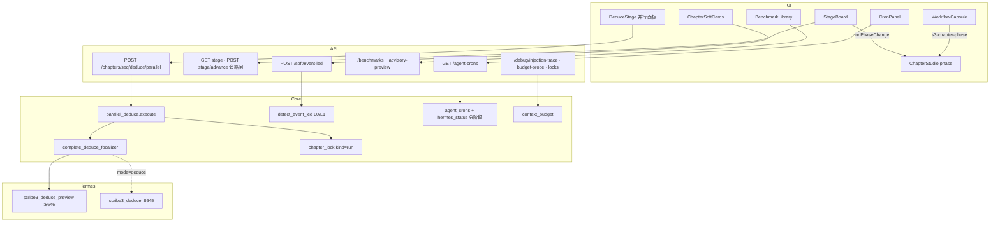
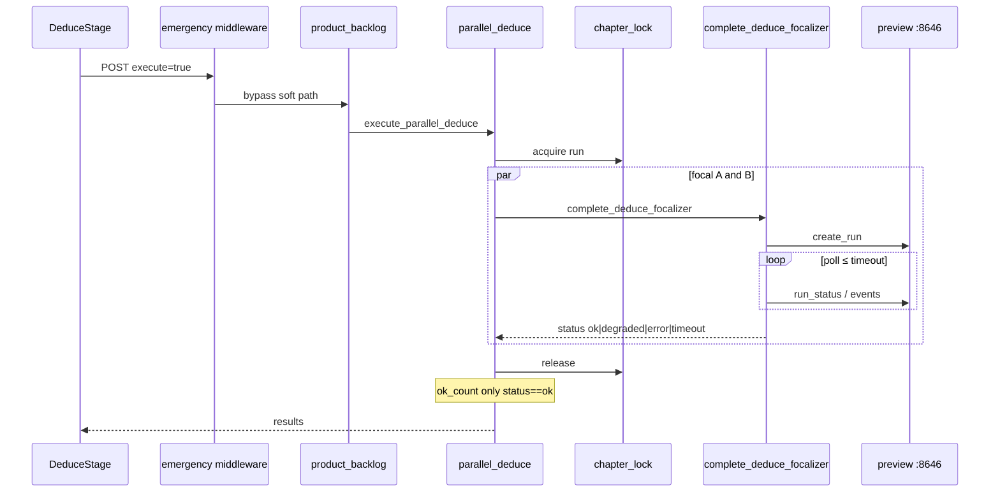
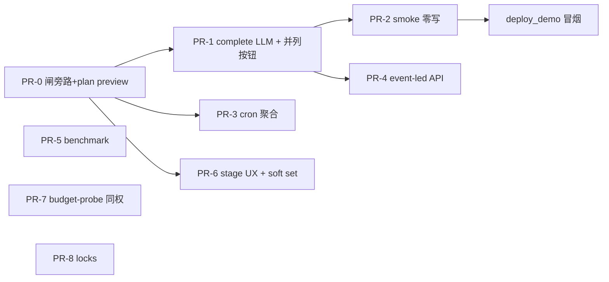

# 铜炉 / scribe3 ·「仍需做厚」能力最优设计（质量优先）

| 字段 | 值 |
|------|-----|
| **Document** | thicken-remaining-capabilities-optimal |
| **Author** | Grok Build (design) |
| **Date** | 2026-08-11 |
| **Status** | **Ready for implementation**（rev.3 · 用户决议定稿） |
| **Codebase** | `/home/admin/projects/scribe-writing-system`（`scribe3/` 为主） |
| **Baseline** | `d49c9ab feat(thicken): 做厚半截能力 H1–H11` |
| **Demo** | `ubuntu@203.0.113.10` · `/opt/scribe3/app` · `deploy/prod` · 公网 `tonglu.example.com` |

---

## Overview

H1–H11 已把「做厚」骨架接上：novel 信封 22k、EVENT_LED soft 检测、并行演绎 plan/execute 框架、StageBoard / SoftCards、Cron/Benchmark 落盘、budget 观测与本地采样。当前**仍薄**的关键缺口是：并行演绎默认 `_default_complete_fn` 无 Hermes 钩子时回 **stub**；登录后主路径冒烟停留在 health/登录级；Cron 产品 enable 与 Hermes/systemd timer **语义未对齐**；EVENT_LED 仅 L0 词面；Benchmark 与质量环/ReferenceWorks 未打通；StageBoard 与 WorkflowCapsule / Studio phase 真源分裂；预算头寸缺 demo 真章采样；锁双轨观测未统一。

本设计给出**可独立合 main、旗控可回滚**的最优接线方案：复用现有 Hermes `scribe3_deduce_preview`（默认 :8646）/ `scribe3_deduce`（:8645）+ Runtime 轮询（**不 fork Hermes**），全程 soft/advisory 优先，验证仅打**已部署 demo** 冒烟。

**rev.2 关键修订（相对 review）**：emergency REST 闸旁路、plan 默认 preview 对齐、complete 终态/summary/tool_trace/ok_count 合同、审计深度诚实声明、budget-probe 两档、冒烟默认零写 stage、Cron 分阶段合并、PR-0 拆闸与 plan。

**rev.3 用户决议（最终，不再开放辩论）**：

1. 并行 UI：**preview | deduce 两按钮并列**（非 advanced 隐藏）。
2. budget-probe 鉴权：**与 `/debug/injection-trace` 同权**（登录作者 + note）。
3. Stage **本波做 soft `action=set`**（localStorage phase 可同步到 `stage_state`；原 PR-6b 并入 PR-6）。
4. 实施顺序：**按 PR-0 → PR-1 → PR-2 开工**（用户已批准开干）。

---

## Background & Motivation

### 产品原则（不可破）

1. **优化目标是「好小说」**，不是成本；禁止 `tokens_saved` KPI。
2. **Soft / advisory 优先**；默认不打开 DRAMA_GATE 硬 park / EVENT_DRIVE_GATE / STAGE_HARD / PARK_STROLL_BLOCKING。
3. **不宣称文学 ≥9.5**。
4. **不 fork Hermes 源码**；profile/overlay 经 `provision_hermes` 叠加。
5. **验证 = 已部署 demo 冒烟**；禁止 Surreal 第二验收栈 / Grok 机全量 npm / 把 demo 当 CI 沙箱清空。
6. **冒烟默认零持久化变更**（不 advance stage、不清库、不批量写删）。

### 现状摘要（代码事实）

| 能力 | 现状 | 缺口 |
|------|------|------|
| `parallel_deduce.py` | plan + execute；章锁 `kind=run`；cap `min(6,…)` | `_default_complete_fn` → stub；**plan 硬编码 `scribe3_deduce` / `HERMES_DEDUCE_RUNS_API`（:8645）**；`ok_count` 把 `stub` 当成功 |
| emergency REST 闸 | `SCRIBE3_EMERGENCY_REST_WRITE` 默认 **关**；`/chapters/*` POST 属世界写 | `is_emergency_bypass_chapter_path` **未**含 `deduce/parallel`、`stage`、`stage/advance` → 生产 **403** |
| Hermes 端口 | deduce **:8645**；deduce_preview **:8646**（`hermes_runs_env` / overlay） | 设计/plan 若混用会接错网关 |
| HermesRuntime | `create_run` / `run_status` / `run_events` | **无** wait/extract 助手；无 `complete_deduce_focalizer` |
| AI run 审计 | `/ai/runs` + collector + `ai_run_trace` | 并行旁路 Runtime 时默认无 collector |
| Cron | catalog + overrides 落盘 | `_hermes_cron_status` **仅聚合 +「scribe3-体检」特判**，非 per-job 现成 |
| EVENT_LED | L0 + full_check soft | 无 L1；无统一 soft API |
| Benchmark | JSON CRUD | 与 `reference_craft` 无桥；inject 钩子未钉 |
| Stage | localStorage + stage API soft persist | advance 会改 demo `stage_state`；**rev.3 本波补 soft `action=set`** |
| Budget | 本地 sample；`/debug/injection-trace` | probe/--url 未实现；无 assemble dry 端点 |
| Locks | chapter_lock + 双轨保留 | 缺 `/debug/locks` |

### 痛点

- 作者点「确认执行」却得到 stub，且 `ok_count` 假绿。
- emergency 关时产品 POST 403，冒烟/UI 全红。
- plan 展示 full deduce 而 execute 走 preview → 语义分裂。
- 运维/作者误以为 CronPanel 开关 = Hermes timer。
- 重复冒烟 advance 推进真实作品阶段。

---

## Goals & Non-Goals

### Goals

1. **并行演绎真 LLM 路径**：`complete_deduce_focalizer` + plan/execute 默认 **preview**；`max_parallel≤2`（API clamp）；章锁；超时 soft；**stub 不计入 ok_count**。
2. **emergency 闸旁路** soft 产品路径，使登录后 curl/UI 非 403。
3. **登录后 demo 主路径冒烟**（默认 **零持久化写**）：login → storyline → GET stage → soft → parallel plan。
4. **Cron 只读对齐（分阶段）**：先聚合 hermes_cron + note_zh；再 per-job（缓存）。
5. **EVENT_LED L1** 可选 LLM；单一 API 入口；永不默认 blocking。
6. **Benchmark** 浅桥 + advisory-preview；inject 默认关且钉插入点。
7. **Stage 双真源**：冲突展示 + 本波 **soft `action=set`**（local → `stage_state` 可同步）。
8. **预算实采样**：`budget-probe` 默认 `mode=config`；assemble 显式；auth **与 injection-trace 同权**。
9. **锁观测** `/debug/locks`；纪律写 PR_TEST_BASELINE（非阻塞）。
10. **并行 UI**：`mode=preview` 与 `mode=deduce` **并列按钮**（非 advanced 隐藏）。

### Non-Goals（必须遵守）

- Hermes 源码 fork。
- 默认打开 `DRAMA_GATE` / `EVENT_DRIVE_GATE` / `STAGE_HARD` / `PARK_STROLL_BLOCKING`。
- 宣称文学 ≥9.5 或 tokens_saved KPI。
- Surreal 第二验收栈 / Grok 全量 npm/pytest。
- 把 demo 当 CI 沙箱清空或**默认** advance 改 `stage_state`。
- 将 `ingest_lease` / `approval_idempotency` 强并进 `chapter_lock`。
- 声称并行路径与单角色 DeduceStage **同审计深度**（除非走完整 `/ai/runs`+collector）。
- 默认无工具 `hermes_complete` 假成功替代 preview Runs。

---

## Key Decisions

| # | 决策 | 理由 |
|---|------|------|
| K1 | 并行默认 **`scribe3_deduce_preview`** + **`HERMES_DEDUCE_PREVIEW_RUNS_API`（默认 :8646）**；`mode=deduce` 才用 full（:8645） | 只读工具面；plan/execute/UI 同一 profile，避免分裂 |
| K2 | `complete_deduce_focalizer` = Runtime create_run + **显式 poll + 可选 events 抽文本**；**不** fork Hermes | 与现有 Runtime 同构；单测可 mock |
| K3 | API **强制** `max_parallel = min(body, env_max, 6)` 且 `env_max` 默认 **2**；`SCRIBE3_PARALLEL_DEDUCE_MAX` 为 **env/settings 数值**（**不**进布尔 `FLAG_REGISTRY`） | 裸 curl 不能打到 6；registry 保持 truthy 旗 |
| K4 | Cron：catalog enable 落盘 ≠ timer；**UI 永不 mutate timer** | 防误触 |
| K5 | EVENT_LED L1 默认关；**唯一入口** `POST /soft/event-led` | 避免 query/按钮/多端点分叉 |
| K6 | Benchmark 独立 advisory 段；不并入 reference_craft 批准流 | 边界清晰 |
| K7 | Phase：导航 = localStorage；可审计 = stage API；Capsule 只广播；**本波**支持 soft `action=set` 将本地 phase 写入 `stage_state`（见 K17） | 双真源可对齐，不依赖多次 advance |
| K8 | budget-probe：**默认 `mode=config`**；`mode=assemble` 显式+超时+仅数字；**auth = 与 injection-trace 同权**（登录作者，非 admin 专属）+ `note` 标明进程内/非跨副本 | 用户决议；防重负载与 prompt 泄露 |
| K9 | `/debug/locks`；纪律 = `docs/PR_TEST_BASELINE.md` 清单一句（**非** grep CI） | 可衰减但可接受 |
| K10 | 验收 = **deployed demo smoke only**；默认零持久化变更 | host 规则 |
| K11 | **session_key ≠ run_scope**：Runtime 直连用 `scribe3_session_key(work, scope=f"parallel_deduce:{ch}:{focal_slug}")` 隔离并发；若走 `/ai/runs` 则 `run_scope=chapter:{n}:deduce_preview`（phase 须匹配 `_CHAPTER_SCOPE`），**focalizer 只进 input/instructions**，不得塞进 run_scope | 防 resolve_run_stage_policy 422；与 `scribe3_session_key` SSOT 一致 |
| K12 | **emergency 旁路（推荐 a）**：扩展 `is_emergency_bypass_chapter_path` 覆盖 soft 产品子路径（见 §0）；**不**默认开 `SCRIBE3_EMERGENCY_REST_WRITE` | 产品 soft 路径不是正典世界写；保持闸对其余 `/chapters` 写的压力 |
| K13 | 审计：并行默认 **best-effort `upsert_ai_run_trace`**，**不**宣称与 DeduceStage collector/`validate_tool_trace` 同深度；UI run_id 链以 trace 有则为准 | 诚实；失败 soft |
| K14 | **不做**默认 `hermes_complete` 无工具 fallback；可选旗 `SCRIBE3_PARALLEL_DEDUCE_TEXT_FALLBACK=0` | 与 K1 一致，防胡编假绿 |
| K15 | 冒烟 **GET stage 为硬步骤**；`MUTATE_STAGE=1` 才 advance | 不干扰作者 stage_state |
| K16 | 并行 UI：**「预览网关执行」与「演绎网关执行」两按钮并列**（分别 `mode=preview` / `mode=deduce`）；另保留 dry-run「预览 plan」；**非** advanced 隐藏 | 用户决议；作者可显式选网关 |
| K17 | Stage soft **`action=set` 本波交付**（并入 PR-6，取消独立 6b 延期）：body `{action:"set", phase}` → soft 持久化 `stage_state`；hard 旗下非法仍 blocked | 用户决议；解决 local↔server 反向同步 |
| K18 | 实施主链 **PR-0 → PR-1 → PR-2 已批准开干**；其余 PR 可并行穿插 | 用户决议 |

---

## Proposed Design

### §0 · Emergency REST 闸与产品 soft 路径（PR-0 阻塞前置）

#### 问题

`app_impl._emergency_rest_write_middleware`：当 `SCRIBE3_EMERGENCY_REST_WRITE` 默认关时，对 `_REST_WORLD_WRITE_PREFIXES` 含 **`/chapters`** 的 POST/PUT/PATCH/DELETE 返回 **403**。  
旁路 SSOT：`chapter_gcd_rest.is_emergency_bypass_chapter_path` —— 目前仅 `archive|restore|restore-version|gcd-fields|beats-fields`。

因此现网（闸关）下：

- `POST /chapters/{seq}/deduce/parallel` → **403**
- `POST /chapters/{seq}/stage/advance` → **403**
- `GET /chapters/{seq}/stage` → **不受影响**（非写方法）

#### 决策（K12 · 推荐 a）

扩展 `is_emergency_bypass_chapter_path`（及 `app_impl` 回退白名单，保持一致）：

```
/chapters/{digits}/deduce/parallel
/chapters/{digits}/stage
/chapters/{digits}/stage/advance
```

可选同波（若 UI 已依赖）：无额外 world-write 的 soft 读模型 POST 仍走 `/soft-*` 前缀者本就不在 `/chapters` 下，无需旁路。

**语义注释**（代码 docstring）：

- 这些路径：**不写正典 prose**；parallel 默认不写 plan（仅 summary）；stage soft 仅 `stage_state.phase` 元数据。
- **仍需登录 auth**；旁路的是 emergency 世界写闸，不是鉴权。
- **禁止**把 `POST /chapters/{seq}` 存正文、`/ingest` 等扩进本白名单。

**备选 b**（不首选）：路由迁到 `/deduce/parallel`、`/chapter-stage/...` —— 需 FE/api.js/冒烟全改，波次更大。

#### 测试

- `test_novel_first_injection` / emergency 测：上述路径 `_is_rest_world_write_path` → False。
- 仍断言 `POST /chapters/3`（无子路径）→ True（闸内）。

#### 冒烟

- 记录 demo `capabilities`/`flags` 中 `emergency_rest_write` 实际值。
- 硬断言：login 后 `POST .../deduce/parallel` `execute=false` → **非 403**（期望 200）。

---

### 总架构



---

### Workstream 1 · 并行演绎真 LLM 路径

#### 1.1 问题

```python
# parallel_deduce.py 现状
# plan: profile="scribe3_deduce", api_env="HERMES_DEDUCE_RUNS_API"  # :8645 full
# _default_complete_fn → complete_deduce_focalizer 不存在 → stub
# ok_count = status in ("ok", "stub")  # 假绿
```

#### 1.2 plan 与 mode 对齐（Issue 2 · 与 K1）

`build_parallel_deduce_plan(..., mode="preview"|"deduce")`：

| mode | profile | api_env | 默认端口 | run_scope（仅当走 /ai/runs） |
|------|---------|---------|----------|------------------------------|
| **preview（默认）** | `scribe3_deduce_preview` | `HERMES_DEDUCE_PREVIEW_RUNS_API` | **:8646** | `chapter:{n}:deduce_preview` |
| deduce | `scribe3_deduce` | `HERMES_DEDUCE_RUNS_API` | **:8645** | `chapter:{n}:deduce` |

每个 run 行携带：`profile`, `api_env`, `mode`, `focalizer`, `system_hint`, `chapter`, `work`。

单测：更新 `test_deferred_product_backlog` / thicken 测中 `profile == "scribe3_deduce"` 为默认 **preview**。

#### 1.3 `complete_deduce_focalizer` 可实现合同（Issue 3 · 推荐路径 A）

**放置**：`scribe3/hermes_runtime.py` 或 `scribe3/parallel_deduce_complete.py`（re-export 到 runtime 命名空间以便 `_default_complete_fn` 发现）。

```python
TERMINAL_OK = frozenset({"completed", "completed_unverified"})  # 文本可用
TERMINAL_FAIL = frozenset({"failed", "cancelled", "stopped", "error"})
# 404 且本地无终态 → 继续 poll 至 timeout，再 status=timeout|error

def complete_deduce_focalizer(
    *,
    work: str,
    chapter: int,
    focalizer: str,
    profile: str = "scribe3_deduce_preview",
    api_env: str = "HERMES_DEDUCE_PREVIEW_RUNS_API",
    system_hint: str = "",
    timeout_s: float = 90.0,
    poll_interval_s: float = 1.5,
    store: Any | None = None,
) -> dict[str, Any]:
    """
    返回固定键:
      status: ok | degraded | error | timeout | stub
      summary: str ≤4000
      tool_trace_ok: bool
      run_id: str | None
      profile: str
      error: str | None
      audit: "trace_best_effort" | "none"
    """
```

**步骤（伪代码级）**：

1. 若 `SCRIBE3_PARALLEL_DEDUCE_LLM` 假 → 立即 `{status:"error", error:"LLM_disabled"}`（**不是** stub 成功）。
2. `api_base = hermes_runs_api_base_for_env(api_env)`（settings 优先若已接线）。
3. `session_key = scribe3_session_key(work, scope=f"parallel_deduce:{chapter}:{focal_slug}")`  
   - `focal_slug` = 安全化 `[a-z0-9_-]{1,32}`，中文 focal 用 hash 短缀。  
   - **不要**把 focal 放进 `run_scope` phase 段。
4. `runtime = HermesRuntime(api_base=api_base, profile=profile)`  
   `create_run(input=user_prompt, instructions=system_hint+只读纪律, session_key=session_key)`。
5. **best-effort** `store.upsert_ai_run_trace(run_id, status=created, session_key=..., input_text=...)`（失败 → `audit=none`，**不阻断**）。
6. **Poll loop** until `time > timeout_s`：
   - `run_status(run_id)`  
   - status ∈ TERMINAL_OK → 抽 summary，break  
   - status ∈ TERMINAL_FAIL → `{status:error, error:remote_status}`  
   - HTTP 404：若已见过 running 则视为回收竞态，尝试从最后一次 status body / 本地 trace 取文本；否则 continue  
   - 可选：并行 `run_events` 消费至 `run.completed`（与 status 二选一或互补；**至少一种**有文本）
7. **summary 抽取优先级**：
   1. `status` JSON 的 `output` / `response` / `result` 字符串或 messages 最后 assistant  
   2. events 中 `run.completed` 的 output  
   3. 拼接的 assistant delta  
   4. 皆空 → `status=degraded`, `summary=""`, `error=empty_output`
8. **`tool_trace_ok`（preview）**：
   - 在 events/trace 中是否存在 **至少一次** `s3_get_chapter` 的 tool completed（名称匹配）；  
   - 无 events 可观测时：`tool_trace_ok=False` 且若有非空 summary → 仍可 `status=ok` 但 `degraded_tools=true`（或整体 `degraded`）；**不得**无依据标 True。  
   - full `mode=deduce`：不要求 `s3_patch_chapter_plan`（并行 **禁止** 代作者写入）；tool_trace_ok 同 preview 读工具标准。
9. 网关不可达 / 建连失败 → `status=error`, `error=hermes_unreachable`（**非** stub）。
10. **`SCRIBE3_PARALLEL_DEDUCE_TEXT_FALLBACK`** 默认 **0**：不调用 `hermes_complete`。若未来开：仅 `error=hermes_unreachable` 时降级，结果必须 `status=degraded`, `error=no_tools_fallback`，**不得**标 ok。

#### 1.4 `ok_count` / 假绿（Issue 3）

修改 `execute_parallel_deduce` 汇总：

```python
ok_count = sum(1 for r in results if r.get("status") == "ok")
# 可选：degraded_count 独立
# stub / error / timeout → fail_count 或分项计数
# 禁止：status in ("ok", "stub") 计入 ok_count
all_stub = bool(results) and all(r.get("status") == "stub" for r in results)
```

响应增加：`all_stub`, `degraded_count`, `stub_count`。

#### 1.5 接线表

| 项 | 规范 |
|----|------|
| `_default_complete_fn` | 调 `complete_deduce_focalizer`；ImportError → **stub**（仅此路径 stub） |
| `max_parallel` | `cap = max(1, min(int(env_max or 2), 6, int(body or 2)))` — **API 与 build_plan 同函数** |
| 章锁 | 整批 `kind=run`；busy → 不发起 LLM |
| 超时 | 批级 `timeout_s`；单路 `min(per_run_cap, remaining)` |
| 旗布尔 | `SCRIBE3_PARALLEL_DEDUCE`、`SCRIBE3_PARALLEL_DEDUCE_LLM` 进 registry |
| 数值 | `SCRIBE3_PARALLEL_DEDUCE_MAX` **仅 env/settings 文档**，默认 `"2"` |
| 审计声明 | `audit_depth: "best_effort_trace"` ≠ DeduceStage full |

#### 1.6 审计深度（Issue 4）

| 能力 | 单角色 DeduceStage (`/ai/runs`) | 并行 complete（本设计默认） |
|------|--------------------------------|------------------------------|
| create_run | 是 | 是 |
| event collector / SSE | 是 | **否**（默认） |
| validate_tool_trace / 审批 | 是（写工具） | **否**（preview 无写） |
| ai_run_trace 落库 | 是 | **best-effort** |
| UI run_id 可回读 | 是 | **有 trace 才可** |

验收文案：**「run_id 尽力落库」**；不得写「与单角色同审计深度」。  
备选 B（后续）：内部调与 `ai_run_create` 同路径 + `run_scope=chapter:{n}:deduce_preview`，focal 在 input；collector 复用——**本波不强制**。

#### 1.7 API 契约

`POST /chapters/{seq}/deduce/parallel`（须 emergency 旁路后非 403）

```json
// request
{
  "focalizers": ["甲", "乙"],
  "max_parallel": 2,
  "execute": true,
  "mode": "preview",
  "timeout_s": 90,
  "lock": true
}

// response execute
{
  "execute": true,
  "mode": "preview",
  "plan": {
    "runs": [
      {
        "index": 0,
        "focalizer": "甲",
        "profile": "scribe3_deduce_preview",
        "api_env": "HERMES_DEDUCE_PREVIEW_RUNS_API"
      }
    ],
    "max_parallel": 2
  },
  "results": [
    {
      "status": "ok",
      "summary": "...",
      "tool_trace_ok": true,
      "run_id": "...",
      "audit": "trace_best_effort"
    }
  ],
  "ok_count": 1,
  "fail_count": 0,
  "stub_count": 0,
  "degraded_count": 0,
  "all_stub": false,
  "severity": "soft",
  "surface": "parallel_deduce.execute"
}
```

#### 1.8 UI（K16 · 并列两按钮）

DeduceStage 并行面板按钮布局（**并列，非 advanced 折叠**）：

| 按钮 | 行为 | body |
|------|------|------|
| **预览 plan** | dry-run，不调 LLM | `execute=false`（mode 可带当前选择，默认 preview） |
| **预览网关执行** | 真跑 preview | `execute=true`, `mode=preview` → :8646 / `scribe3_deduce_preview` |
| **演绎网关执行** | 真跑 full deduce 网关 | `execute=true`, `mode=deduce` → :8645 / `scribe3_deduce` |

纪律（两种 execute 共用）：

- 限并发 2；章锁 `kind=run`；**不**代作者审批写入 `s3_patch_chapter_plan`；结果仅 summary 展示。
- `mode=deduce` 仍 **禁止** 自动写正文/plan；文案注明「完整演绎网关 · 仍不直写正文」。
- `all_stub` 或任一路 `stub`：toast **警告**，非 ok 绿。
- 展示实际 profile / api_env 短名（预览 vs 演绎）。
- 审计尽力落库（K13）。

#### 1.9 序列图



#### 1.10 验收 WS1

- [ ] 单测：mock complete → 两路 ok；stub **不进** ok_count。
- [ ] 单测：plan 默认 profile=`scribe3_deduce_preview`。
- [ ] 单测：emergency 旁路路径非 world-write。
- [ ] Demo：`execute=false` **非 403**；可选 `EXECUTE_PARALLEL=1` 时非 stub 或明确 `hermes_unreachable`（Hermes health ok 且全 stub → **FAIL**）。

---

### Workstream 2 · 登录后 demo 主路径冒烟

#### 2.1 目标

`scripts/smoke_scribe3_thicken.sh`（或 `MODE=thicken`），**只打已部署栈**。  
原则：**默认零持久化变更**（K15）。

#### 2.2 步骤清单

| # | 步骤 | 期望 | 硬/软 |
|---|------|------|-------|
| 0 | ready / health | 200 | 硬 |
| 1 | POST `/auth/login` | 200 cookie | 硬 |
| 2 | NOTE `emergency_rest_write` 实际值（capabilities/flags） | 打印 | 软 |
| 3 | GET works / chapters | 200 | 硬 |
| 4 | GET `/storyline/gantt` | 200 | 硬 |
| 5 | GET `/chapters/{SEQ}/stage` | 200 + phase 字段 | **硬** |
| 6 | **默认不做** POST stage/advance；仅 `MUTATE_STAGE=1` 时执行并 NOTE「已改 stage_state」 | — | 可选 |
| 7 | POST `/soft-precheck` 或 `/soft/event-led` `{"include_llm":false}` | 200 | 软 |
| 8 | POST `.../deduce/parallel` `execute=false` | **200 非 403** + runs；profile 含 preview | **硬** |
| 9 | `EXECUTE_PARALLEL=1` 可选 execute `timeout_s=30` | 打印 status；Hermes ok 且 all_stub → FAIL | 软默认 |
| 10 | GET `/agent-crons` | 200 + note_zh | 硬 |
| 11 | GET `/benchmarks` | 200 | 硬 |
| 12 | GET `/debug/injection-trace` 或 POST budget-probe `mode=config` | 200 或 403 NOTE | 软 |
| 13 | GET `/debug/locks` | 200 或 404 NOTE | 软 |

凭证：同源 `smoke_s32.sh`。

#### 2.3 退出码

- 0 硬全绿；1 硬失败；2 缺凭证。

---

### Workstream 3 · Cron 只读对齐（分阶段 · Issue 7）

#### 3.1 语义边界

| 字段 | 含义 | 真源 | 产品可写 |
|------|------|------|----------|
| schedule/script | 定义 | crons.yaml + provision | 否 |
| catalog_enabled | 目录偏好 | cron_overrides.json | 是 |
| hermes_cron（聚合） | CLI status 摘要 | `hermes cron status/list` | 否 |
| hermes.present/active（per-job） | 单任务 | **新解析器 · Phase 2** | 否 |

#### 3.2 Phase 1（本波 PR-3 必做）

`GET /agent-crons`：

```json
{
  "jobs": [
    {
      "name": "scribe3-daily-digest",
      "schedule": "0 8 * * *",
      "script": "...",
      "catalog_enabled": true,
      "hermes": null
    }
  ],
  "hermes_cron": {
    "checked": true,
    "gateway_running": true,
    "active_jobs": 3,
    "scribe3_qc": {"present": true, "active": false},
    "note": "aggregate only; per-job match is phase2"
  },
  "note_zh": "启停覆盖仅影响产品目录；真正 timer 以 crons.yaml + provision_hermes/systemd 为准",
  "mutates_hermes_timer": false,
  "surface": "agent_crons.list"
}
```

- 复用 **现有** `_hermes_cron_status` 聚合字段（含「scribe3-体检」特判），**不**声称 per-job 复用即得。
- subprocess 失败 / 无 hermes CLI → `checked=false`，**HTTP 200**。
- 可选：进程内缓存 TTL **45s**，降低并发 GET 拖尾。

#### 3.3 Phase 2（follow-up · 可另 PR）

- 解析 `hermes cron list` 全文，按 yaml `name` 匹配 present/active。
- 缓存 TTL 30–60s；单测 mock list 全文。
- 每 job 填 `hermes: {present, active, last_status?}`。

#### 3.4 禁止误触

- `POST .../enable` → 仅 overrides；响应 `mutates_hermes_timer: false`。
- **不做** `SCRIBE3_CRON_OPS_MUTATE` 产品端点（除非运维另立 RFC）。

#### 3.5 UI

- Phase 1：顶栏展示聚合 hermes_cron + note_zh；每行仅 catalog 开关。
- Phase 2：每行 Hermes 在册/活跃。

---

### Workstream 4 · EVENT_LED 分层

#### 4.1 分层

| 层 | 函数 | 旗 | 默认 |
|----|------|-----|------|
| L0 | `detect_event_led` | `SCRIBE3_EVENT_LED_DETECT` | 开 |
| L1 | `detect_event_led_llm` | `SCRIBE3_EVENT_LED_LLM` | **关** |

full_check：**仅 L0**（现网），永不 park。

#### 4.2 唯一入口（Issue 11）

```
POST /soft/event-led
Body: {
  "prose": "...",          // 或 seq + 服务端读章
  "seq": 1,
  "work": "main",
  "include_llm": false     // true 时才跑 L1（且旗开）
}
→ {
  "l0": { ...detect_event_led },
  "l1": null | { advisory_notes, severity: "advisory", ... },
  "severity": "advisory"
}
```

- **不**使用 `?llm=1` query 分叉。
- SoftCards 增加「事件履约」卡：按钮调上述 API（默认 `include_llm=false`；「深评」传 true）。

#### 4.3 L1

- `complete_fn` 默认 `llm.hermes_complete`（无工具）；超时 soft；失败 l1=`degraded`，不影响 l0。

---

### Workstream 5 · Benchmark 浅桥 + 注入点（Issue 10）

#### 5.1 浅桥

- JSON 字段扩：`reference_work_id?`, `beats_sample?`, `tags`。
- `POST /benchmarks/{bid}/advisory-preview` → `{ text, tokens_est, advisory_only: true, not_auto_write_prose: true }`。
- `POST /benchmarks` upsert 可带 `reference_work_id`（或 `/link`）。

#### 5.2 注入（旗默认关）

- 旗：`SCRIBE3_BENCHMARK_INJECT=0`。
- **插入点（钉死）**：`write_assemble.py` 中 **紧邻** 现有 `storyline_inject_polish` 块之后（约 O33 段落后），对 `joined` 追加或 `_push("benchmark_advisory", "supplemental", text)` **若**走 segment 列表路径则与 storyline 同属 supplemental、在 `join_generation_segments` **之前** push（优先：与 reference_craft 一样 `_push` 进 segs，避免二次拼接顺序漂移）。
  - **推荐实现**：在 `reference_craft` soft 段之后、`apply_soft_activation` 之前 `_push("benchmark_advisory", "supplemental", ...)`，使 L2 可裁。
- **max chars**：800（常量 `BENCHMARK_ADVISORY_MAX_CHARS`）。
- **header 常量**：`BENCHMARK_ADVISORY_HEADER = "【对照参考·禁止仿写专名与原句】\n"`。
- **安全过滤**：复用 `reference_craft._UNSAFE_MECHANISM` / 书名号启发式（抽小函数 `sanitize_benchmark_advisory_text`），跳过长引号块。
- **永不** save_chapter / 改 prose。

---

### Workstream 6 · Stage 双真源 + soft set（本波 · K17）

#### 6.1 协议

| 通道 | 职责 |
|------|------|
| localStorage `s3.chapter.phase:{work}:{seq}` | 导航即时 |
| `stage_state` via GET / advance / **set** | 可审计 |
| `s3-chapter-phase` | 进程内广播 |
| workflow snapshot phase_hint | 只读建议 |

#### 6.2 本波 UI

- StageBoard：本地 vs 远程冲突文案。
- **「采用服务端」**：`onPhaseChange(remote)` 写 localStorage。
- **「同步本地到服务端」**（本波交付）：`POST .../stage/advance` body `{ "action": "set", "phase": <localPhase> }`，成功后 refresh remote。
- Capsule 继续：只 event，**不**自动 POST set/advance（避免旅程「继续」误写库）。

#### 6.3 soft `action=set` API（本波，原 6b 并入）

```
POST /chapters/{seq}/stage/advance
Body: { "action": "set", "phase": "deduce" }
```

- `phase` 经 `normalize_phase`；非法 → `ok=false` + advisories（soft 默认不 blocked）。
- soft 路径：直接 persist `stage_state={phase}`（允许跳阶段，advisories 可含 `skipped_phase` / `backward_transition`）。
- hard 旗 `SCRIBE3_STAGE_MACHINE_HARD`：非法跳转 `blocked=true`，不写库。
- 响应形状与 advance 一致：`{ ok, soft_ok, blocked, current, next, action, advisories, persist, severity }`，`action="set"`。
- **须 emergency 旁路**（与 advance 同，§0）。
- 实现：`chapter_stage.transition` 扩展 `action=set`，或 `chapter_stage_advance_ep` 内对 set 分支调用 `normalize_phase` + persist。

#### 6.4 验收

- [ ] soft set 合法 phase → persist ok；GET stage 反映新 phase。
- [ ] hard 旗下非法 set → blocked、不写库。
- [ ] StageBoard 冲突 UX + 双向按钮。
- [ ] 冒烟默认 **不** 调 set/advance（`MUTATE_STAGE=0`）。

---

### Workstream 7 · 预算头寸（Issue 5）

#### 7.1 CLI

```bash
# 本地配置表（已有）
python -m scribe3.tools.sample_budget_report --out /tmp/b.json

# demo auth
python -m scribe3.tools.sample_budget_report \
  --url https://tonglu.example.com \
  --work main --seq 1 \
  --mode config \
  --cookie-jar /tmp/smoke.cookies \
  --out /tmp/budget_demo.json
```

Login 流程复用 smoke cookie（`SMOKE_USER`/`SCRIBE3_BOOTSTRAP_USERS`）。

#### 7.2 `POST /debug/budget-probe`（两档钉死）

| mode | 默认 | 行为 | 返回 |
|------|------|------|------|
| **config** | **是** | 仅 `build_budget_report()` + env 头寸估算 | L1_envelope、prompt_hard、fidelity、adaptive_profile、effective_L2_est（硬顶差） |
| **assemble** | 否，须显式 | 轻量触达 store 投影估算 domain_lengths（**超时** 8–15s）；**禁止**回传完整 instructions/prompt | 仅 `domain_lengths`、L0/L1/L2 数字、effective_l2_cap、dropped 名列表 |

- Auth：**与 `/debug/injection-trace` 同权**（登录作者即可，**非** admin 专属；用户决议定稿）。
- 响应 `note`：`进程内最近/配置快照，非跨副本；与 injection-trace 同权`。
- **永不**日志/响应打全文 prompt。
- 可选简易限流：同进程 1 req/2s（best-effort）。
- `injection-trace` 仍可作「最近真写路径」采样；probe 不依赖先写一章。

---

### Workstream 8 · 锁双轨

#### 8.1 保留

ingest_lease、approval_idempotency、settings busy。

#### 8.2 `GET /debug/locks`

`inflight_snapshot()` + `CHAPTER_OPS` + `distributed_lock` 旗；auth 同 debug。

#### 8.3 纪律（Issue 13）

- 新写路径须 chapter_lock — **文档纪律**。
- 在 `docs/PR_TEST_BASELINE.md` 加一条检查清单（人工）；**不**加阻塞 grep CI。

---

## API / Interface Changes（汇总）

| 方法 | 路径 | 变更 |
|------|------|------|
| — | `is_emergency_bypass_chapter_path` | 旁路 parallel/stage/advance |
| POST | `/chapters/{seq}/deduce/parallel` | mode、preview plan、LLM、ok_count、clamp |
| GET | `/chapters/{seq}/stage` | 已有；冒烟硬步骤 |
| POST | `/chapters/{seq}/stage/advance` | 旁路闸；**本波**支持 `action=advance|set`（set 写 phase） |
| GET | `/agent-crons` | Phase1 聚合 hermes_cron + note_zh |
| POST | `/agent-crons/{name}/enable` | `mutates_hermes_timer: false` |
| POST | `/soft/event-led` | L0 + 可选 L1 |
| POST | `/benchmarks/{bid}/advisory-preview` | 新 |
| POST | `/debug/budget-probe` | mode=config\|assemble |
| GET | `/debug/locks` | 新 |
| GET | `/debug/injection-trace` | 保持 |

### 旗标 / 配置

| 名 | 默认 | 登记 |
|----|------|------|
| `SCRIBE3_PARALLEL_DEDUCE` | 1 | FLAG_REGISTRY |
| `SCRIBE3_PARALLEL_DEDUCE_LLM` | 1 | FLAG_REGISTRY |
| `SCRIBE3_PARALLEL_DEDUCE_MAX` | 2 | **env/settings 数值**，非布尔 registry |
| `SCRIBE3_PARALLEL_DEDUCE_TEXT_FALLBACK` | 0 | FLAG_REGISTRY 可选 caution |
| `SCRIBE3_EVENT_LED_DETECT` | 1 | 已有 |
| `SCRIBE3_EVENT_LED_LLM` | 0 | FLAG_REGISTRY |
| `SCRIBE3_BENCHMARK_INJECT` | 0 | FLAG_REGISTRY |
| `SCRIBE3_AGENT_CRON_UI` | 1 | 已有 |
| `SCRIBE3_EMERGENCY_REST_WRITE` | 0 | 已有；**不**为冒烟默认打开 |
| `MUTATE_STAGE` | 0 | **仅冒烟脚本 env**，非产品旗 |

---

## Data Model Changes

- 无 Surreal 强制迁移。
- benchmark JSON 可选字段。
- `stage_state` 已支持。
- cron_overrides 兼容 bool。

---

## Alternatives Considered

### A. 并行走完整 deduce + 自动审批 — **否决**（审批风暴）

### B. 默认 `hermes_complete` 无工具 — **否决为默认**；仅 TEXT_FALLBACK 旗且 degraded（K14）

### C. Cron UI 直操 timer — **否决**

### D. Phase 只服务端 — **否决**；双真源

### E. 临时 Surreal 采样 — **否决**

### F. 默认开 EMERGENCY_REST_WRITE 跑通产品 — **否决**；扩大世界写面；用旁路 a

### G. 并行强制完整 `/ai/runs`+collector — **本波不强制**（成本/复杂度）；可 follow-up

---

## Security & Privacy

| 威胁 | 缓解 |
|------|------|
| 并行耗尽 Hermes | max≤2、timeout、章锁 |
| emergency 旁路过宽 | 白名单仅 soft 子路径 |
| budget-probe 泄露 prompt | assemble 仅数字；默认 config |
| 公网 author 探针 | 与 injection-trace 同权 + note；限流 best-effort |
| stub 假绿 | ok_count 合同 + UI + 冒烟 |
| Cron 误停 | 不 mutate timer |
| Benchmark 仿写 | sanitize + header + cap 800 |

---

## Observability

- parallel：ok/fail/stub/degraded/elapsed/all_stub  
- event_led：现有 info  
- budget：probe + injection-trace  
- locks：inflight  
- cron：hermes_cron.checked  
- **主指标**：戏剧信号密度；禁 tokens_saved  

---

## Rollout Plan



**开工顺序（用户批准）**：先合 **PR-0**，再 **PR-1**，再 **PR-2** 冒烟验收主链；PR-3…8 可与主链并行。

回滚：关 `PARALLEL_DEDUCE_LLM` / `PARALLEL_DEDUCE`；EVENT_LED_LLM；BENCHMARK_INJECT；旁路代码回滚则 soft 路径再 403（可接受紧急时临时开 EMERGENCY 仅运维）。

---

## Risks

| 风险 | 严重度 | 缓解 |
|------|--------|------|
| 旁路遗漏导致 403 | 高 | PR-0 单测 + 冒烟非 403 |
| plan/execute profile 不一致 | 高 | 同函数生成 plan |
| preview :8646 未监听 | 高 | hermes_unreachable 明确；不 stub 假绿 |
| ok_count 假绿回潮 | 高 | 单测钉死 |
| 宣称审计同深 | 中 | K13 文案 |
| assemble probe 重 | 中 | 默认 config |
| cron subprocess 拖尾 | 中 | 缓存 + Phase1 聚合 |
| 冒烟 advance 改库 | 中 | 默认关 |

---

## Open Questions

| # | 问题 | 状态 | 决议 / 备注 |
|---|------|------|-------------|
| 1 | `mode=deduce` UI 是否 advanced 隐藏？ | **Resolved（用户）** | **否**。preview \| deduce **并列两按钮**（K16）；PR-1 FE 交付 |
| 2 | budget-probe 是否限 admin？ | **Resolved（用户）** | **与 injection-trace 同权**（登录作者 + note）（K8） |
| 3 | CRON_OPS_MUTATE 端点？ | Open | **默认不做**；运维另立 RFC 再说 |
| 4 | soft `action=set` phase 是否延期 6b？ | **Resolved（用户）** | **本波做**；并入 **PR-6**（K17），取消独立 6b 延期 |
| 5 | 并行结果写入 plan.deductions？ | Resolved（设计） | **否**（仅 summary 展示；写入仍走单角色审批 Run） |
| 6 | 并行升格完整 `/ai/runs` collector？ | Open | follow-up，非本波阻塞 |
| 7 | 实施顺序？ | **Resolved（用户）** | **PR-0 → PR-1 → PR-2 开干**（K18）；其余可并行 |

---

## Implementation Status

**Ready for implementation.** 用户已批准按 **PR-0 → PR-1 → PR-2** 开工。本回合仅设计定稿，**不**在本回合写代码。

---

## References

- `scribe3/parallel_deduce.py`, `hermes_runtime.py`, `hermes_runs_env.py`, `run_stage_policy.py`
- `scribe3/api/app_impl.py`（emergency middleware）, `chapter_gcd_rest.py`
- `scribe3/api/routers/product_backlog.py`, `api/services/hermes_status.py`, `ai_run_runtime.py`
- `scribe3/narrative_drive.py`, `benchmark_lib.py`, `reference_craft.py`, `context_budget.py`
- `scribe3/chapter_lock.py`, `docs/guides/2026-08-11-lock-kinds.md`
- `scribe3/web/src/StageBoard.jsx`, `WorkflowCapsule.jsx`, `ChapterStudio.jsx`, `DeduceStage.jsx`, `CronPanel.jsx`
- `scripts/smoke_s32.sh`, `deploy_demo.sh`, `provision_hermes.py`, `deploy/hermes/crons.yaml`

---

## Acceptance Criteria by Workstream（Demo smoke only）

| WS | 验收 | 验证 |
|----|------|------|
| 0 闸 | parallel POST 非 403 | demo curl |
| 1 并行 | plan=preview；ok_count 无 stub；可选 LLM | curl + 单测 |
| 2 冒烟 | 脚本硬步骤；默认不 advance | smoke_scribe3_thicken.sh |
| 3 Cron | 聚合+note；toggle 不改 timer | GET/POST |
| 4 EVENT | POST /soft/event-led | curl |
| 5 Bench | preview advisory | curl |
| 6 Stage | GET + 冲突 UX + soft set；冒烟默认不 mutate | UI/curl；set 单测 |
| 7 Budget | probe mode=config | curl |
| 8 Locks | /debug/locks | curl |

---

## PR Plan

### PR-0 · Emergency 旁路 + plan 默认 preview（阻塞前置）

- **Title**: `fix(thicken): emergency bypass soft chapter paths + parallel plan preview profile`
- **Files**: `chapter_gcd_rest.py`, `app_impl.py`（若重复白名单）, `parallel_deduce.py`（plan profile/api_env/mode）, tests（emergency + deferred backlog profile 断言）
- **Deps**: 无
- **Changes**: 旁路 `deduce/parallel`、`stage`、`stage/advance`；plan 默认 `scribe3_deduce_preview` / `HERMES_DEDUCE_PREVIEW_RUNS_API`；文档端口 :8646/:8645

### PR-1 · complete_deduce_focalizer + ok_count + 并列 preview|deduce 按钮

- **Title**: `feat(parallel-deduce): complete_deduce_focalizer; stub not ok; dual preview|deduce execute buttons`
- **Files**: `hermes_runtime.py` 或 `parallel_deduce_complete.py`, `parallel_deduce.py`, `product_backlog.py`, `feature_flags.py`, `web/src/DeduceStage.jsx`, tests
- **Deps**: **PR-0**
- **Changes**: 路径 A 实现；session_key K11；best-effort trace；ok_count/all_stub；UI stub 警告；**FE 并列三控件**：预览 plan / 预览网关执行 / 演绎网关执行（K16）；`mode` 传入 API；**不**声称全量 collector 审计

### PR-2 · 主路径冒烟（默认零写）

- **Title**: `test(smoke): thicken mainpath; no default stage mutate`
- **Files**: `scripts/smoke_scribe3_thicken.sh`
- **Deps**: PR-0（非 403）；PR-1 建议（execute 段）
- **Changes**: GET stage 硬；`MUTATE_STAGE`/`EXECUTE_PARALLEL` 可选；断言 non-403 parallel plan

### PR-3 · Cron Phase1 聚合对齐

- **Title**: `feat(cron): expose hermes_cron aggregate + note_zh (no per-job claim)`
- **Files**: `agent_crons.py` / `product_backlog.py`, `hermes_status.py`（复用）, `CronPanel.jsx`, tests
- **Deps**: 无（旁路无关）
- **Changes**: Phase1 only；缓存可选；enable 响应 mutates_hermes_timer=false

### PR-3b · Cron Phase2 per-job（可选 follow-up）

- **Title**: `feat(cron): per-job hermes list match with TTL cache`
- **Deps**: PR-3

### PR-4 · EVENT_LED 统一 API

- **Title**: `feat(event-led): POST /soft/event-led L0+optional L1`
- **Files**: `narrative_drive.py`, router, `ChapterSoftCards.jsx`, flags, tests
- **Deps**: 无

### PR-5 · Benchmark preview + inject 钩子（旗关）

- **Title**: `feat(benchmark): advisory-preview and optional inject next to storyline`
- **Files**: `benchmark_lib.py`, `product_backlog.py`, `write_assemble.py`（钩子+sanitize）, `BenchmarkLibrary.jsx`, tests
- **Deps**: 无

### PR-6 · Stage 冲突 UX + soft action=set（本波，原 6b 并入）

- **Title**: `feat(stage): local/server phase conflict UX + soft action=set`
- **Files**: `chapter_stage.py`, `product_backlog.py`（`chapter_stage_advance_ep`）, `web/src/StageBoard.jsx`, `ChapterStudio.jsx`（若需）, tests
- **Deps**: **PR-0**（emergency 旁路 stage/advance）
- **Changes**: 冲突展示；「采用服务端」；**「同步本地到服务端」** → `action=set` + `phase` soft 持久化 `stage_state`；hard 旗纪律；单测 set/非法 phase

### PR-7 · budget-probe 两档 + CLI --url（同权 auth）

- **Title**: `feat(budget): probe mode=config|assemble; same auth as injection-trace`
- **Files**: `misc_routes.py`, `sample_budget_report.py`, tests
- **Deps**: 无
- **Changes**: POST `/debug/budget-probe`；默认 config；assemble 仅数字；**auth 与 injection-trace 同权** + note；CLI `--url` smoke cookie

### PR-8 · /debug/locks + PR_TEST_BASELINE 纪律句

- **Title**: `feat(locks): GET /debug/locks; baseline checklist note`
- **Files**: `misc_routes.py`, `docs/PR_TEST_BASELINE.md`, `docs/guides/2026-08-11-lock-kinds.md`
- **Deps**: 无

### 合并顺序

**用户批准主链开干**：`PR-0 → PR-1 → PR-2`。  
`PR-3/4/5/6/7/8` 可与主链并行穿插（PR-6 依赖 PR-0 闸旁路）。  
交付验证：`./scripts/deploy_demo.sh` + thicken 冒烟（demo-only）。

---

## Revision History

| 版本 | 日期 | 说明 |
|------|------|------|
| Draft r1 | 2026-08-11 | 初稿 |
| Draft r2 | 2026-08-11 | Review：闸旁路、plan preview 端口、complete 合同、ok_count、审计深度、budget 两档、冒烟零写、cron 分阶段、PR-0、K11–K15 |
| **Ready r3** | 2026-08-11 | **用户决议**：并列 preview\|deduce 按钮；budget 与 injection-trace 同权；本波 soft action=set（并入 PR-6）；**PR-0→1→2 批准开干**；Status=Ready for implementation；K16–K18 |
