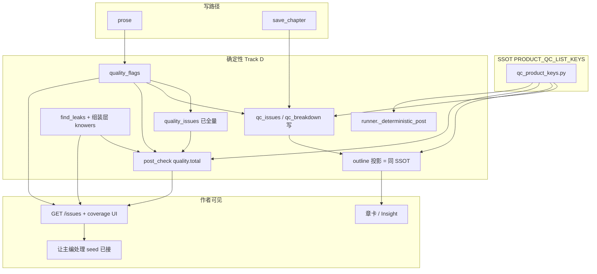
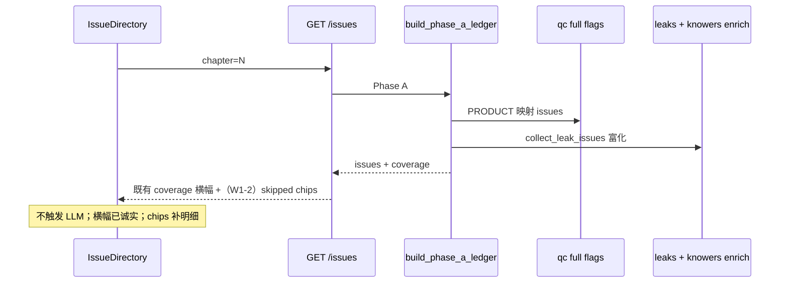

# 铜炉（tonglu / scribe3）产品计数与台账诚实接线方案

| 字段 | 值 |
|------|-----|
| **文档标题** | 真·半接线 → **soft 默认可消费主链**（质量优先 · 可实施 · 可验收） |
| **作者** | Grok Design（待人类审定） |
| **日期** | 2026-08-11 |
| **修订** | Rev D · 用户拍板 OQ（rule_of_three 计入；永久扩维+REVISION；仅 body.platform） |
| **状态** | **Ready for implementation**（下一步：`PR-W0-1`） |
| **仓库** | `/home/admin/projects/scribe-writing-system` |
| **产品** | scribe3 / 铜炉（tonglu.qing.blue） |
| **验证定义** | **只冒烟已部署 demo**（`ubuntu@82.157.130.140` · `/opt/scribe3/app`）；禁止 Grok 机全量 npm / Surreal / pytest；禁止另起第二验收栈 |

> **成功标准（交付门）**：P0–P1 可测项 **A1 / A2 / A5** 合 main + demo 冒烟绿。  
> **A4** 为 W1 **强烈建议**（范围仅 `sources_skipped` chips + 可选 CTA；**coverage 横幅/诚实空态已接，勿重做**）。  
> P2（A7–A10、诚实打磨 E1/E2）为可选加深，**不**绑定「装配闭环全部完成」叙事。  
> 范围是 **soft/advisory 默认可消费 + 作者反馈诚实**，不是硬门闭环，也不是「最完善装配」全称。

---

## Overview

铜炉在 P0–P2、H1–H11、PR-0～8 + 3b 之后，**大量检测器 / 投影 / API / UI 组件已实现**，但默认写后**产品计数**、章缓存、限知交叉审计与部分 opt-in 端点 **并未统一消费**。Issue 台账主诚实文案（未做语义深检）**已在 IssueDirectory 接线**；剩余多为 skipped 明细 chips 与计数/限知主链。

核心作者误读不是「issues 列表完全看不见 god_view」——`quality_issues()` 与 Phase A（经 `qc()` 全量 flags）**已经能展开** god_view/degeneration 等——而是：

1. **产品合计面变窄**：章卡 `qc_issues`、`outline().qc_breakdown`、`post_check.quality.total` 只加 5 类，与 issues 列表分裂；  
2. **读路径再裁一次**：即便落库扩维，`structure.outline()` 硬编码只保留五键；  
3. **入口口径分裂**：`runner._deterministic_post` 已对 flags 全 list 键 sum，与 post_check/缓存五类不一致。

本设计目标：把仍属 **真·半接线** 的项做成可独立合 main 的规格（入口、SSOT 常量、失败语义、UI、验收）。默认 **soft/advisory**；不打开硬 park 门；不把 opt-in / 缺 key / fail-open 当装配缺陷。产品 KPI 是**好小说与可信反馈**，不是检测条数膨胀。

---

## Background & Motivation

### 当前状态（代码核验，2026-08-11 · Rev B）

| 层 | 已实现 | 默认主链消费缺口 |
|----|--------|------------------|
| 检测器 | `quality_flags` **11 键**；`quality_issues()` **已展开** god_view/degeneration/filler/rule_of_three 等进 issues | **产品合计**五类：`_compute_chapter_caches`、`post_check`/`check_prose` 的 quality/qc、scorecard advisory |
| 读路径 | 章表可存任意 `qc_breakdown` JSON | **`structure.outline()` 硬编码只投影五键**（`repetition…oversaturation`）——写扩维、读仍裁回五类 |
| runner | `_deterministic_post` **已**对 flags 全 list 键（除 rhythm/adverb）做 sum → `quality.total` | 与 `write.post_check` **语义分裂**；缺共享 PRODUCT 常量 |
| 限知 | knowers：`list_knowers_for_proposition` + API；leaks：`find_leaks`→`project_frame` | 不交叉；`Leak` dataclass 无 meta；post_check 序列化 leak dict 无 knowers |
| 台账 | Phase A：qc+leaks+causal+secret_debt；Phase B 并 L 快照；`coverage.note` 后端已有；**`IssueDirectory` 已有 coverage 横幅 +「未做语义深检」诚实空态** | **剩余**：`sources_skipped` chips 未展示；栏内可点「全量体检」CTA 仅文案提及（真按钮在 WriteLayout）；`project_quality_dim_advisory` 零调用 |
| 写后 | post_check 已并 discipline 共振、orphan_edges、elegant_variation、event_led 等 | 平台轴 prompt 就绪但 **无 `work.target_platform` 字段**；faction 有 GET 无台账/UI；soak 无端点 |
| UI 修复 | `IssueDetail` **已内置「让主编处理」**→`focusChiefWithSeed`（主价值已接） | 第二枚 `onFix`「修复」按钮生产不传——**非**「无修复能力」 |
| 并行演绎 | Hermes 真打主路径已通 | `_tool_trace_ok` events 空 → **False 假红** |
| 阶段 / Cron | StageBoard 已有 localVsServer banner+双按钮；agent_crons 已返 `mutates_hermes_timer:false` + `note_zh` | **诚实打磨**（文案/挂载默认），非空白半装 |

### 痛点（精确表述）

1. **作者误读（P0）——合计 vs issues 双面分裂**  
   - **章卡 / Insight / Overview**：只看 `qc_issues`（五类 sum）→ 易「绿了」。  
   - **GET /issues**：经 `qc()` 全量 + `QC_ISSUE_LABELS` → 可见 god_view 等。  
   - **POST /post-check**：顶层 `issues` 已有 god_view 等 type，但 `quality.total` / `qc_breakdown` 仍五类 → 「列表有、合计小」。  
   - **outline 读路径**：再裁五键，合计与 breakdown 在扩维后还可能**自相矛盾**。

2. **限知双路径漂移（P1）**：knowers 图查询 vs `project_frame`/`fn::knowledge_frame`；无交叉、无 prop id 归一、序列化层不带 knowers。

3. **台账诚实（P1 · 已部分缓解）**：Issue 栏 **已**展示「确定性检查 / 未做语义深检（≠全书干净）」防假绿；**仍缺** `sources_skipped` 明细 chips（discipline 等四项）与栏内可选 CTA，作者难一眼看到「具体跳过了哪些源」。

4. **P2 体验 / opt-in**：soak 无 HTTP；平台轴无配置真源；tool_trace 假红；onFix 第二按钮冗余。阶段/Cron 属诚实打磨。

### 已接线（勿再设计「首次接线」）

- `SCRIBE3_EVENT_LED_DETECT` → pilot_card / post-check soft findings。  
- `orphan_knowledge_edges` → post_check（fail-soft）。  
- 并行 deduce Hermes 真路径。  
- Phase A **issue 映射**含 god_view 等（缺口在计数/缓存/outline，非 labels 空白）。  
- **Issue「让主编处理」chief seed**（主修复入口已接）。  
- **IssueDirectory coverage 横幅 + 诚实空态**（`data-testid="issue-coverage"` / `issue-empty-honest`；非零渲染）。  
- StageBoard 冲突 banner + soft sync；Cron API `mutates_hermes_timer` / `note_zh`。

---

## Goals & Non-Goals

### Goals

1. **完整分类表**：真·半接线 / 故意半开 / 已接 / 诚实打磨 / 配置态——每条验收标准。  
2. **默认主消费链图**：post-check / 缓存 / outline / runner / ledger / Issue UI / 限知汇合；**SSOT 产品 QC 键**。  
3. **逐条规格**：入口、调用方、序列化层、旗标、失败语义、UI。  
4. **波次**：P0 误读 → P1 限知/faction → P2 可选；交付门 = **A1/A2/A5**；A4 = W1 强烈建议（chips only）。  
5. **默认可 advisory**；硬门另旗。  
6. **可独立合 main 的 PR Plan**（细到文件，含 `structure.py`）。  
7. **demo 冒烟 only**。

### Non-Goals

- 默认打开 `DRAMA_GATE` / `EVENT_DRIVE_GATE` / `STAGE_HARD` / `PARK_STROLL_BLOCKING`。  
- Hermes 源码 fork。  
- 文学 ≥9.5 宣称。  
- Surreal 第二验收栈；Grok 机全量 npm/pytest。  
- **zhuanfang 专访**——排除，不写实现 PR。  
- 把 opt-in 默认关、缺 API key、fail-open 一律当装配缺陷。  
- 把 Cron UI enable 强绑 Hermes systemd timer。  
- **重复实现**已存在的「让主编处理」chief seed（A6 仅可选去重）。  
- 宣称「装配/接线 100% 完成」。

---

## Key Decisions

| ID | 决策 | 理由 |
|----|------|------|
| **KD-1** | 产品 QC 合计 = **`PRODUCT_QC_LIST_KEYS` 命中数之和**（扩维 list 键）；**不含** rhythm/adverb；**不含** LLM 轨 | 与 flags 列表语义一致 |
| **KD-1b** | **`PRODUCT_QC_LIST_KEYS` 单点 SSOT**（建议 `scribe3/qc_product_keys.py` 或并入 `review/schema.py`）；写缓存、outline 投影、post_check、check、scorecard、runner **全部引用** | 消除五类硬编码与 runner/post_check 分裂 |
| **KD-2** | **永久扩维** + **`QUALITY_CACHE_REVISION` 1→2**；旧章 stale；**不**引入 `SCRIBE3_QC_COUNT_EXTENDED` 回退旗 | 用户 Rev D 拍板；少旗、口径一次钉死 |
| **KD-3** | god_view/filler/**rule_of_three（计入章卡合计）**：**advisory 计数**；degeneration：**计入合计但 loop S1 集合不变**；UI 须用 breakdown **分色/分组**，禁止弱章纯 danger 一锅炖 | 用户 OQ-1：rule_of_three 进 PRODUCT 合计；防风格命中打乱优先级靠 UI 分色非踢出合计 |
| **KD-4** | knowers×leaks：在 **序列化/台账组装层** 富化 + 交叉；**不**给 `Leak` dataclass 加 meta；不替换 project_frame | dataclass 与 post_check 路径现实 |
| **KD-5** | quality_dim：full review + 适配器有分才投影；**blocked on 分数适配器**；永不 Phase A LLM | 与左栏零 LLM 契约 |
| **KD-6** | 对话驱动修复主路径 **已是「让主编处理」**；可选统一 onFix 文案，**不**标「首次接线修复」 | 避免重复劳动与过宣称 |
| **KD-7** | 平台轴：**长期仅请求体 `platform`**；**不做** settings/`target_platform` 字段 | 用户 Rev D 拍板 OQ-5 |
| **KD-8** | tool_trace：保留 `tool_trace_ok`，**新增** `tool_trace_status`；unknown 时 ok 可为 null；**不**否决 ok_count | 兼容 + 诚实 |
| **KD-9** | 阶段双真源 / Cron：归 **诚实打磨（E）**，非接线主 KPI | StageBoard/API 已基本可用 |
| **KD-10** | 验证 = **已部署 demo 冒烟 only** | 主机资源规则 |
| **KD-11** | faction：`meta.scope=work` + UI「全书」分组；**禁止 chapter=0**；仅全书 `/issues` 扫一次 | 避免「第 0 章」与 recheck 炸 |
| **KD-12** | A7 restated：仅 soft telemetry/权重提示，**不**「作废该次」硬拒写；与 memory_gain 文案对齐改写 | 避免产品语义冲突 |
| **KD-13** | 实现顺序：定稿后 **立即从 PR-W0-1 开工**；本设计回合不写业务代码 | 用户确认 will implement |

---

## 完整分类表

### A. 真·半接线（主范围 · 交付门 = A1/A2/A5；A4 = W1 强烈建议）

| # | 项 | 代码现状 | 目标 | 默认语义 | 波次 | 验收标准（摘要） |
|---|-----|----------|------|----------|------|------------------|
| **A1** | QC 产品计数变窄 + outline 裁键 + 入口分裂 | 写五类；**outline 再裁五键**；**runner 已半扩**；issues 列表已全 | SSOT 键 + 全入口对齐 + REVISION=2 | 计数 advisory；不改 S1 集合 | **P0** | 含 god_view 样章：`qc_issues`/`quality.total`/`outline.qc_breakdown` 一致扩维；total==sum(PRODUCT 键)；runner≡post_check 口径 |
| **A2** | knowers×find_leaks | 双路径独立；Leak 无 meta | 组装层富化 + 交叉 + prop id 归一 | 冲突 degraded | **P1** | post-check leaks 与 GET /issues leak.meta 含 knowers；前缀用例；失败 degraded 非丢 leak |
| **A3** | quality_dim advisory | 投影函数零调用；十维 scores 在评价流水线 | 适配器 + runner full；Phase B | S3/S4 永不 blocking | **P2\*** | *blocked on 适配器*；无分 skip 诚实，不与 W0 交付绑死 |
| **A4** | 台账 skipped 明细 | **横幅+诚实空态已接**；缺 skipped chips / 栏内 CTA | **仅**补 chips + 可选 CTA；**不**重做横幅 | Phase A 零 LLM | **P1 建议** | 可见 discipline 等 skipped chips；扁平 list 契约不变；**不**要求重做 coverage 横幅 |
| **A5** | 势力一致性 | GET+api 有；台账/UI 无 | ledger work-scope + 入口 | S3 advisory | **P1** | 全书 issues 可含 faction；UI 显示「全书」非第 0 章 |
| **A7** | author_restated_canon | 仅测/脚本 | 写组装 soft 字段 | 不 400 | P2 | 标记/telemetry；文案与 memory_gain 一致 |
| **A8** | 平台轴 | prompt+deterministic 有；**无 work 字段** | body `platform` + 可选 POST /platform-check | 无 platform 零成本 | P2 | body 传 platform 才有 findings；未传无字段 |
| **A9** | soak() | 无 HTTP | POST /soak + 可选前端 | 非热路径自动 | P2 | 有 key→200 seed_words；同 auth |
| **A10** | tool_trace | 空 events→false | 多源 + status 三态 | 不挡 ok_count | P2 | 契约见 A10；UI 不红打 unknown |

\*A3 不进 W0/W1 交付门。

### B. 故意半开（勿当装配缺陷）

| 项 | 默认 | 验收 |
|----|------|------|
| `SCRIBE3_REVIEW_LLM` | off | coverage 标 skipped |
| `SCRIBE3_STAGE_MACHINE_HARD` | 0 | soft advance |
| DRAMA/EVENT_DRIVE/PARK 硬门 | 关 | 本设计不打开 |
| discipline fail-open | degraded | 非假绿 pass |
| soak/platform LLM | 需 key | 缺 key 明确错误 |
| Cron enable | 只改 overrides | ≠ timer 在跑 |

### C. 已接线（加深可选，非首次）

| 项 | 入口 | 备注 |
|----|------|------|
| EVENT_LED_DETECT | `maybe_event_led_detect` | soft |
| orphan_knowledge_edges | post_check | fail-soft |
| 并行 Hermes execute | `execute_parallel_deduce` | ok_count 语义已定 |
| Phase A qc 映射 god_view 等 | schema + qc() | 计数仍 A1 |
| discipline_multi_findings | post_check M5-L0 | 已进 issues |
| **让主编处理 chief seed** | `IssueDetail.jsx` | **主修复入口** |
| quality_issues 全量展开 | critique | 与合计分裂 → A1 |
| **IssueDirectory coverage 横幅** | `IssueDirectory.jsx`（`issue-coverage` / `issue-empty-honest`） | 「未做语义深检」已接；A4 只补 skipped chips |

### E. 诚实打磨（原 A11/A12 · 非接线主 KPI）

| # | 项 | 现状 | 可选加深 | 波次 |
|---|-----|------|----------|------|
| **E1** | 阶段双真源 | StageBoard banner+sync 已有；Capsule 只读 | ChapterStudio 挂载默认：remote 填空、冲突不静默盖 | P2 可选 |
| **E2** | Cron 产品开关诚实 | API 已有 `mutates_hermes_timer`/`note_zh`；CronPanel 已读 note_zh | UI 常驻说明加粗；字段别名可选 | P2 可选 |

### D. 配置态速查

| Flag / 常量 | 默认 | 关系 |
|-------------|------|------|
| `QUALITY_CACHE_REVISION` | 1→**2**（A1 · 永久扩维） | stale；**无** count-extended 回退旗 |
| `PRODUCT_QC_LIST_KEYS` | 新 SSOT（**含 rule_of_three**） | A1 全入口 |
| `SCRIBE3_LEAK_KNOWERS_CROSSCHECK` | 1 | A2 |
| `SCRIBE3_DB_KNOWLEDGE_FRAME` | 1 | 对照 |
| `SCRIBE3_REVIEW_LLM` | 0 | L 轨 |
| `SCRIBE3_PLATFORM_RUBRIC` | 仅 body 有 platform 时 | A8 |
| `SCRIBE3_SOAK_ENDPOINT` | 1 | A9 |

---

## Proposed Design

### 默认主消费链（汇合图）



### 序列：Issue 栏（零 LLM）



---

## 逐条接线规格

### A1 · QC 产品计数扩维 + outline + runner SSOT（P0 · 交付门）

**问题三层**：

| 层 | 行为 |
|----|------|
| 写缓存 | `_compute_chapter_caches` 只写五类 breakdown + sum |
| 读大纲 | `structure.outline()` **再裁**五键 |
| 热检 | `post_check`/`check_prose`/scorecard 五类；**`runner._deterministic_post` 已扩** → 与 post-check **分裂** |
| issues | `quality_issues` / Phase A **已全量** → 与合计双面真相 |

**SSOT（强制）**：

```python
# scribe3/qc_product_keys.py  （或 review/schema.py 旁）
PRODUCT_QC_LIST_KEYS: tuple[str, ...] = (
    "repetition", "structural", "purple", "ai_tics", "oversaturation",
    "god_view", "degeneration", "filler", "rule_of_three",
)
# 明确排除：rhythm, adverb（dict|None）
# 另计不进 flags sum：cross_repetition / duplicate_lines / emotion_telling（qc 端点/台账单独）

def product_qc_breakdown(qf: dict) -> dict[str, int]:
    return {k: len(qf.get(k) or []) if isinstance(qf.get(k), list) else 0
            for k in PRODUCT_QC_LIST_KEYS}

def product_qc_total(breakdown: dict) -> int:
    return sum(int(breakdown.get(k) or 0) for k in PRODUCT_QC_LIST_KEYS)
```

**必须同 PR 改动的入口（全集）**：

| 文件 | 位置 | 变更 |
|------|------|------|
| **`scribe3/qc_product_keys.py`**（新）或 `review/schema.py` | SSOT | 上表 |
| `scribe3/store/core_preamble.py` | `QUALITY_CACHE_REVISION` | **1→2** |
| `scribe3/store/chapters.py` | `_compute_chapter_caches` | 用 SSOT 写 breakdown/`qc_issues` |
| **`scribe3/store/structure.py`** | **`outline()` 投影** | **删除五键硬编码**；按 SSOT 投影；缺键填 0 |
| `scribe3/store/connection.py` | scorecard advisory | SSOT |
| `scribe3/api/routers/write.py` | `check_prose` qc；`post_check` quality/breakdown | SSOT；**保留**顶层五类键兼容 additive |
| `scribe3/api/routers/quality.py` | 默认 breakdown 模板 | SSOT |
| **`scribe3/review/runner.py`** | `_deterministic_post` | **改为只 sum PRODUCT_QC_LIST_KEYS**（含 rule_of_three、degeneration 等与 SSOT 一致；避免 runner 比 post_check 更宽/更窄） |

**失败语义**：单键异常 → 0 + `detector_errors`（U-011）；不整段假绿。

**不改变**：`S1_BLOCKING_TYPES` / loop 判据② degeneration；扩维 **只影响计数与展示**。

**UI（PR-W0-2 · 强烈建议与 W0-1 同批合）**：

- Insight/Overview：合计旁说明「含 advisory 类」；弱章列表用 `qc_breakdown` **分组**（如 degeneration/S1 红，god_view/filler 琥珀），避免 filler 把弱章序打乱后纯 danger。  
- NorthStar：展示扩维 breakdown 标签。  
- stale：`qc_cache_revision != 2` 提示刷新。

**验收**：

1. 构造含 god_view（且无五类命中）样章 → `qc_issues ≥ 1`，`outline.qc_breakdown.god_view ≥ 1`。  
2. `post_check.quality.total == sum(PRODUCT keys)`，且 **≥** 旧五类之和。  
3. 同 prose：`runner` deterministic `quality.total` **==** `post_check.quality.total`（同 SSOT）。  
4. **不**改变 loop S1 集合（单测或代码审查断言）。  
5. Demo：S5 + outline/chapters 列表 breakdown 扩键。

---

### A2 · knowers × find_leaks（P1 · 交付门）

**约束（对照代码）**：

- `Leak` = `@dataclass(fact_id, marker, subject, range)` —— **无 meta 字段**。  
- 富化落点必须在 **dict 组装层**：  
  1. `review/ledger.collect_leak_issues`  
  2. `write.post_check` / `check_prose` / `runner._deterministic_post` 的 leak→dict  
  3. 可选共享 helper `enrich_leak_dict(store, chapter, focalizer, d: dict) -> dict`

**prop id 归一**：

```python
def proposition_local(fact_id: str) -> str:
    s = (fact_id or "").strip()
    for prefix in ("fact:", "proposition:", "prop:"):
        if s.startswith(prefix):
            s = s[len(prefix):]
    # 若仍含 table: 取末段
    if ":" in s:
        s = s.rsplit(":", 1)[-1]
    return s
```

`list_knowers_for_proposition(local, chapter)` 内部已 strip `fact:`；调用方仍须先 `proposition_local`，避免 `proposition:xxx` 静默空列表。

**focalizer 对照**：

```python
foc = normalize_role_id(focalizer)  # deduce_helpers
knower_ids = {normalize_role_id(k.get("id") or k.get("name")) for k in knowers}
in_knowers = foc in knower_ids or (focalizer or "") in {k.get("name") for k in knowers}
```

**交叉语义（默认）**：

| frame.knows | in_knowers | 行为 |
|-------------|------------|------|
| False | False | 一致；leak 成立；meta.knowers 列表（可空） |
| False | True | **mismatch**：仍保留 leak（保守：marker 已命中）；`meta.knowers_mismatch=true`；`degraded_sources` 增 `knowers_crosscheck` 或 shadow log 一周后升 issue（实现可选二阶段） |
| True | * | 本不进 leak 列表（find_leaks 已 skip） |

**序列化形状（post-check / issues）**：

```json
{
  "fact_id": "fact:secret_1",
  "marker": "密诏",
  "subject": "role:li",
  "range": [12, 14],
  "knowers": [{"id": "role:wang", "name": "王", "since_chapter": 1}],
  "knowers_mismatch": false
}
```

issue.meta 同步拷贝 `knowers` / `knowers_mismatch` / `fact_id`。

**旗标**：`SCRIBE3_LEAK_KNOWERS_CROSSCHECK` 默认 1；关则零开销旧行为。

**失败**：knowers 查询抛错 → leak 仍返回；degraded `knowers_crosscheck`；**不丢 leak**。

**单测**：prop 前缀 `fact:` / `proposition:` / 裸 local；时间门（复用 `test_residual_knowledge_memory_context` 思路）；mismatch 形状。

---

### A3 · 十维 quality_dim advisory（P2\* · blocked on 适配器）

**属实**：`project_quality_dim_advisory` 零生产调用；`meta.track=L` 可进 Phase B 过滤。

**阻塞**：十维 scores 来自 quality 评价流水线（job/judgment 多表），**不是**现成 `scores: dict`。OQ-3 未闭合前 **不与 W0/W1 交付门绑定**。

**两段 PR（不可合成「接线完成」叙事）**：

1. **`load_chapter_dim_scores(store, work, seq) -> dict[str, float] | None`**  
   - 读既有评价落库；无数据 → `None`（coverage 保留 quality_dim skipped + note「无十维分数」）。  
2. **runner mode=full**：若 scores 非空 → `issues.extend(project_quality_dim_advisory(...))`；snapshot 纳入 `source=quality_dim`。

**验收（有适配器后）**：有分章 full review → GET /issues Phase B 见 quality_dim。  
**无适配器**：仅 skip 诚实 —— **不算 A3 接线完成**。

---

### A4 · 台账 `sources_skipped` 明细（P1 强烈建议 · **非**首次接线横幅）

**已接线（勿重做）** — `IssueDirectory.jsx`（2026-08-11 核验）：

| 能力 | 实现 |
|------|------|
| coverage 横幅 | `data-testid="issue-coverage"`：覆盖模式「确定性检查」/「含语义深检快照」 |
| 主诚实文案 | det-only 时：「未做语义深检（打开本栏不触发 LLM）。需要时用「全量体检」或 POST /review/chapter。」 |
| 诚实空态 | `issue-empty-honest`：「确定性检查无命中 · 未做语义深检（≠全书干净）」 |
| hook | `useIssueLedger` 已解析并下发 `coverage` |

**后端**（已有）：

```text
sources_skipped = ["discipline", "llm_review", "quality_dim", "tension_rubric"]
coverage.note = "未跑语义深检；点「全量体检」或 POST /review/chapter"
```

**剩余缺口（本项唯一范围）**：

1. **未渲染** `coverage.sources_skipped`（或 `sources_skipped_detail`）为 chips/列表。  
2. **可选**：Issue 栏内可点「全量体检」按钮（文案已提及；真按钮现多在 `WriteLayout`，非必须同 PR）。

**规格（收窄）**：

| 文件 | 变更 |
|------|------|
| `web/src/capabilities/issues/IssueDirectory.jsx` | 在**既有** `issue-coverage` 块内 **追加** skipped chips（读 `coverage.sources_skipped`）；**禁止**替换/重写整段横幅逻辑 |
| `web/src/hooks/useIssueLedger.js` | 通常无需改；若加 detail 字段再透传 |
| `web/src/__tests__/issue-ledger.test.jsx` | 断言 chips 含 discipline 等；**保留**既有 coverage/空态断言 |
| 可选 ledger | `sources_skipped_detail` additive |

**API 兼容示例**（additive，不删扁平 list；后端可先不改，前端只消费已有 `sources_skipped`）：

```json
{
  "coverage": {
    "mode": "deterministic_only",
    "tracks": ["D"],
    "sources_run": ["qc", "causal", "leaks", "secret_without_markers"],
    "sources_skipped": ["discipline", "llm_review", "quality_dim", "tension_rubric"],
    "sources_skipped_detail": [
      {"name": "discipline", "reason": "Phase A 不同步 LLM", "how_to_run": "POST /review/chapter mode=full 或 post-check"},
      {"name": "llm_review", "reason": "SCRIBE3_REVIEW_LLM 或未 full", "how_to_run": "POST /review/chapter mode=full"},
      {"name": "quality_dim", "reason": "需十维分数适配器 + full", "how_to_run": "见 A3"},
      {"name": "tension_rubric", "reason": "非 Phase A", "how_to_run": "既有 tension 缓存端点 / full review"}
    ],
    "note": "未跑语义深检；点「全量体检」或 POST /review/chapter"
  }
}
```

**验收**：

1. 打开 Issue 栏：既有横幅与诚实空态 **仍在**（回归）。  
2. 可见 `sources_skipped` 至少 discipline / llm_review / quality_dim / tension_rubric 四 chip（或等价列表）。  
3. 扁平 `sources_skipped` API 契约不变。  
4. **不**要求「首次出现未做语义深检文案」——该文案已存在。

**禁止**：Phase A 同步跑 LLM；重做 coverage 横幅当「首次接线」。

---

### A5 · 势力一致性（P1 · 交付门）

**入口**：`codex_validate.validate_faction_consistency` · `GET /faction-consistency`。

**ledger**：

```python
def collect_faction_issues(store) -> list[dict]:
    # chapter 省略或 null；meta.scope = "work"
    # 禁止 chapter=0
    return [{
        "id": f"issue:faction:{idx}",
        "source": "system",
        "type": "faction_consistency",
        "severity": "S3",
        "title": "势力关系不一致",
        "reason": ...,
        "chapter": None,  # 或省略
        "meta": {"scope": "work", "severity": "S3"},
        "suggested_action": "在设定库核对双向关系。",
    }, ...]
```

**调用**：仅 `issue_ledger` 在 **`chapter is None`（全书台账）** 时跑一次；单章 `?chapter=N` **不**重复全扫。

**UI**：

- `IssueDirectory`：`meta.scope===work` → 展示「全书」而非「第 N 章」。  
- `IssueDetail`：recheck 对 work-scope 调 `api.factionConsistency()` 或全书 issues，**不**依赖 chapter 正文 range。  
- Codex 势力旁只读入口：`api.factionConsistency()`（已有 client）。

**失败**：fail-soft + degraded。**不** blocking。

---

### A6 · onFix 与「让主编处理」（可选加深 · 非交付门）

**纠正原设计**：生产 **已有**主修复路径——`IssueDetail` 内置「让主编处理」按钮，直接 `focusChiefWithSeed(title/reason/suggested_action)`，无 locatable 时仍渲染。  
`onFix` 仅是第二枚「修复」按钮，`DetailPane`/`ReviewIssueDetail` 未传 —— **属重复入口，不是「无修复能力」**。

**可选 PR-W3-1 范围（重定义）**：

- 统一文案：去掉或隐藏未接线的 onFix，避免双按钮；或 onFix 与「让主编处理」共用同一 seed 模板。  
- **验收**：**不是**「首次出现修复」；而是「无重复/死按钮；种子模板一致」。

**Non-Goals**：再实现一遍 chief seed。

---

### A7 · detect_author_restated_canon（P2）

**挂载**：`write_assemble` / chat 入口，must-link 组装后 soft 字段 `author_restated_canon`。

**语义（KD-12）**：

- **仅** telemetry + 可选压低 must 刷分权重；  
- **不** HTTP 400；**不**「作废该次写作」。  
- 同步改 `memory_gain` 文案：删除或改写「则作废该次」→「则标记 restated 并降权 must 刷分」。

---

### A8 · 平台轴（P2 · 无虚构 work 字段）

**代码事实**：`target_platform` **仅出现在 critique 注释/TODO**；`settings` / store / migrations **无此字段**。  
`platform_deterministic` 与 `build_platform_rubric_prompt` 已实现。

**可实施接线（不依赖 schema）**：

1. **第一真源**：请求体显式 `platform: "qidian"|"fanqie"|"zhihu"|null`。  
   - `POST /platform-check` `{ prose|seq, platform, work }`  
   - 或 `post_check` **可选** body 字段；**缺省不跑**（严肃向默认零成本）。  
2. **确定性优先**：有 platform 时先 `brief.platform_deterministic` 并入 issues（category=platform, S3）。  
3. **LLM 轴**：仅 full review 或 platform-check 显式 `include_llm=true` 时调 `build_platform_rubric_prompt`。

**不做**：settings / 本书 `target_platform` 字段（用户 Rev D：长期仅 body.platform）。

**验收**：

- 无 platform → post-check 无 platform 字段/零 findings（回归）。  
- body `platform=qidian` → 可见 deterministic findings 或明确 degraded。  
- **禁止**依赖 work 级 platform 配置。

---

### A9 · soak 端点（P2）

```text
POST /soak  { chapter, focalizer, work }
  → soak(store, chapter, focalizer, complete_fn)
  → { emotion_arc, turn, seed_words }
```

- 路由挂现有 **auth 依赖**（与其它 work 作用域 API 相同 include）。  
- 前端可选；写路径继续只消费外部 `seed_words`。  
- **不**在热路径自动 LLM。

---

### A10 · tool_trace 三态契约（P2）

**现状**：`_tool_trace_ok(...) -> bool`；events 空且 require_get → **False**（假红）。

**JSON 契约（兼容）**：

```json
{
  "tool_trace_ok": true | false | null,
  "tool_trace_status": "ok" | "fail" | "unknown" | "skipped"
}
```

| 条件 | tool_trace_ok | tool_trace_status |
|------|---------------|-------------------|
| events/status/collector 证有 s3_get_chapter 成功 | true | ok |
| 明确 tool error | false | fail |
| require_get 但无任何证据 | **null**（非 false） | unknown |
| mode 不要求 get | true 或省略 | skipped |

- **Breaking 说明**：旧客户端若 `if (!tool_trace_ok)` 会把 null 当失败 —— UI 必须改读 `tool_trace_status`；文档注明。  
- 优先 **additive** `tool_trace_status`；`tool_trace_ok` 在 unknown 时改 null 需前端同步（同 PR）。  
- **不**否决 `ok_count`（仅 status==ok）。

---

### E1 · 阶段双真源（诚实打磨 · 原 A11）

StageBoard 已有冲突 UI。可选：ChapterStudio 挂载时 local 空→采用 remote；冲突不静默覆盖；Capsule **继续只读**。  
**不**算接线主 KPI。

### E2 · Cron 语义（诚实打磨 · 原 A12）

API 已返回 `mutates_hermes_timer: false` 与 `note_zh`；CronPanel 已读 note。可选 UI 加粗。  
**不**强改 Hermes timer。

---

## API / Interface Changes

| 方法 | 路径 | 变更 |
|------|------|------|
| GET | chapters outline / list | `qc_breakdown` 扩键（structure） |
| POST | `/post-check` | quality 扩键；leaks 可含 knowers；可选 platform body |
| POST | `/check` | qc 扩键；leaks 富化 |
| GET | `/issues` | coverage 可加 `sources_skipped_detail`；faction work-scope；leak meta.knowers |
| POST | `/review/chapter` | quality total 与 post_check 同 SSOT；可选 quality_dim（A3） |
| POST | **`/soak`** | 新；auth 同级 |
| POST | **`/platform-check`** | 新；**body.platform 必填** |
| GET | `/faction-consistency` | 不变；消费方增加 |
| GET/POST | stage / agent-crons | 可选文案；无强制字段改名 |

---

## Data Model Changes

| 存储 | 变更 | 迁移 |
|------|------|------|
| `chapter.qc_breakdown` / `qc_issues` | 键集扩大；含义随 REVISION=2 | 无 DDL；stale 刷新 |
| 本书 `target_platform` | **不新增（长期）** | 平台轴仅 body.platform |
| chapter_review 旁表 | 可含 quality_dim | 已有 persist 旗 |
| cron_overrides | 无 | — |

---

## Alternatives Considered

### Alt-1：保持五类合计，扩维只进 issues

- 弃：继续章卡假绿（P0 根因）。

### Alt-2：find_leaks 改读 knowers、废弃 project_frame

- 弃：限知主防线在渲染投影；选交叉+富化。

### Alt-3：Phase A 同步 discipline + 十维

- 弃：破坏左栏零 LLM。

### Alt-4：onFix 自动 polish 落库

- 弃：违反对话驱动铁律；且 chief seed 已存在。

### Alt-5：共享 `PRODUCT_QC_LIST_KEYS` vs 多处拷贝键表（**采用前者**）

- **共享常量 + 永久扩维 + REVISION++**（用户 OQ-4）：可实施性关键；消除 outline/post_check/runner 漂移。  
- **多处拷贝**：必再分裂（今日 runner 已半扩即例）。  
- **`SCRIBE3_QC_COUNT_EXTENDED` 旗**：**不采用**（用户拍板无回退旗）。

---

## Security & Privacy Considerations

| 威胁 | 严重度 | 缓解 |
|------|--------|------|
| knowers 暴露 secret value | 高 | `list_knowers` **不返回** proposition value（已核实） |
| /soak、/platform-check 未授权耗 LLM | 中 | **与现网写/检 API 相同 auth 依赖注入**；work 隔离 |
| faction 跨 work | 中 | `_store_for(work)` |
| restated 误伤正常长消息 | 低 | 阈值 + soft only |

---

## Observability

- QC：breakdown 键集、REVISION stale 率。  
- knowers_crosscheck degraded / mismatch 计数。  
- coverage 前端曝光（日志可选）。  
- tool_trace_status 分布（ok/fail/unknown）。  

---

## Rollout Plan

| 阶段 | 内容 | 交付门？ | 回滚 |
|------|------|----------|------|
| **W0** | A1 SSOT（含 rule_of_three）+structure+runner+REVISION=2；**W0-2 UI 分色同批强烈建议** | **是** | 回滚该 PR（无单独 extended 旗）；必要时再 +REVISION |
| **W1** | A2 knowers；A5 faction；**A4 chips（强烈建议，非硬门）** | **A2/A5 是**；A4 建议 | 关交叉；collector 短路 |
| **W2** | A3 仅当适配器就绪 | 否 | skip |
| **W3** | A9 soak；A8 body platform；A7；A10；可选 A6 去重；可选 E1/E2 | 否 | 端点旗关 |

不使用硬 park 作 rollout 闸。

---

## Risks

| 风险 | 严重度 | 缓解 |
|------|--------|------|
| qc_issues 上涨焦虑 | 中 | 文案 + breakdown 分色 |
| 弱章序被 filler/rule_of_three 打乱 | 中 | UI 分组/分色（rule_of_three **已定计入**合计，不踢出） |
| outline 与 qc_issues 短暂不一致（只改写未改读） | **高（若漏 structure）** | **W0 强制同 PR 改 outline** |
| tool_trace null breaking | 中 | 同 PR 改 UI；status 字段 |
| A3 无分假「已接线」 | 中 | blocked 标签 |

---

## Open Questions

| ID | 问题 | 状态 | 决议 |
|----|------|------|------|
| **OQ-1** | `rule_of_three` 是否进章卡 QC 合计？ | **已决议** | **计入** `PRODUCT_QC_LIST_KEYS` / 章卡合计（用户 2026-08-11） |
| **OQ-2** | faction 挂章号？ | **已决议**（KD-11） | work-scope + UI「全书」；禁止 chapter=0 |
| **OQ-3** | 十维 scores 落库读路径是否稳定？ | **仍开放（仅挡 A3）** | A3 blocked 直至适配器；**不挡** W0/W1 交付门与开工 |
| **OQ-4** | 永久扩维 vs 回退旗？ | **已决议** | **永久扩维** + `QUALITY_CACHE_REVISION++`；**无** `SCRIBE3_QC_COUNT_EXTENDED` |
| **OQ-5** | 平台字段 settings vs body？ | **已决议** | **长期仅 body.platform**；不做本波/默认 settings `target_platform` |

### 实现备注（Rev D）

- 文档状态：**Ready for implementation**。  
- **立即开工**：`PR-W0-1`（QC SSOT + structure.outline + runner 对齐 + REVISION=2；`PRODUCT_QC_LIST_KEYS` **含 rule_of_three**）。  
- 本回合**不写业务代码**（仅定稿）；代码实现在后续会话按 PR Plan 执行。

---

## 验证 = 已部署 demo 冒烟 only

### 前置

```bash
# 本机仅 SSH/curl；不跑 npm/Surreal
BASE=https://tonglu.qing.blue   # 或 SSH 机内 curl
```

### 冒烟清单

| # | 步骤 | 期望 |
|---|------|------|
| S0 | 登录 / session | 200 |
| S1 | health | ok |
| S2 | work 列表 | 有 slug |
| S3 | 有正文章 GET chapter | prose 非空 |
| **S4** | `GET` 等价 qc（`write.qc`） | **基线**：响应**已含** god_view 等 detector 键（**与 A1 扩维无关**；确认检测器存活） |
| **S5** | `POST /post-check` 现成 prose | **A1 真验收**：`quality.total == sum(PRODUCT list 键)`；有 god_view 样章时 total **>** 旧五类之和；issues 仍可含 god_view |
| S5b | outline / 章列表 | `qc_breakdown` 含扩维键（非仅五类） |
| S6 | `GET /issues?chapter=` + 打开 Issue 栏 | **基线**：coverage 横幅/诚实空态已在；**W1-2 后**：skipped chips 可见；API 扁平 skipped 仍含 discipline |
| S7 | `GET /facts?with_knowers=1` | open 行 knowers 数组 |
| S8 | `GET /faction-consistency` | 200 |
| S9 | （W1）post-check leaks | 含 knowers 字段或 degraded |
| S10 | （W3）`POST /soak` | 有 key→200；**同 auth**；无 key 明确错误 |
| S11 | stage GET | phase |
| S12 | agent-crons | note_zh / mutates_hermes_timer |
| S13 | parallel deduce **plan** only | 200；execute 仅授权 |

禁止：清空 demo 库、第二 Surreal、本机全量 pytest 作门禁。

---

## References

- `scribe3/critique/rules_impl.py` · `store/chapters.py` · **`store/structure.py`（outline 裁键）** · `store/connection.py` · `verify.py` · `store/recall.py` · `review/ledger.py` · `review/runner.py`（`_deterministic_post`） · `review/m5_projection.py` · `api/routers/write.py` · `api/routers/misc_routes.py` · `parallel_deduce.py` · `agent_crons.py` · `web/.../IssueDetail.jsx`（让主编处理） · `web/.../IssueDirectory.jsx` · `web/.../StageBoard.jsx` · `web/settings/CronPanel.jsx`  
- `docs/CURRENT_ARCHITECTURE.md` · `AGENTS.md` · `feature_flags.py`  
- 部署：`scripts/deploy_demo.sh`

---

## PR Plan

### PR-W0-1 · QC SSOT 扩维 + REVISION + 全入口对齐 【**下一步开工**】

- **标题**：`fix(qc): PRODUCT_QC_LIST_KEYS SSOT — cache, outline, post-check, runner`
- **文件**：
  - **新** `scribe3/qc_product_keys.py`（或扩 `review/schema.py`）
  - `scribe3/store/core_preamble.py`（REVISION=2）
  - `scribe3/store/chapters.py`
  - **`scribe3/store/structure.py`（outline 去五键硬编码）**
  - `scribe3/store/connection.py`
  - `scribe3/api/routers/write.py`
  - `scribe3/api/routers/quality.py`
  - **`scribe3/review/runner.py`（`_deterministic_post` 对齐 SSOT）**
  - 相关单测（作者本机/CI）
- **依赖**：无  
- **说明**：`PRODUCT_QC_LIST_KEYS` **必须含** `rule_of_three`（及 god_view/degeneration/filler 等）；**永久扩维**，**不**加 `SCRIBE3_QC_COUNT_EXTENDED`；issues 列表本已全量，本 PR 只统一**产品计数**；不改 loop S1。  
- **Demo**：S4 基线、**S5/S5b**。

### PR-W0-2 · 前端合计文案与 breakdown 分色（强烈建议同批）

- **标题**：`fix(ui): extended qc breakdown labels and advisory vs blocking tone`
- **文件**：`InsightView.jsx`、`OverviewView.jsx`、`NorthStarPanel.jsx`、`ChapterCard.jsx`（若需）
- **依赖**：PR-W0-1  
- **说明**：防弱章纯 danger 误读（Issue 5/10）。  
- **Demo**：概览/北极星只读。

### PR-W1-1 · knowers 富化与交叉（组装层）

- **标题**：`feat(verify): enrich leaks with knowers at serialization and ledger`
- **文件**：`verify.py`（可选 helper `proposition_local`）、**`review/ledger.py`**、**`api/routers/write.py`**、`review/runner.py` leak dict、flag、测试（前缀+时间门）
- **依赖**：无（可与 W0 并行）  
- **Demo**：S7、S9、S5 leaks 字段。

### PR-W1-2 · IssueDirectory sources_skipped chips（加深 · 非首次横幅）

- **标题**：`feat(ui): show sources_skipped chips on existing issue coverage banner`
- **文件**：**`web/src/capabilities/issues/IssueDirectory.jsx`**（仅在既有 `issue-coverage` 内追加）；可选 `useIssueLedger.js`、`issue-ledger.test.jsx`；可选 ledger detail
- **依赖**：无  
- **说明**：**承认**横幅/诚实空态已接；范围 = skipped chips + 可选栏内 CTA；**禁止**重写整段 coverage UI。  
- **交付**：**强烈建议**，不进硬交付门（门 = A1/A2/A5）。  
- **Demo**：S6（横幅回归 + chips）。

### PR-W1-3 · faction work-scope 台账 + UI

- **标题**：`feat(ledger): faction-consistency advisory issues (work scope)`
- **文件**：`review/ledger.py`、`misc_routes.issue_ledger`、`IssueDirectory.jsx` / `IssueDetail.jsx`（全书标签）、Codex 轻入口
- **依赖**：PR-W1-2 更顺  
- **说明**：禁止 chapter=0；仅全书 issues 扫描。  
- **Demo**：S8 + 全书 S6。

### PR-W2-1a · load_chapter_dim_scores 适配器

- **标题**：`feat(quality): adapter load_chapter_dim_scores for advisory projection`
- **依赖**：**OQ-3**；无稳定读路径则 **不做**  
- **说明**：单独合；无分返回 None。

### PR-W2-1b · runner 挂 quality_dim

- **标题**：`feat(review): project quality_dim advisory when scores present`
- **文件**：`review/runner.py`、`m5_projection.py`、snapshot 过滤  
- **依赖**：PR-W2-1a  
- **验收**：有分才算接线完成。

### PR-W3-1 ·（可选）Issue 修复入口去重

- **标题**：`refactor(ui): unify IssueDetail chief-seed actions (no duplicate fix)`
- **文件**：`IssueDetail.jsx`、`CapabilityDetailPanes.jsx`  
- **说明**：**非**首次接线；去掉死 onFix 或合并文案。  
- **可取消**若产品接受现状。

### PR-W3-2 · POST /soak

- **标题**：`feat(api): POST /soak with existing auth`
- **文件**：`soak.py`、router include（**auth 同级**）、`api.js`、可选章台按钮  
- **Demo**：S10。

### PR-W3-3 · 平台轴 body.platform

- **标题**：`feat(critique): platform-check via request body platform`
- **文件**：新/既有 router、`brief.platform_deterministic`、write 可选字段  
- **说明**：**长期仅 body.platform**；**不做** settings/`target_platform` PR（用户 Rev D）。  
- **Demo**：无 platform 回归；有 body 见 findings。

### PR-W3-4 · author_restated soft + 文案

- **标题**：`feat(memory): soft author_restated_canon on write assemble`
- **文件**：`memory_must_link.py`、write 入口、`memory_gain` 文案  
- **说明**：与「作废」语义脱钩（KD-12）。

### PR-W3-5 · tool_trace 三态

- **标题**：`fix(deduce): tool_trace_status unknown when events missing`
- **文件**：`parallel_deduce.py`、消费 UI（若有）、测试  
- **契约**：见 A10。

### PR-W3-6a ·（可选）阶段挂载默认 · E1

- **标题**：`fix(ui): chapter studio stage adopt-remote defaults`
- **文件**：ChapterStudio / StageBoard 调用方  

### PR-W3-6b ·（可选）Cron UI 加粗说明 · E2

- **标题**：`fix(ui): emphasize cron enable ≠ hermes timer`
- **文件**：`CronPanel.jsx`（API 字段已够则仅文案）

### 合并顺序

```text
PR-W0-1 ──► PR-W0-2     【交付门 P0】
PR-W1-1 ──► (‖ W0)
PR-W1-3（faction）     【交付门 P1 · 可与 W1-1 并行】
PR-W1-2（skipped chips） 【强烈建议 · 可后置】
PR-W2-1a ─► PR-W2-1b    【可选 · OQ-3】
PR-W3-* 独立；优先 A9/A10/A8；A6/E1/E2 可砍
```

每个 PR：可独立合 main → `./scripts/deploy_demo.sh` → 表内冒烟；GHA 红不阻部署。

---

## 附录 · 排除范围

- **zhuanfang 专访**：不写实现 PR。  
- **硬门默认开**、**Hermes fork**、**文学分宣称**、**第二 Surreal 验收栈**：不做。  
- **「最完善装配闭环」营销叙事**：本文件硬交付门为 soft 默认可消费计数与限知/faction 诚实（**A1/A2/A5**）；A4 为 chips 加深。  
- **settings `target_platform`**：不做（长期仅 body.platform）。  
- **`SCRIBE3_QC_COUNT_EXTENDED` 回退旗**：不做。

---

## Revision History

| Rev | 日期 | 摘要 |
|-----|------|------|
| A | 2026-08-11 | 初稿：真·半接线分类、主消费链、PR Plan |
| B | 2026-08-11 | 审查吸收：structure.outline、runner 分裂、A6/A8/A2、标题收敛 |
| C | 2026-08-11 | A4 收窄：IssueDirectory 横幅已接；仅 skipped chips；硬门 A1/A2/A5 |
| **D** | **2026-08-11** | **用户拍板**：rule_of_three 计入合计；永久扩维+REVISION++、无 extended 旗；长期仅 body.platform；**Status → Ready for implementation**；下一步 **PR-W0-1** |
)
