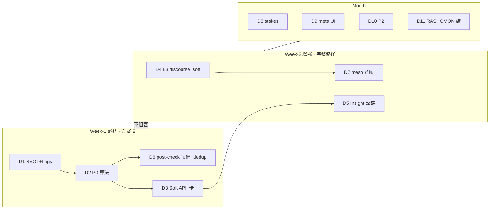
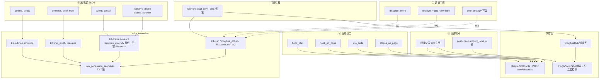
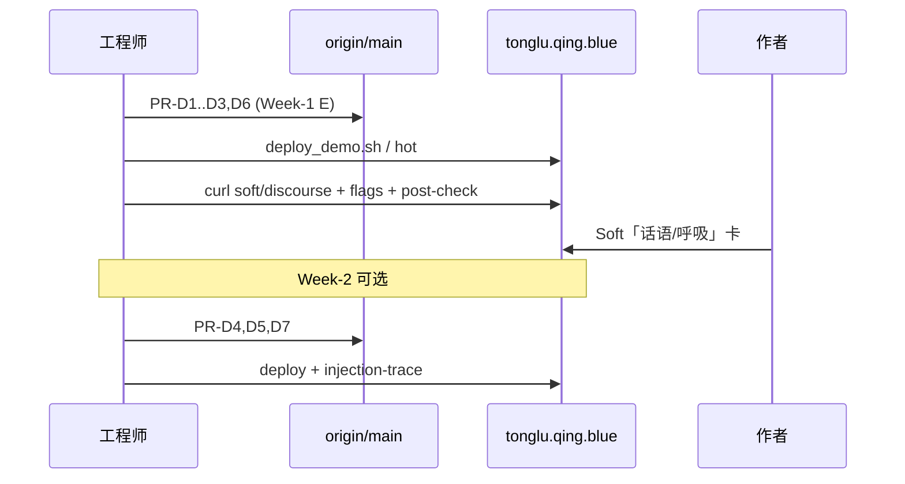

# 设计文档：铜炉叙事话语层「最优化」整合方案（两档交付）

| 项 | 值 |
|----|-----|
| **文档标题** | 铜炉 / scribe3 · 叙事话语层最优化整合（Week-1 砍 scope E 必达 · Week-2+ 完整路径可选） |
| **作者** | Grok Design（系统架构） |
| **日期** | 2026-08-12 |
| **状态** | **Draft · rev.2**（复评：D4 物理序 + loop story 分桶写死） |
| **DESIGN_ID** | `caa1cc21` |
| **基于 / 取代关系** | **based-on** `docs/plans/2026-08-12-discourse-layer-optimal.md`（**rev.3**，writer→reviewer 0 open）与 scratch `/tmp/grok-1000/grok-design-doc-70fbae31.md`；**supersedes** 二者作为「实施就绪默认路径」的表述（技术合同与 KD 全继承，交付分档与旗名规范化为本轮增量） |
| **产品** | 铜炉（tonglu）/ scribe3 长篇写作工作台 |
| **代码根** | `/home/admin/projects/scribe-writing-system/scribe3/` |
| **会话交付** | 设计稿 `/tmp/grok-1000/grok-design-doc-caa1cc21.md` · 摘要 `/tmp/grok-1000/grok-design-summary-caa1cc21.md` |
| **对齐前序** | storyline-fusion · first-principles-quality-enablement · narrative-engine-optimal · engineering-health-closure |
| **验收环境** | 已部署 demo：`https://tonglu.qing.blue`；SSH `ubuntu@82.157.130.140`；应用 `/opt/scribe3/app`；**只冒烟已部署栈**（禁止 Grok 机全量 npm/pytest/本机 Surreal / 第二验收栈） |
| **明确不做的宣称** | **不**宣称文学 ≥9.5；**不**硬阻断形容词；**不**第二套 NLP 情绪库；**不**用实体解决「窒息感」；**不**默认罗生门；**不**替换 must-link/drama_contract/event_drive/brief；**不**重开顶栏故事线 |

---

### 读法（工程师 · 第一周）

1. **§最优化定义 + 两档交付** — 先看「什么叫做完」：Week-1 = E，Week-2+ = 完整路径。  
2. **§产品心智模型 + 责任矩阵** — 四层 SSOT、禁止双写、禁止 L0 污染。  
3. **§Proposed Design** — 检测器 · Dedup · Soft API · 注入（完整路径）· 旗标 · UI。  
4. **§Key Decisions + PR Plan** — 可独立合并的 PR 序与砍 scope 边界。  
5. **§Acceptance** — 一律 demo 冒烟；无文学 KPI。

---

## 概述

铜炉在**故事层**（卷纲→章大纲→节拍→事件/正文 + 伏笔 Promise/Payoff + 因果）与**注入预算/反 AI 味**上已有厚底座；跨章弧实体已并入仪表盘且默认 **omit 伏笔正文、craft_only 控制 notes**。工程健康 A/B/C 与故事线融合 UI **已合入 main**，本方案 **只消费、不重开**。

当前读感瓶颈不在「再多一个实体子系统」，而在 **话语层（discourse）欠位**：

- **中观**：叙事距离、视角立场、故事时间 vs 话语时间——「怎么讲」；
- **微观**：节奏/展示/留白——正文「呼吸」，防窒息；
- **连载动力**：章末钩子、张弛、stakes 落地、信息增量——网文续读经验。

**本轮「最优化」的硬定义**（相对 rev.3 的增量焦点）：

| 档 | 含义 | 作者可感知价值 | 风险 |
|----|------|----------------|------|
| **Week-1 必达（方案 E）** | **PR-D1 + D2 + D3 + D6**（+D0 文档可选）；**无** L3 `discourse_soft` 注入 | Soft 呼吸+连载启发；post-check 顶键不刷屏；flags 可见 | 写前中观弱（无注入一句） |
| **Week-2 增强（完整路径）** | **+ D4 + D5 + D7**（L3 注入 + Insight 深链 + meso 意图） | 写前一句讲法；Insight 同源摘要 | L3 预算竞争 |
| **Month 可选** | D8–D11 | stakes / 编辑 / P2 / 旗预留 | 范围膨胀 |

在 **不拆除** must-link / drama_contract / event_drive / brief 伏笔 / storyline omit 契约的前提下，把话语层能力 **嵌回** 既有写路径与写后 advisory 链路：检测器默认 **advisory**、注入段 **短且可裁（仅 L3，禁止并入 L0 `structure_diversity`）**、UI 落在 **章 soft 卡 + Insight 最小深链**，跨章弧 **仅作可选标签**。

**主优化指标**：作者能在写后（Week-1）/写前（Week-2）看到「呼吸与讲法」的可操作提示；写路径 **不** 双写伏笔；**不** 用文学分验收；**Week-1 单独即算交付完成**。

---

## 背景与动机

### 1. 产品心智模型（SSOT 四层 + 可选标签）

```
① 故事层：卷纲 → 章大纲 → 节拍 → 事件/正文 + 伏笔 Promise/Payoff + 因果
② 话语中观：叙事距离 · 视角 · 时间畸变（热奈特；怎么讲）
③ 话语微观：节奏/展示/留白（正文呼吸，防「窒息」）
④ 连载动力：章末钩子 · 张弛 · stakes · 信息增量（网文经验）
跨章弧实体 = 可选标签（仪表盘内），不是叙事核心
```

| 层 | 回答的问题 | 现网主要载体 | 本方案增量 |
|----|------------|--------------|------------|
| ① 故事 | 发生了什么、欠什么账 | outline / drama_beats / promise / event_graph / causal | **不新建第二套**；保持 omit 防双写 |
| ② 话语中观 | 谁在看、多近、何时讲 | focalizer / knowledge frame / soak 引擎文案 | **写前一句意图**（Week-2）；越界全知 product_label |
| ③ 话语微观 | 句子是否窒息、是否贴标签 | craft ENGINES · `find_rhythm_uniformity` · emotion_telling · oversaturation | **呼吸仪表 + tip SSOT**；post-check **去重注解** |
| ④ 连载动力 | 读者会不会翻下一章 | `chapter_hooks` · narrative_drive · stakes 合同 | **hook_plan vs hook_on_page**；info_delta / stakes soft |
| 标签 | 跨章意图备忘 | storyline 表 · StorylineHub · storyline_polish L3 | **已落地 UI**；本方案不重开顶栏 |

**心智红线**：

- 实体/跨章弧 **不是** 叙事主链；不创建实体仍可用大纲/节拍/正文写故事。
- 「窒息感」= 微观话语，**不能**用实体解决。
- 卷纲/大纲/叙事引擎 = 故事层；距离/视角/时间 = 中观；呼吸 = 微观；钩子/stakes = 连载。

### 2. UI 已完成（引用，不重提案 · 2026-08-12 代码核对）

| 项 | 锚点（真实符号） |
|----|------------------|
| 顶栏去掉「故事线」；`VIEWS` = journey / atlas / timeline / **insight** | `scribe3/web/src/AppRail.jsx` L8–13；文件头注释已写明并入仪表盘 |
| 规划看板 + 跨章弧并入 `InsightView`（`StorylineHub` `embedded`） | `scribe3/web/src/views/InsightView.jsx` ~826–829 |
| 章 soft：precheck / distill / 弧意图 inject 预览 / **event-led** | `scribe3/web/src/ChapterSoftCards.jsx`；`api.js` `softEventLed` → `POST /soft/event-led` |
| 写路径 storyline 段 + `promise_mode=omit` 硬保证 | `storyline_inject_polish.py`；`write_assemble_v1.py` ~520–559 |
| `storyline_polish` ∈ `SEGMENT_REGISTRY` L3 + `L2_DROP_TIER` T3 | `injection_registry.py` L65；`context_budget.py` L132–134 |
| `structure_diversity` = **L0 / head / redline**，与 `prefix` 同 **免疫整段裁剪** | `injection_registry.py` L45；`context_budget.py` `L0_NEVER_CUT` L171–172；组装侧 `structure_diversity_block()` 并入 prefix（`write_assemble_v1.py` ~94–110） |

### 3. 工程健康与既有合入（消费，不重开）

| 项 | 状态 | 引用 |
|----|------|------|
| store mixins / soft_fail / write_assemble 拆分 / critique rules_parts | **已合入 main** | `docs/plans/2026-08-12-engineering-health-closure.md`（Accepted） |
| 故事线融合 UI + inject omit | **已落地** | fusion 设计 + 现网 `AppRail` / `StorylineHub` |
| soft 先例 | `POST /soft/event-led`：body 可空 prose，**服务端按 seq 取 prose\|draft** | `misc_routes.py` `soft_event_led_ep` L1221–1268 |
| post-check 顶键旁路先例 | `structure_style` 顶键 + `loop.triage` 只读投影 advisory | `write.py` `post_check` ~844–867；`loop.py` ~213–245 |
| 旗标 SSOT | `FLAG_REGISTRY` + `flag_truthy` + `GET /debug/flags` | `feature_flags.py`；`misc_routes.py` 注册 `/debug/flags` |

### 4. 代码层已有能力（禁止平行复制）

| 能力 | 模块路径 | 现状缺口（话语视角） |
|------|----------|----------------------|
| 引擎工艺文案 | `craft.py` `ENGINES` / `build_craft_block` | 生成前长文 **仍由 craft 拥有**；tip/反例另放 SSOT |
| 句长均匀 / AI 味 | `critique/rules_parts/06_craft.py` · `aggregate_ai_grade` | 需 product_label 与呼吸卡；**禁止 post-check 双报** |
| 情绪 telling | `find_emotion_telling` · 顶键 `emotion_telling[]` | 与 tip SSOT 对齐；**不进 issues type** |
| 上帝视角 | `find_god_view` | 映射「越界全知」product_label |
| 过度解释/饱和 | `_oversaturation_issues` · `03_style.py` | dedup family=`oversat` |
| 段同构 / 章末公式 | `structure_style.py` `evaluate_structure_style` | hook 落地与 formula 联合见 DET |
| 章末钩子 **规划** | `chapter_hooks.resolve_chapter_hook` | **仅规划**；≠ 正文落地 |
| stakes | `execution_contract.parse_stakes_presence` | 合同路径做 stakes_on_page 子串匹配 |
| soft_fail | `soft_fail.py` `soft_fail(op, err, …)` | 话语检测 fail-soft 必走 |
| blocking | `review/blocking.py` `is_blocking_issue` | discourse **永不**进入 |

### 5. 痛点 D1–D5（保留）

| ID | 痛点 | 伤害 |
|----|------|------|
| **D1** | 微观窒息：节奏单一、解释过多、情绪贴标、意象堆砌 | 读感「像模型文」、无呼吸 |
| **D2** | 中观缺位：写前不知距离/视角；写后全知越界只当「AI 味」 | 立场先于事实的力量用不上 |
| **D3** | 连载：章末公式 vs 真钩子混淆；「有规划」当「已落地」 | 假绿；续读动力弱 |
| **D4** | 跨章弧若被误当成「叙事核心」 | 注意力离开大纲/伏笔 |
| **D5** | 检测多而产品散；同 find_* 再插 discourse.* 则 **三重刷屏** | 作者不信、不改 |

### 6. 与 rev.3 / 代码的差异修正（本轮以代码为准）

| 项 | rev.3 表述 | **2026-08-12 代码事实** | 本方案修正 |
|----|------------|-------------------------|------------|
| migration 下一可用号 | 提示「131 撞号 → 132+」 | 已有 `131_drop_ghost_async_events`、`132_storyline_craft_only` | 若强制 schema 字段 → **133+**；**优先 beats_meta 无 migration** |
| 旗名 | `MESO_INJECT` / `SERIAL_DRIVE_INJECT` / `INFO_DELTA` / `STAKES_ON_PAGE` / `RASHOMON_TOOL` | 尚未入库 | **统一 `SCRIBE3_DISCOURSE_*` 前缀**（见 §旗标） |
| 默认交付路径 | 完整 A 为主、E 为砍刀 | 实施风险：注入+UI+dedup 同周 | **E = Week-1 最优必达**；完整路径 = Week-2+ 增强 |
| storyline 段位置 | ~521–559 | `write_assemble_v1.py` ~520–559 | 接线锚点写 **storyline_polish `_push` 旁** |

---

## 目标与非目标

### Goals

| # | 目标 | 可度量验收（demo 冒烟，非文学 KPI） |
|---|------|-------------------------------------|
| **G1** | 责任矩阵落地；伏笔唯一经 brief/promise；storyline omit | inject-preview / injection-trace：`promise_mode=omit`；text **无**「开放伏笔：」 |
| **G2** | P0 检测器经 `POST /soft/discourse` 可见；默认 advisory | Soft 卡只传 `seq`+work → 200；有 prose 含 breath/serial；无 prose → `status=no_prose` 非 5xx |
| **G3** | （**Week-2**）写前中观/连载仅 L3 `discourse_soft`，可裁；**禁止**并入 L0 | budget_report 有 `discourse_soft`；关旗无段 |
| **G4** | 微观呼吸仪表：soft 卡白话主面；Insight 只读同源 API | 禁止 Insight 第二套检测 |
| **G5** | 全部 `SCRIBE3_DISCOURSE_*` 旗进 `FLAG_REGISTRY`；`GET /debug/flags` 可见 | curl flags 断言键存在 |
| **G6** | Finding Dedup：不双通道 | `len(emotion_telling)` 不变；`issues` 无 `discourse.*`；god_view/rhythm 条数不因 discourse 增加 |
| **G7** | 验收 = 已部署 demo 冒烟 only | 见 §Acceptance |
| **G8** | **两档交付清晰**：Week-1 = E 即交付；完整路径不阻塞 Week-1 定义 | 发布说明写明档位 |

### Non-Goals

| # | 非目标 | 理由 |
|---|--------|------|
| **NG1** | 文学 ≥9.5 / human-blind 宣称 | 产品禁令 |
| **NG2** | 硬阻断形容词 / 修辞刑典 | 引导 > 硬停 |
| **NG3** | 第二套 NLP 情绪库 / 全文情感模型 | 沿用 emotion_scale + telling 正则 |
| **NG4** | 用跨章弧实体「解决窒息感」 | 窒息属微观话语 |
| **NG5** | 默认交付罗生门多版本工具 | P3 非默认 |
| **NG6** | 替换 brief / drama_contract / event_drive / must-link | 只叠加话语层 |
| **NG7** | 重开顶栏「故事线」整页 | UI 已并入 insight |
| **NG8** | Grok 机全量 npm/pytest/本机 Surreal；平行第二验收栈 | 主机资源规则 |
| **NG9** | 话语检测抬成 finalize hard（**含** `DISCOURSE_BLOCKING` 在 Phase0–Month） | KD-D16；永不进 `is_blocking_issue` |
| **NG10** | discourse 纪律并入 L0 `structure_diversity` | KD-D6；抬红线注意力 |

### Must-Keep

- `memory_must_link` / canonical suppress / `project_frame` + epistemic  
- `drama_contract` / `event_drive` / outline beats 内容 SSOT  
- envelope `canonical` / `recent` / `voice_anchor` / prefix anti-slop  
- **伏笔 SSOT** = promise 实体 + `brief.promise_directives` / `brief_must`  
- **storyline** `promise_mode=omit` 硬保证；`craft_only` schema 语义  
- **`structure_diversity` L0 红线身份** — 本方案 **只消费、不往里塞** discourse 文案  
- finalize 既有质控红线；`is_blocking_issue` 合同  
- `soft_fail` 可观测吞异常约定  
- 工程健康分层（业务层无私有 SurQL）  

---

## 最优化定义：两档交付（本轮核心）



| 档 | 包含 PR | 作者可感知价值 | 风险 | 是否阻塞「交付」定义 |
|----|---------|----------------|------|----------------------|
| **Week-1 必达（E）** | D1 D2 D3 D6（+D0 文档） | Soft 呼吸+连载启发；post-check 不刷屏；flags | 无注入，写前中观弱 | **否——此档即交付** |
| **Week-2 增强** | D4 D5 D7 | L3 一句讲法 + Insight 深链 | 预算竞争 | 否——增强 |
| **Month** | D8 D9 D10 D11 | stakes / 编辑 / P2 / 旗预留 | 范围膨胀 | 否 |

**为何 E 是默认最优交付**（见 §Alternatives）：

1. **契约零冲突**：不碰 L0、不碰 inject 预算，失败面最小。  
2. **作者立刻可见**：Soft 卡 + post-check 顶键覆盖 D1/D3/D5 痛点主因。  
3. **完整路径可后置**：D4 注入是「写前提醒」增强，不是检测 SSOT 的前置依赖。  
4. **回滚成本**：关 `SCRIBE3_DISCOURSE_ADVISORY` 即可；无段注册残留（Week-1）。

---

## 工艺 SSOT（Craft · 必须进入实现文案）

> **文件边界（KD-D17）**：  
> - `scribe3/discourse_craft_ssot.py` **只**放作者可见 **tip / 反例 / product_label**（短句表）。  
> - 生成前长文 **仍由** `scribe3/craft.py` `ENGINES` / `build_craft_block` **唯一拥有**。  
> - UI / soft / post-check 注解：`from scribe3.discourse_craft_ssot import TIPS, LABELS`；**禁止** JSX 内联中文长句。

### A. 微观呼吸（Discourse Micro）

| 病症 | 判据直觉 | 改写原则 | 反例 → 改后（示例 tip） |
|------|----------|----------|-------------------------|
| 节奏单一 | 句长 CV 过低 / 段指纹连同 | 长短句交错；对白与叙述交替 | 「他走了。他停了。他看了。」→ 「他走了几步，又停住——廊下风很薄。」 |
| 解释过多 | 因果点破 / 总结心理 / 升华 | 给身体与场景，不替读者懂 | 「他明白了她在骗他。」→ 「她笑的时候没看他眼睛。」 |
| 意象堆砌 | 同意象/「像」过密 / 饱和 | 一段一焦点；删装饰 | 「像刀、像雪、像铁。」→ 留一个能推进情绪的 |
| 情绪贴标 | L1/L2 telling | **展示 > 贴标签**；身体→行动→沉默→语言 | 「他感到悲伤。」→ 「他把杯垫摆得过分整齐。」 |
| 留白不足 | 写满、转折后立刻点透 | **计白当黑**；冰山 1/8；章末冷笔 | 转折后加一句呼吸，不「原来如此」 |

**与现网映射**：`find_rhythm_uniformity`、`find_emotion_telling`、`find_god_view`、`_oversaturation_issues`、`structure_style`、`craft.ENGINES["restraint"/"body"/"temperature"]`。

### B. 中观话语（Discourse Meso · 热奈特）

| 维度 | 核心 | 产品用法 | 非目标 |
|------|------|----------|--------|
| **叙事距离** | 特写↔远景 | 写前一句：`distance_intent`（near/mid/far）；`meso_source` 区分 default/beats_meta | 不强制每段跳距离 |
| **视角** | 立场先于事实；限知过滤 | 章 `focalizer`；越界全知 = god_view **product_label** | 罗生门 = P3 非默认 |
| **时间** | 故事时间 vs 话语时间 | 可选 `time_strategy` | 不新建第二时间线引擎 |

### C. 延展 ROI 表（P0–P3）

| 优先级 | 项 | 工程形态 | 默认 | 档位 |
|--------|-----|----------|------|------|
| **P0** | 章末钩子双档 | `hook_plan` + `hook_on_page` | advisory | Week-1 |
| **P0** | 信息增量 | soft 启发式（算法 A） | advisory | Week-1 |
| **P0** | 过滤词 / 情绪贴标 / 展示 | soft 复算；post-check **只挂 tip** | advisory | Week-1 |
| **P1** | 距离/视角写前一句 + 越界全知 label | L3 `discourse_soft`；god_view label | advisory | Week-2 / 部分 Week-1 soft |
| **P1** | stakes 落地 | 算法 B | advisory | Month（D8）可提前到 W2 若排期允许 |
| **P2** | 句长方差/意象 / 对白潜台词 / 时间策略 | 展示强化；dedup | advisory | Month |
| **P3** | 罗生门 | 旗默认关 | 非默认 | Month+ |

---

## 责任矩阵（Responsibility Matrix）

> 原则：一类信号 **一个写所有者**；话语层默认是 **检测 + 短引导 + 产品文案**，不是第二故事库。  
> **禁止**：storyline_polish 与 brief_must **双写** 伏笔正文。  
> **禁止**：discourse 文案写入 L0 `structure_diversity`。

| 信号类 | 写 SSOT | 模块 | 话语层职责 | 禁止 |
|--------|---------|------|------------|------|
| 卷纲/章大纲/节拍 | 章 · beats | outline / drama_beats | 只读消费 | 话语层不重写戏核 |
| 事件 / 因果 | event + causal | narrative_drive / verify | 只读；info_delta 可引用 | 不建第二因果图 |
| **伏笔 Promise/Payoff** | **promise 实体** | store · brief_must | **不写**；storyline **omit** | **禁止**「开放伏笔：」进 storyline/discourse 段 |
| 跨章弧意图 | storyline 表 | storyline_store · craft_only | 可选标签 | 不替代大纲/伏笔 |
| 叙事距离意图 | beats_meta（可选） | 本方案 P1 | 写前一句注入 L3（W2） | 不持久化第二距离曲线库 |
| 视角/限知 | focalizer + knowledge frame | epistemic | 越界全知 product_label | 不默认多 POV 工具 |
| 时间策略 | beats_meta 可选 | P2 | 一句注入 | 不重做 timeline 引擎 |
| 微观节奏/贴标/饱和 | **无写库**；检测纯函数 | critique rules · structure_style | soft 聚合；post-check **dedup 注解** | 不落库 KPI 分；不双报 |
| 章末钩子 **规划** | beats_meta.chapter_hook 等 | `chapter_hooks.py` | `hook_plan` finding | 不与 drama 各写一套解析 |
| 章末钩子 **落地** | **无写库**；弱启发 | discourse_advisory | `hook_on_page` | 不宣称 NLP 语义对齐 |
| stakes 合同 | synopsis/meta | execution_contract | stakes_on_page 子串 | Gantt hint ≠ 合同 SSOT |
| 注入预算 | registry + budget | injection_registry · context_budget | **仅 L3** `discourse_soft` + T3（W2） | **不抬 L0**；不进 structure_diversity |
| finalize hard | is_blocking_issue 等 | review/blocking · finalize_gate | **不读** DISCOURSE_BLOCKING | KD-D16 |



---

## Proposed Design

### 1. 架构原则

1. **Advisory by default**：新 findings 默认 `severity=advisory`。  
2. **`DISCOURSE_BLOCKING`（Phase 0–Month）**：只改 `run_discourse_advisory` 返回的 severity 展示字段；**永不**进入 `is_blocking_issue` / finalize hard（KD-D16）。  
3. **复用优先 + Dedup 合同**：既有 find_* 在 post-check 已跑的，discourse **只挂 product_label/tip**，不第二份 issue。  
4. **短注入 · 仅 L3（Week-2）**：单一段名 `discourse_soft`（meso+serial 合并），进 T3；**禁止**并入 `structure_diversity`（L0）。  
5. **差异化一句**：禁止复读 structure_diversity / craft 长文。  
6. **观测**：`soft_fail(op=discourse_*)`；budget_report 键完整（W2）。  
7. **作者白话**：UI 禁用 GATE/GCD 裸英文。  
8. **路径最优**：默认实现与验收按 **Week-1 E**；注入代码可同仓但 **旗默认仍可开**，未合 D4 时不出现段名。

### 2. 检测器清单（Concrete detectors）

| ID | 名称 | 实现策略 | 输入 | 输出 | 优先级 | 档位 |
|----|------|----------|------|------|--------|------|
| **DET-P0-1** | `filter_and_telling` | 组合 ai_tics + `find_emotion_telling` | prose | soft breath；post-check **dedup family=telling** | P0 | W1 |
| **DET-P0-2** | `show_vs_label_tip` | SSOT tip 表 | telling hits | `{tips[]}` 挂到既有 hit 或 soft | P0 | W1 |
| **DET-P0-3a** | `hook_plan` | `resolve_chapter_hook(ch)` 空 → advisory | chapter dict | `discourse.hook_plan` in **顶键 findings** | P0 | W1 |
| **DET-P0-3b** | `hook_on_page` | **算法 C**；`hook_on_page_ok := overlap >= 0.15` | prose + hook 串 | 顶键 findings；**不**进 `issues[]` | P0 | W1 |
| **DET-P0-4** | `ending_formula_vs_hook` | 仅当 `formula_hit && !hook_on_page_ok` | structure_style + 3b | structure_style tip 或 soft | P0 | W1 |
| **DET-P0-5** | `info_delta` | **算法 A** | focus + near | 顶键 findings | P0 | W1 |
| **DET-P1-1** | `god_view_label` | `find_god_view` → product_label「越界全知」 | prose | **dedup family=god_view** | P1 | W1 annotate / W2 soft 露出 |
| **DET-P1-2** | `stakes_on_page` | **算法 B** | synopsis + prose | 顶键 findings | P1 | Month D8（可提前） |
| **DET-P1-3** | `scene_got_link` | 深链状态，不新检测 | chapter | `{has_grid, link}` | P1 | Month |
| **DET-P2-*** | rhythm / motif / subtext | 复用 find_* | prose | soft / annotate | P2 | Month |
| **DET-P3-1** | `rashomon_pack` | 多版本工具 | N drafts | 旗关 | P3 | Month+ |

#### 算法 A · info_delta（P0 · 非 LLM · KD-D11）

```text
# 输入：focus_synopsis, near_synopses[1..2], optional event_ids_focus / event_ids_near
# 无事件时仅用 synopsis；focus synopsis 去空白后 < 40 字 → 返回 skip（不报警）
def cjk_bigrams(text):
    hans = all CJK chars in order
    return set of hans[i:i+2] for i in range(len(hans)-1)  # 长度 <2 不存在

F = cjk_bigrams(focus_synopsis)
N = union(cjk_bigrams(s) for s in near_synopses)
# 若有 event id 集合：new_events = focus_ids - near_ids；计入 bonus
new = F - N
score = len(new) / max(len(F), 1)
if score < 0.08 and len(strip(focus_synopsis)) >= 40:
    emit advisory discourse.info_delta
    new_tokens_sample = list(new)[:8]
# 有 event 且 new_events 非空 → 不因 score 报警（视为有增量）
```

#### 算法 B · stakes_on_page（P1）

```text
sp = parse_stakes_presence(synopsis)  # execution_contract
if not sp["present"]:
    return skip
# 禁止第二词库文件：只用 sp["stakes"] 串本身
parts = split sp["stakes"] by [，,。；;、|/\n] and whitespace
parts = [p.strip() for p in parts if len(p.strip()) >= 2]
if not parts:
    # stakes 过短：整串 ≥2 则 parts=[stakes]
body = prose or ""
if any(p in body for p in parts):
    return ok
emit advisory discourse.stakes_on_page
  message: 「大纲有代价，正文未检出痕迹（启发，可误报）」
```

#### 算法 C · hook_on_page（P0 · 与算法 A 同构）

```text
# 输入：hook_text = resolve_chapter_hook(...)；prose 全文
# 无 prose 或 hook_text 去空白为空 → skip 3b（不报警）
tail_n = min(400, max(1, int(len(prose) * 0.15)))
prose_tail = prose[-tail_n:]   # 按字符，非按句

H = cjk_bigrams(hook_text)     # 同算法 A：连续 CJK 字 bigram 集合
T = cjk_bigrams(prose_tail)
if not H:
    skip 3b                    # hook 无足够 CJK → 不判落地
overlap = |H ∩ T| / |H|        # 分母固定 |H|
hook_on_page_ok = (overlap >= 0.15)
if not hook_on_page_ok:
    emit advisory discourse.hook_on_page
      message: 「规划有钩、正文痕迹弱（启发，可误报）」
      meta: { overlap, threshold: 0.15, tail_n }

# DET-P0-4：formula_hit 来自 structure_style.ending_formula_hit
# 仅当 formula_hit and not hook_on_page_ok → 联合文案「公式收束≠钩子」
# （挂 structure_style tip，不新造 issues 条）
```

#### 聚合出口

```text
scribe3/discourse_advisory.py
  run_discourse_advisory(
      prose: str | None,
      chapter: dict | None,
      *,
      near_chapters: list[dict] | None = None,  # 服务端填充
      mode: "soft" | "post_check_annotate",
  ) -> dict
  # 永不抛出；soft_fail
  # 顶层形状（与 soft / post-check 顶键一致）：
  {
    "severity": "advisory",           # DISCOURSE_BLOCKING=1 时仅此处可升展示级
    "not_a_kpi": True,
    "status": "ok" | "no_prose" | "degraded",
    "findings": [...],                 # soft：全量白话；post-check：仅纯新增
    "breath": { "rhythm": ..., "telling_count": ..., "tips": [...] },
    "serial": { "hook_plan": ..., "hook_on_page": ..., "info_delta": ... },
    "meso": { ... },
    "annotations": [                   # post_check_annotate
      { "family": "telling", "mount": "emotion_telling", "hit_index": 0, ... },
      { "family": "god_view", "mount": "issues", "issue_index": 3, ... }
    ]
  }
```

### 2.1 Finding Dedup 合同（实现必遵 · KD-D18 + KD-D25）

> **现网事实（`api/routers/write.py` `post_check`，2026-08-12 核对）**：  
> - **`emotion_telling`** = 响应 **顶键**（`find_emotion_telling` 列表），**不**经 `quality_issues` 进 `issues[]`。  
> - **`structure_style`** = 响应 **顶键**（`evaluate_structure_style`），`loop.triage` 旁路投影 advisory_items（`loop.py` ~213–245）。  
> - **`issues[]`** 来自 `quality_issues`：含 `god_view` / `rhythm` / oversaturation / ai_tics 等，**无** `type=emotion_telling`。  
> 因此「对 quality_issues 挂 telling」按字面 **找不到挂载点**；若把 DET-P0-1 当纯新增写入 `issues`，会 **首次** 把贴标塞进 issues，与顶键 **双通道**。G6 不得用「issues 中 telling 条数」作指标（恒为 0 → 假绿）。

#### family → 现网挂载面

| family | 现网载体 | annotate 方式 | **禁止** |
|--------|----------|---------------|----------|
| **`telling`** | 顶键 **`emotion_telling[]`** | 对既有 hit 增 `product_label` / `discourse_tip`；或 `annotations[]` 指 hit index | **不得**新增 `issues[].type` 为 telling 别名；**不得** append 新 hit 拉长列表 |
| **`god_view`** | `issues[]` 中 `type=god_view` | 同条字段 annotate | 不 append 第二条同 span |
| **`rhythm`** | `issues[]` 中 `type=rhythm` | 同条字段 annotate | 同上 |
| **`oversat`** | `issues[]` 中 oversaturation 等价 type | 同条字段 annotate | 同上 |
| **`ending_formula`** | 顶键 **`structure_style`** | `product_label` / `discourse_tip`；DET-P0-4 联合文案挂此 | **不得**再插 `discourse.ending_*` 进 `issues` |
| **`parallelism` 等** | 既有 issues/顶键 | 有则 annotate；无则仅 soft | 不发明第二 type 平行通道 |

#### 规则摘要

| 规则 | 说明 |
|------|------|
| **Soft / 仪表盘** | discourse 聚合卡为 **产品白话主面**，可复算 find_* |
| **post-check** | 按上表挂载面 annotate；**禁止**默认 append 同 family 第二条 |
| **纯新增** | 仅 `hook_plan` / `hook_on_page` / `info_delta` / `stakes_on_page` → **`discourse_advisory.findings` only**（**KD-D25**） |
| **`issues[]` 不追加 `discourse.*`** | 对齐 `structure_style` 顶键旁路模式 |
| **去重键** | `(family, normalized_span_or_code_or_hit_index)` |
| **G6 验收** | ① `len(emotion_telling)` 不变；② `issues` 中 `type.startswith("discourse.")` **推荐为空**；③ `god_view` / `rhythm` 条数不因 discourse 增加 |

### 3. 注入点（Inject points · Week-2 完整路径）

> **Week-1 砍 scope：跳过本节实现**（无 `discourse_soft` 段、无 registry 改动）。  
> 以下为 **完整路径** 合同，D4/D7 实施时严格遵守。

| 点 | 时机 | 段名 / 机制 | tier | 内容 | Flag |
|----|------|-------------|------|------|------|
| **INJ-1** | 生成前 | 既有 `structure_diversity` | **L0 redline** | **仅**既有结构多样性文案；**禁止**写入 discourse | 既有 `STRUCTURE_DIVERSITY_INJECT` |
| **INJ-2** | 生成前 | 既有 `craft` | L3 | body/restraint/subtext 长文 SSOT=`craft.py` | `SCRIBE3_CRAFT_NOVEL` |
| **INJ-3** | 生成前 | 既有 `storyline_polish` | L3 | 近程阶段 + craft_only；**omit 伏笔** | `SCRIBE3_STORYLINE_INJECT` |
| **INJ-4** | 生成前 | **`discourse_soft`（新建唯一话语段）** | **L3** + **T3** | meso 差异化一句 + serial 差异化一行；合计 **≤200 字** | `DISCOURSE_MESO` / `DISCOURSE_SERIAL` |
| **INJ-5** | （撤销独立 serial 段） | — | — | serial **并入** `discourse_soft` | — |
| **INJ-6** | 写后 | post-check 顶键 `discourse_advisory` + annotate | N/A | dedup 合同 | `DISCOURSE_ADVISORY` |
| **INJ-7** | 章 soft | **`POST /soft/discourse` only** | N/A | 与聚合同源 | 同上 |

**`discourse_soft` 文案差异化（禁止复读 structure_diversity）**：

| 子块 | 只允许强调 | 禁止复读 |
|------|------------|----------|
| **meso** | 距离意图 / 贴焦点者限知 / **勿越界全知解释** | 「长短交错」「章末禁止短句+意象回扣」（已在 L0 `structure_diversity_block`） |
| **serial** | **未决问题或动作定格** / **本章须有信息增量** / 真钩≠公式 | 同上结构纪律套话；不写 craft 身体层长文 |

**合计 cap**：`discourse_soft` 渲染后 **≤200 字**。超 cap 裁剪优先级：

1. 保留 meso（若 `SCRIBE3_DISCOURSE_MESO=1`）  
2. 否则保留 serial（若 `SCRIBE3_DISCOURSE_SERIAL=1`）  
3. 两旗皆开且仍超：先截 serial 再截 meso 至 cap  

**默认 fallback 文案（无 beats_meta 时）** — SSOT 键：

```text
discourse_craft_ssot.MESO_DEFAULT =
  "讲法：贴本章焦点者限知；慎用叙述者越界全知点破因果。"
discourse_craft_ssot.SERIAL_DEFAULT =
  "连载：章末留未决或动作定格；本章相对近章须有可感知信息增量。"
```

**budget_report 字段**：

```text
bud_rep["discourse_soft"] = {
  "fed": bool,
  "applied": bool,              # 最终 text 非空
  "enabled": bool,
  "chars": int,
  "meso_source": "beats_meta" | "default" | "off",
  "serial_source": "default" | "off",
  "cap": 200,
  "truncated": bool,
}
```

**接线锚点（真实文件 · Week-2 PR-D4 必全改）**：

- `write_assemble_v1.py`：`_push("discourse_soft", "supplemental", …)` 于 **storyline_polish `_push` 旁**（~520–534 后）  
- `injection_registry.py`：`SegmentMeta("discourse_soft", "L3", "mid", "craft")` 紧邻 `storyline_polish`  
- `context_budget.py` · **`generation_physical_order_names`**（**必改 · KD-D28**）：在 base 列表中 **`"storyline_polish"` 之后** 插入 `"discourse_soft"`（同档注意力；现网 `storyline_polish` 在 ~795，紧邻 `reference_craft` 后）。  
  - **原因（现网）**：registry active 时 `registry_physical_order_names()`（`injection_registry.py` L150–170）以 `generation_physical_order_names` 为 **base**，仅把「注册表有、base 无」的名字 **append 到 base 末尾**。若只加 `SEGMENT_REGISTRY` 而不进 base，则 `discourse_soft` 会落到 **`final_reminder` / `scene_truth_proj` / `request_constraint` 之后**，注意力位置错误，与「storyline_polish 旁」意图不符。  
  - **对照**：storyline 合入时同时改了 registry、T3 **与** `generation_physical_order_names`（`tests/test_storyline_fusion.py` 断言 polish 紧邻 `reference_craft`）。  
- `context_budget.py` · **`L2_DROP_TIER["T3"]`**：追加 `"discourse_soft"`（建议靠前，与 `material_recall` / `storyline_polish` 同档）  
- **禁止** 修改 `structure_diversity_block()` 字符串拼接 discourse  
- **禁止** 把 discourse 加入 `L0_NEVER_CUT`  
- **禁止** 只改 registry/T3 而不改 `generation_physical_order_names`（会静默错序）

**伏笔双写防护（硬）**：

| 规则 | 实现 |
|------|------|
| storyline 默认 omit | 已有 `promise_mode=omit` |
| `STORYLINE_PROMISE_HINT` 默认 0 | 已有 |
| `discourse_soft` **禁止** 列举 open_promise 正文 | 单测断言（demo 或极小纯函数） |
| brief_must 仍是伏笔指令 SSOT | 不改所有权 |

### 4. Soft API 契约（硬决策 · KD-D19）

**唯一入口**：`POST /soft/discourse`  
- 路由挂点：与 `POST /soft/event-led` 同层 — `scribe3/api/routers/misc_routes.py`（`soft_event_led_ep` 旁注册）  
- **禁止** 扩展 `soft_precheck_ep` / `POST /soft-precheck`（语义是大纲/节拍空洞，与话语正交）

**请求 body**：

```json
{ "seq": 12, "work": "main", "prose": null }
```

| 字段 | 规则 |
|------|------|
| `seq` | 必填（章号） |
| `work` | 可选，随会话 |
| `prose` | 可选；**空则** `st.get_chapter(seq)` 取 `prose or draft`（与 `soft_event_led_ep` L1228–1233 一致，fail-soft） |
| 近章 | **客户端不传**；服务端 `seq±1`（不足则一侧）拉 synopsis + 可选 open events 摘要，供 info_delta |

**响应**：

- 有正文：`status: "ok"` + `run_discourse_advisory` 全量  
- 无正文：`status: "no_prose"` + **仅计划侧** findings（`hook_plan`、基于 synopsis 的 info_delta 若可算）；**HTTP 200**，永不 5xx  
- 异常：`status: "degraded"` + `soft_fail(op="discourse_*")`；200 或既有 soft 错误形，不炸主路径  

**前端**：

- `api.js`：`discourseSoft(body, work)`（并列 `softEventLed`）  
- `ChapterSoftCards.jsx`：新卡「话语/呼吸」；**只传 `{seq}` + work** 即可验收 G2  

### 5. UI 表面

| 表面 | 路径 | 内容 | 阶段 |
|------|------|------|------|
| **章 soft 卡** | `ChapterSoftCards.jsx` | 「话语/呼吸」→ `POST /soft/discourse`；白话 findings + tip | **Week-1** |
| **仪表盘** | `InsightView.jsx` | **最小实现**：折叠区文案「正文呼吸请在章信息 · 话语/呼吸卡查看」+ **深链焦点章**；**或** 对 `focus_seq` 调同一 `discourseSoft` 只展示 `breath` 三字段 | **Week-2**（D5）；Week-1 可不做 |
| **禁止** | Insight 内 | **第二套**检测实现 / 复制 find_* | — |
| **StorylineHub** | 已有 embedded | 不加呼吸 KPI；保持「跨章弧可选」 | — |
| **post-check 面板** | 既有 | 顶键 `discourse_advisory` 摘要；issues 不 ×2 | **Week-1**（D6 后端）；面板展示随既有消费方 |
| **大纲侧** | 章 meta | P1：`distance_intent` / `time_strategy` / `pov_stance` | Month |
| **P3 罗生门** | 隐藏 | 旗默认关 | Month+ |

### 6. post-check / loop 响应形状（KD-D20 · KD-D25）

> **展示单一来源（对齐 `structure_style`）**：纯新增 **只** 进顶键 `discourse_advisory.findings`；**`issues[]` 不追加任何 `discourse.*`**。loop 只读顶键投影 `advisory_items`。作者可见列表 **不双行**。

```text
POST /post-check 响应（增量）：
  emotion_telling: [                         # 既有顶键 · 不拉长
    { ...hit, product_label?: str, discourse_tip?: str }
  ]
  structure_style: {                         # 既有顶键
    ...,
    product_label?: str,
    discourse_tip?: str
  }
  discourse_advisory: {                      # 新增顶键
    severity: "advisory",
    not_a_kpi: true,
    status: "ok" | "no_prose" | "degraded",
    findings: [                              # 纯新增唯一权威列表
      { "type": "discourse.hook_plan", "severity": "advisory", "message": "...", "meta": {...} },
      { "type": "discourse.hook_on_page", ... },
      { "type": "discourse.info_delta", ... },
      { "type": "discourse.stakes_on_page", ... }
    ],
    breath: { ... },
    serial: { ... },
    meso: { ... },
    annotations_applied: int
  }
  issues: [
    ...既有 quality_issues 原样 + 可选字段 annotate...,
    { "type": "god_view", "product_label": "越界全知", "discourse_tip": "..." },
    # ★ 不包含 type=discourse.* （KD-D25）
  ]
```

**loop.triage 映射**（写死 · KD-D20 / KD-D29）：

> **旁路形状**对齐 `structure_style`（`loop.py` ~213–245：从顶键读出 → 写入 `advisory_items`），但 **分桶不得**照搬 `structure_style` → `style`。  
> 现网 `_triage_bucket_for`（`loop.py` L94–112）：未点名的 advisory 默认 → **`style`**（`return "story" if is_block else "style"`）；`structure_style` ∈ `_STYLE_TYPES` → **style**。若仅 append 到 `advisory_items` 而不改分桶，则 `discourse.hook_plan` 等会进 **style**，与连载/故事动力心智冲突。

| 来源 | 动作 | 桶 |
|------|------|-----|
| `post["discourse_advisory"].findings[]` | 投影为 advisory_items（`type` 保留 `discourse.*`） | **story**（hook / info_delta / stakes）— **见下方写死合同** |
| `emotion_telling` annotate | **不**因 tip 新增 item | — |
| `issues` 内 god_view/rhythm annotate | 不新增条 | 既有 style 路径 |
| 任何 `discourse.telling` | **实现禁止发出** | — |
| discourse 任何 finding | **永不**进 redline / blocking | — |

**分桶写死合同（推荐方案 1 · 实现必遵）**：

```text
# loop.py · _triage_bucket_for（在 style 默认分支之前插入）
t = str(iss.get("type") or iss.get("detector") or "")
if t.startswith("discourse."):
    return "story"
# 之后才是既有 _STYLE_TYPES / 默认 advisory→style
```

- **备选（等价）**：旁路块内直接 `buckets["story"].append(...)`，不经 `_triage_bucket_for` 默认路径。  
- **禁止**：只写「仿 structure_style」却让 `discourse.*` 落入 style 桶（与本表 **story** 冲突）。  
- **禁止**：方案 3（改设计为 style）— 连载 findings 与标点/AI 味同桶会混淆产品分桶计数。

实现文件（PR-D6 必列）：

- `scribe3/api/routers/write.py` · `post_check`（顶键 + annotate）  
- `scribe3/loop.py` · `triage`：顶键旁路投影 **+** `_triage_bucket_for` 对 `discourse.*` → `"story"`（或等价直接 append story）  
- **不** 把 discourse 送进 `is_blocking_issue`  
- **不** 把 `discourse_advisory.findings` 再 merge 进 `issues[]`

### 7. 旗标设计（全部 FLAG_REGISTRY · KD-D21）

> **本轮规范化名**（相对 rev.3 统一 `DISCOURSE_*` 前缀；实现时只注册下表，**不要**双名并存）。

| Flag | 默认 | risk | 说明 |
|------|------|------|------|
| `SCRIBE3_DISCOURSE_ADVISORY` | `1` | safe | soft + post-check 顶键总开关 |
| `SCRIBE3_DISCOURSE_MESO` | `1` | caution | discourse_soft 内 meso 子块（W2；W1 无段时无影响） |
| `SCRIBE3_DISCOURSE_SERIAL` | `1` | safe | discourse_soft 内 serial 子块（W2） |
| `SCRIBE3_DISCOURSE_INFO_DELTA` | `1` | safe | info_delta 检测 |
| `SCRIBE3_DISCOURSE_STAKES` | `1` | safe | stakes_on_page（D8 启用检测时生效） |
| `SCRIBE3_DISCOURSE_BLOCKING` | `0` | danger | **仅**改 advisory 返回 severity 展示；**finalize / is_blocking_issue 不读** |
| `SCRIBE3_DISCOURSE_RASHOMON` | `0` | caution | P3 预留 |

**强制**：

1. 上表全部写入 `scribe3/feature_flags.py` `FLAG_REGISTRY`（name/default/description/module/risk）。  
2. 读路径：`flag_truthy("SCRIBE3_…")`；**禁止**模块内裸 `os.environ` 第二默认与 registry 漂移。  
3. settings 热更表 **可选** 同步；**不能**替代 FLAG_REGISTRY。  
4. 验收：`curl …/debug/flags` 断言上表键存在。

**`DISCOURSE_BLOCKING` 接线（Phase 0–Month · 写死）**：

| 路径 | 是否读取该旗 |
|------|----------------|
| `run_discourse_advisory` → 顶层 `severity` / soft 展示色 | **是**（仅展示级） |
| `review.blocking.is_blocking_issue` | **否** |
| `finalize_gate` / craft finalize | **否** |
| `loop.triage` redline 桶 | **否**（discourse 永不进 redline） |
| 未来 hard | **必须另开设计** |

### 8. 数据模型变更

| 变更 | 类型 | 说明 |
|------|------|------|
| `beats_meta.distance_intent` | 可选 enum `near\|mid\|far\|""` | P1；**与 `chapter_hook` 同层**（`migrations/117_beats_meta.surql` 已存在） |
| `beats_meta.time_strategy` | 可选 | P2 |
| `beats_meta.pov_stance` | 可选 ≤40 字 | P1 |
| storyline / promise 表 | **无** | craft_only 语义保持 |
| 新 Surreal 表 | **无**（P0–P2） | — |
| migration | **默认不新增** | 若强制独立列：下一可用号 **133+**（现网已至 `132_storyline_craft_only`） |

### 9. API / Interface Changes

| 接口 | 变更 | 档位 |
|------|------|------|
| **`POST /soft/discourse`** | **新建**；契约见 §4 | Week-1 |
| `POST /soft-precheck` | **不改**；禁止塞 discourse | — |
| `POST /storyline/inject-preview` | 不改 omit；可选附带「discourse_soft 将注入」只读预览 | Week-2 可选 |
| write budget_report | `discourse_soft` meta（含 `meso_source`） | Week-2 |
| `POST /post-check` | 顶键 `discourse_advisory`；annotate only；**issues 不追加 discourse.*** | Week-1 |
| `GET /debug/flags` | DISCOURSE_* 键可见 | Week-1 |
| 前端 `api.js` | `discourseSoft` | Week-1 |

不新增 MCP 写工具。

---

## Alternatives Considered

### 方案 A · 全量话语栈（全 PR 一次做）

| 优点 | 缺点 |
|------|------|
| 概念完整；写前+写后齐 | **高风险**：注入预算 + soft + post-check + UI 同周；任一环阻塞整交付 |
| — | 评审面过大；回滚牵连段注册 |

**结论**：**否决为默认交付**；保留为「完整路径」时间线，**不**阻塞 Week-1 定义。

### 方案 B · 只检测无 soft UI

| 优点 | 缺点 |
|------|------|
| 改动面最小 | **作者不可见**；检测沉在 JSON，不解决 D1/D5 产品面 |
| — | 违背「可操作提示」目标 |

**结论**：**否决**。

### 方案 C · 并入 structure_diversity L0

| 优点 | 缺点 |
|------|------|
| 无新段名 | **红线污染**；抬 L0 注意力；旗无法拆开关 discourse |
| — | 与 `L0_NEVER_CUT` / redline 身份冲突；**明确否决** |

**结论**：**否决**（KD-D6）。

### 方案 D · 用 storyline 实体承载呼吸

| 优点 | 缺点 |
|------|------|
| 复用已有实体 CRUD | 窒息属微观话语，实体无法解决；弧误当核心回潮（D4） |
| — | 与 fusion IA（弧=可选标签）冲突 |

**结论**：**否决**。

### 方案 E · 砍 scope：D1+D2+D3+D6 无注入（**Week-1 推荐最优**）

| 优点 | 缺点 |
|------|------|
| 无段膨胀；无 L3 注意力税；契约面最小 | 写前无 meso/serial 一句提醒 |
| Soft 可见呼吸+连载；post-check 不刷屏 | 完整「讲法」需 W2 |
| 关一旗即可回滚 | — |

**结论**：**默认最优交付路径**。完整路径（A 的子集 D4+D5+D7）为 **增强而非阻塞**。

### 方案 F · 本机全量测验收

| 优点 | 缺点 |
|------|------|
| CI 感完整 | Grok 机 **1.6Gi / 无 swap** 易 OOM；违背主机资源规则 |
| — | 与「demo = 验证环境」冲突 |

**结论**：**否决**。验收 = 已部署 `tonglu.qing.blue` / `/opt/scribe3/app` 冒烟。

---

## Security & Privacy

| 项 | 处理 |
|----|------|
| 日志 | soft_fail / trace **不**打全文；截断 80–160 字（对齐 `soft_fail.py`） |
| 注入 | beats_meta 短句限长；防 notes 式膨胀 |
| 权限 | soft API 随 work 会话；无新匿名面 |
| 密钥 | 不新增；不进 git；demo `.env` 仅服务器 |

---

## Observability

| 信号 | 位置 | 档位 |
|------|------|------|
| `soft_fail op=discourse_*` | 检测异常 | W1 |
| post-check `discourse_advisory` 顶键 | `write.py` | W1 |
| loop advisory_items 桶 | `loop.triage` | W1 |
| `/debug/flags` | FLAG_REGISTRY | W1 |
| `budget_report.discourse_soft`（含 meso_source / truncated） | write_assemble | W2 |
| `density_trace` 段长 | injection_registry | W2 |
| **禁止 KPI** | `not_a_kpi: true` | 全程 |

---

## Rollout Plan

1. **Week-1**：合入 D1→D2→D3→D6 → `./scripts/deploy_demo.sh`（或 hot）→ `/opt/scribe3/app`。  
2. **冒烟**（demo）：见 §Acceptance（Week-1 子集先绿）。  
3. **Week-2**：合 D4/D5/D7 → 再冒烟 injection-trace + Insight。  
4. **回滚**：`SCRIBE3_DISCOURSE_ADVISORY=0`；W2 另关 `MESO`/`SERIAL` 去段。  
5. **Grok 机**：禁止全量 npm/pytest/Surreal；纯函数单测仅极小文件可选。



---

## Risks

| 风险 | 严重度 | 缓解 |
|------|--------|------|
| 误并入 structure_diversity | **高** | KD-D6；PR 审查拒；Acceptance 断言段正文 |
| findings 三重刷屏 | **高** | Dedup KD-D18/D25；G6 可观测 |
| DISCOURSE_BLOCKING 误接 finalize | **高** | KD-D16 写死不读 `is_blocking_issue` |
| info_delta / hook_on_page 误报 | 中 | 文案「启发」；可关子旗；阈值写死 |
| 段/文案与 L0 重复（W2） | 中 | 差异化一句 + 200 字 cap |
| 弧当核心回潮 | 中 | REGRESSION：无故事线顶栏；拒新 tab |
| Grok 机 OOM | 中 | 只 demo 冒烟；禁止本机重活 |
| 范围膨胀（一次做完 A） | 中 | **两档交付**；E 即交付 |

---

## Open Questions

| ID | 问题 | **闭合默认（本轮）** | 状态 |
|----|------|----------------------|------|
| **OQ1** | distance_intent 落点？ | **beats_meta**（与 chapter_hook 同层） | **闭合** |
| **OQ2** | meso/serial 并入 structure_diversity？ | **禁止**。完整路径仅 L3 `discourse_soft` | **闭合** |
| **OQ3** | 信息增量是否 LLM？ | **P0 否**；算法 A | **闭合** |
| **OQ4** | 仪表盘 vs soft？ | soft 主面；Insight **深链或三字段调 soft API**；无二套检测 | **闭合** |
| **OQ5** | 罗生门主航道？ | **否**；旗默认 0 | **闭合** |
| **OQ6** | Week-1 是否必须含 D4 注入？ | **否**；E = 必达；D4 = W2 | **闭合**（本轮最优化裁决） |
| **OQ7** | stakes 是否进 Week-1？ | **默认否**（D8 Month）；算法 B 可在 D2 骨架预留 | **闭合** |
| **OQ8** | migration 号？ | 优先无 migration；强制时 **133+** | **闭合** |

> 真正需用户拍板的项：**无**（本轮全部闭合默认）。若产品事后要求「Week-1 必须写前一句」，将 OQ6 改口为完整路径提前，**不**改变 Dedup/L0/omit 合同。

---

## Key Decisions（强制）

| ID | 决策 | 理由 |
|----|------|------|
| **KD-D1** | 四层模型 + 跨章弧可选标签；弧非核心 | 产品共识 |
| **KD-D2** | 伏笔只经 promise/brief；storyline omit；discourse 禁列伏笔 | 反双写 |
| **KD-D3** | 新 findings 默认 advisory | 使能 > 刑典 |
| **KD-D4** | ROI P0–P3 表（钩双档 + 增量 + 贴标…） | 用户 ROI |
| **KD-D5** | 优先复用 find_*；新建 advisory 聚合与缺口启发 | 减平行刑典 |
| **KD-D6** | 新注入 **仅 L3** `discourse_soft` + T3；**禁止**并入 L0 `structure_diversity` | 预算/红线契约 |
| **KD-D7** | UI = Soft 主面 + Insight 最小深链；不重开故事线；**消费**既有 IA | IA 已完成 |
| **KD-D8** | 工艺 tip SSOT 单文件；长文仍 craft.ENGINES | 防漂移 |
| **KD-D9** | 验收 = demo 冒烟 only | 主机规则 |
| **KD-D10** | 不宣称 ≥9.5；不硬拦形容词；无第二情绪 NLP | Non-goals |
| **KD-D11** | info_delta P0 非 LLM；算法 A 阈值写死 | 可复现 |
| **KD-D12** | meso 字段默认 beats_meta | 与 hook 对齐 |
| **KD-D13** | 同旗语言 not_a_kpi / advisory / 白话 | 作者心智 |
| **KD-D14** | fail-soft → soft_fail | EH |
| **KD-D15** | PR 可旗关回滚 | 风险 |
| **KD-D16** | `DISCOURSE_BLOCKING` Phase0–Month **只改展示 severity**；**永不**进 is_blocking_issue / finalize | 安全 |
| **KD-D17** | `discourse_craft_ssot.py` 仅 tip/label；禁止 UI 内联长句 | SSOT |
| **KD-D18** | Finding Dedup + family→挂载面表；telling 只 annotate 顶键 `emotion_telling` | 反双通道 |
| **KD-D19** | 唯一 soft 入口 `POST /soft/discourse`；服务端装 prose/near；禁扩展 soft-precheck | 契约 |
| **KD-D20** | post-check 顶键 `discourse_advisory`；loop **只读顶键** 投影 advisory_items（旁路形状对齐 structure_style；**分桶见 KD-D29**） | 反双通道 + 可观测 |
| **KD-D21** | 全部新旗进 FLAG_REGISTRY；统一 `SCRIBE3_DISCOURSE_*` 名；flag_truthy；debug/flags 验收 | 可观测 |
| **KD-D22** | hook_plan ≠ hook_on_page；算法 C bigram；formula 联合仅当 `!hook_on_page_ok` | 假绿 |
| **KD-D23** | discourse_soft ≤200 字；meso/serial 差异化；meso_source 可观测 | 注意力税 |
| **KD-D24** | **砍 scope 默认方案 E（D1+D2+D3+D6 无注入）= Week-1 最优必达** | 路径最优 |
| **KD-D25** | 纯新增 **只**进 `discourse_advisory.findings`；**`issues[]` 不追加 `discourse.*`** | 反双行 |
| **KD-D26** | **两档交付**：E 即交付完成；完整路径（D4+D5+D7）= Week-2 增强不阻塞 | 本轮最优化 |
| **KD-D27** | 若需 migration：**133+**（现网已至 132）；优先 beats_meta 零 migration | 以代码为准 |
| **KD-D28** | PR-D4 **必须**改 `generation_physical_order_names`：`"discourse_soft"` 插在 `"storyline_polish"` **之后**；禁止仅 registry+T3 | 否则段 append 到 final_reminder 后 |
| **KD-D29** | loop：`type.startswith("discourse.")` → 桶 **`story`**（改 `_triage_bucket_for` 或直接 append story）；禁止默认落入 style | 与连载 findings 心智一致 |

---

## PR Plan（强制 · 有序 · 可独立合并）

> 每 PR：可合 main、旗可关回滚、**demo** `deploy_demo` + curl soft/flags/trace。  
> **Grok 机：禁止**全量 npm/pytest/Surreal；仅允许无 I/O 纯函数极小单测（可选）。

| PR | 标题 | 范围（文件） | 依赖 | 验收（demo） | 档位 |
|----|------|--------------|------|--------------|------|
| **PR-D0** | docs: 话语层最优化设计入仓（可选） | `docs/plans/…` 或本 DESIGN_ID 链 | — | 链到 fusion/使能/rev.3 | 任意 |
| **PR-D1** | feat(discourse): SSOT tips + advisory 骨架 + FLAG_REGISTRY | `discourse_craft_ssot.py`、`discourse_advisory.py`、`feature_flags.py` | — | `/debug/flags` 有 DISCOURSE_* 键 | **W1** |
| **PR-D2** | feat(discourse): P0 hook 双档 / formula / info_delta 算法 A（+B 骨架） | `discourse_advisory.py`、只读 `chapter_hooks` / `structure_style` | D1 | 算法阈值固定；JSON 形状稳定 | **W1** |
| **PR-D3** | feat(api+ui): `POST /soft/discourse` + Soft 卡 | `misc_routes.py`（event-led 旁）、`ChapterSoftCards.jsx`、`api.js` | D2 | 只传 seq → 200；no_prose 200 | **W1** |
| **PR-D6** | feat(post-check): 顶键 discourse_advisory + 挂载面 annotate + loop 旁路 + **story 分桶** | `api/routers/write.py`、`loop.py`（`_triage_bucket_for`：`discourse.*`→`story`） | D2 | G6 全绿；discourse 不进 blocking；有 finding 时 `buckets.story` 含 hook/info_delta 投影 | **W1** |
| **PR-D4** | feat(inject): L3 `discourse_soft` + registry/T3 + **physical order** + cap/meso_source | `write_assemble_v1.py`、`injection_registry.py`、`context_budget.py`（**`generation_physical_order_names` 在 storyline_polish 后插 `discourse_soft`** + `L2_DROP_TIER["T3"]`） | D1 | **∥ D2**；trace 可见；**序：storyline_polish → discourse_soft → … → final_reminder 之前**；关子旗无子块；**无**改 structure_diversity 正文 | **W2** |
| **PR-D5** | feat(ui): Insight 最小深链或 breath 三字段 | `InsightView.jsx` | D3 | 无二套检测 | **W2** |
| **PR-D7** | feat(meso): beats_meta 意图 + default fallback + budget meso_source | 组装 + 可选 API 透传 | D4 | `meso_source=beats_meta\|default` 可区分 | **W2** |
| **PR-D8** | feat(discourse): stakes_on_page 算法 B + GOT 深链 | discourse_advisory、Soft 卡链 | D3 | 有代价章 finding | Month |
| **PR-D9** | feat(meso-ui): distance/time/pov 编辑 | 章编辑 UI | D7 | 保存再注入 | Month |
| **PR-D10** | feat(p2): 意象/潜台词 soft | 展示层 | D6 | advisory only | Month |
| **PR-D11** | chore: RASHOMON 旗预留 | feature_flags（已在 D1 注册亦可） | — | 默认 0 | 随时 |

**合并序**：

```text
D1 → (D2 ∥ D4*) → D3 → D5* → D6 → D7* → D8 → (Month) D9 → D10
D0 ∥ D1；D11 随时
* = Week-2 增强，不阻塞 Week-1 交付定义
```

**砍 scope Week-1**：

```text
只合 D1 + D2 + D3 + D6（= 方案 E + soft 主面 + post-check 顶键）
跳过 D4 / D5 / D7 注入与 Insight 深链
```

| 档 | 包含 PR | 作者可感知价值 | 风险 |
|----|---------|----------------|------|
| **Week-1 必达（E）** | D1 D2 D3 D6（+D0） | Soft 呼吸+连载启发；post-check 不刷屏 | 无注入，写前中观弱 |
| **Week-2 增强** | D4 D5 D7 | L3 一句讲法 + Insight 深链 | 预算竞争 |
| **Month** | D8 D9 D10 D11 | stakes / 编辑 / P2 / 旗预留 | 范围膨胀 |

---

## Acceptance Checklist（demo only）

### Week-1 必达

```text
[ ] tonglu.qing.blue 可登录既有 work
[ ] REGRESSION：AppRail 无「故事线」顶栏项；仪表盘内 StorylineHub 仍可用（embedded）
[ ] PR 模板：拒「新增 AppRail storyline tab」
[ ] GET /debug/flags 含：
      SCRIBE3_DISCOURSE_ADVISORY
      SCRIBE3_DISCOURSE_MESO
      SCRIBE3_DISCOURSE_SERIAL
      SCRIBE3_DISCOURSE_INFO_DELTA
      SCRIBE3_DISCOURSE_STAKES
      SCRIBE3_DISCOURSE_BLOCKING
      SCRIBE3_DISCOURSE_RASHOMON
[ ] POST /soft/discourse {seq} → 200；无 prose → status=no_prose 200
[ ] Soft「话语/呼吸」可见 hook_plan / breath 白话（有正文时）
[ ] injection-trace：storyline promise_mode=omit，无「开放伏笔：」
[ ] post-check：discourse_advisory 顶键；findings 含纯新增（若有）
[ ] post-check：len(emotion_telling) 不因 discourse 增加；issues 无 type=discourse.*
[ ] post-check：god_view / rhythm 条数不因 discourse 增加
[ ] 作者面板：hook/info_delta 不因顶键+issues 双行
[ ] DISCOURSE_BLOCKING=0 默认；即使误开=1，finalize 不因 discourse 失败
[ ] soft_fail 日志无 secret/全文倾倒
[ ] （W1）无 discourse_soft 段或旗关时 injection-trace 不出现该段 — 视为 PASS
```

### Week-1 分桶（随 D6）

```text
[ ] 有 discourse findings 时：loop/triage `buckets.story` 含 type 以 discourse. 开头的投影；**不**仅进 style
```

### Week-2 增强追加

```text
[ ] discourse_soft：旗开有段且 ≤200 字；旗关无段；meso_source 可观测
[ ] 物理序：generation_physical_order_names / injection-trace 中 discourse_soft **紧随** storyline_polish 之后，且在 final_reminder **之前**（禁止落在 base 末尾 append 位）
[ ] 确认 structure_diversity 段正文无 discourse 粘贴
[ ] Insight 深链或 breath 三字段同源 soft API；无二套检测
```

---

## 成功定义（非文学 KPI）

| 信号 | 通过标准 |
|------|----------|
| 工程 | Week-1 Acceptance 全绿 → **交付**；W2 全绿 → **增强完成** |
| 产品 | soft 一屏见呼吸+连载启发；知弧可选；无三重刷屏 |
| 负向 | 无伏笔双写；无 L0 污染；无默认 finalize blocking；无新顶栏；无第二情绪库 |

---

## References

| 文档/代码 | 路径 |
|-----------|------|
| **基线 rev.3 话语层** | `docs/plans/2026-08-12-discourse-layer-optimal.md` · `/tmp/grok-1000/grok-design-doc-70fbae31.md` |
| 故事线融合 | `docs/plans/2026-08-12-storyline-fusion-global-design.md` |
| 第一原则质量使能 | `docs/plans/2026-08-12-first-principles-quality-enablement.md` |
| 叙事引擎改进层 | `docs/plans/2026-08-10-narrative-engine-optimal-improvement.md` |
| 工程健康结案 | `docs/plans/2026-08-12-engineering-health-closure.md` |
| 注入 / 预算 | `injection_registry.py` · `context_budget.py` |
| 故事线 inject | `storyline_inject_polish.py` |
| 组装 | `api/services/write_assemble_v1.py` |
| 章末钩 | `chapter_hooks.py` `resolve_chapter_hook` |
| 结构多样性 | `structure_style.py` `structure_diversity_block` / `evaluate_structure_style` |
| craft | `craft.py` |
| 规则 | `critique/rules_parts/06_craft.py` · `03_style.py` |
| stakes | `execution_contract.py` `parse_stakes_presence` |
| 旗 | `feature_flags.py` |
| blocking | `review/blocking.py` · `loop.py` triage |
| soft 先例 | `misc_routes.py` `soft_event_led_ep` · `ChapterSoftCards.jsx` |
| post-check | `api/routers/write.py` `post_check` |
| soft_fail | `soft_fail.py` |
| UI | `AppRail.jsx` · `InsightView.jsx` · `StorylineHub.jsx` |
| migrations | `scribe3/migrations/` 现网最高 `132_storyline_craft_only.surql` |

---

## 修订说明

### rev.1（DESIGN_ID caa1cc21）

基于 **rev.3（0 open）** 整合「以上几轮」产品/工程共识，产出 **实施就绪最优化方案**：

1. **两档交付写死**：Week-1 = 方案 E（D1+D2+D3+D6 无注入）**即交付**；完整路径 D4+D5+D7 = Week-2 增强（KD-D26）。  
2. **契约零冲突**重申：禁 L0 污染；omit；不进 `is_blocking_issue`；Dedup + KD-D25；旗进 FLAG_REGISTRY。  
3. **旗名规范化**：统一 `SCRIBE3_DISCOURSE_*`（相对 rev.3 的 MESO_INJECT / SERIAL_DRIVE_INJECT 等）。  
4. **migration**：以代码为准，下一可用 **133+**；优先 beats_meta（KD-D27）。  
5. **代码锚点**按 2026-08-12 现网核对（`AppRail.VIEWS`、`soft_event_led_ep`、`post_check` 顶键、`loop` structure_style 旁路、`L0_NEVER_CUT` 等）。  
6. **Open Questions 全部闭合默认**；无阻塞实施的 open 项。  
7. **不实现代码**；本文件为 Draft · rev.1 设计交付。

### rev.2（复评 review-caa1cc21）

1. **KD-D28 / PR-D4**：接线清单强制更新 `generation_physical_order_names`——`"discourse_soft"` 插在 `"storyline_polish"` **之后**；说明 `registry_physical_order_names` 对 base 外段名 **append 末尾** 的现网行为；W2 Acceptance 增加序断言。  
2. **KD-D29 / §6 / PR-D6**：loop 分桶写死——`type.startswith("discourse.")` → **`story`**（改 `_triage_bucket_for` 或直接 append）；澄清「仿 structure_style」仅指顶键旁路形状，**非** style 分桶；W1 验收 `buckets.story`。

---

*文档结束 · Draft · rev.2 · DESIGN_ID caa1cc21 · 2026-08-12*
