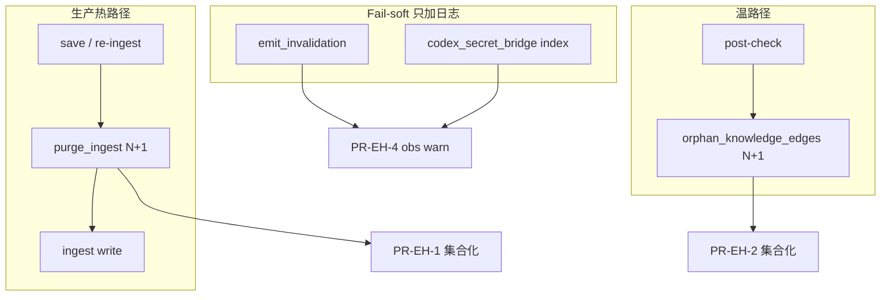
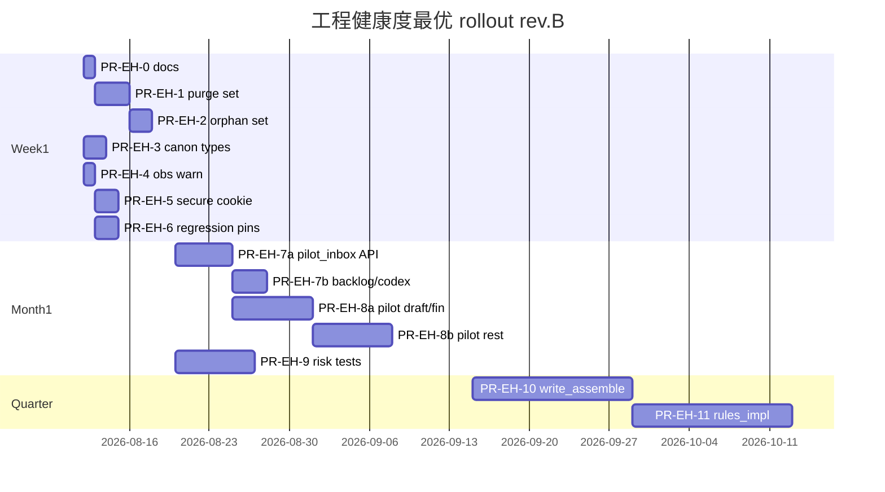

# 铜炉（scribe3）工程健康度审计 — 深度核实 + 最优改进方案

| 字段 | 值 |
|------|-----|
| **文档标题** | 工程健康度审计对抗核实与最优改进方案 |
| **作者** | Grok Design（对抗审计） |
| **日期** | 2026-08-12 |
| **修订** | rev.C（A1 验收：命题路径 O(1)/斜率 0；整函数勿用 ≤6 含侧清） |
| **状态** | **Accepted · 实施结案**（见 `2026-08-12-engineering-health-closure.md`，main≥`cb64141`） |
| **仓库** | `/home/admin/projects/scribe-writing-system`（`scribe3/` monorepo package） |
| **受众** | 资深工程师 / 产品决策 |
| **输入** | 外部审计声称 46 findings（2 P0 / 16 P1 / 23 P2 / 5 P3 + 13 healthy）；编排器预核；只读代码对抗；design review |

---

## Overview

外部审计对铜炉（scribe3）给出 **46 项发现 + 13 项健康** 的健康度画像。本设计文档 **不背书** 该报告的严重度与优先级，而是：

1. 以当前代码为唯一真相源做裁决（**P0/P1 全量对抗**；**P2/P3 为对抗抽样**，见 §方法论）；
2. 补上审计漏检 / 已修需回归 / 信息项（分表，见 §3）；
3. 给出按 **生产风险 × 频率 × ROI** 重排的三阶段计划与可独立合并的 **PR Plan**。

**核心结论（执行摘要）**：

- 外部 **P0 候选**均不宜按「生产即炸」处理：orphan N+1 为 **P1 温路径**；缓存 fail-soft 为 **有意设计**（若外部第二 P0 实为 REST 门控，则见 EH-12 INTENTIONAL）。
- **真正更热的 N+1 是 `purge_ingest`**，生产优先级 **高于** `orphan_knowledge_edges`。
- 分层泄漏、import 环、巨型函数/文件是 **真债**（P1/P2），非当晚数据事故。
- REST vs MCP 审批不对称是 **产品双路径**（emergency 默认关）→ **DOC_ONLY**。
- 覆盖率「121 模块」启发式 **夸大**；应补热路径契约测。
- **讨论 soft 限知已交付**（GAP-9 / `guard_discuss_instructions`，默认开）——开放问题仅为是否 **硬裁**（OQ-2），禁止再造 `discuss_epistemic_guard`。

---

## Background & Motivation

### 当前架构（与审计相关的切片）

```text
浏览器 SPA ──session cookie──► FastAPI (scribe3.app / api/*)
                                  │
                                  ├─ REST 世界写：SCRIBE3_EMERGENCY_REST_WRITE 默认 403
                                  ├─ MCP s3_*：WRITE_GATED + commit_if_approved
                                  └─ SurrealStore（store/* mixin）
                                        ├─ _execute_write / _query 单一落库点
                                        ├─ _ws_lock（WS SDK 非线程安全）
                                        └─ emit_invalidation → TTLCache 广播
```

权威：[`docs/CURRENT_ARCHITECTURE.md`](../CURRENT_ARCHITECTURE.md)、[`scribe3/AGENTIC_BOUNDARY_DECISION.md`](../../scribe3/AGENTIC_BOUNDARY_DECISION.md)。

### 审计报告为何需要对抗

历史经验：fail-soft 被标成永脏；测试/运维路径被标生产 P0；文件名启发式假阳性；双通道被标 approval bypass。

### 约束

| 约束 | 含义 |
|------|------|
| Grok 机 ~1.6Gi RAM | 禁止本机全量 `npm ci` / 临时 Surreal / 无过滤全量 pytest |
| demo = 验证环境 | `./scripts/deploy_demo.sh` + 已部署栈冒烟 |
| 爆炸半径 | flag-gated、可独立回滚 PR |
| 严重度 | **禁止无代码证据发明 P0** |

---

## Goals & Non-Goals

### Goals

1. **裁决表**：对 **外部 P0/P1 量级条目做全量对抗**；对 **P2/P3 做对抗抽样**（覆盖代表风险类，**不声称**已与外部 23+5 条一一映射完毕——原报告未入库，见 OQ-6 / PR-EH-0）。
2. 按 **生产风险 × 频率 × ROI** 给出 **Top 15**（Rank 可为判断调序，见 §2）。
3. 漏检分表：Active / Already-fixed-need-regression / Informational。
4. 三阶段计划 + 止损标准。
5. **Key Decisions** 与 **PR Plan**（每 PR 可独立合并）。

### Non-Goals

- 本文件不直接改生产代码。
- 不重做 Hermes / 微服务 / 迁库。
- Week1 不做 write_assemble / rules_impl 大搬家、不全仓 env 中心化。
- 不强制 REST≡MCP 审批同构。
- 不以「删除所有 `except Exception`」为成功标准。
- **不**重写已交付的 `guard_discuss_instructions` soft 路径。

---

## 方法论

| 步骤 | 做法 |
|------|------|
| 证据 | 只读打开声称路径；核对调用图（谁调、多频？） |
| 裁决 | CONFIRMED / OVERSTATED / FALSE / INTENTIONAL |
| 真严重度 | 入口频率 × 错误影响面 × 已有缓解 |
| Action 用语 | **`FIX_WEEK1` / `FIX_MONTH1` / `FIX_QUARTER` / `WONT_DO` / `DOC_ONLY` / `DONE`**（取代模糊 FIX_NOW/LATER） |
| 覆盖诚实性 | P0+P1 全量；P2/P3 **抽样**；OQ-6 归档原报告后回填外部 ID |

**关于「原审计 46 ID」**：仓库内 **未检入** 完整 46 条编号原文。本文用稳定 **`EH-xx`**；PR-EH-0 须附「未映射外部措辞占位 / 归档动作」。

---

## 1. Finding-by-finding 裁决表

### 1.1 外部 P0 **候选**对抗（身份依赖原报告；OQ-6 后回填）

> 节标题故意写「候选」：第二 P0 可能是 emit、REST 门控、或其他；**并列** EH-02 / EH-12，**不**断言外部第二 P0 恒等于 emit。

| ID | Audit claim（外部措辞候选） | Verdict | True sev | Evidence | Action |
|----|------------------------------|---------|----------|----------|--------|
| **EH-01** | `orphan_knowledge_edges` N+1，生产热路径 P0 | **OVERSTATED** | **P1** | `store/facts_knowledge.py:325-367` 逐边 existence；调用：`test_consistency` + **`write.py:615-625` `/post-check`**（自认非热路径）。 | **FIX_WEEK1**（温路径；**次于** EH-03） |
| **EH-02** | `emit_invalidation` 外层 `except: pass` → 缓存永远不知道脏 | **OVERSTATED + INTENTIONAL** | **P2** | `context_cache.py:263-309`：**写正确性 > 缓存卫生**。**正常路径** `invalidate` 后可走 `record_cache_invalidation` / zero_keys WARNING；**外层异常时两者都不跑，仍完全静默** → 需 `emit_invalidation_failed` warning，**禁止改抛**。 | **FIX_WEEK1** |
| **EH-12** | REST 写绕过 MCP `WRITE_GATED` = approval bypass（**另一 P0 候选**） | **INTENTIONAL** | **—** | `app_impl.py:228-241` emergency 默认 **403**；MCP 走 `commit_if_approved`。双路径产品契约。 | **DOC_ONLY** |

### 1.2 P1 量级 — 全量对抗

| ID | Audit claim | Verdict | True sev | Evidence | Action |
|----|-------------|---------|----------|----------|--------|
| **EH-03** | `purge_ingest` 命题 N+1 count+DELETE | **CONFIRMED** | **P1↑ 热路径** | `store/chapters.py:8-45`；`ingest.py` re-ingest 前调用。 | **FIX_WEEK1**（**优先**） |
| **EH-04** | `canon_apply_store` 顶层 import `canon_loop` 成环 | **CONFIRMED** | **P1** | `canon_apply_store.py:8`；`canon_loop.py:473` 延迟 import 反方向。 | **FIX_WEEK1** |
| **EH-05** | router 调 `st._execute_write` / `st._query` | **CONFIRMED** | **P1** | `pilot_inbox` 多处；`product_backlog.py:183`；`codex.py:92,131`（仅 `_query`）。清单见 **附录 C**。 | **FIX_MONTH1** |
| **EH-06** | `codex_secret_bridge` bare `except: pass` 无日志 | **CONFIRMED** | **P1** | `codex_secret_bridge.py:131-159`。 | **FIX_WEEK1** |
| **EH-07** | `quality/store` `time.sleep` 堵请求线程 | **CONFIRMED** | **P2** | `quality/store.py:176-183`；同步 HTTP 可能路径。 | **FIX_MONTH1** |
| **EH-08** | `write_assemble` ~1989 LOC | **CONFIRMED** | **P2** | **1990 行**。 | **FIX_QUARTER** |
| **EH-09** | `rules_impl` ~2795 LOC | **CONFIRMED** | **P2** | ~2795 行。 | **FIX_QUARTER** |
| **EH-10** | `_pilot_executor` 上帝函数 | **CONFIRMED** | **P1** | `pilot_runtime.py:409-1324` ≈ **915 行**。 | **FIX_MONTH1**（工期见 PR-EH-8） |
| **EH-11** | `_ALL_CACHES` 只 append | **CONFIRMED**（prod 轻） | **P2** | `context_cache.py:151-202`。 | **FIX_MONTH1** |
| **EH-13** | `os.environ` 散落无中心 | **OVERSTATED** | **P2** | `settings.py` REGISTRY + gate 测试已存在。 | **FIX_QUARTER**（渐进） |
| **EH-14** | 「121 模块未覆盖」 | **OVERSTATED** | **P2** | ~214 test 文件；真缺口=热路径密度。 | **FIX_MONTH1**（契约测） |
| **EH-15** | 017 ghost 表 | **INTENTIONAL** | **P3** | `017_async_events.surql:5-7`。 | **DOC_ONLY** / Quarter 可选删 |
| **EH-16** | 全仓 except 静默=不可观测 | **OVERSTATED** | **P2** | 真缺口=**无日志 bare pass**（EH-06、emit 外层）。 | **FIX_MONTH1**（清单） |
| **EH-17** | 无事务 / 半套写 | **OVERSTATED** | **P2** | `connection.transaction()` 已有。 | **FIX_MONTH1**（关键路径扩用） |
| **EH-18** | app_impl 仍巨石未拆 | **OVERSTATED** | **P2** | ARCHITECTURE_SPLIT A/B/C **已完成**路由下沉。 | **FIX_QUARTER** |
| **EH-23a** | 讨论路径无任何限知保护 | **FALSE / OVERSTATED** | — | **已交付 soft**：`epistemic_guard.discuss_epistemic_guard_enabled`（`SCRIBE3_EPISTEMIC_DISCUSS_GUARD` **默认 "1"**）、`guard_discuss_instructions`；`write_assemble.py:1980-1991` 接线；`test_gap_fix_batch` / `test_gap_spec_complete` 覆盖。 | **DONE**（回归钉即可） |
| **EH-23b** | 讨论与写作 `project_frame` 硬裁未统一 | **CONFIRMED** | **P1 产品** | `CURRENT_ARCHITECTURE.md` §5b。 | **DOC_ONLY** 直至 OQ-2；**禁止**再写一套 soft guard |

> 原 EH-23 拆为 23a/23b，避免「待做 soft」误导实现。

### 1.3 P2 量级 — **对抗抽样**（不声称覆盖外部全部 23 条）

| ID | Audit claim | Verdict | True sev | Evidence | Action |
|----|-------------|---------|----------|----------|--------|
| **EH-19** | Changefeed 非真 CDC | **CONFIRMED** | **P2** | 轮询 `SHOW CHANGES`。 | **FIX_QUARTER** |
| **EH-20** | cache_watch 只增不删 / 清理未接线 | **OVERSTATED**（接线已有） | **P3** | `purge_cache_watch` 已挂：`changefeed_consumer.py:301-302`（节流≥60s）、`agent_crons.py:327-337`。剩余=运维是否启用 consumer/cron、频率与指标。 | **DOC_ONLY**（demo 调度核对清单） |
| **EH-21** | 锁三层幽灵锁（现状） | **OVERSTATED** | **P2** | GAP-1 已简化 `_acquire_op_mutex`→chapter_lock。 | **DOC_ONLY** + 回归 |
| **EH-22** | LIVE SELECT 未用 | **CONFIRMED** | **P3** | 可接受。 | **WONT_DO**（短期） |
| **EH-24** | bridge 绕过 `add_fact` | **CONFIRMED** | **P2** | 镜像 UPSERT 设计。 | **FIX_QUARTER**（跟命题方案） |
| **EH-25** | 魔法超时散落 | **CONFIRMED** | **P3** | — | **FIX_QUARTER** |
| **EH-26** | 前端表单直写残留 | **CONFIRMED**（部分） | **P2** | — | **FIX_MONTH1** |
| **EH-27** | 批量 WriteProposal 未做 | **CONFIRMED** | **P2** | CURRENT §8。 | **FIX_QUARTER** |
| **EH-28** | 聚合视图不足 | **CONFIRMED** | **P2** | GAP-5 类。 | **FIX_QUARTER** |
| **EH-29** | Hermes SOUL/Memory 未尽 | **CONFIRMED** | **P3** | — | **WONT_DO**（本计划） |
| **EH-30** | 情绪尺度不一致 | **CONFIRMED** | **P2** | — | **FIX_MONTH1** |
| **EH-31** | Storyline 不完整 | **CONFIRMED** | **P2** | — | **FIX_QUARTER**（产品轨） |
| **EH-32** | 死代码清单可批删 | **OVERSTATED** | **P3** | 历史 PALETTE 误报。 | **FIX_QUARTER**（引用图后） |
| **EH-33** | migration 半成功 | **OVERSTATED** | **P2** | `_query_all_checked` 已修。 | **DOC_ONLY** |
| **EH-34** | `_store_for` 永不释放 | **OVERSTATED** | **P3** | `_STORE_CACHE_MAX=8`。 | **WONT_DO** |
| **EH-35** | 流式 LLM 无重试 | **OVERSTATED（已修）** | **P3 边界** | `llm.py:178-206` `_stream_with_retry`：建链瞬时错/5xx 重试；**已 yield 后中途断不重试（有意）**；`test_llm_stream.py`。 | **DOC_ONLY**（钉边界） |
| **EH-36** | QC 误报 | **CONFIRMED** | **P2** | 启发式固有。 | **FIX_MONTH1** |
| **EH-37** | inflight TTL 幽灵 | **CONFIRMED**（边界） | **P2** | — | **FIX_MONTH1** |
| **EH-38** | settings hot/restart 认知税 | **CONFIRMED** | **P3** | 设计如此。 | **DOC_ONLY** |
| **EH-39** | rebind 脆弱 | **CONFIRMED** | **P2** | — | **FIX_MONTH1**（冻结列表测） |
| **EH-40** | 多 worker 文档不足 | **OVERSTATED** | **P2** | 已有 ops 文档；默认单 worker。 | **DOC_ONLY** |
| **EH-41** | 前端未用依赖 | **抽样未闭环** | **P3** | 未全仓扫 package。 | **FIX_QUARTER**（复检） |

**P2 抽样说明**：上表 ≈ 代表风险类（CDC/锁/桥/LLM/QC/配置/前端…），**映射覆盖率未知**，因外部 23 条原文未入库。PR-EH-0 + OQ-6 负责闭合。

### 1.4 P3 抽样

| ID | Claim | Verdict | Action |
|----|-------|---------|--------|
| **EH-42** | 文档过期 | CONFIRMED | DOC_ONLY |
| **EH-43** | 日志中英混杂 | CONFIRMED | WONT_DO |
| **EH-44** | 类型注解不全 | CONFIRMED | WONT_DO |
| **EH-45** | 魔法 status 字符串 | CONFIRMED | FIX_QUARTER |
| **EH-46** | 测试命名不一致 | CONFIRMED | WONT_DO |

### 1.5 Healthy 抽核（H-01…H-13）

与 rev.A 同：`_execute_write` 单点（有 router 例外）、WRITE_GATED、限知写作硬裁、Surreal3、L1 会话、emergency 默认关、store 分包、cache+authority、ingest lease、WS 锁、settings gate、路由 split、PR 基线 —— 大体 CONFIRMED。注意 Secure cookie 默认 False（M-01）。

---

## 2. Severity re-rank — Top 15

**排序规则（明示）**：

1. 先算辅助分 **`Score = R×F + E`**（R/F/E 各 1–5，E 高=易做高回报）。
2. **`Rank` 为工程判断调序**，不必严格等于 Score 降序；调序原因见「调序」列。
3. 已 **DONE** 项不进 Top15 实施队列（EH-23a）。

| Rank | ID | 主题 | R | F | E | Score | 调序 | 阶段 |
|------|-----|------|---|---|---|-------|------|------|
| 1 | **EH-03** | `purge_ingest` 集合化 | 4 | 5 | 4 | 24 | 热路径正确性/性能最高 | Week1 |
| 2 | **EH-06** | bridge bare except→warning | 3 | 4 | 5 | 17 | Score 高且零行为风险，可先于破环落地 | Week1 |
| 3 | **M-01** | Session Secure 默认/生产 | 4 | 3 | 5 | 17 | 安全面；与 2 同 Score，安全优先于纯 obs 时并列靠前 | Week1 |
| 4 | **EH-04** | canon 类型破环 | 3 | 3 | 5 | 14 | Score 低于 2/3，但阻塞类型/import 卫生，紧接 obs | Week1 |
| 5 | **EH-02** | emit 外层 failed 日志 | 2 | 3 | 5 | 11 | 与 2 同 PR 族（obs） | Week1 |
| 6 | **EH-01** | orphan 集合查询 | 3 | 2 | 4 | 10 | 温路径；同模式跟 purge | Week1 |
| 7 | **M-02** | changefeed dual_write 回归 | 5 | 2 | 4 | 14 | 历史 P0；增量钉非重写测 | Week1 |
| 8 | **EH-05** | router 私有 store API | 3 | 4 | 3 | 15 | Score 高于部分 Week1，但爆炸半径大 → Month1 | Month1 |
| 9 | **EH-10** | pilot executor 拆分 | 3 | 4 | 2 | 14 | 难做；工期 10–14d | Month1 |
| 10 | **EH-23b** | 讨论硬裁产品决策 | 4 | 3 | 2 | 14 | 不写代码直至 OQ-2；跟踪 | Month1 决策 |
| 11 | **EH-08** | write_assemble 拆分 | 3 | 5 | 2 | 17 | Score 高但 E 低、冲突成本；Quarter | Quarter |
| 12 | **EH-14′** | 热路径契约测 | 3 | 3 | 3 | 12 | — | Month1 |
| 13 | **EH-16′** | bare pass 清单 | 2 | 4 | 4 | 12 | — | Month1 |
| 14 | **EH-07** | quality sleep | 2 | 3 | 3 | 9 | — | Month1 |
| 15 | **EH-09** | rules_impl 拆分 | 2 | 3 | 2 | 8 | — | Quarter |

**EH-03 的 F=5**：`ingest.py` 每次 re-ingest / 清理前调用 `purge_ingest` —— 热路径判断 **成立**。

**刻意不进实施 Top**：EH-12、EH-15、EH-20（DOC）、EH-23a（DONE）、EH-35（已修）、全量 env、LIVE SELECT。

---

## 3. 漏检 / 已修 / 信息（分表）

### 3.1 Active gaps（仍要做）

| ID | 问题 | 严重度 | 证据 | 建议 |
|----|------|--------|------|------|
| **M-01** | `SCRIBE3_SESSION_SECURE` 默认 False；代码无 HTTPS 推断（L1 文档超前） | **P1** | `auth/routes.py:22-29`；`deploy/prod/.env.example` 已建议 `1`，**demo 实机 env 须冒烟核实** | PR-EH-5 两步 |
| **M-05** | 多 worker 下进程内锁 | **P2** | 默认单 worker | 文档+启动校验 |
| **M-07** | bridge vs `add_fact` 语义 | **P2** | 命题链 | 跟产品方案 |
| **M-08** | 同步 sleep 在请求栈 | **P2** | EH-07 | Month1 |
| **M-09** | post-check 检测器串联延迟 | **P2** | `write.py` | 预算/并行 |
| **M-10** | conftest 默认 emergency REST=1 | **P2 流程** | 易误导 | 文档+「闸关」CI 套件 |

### 3.2 Already fixed — 需回归钉（不是新洞）

| ID | 问题 | 状态 | 回归动作 |
|----|------|------|----------|
| **M-02** | Changefeed dual_write 死环 | **已修** | PR-EH-6 增量契约（见 PR Plan） |
| **M-03** | MCP∥HTTP 双 purge | **已修**（lease） | 保留现测 + demo 同章双触 409 |
| **M-04** | Surreal WS 非线程安全 | **已缓解** `_ws_lock` | 禁止旁路 `_db.query` |

### 3.3 Informational

| ID | 说明 |
|----|------|
| **M-06** | orphan 已挂生产 post-check（若外部仍写「仅测试」则报告过时） |
| **EH-23a** | 讨论 soft guard **已交付**（非漏检待做） |



---

## 4. Proposed Design

### 4.1 原则

1. 热路径正确与性能 > 美学重构  
2. fail-soft 保留；只补可观测性  
3. 每 PR 可回滚  
4. 验证 = demo 已部署冒烟  
5. **已交付 soft 限知不重写**

### 4.2 Phase A — Week 1

| 项 | 内容 | 完成定义（可测） |
|----|------|------------------|
| A1 | `purge_ingest` 集合化 | **主指标（命题路径）**：`prop_path_query_count ≤ 4`（own SELECT + kept knows + kept rk + batch DELETE，或等价 2–4 次），且 **对命题数 N 斜率 = 0**（单测 N=5 vs N=50 计数相同）。**禁止** per-prop existence/count。**整函数**：固定侧清（knows/rk 边、char_state、unverified、voice、motif、promise、relation_touch、event 图等）次数 **不随 N 增长**；可选总 cap `total_query_count ≤ 20`（含侧清，防误塞 O(n)），**不得**用 `≤ 6` 含侧清（固定侧清 alone 已 ≥10）。跨章复用命题保留单测。demo：`deploy_demo.sh` → health/ready + 一章 re-ingest |
| A2 | `orphan_knowledge_edges` 集合差 | 见 **§4.5.2**；`test_consistency` orphan 用例绿；post-check 不 O(n) round-trip |
| A3 | `ChangeItem` / approval helper → `canon_types.py` | 无顶层环；`test_canon_*` 绿 |
| A4 | bridge + emit 外层 `warning` | 行为不变；失败可见且 **不落 secret value** |
| A5 | Secure cookie | 见 PR-EH-5 两步 |
| A6 | 回归钉 dual_write / lease | 见 PR-EH-6 **增量**定义 |

**止损**：A1–A4 合入；demo health/ready + re-ingest 冒烟；A1 SurQL 卡壳则 Python set 差降级仍合入。

### 4.3 Phase B — Month 1

| 项 | 内容 |
|----|------|
| B1 | Store public API（**附录 C**）；`pilot_inbox` 私有调用→0；`product_backlog` 同 PR 或 **PR-EH-7b**；`codex` 只读 `_query` 列入清单（迁 public read 或明确跟踪） |
| B2 | `_pilot_executor` 拆 action 模块（**10–14 日历日**或两 PR：先 draft/finalize，再 beats/其余） |
| B3 | bare pass 清单 → warning |
| B4 | write/pilot 契约测（mock store） |
| B5 | **非**新写 discuss guard。仅：(1) 文档/CURRENT 与 flag 默认「开」一致；(2) 若产品要 → **作者可见** soft 命中提示 UI；(3) OQ-2 硬裁另议 |
| B6 | quality retry 降 sleep / attempts 可配 |

**止损**：`pilot_inbox` 上 `st._execute_write|_query` = **0**；product_backlog 写点清零或登记 ticket；pilot 拆分后 rebind 列表测绿。

### 4.4 Phase C — Quarter

C1 write_assemble 按 block 拆；C2 rules_impl 按族拆；C3 env 渐进；C4 017 ghost；C5 LIVE 评估（仅产品需要时）。

### 4.5 算法草图

#### 4.5.1 purge_ingest（热路径）

```python
# 语义不变：先删本章 knows/reader_knows；命题仅当无他章引用时删

# 1) DELETE knows / reader_knows WHERE ingest_seq = $seq
# 2) own = SELECT meta::id(id) AS local FROM proposition WHERE ingest_seq = $seq
# 3) kept_from_knows = SELECT meta::id(out) AS local FROM knows
#        WHERE ingest_seq != $seq AND out IN $prop_records
#    kept_from_rk = SELECT ... FROM reader_knows WHERE ingest_seq != $seq AND ...
# 4) DELETE proposition WHERE ingest_seq=$seq AND meta::id(id) NOT IN $kept

# 降级：2–4 次 query + Python set 差，禁止 per-prop count
# 验收（命题路径）：prop_path_query_count ≤ 4 且 slope(N)=0（N=5 vs N=50）
# 验收（整函数）：固定侧清不随 N 增长；可选 total_query_count ≤ 20（勿用 ≤6 含侧清）
# 跨章复用单测
```

#### 4.5.2 orphan_knowledge_edges（温路径 · PR-EH-2）

**ID 形态不对称（实现必读）**：

| 边 | 指向命题的字段 | 规范化规则（与现逻辑一致） |
|----|----------------|---------------------------|
| `knows` | 图 `out` → `meta::id(out)` | local id，无 `fact:` 前缀 |
| `reader_knows` | 字段 `proposition` 可能是 `fact:xxx`、裸 local、或 RecordID `str` | 若含 `:`，取 **第一个 `:` 右侧** 为 local（`split(":", 1)[-1]`，与现 N+1 路径一致，如 `fact:k3-0`→`k3-0`）；否则整串为 local |

```python
def orphan_knowledge_edges(self) -> list[dict]:
    # 1) 一次拉全量命题 local id
    prop_rows = self._query("SELECT meta::id(id) AS local FROM proposition")
    alive: set[str] = {str(r["local"]) for r in (prop_rows or []) if r.get("local") is not None}

    orphans: list[dict] = []

    # 2) knows：一次扫边
    for r in self._query(
        "SELECT meta::id(in) AS knower_local, meta::tb(in) AS knower_tb, "
        "meta::id(out) AS prop_local FROM knows"
    ) or []:
        pl = r.get("prop_local")
        if pl is None:
            continue
        if str(pl) not in alive:
            orphans.append({
                "type": "knows",
                "knower": f"{r.get('knower_tb', 'character')}:{r.get('knower_local', '')}",
                "proposition_ref": f"fact:{pl}",
            })

    # 3) reader_knows：一次扫边 + 剥 fact: 前缀
    for r in self._query("SELECT proposition FROM reader_knows") or []:
        prop_ref = r.get("proposition")
        if prop_ref is None:
            continue
        prop_str = str(prop_ref)
        prop_local = prop_str.split(":", 1)[-1] if ":" in prop_str else prop_str
        # 注意：split(":", 1) 对 "fact:k3-0" → "k3-0"；与现 N+1 路径一致
        if prop_local not in alive:
            orphans.append({
                "type": "reader_knows",
                "knower": "reader",
                "proposition_ref": prop_str,
            })
    return orphans

# 可选 SurQL：WHERE out NOT IN (SELECT id FROM proposition) —— Surreal 3.2.4 需验证后再用
# 验收：边数 N、命题 M 时 DB round-trip = O(1)（2–3 次），非 O(N)
```

---

## API / Interface Changes

| 变更 | 说明 |
|------|------|
| Store public helpers | 见 **附录 C**；HTTP 契约不变 |
| `canon_types` | 类型搬迁；`canon_loop` re-export |
| 日志 | `emit_invalidation_failed` / `bridge_side_effect_failed`（无 secret 正文） |
| Cookie Secure | PR-EH-5：env 钉 + 可选推断规格 |
| 讨论 soft | **无新 API**；可选 UI 展示 soft hits |

---

## Data Model Changes

- Week1 **无** schema 强制变更。  
- `cache_watch`：清理 **已接线**；运维确认 demo cron/consumer 启停与频率。  
- Quarter：可选删 017 ghost。

---

## Key Decisions

| ID | 决策 | 理由 |
|----|------|------|
| **KD-1** | purge 优先于 orphan；二者皆 Week1 | 热 vs 温 |
| **KD-2** | emit **保持 fail-soft**；外层补 warning | 写正确性 > 缓存卫生 |
| **KD-3** | REST/MCP 双路径维持 | 产品契约 |
| **KD-4** | Week1 不大搬家 write/rules | 爆炸半径 |
| **KD-5** | 死代码须引用图 | 防 PALETTE 误杀 |
| **KD-6** | demo 冒烟=验证 | 资源规则 |
| **KD-7** | bare except→可观测，不改抛写路径 | 防回归 |
| **KD-8** | 覆盖率=热路径契约，不追文件名 | 假阳性 |
| **KD-9** | 讨论 soft guard **DONE**；硬裁仅 OQ-2 | 禁止重复造轮子 |
| **KD-10** | Top15 Rank 允许判断调序 | Score 辅助可审计 |

---

## PR Plan

| PR | 标题 | 内容 | 风险 | 验证 |
|----|------|------|------|------|
| **PR-EH-0** | docs: 工程健康度对抗结论 | 本文 + **OQ-6 归档占位**（外部措辞未映射清单） | 无 | 审阅 |
| **PR-EH-1** | perf(store): set-based purge_ingest | `chapters.py` + 跨章复用单测 | 中 | `test_*ingest*` / 跨章复用；**`prop_path_query_count ≤ 4` + N=5/50 斜率 0**；可选 total≤20；demo：`deploy_demo.sh` → health/ready → 一章 re-ingest |
| **PR-EH-2** | perf(store): set-based orphan | `facts_knowledge.py` §4.5.2 | 低 | `test_consistency` orphan；post-check |
| **PR-EH-3** | refactor(canon): types | `canon_types.py` | 低 | `test_canon_*` |
| **PR-EH-4** | obs: bridge/emit warn | 两文件 | 极低 | mock 失败见 log |
| **PR-EH-5** | security: session Secure | **两步**见下 | 低 | Set-Cookie |
| **PR-EH-6** | test: dual_write/lease **增量** | **非**重写 FakeStore 测 | 低 | 见下 |
| **PR-EH-7a** | store public + pilot_inbox | 附录 C 全表 | 中 | pilot 测；grep pilot_inbox 私有=0 |
| **PR-EH-7b** | product_backlog + codex 私有 API | 写点清零 / 只读 public | 中 | grep 基线 |
| **PR-EH-8a** | pilot：抽 draft/finalize | 减负 rebind | 中 | pilot + rebind 列表 |
| **PR-EH-8b** | pilot：beats/outline/其余 | 续 8a | 中 | 同上 |
| **PR-EH-9** | test: write/pilot 契约 | mock | 低 | CI 子集 |
| **PR-EH-10** | write_assemble blocks | 门面保留 | 高 | 快照 + demo 写作 |
| **PR-EH-11** | rules_impl 族拆 | re-export | 中 | test_critique |

**PR-EH-5 两步**：

1. **运维**：核实/钉 demo `.env` `SCRIBE3_SESSION_SECURE=1`；HTTPS 登录冒烟 `Set-Cookie` 含 `Secure`。  
2. **可选代码**：HTTPS 推断仅当显式 `SCRIBE3_SESSION_SECURE` 未设置时：信任 **`X-Forwarded-Proto: https`**（部署须由受信反代注入；**不**信客户端随意头）或 ASGI `request.url.scheme==https`；本地 HTTP 默认仍 False。并修正 L1 文档与代码一致性（文档不得声称已推断若代码未做）。

**PR-EH-6 增量（避免空 PR）**：

| 已有 | 不重复 |
|------|--------|
| `test_surreal_deep_use.py::test_s2_emit_dual_write_false_skips_create` 等 | 再写 FakeStore dual_write |
| `test_ingest_pipeline_policy.py` lease CAS | 复制同构用例 |

**本 PR 只做**：(1) **契约/静态**：`changefeed_consumer` 内 `_touch` → `emit_invalidation(..., dual_write=False)` 的测试或简单 AST/源码断言；(2) 可选：invalidation 速率计数器防环阈值；(3) demo 可选：同章双触 409。lease **保留现测**即可。

**推荐合并序**：

- **硬依赖**：无（1 与 2 同模式，**2 软依赖 1** 的审查经验，非代码硬依赖）。  
- **并行**：3 / 4 / 5 / 6 可与 **1 并行**；一人时优先 1→2。  
- 序：`0 → (1 ∥ 3∥4∥5∥6) → 2 → 7a → 7b → 8a → 8b → 9 → 10 → 11`。

**回滚**：单 PR `git revert`；demo `deploy_demo.sh` / hot 回退提交。PR-1 后 **必跑**：health/ready + 一章 re-ingest。

---

## Alternatives Considered

| 方案 | 结论 |
|------|------|
| Alt-A 按外部 P0 原样全修 | **拒绝** |
| Alt-B 只做日志不做 N+1 | 子集可先，**不能**替代 PR-EH-1 |
| Alt-C REST≡MCP 审批 | **WONT_DO** 除非改 KD-3 |
| Alt-D 巨石一 PR 拆完 | **拒绝** |
| Alt-E 重写 discuss soft guard | **拒绝**（KD-9） |

---

## Security & Privacy

| 主题 | 说明 |
|------|------|
| Cookie | HttpOnly+SameSite=Lax；Secure 默认 off=**真缺口**；PR-EH-5 |
| REST 世界写 | 默认 403 |
| MCP | 拒绝/过期不假绿 |
| 限知 | 写作硬裁；讨论 **soft 已开**；硬裁 OQ-2 |
| 日志 | warning **禁止** secret value |

---

## Observability

| 信号 | 用途 |
|------|------|
| zero_keys WARNING | 成功 invalidate 但 0 key |
| `emit_invalidation_failed` | **外层**异常（此前静默） |
| `bridge_side_effect_failed` | index/cache soft 失败 |
| purge `prop_path_query_count` / 可选 total + 耗时 | **对齐 A1**：命题路径 O(1)；侧清次数不随 N |
| post-check `degraded_stages` | orphan 失败可见 |
| changefeed 处理速率 | 防环 |

---

## Rollout Plan



**并行说明**：Week1 一人时 1 串行后 2；3/4/5/6 与 1 **可并行**（无代码硬依赖）。

---

## Open Questions

| # | 问题 | 建议默认 |
|---|------|----------|
| **OQ-1** | REST 紧急写是否永久保留？开启是否强制 audit？ | 保留；开启写 audit |
| **OQ-2** | 讨论路径是否 **硬裁** secret / 帧外？（soft **已有**） | 默认维持 soft；UI 可选提示 |
| **OQ-3** | 多 worker 6 个月内？ | 否 → 钉单 worker |
| **OQ-4** | 017 ghost 删还是 UI？ | 删 |
| **OQ-5** | post-check 异步/限流？ | 大库再议 |
| **OQ-6** | 原审计 46 ID 归档？ | **PR-EH-0 附件动作** → `docs/audits/` |

---

## Risks

| 风险 | 严重度 | 缓解 |
|------|--------|------|
| purge 误删跨章复用命题 | **高** | 单测 + prop_path 计数/斜率 + dry 对比删除集 |
| orphan `fact:` 剥前缀不一致 | 中 | §4.5.2 与现逻辑对齐；一致性单测 |
| pilot 拆分破 rebind | 中 | 冻结符号列表；8a/8b 分阶段 |
| Secure 推断误信客户端 | 中 | 仅受信反代 `X-Forwarded-Proto` |
| 日志含 secret | 中 | 只记 entity_id/attr/table |

---

## References

- [`docs/CURRENT_ARCHITECTURE.md`](../CURRENT_ARCHITECTURE.md)
- [`scribe3/AGENTIC_BOUNDARY_DECISION.md`](../../scribe3/AGENTIC_BOUNDARY_DECISION.md)
- [`docs/ARCHITECTURE_SPLIT_ROADMAP.md`](../ARCHITECTURE_SPLIT_ROADMAP.md)
- [`docs/L1-AUTH-ISOLATION.md`](../L1-AUTH-ISOLATION.md)
- [`docs/ops/changefeed-multi-worker.md`](../ops/changefeed-multi-worker.md)
- [`docs/PR_TEST_BASELINE.md`](../PR_TEST_BASELINE.md)
- 代码：`store/chapters.py` · `facts_knowledge.py` · `context_cache.py` · `canon_apply_store.py` · `codex_secret_bridge.py` · `pilot_runtime.py` · `pilot_inbox.py` · `epistemic_guard.py` · `llm.py` `_stream_with_retry` · `auth/routes.py` · `changefeed_consumer.py` · `agent_crons.py`

---

## 附录 A — 外部审计 vs 本文件

| 外部倾向 | 本文件 |
|----------|--------|
| orphan N+1 = P0 | P1 温路径 **FIX_WEEK1** |
| 缓存吞异常 = 永脏 | fail-soft + **外层**补日志 |
| REST 无 WRITE_GATED = 洞 | 双路径 DOC_ONLY |
| 121 模块无测 | 启发式夸大 |
| 讨论无限知 | soft **DONE**；硬裁 OQ-2 |
| 流式无重试 | **已有** `_stream_with_retry` |
| cache_watch 未清理 | **已接线**；运维核对 |
| （漏）purge_ingest | **应最高优先** |

---

## 附录 B — 健康项保持（勿修坏）

1. MCP `commit_if_approved` 不假绿  
2. emergency REST 默认 403  
3. `_ws_lock`  
4. changefeed `dual_write=False`  
5. ingest 共享 lease  
6. settings 注册门禁测  
7. 限知写作硬裁测  
8. Surreal 3.x / 禁 `type::thing` 回流  
9. `guard_discuss_instructions` soft（默认开）  
10. `_stream_with_retry` 建链重试语义  

---

## 附录 C — EH-05 调用点 → 拟议 public 方法

**grep 基线（router 层）**（2026-08-12）：

| 文件 | 符号 | 约行 | 现有 SurQL / 行为 | 拟议 public API |
|------|------|------|-------------------|-----------------|
| `pilot_inbox.py` | `_execute_write` | 55, 153 | `UPDATE chapter SET pilot_steer=$s`（追加截断 2000） | `append_pilot_steer(seq, text: str) -> None`（内部截断；**优先**复用 `update_chapter_meta` 白名单若已含 `pilot_steer`） |
| `pilot_inbox.py` | `_execute_write` | 165–169 | `CREATE idea SET text, route_kind, …` | `create_idea(...)` → 返回 id |
| `pilot_inbox.py` | `_execute_write` | 175–176 | `UPDATE idea SET status='done'` | `set_idea_status(id, status)` |
| `pilot_inbox.py` | `_execute_write` | 185–187 | `UPDATE chapter` 清 pilot_state/parked/card/steer | `clear_pilot_fields(seq)` |
| `pilot_inbox.py` | `_query` | 287 | `SELECT seq, pilot_parked FROM chapter:.. WHERE pilot_parked != NONE` | `list_pilot_parked_seqs() -> list[int]` |
| `pilot_inbox.py` | `_query` | 325–327 | pilot_state 列表 | `list_pilot_chapter_rows() -> list[dict]` |
| `pilot_inbox.py` | `_query` | 368–370 | idea pending/unclear | `list_inbox_ideas() -> list[dict]` |
| `pilot_inbox.py` | `_execute_write` | 377–379 | `UPDATE idea SET question=$q` | `set_idea_question(id, q)` |
| `product_backlog.py` | `_execute_write` | 183 | （实现时读现 SQL） | 对应 backlog 领域方法；**PR-EH-7b** |
| `codex.py` | `_query` | 92, 131 | 只读 | `query_*` public 或 store 已有 list API；**PR-EH-7b** 跟踪 |

**止损分层**：

- **PR-EH-7a**：`pilot_inbox` 上表全部清零。  
- **PR-EH-7b**：`product_backlog` 写 + `codex` 私有读清零或 ticket 登记。  
- Month1 总止损：**不**再写「全 router `_execute_write`=0」而不列 codex/backlog。

---

## 附录 D — Action 用语对照

| 旧（rev.A） | 新（rev.B） |
|-------------|-------------|
| FIX_NOW | FIX_WEEK1（或按阶段） |
| FIX_LATER | FIX_MONTH1 / FIX_QUARTER |
| （无） | DONE |

---

*文档结束 · Draft rev.C 2026-08-12*
