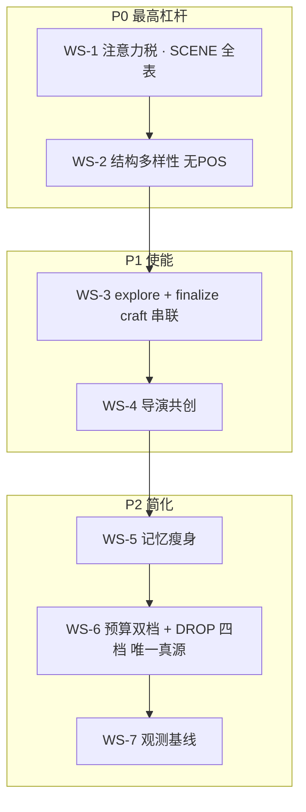
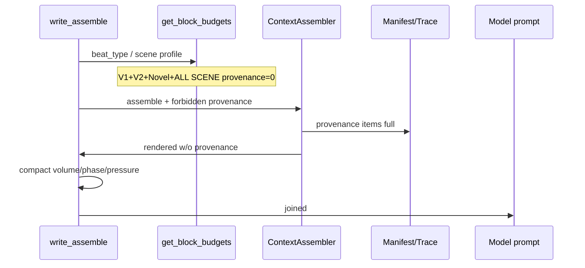
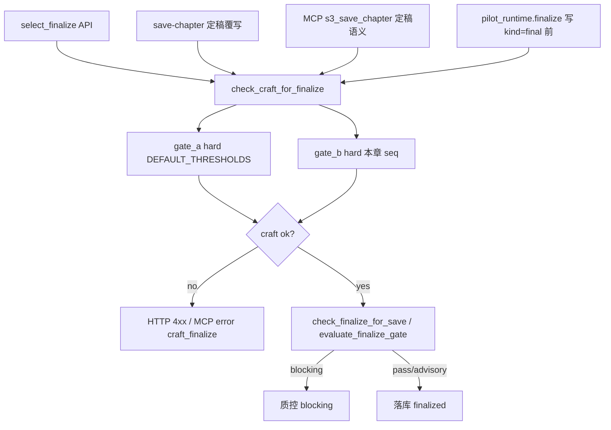

# 设计文档：铜炉 / scribe3 · 第一原则质量使能最优改进计划

| 项 | 值 |
|----|-----|
| **文档标题** | 写出好的小说 · 注意力回收 · 结构多样性 · 渐进探索 · 导演共创 · 分波 PR |
| **作者** | Grok Design（系统架构） |
| **日期** | 2026-08-12 |
| **修订** | **rev.1.2** · 吸收复评 Issue 18–20（度量/ingest/V1）；pilot_runtime.finalize 挂点 |
| **状态** | **Draft · rev.1.2** |
| **产品** | 铜炉（tonglu）/ scribe3 长篇写作工作台 |
| **代码根** | `/home/admin/projects/scribe-writing-system/scribe3/` |
| **落地路径（仓库）** | `docs/plans/2026-08-12-first-principles-quality-enablement.md` |
| **会话 scratch** | `/tmp/grok-1000/grok-design-doc-45fb0716.md` · 摘要 `/tmp/grok-1000/grok-design-summary-45fb0716.md` |
| **评审真源** | 2026-08-12 第一原则审查（系统输出质量 ~7.5/10；偏防错、欠使能） |
| **对齐前序** | `docs/plans/2026-08-11-novel-first-injection-quality-optimal.md`（rev.3.1）；`docs/plans/2026-08-11-context-injection-budget-and-quality-optimal.md`（rev.2.1）；`docs/plans/2026-08-10-novel-quality-first-pipeline-optimization.md`；storyline / quality_dim A3（2026-08-12 已合） |
| **验收环境** | 已部署 demo：`https://tonglu.qing.blue`（主）/ `qing.blue`；SSH `ubuntu@82.157.130.140`，密钥 `~/.ssh/id_tencent_lh`；应用 `/opt/scribe3/app`；**只冒烟已部署栈** |
| **明确不做的宣称** | **不**宣称 human-blind ≥9.5；**不**默认 hard park 全开；**不** fork Hermes；**不**在 Grok 机全量 npm / 本机 Surreal / 平行第二栈验收 |

---

### 读法（工程师 · 第一周）

1. **第一原则 + 杠杆序** — 目标是「写出好的小说」，工作流按 **质量杠杆** 排序。  
2. **不可拆除清单** — 先看 Non-Goals / Must-Keep，再动注入与门控。  
3. **WS-1…WS-7** — 每条：问题 → 机制 → 文件 → flag/默认 → 验收（demo 冒烟）。  
4. **关键决策 + PR Plan（PR-0…PR-7，含 PR-2a/2b）** — 与 Rollout **同编号**；每 PR 可回滚。  
5. **成功度量** — provenance=0（硬）+ 相对基线；路径步数；AI 味；scorecard ≠ 9.5。

---

## 概述

铜炉写路径在长篇一致性、限知隔离、戏剧合同上 **已优于裸 LLM**（审查口径约 **7.5/10** 输出质量）。差距不在「缺模块」，而在 **目标函数失衡**：系统长期优化 **防错 / 审计 / 脚手架齐套**，对 **创作使能**（注意力留给戏剧信号、结构多样性、低摩擦开写、导演级创意建议）投入不足。

本计划在 **不拆除** must-link、canonical suppress、`project_frame` 限知、`drama_contract` / `event_drive`、envelope `canonical`/`recent`、`voice_anchor`、prefix 反平庸、codex 等不可替代机制的前提下，按质量杠杆交付七条工作流：

1. **WS-1 注意力税回收（最高杠杆）**：生成 prompt 踢出 provenance（**V1+V2+Novel+全部 SCENE**）；大纲升 **SEGMENT_L1**；重叠段去重；**G1 主杠杆独立字段**。  
2. **WS-2 结构多样性 / 反 AI 味**：无 POS 的段同构 + 章末公式 advisory；生成前短纪律。  
3. **WS-3 渐进探索模式**：GATE-A/B save 路径 **soft + max_warns=0**；**所有 finalize 入口 craft hard**；ingest 探索稿可 hold。  
4. **WS-4 导演共创**：`director.next_step` store-grounded 建议（真实 API 清单）。  
5. **WS-5 记忆产品路径瘦身**：entity_link / co_present 门控；ablation 告警。  
6. **WS-6 预算表简化（唯一 DROP 四档真源）**：Standard+Novel；**4 tier 替换 14 键**仅在此工作流/PR-6。  
7. **WS-7 观测与评分卡诚实**：`audit_share`/`drama_share` 真计算；基线采样。

**主优化指标 = 戏剧信号密度与可读文学性，不是 tokens_saved，也不是工程完备度。**

**P1 步数收益主要来自 craft soft-save（explore），不是 WRITE_GATED 批审批**（后者显式 out-of-scope）。

---

## 背景与动机

### 1. 审查结论（真源摘要）

| 维度 | 现状 | 含义 |
|------|------|------|
| 输出质量 | ~7.5/10 | 长篇一致 + 限知优于裸 LLM |
| 系统偏向 | **防错 > 使能** | 元数据/审计占生成注意力；门控偏全或无 |
| Prompt 注意力税 | **待校准假设**（审查口述 ~10–15% 全 prompt；**代码可证** Novel 信封内 provenance=`1000/22000≈4.5%`，相对 `PROMPT_HARD=48000`≈**2.1%**） | 单点踢 provenance 杠杆真实但 **≠** 整段 8–12% 下降；重叠 L3 段贡献需 PR-0 采样后回填 |
| AI 味 | 「像」密度、段同构、五章末公式 | 仅事后检不够，需结构多样性 |
| 摩擦 | GATE-A all-or-nothing + **A7** + **WARN-BUDGET**；**48** 个 `WRITE_GATED`；pilot **8 态 / 7 转移** + 书级齐套 | 探索期被拦；P1 主收益在 craft soft |
| 导演 | 状态机 wizard | 缺 grounded 创意建议 |
| 记忆 | 已验证链路强；未验证分支混产品 | graph `co_present`、`entity_link` 死字段 |
| 预算 | 5 表信封 + 2×3 SCENE + **14** 档 `L2_DROP_PRIORITY` | 心智负担；**SCENE 表 provenance 仍 800–1300**（实现阻塞） |

### 2. 现网架构锚点（2026-08-12 已核对 · rev.1.1 补正）

#### 2.1 写路径编译

- 入口：`scribe3/api/services/write_assemble.py` → `_assemble_write_instructions_v1` / `_render_final_input`
- 段注册：`scribe3/injection_registry.py` · `SEGMENT_REGISTRY`（默认 **active**）；`outline` 现为 **L2**
- 预算：`scribe3/context_budget.py`  
  - 基表：V1 10k / V2 18k / Novel 22k / Literary / Epic（后两者 provenance **已 0**）  
  - **SCENE 覆盖**：`get_block_budgets()` 在 adaptive/显式 profile 时 **整表替换** 为 `SCENE_BUDGET_PROFILES` 或 `SCENE_BUDGET_PROFILES_NOVEL`，其中 provenance **仍 800–1300**（生产 Novel 默认路径风险点）  
  - `L2_DROP_PRIORITY` **14** 键；`outline=40`
- 信封：`scribe3/context_assembler.py` · 八块；`_provenance_items` 生成 `## 溯源清单`；块内「L1」= `_is_l1_priority_item` / `_reorder_l1_first`（**≠** 本设计 generation segment tier）
- 旗：`scribe3/novel_quality_flags.py`
- 反平庸：`write_assemble._anti_slop_floor_block`（`SCRIBE3_INJECT_FLOOR`）

#### 2.2 门控与路径

| 机制 | 文件 | 行为 |
|------|------|------|
| GATE-A | `verify_craft_compliance.gate_a` | **A1** intent 三字段；**A2** ≥2 丰满角色；**A3** facts+rules；**A4** 关系；**A5** 母题；**A6** open 伏笔；**A7** brief/伏笔注入可观测（无有效伏笔 → hard fail；brief 组装失败 → soft warn）；**A-ARC** Lie soft；经 `_finalize(..., max_warns=t.max_warns_before_fail)` |
| **WARN-BUDGET** | `_finalize` | 默认 `CraftGateThresholds.max_warns_before_fail=3`：warn 条数 ≥3 → 注入 `{A\|B}-WARN-BUDGET` **hard fail**，`ok=False`（**0=禁用升 hard**） |
| 存正文工艺门 | `evaluate_save_craft_gate` | 首篇实质 prose（≥80 字）要求 GATE-A **全硬项 pass** + GATE-B；短 prose 放行 |
| 定稿门 | `finalize_gate.evaluate_finalize_gate` / `check_finalize_for_save` | **与 craft GATE 正交**：仅 post-check triage；**不**跑 GATE-A/B |
| 定稿入口 | `api/routers/chapters.select_finalize`；save 路径经 `check_finalize_for_save`；MCP `s3_save_chapter` 等 | 终选调用 finalize 质控，**现网无 craft 串联** |
| Pilot | `pilot.py` | `STATES` **8** 态；主链 **7** 次转移；finalize 宪法 approve |
| WRITE_GATED | `write_commit.DEFAULT_WRITE_GATED` | **48** 工具 |
| Director | `director.py` | `_NEXT_TEMPLATES`；`bible_motifs.next_step_for_motif_gap` 例外 |
| Ingest hold | **写路径**：`ingest_policy.decide_ingest` / `persist_hold` + `api.services.ingest_bg.schedule_ingest`；**只读展示**：`finalize_gate.build_ingest_status_row` | hold 由 policy 决策并写 `ingest_hold_*`；status 行仅投影 |

#### 2.3 记忆与限知（不可拆）

- must-link：`memory_must_link.py`
- canonical suppress：`memory_retrieval._suppress_by_canonical`
- 限知：`knowledge.project_frame` + `epistemic_guard` + envelope 帧内事实
- drama / event / pressure：`drama_beats` / `narrative_drive` / `pressure_drive`（合同键见 WS-1 C）
- quality_dim：`quality/dim_scores.load_chapter_dim_scores` + `review/m5_projection.project_quality_dim_advisory`

#### 2.4 AI 味已有钩子

- 生成前：`_anti_slop_floor_block`
- 事后：`aggregate_ai_grade`、`find_parallelism`、`find_poetic_fragments`、metaphor soft
- **缺口：** 段型/章末公式/跨段同构的 **无 POS** 可实现约束

### 3. 痛点 → 质量伤害

| ID | 问题 | 对小说的伤害 | 杠杆 |
|----|------|--------------|------|
| **Q1** | provenance 进生成（基表 + **SCENE 整表替换**） | 注意力被清单占 | **最高** |
| **Q2** | outline 标 L2、可被 L2 裁 | 冲突节拍先丢 | 高 |
| **Q3** | 段重叠 | 公式腔 | 高 |
| **Q4** | AI 味结构同构 | 「模型文」 | 高 |
| **Q5** | GATE-A 全或无 + WARN-BUDGET 升 hard | 探索堵死 | 中高 |
| **Q6** | finalize 不跑 craft | explore 放宽 save 后可半齐套定稿 | 中高 |
| **Q7** | Director 纯状态机 | 缺创意下一步 | 中 |
| **Q8** | 预算/DROP 过复杂 | 误伤 high-signal | 中 |
| **Q9** | explore 入库 dual-truth | 试写事实污染正典 | 中 |

### 4. 产品原则（不可违背）

| # | 原则 |
|---|------|
| P1 | **写出好的小说** |
| P2 | 预算/裁剪 **只服务注意力与信号密度**；禁止 tokens_saved KPI |
| P3 | **软/advisory 优先**；硬门在 finalize / 安全边界 |
| P4 | 渐进探索 **不得** 静默关闭 limited-knowledge / dual-truth / must-link；入库侧见 WS-3 |
| P5 | soft ≠ hard park（除非显式 flag） |
| P6 | 评分卡 ≠ 意图；经验复盘 ≠ `pressure_drive` |
| P7 | 验收 = **已部署 demo 冒烟** |

---

## 目标与非目标

### Goals

| # | 目标 | 可度量（验收） |
|---|------|----------------|
| G1 | 生成路径审计注意力可验收下降 | **(a) 硬 · 主杠杆**：任意 fidelity / **V1 回滚** / SCENE 路径 **`provenance_in_prompt_tokens = 0`** 且 joined 无 `## 溯源清单`（独立字段，**不**依赖 audit_share 间接反映）；**(b) 次杠杆**：`audit_meta_share`（含改前溯源块字符 + volume/phase/avoid 等）相对 PR-1 前同章采样下降（不预设 8–12%；PR-7 回填）；兼容别名见 §1.2 D |
| G2 | high-signal 段优先 | 超 cap 时 T3 先于 `outline`/`brief_must`/`voice_anchor` |
| G3 | AI 味结构指标 | 5 章抽样：`像`/千字、ending_formula、段同构 run（相对基线） |
| G4 | 探索路径步数下降 | **定义**：「explore 下至首段 ≥80 字 prose 的 **强制工具/门控拦截次数**」↓；**主因 craft soft-save**，**不含** WRITE_GATED 批改 |
| G5 | Director ≥1 条 store-grounded 建议 | demo 有数据时 API 非空 |
| G6 | 预算心智 ≤2 产品档 | settings 只暴露 Standard / Novel |
| G7 | scorecard / quality_dim 仅 advisory | 不进 blocking |

### Non-Goals

| # | 非目标 | 理由 |
|---|--------|------|
| NG1 | 宣称 human-blind / 文学 ≥9.5 | 产品禁令 |
| NG2 | 默认全 hard park | 引导 > 硬停 |
| NG3 | Hermes 分叉 | 正交 |
| NG4 | 重写检索 / 换 embedding | 低杠杆 |
| NG5 | 推翻 pilot 拓扑 | 只减摩擦 |
| NG6 | Grok 机全量 pytest/npm/Surreal | 资源 |
| NG7 | 平行第二栈验收 | demo 即验证 |
| NG8 | tokens_saved 为 KPI | 第一原则 |
| NG9 | 静默关闭 `project_frame` / dual-truth 换「自由」 | 限知核心 |
| NG10 | 拆除 must-link / canonical suppress | 跨章一致 |
| NG11 | P1 批量取消 WRITE_GATED / batch 信任会话 | **安全 out-of-scope**；不作为 G4 主杠杆 |
| NG12 | 引入 POS 标注管线（pkuseg/spacy）做同构 | 资源；用无 POS 特征 |

### Must-Keep（禁止拆除 / 禁止默默降级）

| 机制 | 锚点 | 原因 |
|------|------|------|
| must-link | `memory_must_link.py` | 戏剧必需正典 |
| canonical suppress | `memory_retrieval` | 防状态打架 |
| project_frame / epistemic | `knowledge` / `epistemic_guard` | 限知不泄 |
| drama_contract / event_drive | write_assemble | 冲突兑现 |
| outline beats 内容 | domain outline | 章内节拍 SSOT |
| envelope canonical / recent | assembler | 状态 + 近章 |
| voice_anchor | write_assemble | 声口 |
| prefix anti-slop | `_anti_slop_floor_block` | 下限 |
| codex（cap + 戏剧后） | budget + assemble | 世界设定 |
| finalize **质控** blocking 红线 | `finalize_gate` | 三分流 |
| **finalize 前 craft hard（explore 后）** | 本计划新增串联 | 防半齐套上架 |
| **注入侧** 与 create_mode 解耦 | 全路径 | 限知/must-link 不降级 |

---

## Proposed Design

### 0. 杠杆序总览



### 1. WS-1 · Prompt 注意力税回收（P0）

#### 1.1 问题

- Novel 基表 `provenance=1000` → 信封 **≈4.5%**；全 cap **≈2.1%**（代码可证）。  
- 审查「~10–15% 全 prompt 审计/元数据」= **待校准假设**（含 phase_role/avoid/volume 等），**不得**写入 Success Metrics 绝对值。  
- **阻塞**：`get_block_budgets()` SCENE 整表替换后 provenance 仍 **800–1300**。

#### 1.2 机制

**A. Provenance 踢出生成 prompt（保留 trace）— 全路径**

1. **所有** 信封块表（含回滚档）一律 `provenance: 0`，原配额按 **Q1 冻结比例** 并入：  
   - **`BLOCK_BUDGETS_V1`**（`ENVELOPE_V2_ENABLE=0` 回滚；现 provenance=**800** → 0；回灌后仍 sum=**10_000**）  
   - `BLOCK_BUDGETS_V2`、`BLOCK_BUDGETS_NOVEL`  
   - **`SCENE_BUDGET_PROFILES` 全部 3 profile**、**`SCENE_BUDGET_PROFILES_NOVEL` 全部 3 profile**  
   - Literary/Epic 已 0，保持  
   - 回灌：**canonical +60%** of freed / **recent +40%** of freed  
   - 例：Novel 基表 freed=1000 → canon +600 / recent +400；V1 freed=800 → +480/+320；SCENE novel dialogue 原 1300 → +780/+520  
   - 改后 **assert sum(profile)==档总额**（10k / 18k / 22k）  
   - 验收增 **U0**：`SCRIBE3_ENVELOPE_V2_ENABLE=0` 时 joined 仍无溯源清单  
2. `ContextAssembler`：生成 **不** render provenance 块；`Manifest` / `envelope_trace` / journal **仍写** `_provenance_items`。  
3. **双保险**（并列，任一即可挡住进模）：  
   - budget `provenance=0`；**且**  
   - 写路径 `forbidden_source_kinds` **包含** `"provenance"`（现网 `write_assemble` 曾传空元组处改为含 provenance；调试 `SCRIBE3_PROVENANCE_IN_PROMPT=1` 时两者同时恢复旧行为）。  
4. Flag：`SCRIBE3_PROVENANCE_IN_PROMPT` 默认 **0**。

**验收路径（PR-1 强制）**：

| 用例 | 条件 |
|------|------|
| U0 | `SCRIBE3_ENVELOPE_V2_ENABLE=0`（**V1 10k 回滚**；provenance 原 800） |
| U1 | `SCRIBE3_ENVELOPE_NOVEL=1`，**adaptive 关**，无 SCENE 显式 |
| U2 | adaptive **开** 或 `SCRIBE3_SCENE_BUDGET_PROFILE=dialogue_heavy`（及 action/exposition） |
| 全部 | joined 文本 **无** `## 溯源清单`；trace 有 provenance 条数；`provenance_in_prompt_tokens==0` |

**B. Outline 升 SEGMENT 层（命名防碰撞）**

| 名称 | 含义 | 层 |
|------|------|-----|
| **envelope-block L1** | assembler `_reorder_l1_first` / must_link 块内重排 | **不改名、本计划不碰语义** |
| **SEGMENT_L1** | `injection_registry` / generation tier | outline 从 L2 → **SEGMENT_L1** |
| **GEN_SEGMENT_PROTECTED** | 生成段保护集（原草案 L1_PROTECTED） | `outline`, `brief_must`, `voice_anchor` + 全部 L0 redline + envelope 整段 |

规则：

- `SEGMENT_REGISTRY`：`outline` → tier **L1**（`zone=mid`, `epistemic=frame`）。  
- **不**把全文 outline 塞进 `L0_NEVER_CUT`（防无限膨胀）。  
- `GEN_SEGMENT_PROTECTED`：L2/全域裁剪时 **仅在 T3→T2→T1 裁尽后仍超 cap 才半裁**；beats 摘要优先于 volume 复述。  
- **DROP 四档替换 14 键不在 WS-1 实现**（见 WS-6 / PR-6）；WS-1 仅保证 outline 进入保护集，可在现网 14 键表把 `outline` 优先级降到 **≤10** 或移出 victim 列表作 **临时垫片**（PR-2a），正式四档在 PR-6。

**C. 重叠段折叠 — 可测规格**

##### C.1 `volume_intro` compact

| 项 | 规格 |
|----|------|
| Flag | `SCRIBE3_VOLUME_INTRO_COMPACT` 默认 **1**；关 = 现网全文（≤400） |
| 输入 | `volume_intro` 原文；`chapter.synopsis`；`outline` 已渲染串；`volume.title`/`volume.goal`（store 有则用） |
| 判定「已含」 | 规范化后（去空白）：`volume.title` 非空且为 synopsis **或** outline 的子串；**或** `volume.goal` 前 12 字出现在 synopsis/outline |
| 输出 | 已含 → 渲染 **≤120 字** 钩子：`卷钩：{title} · {goal[:40]}`；未含 → 现网块但硬顶仍 400 |
| 失败 | store 读失败 → fail-soft **保留** 现网块（不 omit） |
| 夹具 | `test_volume_intro_compact_skips_when_synopsis_has_title` / `_keeps_when_novel_volume` |

##### C.2 `phase_role`

| 项 | 规格 |
|----|------|
| Flag | 并入 `SCRIBE3_AVOID_MERGE_ANTISLOP` 家族：`SCRIBE3_PHASE_ROLE_DEDUP=1` 默认 |
| 输入 | phase 名；`phase_role` 候选句；已注入的 `craft` + anti_slop 文本 |
| 判定 | 候选句中 **每一句** 若与 craft/anti_slop 的 bigram Jaccard ≥0.5 → 丢弃该句 |
| 输出 | 剩余句 ≤1 句；全空则 **omit 整段** |
| 失败 | 异常 → 保留原 `phase_role`（fail-soft） |

##### C.3 `avoid` → anti_slop

| 项 | 规格 |
|----|------|
| Flag | `SCRIBE3_AVOID_MERGE_ANTISLOP=1` 默认 |
| 行为 | 独立 `avoid` domain **不推入** segments；要点已在 `_anti_slop_floor_block`；关旗恢复独立段 |
| 夹具 | 开旗时 joined 无单独 `## 避免` 标题（若现网有） |

##### C.4 `pressure_drive` 差集（键集合，非字符串包含）

压力合同真源字段（`pressure_drive.py` `contract.get`）：

```text
PRESSURE_DIFF_KEYS = frozenset({
  "fork", "irreversible", "progress", "role", "chapter_pressure",
  "time_budget", "ritual_quota", "witness_policy", "stroke_plan",
  "motif_intensity_caps",
})
```

| 项 | 规格 |
|----|------|
| Flag | `SCRIBE3_PRESSURE_DIFF_ONLY=1` 默认 |
| 输入 | `pressure_drive` 解析后 contract；`drama_contract` 结构化 dict（若仅有渲染串则 **不做差集，整块保留**） |
| 算法 | `keys_needed = {k in PRESSURE_DIFF_KEYS if contract.get(k) not in (None,"",{},[])}`；`keys_in_drama =` drama 对象已表达的同义键（映射表：`conflict→fork` 等，无映射则该键视为 drama **未覆盖**）；`keys_emit = keys_needed - keys_in_drama` |
| 输出 | `keys_emit` 空 → **omit** pressure 段；非空 → 只渲染这些键对应行（复用 `_format_p0` 等子集），仍受 `MAX_PDC_BLOCK=400` |
| 无交集/drama 非结构 | **整块保留** `render_pressure_drive_block(contract)` |
| 失败 | 解析失败 → 整块保留 |
| 夹具 | `test_pressure_diff_omits_when_drama_covers_fork`；`test_pressure_diff_keeps_full_when_drama_text_only` |

**D. Density 观测（真计算 · 主杠杆与次杠杆分离）**

> **问题（Issue 18）**：若 `audit_share` 仅计 `phase_role`/`avoid` 等 L3 段名，**不含** envelope 内 provenance 块，则 PR-1 踢溯源后 `audit_share` 几乎不动，G1(b) 无法验收最高杠杆。  
> **原则**：G1(a) 用 **独立硬字段** 验收 provenance；G1(b) 用 **含溯源字符的元数据份额**；`drama` **禁止**把整个 `envelope` 一锅端。

`injection_registry.density_trace_for_segments` + assembler `budget_report` 扩展（PR-0 即真逻辑）：

```python
# —— 次杠杆：生成 instructions 中「审计/元数据」份额（含溯源）——
# lengths 来自最终 joined 各段；另传 envelope_block_lengths（assembler 八块字符）
META_SEGMENT_NAMES = frozenset({
    "phase_role", "avoid", "material_recall", "seed_words", "volume_intro",
})
# 溯源：改前 = envelope 块 "provenance" 渲染长度；改后 = 0（不进 joined）
# 兼容：字段名 audit_share 作为 audit_meta_share 的别名写出，避免旧仪表盘空读

DRAMA_CORE_NAMES = frozenset({
    "event_drive", "drama_contract", "drama_vacuum", "outline", "brief_must",
})
# 勿把整个 envelope 算进 drama_share

def density_trace_for_segments(
    domain_lengths: dict[str, int] | None = None,
    *,
    envelope_block_lengths: dict[str, int] | None = None,
    ...
) -> dict:
    lengths = dict(domain_lengths or {})
    env = dict(envelope_block_lengths or {})
    # 主杠杆硬字段
    prov_in_prompt = int(env.get("provenance", 0) or lengths.get("provenance", 0) or 0)
    # 若 Assembler 已 omit render，实现必须写 0，即使 trace 仍有 items
    total = sum(lengths.values()) or 1
    meta = sum(lengths.get(n, 0) for n in META_SEGMENT_NAMES) + prov_in_prompt
    drama_core = sum(lengths.get(n, 0) for n in DRAMA_CORE_NAMES)
    env_canon = int(env.get("canonical", 0) or 0)
    env_recent = int(env.get("recent", 0) or 0)
    return {
        "provenance_in_prompt": prov_in_prompt > 0,
        "provenance_in_prompt_tokens": prov_in_prompt,  # G1(a) 硬验收 == 0
        "provenance_trace_items": N,  # 可 >0 且与 in_prompt 解耦
        "audit_meta_share": round(meta / total, 4),     # G1(b)
        "audit_share": round(meta / total, 4),           # 别名 = audit_meta_share
        "meta_segments_share": round(
            sum(lengths.get(n, 0) for n in META_SEGMENT_NAMES) / total, 4),
        "drama_core_share": round(drama_core / total, 4),
        "envelope_canon_share": round(env_canon / total, 4),
        "envelope_recent_share": round(env_recent / total, 4),
        # 可选合计（文档化；不作唯一 KPI）
        "drama_plus_canon_recent_share": round(
            (drama_core + env_canon + env_recent) / total, 4),
        "primary_metric": "signal_density_for_drama",
        "not_a_kpi": "tokens_saved",
    }
```

| 验收字段 | 用途 |
|----------|------|
| `provenance_in_prompt_tokens` | **G1(a) 唯一硬门槛** = 0（U0/U1/U2） |
| `audit_meta_share` / `audit_share` | G1(b) 相对基线；**定义含改前溯源块** |
| `drama_core_share` | 戏剧钉段（不含 envelope 整包） |
| `envelope_canon_share` / `envelope_recent_share` | 回灌可解释，不与 drama_core 混谈 |

PR-7 基线采样 **必须**按本定义重算（禁止沿用「仅 L3 段名」旧式 audit_share）。

#### 1.3 文件

| 文件 | 变更 |
|------|------|
| `context_budget.py` | **V1+V2+Novel+全部 SCENE** 表 provenance=0 与回灌；assert |
| `context_assembler.py` | 不 render provenance；forbidden 配合 |
| `injection_registry.py` | outline→L1；density 真字段 |
| `write_assemble.py` | compact 三件套；forbidden_source_kinds；pressure 差集 |
| `feature_flags.py` / `settings.py` | 旗 |
| 测试 | SCENE 双路径；compact 夹具名见上 |

#### 1.4 Flag / 默认

| Flag | 默认 |
|------|------|
| `SCRIBE3_PROVENANCE_IN_PROMPT` | **0** |
| `SCRIBE3_VOLUME_INTRO_COMPACT` | **1** |
| `SCRIBE3_PHASE_ROLE_DEDUP` | **1** |
| `SCRIBE3_AVOID_MERGE_ANTISLOP` | **1** |
| `SCRIBE3_PRESSURE_DIFF_ONLY` | **1** |
| `SCRIBE3_ENVELOPE_NOVEL` | 保持 **1** |

#### 1.5 验收（demo）

1. **U0+U1+U2**：`provenance_in_prompt_tokens==0`；无溯源标题；trace 仍可有来源。  
2. 限知抽检不退步。  
3. G1(b) 用 `audit_meta_share` 相对基线；**不**预设 8–12%。



---

### 2. WS-2 · 结构多样性 / 反 AI 味（P0）

#### 2.1 问题

章末公式、段同构、比喻密度；事后检多、生成使能少。

#### 2.2 机制

**A. 生成前 `structure_diversity`（≤200 字）**

正向可执行：段型轮换、章末禁默认短句+意象回调、比喻克制（呼应 `SCRIBE3_METAPHOR_SOFT_PER_1K`）。  
Flag：`SCRIBE3_STRUCTURE_DIVERSITY_INJECT` 默认 **1**。

**B. 事后指标（默认 advisory）**

| 指标 | 算法（**无 POS**） | severity |
|------|-------------------|----------|
| `ending_formula_hit` | 末 1–3 非空行：存在长度≤12 的行，且该行 ≥1 个长度≥2 的汉字串出现在正文前 80% 的高频名词候选（频次≥2 的 2–4 字窗） | advisory |
| `paragraph_isomorphism` | 见伪代码 | advisory |
| `simile_like_per_1k` | 既有 + 宽松「像」 | soft |

**`paragraph_isomorphism` 伪代码（P0，无词性）：**

```python
def paragraph_fingerprint(para: str) -> tuple:
    lines = [l for l in para.splitlines() if l.strip()]
    # 段长桶：0–40 / 41–120 / 121–280 / 281+
    n = len(para.strip())
    len_bucket = 0 if n<=40 else 1 if n<=120 else 2 if n<=280 else 3
    # 句数桶：按。！？…切
    sents = re.split(r"[。！？…]+", para)
    sents = [s for s in sents if s.strip()]
    sent_bucket = min(len(sents), 6)
    # 开首：去空白后前 1–2 个汉字，或首字符为引号/破折号则记 "Q"/"D"
    head = para.strip()
    if head[:1] in "「『“\"":
        open_pat = "Q"
    elif head.startswith(("—", "…")):
        open_pat = "D"
    else:
        hans = re.findall(r"[\u4e00-\u9fff]", head)
        open_pat = "".join(hans[:2]) if hans else "?"
    # 对话行占比桶：含引号行 / 总行
    if not lines:
        dlg_bucket = 0
    else:
        dlg = sum(1 for l in lines if any(q in l for q in "「」『』“\""))
        ratio = dlg / len(lines)
        dlg_bucket = 0 if ratio < 0.25 else 1 if ratio < 0.75 else 2
    return (len_bucket, sent_bucket, open_pat, dlg_bucket)

def find_paragraph_isomorphism(text: str, min_run: int = 3) -> list[dict]:
    paras = [p for p in re.split(r"\n\s*\n", text or "") if p.strip()]
    fps = [paragraph_fingerprint(p) for p in paras]
    out, i, n = [], 0, len(fps)
    while i < n:
        j = i + 1
        while j < n and fps[j] == fps[i]:
            j += 1
        if j - i >= min_run:
            out.append({"start": i, "count": j - i, "fp": fps[i],
                        "sample": paras[i][:40]})
        i = j if j > i else i + 1
    return out
```

**Fixture 文本（实现/单测）：**

1. **命中**：三段均「环境两句 + 无对白 + 开首同两字『夜色』」→ isomorphism count≥3。  
2. **不命中**：段1 对白为主、段2 长叙述、段3 短动作 → 指纹不同。  
3. **ending 命中**：全文长叙述 + 末行「灯灭了。」且「灯」在前文出现 ≥2 次。

**POS 方案：defer（NG12）。** 可复用 `find_parallelism` 的开首汉字指纹作补充信号。

接入：`quality_flags` / pilot soft-ai；`loop.triage` 默认 advisory；`SCRIBE3_ENDING_FORMULA_BLOCKING` 默认 **0**。

#### 2.3 文件

`write_assemble.py`；`critique/rules_impl.py` 或 `structure_style.py`；`critique/_common.py`；`novel_quality_flags.py`；pilot/check。

#### 2.4–2.5 Flag / 验收

同前；另：公式章末 → advisory；默认不 block finalize。

---

### 3. WS-3 · 渐进探索模式（P1）

#### 3.1 问题

- 首篇实质 save：GATE-A hard all-or-nothing。  
- **warn≥3 → A-WARN-BUDGET hard**（`max_warns_before_fail=3`）会 **抵消** soft 映射。  
- finalize **正交** craft：explore 放宽 save 后可半齐套定稿。  
- pilot **8 态 / 7 转移** + 书级齐套；WRITE_GATED 48 不作为本计划步数主杠杆。

**Before 基线步骤清单（standard · 新书至首段 ≥80 字 prose 强制门控）**

| # | 强制项 | 来源 |
|---|--------|------|
| 1 | intent 三字段 | A1 |
| 2 | ≥2 丰满角色 | A2 |
| 3 | ≥1 fact/rule | A3 |
| 4 | ≥1 关系 | A4 |
| 5 | ≥1 母题 | A5 |
| 6 | ≥1 open 伏笔 | A6 |
| 7 | A7 可观测（无伏笔则随 A6 失败） | A7 |
| 8 | 章 synopsis | B1 |
| 9 | ≥3 beats（等 GATE-B） | B* |
| 10 | 演绎/场景真相等 B 项 | B* |
| （+） | 工具审批 × N | WRITE_GATED · **OOS** |

explore 目标：1–7 在 **save** 阶段变为 warnings（不拦截），8–10 soft warn 可写 draft；**finalize** 恢复 1–10 hard。

#### 3.2 机制

**模式：`explore` | `standard`（默认 standard）**

| 阶段 | explore | standard |
|------|---------|----------|
| 短 prose &lt;80 | 放行 | 放行 |
| 实质 save | **soft**：A1–A7 hard→warn（`hard=False`）；**`max_warns_before_fail=0`**（禁用 WARN-BUDGET）；GATE-B 同 soft；`allowed=true` + `warnings[]` | 现网 hard + 默认 max_warns=3 |
| **finalize / 正式交付** | **craft hard**：GATE-A（默认 thresholds，含 max_warns=3）+ **本章 GATE-B** + 既有 `check_finalize_for_save` | 同左 craft（现网 save 已拦则 finalize 仍跑 craft 作双检，幂等） |
| 限知 / must-link / suppress | **零改** | 零改 |

**explore thresholds 构造（规范）：**

```python
def thresholds_for_create_mode(mode: str) -> CraftGateThresholds:
    t = CraftGateThresholds()  # 默认 min_* 不变
    if mode == "explore":
        t = replace(t, max_warns_before_fail=0)  # 关键：禁止 warn 升 hard
    return t

# gate_a explore：每个本 hard fail 的 check 改为 verdict=warn, hard=False
# 再 _finalize(..., max_warns=0)
# finalize 路径：mode 忽略，始终 DEFAULT_THRESHOLDS + 真 hard 语义
```

**验收必加：**「故意缺 **≥3** 项 GATE-A（如无母题、无关系、无事实）仍可 explore save ≥80 字」。

#### 3.2.1 Finalize craft 强制串联 — 调用图（PR-4 规格）

现网：`finalize_gate` **正交** craft。explore 后 **Must-Keep**：凡进入 `finalized` / 正式交付的入口必须 craft hard。



| 项 | 规格 |
|----|------|
| 新函数 | `evaluate_craft_finalize_gate(st, seq, *, thresholds=None) -> dict`：跑 `gate_a` + `gate_b(seq)`，**永不**用 explore soft 映射；`max_warns` 默认 3 |
| 挂载 | (1) `chapters.select_finalize` 在 `check_finalize_for_save` **之前**；(2) 任何 `check_finalize_for_save` 调用点包装为 `check_persist_gates` = craft + finalize；(3) **`api/services/pilot_runtime.py` → `finalize(st, seq)`**：现网在 `add_chapter_version(..., kind="final")` **之前零门闩**——PR-4 **必须**在写 final 版前调用 `evaluate_craft_finalize_gate` + `check_finalize_for_save`，失败则 **不**写 kind=final、不推进 `finalized`；(4) MCP 定稿路径与 REST 同函数；(5) pilot approve 路由若直接调 runtime.finalize，不得旁路 |
| 失败响应 | `{allowed:false, code:"craft_finalize", gate_a, gate_b, blocking:[...]}` |
| **danger_draft** | 仅旁路 **质控 triage**（既有 finalize 语义）；**不可**旁路 craft GATE-A/B（脚手架齐套）。若未来要旁路须二次确认 token，**本计划不做** |
| `SCRIBE3_FINALIZE_GATE=0` | 质控可 skip；**craft finalize 仍执行**（独立旗 `SCRIBE3_CRAFT_FINALIZE=1` 默认开；关=危险运维） |
| GATE-B 范围 | **每一章** finalize 强制本章 B；GATE-A 书级每次 finalize 重跑 |

#### 3.2.2 入库 / dual-truth / ingest（explore）

与 `offline_close_dual_truth` / 库内真源语义对齐（**不仅** prompt 双真源）：

| 规则 | 说明 |
|------|------|
| (1) 注入 | create_mode **零改** project_frame / epistemic / must-link / suppress |
| (2) 抽取 · **写路径（真源）** | explore + 实质 prose 时：在 **`ingest_policy.decide_ingest`** 增加分支（或 save 传入的 `GateSnapshot`/create_mode 上下文）→ `DecideResult(action="hold", hold_reason="explore_draft", ...)`，经既有 **persist hold** 写 `chapter.ingest_hold_reason` / `ingest_hold_prose_fp` / `ingest_hold_until`；**`api.services.ingest_bg.schedule_ingest`** 尊重 hold，**不** `auto` 入队抽取。**禁止**只改 `finalize_gate.build_ingest_status_row`（该函数 **只读** 投影 held，**不写** hold） |
| (3) 解除 hold | finalize 且 craft GATE-A 绿后 clear hold 并允许 enqueue；或作者显式 confirm/「晋升正典」token |
| (4) 验收 | explore save 后 status 展示 **held**（`build_ingest_status_row` 可读到 reason）；**无**自动 apply 正典；secret 抽检；`epistemic_guard` 仍挂 |

**文件（PR-4）**：`scribe3/ingest_policy.py`（`decide_ingest` + hold 持久化）、`scribe3/api/services/ingest_bg.py`（`schedule_ingest`）、save-chapter 传 `create_mode` / GateSnapshot；`build_ingest_status_row` 仅冒烟断言展示。

Flag：`SCRIBE3_EXPLORE_INGEST_HOLD=1` 默认。

#### 3.3 WRITE_GATED

- **不做** batch；**不**计 G4。  
- 叙事：摩擦分析可提 48 门，但 **P1 验收只认 craft soft-save**。

#### 3.4 文件

`verify_craft_compliance.py`；`finalize_gate.py`（`evaluate_craft_finalize_gate` + 包装）；`api/routers/chapters.py`；**`api/services/pilot_runtime.py::finalize`**（kind=final 前双门）；MCP save；`ingest_policy.py` + `ingest_bg.schedule_ingest`；settings；web 黄条。

#### 3.5 Flag

| Flag | 默认 |
|------|------|
| `SCRIBE3_CREATE_MODE` | **standard** |
| `SCRIBE3_EXPLORE_SOFT_SAVE` | **1**（仅 explore） |
| `SCRIBE3_EXPLORE_HARD_FINALIZE` | **1** |
| `SCRIBE3_CRAFT_FINALIZE` | **1** |
| `SCRIBE3_EXPLORE_INGEST_HOLD` | **1** |

#### 3.6 验收（demo · 独立 work）

**数据约定：** 使用 **非主展示书** work id，例如 `book_explore_smoke`（脚本创建/测完可删章或标 archive）；**禁止**污染主 demo 连载书。

1. explore + 缺 ≥3 GATE-A → save ≥80 字 **成功** + warnings。  
2. 同书 finalize → **拒绝** 直至 GATE-A/B 绿。  
3. danger_draft **不能** 靠 craft 缺口定稿。  
4. standard 回归一章。  
5. 限知 / hold 行为抽检。

---

### 4. WS-4 · 导演共创（P1）

#### 4.1–4.2 机制

扩展 `next_step.creative_suggestions`（0–3 条）。

**只读 API 清单（实现 import 用）：**

| kind | 调用 |
|------|------|
| `open_promise` | `st.effective_open_promises()`（`store/promises.py`）；回退 `open_promises` / `list_promises` |
| `char_pressure` | `st.char_anchors(character_id)`（`store/characters.py`）；`st.characters()` |
| `drama_gap` | `st.get_chapter(seq)` beats/synopsis；可选 drama validation 结果 |
| `motif_gap` | `bible_motifs.evaluate_motif_gap` → `next_step_for_motif_gap`（**已有**） |
| `quality_dim` | `quality.dim_scores.load_chapter_dim_scores(store, work, seq)` |

Flag：`SCRIBE3_DIRECTOR_CREATIVE=1` 默认；fail-soft 空列表。

#### 4.3–4.4 文件 / 验收

`director.py`；API；web；demo 有书数据 suggestions≥1。

---

### 5. WS-5 · 记忆产品路径瘦身（P2）

1. **entity_link**：产品打分/展示 **不依赖** `entity_link.name`；PR-6 **二选一写死**：  
   - **默认采纳：删除 SELECT 列与 idx 依赖**（维护收益；subject 仅 `entity_id`）；迁移索引 `idx_prop_entity_link` 可留但文档标 obsolete。  
   - 备选：保留 SELECT 但不映射到打分（收益低，不推荐）。  
2. **co_present**：`SCRIBE3_GRAPH_CO_PRESENT=0` 默认；关时召回 **不** SELECT 该边、不进 rank 特征。  
3. ablation：非 `none` → warning 日志 + `memory_ablation_active`。  
4. 保留 must-link / suppress / focus_bonus。

---

### 6. WS-6 · 预算与 L2_DROP 简化（P2）— **DROP 四档唯一真源**

> **WS-1 / PR-2a 不得实现完整四档替换**；仅临时保护 outline。工程师以 **本节 + PR-6** 为准。

**产品两档：** Standard=V2 18k@42k；Novel=22k@48k（默认）。Literary/Epic deprecate 兼容。

**L2 四档（替换 14 键）：**

| Tier | 段 |
|------|-----|
| T3 先丢 | material_recall, reference_craft, seed_words, author_prefs |
| T2 | craft, phase_role, avoid, volume_intro, request_constraint |
| T1 | codex, purpose, pressure_drive |
| T0 保护 | L0 redline + **GEN_SEGMENT_PROTECTED** + envelope |

实现：`L2_DROP_TIER` → 生成 priority；旧 14 键 map 兼容一层后删。

SCENE 表 provenance=0 **已在 PR-1 完成**；本 PR 只做 UI 双档标签 + DROP + 记忆。

---

### 7. WS-7 · 观测与评分卡诚实

1. scorecard：`provenance_in_prompt_tokens`、`audit_meta_share`、`drama_core_share`、`envelope_canon_share`、`envelope_recent_share`、`simile_per_1k`、`ending_formula_rate`、`gate_a_warning_count`、`create_mode`。  
2. quality_dim 仅 advisory。  
3. **禁止** 未校准 8–12% 绝对 KPI。  
4. PR-0/PR-7 采样：demo 同章 `density_trace` + budget_report（端点以现网 debug/assemble trace 为准；若无则 journal 字段）。

---

## API / Interface Changes

### Trace

```text
{
  "provenance_in_prompt": false,
  "provenance_in_prompt_tokens": 0,
  "provenance_trace_items": N,
  "audit_meta_share": 0.04,
  "audit_share": 0.04,
  "meta_segments_share": 0.04,
  "drama_core_share": 0.22,
  "envelope_canon_share": 0.18,
  "envelope_recent_share": 0.12,
  "compacted": ["volume_intro", "pressure_diff"],
  "create_mode": "explore"
}
```

### Save（explore）

```text
{
  "ok": true,
  "craft_gate": {
    "allowed": true,
    "code": "explore_soft",
    "warnings": [{"id": "A5", ...}, {"id": "A4", ...}, {"id": "A3", ...}],
    "mode": "explore",
    "max_warns_before_fail": 0
  }
}
```

### Finalize craft 失败

```text
{
  "allowed": false,
  "code": "craft_finalize",
  "gate_a": {...},
  "gate_b": {...},
  "blocking": ["A5", "B1"]
}
```

### Before/After（示意 · 非 KPI 绝对值）

| 桶 | Before | After 目标 |
|----|--------|------------|
| `provenance_in_prompt_tokens` | V1:800 / Novel:1000 / SCENE:800–1300 | **0**（G1a 硬） |
| `audit_meta_share`（含溯源） | PR-0 采样 | 相对下降（G1b；PR-7 填） |
| `drama_core_share` | 基线 | 不降或升（勿与 envelope 整包混淆） |
| outline 被先裁 | 中 | 近 0（GEN_SEGMENT_PROTECTED） |

---

## Data Model Changes

- 无强制 schema。  
- work prefs：`create_mode`。  
- ingest_hold 字段复用现网。  
- entity_link：查询删除列（PR-6 默认）。

---

## Alternatives Considered

### Alt-1：继续加硬门

否决 — 加剧防错失衡。

### Alt-2：压缩信封省 token

否决 — 违反第一原则。

### Alt-3：Hermes fork

否决 — 用户约束。

### Alt-4：本方案（注意力 + 结构 + explore + 导演 + 简化）

**采纳** — 对齐审查使能目标。

### Alt-5：最小注意力补丁 only（provenance 出 prompt + outline 保护，不做 explore/结构/导演）

- **优点：** 最小 diff、最快降税。  
- **缺点：** 不解决探索摩擦与 AI 结构同构；审查「使能」主诉仍在。  
- **定位：** 等于 **PR-1+PR-2a 子集**；可作紧急热修，但 **不是** 完整最优计划。

### Alt-6：逐 GATE-A check 降硬（无 explore mode 开关）

- **优点：** 无 mode 概念。  
- **缺点：** 全局削弱 standard 齐套；难区分「试写」与「正式连载」；finalize 边界更糊。  
- **否决为默认**；explore mode 显式更安全。

---

## Security & Privacy

| 威胁 | 严重度 | 缓解 |
|------|--------|------|
| explore 半齐套定稿 | High | **所有** finalize 入口 craft hard |
| warn 升 hard 抵消 soft | High | explore `max_warns=0` |
| 限知被 create_mode 绑降 | High | 注入零改 |
| 试写事实入库 dual-truth | Med–High | explore ingest_hold |
| danger_draft 旁路 craft | Med | **禁止** |
| 结构误报 | Med | 默认 advisory |
| provenance 调试恢复 | Low | 双保险旗 |

---

## Observability

| 信号 | 说明 |
|------|------|
| `provenance_in_prompt_tokens` | 生产 **0**（G1a） |
| `audit_meta_share`（=`audit_share` 别名） | 含溯源的元数据份额（G1b） |
| `drama_core_share` / `envelope_canon_share` / `envelope_recent_share` | 分项；禁止单字段吞 envelope |
| `create_mode` / `gate_a_warnings` | save |
| `craft_finalize` rejects | 计数 |
| `memory_ablation_active` | warn |
| ending/isomorphism | advisory metric |

禁止 KPI：tokens_saved、9.5、空绿 pass。

---

## Rollout Plan（与 PR Plan **同编号** PR-0…PR-7）

| PR | 内容 | 主旗 / 回滚 |
|----|------|-------------|
| PR-0 | 文档 + **真** density 字段 | n/a |
| PR-1 | provenance=0 **全表含 SCENE** + 双保险 | `PROVENANCE_IN_PROMPT=1` 回滚 |
| PR-2a | outline SEGMENT_L1 + GEN_SEGMENT_PROTECTED（临时 DROP 垫片） | 关保护旗 |
| PR-2b | volume/phase/avoid/pressure compact（独立旗） | 各 compact 旗=0 |
| PR-3 | 结构多样性 | inject=0 |
| PR-4 | explore + max_warns=0 + craft finalize 串联 + ingest_hold | mode=standard |
| PR-5 | director suggestions | CREATIVE=0 |
| PR-6 | DROP 四档 **唯一**落地 + Standard/Novel UI + 记忆瘦身 | 旧 priority map |
| PR-7 | scorecard 基线笔记（相对采样回填 G1b） | n/a |

部署：`./scripts/deploy_demo.sh` → `tonglu.qing.blue` 冒烟。

---

## Open Questions

| # | 问题 | 建议默认 |
|---|------|----------|
| Q1 | 回灌比例 | **canon 60% / recent 40%**（已写入 SCENE 全表规则） |
| Q2 | 纯散文实验室 work 类型 | 否；仍 soft warn + finalize hard |
| Q3 | 跨章 ending 重复 | P2 |
| Q4 | WRITE_GATED batch | **不做** |
| Q5 | Literary/Epic 删除 | 兼容 ≥1 次要版本 |
| Q6 | PR-0 采样 | **是** |

---

## Key Decisions

| ID | 决策 | 理由 |
|----|------|------|
| KD1 | 目标 = 写出好的小说 | 审查真源 |
| KD2 | provenance **全路径** trace-only（**V1+V2+Novel+全部 SCENE**）+ forbidden 双保险 | 阻塞修复；回滚档不漏；Literary 先例 |
| KD3 | outline → SEGMENT_L1 + GEN_SEGMENT_PROTECTED；**≠** envelope-block L1 | 防命名碰撞 |
| KD4 | 结构项默认 soft；无 POS | 误报与资源 |
| KD5 | explore：save soft / finalize craft hard | 使能且不烂尾 |
| KD5a | explore save **`max_warns_before_fail=0`** | 否则 soft 被 WARN-BUDGET 抵消 |
| KD5b | **所有** finalized 入口 `evaluate_craft_finalize_gate`；danger_draft **不**旁路 craft | 现网 finalize 与 craft 正交必须补链 |
| KD5c | explore 默认 ingest_hold | 防库内 dual-truth |
| KD6 | 限知/must-link 与 create_mode 解耦 | 红线 |
| KD7 | 产品 Standard+Novel | 降调参伤害 |
| KD8 | DROP 四档 **仅 WS-6/PR-6** 为真源 | 防双写 |
| KD9 | Director store-grounded | 稳可测 |
| KD10 | demo 冒烟；不宣称 9.5 | 约束 |
| KD11 | 不 hard park 默认、不 Hermes fork、不第二栈 | 用户 |
| KD12 | 重叠折叠可测键集 | 防静默丢力学钉 |
| KD13 | G1(a)=`provenance_in_prompt_tokens==0` 硬独立字段；G1(b)=`audit_meta_share` 含溯源相对基线；废除 8–12% | 防 audit 定义与主杠杆脱节（Issue 18） |
| KD14 | G4 主因 craft soft；WRITE_GATED OOS | 验收不扯皮 |
| KD15 | explore hold 挂 **`decide_ingest`/`schedule_ingest`**，不挂只读 status 行 | Issue 19 |
| KD16 | `pilot_runtime.finalize` 写 kind=final **前** 强制 craft+finalize 双门 | 现网零门闩旁路 |

---

## PR Plan

### PR-0 · 文档与真 density 字段

| 项 | 内容 |
|----|------|
| **标题** | docs: 第一原则质量使能 rev.1.2 + density（provenance_tokens + audit_meta_share 分项） |
| **文件** | 本计划；`injection_registry.py` density 扩展 |
| **依赖** | 无 |
| **验收** | density 返回真比例；文档在仓 |

### PR-1 · Provenance 出 prompt（含 SCENE）

| 项 | 内容 |
|----|------|
| **标题** | fix(context): provenance trace-only；**全 SCENE/基表** 回灌；forbidden 双保险 |
| **文件** | `context_budget.py`（**BLOCK_BUDGETS_V1 + V2 + NOVEL + 全部 SCENE profile**）、`context_assembler.py`、`write_assemble.py`、settings |
| **依赖** | PR-0 |
| **验收** | **U0+U1+U2** `provenance_in_prompt_tokens==0`；限知不退步；V1 表已改 |

### PR-2a · Outline 保护

| 项 | 内容 |
|----|------|
| **标题** | feat(inject): outline SEGMENT_L1 + GEN_SEGMENT_PROTECTED |
| **文件** | `injection_registry.py`、`context_budget.py`（outline 出 victim / 临时 priority≤10）、settings 保护旗 |
| **依赖** | PR-1 |
| **验收** | 挤预算时 outline 后于 material_recall 被裁 |
| **不做** | 完整四档 DROP、compact |

### PR-2b · 重叠段 compact

| 项 | 内容 |
|----|------|
| **标题** | feat(inject): volume/phase/avoid/pressure 可测 compact |
| **文件** | `write_assemble.py`、pressure 差集键、单测夹具名见 §1.2 C |
| **依赖** | PR-1；可与 2a 并联 |
| **主旗** | 四个 compact 旗可独立关 |
| **验收** | 夹具绿；关旗旧行为 |

### PR-3 · 结构多样性

| 项 | 内容 |
|----|------|
| **标题** | feat(quality): structure diversity 注入 + ending/isomorphism（无 POS） |
| **文件** | write_assemble、critique、novel_quality_flags、fixture 三段 |
| **依赖** | PR-0 |
| **验收** | fixture 命中/不命中；默认不 block finalize |

### PR-4 · 渐进探索 + finalize craft 串联

| 项 | 内容 |
|----|------|
| **标题** | feat(craft): explore soft-save（max_warns=0）+ craft finalize 全入口 + ingest_hold |
| **文件** | `verify_craft_compliance.py`、`finalize_gate.py`、`chapters.py` select_finalize、pilot、MCP、ingest、web |
| **依赖** | 建议 PR-1 后 |
| **验收** | ≥3 缺口可 save；finalize 拒；danger_draft 不旁路 craft；**pilot_runtime.finalize** 缺 GATE 不可写 kind=final；explore save 后 ingest **held** 且无自动正典；**独立 work** `book_explore_smoke` |
| **调用图** | 见 §3.2.1 |

### PR-5 · 导演建议

| 项 | 内容 |
|----|------|
| **标题** | feat(director): store-grounded creative_suggestions |
| **文件** | `director.py`（API 清单 §4.2）、web |
| **依赖** | 无 |
| **验收** | suggestions≥1 |

### PR-6 · DROP 四档 + 双档 UI + 记忆瘦身

| 项 | 内容 |
|----|------|
| **标题** | chore(budget,memory): L2 四档唯一真源；Standard/Novel UI；entity_link SELECT 删除；co_present 默认关 |
| **文件** | `context_budget.py`、`store/recall.py`、`memory_retrieval.py`、settings UI |
| **依赖** | PR-2a 更佳 |
| **验收** | T3 先丢；must-link 仍在；查询无 entity_link 依赖 |

### PR-7 · Scorecard 基线

| 项 | 内容 |
|----|------|
| **标题** | chore(obs): scorecard 与 demo 相对基线回填 G1b |
| **文件** | journal/trace；本计划附录数字 |
| **依赖** | PR-1–3 |
| **验收** | 同章前后 `provenance_in_prompt_tokens` 与 `audit_meta_share` 可对比（新定义） |

```mermaid
gantt
  title PR 依赖 rev.1.1
  dateFormat X
  axisFormat %s
  section P0
  PR-0 density真字段     :0, 1
  PR-1 provenance+SCENE  :1, 2
  PR-2a outline保护      :3, 1
  PR-2b compact          :3, 1
  PR-3 结构无POS         :3, 2
  section P1
  PR-4 explore+craft串联 :5, 2
  PR-5 director          :5, 1
  section P2
  PR-6 DROP四档+记忆     :7, 2
  PR-7 基线回填          :9, 1
```



---

## Risks

| 风险 | 严重度 | 缓解 |
|------|--------|------|
| 只改基表忘 SCENE | **Critical** | PR-1 清单+U2 |
| max_warns 抵消 explore | **Critical** | max_warns=0 |
| finalize 旁路 craft | **Critical** | 全入口串联；danger 不旁路 craft |
| compact 丢力学钉 | Med | 非结构 drama → 整块保留 |
| 同构误报 | Med | soft；无 POS 可调桶 |
| DROP 双写 | Med | 仅 PR-6 真源 |
| explore 污染主书 | Med | 独立 work id |
| audit 度量漏溯源 | Med | G1a 独立字段 + audit_meta 含 provenance |
| pilot_runtime 旁路定稿 | **High** | finalize 写 final 前双门 |
| hold 只改 status 行 | High | 挂 decide_ingest/schedule_ingest |

---

## Success Metrics（可度量 · 非 9.5 · 非未校准 %）

| 指标 | 目标 |
|------|------|
| `provenance_in_prompt_tokens` | **0**（V1+V2+Novel+全部 SCENE） |
| `audit_meta_share` | 相对 PR-1 前同章 **下降**（定义含改前溯源；PR-7 回填） |
| `drama_core_share` | 相对不降或升（不含 envelope 整包） |
| `envelope_canon_share`+`recent` | 回灌后可升；单独报告 |
| explore：≥3 GATE-A 缺口 save | **允许** |
| explore finalize 缺 GATE-A | **拒绝** |
| 强制门控次数至首段 prose | explore 下 **显著少于** §3.1 表 1–10 |
| ending/isomorphism | advisory 可检出 fixture |
| WRITE_GATED 数 | **不作为**成功指标 |

---

## References

| 文档 / 代码 | 说明 |
|-------------|------|
| `docs/plans/2026-08-11-novel-first-injection-quality-optimal.md` | 18k/22k、物理序 |
| `docs/plans/2026-08-11-context-injection-budget-and-quality-optimal.md` | rev.2.1 |
| `scribe3/context_budget.py` | 块表、**SCENE**、L2_DROP |
| `scribe3/context_assembler.py` | 信封、provenance、**envelope-block L1** |
| `scribe3/injection_registry.py` | segment tier |
| `scribe3/api/services/write_assemble.py` | 编译、anti_slop |
| `scribe3/verify_craft_compliance.py` | GATE-A1–A7、WARN-BUDGET、`max_warns_before_fail` |
| `scribe3/finalize_gate.py` | 正交 craft；`check_finalize_for_save`；ingest hold 行 |
| `scribe3/api/routers/chapters.py` | `select_finalize` |
| `scribe3/director.py` / `pilot.py` | 8 态 / 导演 |
| `scribe3/bible_motifs.py` | `evaluate_motif_gap` / `next_step_for_motif_gap` |
| `scribe3/store/promises.py` | `effective_open_promises` |
| `scribe3/quality/dim_scores.py` | `load_chapter_dim_scores` |
| `scribe3/pressure_drive.py` | 差集键真源 |
| `scribe3/critique/rules_impl.py` | AI 味 / `find_parallelism` |
| `scribe3/write_commit.py` | WRITE_GATED 48 |
| `scribe3/store/recall.py` | entity_link / co_present |

---

## Revision Summary

| 版本 | 日期 | 说明 |
|------|------|------|
| Draft | 2026-08-12 | 初稿 |
| rev.1.1 | 2026-08-12 | 评审 Issue 1–17 |
| **rev.1.2** | 2026-08-12 | 复评 Issue 18–20：G1 主/次杠杆与 `audit_meta_share`（含溯源）；drama 分项；ingest hold 挂 `decide_ingest`/`schedule_ingest`；**V1** 表 provenance=0+U0；`pilot_runtime.finalize` 写 kind=final 前双门 |

---

*文档结束 · rev.1.2。*
