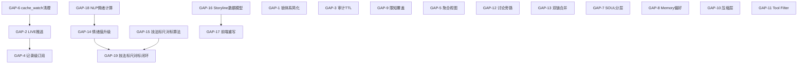

# 铜炉写作系统改进差距修复 Spec

## 1. 执行摘要

铜炉（Scribe3）长篇写作系统在对照三份优化方案（SurrealDB 深度利用 S1-S8、全方位优化 O1-O33、Storyline 可视化升级）实施大规模改进后，整体完成度约 84%。本 spec 覆盖经深度代码审计确认的 **20 项遗留差距**，涉及并发锁体系简化、实时推送架构升级、限知安全覆盖扩展、Hermes 运行时能力利用、情绪算法提升、技法标尺对标引擎补全等方面。目标是将这 20 项差距转化为可执行的工程任务并分批次交付。

**优先级分布**：

| 优先级 | 数量 | 说明 |
|--------|------|------|
| P0（立即修复） | 4 | 影响数据一致性或安全性 |
| P1（短期完成） | 9 | 功能缺失或质量不足 |
| P2（中期规划） | 7 | 增强型功能或设计决策 |

---

## 2. 差距全景表

| 编号 | 来源 | 标题 | 优先级 | 工作量 | 依赖 |
|------|------|------|--------|--------|------|
| GAP-1 | S3 | 锁体系过度复杂 / 幽灵锁风险 | P0 | M | — |
| GAP-2 | S2 | Changefeed 非真 CDC 推送 | P1 | L | — |
| GAP-3 | S7 | 审计表只写不读 / 无 TTL | P0 | S | — |
| GAP-4 | S8 | LIVE SELECT 仍为表级订阅 | P2 | M | GAP-2 |
| GAP-5 | S6 | 聚合视图覆盖面不足 | P1 | XS | — |
| GAP-6 | S2 | cache_watch 行只增不删 | P0 | XS | — |
| GAP-7 | O21 | Hermes SOUL 分层完全缺失 | P2 | M | Hermes API 确认 |
| GAP-8 | O24 | Hermes Memory 偏好未利用 | P2 | M | 设计决策 |
| GAP-9 | O16 | 限知覆盖不全（非限知出口无保护） | P0 | S | — |
| GAP-10 | O5 | 压缩层降级为启发式 | P2 | L | 成本评估 |
| GAP-11 | O11 | Per-Run Tool Filter 粒度不足 | P2 | M | Hermes API 确认 |
| GAP-12 | O20 | 讨论旁路仍存 | P1 | S | — |
| GAP-13 | O29 | 双链未完全统一 | P1 | M | — |
| GAP-14 | O31 | 情绪值指标偏差（0-1 vs -5~+5） | P1 | M | GAP-18 |
| GAP-15 | O32 | 技法标尺对标算法缺失 | P1 | M | — |
| GAP-16 | Storyline | 无独立 Storyline 数据模型 | P1 | L | — |
| GAP-17 | Storyline | 前端 StorylineHub 极简 | P1 | M | GAP-16 |
| GAP-18 | Storyline | 情绪值计算非 NLP/LLM 方式 | P1 | M | — |
| GAP-19 | Storyline | 技法标尺对标闭环缺失 | P2 | L | GAP-15, GAP-18 |
| GAP-20 | Storyline | 方案文档不在仓库中 | P2 | XS | — |

---

## 3. 修复方案详解

### GAP-1. 锁体系过度复杂 / 幽灵锁风险（P0，M）

**现状**

`api/app_impl.py:294-373` `_acquire_op_mutex` 内存在三层互斥：
1. `chapter_lock`（进程内注册表 + 可选 DB store）— 行 309-321
2. `TableInflightLock`（DB inflight 表 UNIQUE 索引）— 行 328-338
3. 遗留 `_loop_inflight` / `_chapter_repair_inflight` 进程内 set — 行 340-373

另有 `_pending_ingest`（行 256）完全未接入 `_acquire_op_mutex` 体系。释放路径 `_release_op_mutex`（行 376+）任一层失败都可能残留"幽灵锁"。

**方案要求 vs 实际差距**

- 方案 S3 要求：DB 幂等锁替代进程内集合，实现单一简洁互斥
- 实际偏差：三层并存（80+ 行，多重 try/except 嵌套），认知复杂度极高

**修复方案**

1. 将 `chapter_lock` + `distributed_lock` 确定为唯一锁路径
2. 移除 `_loop_inflight` 和 `_chapter_repair_inflight` 进程内 set
3. 将 `_pending_ingest` 接入 `acquire_chapter_lock(op="ingest", ...)`
4. `_acquire_op_mutex` 简化为 ~20 行（acquire chapter_lock → 成功返回 / 失败 409）
5. `TableInflightLock` 仅作 `chapter_lock` 的 DB backend（通过 store 注入），不再作为独立层

涉及文件：
- `api/app_impl.py` — 重写 `_acquire_op_mutex` / `_release_op_mutex`
- `chapter_lock.py` — 新增 `op="ingest"` 支持
- `concurrency_lock.py` — 确认单一路径

```python
# 伪代码：简化后的 _acquire_op_mutex
def _acquire_op_mutex(work, seq, op, *, detail):
    st = _store_for(work)
    clr = acquire_chapter_lock(op, work, seq, store=st)
    if not clr.ok:
        raise HTTPException(409, detail or chapter_lock_busy_http_detail(clr))
```

**验收标准**
- `_acquire_op_mutex` 行数 ≤ 25
- `_loop_inflight` / `_chapter_repair_inflight` / `_pending_ingest` 集合完全移除
- 并发测试：同章同操作并发请求返回 409
- 异常中断后锁自动释放（TTL 5 分钟内）

**风险与决策点**
- 移除进程内 set 后纯内存降级路径消失 → DB 不可用时降级为单进程 asyncio.Lock

---

### GAP-2. Changefeed 非真 CDC 推送（P1，L）

**现状**

`changefeed_consumer.py:182-209` 以 2s 间隔轮询 `SHOW CHANGES`，非 WebSocket LIVE 订阅，存在最大 2s 不一致窗口。多 worker 部署时各自独立轮询。

**方案要求 vs 实际差距**
- 方案 S2 要求：CDC 驱动缓存失效（事件驱动）
- 实际：2s 轮询，非毫秒级推送

**修复方案**

两阶段方案：
1. **短期**：将轮询间隔降至 200ms（`self._interval = 0.2`），减小不一致窗口
2. **中期**：改用 LIVE SELECT 实现真推送——对 `_WATCH` 列表中每张表执行 `LIVE SELECT * FROM {table}`，收到变更通知后直接调用 `apply_changes_to_cache`，保留 `SHOW CHANGES` 作为冷启动追赶机制

涉及文件：
- `changefeed_consumer.py` — 重写 `_run` 为异步 LIVE 订阅 + fallback 轮询
- `context_cache.py` — 移除 `_emit_cache_invalidation` 双写（LIVE 已足够）
- `store/core_preamble.py:105` — 移除遗留 `emit` 调用

**验收标准**
- 缓存失效延迟 < 100ms（LIVE 模式下）
- 单 worker 断连后 3s 内自动重连 + catch-up
- 集成测试：写入后 200ms 内缓存已失效

**风险与决策点**
- SurrealDB LIVE SELECT 稳定性需验证（社区有 WebSocket 断连报告）

---

### GAP-3. 审计表只写不读 / 无 TTL（P0，S）

**现状**

`migrations/124_audit_events.surql` 定义了 `audit_event` 表 + 两个 DEFINE EVENT（`audit_pilot_state`、`audit_memory_status`）。写入持续发生，但：
- 无任何 API 读取审计日志
- 无 TTL 清理策略
- 长期运行后表无限膨胀

**方案要求 vs 实际差距**
- 方案 S7 要求：审计与状态联动（含消费端）
- 实际：仅有写入端

**修复方案**

1. 新增迁移 `128_audit_ttl.surql`：定时清理 30 天前审计行
2. 在 `agent_crons.py` 新增 `audit_cleanup` cron（每日执行 `DELETE FROM audit_event WHERE at < time::now() - 30d`）
3. 新增 REST API `GET /debug/audit-log?table=&limit=50`（`api/routers/settings_gateway.py`）

涉及文件：
- `agent_crons.py` — 新增 audit_cleanup 定时任务
- `api/routers/settings_gateway.py` — 新增审计查询端点
- 新增迁移文件 `128_audit_ttl_index.surql`（索引优化）

**验收标准**
- 30 天前的审计行每日自动清理
- `/debug/audit-log` 返回结构化审计数据
- 表行数 < 10 万条（稳态运行）

**风险与决策点**
- TTL 天数可配置化（环境变量 `SCRIBE3_AUDIT_TTL_DAYS`）

---

### GAP-4. LIVE SELECT 仍为表级订阅（P2，M）

**现状**

`live.py:86` 使用 `await c.live(table)` 订阅整张表，"精细化"仅在输出解析层（`_normalize_live_note`），非 DB 侧 WHERE 过滤。

**方案要求 vs 实际差距**
- 方案 S8 要求：记录级精细化 LIVE SELECT
- 实际：表级订阅 + 输出解析精细化

**修复方案**

当前端关注特定记录集时，改用条件订阅 `LIVE SELECT * FROM table WHERE id IN $ids`；对不确定 id 的场景保留表级订阅但裁剪字段 `LIVE SELECT id, title, stage FROM chapter`。

涉及文件：
- `live.py` — `watch()` 函数接受可选 `record_ids` 参数
- `web/src/` — 前端 WebSocket 消息增加 subscribe-by-id 指令

**验收标准**
- 传入 record_ids 时，DB 侧仅推送目标记录变更
- 高写入表（proposition）流量降低 80%+
- 无 record_ids 时兼容现有表级行为

**风险与决策点**
- SurrealDB 条件 LIVE SELECT 的性能需基准测试，每条件订阅一个 WebSocket 连接需评估连接池策略

---

### GAP-5. 聚合视图覆盖面不足（P1，XS）

**现状**

`migrations/123_stats_views.surql` 仅定义 2 个物化视图：
- `stats_chapter_count`（章节计数）
- `stats_open_promises`（开放伏笔计数）

缺少字数统计等业务常用聚合。

**方案要求 vs 实际差距**
- 方案 S6 预期：覆盖多维度统计
- 实际：仅 2 个视图

**修复方案**

新增迁移 `129_extended_stats_views.surql`：
```sql
DEFINE TABLE stats_total_words AS
  SELECT math::sum(qc_word_count) AS total_words FROM chapter GROUP ALL;
DEFINE TABLE stats_phase_distribution AS
  SELECT stage, count() AS n FROM chapter GROUP BY stage;
```
`stats_views.py` 新增对应读方法 + 降级路径。

涉及文件：
- 新增 `migrations/129_extended_stats_views.surql`、`stats_views.py` 新增读方法

**验收标准**
- `/debug/stats` 返回字数统计、阶段分布；物化视图在基表写入后 < 1s 内更新

**风险与决策点**
- Surreal 物化视图维护时机需实际验证（社区 bug #2825）

---

### GAP-6. cache_watch 行只增不删（P0，XS）

**现状**

`context_cache.py:246-261` `emit_invalidation` 写入 `cache_watch` 表行。`migrations/125_cache_watch_changefeed.surql` 定义了表，但无清理策略。

**方案要求 vs 实际差距**
- 应有 TTL 或消费后删除机制
- 实际：持续膨胀

**修复方案**

在 `ChangefeedCacheWorker._run` 成功消费后清理已处理行，或在 `agent_crons.py` 的 `audit_cleanup` cron 中追加 `DELETE FROM cache_watch WHERE created_at < time::now() - 1h`。

涉及文件：
- `changefeed_consumer.py` 或 `agent_crons.py` — 清理逻辑

**验收标准**
- `cache_watch` 表行数稳态 < 1000，清理不影响未消费的新行

---

### GAP-7. Hermes SOUL 分层完全缺失（P2，M）

**现状**

`hermes_runtime.py:225-274` `responses_events()` 和 `create_run()` 仅传递 `instructions` 字段：
```python
body: dict[str, Any] = {
    "input": message,
    "instructions": instructions,
    "stream": True,
}
```
无 `system`、`personality`、`soul` 分层参数。

**方案要求 vs 实际差距**
- 方案 O21 要求：利用 Hermes SOUL 三层分离（system/instructions/personality）
- 实际：单一 instructions 字段

**修复方案**

**待决策**：需先确认 Hermes Responses API 是否暴露了 `system` / `personality` 参数。若支持：
- `hermes_runtime.py` — `responses_events`/`create_run` body 增加 system + personality 字段
- `api/services/write_assemble.py` — 拆分当前 instructions 为三层
- `context_assembler.py` — envelope 编译输出增加三层

**验收标准**
- Hermes 请求体包含 system/instructions/personality 三字段
- 各层内容互不重叠
- 功能回归测试通过

**风险与决策点**
- **阻塞依赖**：Hermes API 是否已支持 SOUL 分层
- 若 Hermes 不支持 → 标记为 "Won't Do" 或改为 Scribe 侧模拟分层

---

### GAP-8. Hermes Memory 偏好未利用（P2，M）

**现状**

`hermes_plugins/scribe3-memory/__init__.py` 仅做 prefetch/capture-turn/flush：
```python
# 注释第 17 行："显式'记住偏好'走 Scribe 待批 API, 不在 provider 内直写设定/事实"
```
设计决策为"偏好走 Scribe 自有待批存储"而非 Hermes 原生 Memory。

**方案要求 vs 实际差距**
- 方案 O24 要求：利用 Hermes 原生 Memory 存储非剧情偏好（跨 session）
- 实际决策：走 Scribe `s3_author_pref_add` MCP elicitation → 待批 API

**修复方案**

**待决策**：当前设计为有意识的替代方案。利弊分析：

| 维度 | Hermes 原生 Memory | Scribe 待批存储（当前） |
|------|-------------------|----------------------|
| 跨 session | ✅ 自动 | ❌ 需 Scribe 显式加载 |
| 可审计 | ❌ Hermes 黑盒 | ✅ 全量可审计 |
| 用户控制 | ❌ 自动存 | ✅ 审批后才生效 |
| 一致性 | ❌ 与 Scribe 设定库分裂 | ✅ 单源 |

**建议**：保持当前设计，但补充"启动时预加载历史偏好到 Hermes context"机制——`scribe3-memory` provider 的 `prefetch` 阶段从 Scribe 偏好库读取注入到对话开头。

涉及文件：
- `hermes_plugins/scribe3-memory/__init__.py` — prefetch 增加偏好注入

**验收标准**
- 新 session 启动时 Hermes 能感知历史偏好
- 偏好仍存储于 Scribe 侧（单源）

**风险与决策点**
- 是否需要 Hermes 原生记忆能力 → 标记为**待 PO 决策**

---

### GAP-9. 限知覆盖不全（P0，S）

**现状**

`epistemic_guard.py:129-163` `scan_prompt_for_off_frame_secrets` 第 141 行：
```python
if not (prompt or "").strip() or not focalizer:
    return []
```
无 focalizer 时直接返回空列表。讨论/全知作者路径无任何 secret 扫描。

`api/services/write_assemble.py:1647-1666` 出口守卫同样以 `if focalizer:` 为前置条件。

**方案要求 vs 实际差距**
- 方案 O16 要求：覆盖所有出口
- 实际：仅限知章（focalizer 非空）有保护

**修复方案**

1. 新增 `scan_prompt_for_any_secrets()`（不以 focalizer 为前置）
2. 讨论路径出口增加 soft 扫描：检测到 secret 泄漏时 WARNING 日志 + `_leaked_warning` 元数据（不阻断）
3. 写路径保持现有 hard 模式不变
4. 新增 flag `SCRIBE3_EPISTEMIC_DISCUSS_GUARD` 默认 "1"

涉及文件：
- `epistemic_guard.py` — 新增 `scan_prompt_for_any_secrets`
- `api/services/write_assemble.py` — 讨论出口增加 guard
- `feature_flags.py` — 新增 flag

**验收标准**
- 讨论路径中出现帧外 secret 时产生 WARNING 日志
- 限知写路径行为不变
- 新增单测覆盖非 focalizer 路径

**风险与决策点**
- 讨论路径误报率 → 设为 soft（不阻断，仅告警）

---

### GAP-10. 压缩层降级为启发式（P2，L）

**现状**

`literary_distill.py:47` `literary_distill()` 用正则/关键词启发式从多段 recap 提取结构化 bullets，非 token 压缩：
```python
def literary_distill(recap: str, *, max_bullets: int = 12) -> dict[str, Any]:
```
文件头注释（行 1）："无 LLM 启发式"。

**方案要求 vs 实际差距**
- 方案 O5 要求：LLMLingua 或等效 token 压缩方案
- 实际：启发式摘要（压缩率有限，无法达到 2x-5x token 压缩）

**修复方案**

分级方案：
1. **Level 1（保持现有）**：启发式 `distill_heuristic`
2. **Level 2（中成本）**：新增 `distill_llm()` 通过 LLM 调用做摘要压缩（可选 deepseek/local）
3. **Level 3（高压缩）**：集成 LLMLingua-2 做 token 级压缩

通过 flag `SCRIBE3_DISTILL_MODE` (heuristic/llm/token) 切换。

涉及文件：
- `literary_distill.py` — 新增 LLM 压缩路径
- `requirements.txt` — 可选依赖 `llmlingua>=0.2`
- `feature_flags.py` — `SCRIBE3_DISTILL_MODE` (heuristic/llm/token)

**验收标准**
- LLM 模式：token 压缩率 > 50%（同等语义保留），各模式可通过 flag 切换
- 性能：heuristic < 10ms，llm < 2s，token < 500ms

---

### GAP-11. Per-Run Tool Filter 粒度不足（P2，M）

**现状**

`run_stage_policy.py:1-5` 明确注释：
```python
# Hermes Runs API 没有请求级 MCP 工具过滤；阶段安全不能依赖提示词或 server_label。
```
当前方案：通过独立 gateway profile（如 `scribe3_deduce_write`、`scribe3_write`）隔离工具集。

**方案要求 vs 实际差距**
- 方案 O11 要求：Per-Run 请求级工具过滤
- 实际：Profile 级隔离（粒度更粗）

**修复方案**

**待决策**：依赖 Hermes 是否新增 per-request `tools.filter` 参数。

若支持：`body["tools"]` 增加 `filter.include` 字段。若不支持（当前状态）：新增 `validate_tool_call_compliance(policy, tool_name)` 后验函数，Hermes 返回 tool_call 后校验是否在 `allowed_tools` 内，违规时拒绝执行并记录告警。

涉及文件：
- `run_stage_policy.py` — 新增后验函数
- `hermes_runtime.py` — tool_call 处理增加合规校验

**验收标准**
- 阶段外工具调用被拦截（后验）
- 拦截事件写入 `audit_event`

**风险与决策点**
- 后验拦截有 cost（LLM token 已消耗）→ 可接受的安全兜底

---

### GAP-12. 讨论旁路仍存（P1，S）

**现状**

写作路径已统一走 `/chat/write` → Hermes。但讨论（discuss）和部分 experience 路径可能仍有直接 LLM 调用（非经 Hermes 网关）。

**方案要求 vs 实际差距**
- 方案 O20 要求：所有 LLM 调用统一走 Hermes
- 实际：discuss 路径待确认

**修复方案**

1. 全局搜索 `deepseek_client` / `llm.` 直接调用点，逐一改为 Hermes 路由
2. discuss 路径改为 `HermesRuntime.responses_events(..., server_label="scribe3_read")`
3. experience 路径中的 LLM 调用改走 Hermes

涉及文件：
- `api/routers/chat.py` — discuss 端点改走 Hermes
- `deepseek_client.py` — 标记 deprecated，仅 fallback

**验收标准**
- `grep -r "deepseek_client\." scribe3/ --include="*.py"` 仅在 fallback 代码中出现
- 所有对话型 LLM 调用走 Hermes（可通过 `audit_event` 观测）

**风险与决策点**
- discuss 走 Hermes 增加延迟 → 可接受（一致性优先）

---

### GAP-13. 双链未完全统一（P1，M）

**现状**

- MCP 侧：统一走 `write_commit.py` → 审批 → 落库
- REST 侧：canon ChangePack 审批链仍为独立实现（`canon_apply_store.py` / `canon_loop.py`）

**方案要求 vs 实际差距**
- 方案 O29 要求：双链合并为单一审批 SSOT
- 实际：MCP 侧已统一，REST/canon 链独立

**修复方案**

将 canon ChangePack 的 commit 逻辑委托给 `write_commit.py`，保留 ChangePack 的语义（多步骤 diff），但审批/幂等/审计走统一路径。

涉及文件：
- `canon_apply_store.py` — commit 逻辑委托 write_commit
- `canon_loop.py` — 同步改造
- `write_commit.py` — 确保支持 batch/multi-step 场景

**验收标准**
- MCP 和 REST/canon 路径的审批审计在同一张表（`audit_event`）可观测
- `approval_idempotency` 对 canon 生效

**风险与决策点**
- ChangePack 是多步骤原子操作 → write_commit 需支持事务语义

### GAP-14. 情绪值指标偏差（P1，M）

**现状**

`storyline_project.py:32-59` `_tension_score()` 输出 0-1 启发式张力：
```python
def _tension_score(ch: dict[str, Any]) -> float:
    """0–1 启发式张力；禁止当文学评分。"""
    score = 0.2
    ...
    return round(max(0.0, min(1.0, score)), 3)
```
使用魔术数字（0.08、0.15、0.1）无外部可配。

**方案要求 vs 实际差距**
- 方案要求：-5~+5 情绪极性值（悲/喜轴）
- 实际：0-1 张力强度值（紧张度，非情绪极性）

**修复方案**

新增 `emotion_analyzer.py`：
```python
def compute_emotion_polarity(chapter_prose: str, *, method: str = "lexicon") -> float:
    """返回 -5.0 ~ +5.0 情绪极性。
    method: "lexicon"（中文情感词典） | "llm"（LLM 打分）
    """
```

实现路径：词典方案（知网 HowNet / 大连理工）逐句打分取均值；LLM 方案对 prose 前 2000 字输出结构化评分。结果缓存到 `chapter.emotion_score` 字段。

涉及文件：
- 新增 `emotion_analyzer.py`
- `storyline_project.py` — `project_emotion_curve` 调用新分析器
- 新增迁移 `130_emotion_score_field.surql`
- `web/src/views/StorylineHub.jsx` — Y 轴改为 -5~+5

**验收标准**
- emotion_score 范围 [-5, +5]
- 词典方案延迟 < 100ms/章
- 前端曲线 Y 轴标签为 -5~+5

**风险与决策点**
- 词典覆盖度 vs LLM 成本 → 默认词典，可选 LLM 增强

---

### GAP-15. 技法标尺对标算法缺失（P1，M）

**现状**

`benchmark_lib.py` 提供 CRUD + `build_advisory_preview()`（文本建议），无与系统内技法标尺（craft rule）维度对齐的能力。`quality/rubrics.py` 定义了十维质量量表（`CORE_DIMENSIONS`：coherence_causality / character_truth / scene_necessity / structure_pacing / suspense_payoff / emotional_effect / reading_experience / language_voice / theme_subtext / originality），`quality/evaluator.py` 有打分逻辑，但 benchmark_lib 未与其对接。

**方案要求 vs 实际差距**
- 方案 O32 要求：将章节/故事线的实际表现曲线与技法标尺定义的理想模式进行 DTW 对齐，给出偏差诊断
- 实际：benchmark_lib 仅存储文本型 advisory 模板，与 `quality/` 和 `review/` 中的技法维度完全脱节

**修复方案**

新增 `craft_ruler_compare.py`（替代原 dtw_compare 定位）：
```python
from fastdtw import fastdtw
from scipy.spatial.distance import euclidean

def build_ideal_curve(dimension: str, chapter_count: int) -> list[float]:
    """根据技法标尺维度生成理想模式曲线。
    如 suspense_payoff 应呈 rising-climax-resolution 形态。"""
    ...

def ruler_deviation_analysis(
    actual_scores: list[float],
    dimension: str,
) -> dict:
    """将章节实际维度得分序列与技法标尺理想模式做 DTW 对齐，
    返回偏差诊断 + 改进建议。"""
    ideal = build_ideal_curve(dimension, len(actual_scores))
    distance, path = fastdtw(actual_scores, ideal, dist=euclidean)
    return {
        "dimension": dimension,
        "distance": distance,
        "normalized_distance": distance / max(len(actual_scores), 1),
        "alignment_path": path,
        "compliance_score": 1.0 / (1.0 + distance),
        "diagnosis": _generate_diagnosis(actual_scores, ideal, path, dimension),
        "suggestions": _generate_suggestions(actual_scores, ideal, path, dimension),
    }
```

新增 REST 端点 `POST /storyline/ruler-compare`：
```json
{"work": "slug", "dimensions": ["structure_pacing", "suspense_payoff"]}
```

`benchmark_lib.py` 对接 `quality/rubrics.py`：理想模式曲线从 `CORE_DIMENSIONS` 的 observations/anchors 推导（而非外部 JSON 模板）。

涉及文件：
- 新增 `craft_ruler_compare.py`
- `benchmark_lib.py` — 移除外部模板依赖，改为读取 `quality/rubrics.py` 维度定义
- `quality/rubrics.py` — 增加 `ideal_curve_shape` 元数据（每维度的理想形态描述）
- `api/routers/product_backlog.py` — 新增 `/storyline/ruler-compare` 端点
- `requirements.txt` — 新增 `fastdtw>=0.3` + `scipy`

**验收标准**
- 十维中至少 5 维有明确的理想模式曲线定义
- DTW 计算正确性（对称性 + 已知序列验证）
- 响应时间 < 200ms（100 章 × 单维度）
- API 返回 compliance_score + diagnosis + suggestions
- diagnosis 文本引用具体章节偏差位置

**风险与决策点**
- 理想模式曲线如何定义 → 建议由 quality 团队 review，初版可用 heuristic + 可配置
- scipy 依赖较重 → 可用纯 Python DTW 替代（性能略差但无额外依赖）

---

### GAP-16. 无独立 Storyline 数据模型（P1，L）

**现状**

故事线数据完全由 `storyline_project.py` 从 chapter 列表动态投影，无 SurrealDB 持久化实体。用户无法手动编辑故事线分段、标注关键事件。

**方案要求 vs 实际差距**
- 方案要求：独立 Storyline / StorylineSegment 表
- 实际：纯函数投影，无状态

**修复方案**

新增迁移 `131_storyline_tables.surql`，定义 `storyline`（name/work/description/color）和 `storyline_segment`（storyline/chapter_start/chapter_end/label/emotion_target）两张 SCHEMAFULL 表 + 索引。

新增 `store/storylines.py` mixin：CRUD + 章节关联查询。`storyline_project.py` 优先读持久化数据，fallback 动态投影。

涉及文件：
- 新增 `migrations/131_storyline_tables.surql`、`store/storylines.py`
- `storyline_project.py` — 优先读持久化数据
- `api/routers/product_backlog.py` — CRUD 端点

**验收标准**
- Storyline/Segment CRUD 通过 REST API 可操作
- 已有动态投影作为默认（无手动创建时）
- 手动编辑的分段优先于自动投影

**风险与决策点**
- 增加数据维护负担 → 提供"自动生成默认故事线"功能

---

### GAP-17. 前端 StorylineHub 极简（P1，M）

**现状**

`web/src/views/StorylineHub.jsx`（~86 行）：
- Gantt：纯 HTML div 列表（seq/title/phase/stakes）
- 情绪曲线：CSS 柱形条高度映射（`tension*100%`）
- 未使用已安装的 `recharts ^3.9.2` 和 `vis-timeline ^8.5.1`

**方案要求 vs 实际差距**
- 方案要求：交互式可视化（缩放、hover、拖拽）
- 实际：~80 行 div 列表

**修复方案**

重写 StorylineHub 使用已安装依赖：情绪曲线用 recharts `<LineChart>` + tooltip；Gantt 用 vis-timeline 渲染章节时间条 + 阶段着色；技法标尺对比用 recharts 多系列叠加标尺理想曲线。目标 ~300 行。

涉及文件：
- `web/src/views/StorylineHub.jsx` — 完全重写
- `web/src/views/BenchmarkLibrary.jsx` — 增加"对比"按钮联动 StorylineHub

**验收标准**
- 情绪曲线可 hover 查看逐章数值，Gantt 可缩放点击跳转
- recharts / vis-timeline import 实际使用（非空导入）

**风险与决策点**
- vis-timeline 的 React wrapper 兼容性需确认

---

### GAP-18. 情绪值计算非 NLP/LLM 方式（P1，M）

（与 GAP-14 合并实施，此处标记依赖关系）

本条的独立验收标准：
- 有中文情感词典文件（或 LLM prompt）
- 单测覆盖正面/负面/中性文本的打分范围
- 计算结果可缓存到 DB

---

## GAP-19. 技法标尺对标闭环缺失（P2，L）

（依赖 GAP-15 技法标尺对标算法 + GAP-18 情绪值计算）

完整对标闭环——将章节实际表现与系统技法标尺理想模式做全维度对比：
1. 理想模式曲线注册（从 `quality/rubrics.py` CORE_DIMENSIONS 推导，每维度对应一条理想形态曲线）
2. 多维度 DTW 批量计算端点
3. 前端"实际 vs 标尺理想"曲线叠加对比 UI（recharts 多系列 LineChart）
4. 偏差热力图（章节 × 维度矩阵，颜色深浅表示偏离度）
5. 改进建议面板（按偏差严重度排列）

涉及文件：
- `craft_ruler_compare.py` — 算法（GAP-15）
- `quality/rubrics.py` — 理想曲线形态定义
- `benchmark_lib.py` — 移除旧外部模板，对接 quality 维度
- `web/src/views/StorylineHub.jsx` — 对标对比视图（实际曲线 + 理想曲线叠加）
- `api/routers/product_backlog.py` — `/storyline/ruler-compare` 端点

**验收标准**
- 用户可选择维度 → 查看"实际得分曲线 vs 技法标尺理想曲线"叠加图
- 偏差热力图展示十维 × N 章矩阵
- compliance_score 百分比展示
- 至少为 structure_pacing / suspense_payoff / emotional_effect 三个核心维度预置理想模式

---

### GAP-20. 方案文档不在仓库中（P2，XS）

`docs/plans/storyline-visualization-upgrade-plan.md` 不存在于代码库中。将原始方案文档提交到 `docs/plans/` 目录。验收：文件存在且内容完整。

---

## 4. 实施路线图

### 第一批：立即（1-2 天）

| GAP | 任务 | 预计工时 |
|-----|------|---------|
| GAP-6 | cache_watch TTL 清理 | 1h |
| GAP-3 | 审计表 TTL + 查询 API | 3h |
| GAP-9 | 限知讨论出口 guard | 4h |
| GAP-1 | 锁体系简化 | 6h |
| GAP-5 | 补充聚合视图 | 2h |

### 第二批：短期（1 周）

| GAP | 任务 | 预计工时 |
|-----|------|---------|
| GAP-12 | 讨论旁路统一走 Hermes | 4h |
| GAP-13 | 双链合并 | 6h |
| GAP-14/18 | 情绪值计算升级 | 8h |
| GAP-15 | 技法标尺对标算法实现 | 4h |
| GAP-16 | Storyline 数据模型 | 6h |
| GAP-2 | Changefeed LIVE 推送 | 8h |

### 第三批：中期（2-3 周）

| GAP | 任务 | 预计工时 |
|-----|------|---------|
| GAP-17 | 前端 StorylineHub 重写 | 10h |
| GAP-19 | 技法标尺对标完整闭环 | 8h |
| GAP-4 | 记录级 LIVE SELECT | 6h |
| GAP-10 | LLM 压缩层 | 8h |
| GAP-7 | Hermes SOUL 分层（待决策） | 6h |
| GAP-8 | Hermes Memory 偏好注入（待决策） | 4h |
| GAP-11 | Per-Run Tool Filter（待决策） | 4h |
| GAP-20 | 方案文档补提交 | 0.5h |

### 依赖关系图



---

## 5. 设计决策待确认清单

| 编号 | 决策问题 | 当前状态 | 建议 |
|------|---------|---------|------|
| D1 | GAP-7: Hermes API 是否支持 SOUL 分层？ | 未确认 | 联系 Hermes 维护者确认 API spec |
| D2 | GAP-8: 偏好走 Scribe 待批 vs Hermes Memory？ | 已决策走 Scribe | 保持现有决策，补充 prefetch 注入 |
| D3 | GAP-11: Hermes 是否支持 per-request tool filter？ | 不支持 | 先做后验拦截，等 Hermes 升级 |
| D4 | GAP-10: LLM 压缩的成本可接受上限？ | 未定 | 建议 < $0.001/次（仅长段调用） |
| D5 | GAP-1: DB 不可达时的降级策略？ | 三层并存 | 改为单进程 asyncio.Lock 降级 |
| D6 | GAP-16: Storyline 实体是否需要用户可编辑？ | 纯投影 | 支持可编辑（方案原设计） |

---

## 6. 测试策略

| GAP | 测试方案 | 类型 | CI 要求 |
|-----|---------|------|---------|
| GAP-1 | 并发 acquire/release 测试 + TTL 过期自动释放 | 单元 + 集成 | 必须 |
| GAP-2 | LIVE 订阅延迟测试 + 断连恢复 | 集成（需 SurrealDB） | 需容器 |
| GAP-3 | 审计行 TTL 清理 + API 返回验证 | 单元 + 集成 | 必须 |
| GAP-4 | 条件订阅流量对比 | 集成（需 SurrealDB） | 需容器 |
| GAP-5 | 视图查询正确性 + 降级 | 单元 | 必须 |
| GAP-6 | cache_watch 行数稳态测试 | 集成 | 必须 |
| GAP-7 | 请求体包含三层字段 | 单元 mock | 必须 |
| GAP-8 | prefetch 注入偏好验证 | 单元 | 必须 |
| GAP-9 | 讨论路径 secret 扫描 + 告警产生 | 单元 | 必须 |
| GAP-10 | 压缩率对比（heuristic vs llm） | 基准测试 | 可选 |
| GAP-11 | 违规 tool_call 拦截验证 | 单元 | 必须 |
| GAP-12 | 全路径 LLM 调用走 Hermes 审计 | 集成 | 必须 |
| GAP-13 | canon + MCP 审批审计同表 | 集成 | 必须 |
| GAP-14 | 情绪值范围 [-5,+5] + 正负面样本 | 单元 | 必须 |
| GAP-15 | 技法标尺 DTW 对称性 + 已知序列验证 + 理想曲线定义完整性 | 单元 | 必须 |
| GAP-16 | Storyline CRUD + 章节关联 | 集成 | 必须 |
| GAP-17 | StorylineHub 渲染 + 交互 | Playwright E2E | 可选 |
| GAP-18 | 情感分析准确度基准 | 基准测试 | 可选 |
| GAP-19 | 技法标尺对标全维度闭环流程 + 前端叠加图 | 集成 | 必须 |
| GAP-20 | 文件存在性 | CI lint | 必须 |

**CI 集成要求**：
- 第一批（GAP-1/3/5/6/9）：现有 pytest 框架即可运行
- 第二批（GAP-2/4/16）：需在 CI 中启动 SurrealDB 容器（`docker-compose.yml` 已有配置）
- Playwright 测试（GAP-17）：可在 nightly 流水线运行
