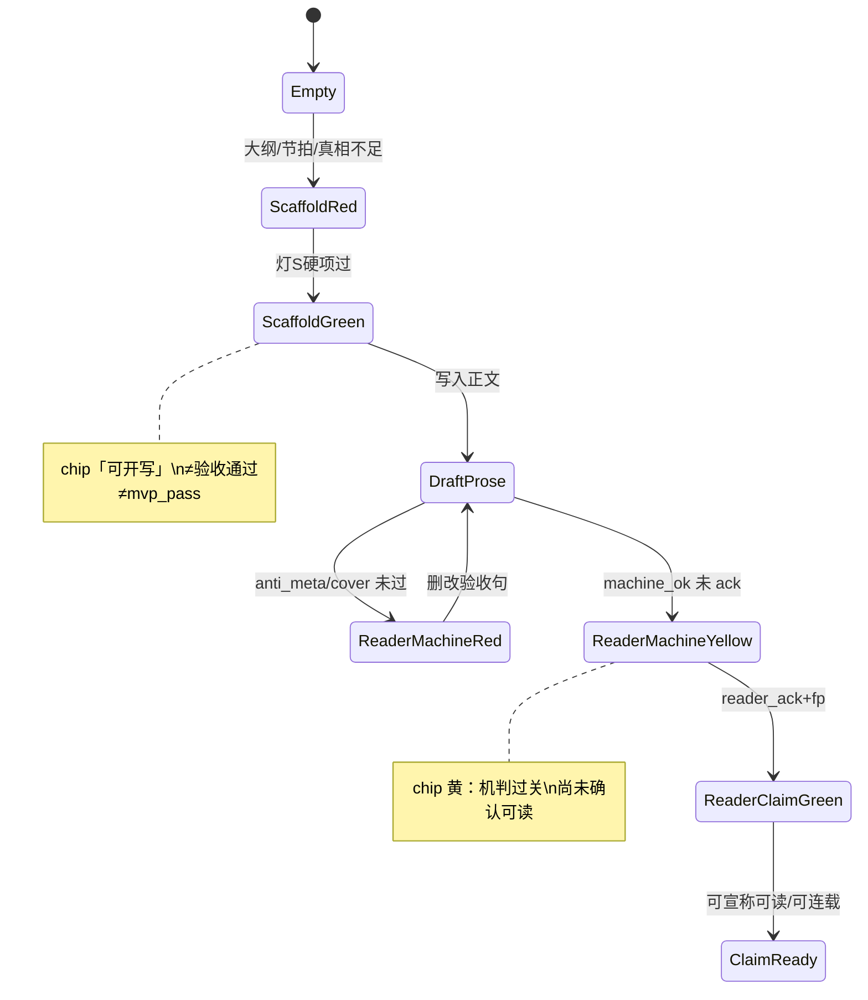
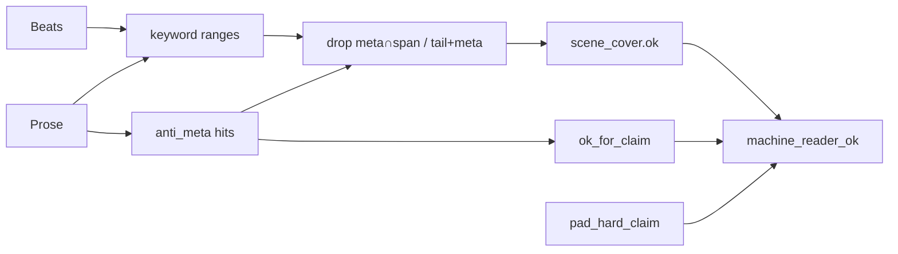

# 工程验收与文学质量解耦（Dual-Lamp · 反元叙事）

| 项 | 值 |
|----|-----|
| **短名** | `dual-lamp` / `acceptance-vs-literary` |
| **文档状态** | Draft · **R2 修订**（评审 `/tmp/grok-1000/grok-design-review-b4f4e6ef.md`） |
| **作者** | Grok Build（design） |
| **日期** | 2026-08-12 |
| **产品** | 铜炉 / tonglu · 代码 `scribe3/` |
| **仓库** | `/home/admin/projects/scribe-writing-system` |
| **协议 SSOT** | `docs/plans/craft-loop.md` Accepted 0.3.1 |
| **触发证据** | `docs/evidence/craft-loop/20260812-book_qe_live5/` · 书 `book_qe_live5` 第二章「齿边」 |
| **验证环境** | **仅已部署 demo**（`https://tonglu.qing.blue`）；禁止 Grok 机全量 `npm ci` / 本机 Surreal / 第二栈 |
| **关联 scratch** | craft-loop 设计 `/tmp/grok-1000/grok-design-doc-b066a1b5.md` |

---

## Overview

craft-loop MVP 在 `book_qe_live5` 上已序贯 **PASS**（CL-B0…B6 green，`prose_cn≈1823`，`gate_b.ok` 真），但第二章「齿边」**文学可读性仅约 5.0–5.5**：前半场面有戏，后半沦为**验收腔 / 元叙事 / 灌字 / 母题 SEO**。机判与人签 hard 把「齐套」当成了写作终点，代理则以最短路径勾选 hard——把协议词（`open`/`touch`/`close`、`信息差维持到章末`、`读者知道…`、`伏笔仍 open`）直接写进正文。

本设计提出一套 **可落地、可接线、可增量合并** 的改进：**双灯（脚手架齐套 vs 读者可读）** + **正文反元叙事闸** + **字数/touch 奖励重标** + **产品级「删验收句再人读」闸**。目标不是把 craft-loop 抬到「human-blind ≥9.5」，而是：

> **机判绿 ≠ 可连载；齐套绿 ≠ 读者可读；禁止用验收话术在正文里刷绿。**

**R1 修订焦点：** 旁表存储、choke point、真值表、is_blocking 陷阱、mvp 不含灯 R。  

**R2 修订焦点（再审 minor）：**

1. **`reader_ready` / post-check 输入契约**：beats / ack / prose 数据源钉死，避免 `scene_cover` 恒 null。  
2. **Milestone-A 只验拒绝路径**；`human_acked=true` 仅持久化旁表；禁止内存骨架；绿路径推荐 PR-5+PR-7a 同发。  
3. **`chapter_reader_ack` UPSERT** 对齐 `chapter_review` record id。  
4. **`prose_fp` 唯一 import** `scribe3.review.fp.prose_fp`。  
5. **M3 文案统一**为条件 claim_blocking。  
6. **H9/claims 机检入口**钉到 `craft_loop_ssot.py` + checklist。  
7. **degen TIER2 双轨**验收标准；**demo migration** 运维一句。

---

## Background & Motivation

### 证据事实（2026-08-12 · book_qe_live5）

| 事实 | 出处 |
|------|------|
| craft-loop MVP `mvp_pass=true`，CL-B5 green，`prose_cn_len=1823` | `docs/evidence/.../PASS.md`、`block-CL-B5/verdict.md` |
| 人 hard H9 签「愿意连载」；运营 G_continue=yes | 同块 `ops-scorecard.md` / `verdict.md` |
| 成稿后半出现协议元叙事 | `machine-ch2-after-prose.json` 正文尾段（见下摘录） |
| F1/F2 `gate_b` synopsis/scene_truth **cn_len≥80 hard** 已 ship | `verify_craft_compliance.CraftGateThresholds`、`chapterContractGate.js` `MIN_WRITABLE_CHARS=80` |
| 字数 hard 仍为 craft-loop **CL-B5-H1 ≥1500** 与 `quality.Q1` | `craft-loop.md`、`verify_content_quality.QualityThresholds`、`scripts/craft_loop_ssot.py` |
| touch 仍为关键词子串 | `promise_touch_soft.prose_touches_promise`、`verify_content_quality` Q4 |

**正文尾段元叙事摘录（问题样本，非规范）：**

```text
信息差维持到章末：缺口露一线，用途不写明。伏笔触碰：齿边、铜匙……
读者知道那是旧库钥匙；他知道；灰狸不知道——这道差……
伏笔仍 open：铜匙齿边缺口要回收——本章只 touch，不 close。
余烬主题在炉灰、温着、铜腥里轻轻回响。
```

前半「假匙挡灰狸 / 冷锅婆压场 / 齿边硌肉」有戏；后半用**验收清单语言**复述 hard 项，字数垫到 ≥1500，touch/母题/信息差机判即可绿。

### 根因 taxonomy（必须对症）

| 码 | 层 | 根因 | 现网表现 |
|----|-----|------|----------|
| **C+P** | 合同 + 产品 | **目标错位**：机判齐套 / 字数≥1500 / 伏笔 touch / 信息差可陈述 被当成写作终点；读者体验不在损失函数 | CL-B5-H1/H7、`quality.Q1`、H9 人签可与文学分脱节 |
| **A** | 代理策略 | **最短路径勾选 hard**：灌字 + 明说信息差 + 抄协议词 | 尾段 SEO 式「伏笔触碰：…」「本章只 touch」 |
| **P+T** | 产品 + 工具 | **无反元叙事闸**：系统不拦验收话术入成稿 | post-check / C-Det / quality 均无协议验收腔 detector（degen meta_leak 仅工程词） |
| **P** | 奖励错位 | gate/craft-loop 绿与「可连载」**混称** | `PASS.md` + H9 愿连载 vs 文学 5.0–5.5 |
| **已修 vs 未修** | — | F1/F2 cn_len≥80 已 ship；字数 hard 仍诱灌水；touch 仍诱关键词；**无读者版/验收版分离** | 本设计主攻未修项 |

### 现网代码锚点（R1 再核实）

| 锚点 | 路径 | 现网行为（本设计接线面） |
|------|------|--------------------------|
| GATE 阈值 | `verify_craft_compliance.CraftGateThresholds` | synopsis/scene_truth min=80；`PASS_FORMULA_KEYS` **不含** word_count |
| 存稿 craft | `evaluate_save_craft_gate` → `misc_routes.save_chapter` | 实质 prose：`len(_strip(prose)) ≥ _PROSE_ENFORCE_MIN`（**80**，strip 后长度）才 enforce A/B；**不查** 1500/元叙事 |
| 存稿质控 | **`check_finalize_for_save`** → **`collect_deterministic_post_for_prose`** → `evaluate_finalize_gate`/`triage` | **每次** save-chapter 都跑（除非 skip/门关）；leaks/degeneration/ai_grade heavy 等可 409 |
| craft stamp | **`try_stamp_kind_final`** | **仅** `evaluate_craft_finalize_gate`（GATE-A/B）；**不**跑 QC triage；`POST /checkpoint?kind=final` 只走此路径 |
| 双门封装 | `check_persist_gates` | craft hard + finalize QC（select_finalize 等） |
| C-Det | `audit_chapter_det` C1/C2/C6/C11 | C11 节拍关键词；&lt;2/3 warn，0 fail；**C10 未实现** |
| 内容质量 | `verify_content_quality` Q1=1500 **hard=True** | `ok = not hard_fails`；与 craft 分离但 craft-loop H7 引用 |
| 前端契约 | `chapterContractGate.js` | 可写≥80 **UI soft error**；**≠** 后端 save craft 同一对象 |
| 执行 soft | `execution_contract.soft_fulfill_drive` | soft_len_floor=2400 + 对白；戏优先 |
| 伏笔 soft | `promise_touch_soft` → `loop.triage` F7 | open 未 touch → advisory；子串即 touch |
| post-check | `api/routers/write.py` `post_check` | 完整检测 + discourse；**无** anti_meta；**存稿不走此端点** |
| 退化 meta | `critique` `_DEGEN_META_TIER1/2_RE` | 工程词（细纲/情节点/章首钩子…）与「读者/伏笔/本章」弱项；**不**覆盖 open/touch/close、信息差维持到章末、伏笔触碰： |
| blocking 谓词 | `review.blocking.is_blocking_issue` | degeneration/pressure + S1/BLOCKING 等 → triage blocking → **save 可 409** |
| 章 meta 白名单 | `store/chapters.update_chapter_meta` | **仅** synopsis/beats/scene_truth/…/narrative_drive/stage_state 等；**无通用 meta map**；**无 reader_ack** |
| 版 stats | `add_chapter_version(..., stats=)` | `chapter_version.stats` option JSON 串 |
| 旁表先例 | `migrations/116_chapter_review.surql` + `store/adapter_ops.upsert_chapter_review` | `UPSERT type::record('chapter_review', $local)`；`local=f"{work}_{seq}"`；`get` by id LIMIT 1 |
| fp SSOT | **`scribe3.review.fp.prose_fp`** | `sha256(utf-8)[:16]`；与 `chapter_analysis._prose_fp` / `ingest._prose_fingerprint` 一致；`assert_parity_with_chapter_analysis` |
| fp 禁止 | `ingest_policy.prose_fingerprint` | **sha256[:32]** — reader_ack / claims **禁止**混用；禁止第三份本地 hashlib 副本 |
| SSOT 机算 | `scripts/craft_loop_ssot.py` | `CL-B5-H1: prose>=1500` 仍绑定 |
| 写 UI | `WriteLayout.jsx` | soft banner / post-check / focusIssue；无双灯 |

---

## Goals & Non-Goals

### Goals

1. **双灯语义**：产品 UI + 机判 API 明确区分  
   - **灯 S（Scaffold）**：脚手架齐套（GATE-A/B、可写字段、节拍…）— 文案「可开写」，**禁止**写「验收通过」  
   - **灯 R（Reader machine）**：机判可读子集（anti_meta + scene_cover + ¬pad_hard_claim）  
   - **宣称可读 / 可连载**：另见 Claims 真值表（需 human_ack）
2. **禁止/软拦元叙事入正文**：协议词与验收清单句不得作为成稿宣称「可读」。
3. **正文门重标**：不以「净文≥1500 充分绿」单独指挥；改为 **场面覆盖 + 禁元话语 + 字数 soft/上限提示**。
4. **伏笔 touch 只认场面痕迹**：禁止正文出现 `open/touch/close` 等协议词刷 touch。
5. **代理/作者路径**：scaffold green 后强制「删验收句 → 人读」；未过宣称闸 **不得宣称可读/可连载**。
6. **可接线真实 choke point**：`collect_deterministic_post_for_prose`、`check_finalize_for_save`、`try_stamp_kind_final`、`post_check`、`WriteLayout`、`promise_touch_soft`。
7. **PR 增量可合并**；demo 冒烟定义清楚；**Milestone-A** 即闭环「不可假宣称」。

### Non-Goals

| # | 非目标 | 理由 |
|---|--------|------|
| NG1 | 用 LLM 文学分自动替代人 H9 | 代理自评假绿 |
| NG2 | 废除 craft-loop / GATE 齐套 | 脚手架仍必需 |
| NG3 | 强制 human-blind ≥9.5 | 产品禁令 |
| NG4 | 把 discourse.* 默认升定稿 blocking | must-keep |
| NG5 | 拆 must-link / project_frame / try_stamp | must-keep |
| NG6 | Grok 机 npm ci / 本机 Surreal / 第二栈 | 资源纪律 |
| NG7 | 一次 PR 重写全部 quality + craft-loop | 增量 |
| NG8 | 把 soft_len_floor=2400 变存稿 hard | 反灌水 |
| NG9 | 把 anti_meta 并入 degen meta_leak 并走 is_blocking_issue | **会 409 一切带验收腔的存稿**，违背 KD2 |
| NG10 | `mvp_pass` 默认吞并灯 R | 脚手架回归与可读宣称分叉（见 KD11） |

---

## Proposed Design

### 1. 一句话架构

```text
灯 S = 工程脚手架（齐套 / 可开写）
灯 R.machine = 机判读者卫生（无验收腔 + 场面覆盖机判 + 非灌水硬疑）
宣称可读 = R.machine ∧ reader_ack(prose_fp)
宣称可连载 = 灯S可宣称 ∧ 宣称可读 ∧ 人 H9
mvp_pass（默认）= 块脚手架 hard，**不含**灯 R
craft_loop_readable_pass = mvp 块序 ∧ may_claim_readable ∧ H9 机检字段
```

### 2. 双灯状态机（含三态可读）



### 3. Claims 真值表（强制 · 防假绿）

```text
# 机判（可自动化、可 HTTP 复现）
anti_meta.ok_for_claim  = 无 severity∈{claim_blocking} 的 hit
                          # severity 默认：
                          #   M1/M2/M6 → claim_blocking
                          #   M3 → **条件** claim_blocking（同句/邻句共现 信息差|伏笔|钥匙|秘密|不知道
                          #         见 §4.2）；无共现 → soft（不单独否决 ok_for_claim）
                          #   M4/M5 → soft
scene_cover.ok          = SC1 有效覆盖 ≥2/3 且 SC3 未因纯尾补/meta 交并否决
                          # 缺 beats/无法算 → ok=null + degraded，**禁止**当 true
pad_hard_claim          = hits_in_tail/max(1,hits_total) ≥ 0.6
                          ∧ hits_total ≥ 2 ∧ cn_len ≥ soft_floor
                          # tail = 文末 25% 字符区间

machine_reader_ok       = anti_meta.ok_for_claim
                          ∧ scene_cover.ok is True
                          ∧ ¬pad_hard_claim
                          ∧ anti_meta 与 scene_cover 均非 degraded 假绿
                          # 注意：scene_cover.ok is null → machine_reader_ok = false
                          # （严格：不得把 null 当 true；也不得静默 skip cover 变绿）

lamps.reader.ok         = machine_reader_ok
                          # 纯机判子灯；**不含** human_ack
lamps.reader.phase      = "red" | "yellow" | "green"
                          # red: ¬machine_reader_ok
                          # yellow: machine_reader_ok ∧ ¬human_acked
                          # green: machine_reader_ok ∧ human_acked ∧ fp_match
                          # Milestone-A：**只保证能到 red 与（有 beats 时）yellow 的判定**；
                          # green **仅**旁表持久化后可达（PR-7）

# 宣称（产品 / craft-loop H9 机检）
human_acked             = chapter_reader_ack 行存在
                          ∧ row.prose_fp == current_fp
                          # current_fp = prose_fp(prose)  # from scribe3.review.fp
                          # **禁止**进程内 dict 作为 demo/生产真源
may_claim_scaffold      = lamps.scaffold.ok
                          # ≠ craft-loop mvp_pass；≠「验收通过」
may_claim_readable      = machine_reader_ok ∧ human_acked
may_claim_serializable  = may_claim_scaffold ∧ may_claim_readable ∧ human_H9
                          # human_H9：人写证据句≥10 字且对证据句 scan_anti_meta 无 claim_blocking

# craft-loop 公式（KD11 已拍板默认）
mvp_pass                = CL-B0…B6 脚手架块 hard 序贯绿（**默认不含灯 R**）
craft_loop_readable_pass = mvp_pass 路径完成
                          ∧ may_claim_readable
                          ∧ CL-B5-H9 人签（证据 checklist 机读 claims 字段）
```

### 3.1 `reader_ready` / 调用方输入契约（R2 · 防 scene_cover 恒 null）

`PostCheckReq` 现网形状：`prose` + `focalizer` + 可选 `seq`/`chapter`（**body 不带 beats**）。  
因此 **beats / open_promises / reader_ack 必须由服务端按 work+seq 从 store 加载**，不得假设客户端上传。

| 调用方 | prose | beats | open_promises | reader_ack / human_acked | scene_cover 期望 |
|--------|-------|-------|---------------|--------------------------|------------------|
| **POST post-check** | `req.prose` | **`st.get_chapter(seq).beats`**（`seq` 来自 query 或 body；无 seq → cover degraded） | 已有 `list_promises` 模式（F7） | **`get_reader_ack(work,seq)`**；表未建/读失败 → `human_acked=false`（不 500） | 有章+beats → 可算 ok true/false；无 beats → `ok=null` + `degraded_stages+=scene_cover` |
| **collect_deterministic_post_for_prose** | 参数 `prose` | **可选**：若调用方传 `st+seq` 则加载 beats 算 cover；存稿默认 **可 skip cover**（只注入 anti_meta 顶键），`lamps.reader` 可缺或 `scene_cover.degraded` | 可选 | **不强制**读 ack（存稿不宣称） | skip 时不得写 `scene_cover.ok=true` |
| **assert_reader_claim** | 参数 | **必须** `st+seq` 加载 beats，**或**显式 `beats=` 传入 | 可选 | **必须** store `get_reader_ack`（`require_ack=True` 时） | 缺 beats → `allowed=false`，`code=reader_claim` / degraded 明细，**不可** machine 黄/绿 |
| **craft_loop_ssot.py** | GET chapter.prose | GET chapter.beats | GET promises | GET ack 或仅导出 claims 占位 | 导出 `scene_cover`/`claims` 字段供 checklist |

**`build_reader_ready` 伪代码（PR-2 必实现）：**

```python
def build_reader_ready(
    prose: str,
    *,
    st=None,
    work: str | None = None,
    seq: int | None = None,
    beats=None,                 # 显式传入优先
    open_promises=None,
    load_ack: bool = True,
    require_scene_cover: bool = True,
) -> dict:
    am = scan_anti_meta(prose)
    degraded = []
    # beats
    if beats is None and st is not None and seq is not None:
        ch = st.get_chapter(int(seq)) or {}
        beats = ch.get("beats")
    if require_scene_cover and not beats:
        sc = {"ok": None, "degraded": True, "reason": "no_beats"}
        degraded.append("scene_cover")
    elif not require_scene_cover and beats is None:
        sc = {"ok": None, "degraded": True, "reason": "cover_skipped"}
        degraded.append("scene_cover")
    else:
        sc = scene_cover(prose, beats, am["hits"])
    # ack — 仅旁表；无表/失败 → false，禁止内存真源
    human_acked = False
    ack_row = None
    if load_ack and st is not None and seq is not None and work:
        try:
            ack_row = st.get_reader_ack(work, int(seq))  # by record id
            from scribe3.review.fp import prose_fp
            human_acked = bool(
                ack_row and (ack_row.get("prose_fp") or "") == prose_fp(prose)
            )
        except Exception:
            degraded.append("reader_ack")
            human_acked = False
    machine_ok = (
        am["ok_for_claim"]
        and sc.get("ok") is True
        and not pad_hard_claim(...)
        and "anti_meta" not in degraded
        and sc.get("degraded") is not True
    )
    # phase / claims …
```

**单测（PR-2 必带）：**

1. post-check 有 seq、章内 beats≥3、无验收腔 → `scene_cover.ok` 为 bool（非 null），可 `phase=yellow`（无 ack）。  
2. post-check **无 seq** 或章无 beats → `scene_cover.ok is null`，`machine_reader_ok is false`，`degraded` 含 `scene_cover`。  
3. 禁止：缺 beats 时 `ok_for_claim`/machine 仍 true（除 `require_scene_cover=False` 且文档声明的 collect 子集）。

**UI 规则：**

| phase | chip 文案 | 颜色 |
|-------|-----------|------|
| red | 可读：未过关 | 红 |
| yellow | 可读：机判过关，请通读确认 | 黄 |
| green | 可读：已确认 | 绿 |

**禁止：** 把 `lamps.reader.ok==true` 单独渲染成「已可读/可连载」而不看 phase / `may_claim_readable`。

**响应形状：**

```python
{
  "lamps": {
    "scaffold": {
      "ok": True,
      "label": "可开写",  # 禁止「验收通过」
      "source": "gate_b+contract_ui",  # 声明聚合源；≠ craft-loop 块 green
      "blocking": [],
    },
    "reader": {
      "ok": False,           # == machine_reader_ok
      "phase": "red",        # red|yellow|green
      "label": "可读",
      "blocking": ["anti_meta.M2"],
      "soft": ["anti_meta.M3", "length.below_soft_floor"],
      "human_ack_required": True,
      "human_acked": False,
      "degraded": [],        # 非空时 ok 不得为 true
    },
  },
  "claims": {
    "may_claim_scaffold": True,
    "may_claim_readable": False,
    "may_claim_serializable": False,
  },
  "anti_meta": { "ok_for_claim": False, "hits": [...] },
  "scene_cover": { "ok": True, "beat_ratio": 0.67, "invalidated": [] },
  "length_policy": { "cn_len": 1823, "soft_floor": 800, "pad_hard_claim": False, "pad_suspect": True },
}
```

### 4. 反元叙事闸（Anti-Meta）

#### 4.1 模块与导出结构（PR-1 稳定 API）

**路径：** `scribe3/anti_meta_narration.py`（零 store IO）

```python
@dataclass
class AntiMetaHit:
    id: str          # M1…M6
    start: int       # prose 内 [start,end)
    end: int
    quote: str       # ≤80
    severity: str    # "claim_blocking" | "soft"
    message_zh: str  # 中文人话，无 GATE 黑话

def scan_anti_meta(prose: str) -> dict:
    """返回 {
      hits: list[AntiMetaHit-as-dict],
      ok_for_claim: bool,
      claim_blocking_ids: list[str],
    }"""

def is_meta_span(prose: str, i: int, j: int, hits: list | None = None) -> bool:
    """区间 [i,j) 是否与任一 claim_blocking hit 相交；hits 可传入避免重扫。"""
```

**句/段切分（`is_meta_span` / touch / SC3 共用）：**

1. 段：`re.split(r"\n\s*\n", prose)`；若无空行，则按单 `\n` 为弱段。  
2. 句：在段内按 `[。！？…\n]` 切；保留分隔符归属前句。  
3. hit 的 start/end 为全文 offset；span 相交：`not (end<=hs or j<=he)`。

#### 4.2 规则分级与短语初表

| ID | 模式 | 初表 / 正则（可复制） | R1 severity |
|----|------|----------------------|-------------|
| **M1** | 协议状态词 | `(?i)(?<![A-Za-z])(open|touch|close)(?![A-Za-z])` 且同句含 `伏笔\|信息差\|回收\|本章`；或中文 `伏笔仍\s*open` / `只\s*touch` / `不\s*close` / `本章只\s*touch` | **claim_blocking** |
| **M2** | 验收清单腔 | `伏笔触碰\s*[:：]` / `信息差维持到章末` / `信息差钉在` / `一一落在读者可感` / `可追踪钩子` | **claim_blocking** |
| **M3** | 读者元叙事 | `读者知道` / `读者已知` / `读者可感`。**判定（与 §3 总述一致，禁止「M3 全 soft」误读）**：同句或邻句（前后各 40 字）含 `信息差\|伏笔\|钥匙\|秘密\|不知道` → **claim_blocking**（齿边「读者知道…灰狸不知道」正样本必须命中）；**无共现** → **soft only**（「读者须知：附录」类不单独否决 `ok_for_claim`） | **条件 claim_blocking** |
| **M4** | 章结构报幕 | `章末钩子悬着` / `本章不揭` / `回收尚未到来` | **soft** |
| **M5** | 母题 SEO | `主题在.{0,20}轻轻回响` 或 同句顿号枚举≥3 个已知 motif token | **soft** |
| **M6** | 黑话堆叠 | 同段同时 ≥2 个标记词：`信息差\|伏笔\|touch\|open\|close\|回收`（中英） | **claim_blocking** |

**正样本（PR-1 必过）：** `machine-ch2-after-prose.json` 尾段 → 至少命中 M1、M2、M3、M6 中约定集合（设计约定：`hits` 含 M2「信息差维持到章末」、M1/M6「touch/close/open」、M3「读者知道」）。

**负样本（PR-1 必过 · 不得 claim_blocking）：**

| 正文片段 | 期望 |
|----------|------|
| `他推开门，走进炉房。` | 无 hit |
| 对话：`「Open the door,」灰狸说。`（无伏笔邻域） | 无 M1 claim_blocking |
| `章末他仍未揭开匙的用途。`（叙事，无「钩子悬着」） | 无 M4 或仅 soft 且不挡 claim |
| `冷锅婆不知道炉里藏着什么。`（无「读者知道」） | 无 M3 |
| `读者须知：本卷地图见附录。`（无信息差/伏笔共现） | M3 **soft 或未命中 claim**，不单独否决 ok_for_claim |

#### 4.3 与 `find_degeneration` meta_leak 的分工

| 轨 | 覆盖 | 默认进 save blocking? |
|----|------|----------------------|
| **degen meta_leak** | 工程词：细纲、情节点、字数目标、章首/章尾钩子…；**TIER2**（`_DEGEN_META_TIER2_RE`）含 `本章\|伏笔\|读者|…`，**现网恒 advisory** | degeneration 且 severity blocking/S1 时 **会** 经 `is_blocking_issue` → save 可 409；**TIER2 单独不会 409** |
| **anti_meta** | **协议/验收腔**：open/touch/close、信息差维持到章末、伏笔触碰：、清单式触碰 | **永不**默认进 `is_blocking_issue` |

**UI：** 可合并展示，severity 取严；**计数去重**：同一 range 交并时优先展示 anti_meta 文案（更贴产品），degen 不重复弹两条。

**双轨噪音验收标准（PR-2b / PR-2 单测 · R2）：**

1. 正文仅含叙事「读者/伏笔/本章」、**无** M1/M2/M6 且 M3 无共现 → `anti_meta.ok_for_claim=true`；`assert_reader_claim` **不因** degen TIER2 失败（degen 仍可 advisory 列表出现）。  
2. 同 range 同时命中 anti_meta 与 degen meta_leak → 产品 issues **展示条数 ≤1**（合并或抑 degen）。  
3. save-chapter 带上述「仅 TIER2 叙事」正文 → **默认 200**（不被 tier2 单独升级 blocking）。  
4. 齿边尾段仍可同时有 degen advisory + anti_meta claim_blocking；**宣称**只看 anti_meta/reader_ready。

**禁止 Alt-E：** 把验收腔短语并入 `_DEGEN_META_TIER1_RE`（见 Alternatives）。

#### 4.4 路径策略与 `is_blocking_issue` 陷阱（关键）

```text
anti_meta issues 写入 post 时：
  type = "anti_meta"
  meta.severity = "advisory" | "claim_blocking"
  # claim_blocking **不是** S1，也 **不是** degeneration/pressure
  # → is_blocking_issue(...) == False 恒成立（当前谓词）
  # 禁止把 severity 设为 "S1"/"BLOCKING" 以「图省事」——会污染 save 409
```

| 路径 | 灯 S / craft | anti_meta / 灯 R |
|------|----------------|------------------|
| **save-chapter 草稿** | `evaluate_save_craft_gate`；+ **已有** `check_finalize_for_save`（leaks 等可 409） | 在 `collect_deterministic_post_for_prose` **注入** `anti_meta` 顶键 + issues(advisory)；**仅** warnings/advisory_items；**不** 409（`BLOCK_SAVE` 默认 0） |
| **post-check** | 不直接门禁 | 顶键完整 lamps/claims；供 UI |
| **标记可读 / H9 机检** | 需 scaffold | 调用 **`assert_reader_claim(post|prose)→`** 独立检查；失败 409 `code=reader_claim` |
| **checkpoint kind=final** | **仅** `try_stamp_kind_final` = craft A/B | **默认不跑** anti_meta；文档诚实：**stamp ≠ 可读宣称**。可选 flag `SCRIBE3_ANTI_META_ON_STAMP=0` 默认关；若开则在 stamp 前调 `assert_reader_claim`（**不**经 is_blocking_issue） |
| **select_finalize / check_persist_gates** | craft + QC | QC 路径同 collect；claim 仍不自动 409，除非调用方显式 claim 模式 |

**Flag：**

| Flag | 默认 | 含义 |
|------|------|------|
| `SCRIBE3_ANTI_META` | `1` | 检测 on，进 post / collect 顶键 |
| `SCRIBE3_ANTI_META_BLOCK_CLAIM` | `1` | `assert_reader_claim` 与 H9 机检生效 |
| `SCRIBE3_ANTI_META_BLOCK_SAVE` | `0` | 存草稿也 409（默认关） |
| `SCRIBE3_ANTI_META_ON_STAMP` | `0` | kind=final stamp 前 claim 检查（默认关，避免与「stamp≠可读」混淆） |

**`assert_reader_claim` 伪代码：**

```python
def assert_reader_claim(
    prose,
    *,
    st,
    work: str,
    seq: int,
    require_ack: bool = True,
    beats=None,
) -> dict:
    """宣称可读硬门。必须 st+work+seq（或显式 beats）以便 scene_cover / ack。
    纯 prose、无 store → 不得返回 allowed=true。"""
    rr = build_reader_ready(
        prose, st=st, work=work, seq=seq, beats=beats,
        load_ack=require_ack, require_scene_cover=True,
    )
    if not rr["machine_reader_ok"]:
        return {
            "allowed": False, "code": "reader_claim",
            "detail": "正文未过可读机判（验收腔或场面未覆盖）",
            "blocking": rr.get("blocking") or [],
            "reader_ready": rr,
        }
    if require_ack and not rr["human_acked"]:
        return {
            "allowed": False, "code": "reader_ack_required",
            "detail": "请像读者一样通读并确认（尚未确认或正文已改）",
            "reader_ready": rr,
        }
    return {"allowed": True, "code": "ok", "reader_ready": rr}
```

### 5. 正文门：场面覆盖 + 字数策略

#### 5.1 废弃「≥1500 单独充分绿」与 H7 连锁

| 组件 | 现状 | 目标（PR-4 **同步**交付） |
|------|------|---------------------------|
| craft-loop **CL-B5-H1** | 净文≥1500 hard | **H1-cover** 场面覆盖；**H1-length** soft 记录；**H1m** anti_meta 机判 |
| **CL-B5-H7** | `review_chapter_quality` hard 通过 | 改为 **reader_ready 子集 hard**（anti_meta.ok_for_claim ∧ scene_cover.ok）；**不再**等于旧 quality hard 列表全过 |
| `quality.Q1` | hard min=1500 | `hard=False`；长度进 `length_policy` soft |
| `quality_ok` | hard_fails 含 Q1 | **长度不再单独否决**；注释写明 |
| `craft_loop_ssot.py` | `prose>=1500→H1` | 删除；导出 `length_soft` / `anti_meta` / `scene_cover`（人 hard 未机签则字段仍导出） |
| `brief.py` 平台带 1500–2500 | 参考 | 保留为 **target 提示带**；产品文案区分 soft_floor=800「可能偏短」vs 平台目标，**不**把 1500 当 hard 绿 |

**LengthPolicy 伪代码：**

```text
soft_floor = 800
target_band = [1500, 5500]          # 提示，非 hard
pad_suspect = cn_len >= 1500 and len(anti_meta.hits) >= 1
pad_hard_claim =
    hits_total = count(claim_blocking hits)  # 或全部 hits，实现钉 claim_blocking
    hits_in_tail = count(hits whose start >= floor(0.75 * len(prose)))
    hits_in_tail / max(1, hits_total) >= 0.6
    and hits_total >= 2
    and cn_len >= soft_floor
```

#### 5.2 场面覆盖（Scene Cover）— 局限诚实

**SC1 不能证明文学质量**，只能挡「零覆盖 / 纯尾补 / meta 段刷关键词」。灯 R 仍依赖 anti_meta + 人 ack。

| 检查 | 规格 | hard? |
|------|------|-------|
| **SC1** | 复用 C11 思路：节拍 text 前缀/分词在 prose 中定位 range；有效命中数 / beats ≥ 2/3 | 灯 R hard（**不**改 GATE-C 主报告：C11 仍 warn） |
| **SC3** | `tail_ratio=0.25`：命中 range 与任一 **claim_blocking** anti_meta hit 相交 → **无效**；若命中仅落在文末 25% 且同段 meta → **无效** | 计入有效覆盖 |
| **SC2** | 大纲情节点 | 仍人 hard（C10 未实现） |

```python
def scene_cover(prose, beats, anti_meta_hits) -> dict:
    if beats is None:
        return {"ok": None, "degraded": True, "reason": "no_beats"}
    # 禁止：缺数据时 ok=True
    valid = 0
    for b in beats:
        ranges = find_keyword_ranges(prose, b)
        ranges = [r for r in ranges if not is_meta_span(prose, r[0], r[1], anti_meta_hits)]
        ranges = [r for r in ranges if not (tail_only(r) and near_meta(r))]
        if ranges:
            valid += 1
    ratio = valid / max(1, len(beats))
    return {"ok": ratio >= 2/3, "beat_ratio": ratio, "valid": valid, "total": len(beats)}
```



### 6. 伏笔 touch：只认场面痕迹

`promise_touch_soft.py`：

```python
def prose_touches_promise_scene(prose, promise_text, *, anti_hits=None) -> tuple[bool, str]:
    # 1) 关键词命中位置
    # 2) 所在句/段若 is_meta_span → (False, "meta_span")
    # 3) SEO 列举：句内顿号/逗号分隔 token≥3 且 无一动词性谓语启发式
    #    （简单：无 [着了过]|是|在|把|被|说|看|摸|推|藏）→ (False, "seo_list")
    # 4) else (True, "scene")
```

`open_promise_touch_advisories` 改用 scene 版；message：`伏笔还没有写进场面里（列举或验收句不算）`。  
PR-1 须导出 `hit_spans` / `is_meta_span` 供 PR-3 共享。

### 7. 代理 / 作者路径与 reader_ack 存储（真实模型）

#### 7.1 产品流

同前：post-check/collect → 高亮 hits → 编辑 → machine yellow → **reader_ack** → green claim。

#### 7.2 存储决策（强制 · R2 对齐 chapter_review UPSERT）

**禁止：**

- `chapter.meta.reader_ack` / 无 migration 通用 meta map  
- **进程内 dict / 内存骨架** 作为 demo 或生产 `human_acked` 真源（多 worker / hot 后间歇假绿假红）

**采纳组合：**

| 层 | 方案 | 用途 |
|----|------|------|
| **主路径 PR-7a** | 旁表 **`chapter_reader_ack`**，**UPSERT by record id**（镜像 `upsert_chapter_review`） | 唯一真源；跨进程 |
| **可选增强** | `chapter_version.stats.reader_ack` 在 final stamp 时快照 | 审计，非唯一真源 |
| **替代** | migration 章列 `chapter.reader_ack` + 扩展 `update_chapter_meta` allowed | 与旁表二选一；仍须 UPSERT/单行语义 |

**旁表 schema + UPSERT 语义（对齐 `adapter_ops.upsert_chapter_review`）：**

```surql
-- migrations/1xx_chapter_reader_ack.surql
DEFINE TABLE IF NOT EXISTS chapter_reader_ack SCHEMALESS;
DEFINE FIELD IF NOT EXISTS work ON chapter_reader_ack TYPE option<string>;
DEFINE FIELD IF NOT EXISTS seq ON chapter_reader_ack TYPE option<int>;
DEFINE FIELD IF NOT EXISTS prose_fp ON chapter_reader_ack TYPE option<string>;
DEFINE FIELD IF NOT EXISTS note ON chapter_reader_ack TYPE option<string>;
DEFINE FIELD IF NOT EXISTS by_user ON chapter_reader_ack TYPE option<string>;
DEFINE FIELD IF NOT EXISTS created_at ON chapter_reader_ack TYPE option<datetime>;
-- 次要索引（查询兜底）；**行唯一性靠 record id，不靠此索引**
DEFINE INDEX IF NOT EXISTS idx_reader_ack_work_seq ON chapter_reader_ack FIELDS work, seq;
```

```python
# store 对齐 chapter_review 模式（review/snapshot.py）
def _reader_ack_local(work: str, seq: int) -> str:
    return f"{work}_{int(seq)}".replace(":", "_")

def upsert_reader_ack(self, work: str, seq: int, *, prose_fp: str, note: str, by_user: str) -> None:
    local = _reader_ack_local(work, seq)
    self._execute_write(
        "UPSERT type::record('chapter_reader_ack', $local) SET "
        "work=$work, seq=$seq, prose_fp=$fp, note=$note, "
        "by_user=$by, created_at=time::now()",
        {"local": local, "work": work, "seq": int(seq),
         "fp": prose_fp, "note": note, "by": by_user},
    )

def get_reader_ack(self, work: str, seq: int) -> dict | None:
    local = _reader_ack_local(work, seq)
    rows = self._query(
        "SELECT * FROM type::record('chapter_reader_ack', $local) LIMIT 1",
        {"local": local},
    ) or []
    return rows[0] if rows else None
    # 可选兜底：SELECT … WHERE work=$w AND seq=$s ORDER BY created_at DESC LIMIT 1
```

**prose_fp SSOT（钉死 · 唯一 import）：**

```python
# 所有 ack / claims / evidence 路径：
from scribe3.review.fp import prose_fp
# 可选启动断言：assert_parity_with_chapter_analysis()

# 禁止：
# - hashlib.sha256(...)[:16] 本地副本
# - ingest_policy.prose_fingerprint（[:32]）
# - 第三份「prose_fp_reader_ack」包装（应 re-export prose_fp）
```

**表未就绪：** `get`/`upsert` 失败 → fail-soft：`human_acked=false`；API 返回中文 **「读者确认存储未就绪」**（503 或 200+degraded，ack POST 用 503）；**不得**静默内存成功。

**鉴权：** cookie 会话；work ownership 同 save-chapter；401/403 冒烟。**禁止** emergency REST 代签 ack。

#### 7.3 代理约束与 H9 / claims 机检入口（R2 钉命令）

| 规则 | 机检字段 |
|------|----------|
| `author_human=false` 不可代签灯 R | `reader_ack.by_user` ∉ `{agent, drive-to-block, …}`；ack API 拒绝非交互头 |
| H9 不得 PASS 若 `may_claim_readable=false` | 见下 **ssot + checklist** |
| 证据包 | `block-CL-B5/machine/reader-ready.json` |

**落地入口（PR-4 / PR-8 · 不必新 runtime）：**

1. **扩展** `scripts/craft_loop_ssot.py`（只读 GET，现有 cookie 模式）：  
   - 拉取 chapter / 可选 post-check 或本地 `scan_anti_meta`+`scene_cover`（若脚本侧 import 纯函数，优先纯函数避免写路径）。  
   - 导出字段：`anti_meta`、`scene_cover`、`claims.may_claim_readable`、`claims.may_claim_serializable`、`lamps.reader.phase`、`prose_fp`。  
   - **删除** `CL-B5-H1: prose>=1500` 单独 True。  
2. **evidence checklist**（`block-CL-B5/checklist.json` 或 `verdict.md` 机读行）：  
   - `may_claim_readable` 字段**必须存在**；  
   - `CL-B5-H9=PASS` **仅当** `may_claim_readable===true` 且 H9 证据句 ≥10 字且证据句无 claim_blocking anti_meta；  
   - 否则 H9 机检 FAIL（人不得口头绿）。  
3. 打包命令示例：  
   `python3 scripts/craft_loop_ssot.py --work W --seq N --out block-CL-B5/machine/reader-ready.json`

**evidence schema 示例：**

```json
{
  "work": "book_qe_live5",
  "seq": 2,
  "prose_fp": "a1b2c3d4e5f67890",
  "lamps": { "scaffold": { "ok": true }, "reader": { "ok": false, "phase": "red" } },
  "claims": { "may_claim_readable": false, "may_claim_serializable": false },
  "anti_meta": { "ok_for_claim": false, "hits": [{ "id": "M2", "start": 0, "end": 10, "quote": "…" }] },
  "scene_cover": { "ok": true, "beat_ratio": 0.67 },
  "mvp_pass_note": "mvp_pass 不含灯R；本文件用于 craft_loop_readable_pass",
  "disclaimer": [
    "craft-loop PASS ≠ 50k-e2e",
    "gate_*.ok ≠ 块 hard",
    "灯S ≠ 灯R ≠ 可连载",
    "字数≥1500 ≠ 可读"
  ]
}
```

### 8. 接线表（真实 choke point）

| 模块 | 改动 | 说明 |
|------|------|------|
| `anti_meta_narration.py` | **新增** | hits + is_meta_span + ok_for_claim |
| `reader_ready.py` | **新增** | `build_reader_ready` + §3.1 输入契约；缺 beats degraded |
| `promise_touch_soft.py` | 改 | scene touch |
| `finalize_gate.collect_deterministic_post_for_prose` | **改（主注入点）** | 注入 anti_meta；cover 可选 skip；**不** is_blocking |
| `finalize_gate.check_finalize_for_save` | 透传 | triage；anti_meta 不进 blocking |
| `assert_reader_claim`（`reader_ready.py`） | **新增** | 必须 st+work+seq 或显式 beats |
| `try_stamp_kind_final` | 可选 ON_STAMP | 默认 craft-only；stamp≠可读 |
| `write.post_check` | 改 | 按 §3.1 从 store 加载 beats/ack；完整 lamps |
| `loop.triage` | 改 | anti_meta → advisory only |
| `verify_content_quality` | 改 | Q1 soft；H7 解耦 |
| `store/adapter_ops` + migration | **新增** | UPSERT `chapter_reader_ack:{work}_{seq}` |
| `scripts/craft_loop_ssot.py` | 改 | 脱钩 1500；导出 claims/anti_meta/scene_cover |
| `docs/plans/craft-loop.md` | 补丁 | 双公式 + H9 机检 claims |
| `feature_flags.py` | 改 | ANTI_META* |
| **fp 唯一 import** | `from scribe3.review.fp import prose_fp` | 禁止本地 hashlib 副本 |

---

## API / Interface Changes

### POST `/api/post-check`（扩展）

见 §3 响应形状；旧客户端忽略新顶键。

**服务端必须（§3.1）：** 解析 `seq`（query 或 body）→ `st.get_chapter(seq)` 取 **beats**；`list_promises` 取 open；`get_reader_ack` 取 ack（表缺失 → acked=false）；`prose` **仅**来自 `req.prose`（不与库内 prose 静默替换，除非产品另有「以库为准」模式——本设计默认 body prose）。

### `collect_deterministic_post_for_prose`（存稿同源）

```python
post["anti_meta"] = scan_anti_meta(prose)
post["prose"] = prose
# 若 st+seq 可用：可算 scene_cover；否则 cover_skipped，禁止 ok=true
# 不读 ack；不写 may_claim_readable=true
# anti_meta issues: type=anti_meta, meta.severity=advisory|claim_blocking 但非 S1
```

### POST 标记可读 / reader-ack

`POST /api/chapter/reader-ack?work=&seq=`  

Body: `{ "note": "已通读", "prose_fp": "<16 hex>" }`  

- 401 未登录；403 无 work 权；409 fp 不匹配当前 prose  
- 成功：upsert `chapter_reader_ack`  
- **内部**可先 `assert_reader_claim(..., require_ack=False)` 确保 machine_ok，否则 409 `reader_claim`（避免对红灯正文点确认）

### GET `/api/craft-gates`

**不**把 reader 塞进 `gate_b.ok`。可选并列只读 `reader_ready` 摘要。

### 前端映射

| 后端 | `readerReadyGate.js` |
|------|----------------------|
| `lamps.reader.phase` | chip 三态 |
| `anti_meta.hits[].start/end` | focusIssue range |
| `claims.may_claim_readable` | 禁用「标记可连载」按钮 |
| 缺 `lamps` | fail-soft 不渲染灯 R，**不**显示假绿 |

---

## Data Model Changes

| 变更 | 策略 |
|------|------|
| **`chapter_reader_ack` 旁表** | migration + store API（主路径） |
| 可选 `chapter_version.stats.reader_ack` | stamp 时快照，非唯一真源 |
| **禁止**无 migration 写虚构 `chapter.meta` | — |
| 若选章列 | `DEFINE FIELD reader_ack ON chapter` + **扩展** `update_chapter_meta` allowed — 与旁表二选一 |
| prose_fp | **仅** `sha256(utf-8)[:16]` |

**回滚：** 关 flag；旁表可留只读。

---

## Alternatives Considered

### Alt-A · LLM 文学分门 — **否**

贵、不稳、可刷分；触 ≥9.5 禁令张力。

### Alt-B · 抬字数 hard — **否**

齿边 1823 已过 1500；激励灌水。

### Alt-C · 仅改 craft-loop 人文案 — **不足**

代理不收敛；H9 可误签。

### Alt-D · 本设计（双灯 + anti_meta + touch 场面 + 字数 soft）— **采纳**

### Alt-E · 扩 `_DEGEN_META_TIER1_RE` 纳入验收腔 — **否**

degeneration 可经 `is_blocking_issue` **409 存稿**；与 KD2 冲突；领域应独立 anti_meta，severity 不走 S1。

### Alt-F · 仅 UI 高亮 + 不改 ssot — **R0 观察可**，**不替代**本设计

可作 Milestone-A 前的手工周，但不能关闭「假宣称」路径。

---

## Security & Privacy Considerations

| 风险 | 严重度 | 缓解 |
|------|--------|------|
| 误杀正当「读者*」 | 中 | M3 共现收窄；R1 soft 观察；作品白名单后续 |
| 谐音绕表 | 中 | M6 密度 + pad_hard_claim |
| reader_ack 伪造 | 中 | 登录 cookie 会话；work ownership；fp 绑定；拒绝 emergency 代签 |
| CSRF | 低 | 与现网同站 cookie API 一致 |
| 日志全文 | 低 | quote≤80 |
| anti_meta 误入 is_blocking | **高** | 规范 + code review 清单；单测 `is_blocking_issue(anti_meta_issue)==False` |

---

## Observability

| 信号 | 用途 |
|------|------|
| `anti_meta.hit_count` / by rule | 回归 |
| `lamps.reader.phase` 分布 | 过严/过松 |
| `pad_hard_claim` 率 | 灌字 |
| `promise_touch` meta_span 拒绝 | 刷 touch |
| `reader_ack` vs final stamp 漏斗 | 产品路径 |
| `degraded_stages` 含 anti_meta/scene_cover | **不得**假绿 machine_ok |

---

## Rollout Plan

### 阶段

| 阶段 | 内容 | Flag |
|------|------|------|
| **R0** | 检测器 + 正负样本单测 | soft only |
| **R1** | collect + post-check 顶键 + UI 三态（可无 ack） | ANTI_META=1，BLOCK_CLAIM=0 观察 |
| **R2** | assert_reader_claim + BLOCK_CLAIM=1 | 标记可读硬 |
| **R3** | touch scene + 字数/ssot + 协议 | — |
| **R4** | reader_ack 旁表 + 黄→绿 | — |

### Milestone（R2 钉边界）

| Milestone | PR | demo 能力 |
|-----------|-----|-----------|
| **A · 不可假宣称（只验拒绝）** | PR-1 + PR-2 + PR-2b + PR-5 | **仅**验收：`reader_claim` / `reader_ack_required` / `may_claim_readable=false`；有 beats 时可观测 **yellow**；**不**宣称 A 阶段可点绿；**禁止**内存 dict 顶替 ack |
| **A′ · 可选绿路径同发** | **推荐 PR-5 与 PR-7a（migration+UPSERT）同发** | 若需冒烟 yellow→green，**必须**旁表持久化；否则拆到 B |
| **B · 产品确认** | PR-6 UI + PR-7（若未进 A′） | 三态 chip + 确认绿 |
| **C · 协议** | PR-3 + PR-4 + PR-8 | ssot/H7/H9/claims checklist |

### 部署与回滚

- `deploy_demo.sh hot` / `frontend`  
- Flag 全 0 回滚行为；顶键可残留  

### Demo 冒烟（强制 · cookie）

复用 `scripts/craft_loop_ssot.py` 约定：`API_BASE` + `SCRIBE3_COOKIE_JAR`（Mozilla cookie jar）。

1. `GET /api/health` → ok  
2. 登录 cookie 有效；无 cookie → 写路径 401  
3. `POST /api/post-check?seq=N` 带齿边验收腔 + **库内章有 beats** → `anti_meta.hits≥1`，`may_claim_readable=false`，`phase=red`；`scene_cover` 非「静默缺省 true」  
4. 删验收句后再 post-check（仍有 beats）→ claim_blocking=0；`phase` **至多 yellow**（Milestone-A **不要求** green）  
5. **Milestone-A 宣称拒绝路径**：标记可读 / `assert_reader_claim` 在红 → **409** `reader_claim`；在 yellow 无 ack → **409** `reader_ack_required`。**A 阶段不测 green 成功。**  
6. **save-chapter** 带验收腔 → **默认 200**；warnings 可见；anti_meta 不单独 409；仅 TIER2「读者/伏笔/本章」叙事仍 200  
7. **checkpoint kind=final** → craft-only 默认不因 anti_meta 失败  
8. **PR-7 / A′ 后**：migrate 旁表存在；ack POST 成功 → `phase=green`；改 prose 后 ack 失效  
9. **migration 运维**：`deploy_demo.sh hot` **不保证**自动跑 Surreal migration。PR-7 冒烟前检查表/记录 id 可 UPSERT；失败文案 **「读者确认存储未就绪」**；full/server-git 或显式 migrate 步骤写入 PR-7 清单  
10. `promise_mode=omit`；emergency 不得代签 ack；**不** Grok 机 npm/Surreal/第二栈  
11. `python3 scripts/craft_loop_ssot.py …` 导出含 `claims`；H9 模拟：`may_claim_readable=false` 时 checklist 不得签 H9=PASS

---

## Risks

| 风险 | 严重度 | 缓解 |
|------|--------|------|
| 短语表漏网 | 中 | 证据加表；M6+pad |
| 误杀 | 中 | 不挡存稿；M3 收窄；负样本 |
| 实现者把 anti_meta 标 S1 | **高** | §4.4 陷阱；单测 is_blocking |
| C11 关键词仍可前 75% 清单刷 | 中 | SC3 meta 交并；诚实局限；人 ack |
| H1 协议变更旧 evidence | 低 | 四行 disclaimer；不重写历史 PASS |
| 双灯 UI 复杂度 | 低 | 三态 chip + banner |
| `mvp_pass` 与可连载话术分叉 | 中 | KD11 双公式；PASS.md 第四节 |

---

## Open Questions

1. **存草稿 hard 拦验收腔？** → **默认否**（`BLOCK_SAVE=0`）。导出读者版/发布走 `assert_reader_claim`。若代理大量只存不宣称，产品可后续开 BLOCK_SAVE——**非本设计默认**。  
2. **reader_ack 可否 skip？** → 允许 skip with reason，则 `may_claim_readable` 仍 false；可继续改稿。  
3. **soft_floor=800 类型文例外？** → 作品级设置预留；MVP 全局 800。  
4. **M4 软硬？** → 保持 soft。  
5. **mvp_pass 是否含灯 R？** → **已拍板默认：否**。见 KD11；`craft_loop_readable_pass` 另计。用户若改口「mvp 必须 H1m」可升 patch，但不默认。

---

## Key Decisions

| # | 决策 | Rationale |
|---|------|-----------|
| KD1 | 双灯正交；不把可读塞进 `gate_b.ok` | 防假绿；PASS_FORMULA 契约 |
| KD2 | 存稿 anti_meta **soft**；宣称路径 hard | 不打断写作；堵混称 |
| KD3 | 废除「≥1500 充分绿」 | 齿边证伪 |
| KD4 | touch 不计 meta/SEO | 断关键词刷 |
| KD5 | 人读 ack 绑定 **`from scribe3.review.fp import prose_fp`**（[:16]） | 唯一 import；禁 [:32] 与本地 hashlib 副本 |
| KD6 | 纯函数模块 + post/collect 顶键 | 与 discourse/degen 分离 |
| KD7 | craft-loop H1/H7/H9 + 第四 disclaimer | 协议机判一致 |
| KD8 | 仅 demo 冒烟 | 资源纪律 |
| KD9 | 中文产品文案；scaffold=「可开写」 | must-keep；禁「验收通过」 |
| KD10 | 不引入 LLM 文学 hard | 可回归 |
| KD11 | **`mvp_pass` 不含灯 R**；新增 **`craft_loop_readable_pass`** | 脚手架可回归；可连载另证 |
| KD12 | **reader_ack → 旁表 UPSERT `chapter_reader_ack:{work}_{seq}`**；禁止虚构 meta 与内存真源 | 对齐 `upsert_chapter_review` |
| KD13 | **主注入点 `collect_deterministic_post_for_prose`**；claim 用 `assert_reader_claim` | 对齐 save/finalize 真路径 |
| KD14 | **anti_meta 永不默认 `is_blocking_issue`** | 防止 save 409 陷阱 |
| KD15 | `lamps.reader.ok` = 机判 only；宣称看 `may_claim_readable` + phase 三态 | 防「绿灯假可读」 |
| KD16 | `try_stamp_kind_final` 默认仍 craft-only；stamp≠可读宣称 | 诚实语义；可选 ON_STAMP |
| KD17 | **post-check 必须 store 加载 beats**（body 无 beats） | 防 scene_cover 恒 null |
| KD18 | **Milestone-A 只验拒绝路径**；green 需 PR-7 持久化（推荐与 PR-5 同发） | 多进程语义诚实 |
| KD19 | **H9 机检入口 = craft_loop_ssot 导出 claims + checklist** | 防口头签 H9 |

---

## References

- `docs/plans/craft-loop.md` Accepted 0.3.1  
- `docs/evidence/craft-loop/20260812-book_qe_live5/`  
- `scribe3/verify_craft_compliance.py` — thresholds、`evaluate_save_craft_gate`、`_PROSE_ENFORCE_MIN`  
- `scribe3/finalize_gate.py` — `check_finalize_for_save`、`collect_deterministic_post_for_prose`、`try_stamp_kind_final`、`check_persist_gates`  
- `scribe3/review/blocking.py` — `is_blocking_issue`  
- `scribe3/store/chapters.py` — `update_chapter_meta` allowed 白名单；`add_chapter_version` stats  
- `scribe3/review/fp.py` — **`prose_fp` SSOT** + `assert_parity_with_chapter_analysis`  
- `scribe3/chapter_analysis.py` — `_prose_fp`（parity 目标）  
- `scribe3/ingest.py` — `_prose_fingerprint` [:16]  
- `scribe3/ingest_policy.py` — `prose_fingerprint` [:32]（**勿混用**）  
- `scribe3/migrations/116_chapter_review.surql`  
- `scribe3/store/adapter_ops.py` — `upsert_chapter_review` / `get_chapter_review_row`  
- `scribe3/review/snapshot.py` — `local=f"{work}_{seq}"`  
- `scribe3/api/models.py` — `PostCheckReq`（无 beats 字段）
- `scribe3/critique/_common.py` — `_DEGEN_META_TIER1/2_RE`  
- `scribe3/promise_touch_soft.py`、`loop.py`、`write.py` post_check、`misc_routes.save_chapter`  
- `scribe3/web/src/lib/chapterContractGate.js`、`WriteLayout.jsx`  
- `scripts/craft_loop_ssot.py`  
- `scribe3/feature_flags.py`  

---

## PR Plan

### Milestone-A（优先 · 只验拒绝路径 · 防假宣称）

#### PR-1 · 反元叙事纯函数 + 正负样本

| 项 | 内容 |
|----|------|
| **标题** | `feat(scribe3): anti-meta narration detector (hits, is_meta_span, ok_for_claim)` |
| **影响文件** | `scribe3/anti_meta_narration.py`；`tests/test_anti_meta_narration.py`；`feature_flags.py` |
| **依赖** | 无 |
| **简述** | M1–M6；M3 **条件** claim_blocking；齿边正样本 + §4.2 负样本；导出 spans；无 Surreal。 |

#### PR-2 · post-check lamps + 输入契约

| 项 | 内容 |
|----|------|
| **标题** | `feat(scribe3): reader_ready lamps/claims on post-check with store beats` |
| **影响文件** | `reader_ready.py`；`api/routers/write.py`；`loop.py`；tests（§3.1 三测 + degen 去重） |
| **依赖** | PR-1 |
| **简述** | **从 store 加载 beats/ack**；无 beats → cover null 不假绿；有 beats 可达 yellow；triage advisory only。 |

#### PR-2b · collect 注入

| 项 | 内容 |
|----|------|
| **标题** | `feat(scribe3): inject anti_meta into collect_deterministic_post_for_prose` |
| **影响文件** | `finalize_gate.py`；tests：`is_blocking_issue(anti_meta)==False`；TIER2 不 409 save |
| **依赖** | PR-1 |
| **简述** | 存稿真路径；cover 可选 skip。 |

#### PR-5 · assert_reader_claim（宣称硬门 · 拒绝路径）

| 项 | 内容 |
|----|------|
| **标题** | `feat(scribe3): assert_reader_claim for readable claim paths` |
| **影响文件** | `reader_ready.py`；标记可读路由；flags；tests |
| **依赖** | PR-2、PR-2b |
| **简述** | 409 `reader_claim` / `reader_ack_required`；**A 不交付 green 成功**。若需 green 冒烟 → **与 PR-7a 同发（A′）**。 |

### Milestone-B

#### PR-6 · 前端三态双灯 + 高亮

| 项 | 内容 |
|----|------|
| **标题** | `feat(web): dual-lamp phase chips and anti-meta highlights` |
| **影响文件** | `readerReadyGate.js`；`WriteLayout.jsx`；banner 文案「可开写」 |
| **依赖** | PR-2 |
| **简述** | phase 红/黄/绿；旧客户端无 lamps fail-soft。 |

#### PR-7 · chapter_reader_ack UPSERT 旁表 + API

| 项 | 内容 |
|----|------|
| **标题** | `feat(scribe3): chapter_reader_ack UPSERT side table and reader-ack API` |
| **影响文件** | `migrations/1xx_…surql`；`adapter_ops.upsert_reader_ack`（对齐 chapter_review）；API；WriteLayout；tests 401/403/409/503 表未就绪 |
| **依赖** | PR-5；**推荐与 PR-5 同发（A′）** 才能 yellow→green |
| **简述** | `local=f"{work}_{seq}"` UPSERT；`from scribe3.review.fp import prose_fp`；**demo 先 migrate**（hot 不自动）；失败中文「读者确认存储未就绪」。禁止内存真源。 |

### Milestone-C

#### PR-3 · touch 场面化

| 项 | 内容 |
|----|------|
| **标题** | `fix(scribe3): promise touch ignores meta/SEO spans` |
| **影响文件** | `promise_touch_soft.py`；tests |
| **依赖** | PR-1（is_meta_span） |
| **简述** | scene touch；中文 advisory。 |

#### PR-4 · 字数 soft + ssot claims 导出

| 项 | 内容 |
|----|------|
| **标题** | `fix(scribe3): length soft policy; ssot exports claims for H9 gate` |
| **影响文件** | `verify_content_quality.py`；`scripts/craft_loop_ssot.py`；reader_ready length |
| **依赖** | PR-2 |
| **简述** | Q1 soft；ssot 删 1500→H1；**导出 claims/anti_meta/scene_cover**；checklist 规则：H9=PASS ⇒ may_claim_readable。 |

#### PR-8 · craft-loop 协议双公式 + checklist

| 项 | 内容 |
|----|------|
| **标题** | `docs(craft-loop): dual-lamp H1/H7/H9, mvp_pass vs readable_pass, H9 claims gate` |
| **影响文件** | `docs/plans/craft-loop.md`；evidence schema；checklist 字段说明 |
| **依赖** | PR-4、KD11/KD19 |
| **简述** | 双公式；disclaimer 第四行；H9 机检入口指向 ssot 输出。**禁止含糊合并**。 |

### PR 依赖图

```text
PR-1 → PR-2 → PR-2b → PR-5 ──┬── PR-7（推荐与 PR-5 同发 = A′）
         ↘ PR-6 ────────────┘
         ↘ PR-4 → PR-8
PR-1 → PR-3
Milestone-A  = PR-1+2+2b+5（只验拒绝；可达 yellow）
Milestone-A′ = A + PR-7a（可 green）
Milestone-B  = +PR-6（+PR-7 若未 A′）
Milestone-C  = +3+4+8
```

### 每 PR demo 冒烟子集

- 合入后 `deploy_demo.sh hot`（UI 则 frontend）；**旁表 PR 另确认 migrate**  
- 按 Milestone 跑 §冒烟对应步  
- 记录 commit、health、hits 摘录  

---

*End of design document · R2.*

