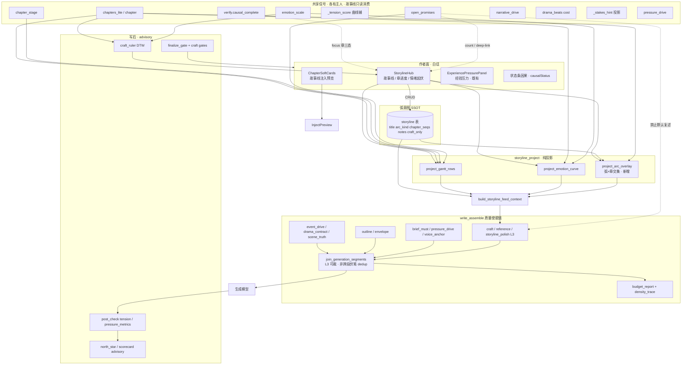
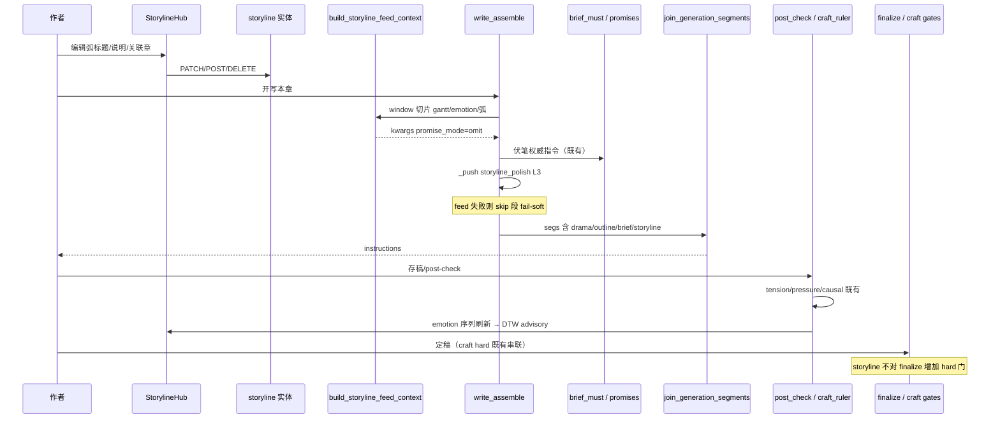

# 设计文档：故事线融合改进 · 单一职责 + 共享信号 + 统一注入/观测

| 项 | 值 |
|----|-----|
| **文档标题** | 铜炉 / scribe3 · 故事线在写作质量使能链路中的融合方案（非平行子系统） |
| **作者** | Grok Design（系统架构） |
| **日期** | 2026-08-12 |
| **状态** | **Draft · rev.3**（PO 闭合 OQ1 schema `craft_only` · OQ6 完整方案 A；落库路径见下） |
| **产品** | 铜炉（tonglu）/ scribe3 长篇写作工作台 |
| **代码根** | `/home/admin/projects/scribe-writing-system/scribe3/` |
| **会话交付** | 设计稿 `/tmp/grok-1000/grok-design-doc-5b5437dc.md` · 仓库 `docs/plans/2026-08-12-storyline-fusion-global-design.md`（内容同步） · 摘要 `/tmp/grok-1000/grok-design-summary-5b5437dc.md` |
| **对齐前序** | `docs/plans/2026-08-12-first-principles-quality-enablement.md`；`docs/plans/2026-08-12-storyline-and-hermes-decisions.md`；`docs/plans/2026-08-12-gap-fix-20-spec.md`；`docs/plans/2026-08-12-storyline-visualization-design.md` |
| **验收环境** | 已部署 demo：`https://tonglu.example.com`；SSH `ubuntu@203.0.113.10`；应用 `/opt/scribe3/app`；**只冒烟已部署栈** |
| **明确不做的宣称** | **不**宣称 human-blind / 文学 ≥9.5；scorecard/DTW **仅 advisory**；**不** fork Hermes；**不**默认第二套 tension / 因果图 / 情绪分 |
| **PO 决策（2026-08-12）** | **OQ6** → 默认交付 **完整方案 A**（PR-SL0…SL6）；方案 E 仅作排期削减应急。**OQ1** → **schema 级 `craft_only`** 为有意交付（非仅截断）；规则见 §数据模型 / KD15 |

---

## 概述

故事线（Storyline）在铜炉中的产品目标是：**规划跨章弧、盯阶段与坑点、写时给近程提示、写后可自比节奏**。现网已有可编辑弧实体（`storyline` 表 + `storyline_store`）、章投影 Gantt/情绪曲线（`storyline_project`）、注入 polish（`storyline_inject_polish`）、Hub UI（`StorylineHub.jsx`）与技法 DTW 对标（`craft_ruler`）。问题不在「缺一块 storyline 产品」，而在 **信号所有权未钉死 + 注入未喂满 + 与既有张力/伏笔/因果/简报并行却无去重契约**，导致作者面与写路径同时出现 **平行感** 与 **半成品段**。

本方案把故事线 **嵌回** 整条写作质量使能链路（章阶段 → 大纲代价/stakes → 节拍戏核 → 演绎场景真相 → 伏笔/promises → 事件驱动 narrative_drive → causal 校验 → 张力/经验复盘 → density/budget → `write_assemble` → explore/finalize craft gates → brief → 北星 scorecard advisory），用 **单一职责矩阵 + 共享信号投影 + 统一注入层（segment + budget；伏笔以 omit 为硬保证）** 完成融合，而不是再做一个平行「故事线子系统」。

**主优化指标**：写路径近程弧提示 **可观测且默认不复述伏笔正文**（`promise_mode=omit` 硬保证）；Hub **可读跨章意图并深链既有子系统**；**不**用文学 KPI 验收。

---

## 背景与动机

### 1. 代码层已确认的断点（2026-08-12 核对 · 以代码为准）

| ID | 断点 | 证据 | 伤害 |
|----|------|------|------|
| **B1** | 热路径与作者预览 **双侧空心**（能力 ≠ 接线） | **热路径** `write_assemble` ~587–598 只传 `focus_seq`。**Preview API** 虽可收 `gantt_rows`/`emotion_point`/`open_promises`，但 `ChapterSoftCards` 只传 `{focus_seq, chapters:[{seq,synopsis}]}`，无近程窗口、无 store、无 open_promises | 写路径几乎只剩「焦点章」；作者面预览与热路径 **今天双方都偏空**——不是「预览已满、生成空」，而是 **API 可满参、UI/热路径未喂** |
| **B2** | Hub/Gantt/情绪优先 `chapters_lite`；**独立 storyline 实体不参与** `project_gantt` / `project_emotion` | `product_backlog._storyline_chapters` + `project_*` 纯章列表；hub 仅 **并置** `storylines` 列表 | 弧意图与章进度/情绪 **视觉脱节**；实体像旁路 CRUD |
| **B3** | store 有 `delete_storyline`，**缺 REST DELETE**；前端缺完整 PATCH/删除/notes·arc_kind | `store/storyline.py:delete_storyline` 存在；`product_backlog` 路由无 DELETE；`api.js` 无 `storylinePatch`/`storylineDelete`；`StorylineHub` 仅 create+link | 作者无法维护弧元数据，实体退化为「标题+章号袋」 |
| **B4** | `craft_ruler_report` 非 `emotional_effect` 轴多为 **0.5 占位** | `craft_ruler.py`：`score = sim if d.key == "emotional_effect" else 0.5` | 维度 bar 假丰富；与 quality_dim / 北星 advisory 心智冲突 |
| **B5** | 伏笔：`brief.promise_directives` / `brief_must` 与 storyline inject「开放伏笔：…」**可并行**；**不能**靠 `inject_dedup` 全等指纹挡双写 | brief 权威指令与 polish「开放伏笔：」格式不同；`is_duplicate_text` 要求整段 SHA 全等；`join_generation_segments` **不**跨段调用 inject_dedup | 若默认仍填 open_promise_texts → 双写；须以 **`promise_mode=omit` 为空列表硬保证**（非指纹二道闸） |
| **B6** | `storyline_polish` **未进** `SEGMENT_REGISTRY` / `L2_DROP_*` | 现为 join **之后** 字符串拼接 | 不进 density_trace 主表；超 cap 时行为与其它 supplemental 不一致 |

**与 gap-spec / 决策文档的差异（以代码为准）**：

- GAP-16「无独立数据模型」**已闭合**（`130_storyline.surql` + mixin + 进程内降级）。
- D7：产品主字段 emotion ∈ [-5,+5]；0–1 `tension` 为 **有意保留** 低成本辅字段 — **本方案不升级 NLP，不新建第二情绪库**。
- gap-spec 曾设想 `storyline_segment` 情绪目标表 — **本方案明确拒绝** 把 emotion 目标迁入 storyline 表；情绪序列 SSOT 仍是章正文/梗概投影。

### 2. 现网能力盘点（已有 · 禁止平行复制）

| 能力类 | 现有模块（SSOT） | 作者/写路径消费面 |
|--------|------------------|-------------------|
| 跨章弧意图 | `storyline` 表 / `storyline_store` / `store/storyline.py` | Hub 实体列表；**写路径几乎未消费 notes/arc_kind** |
| 章阶段 | `chapter_stage.PHASES` + 章 dict 推断 | Gantt `phase`；`/chapters/{seq}/stage` |
| 赌注/代价（**多路径**） | **Gantt 显示**：`storyline_project._stakes_hint`（synopsis/meta 本地正则，**非** `parse_stakes_presence`）。**写路径/合同**：`execution_contract.parse_stakes_presence` / `brief.parse_chapter_meta`；节拍 cost：`drama_beats` | Gantt 只读 hint；drama_contract / outline 注入用各自 SSOT |
| 戏核节拍 | `drama_beats` · `beats_have_drama_gcd` / `format_drama_block` | `drama_contract` L0 段 |
| 场景真相 | scene_truth / `scene_truth_proj` | redline 段 |
| 伏笔 | promise 实体 + `brief.promise_directives` + envelope open_promises | `brief_must`、GATE-A A6/A7 |
| 事件驱动 | `narrative_drive` + `event_drive` 块 | L0 redline |
| 因果 | `verify.causal_complete`；`causalStatus.js` 三态 | post-check / craft C2 / 状态条 |
| 情绪曲线辅张力 0–1 | `storyline_project._tension_score`（只读章字段启发式） | Hub 曲线辅字段；**不**写库 |
| 经验/压力格 | `experience/scene_grid` + `ExperiencePressurePanel`；`pressure_drive` / `pressure_metrics` | 章辅面板；`pressure_drive` L2 段 |
| 情绪曲线 | `emotion_scale.score_prose_emotion` ← 章 prose/synopsis | Hub 曲线；craft-align |
| 张弛检查（写后） | `brief.find_tension_monotony` / `tension_deterministic`；rubric `chapter_analysis` | post-check、旅程、张力检查 dock |
| 技法对标 | `craft_ruler` DTW + `quality.rubrics.CORE_DIMENSIONS` | Hub craft-align；**非 finalize hard** |
| 北星/评分卡 | north_star_book / scorecard / quality_dim advisory | 面板；**不 blocking craft finalize**（既有硬门除外） |
| 注入预算 | `injection_registry` + `context_budget.join_generation_segments`（must-link 路径另用 inject_dedup） | density / budget report |
| 软卡预览 | `ChapterSoftCards` → inject-preview | 现网客户端残缺 body；P0 改 `use_store=1` 与热路径同源 |

### 3. 痛点 → 对「写出好的小说」的伤害

| 痛点 | 伤害 |
|------|------|
| 热路径空心 inject | 规划在 Hub 的弧意图 **到不了写笔** |
| 弧与章投影脱节 | 作者无法一眼看到「这条弧盖了哪些阶段/开放坑」 |
| 伏笔双写 | 模型收到两套「该兑现/刷新」话术，戏剧信号被稀释 |
| 占位维度轴 | 对标区误导作者以为多轴已测，实际只有情绪 DTW |
| CRUD 残缺 | 弧无法演进 notes/种类/删除，数据垃圾堆积 |

---

## 目标与非目标

### Goals

| # | 目标 | 可度量验收（demo 冒烟，非文学 KPI） |
|---|------|-------------------------------------|
| **G1** | 写路径故事线段 **喂满共享投影**（近程阶段 + 弧意图短注 + 情绪点标签）；**硬保证** 默认不输出「开放伏笔：…」正文行 | 写组装后 `GET /debug/injection-trace`（或 last budget_report）见 `storyline_inject.fed=true` 与 line 类型计数；`promise_mode=omit` 时 text **无**「开放伏笔：」前缀（见 §D.2；**不**依赖指纹碰撞） |
| **G2** | Hub **融合视图**：实体弧叠加章 Gantt；`refs` **按 focus 章** 引用既有因果/伏笔 API | `GET /storyline/hub?focus_seq=`；缺省 focus 按 **lite 算法**（非 prose）；`refs.causal` 单章三态 + open_promise_count |
| **G3** | 实体 CRUD 闭环：PATCH notes/arc_kind/title/seqs/**craft_only**；DELETE；前端完整表单 + 「写入生成提示」勾选 | REST + UI；demo 创建→改 notes/craft_only→删 200 |
| **G4** | craft-align **诚实**：非计算轴标记 `source=uncomputed`/`n/a`，禁止假 0.5 当实测 | API `core_dimensions[].source` 可区分；UI 文案「未测」 |
| **G5** | 单一注入层：`storyline_polish` 进 registry 为 **L3 supplemental**，进 density_trace 与 L2 裁剪序 | registry 含名；超 cap 可裁；flag `SCRIBE3_STORYLINE_INJECT` 仍 redline_safe |
| **G6** | 与质量使能链路 **同旗/同观测语言**：audit `not_a_kpi`、`advisory`、白话作者面 | 作者面禁用 GATE/GCD/stamp/stakes **英文字段**；「有赌注」→「有代价」等（见 §H 文案表）；页头用「参考」非裸 `advisory` 英文 |

### Non-Goals

| # | 非目标 | 理由 |
|---|--------|------|
| **NG1** | 第二套 scorecard / 文学分 / human-blind ≥9.5 | 产品禁令 |
| **NG2** | 第二套 causal 引擎或 storyline 私有因果图 | 已有 `causal_complete` |
| **NG3** | 第二套 tension/emotion 持久化序列或 NLP 全文情感 P0 | D7 已闭合；0–1 张力辅字段保留即可 |
| **NG4** | Hermes 分叉 / SOUL 依赖 storyline | 正交（见 Hermes 决策 D1–D5） |
| **NG5** | `storyline_segment` 表存 emotion_target 作情绪 SSOT | 情绪从章投影，弧表只存 **意图** |
| **NG6** | 把 storyline 注入抬到 L0 redline 或进 finalize hard | 保持 polish / advisory |
| **NG7** | 替换 brief / drama_contract / event_drive / must-link | 只融合与引用 |
| **NG8** | Grok 机全量 npm/pytest/本机 Surreal；平行第二验收栈 | 主机资源规则 |
| **NG9** | 拆除 must-link、canonical suppress、`project_frame`、`try_stamp` 唯一终闸 | Must-Keep |

### Must-Keep（禁止拆除 / 禁止默默降级）

与第一原则质量使能文档一致，故事线改造 **不得** 触碰：

- `memory_must_link` / canonical suppress / `knowledge.project_frame` + epistemic
- `drama_contract` / `event_drive` / outline beats 内容 SSOT
- envelope `canonical` / `recent` / `voice_anchor` / prefix anti-slop
- finalize 质控红线；explore soft-save 后 **finalize craft hard 串联**（若已合入）
- `try_stamp` 作为既定终闸（若文档/代码已钉）
- promise 实体生命周期 API（advance/patch/abandon）仍为伏笔 SSOT

---

## 能力所有权矩阵（Capability Ownership Matrix）

> **原则**：一类信号 **一个写所有者**；故事线默认是 **消费者 + 可选意图登记**，不是第二写库。

| 信号类 | 所有者（写 SSOT） | 模块 | 故事线职责 | 其它消费者 | 作者 UI 表面（白话） |
|--------|-------------------|------|------------|------------|----------------------|
| **跨章弧意图** | storyline 实体 | `storyline` 表 · `store/storyline.py` · `storyline_store.py` | **唯一写**：title / arc_kind / chapter_seqs / notes / **`craft_only`** | inject **仅当 craft_only=true** 的 notes；Hub 始终可编 | 「故事线」「弧说明」「写入生成提示」 |
| **章阶段/进度** | chapter stage | `chapter_stage` + 章字段 | **只读投影** → Gantt phase | stage API、旅程 | 「大纲 / 节拍 / 演绎 / 草稿 / 正文」 |
| **Gantt 代价提示** | **无独立写库**；投影函数只读章 | **`storyline_project._stakes_hint`**（synopsis/meta 本地正则：`stakes|赌注|代价|风险`） | **只显示** `stakes_hint`；**不** re-store；**不**宣称 = `parse_stakes_presence` | Hub Gantt 行 | 「有代价 / 缺代价 / —」 |
| **大纲赌注（合同路径）** | 章 synopsis / meta | `execution_contract.parse_stakes_presence` · `brief.parse_chapter_meta` | 故事线 **不拥有**；可选 P2 对齐 Gantt 语义 | chapterContractGate、简报 | 合同/执行软状态既有面 |
| **节拍代价 cost** | beats | `drama_beats`（meaningful cost / GCD） | 不注入第二套；可只读角标 | drama_contract L0 | 「冲突节拍是否齐」（勿写 GCD） |
| **场景真相** | scene_truth | deduce / scene_truth_proj | 不复制 | redline 段 | 「场景真相」既有面 |
| **伏笔 / promises** | promise 实体 | store open_promises · `brief.promise_directives` | inject **硬默认 omit** 正文；Hub **引用计数/深链** | brief_must、GATE-A | 「未收线的伏笔」 |
| **事件驱动** | narrative_drive | `narrative_drive.py` | 不平行合同；Hub 可深链本章驱动 | event_drive 段 | 「本章靠什么推着走」 |
| **因果（按章）** | event + causal_complete | `verify.causal_complete` · `GET /causal?chapter=` · `causalStatus.js` | Hub **`refs.causal` = focus 单章三态**（非全书汇总）；不建图 | post-check、craft C2、状态条 | 「因果：完整 / 有缺口 / 尚无事件」 |
| **曲线辅张力 0–1** | **无写库**；投影计算 | **`storyline_project._tension_score`** 只读章字段 | 情绪曲线辅字段；**不**替代 emotion | craft-align 回落 | 「松紧启发」 |
| **张弛检查（写后）** | brief / 分析缓存 | `brief.find_tension_monotony` · `tension_deterministic` · rubric | 故事线 **不拥有**；不并入弧表 | post-check、旅程、张力 dock | 「张弛分布」「张力检查」既有面 |
| **情绪 -5…+5** | 章 prose/synopsis 投影 | `emotion_scale` · `project_emotion_curve` | **消费序列** 做曲线与 DTW；不落库 | craft_ruler | 「情绪起伏（参考）」 |
| **经验压力格** | experience scene_grid | `experience/scene_grid` · ExperiencePressurePanel | **不**并入 storyline 表；可链到章辅 | pressure 面板 | 「本场目标—冲突—代价」 |
| **力学压力合同** | pressure_drive | `pressure_drive.py` | 不双写 | L2 段、post_check metrics | 既有压力面 |
| **技法对标 DTW** | craft_ruler（纯函数） | `craft_ruler.py` | Hub 展示；advisory only | craft-align API | 「节奏像不像起承转合（参考）」 |
| **质量维度分** | quality_dim / rubrics 作业 | `quality/*` · review projection | craft-align **不伪造** 未测轴 | 北星/scorecard advisory | 「质量维度（另算）」 |
| **注入预算** | registry + budget | `injection_registry` · `context_budget` | storyline 段注册 L3 + 物理序；伏笔靠 **omit** 非 join 自动 dedup | density_trace | 调试面；作者不可见 |
| **must-link 指纹 dedup** | memory_must_link 路径 | `inject_dedup` / must-link pin | **不**作为 storyline↔brief 伏笔硬闸（见 §D.2） | brief 短路 | 调试 |
| **北星 scorecard** | north_star / post_check | pilot_inbox / write post_check | 不第二套 | 北星面板 | 「书级健康参考」 |

---

## Proposed Design

### A. 架构总图：弧编辑 → 投影 → 写注入 → 写后对标



### B. 单一职责分层

| 层 | 模块 | 职责 | 禁止 |
|----|------|------|------|
| **Registry（意图）** | storyline 实体 | 跨章「这条线是什么、盖哪些章、作者笔记」 | 存 emotion 序列、stakes 正文、promise 状态机 |
| **Projection（投影）** | `storyline_project` | 章列表 → Gantt / emotion / arc overlay | 写库；LLM 调用 |
| **Feed（写前装配）** | `build_storyline_feed_context(st, focus_seq)` | **先 window 过滤再 project**；弧 filter focus；产出 segment kwargs | 全书 emotion 打分；拉全文 prose；自己格式化最终 text |
| **Polish（注入文本）** | `storyline_inject_polish` | 短 bullet 中文提示 | 伏笔指令权威文案（归属 brief） |
| **Align（写后）** | `craft_ruler` | DTW + 诚实维度源 | 当 finalize hard；伪造 0.5 为实测 |
| **UI** | Hub / SoftCards | 白话展示 + 深链 | 黑话；第二因果编辑器 |

### C. 弧 × 章融合投影（修 B2）

新增纯函数（建议落在 `storyline_project.py`）：

```python
def project_arc_overlay(
    storylines: list[dict],
    gantt_rows: list[dict],
    *,
    focus_seq: int | None = None,
) -> dict:
    """弧意图 × 章进度：不改 gantt 行真源，只附加 overlay。"""
    # 每弧：覆盖 seq 集合、与 gantt phase 直方图、是否含 focus
    # 每章行可附：arc_ids / arc_titles（截断）
    ...
```

**Hub 契约扩展**（`GET /storyline/hub` 向后兼容加字段）：

```json
{
  "work": "main",
  "focus_seq": 12,
  "gantt": { "rows": [], "surface": "storyline.gantt", "advisory": true },
  "emotion": { "points": [], "craft_align": {} },
  "storylines": [],
  "overlay": {
    "by_line": [{ "id": "sl_…", "title": "…", "phases": {"draft": 2}, "covers_focus": true }],
    "by_seq": { "12": ["sl_…"] }
  },
  "refs": {
    "open_promise_count": 3,
    "causal": {
      "state": "complete|violations|no-data",
      "count": 0,
      "chapter": 12,
      "deep_link": "/causal?chapter=12"
    },
    "source": "shared_apis_not_owned_by_storyline"
  },
  "chapter_source": "chapters_lite"
}
```

**`refs.causal` P0 钉死策略（禁止全书扫描）**：

| 项 | 契约 |
|----|------|
| **粒度** | **单章**，与 `GET /causal?chapter=` / `verify.causal_complete(st, chapter)` / `causalStatus.js` **同源三态** |
| **选章** | 见下方 **default_focus_seq 算法**（**不**依赖 prose 字段） |
| **count** | 仅 `state=violations` 时为 `len(violations)`；其余态 **恒 0**（防假绿） |
| **超时/异常** | fail-soft → `{state:"no-data", count:0, chapter, degraded:true}`，**不得**当 complete |
| **P2（非本方案 P0）** | 全书「有缺口章数」汇总；若做须独立字段 `refs.causal_book`，不得塞进 `refs.causal` |

- `refs.open_promise_count`：既有 `open_promises` 长度（书级计数可接受，O(1) list）；**不**在 storyline 表缓存；UI 深链伏笔既有面。
- Hub **不对每章**调 `causal_complete`。

**`default_focus_seq` 算法（Hub / refs · P0 · 对齐 `chapters_lite`）**

现网 `_storyline_chapters` → `chapters_lite()` 仅选 `seq, title, synopsis, beats, scene_truth, deltas`（**无 prose**；见 `store/chapters.py`）。因此 **禁止**把默认写为「最大有正文章」并暗示扫 `get_chapter` 全文。

优先级（实现须按序）：

1. query **`focus_seq`** 合法（`>0` 且 ideally 落在 lite 章集合内；若不在集合仍可用于 causal 调用，由 causal 自身 no-data）  
2. 否则 lite 中 **最大 `seq`**，且满足 **任一非空**：`synopsis` / `beats` / `title` / `scene_truth`（字符串 strip 后非空，或 beats 非空 list）  
3. 否则 lite 中 **最大 `seq`**（列表非空）  
4. 否则 `focus_seq` 无效 → `refs.causal = {state:"no-data", count:0}`，**不** dig prose  

- Gantt 行上的 `has_prose` 在 lite 路径上可恒 false——**正常**，勿为填 has_prose 拉 prose。  
- **P2（非默认）**：若产品坚持「真·有正文」focus，仅允许 **单次**窄查询（如 `SELECT seq FROM chapter WHERE … AND string::len(prose)>0 ORDER BY seq DESC LIMIT 1`），**禁止** Hub 默认全表 dig prose。

### D. 统一注入契约（修 B1 + B5 + B6）

#### D.1 热路径必须与 preview 同源 + 窗口切片硬边界

在 `write_assemble` 内（现 ~585–600 段）替换为：

1. `feed = build_storyline_feed_context(st, chapter)` — **失败 fail-soft**（见 KD11）：异常则不 `_push`、不 500。  
2. **切片顺序（强制，控延迟）**：  
   - `lite = chapters_lite()`（或等价窄列表）  
   - **先** `window_chs = [c for c in lite if focus-window ≤ seq ≤ focus+window]`（默认 `window=2`，最多约 5 章）  
   - **仅对 `window_chs`** 调用 `project_gantt_rows` / `project_emotion_curve`（或等价单点打分）— **禁止**热路径对全书每一章跑 `score_prose_emotion`  
   - 弧：`list_storylines` 后 filter `focus_seq in chapter_seqs`；**notes 注入再 filter `craft_only is True`**，最多 **2** 条；每条 notes ≤ **40** 字（截断仍适用）  
   - **禁止**热路径 `get_chapter` 拉 **全文 prose**（需要时仅 synopsis 字段；lite 已有则不再 dig）  
3. feed 字段 → 传入 segment builder（见 D.5 签名）：  
   - `gantt_rows` / `emotion_point` / `arc_summaries`  
   - **`open_promise_texts=[]` 且 `promise_mode="omit"`（P0 硬默认，SL2 即生效）**  
4. **`_push("storyline_polish", "supplemental", text)` 在 `join_generation_segments` 之前**；**废除** join 后裸拼接。  
5. `bud_rep["storyline_inject"]`：`fed`, `window_seqs`, `arc_ids`, `promise_mode`, `notes_in_prompt`, `craft_only_injected_ids`, `craft_only_skipped`, `optional_dedup`（观测，非硬闸）。

**Preview / SoftCards**：`POST /storyline/inject-preview` 默认 **`use_store=1`**（query 或 body）；有 store 时 **忽略** 客户端残缺 `chapters`，改调同一 `build_storyline_feed_context`。`ChapterSoftCards` 改为只传 `focus_seq` + `use_store`（或空 body + work），禁止再假装「本地 synopsis 即满参」。

#### D.2 伏笔规范：`omit` 为唯一 P0 硬保证

> **重要（评审 Issue 1）**：`inject_dedup.is_duplicate_text` / `content_fingerprint` 要求整段归一化 **SHA 全等**。brief 文案（「伏笔「…」已过窗口一半…」）与 storyline「开放伏笔：{s[:80]}」**格式必然不同**，指纹 **几乎永不碰撞**。且 `join_generation_segments` **不**调用 inject_dedup；现网 dedup 主路径是 must-link pin 短路 brief。**禁止**把「指纹碰撞」写成可依赖的双写防护。

| 模式 | 何时 | 行为 | 保证级别 |
|------|------|------|----------|
| **`promise_mode=omit`（默认）** | 始终默认；SL2 落地即生效 | **不**生成任何「开放伏笔：…」行；feed 中 `open_promise_texts=[]` | **P0 硬保证** |
| **`promise_mode=hint_only`** | **仅当** `SCRIBE3_STORYLINE_PROMISE_HINT=1`（默认 off） | 最多 1 行「尚有未收线伏笔 N 条（见章前简报）」— **无** promise 正文复述 | P1 / 旗控 |
| **禁止** | 任意 | 复制 `promise_directives` 的 decisions/directives 原文 | — |

**可选二道闸（非 P0、不替代 omit）**：若未来允许非空 `open_promise_texts`，须在 **`build_storyline_feed_context` / `_push` 之前** 用 **promise id 集合** 或 **归一化 promise text 子串 ∈ brief 渲染串** 过滤；**禁止**假设 `is_duplicate_text(brief_blob, storyline_line)` 全等。结果仅写入 `audit.optional_dedup` 观测字段。

**接线点**：feed 在 write_assemble 组装 brief 段 **之后或并行** 可知 brief 是否已含伏笔，但 **omit 不依赖 brief 是否非空**（即使 brief 空也不自动填开放伏笔列表，除非 hint 旗）。

**伏笔权威文案 SSOT = brief**；storyline 只负责 **弧近程 + 阶段 + 情绪启发 + 弧 notes**。

#### D.3 Registry / Budget / 物理序（四元组 checklist · PR-SL2 必改）

实现 **必须同步** 下列四处，禁止「只 `_push` 不注册」（`benchmark_advisory` 半吊子模式 **不可**照抄为完成态）：

| # | 位置 | 动作 |
|---|------|------|
| 1 | `injection_registry.SEGMENT_REGISTRY` | `SegmentMeta("storyline_polish", "L3", "mid", "craft")` |
| 2 | `context_budget.GENERATION_SEGMENT_LAYERS` | `"storyline_polish": "supplemental"` |
| 3 | `context_budget.L2_DROP_TIER["T3"]` | 列入 T3（最先可裁）；**不得**高于 brief_must/outline/voice_anchor |
| 4 | `context_budget.generation_physical_order_names` | 显式插入，**建议紧邻 `reference_craft` 之后**（勿落入 final_reminder 前 extra 无序桶） |

单测：`assert "storyline_polish" in order`；超 cap 时可整段丢；density_trace 计入 L3；segment audit `redline_safe=True`。

#### D.4 注入文本模板（作者/模型可见中文 · 内部 ID 不进文案）

```
【故事线提示｜借鉴勿当设定点名】
- 焦点章：第{N}章
- 近程阶段：#{n}:草稿, …
- 相关弧：{title}（{arc_kind_label}）— {notes_clip}
- 情绪启发：{label}（参考，非评分）
```

- `arc_kind` 映射白话：`main`→主线，`subplot`→支线，`character`→人物弧，`mystery`→悬疑线，其它原样截断。
- **禁止** 输出 GATE / GCD / stamp / stakes 英文字段名。
- 默认模板 **无**「开放伏笔」行（omit）。

#### D.5 格式化路径唯一：扩展 `build_storyline_inject_segment` 签名

**钉死**：只允许 **一条** 文本格式化路径 = `build_storyline_inject_segment`。feed **不**直接拼最终 lines 字符串（避免第二格式化器）。

```python
def build_storyline_inject_segment(
    *,
    focus_seq: int | None = None,
    gantt_rows: list[dict] | None = None,
    open_promise_texts: list[str] | None = None,  # P0 调用方应传 [] 或 None
    emotion_point: dict | None = None,
    arc_summaries: list[dict] | None = None,  # NEW: [{title, arc_kind, notes_clip, craft_only:true}]
    promise_mode: str = "omit",  # NEW: omit | hint_only
    open_promise_count: int = 0,  # hint_only 用
) -> dict:
    ...
```

`build_storyline_feed_context` **只**组装上述 kwargs + audit meta（`fed`, `window_seqs`, `notes_in_prompt`, …），再调用 segment builder。

### E. CRUD 与 API 闭环（修 B3）

| 方法 | 路径 | 行为 |
|------|------|------|
| GET | `/storyline/lines` | 已有 |
| POST | `/storyline/lines` | 已有；body 支持 notes/arc_kind/chapter_seqs/**craft_only**（默认 true） |
| PATCH | `/storyline/lines/{sid}` | 已有后端扩展 **craft_only**；**前端补齐** `storylinePatch` + Hub 表单 + 勾选 |
| DELETE | `/storyline/lines/{sid}` | **新增** → store/memory `delete_storyline` |
| POST | `/storyline/lines/{sid}/link` | 已有；可选后续 `unlink`（P2） |
| GET | `/storyline/hub?focus_seq=` | 扩展 overlay/refs；causal = focus 单章 |
| POST | `/storyline/inject-preview` | 默认 `use_store=1`；与热路径共用 feed |
| GET | `/storyline/craft-align` | 诚实维度源 |

**Flags**（须进 `feature_flags.FLAG_REGISTRY`）：

| 旗 | 默认 | 说明 |
|----|------|------|
| `SCRIBE3_STORYLINE_INJECT` | on（现网） | 故事线 polish 段；关则 text 空 |
| `SCRIBE3_STORYLINE_PROMISE_HINT` | **off** | 允许 hint_only 一行计数提示；caution；PR-SL3 注册 |
| `SCRIBE3_STORYLINE_UI` | on（现网） | Hub UI |

### F. craft-align 诚实化（修 B4）

`craft_ruler_report`：

- `emotional_effect`：`source=craft_ruler.dtw`，score=similarity（保持）
- 其它 `CORE_DIMENSIONS`：**不再写 0.5 当作实测**  
  - 若存在既有 `load_chapter_dim_scores` / quality_dim advisory 可 **只读合并** → `source=quality_dim.advisory`  
  - 否则 `score=null`（或省略），`source=uncomputed`，`display="未测"`  
  - **兼容旧字段**：既有 `source=neutral_placeholder` 在 UI/API 归一为 **uncomputed**（只读兼容，新码不再写入 placeholder）
- **UI 强制**（PR-SL5 与后端同 PR 或紧随）：`StorylineHub` `dimBars` **禁止** `Number(d.score) \|\| 0` 把 null 画成 0 柱；过滤 `source ∈ {uncomputed, neutral_placeholder}` **不进 bar** 或灰显「未测」；单测覆盖 null ≠ 0.5/0 实测  
- 文案：「目前只对情绪起伏做了节奏对照，其它维度见质量面板」

**不**把 DTW 相似度写入 scorecard 阻塞字段；**不**进 finalize hard。

### G. 与质量使能链路的挂点一览



### H. 作者工作流（白话 · UI 文案原则）

**文案原则（强制）**：

1. 作者面 **只用白话中文**；禁止 GATE / GCD / stamp / redline / L0–L3 / stakes **英文字段名**上界面。  
2. 设计文档与 API 字段可用英文 ID；映射层负责翻译。  
3. 所有曲线/对标旁注 **「参考，不是打分」**。  
4. **不宣称** notes 注入已做限知/epistemic 过滤（见安全节）。

**作者面文案替换表（SL1/SL4 验收）**：

| 现网/工程 | 作者面 |
|-----------|--------|
| stakes_hint present/missing | 「有代价」/「缺代价」 |
| 页头裸 `advisory` | 「参考」徽章 |
| `CORE_DIMENSIONS` / dimension_ssot 路径 | 隐藏或「质量维度（另算）」 |
| DTW 距离（可保留数字） | 旁注「节奏对照参考」 |
| tension | 「松紧启发」 |
| causal complete | 「因果完整」 |

**推荐路径**：

1. 在「故事线」建弧 → 写清「这条线想讲什么」（notes）→ 勾选 **「写入生成提示」**（`craft_only=true`，默认开）→ 关联章节号。含未揭示真相的笔记请 **取消勾选**，仅 Hub 自用。  
2. 看「章进度」色条与「缺代价」提示 → 跳进手稿补大纲/节拍（改的是章，不是故事线表）。  
3. 开写前软卡「故事线注入预览」与真实写路径 **同源 feed**（`use_store=1`）。  
4. 写后看情绪起伏与「起承转合对照」；伏笔仍在简报/伏笔工具；因果在状态条（Hub 仅 focus 章摘要）。  
5. 经验压力格仍在章辅「压力」页，**不搬进故事线页做第二编辑器**（可链过去）。

---

## API / 接口变更

### 新增

```http
DELETE /storyline/lines/{sid}?work=main
→ 204 或 { "ok": true, "id": "sl_…" }
→ 404 storyline not found
```

### 扩展（兼容）

| 端点 | 变更 |
|------|------|
| `GET /storyline/hub?focus_seq=` | +`overlay`, +`refs`（causal=单章）；返回 `focus_seq` |
| `POST /storyline/inject-preview` | 默认 `use_store=1`：走 store feed；`use_store=0` 才信 body.chapters |
| `GET /storyline/craft-align` | `source` ∈ {`craft_ruler.dtw`,`quality_dim.advisory`,`uncomputed`}；兼容读 `neutral_placeholder`→uncomputed |
| budget_report / injection-trace | `storyline_inject.fed` 等结构化字段 |
| `GET /debug/injection-trace` | **验收热路径** storyline 段（**不是** budget-probe） |

### 前端 `api.js`

```js
storylinePatch: (sid, body, work) => patch(`/storyline/lines/${enc(sid)}`, body || {}, work),
storylineDelete: (sid, work) => del(`/storyline/lines/${enc(sid)}`, work),
storylineHub: (work, focusSeq) => j(`/storyline/hub?focus_seq=${enc(focusSeq||'')}`.replace(/\?focus_seq=$/, ''), work),
storylineInjectPreview: (body, work) => post('/storyline/inject-preview', { use_store: 1, ...(body||{}) }, work),
```

### 内部函数（钉死签名）

```python
def build_storyline_feed_context(
    st,
    focus_seq: int,
    *,
    window: int = 2,
    max_arcs: int = 2,
    promise_mode: str = "omit",  # omit | hint_only
) -> dict:
    """切片后投影；返回 build_storyline_inject_segment 的 kwargs + audit meta。
    不拉全文 prose；不对全书 score_prose_emotion。
    异常由调用方 catch → fail-soft。
    """
```

见 §D.5 `build_storyline_inject_segment` 扩展形参；**禁止**第三条格式化路径。

---

## 数据模型变更

### 表 `storyline`（**不扩情绪/张力序列**；**增 craft_only**）

既有字段（`130_storyline.surql`）：

- `title`, `arc_kind`, `chapter_seqs`, `notes`, `updated_at`

**PO 闭合 OQ1 · P0/P1 交付字段**：

| 字段 | 类型 | 默认 | 语义 |
|------|------|------|------|
| **`craft_only`** | `bool` | **`true`**（新建） | **仅当 `craft_only=true` 时**，该弧的 `notes`（及弧标题短注）可进入写路径 `storyline_polish` / inject-preview 的 `arc_summaries`。**`craft_only=false`**：Hub 仍可编辑与展示 notes，**硬禁止**进入任何生成 prompt（含 L3 polish）。 |

**注入规则（钉死 · 单向明确）**：

```
inject_notes = (storyline.craft_only is True)
```

- **不是**「false 才注入」；默认 true 表示「弧说明默认视为工艺提示、可进生成」。  
- 作者把未揭示真相/读者未知机密写进 notes 时，应 **取消「写入生成提示」**（`craft_only=false`）。  
- Hub **始终**可读 notes，与是否注入无关。  
- title / arc_kind 用于列表与 overlay 标签；**进 prompt 的 notes_clip 仍受 craft_only 门闩**（`craft_only=false` 时该弧不进 `arc_summaries`，或 summaries 无 notes_clip）。

**仍禁止**作为 SSOT 的列：`emotion_target` / `tension_series` / `stakes_cache` 等。情绪继续从章投影。

### 迁移

| 优先级 | 文件（建议名） | 内容 |
|--------|----------------|------|
| **P0（PR-SL1）** | `scribe3/migrations/131_storyline_craft_only.surql` | `DEFINE FIELD IF NOT EXISTS craft_only ON storyline TYPE option<bool>;`（缺省读时按 true） |
| P0 | store / memory | `create/update/list` 透传 `craft_only`；旧行缺字段 → **读时默认 true**（兼容：已有弧说明可进生成，与升级前行为一致；作者可改 false） |
| 可选 P2 | chapter_seqs 索引 | 查询优化 |

### 进程内降级

`storyline_store`：进程内 dict 同样带 `craft_only`；`delete_storyline` 已有；REST DELETE 与 Surreal mixin 对齐。

---

## 替代方案（≥2）与取舍

| 方案 | 做法 | 优点 | 缺点 | 结论 |
|------|------|------|------|------|
| **A. 融合投影 + L3 注入（本方案完整）** | 弧表意图+`craft_only`；窗口 feed；omit 伏笔；registry 四元组；Hub overlay + focus causal；**SL0–SL6 全交付** | 无平行系统；对齐质量使能 | 多 PR | **采用 · PO 默认排期** |
| **B. 平行「故事线引擎」** | 自建 tension 序列、因果子图、伏笔副本、独立评分 | 产品叙事独立 | 双写、双 UI、双分 | **拒绝** |
| **C. 取消 storyline 实体，仅章标签** | 删表，只用 chapter meta tags | 最简 | 丢失跨章弧笔记 | **拒绝** |
| **D. 把 storyline 抬到 L0/brief 级** | 与 drama 同级硬注入 | 提示更强 | 注意力税；争抢 brief | **拒绝** |
| **E. MVP 最小切片（排期应急 · 非默认）** | **仅** SL1 CRUD+craft_only + SL2 feed/L3/omit + SL5 诚实 craft-align；暂缓 SL3/SL4 | 最快修空心 inject + CRUD + 假 0.5 | **暂缓 G2 / hint** | **仅当排期被迫削减时**由 PO 再砍；**默认不采用** |

**PO（2026-08-12）**：默认执行 **完整方案 A（PR-SL0…SL6）**。方案 E 保留为文档化应急阀，**不是**当前排期基线。A/E 共享同一所有权矩阵。

---

## 安全与隐私

| 项 | 说明 |
|----|------|
| **craft_only 门闩（PO · OQ1）** | schema 字段；**仅 `craft_only=true` 的弧 notes 可进 L3 inject**。`false` → Hub 可见、生成不可见。默认新建 `true`（兼容升级前「说明可进生成」）。 |
| 限知边界 | `craft_only` **≠** 自动 epistemic / focalizer 过滤。作者勾选后仍可能写入敏感句。**验收不得宣称「已限知安全」** |
| P0 硬约束 | 注入侧 notes **截断**（≤40 字/弧，最多 2 弧）；**永不**进 envelope `canonical`/`recent`；audit **`notes_in_prompt`** + **`craft_only_injected_ids` / `craft_only_skipped`** |
| fail-soft | inject 失败不 500；仍写 `storyline_inject` 键（KD11） |
| 租户/work | 所有 API 带 `work`；store 按 work 隔离 |
| 注入 | `redline_safe`；不得削弱 must-link / dual-truth |
| 删除 | DELETE 仅删弧实体，**不**级联删章/伏笔 |
| 密钥 | 无新密钥；旗进 `feature_flags.FLAG_REGISTRY` |

---

## 可观测性

| 信号 | 落点 | 用途 |
|------|------|------|
| `budget_report.storyline_inject` / injection-trace | 写组装后（进程内） | **键必须存在**（含 fail-soft/`enabled:false`）；fed/window/promise_mode/`notes_in_prompt`；空 last → config 回落 **无**此键 |
| density_trace `storyline_polish` | registry | L3 占比 |
| Hub `refs.causal` | GET hub | focus 章三态；degraded |
| craft_align `source` | API | 防假绿维度 |
| 日志 | `scribe3.storyline` | feed 失败 fail-soft（**不阻断写、不 500**） |

**禁止** KPI：`tokens_saved`、文学分、人盲分。

**注意**：`POST /debug/budget-probe`（含 `mode=assemble`）**不**跑完整 write storyline inject，**不得**用于验收 fed。

---

## 风险与缓解

| 严重度 | 风险 | 缓解 |
|--------|------|------|
| **高** | 误用指纹 dedup 当双写防护 | **omit 硬默认**；文档禁止依赖 `is_duplicate_text` 全等 |
| **高** | 窗口未切片 → 全书 emotion 打分延迟 | §D.1 强制先 filter 再 project；禁止全书 score |
| **高** | lite 无 prose → 情绪全「平」 | 诚实文案；synopsis 词表；不宣称精度；**禁止**热路径拉全文 prose |
| **中** | Hub 对每章 causal | P0 **只** focus 一章；超时 → no-data |
| **中** | join 前 `_push` 序漂移 | 四元组 + 物理序钉在 reference_craft 后；order 单测 |
| **中** | UI null→0 假柱 | PR-SL5 强制过滤 uncomputed/neutral_placeholder |
| **中** | 作者 notes 当正典/泄密 | **craft_only 门闩** + 截断 + 不进 canonical + 文案；不宣称限知 |
| **低** | DELETE 误删 | UI 确认；无级联 |
| **低** | 误用 budget-probe 验收 | S4/SL6 明确 injection-trace |

---

## 滚动发布计划

| 阶段 | 内容 | Flag | 回滚 |
|------|------|------|------|
| **PR-SL0** | 文档/契约落库 | — | 无 |
| **PR-SL1** | DELETE + **craft_only 迁移/API/Hub 勾选** + PATCH notes + 文案起步 | — | 路由开关 |
| **PR-SL2** | feed 窗口切片 + **craft_only 注入过滤** + L3 四元组 + `_push` + omit + use_store + SoftCards | `SCRIBE3_STORYLINE_INJECT` | 旗关 text 空 |
| **PR-SL3** | **hint_only 旗** + 可选子串/id 观测 dedup + `feature_flags` 注册 | `SCRIBE3_STORYLINE_PROMISE_HINT` 默认 off | 旗关 |
| **PR-SL4** | Hub overlay + focus causal refs + 文案表收尾 | — | 忽略新字段 |
| **PR-SL5** | craft-align 诚实 + UI 不画假柱 | — | 回退 dtw only |
| **PR-SL6** | demo curl 清单 | — | 无 |

**默认排期 = 完整方案 A（SL0…SL6）**（PO）。方案 E 仅应急：SL0+SL1+SL2+SL5。

**回滚总策略**：旗关 inject；Hub 新字段可选链；不改章/伏笔 SSOT。

---

## 验收定义（demo 冒烟 · 非文学 KPI）

在 **已部署** `tonglu.example.com` / `/opt/scribe3/app` 上：

| # | 步骤 | 期望 |
|---|------|------|
| S1 | `GET /storyline/hub?focus_seq=<n>` | 200；gantt/emotion/storylines；扩展后 overlay/refs；`refs.causal.chapter==n` 且 state∈三态 |
| S2 | `POST /storyline/lines`（含 craft_only）→ `PATCH` notes/craft_only → `DELETE` | 200/204；list 无该 id；craft_only 可 round-trip |
| S3 | `POST /storyline/inject-preview` `use_store=1` + focus | text 含近程/弧提示；**无**「开放伏笔：」；`craft_only=false` 弧的 notes **不**出现在 text |
| S4 | 见 **§S4 热路径三步**（同 host 登录 → 触发 assemble → 立即 injection-trace） | 必须出现 `budget_report.storyline_inject` **对象键**；断言 `promise_mode=="omit"`（及 `fed` 布尔）；键缺失 = 未命中写路径/跨进程/读到 config 回落，**非**产品「接线失败」；**禁止** budget-probe |
| S5 | `GET /storyline/craft-align` | emotional_effect=`craft_ruler.dtw`；其它轴 uncomputed 或 quality_dim，**非**假 0.5 实测 |
| S6 | UI CRUD + 文案表 | 有代价/缺代价；参考徽章；无 GATE/GCD/CORE_DIMENSIONS 路径字样 |
| S7 | 因果/伏笔 | Hub 仅 focus 因果三态 + 伏笔计数深链；无第二因果编辑器 |

#### §S4 热路径三步（钉死 · 防 injection-trace 空回落误判）

现网 `GET /debug/injection-trace`（`misc_routes.get_injection_trace`）读进程内 `_LAST_WRITE_BUDGET_REPORT`；**若为空**则回落 `build_budget_report()` **配置快照**（**无** `storyline_inject` 键）。因此：

| 步 | 动作 | 说明 |
|----|------|------|
| **1** | 登录 **同一 demo host / 同一 backend 实例**（cookie） | 进程内报告；跨副本/重启后空 |
| **2** | **触发一次**写组装（任选其一，点名现网入口） | **推荐冒烟**：`GET /chat/write?chapter=<n>&msg=故事线冒烟组装&work=main`（兼容组装端点，走 `_assemble_write_instructions`，会 SSE；只需触发组装，**不**要求读完全文生成）。备选：产品主路径 `POST /chat/write`（body 含 chapter/msg；注意 context 三件套/重读门可能 4xx，冒烟脚本需带齐或选无门控环境）。**禁止**用 `POST /debug/budget-probe`（含 `mode=assemble`）充当本步 |
| **3** | **立即** `GET /debug/injection-trace` | 断言见下 |

**断言形状（SL2 落地后）**：

```json
{
  "surface": "debug.injection_trace",
  "budget_report": {
    "storyline_inject": {
      "fed": true,
      "promise_mode": "omit",
      "window_seqs": [/* … */],
      "notes_in_prompt": false
    }
  }
}
```

- **通过**：`budget_report` 为对象且 **`"storyline_inject" in budget_report`**，且 `promise_mode == "omit"`（`fed` 为 bool；成功喂满时 `fed==true`）。  
- **未命中写路径**（非产品回归）：响应像纯 config 快照、**无** `storyline_inject` 键 → 判定「步骤 2 未在本进程执行 assemble / 多 worker 打到别实例 / 重启清空」，**重跑 1–3**，勿报 SL2 接线失败。  
- **fail-soft 仍可观测（SL2 实现要求）**：storyline 块 `except` 时 **仍写入**  
  `storyline_inject: { "fed": false, "promise_mode": "omit", "error": "<short>", "applied": false }`  
  使键存在，与「从未跑 inject」区分。  
- **旗关** `SCRIBE3_STORYLINE_INJECT=0`：允许 `applied=false` / text 空，但键仍建议存在并带 `enabled:false`。

**不**验收：人盲分、DTW 阈值、情绪 NLP、notes 限知安全、budget-probe 含 storyline、跨 worker 进程内 trace 强一致。

---

## 开放问题

| ID | 问题 | 状态 | 决议 / 建议 |
|----|------|------|-------------|
| **OQ1** | notes 是否需 schema 级 `craft_only`？ | **Resolved（PO · 2026-08-12）** | **要**。字段 `craft_only: bool` 默认 `true`；**仅 true 时 notes 进写路径 inject**；false 仅 Hub。交付：SL1 迁移+API+勾选，SL2 feed 过滤。仍截断、不进 canonical、`notes_in_prompt` 可观测、fail-soft。**≠** 自动限知。 |
| OQ2 | Hub 是否内嵌迷你违规列表？ | 开放（建议默认） | P0 只三态+count+deep_link |
| OQ3 | `unlink` 章 API？ | 开放（建议默认） | P1；PATCH chapter_seqs |
| OQ4 | quality_dim 合并同 PR-SL5？ | 开放（建议默认） | 可；无则 uncomputed |
| OQ5 | chapters_lite 缓存 emotion？ | 开放（建议默认） | **否** |
| **OQ6** | 排期选完整 A 还是 MVP E？ | **Resolved（PO · 2026-08-12）** | **完整方案 A**：执行 **PR-SL0…SL6** 全量。方案 E **仅**作排期被迫削减时的应急文档选项，**非**当前基线。 |

---

## Key Decisions

| ID | 决策 | 理由 |
|----|------|------|
| **KD1** | 故事线 = **弧意图登记表**，不是情绪/张力/伏笔/因果的 SSOT | 消除平行系统 |
| **KD2** | 写路径 inject **必须**经窗口切片 `build_storyline_feed_context`，与 preview（`use_store=1`）同源；现网 SoftCards 亦空心 | 修双侧空心；控延迟 |
| **KD3** | **`promise_mode=omit` 为 P0 唯一硬保证** 不复述开放伏笔正文；brief 为伏笔 SSOT；**不**依赖 inject_dedup 全等指纹 | 修 B5；指纹对格式化差异无效 |
| **KD4** | `storyline_polish` **四元组**注册 L3 + 物理序在 reference_craft 后；join 前 `_push` | 统一观测/裁剪 |
| **KD5** | Gantt/情绪从章投影；弧用 overlay；**Gantt stakes = `_stakes_hint` 非 parse_stakes** | 修 B2；文档对齐代码 |
| **KD6** | craft-align 非 DTW 轴 uncomputed；UI 不把 null 画成 0；兼容 neutral_placeholder | 修 B4 |
| **KD7** | scorecard/DTW/情绪 **不**新增 finalize hard | 产品边界 |
| **KD8** | 作者面白话 + 文案替换表 | 产品偏好 |
| **KD9** | 无新情绪/张力持久化；无 NLP P0；不 fork Hermes | Non-Goals |
| **KD10** | 验收 = demo 冒烟；热路径看 injection-trace **非** budget-probe | 主机与代码事实 |
| **KD11** | storyline feed/inject **fail-soft**：异常不抛穿写路径、不 500；**仍写入** `budget_report.storyline_inject`（`fed:false`+error），避免与 injection-trace 配置回落混淆 | 写路径稳定 + 可观测 |
| **KD12** | `refs.causal` = **focus 单章** 同源 `/causal` 三态；默认 focus 按 **lite 字段**（synopsis/beats/title）选最大 seq，**不** dig prose；全书汇总 P2 | 粒度匹配；对齐 chapters_lite |
| **KD13** | 不改 promise 生命周期 API；storyline 不拥有伏笔状态机 | Must-Keep |
| **KD14** | 格式化路径唯一：扩展 `build_storyline_inject_segment`（`arc_summaries`/`promise_mode`） | 禁第三渲染器 |
| **KD15** | schema **`craft_only: bool` 默认 true**；**仅 true 注入 notes**；false=Hub 自用；截断+不进 canonical+可观测仍适用 | PO 闭合 OQ1；作者可控工艺/机密边界，非自动限知 |
| **KD16** | 默认交付 **完整方案 A（SL0–SL6）**；方案 E 仅应急 | PO 闭合 OQ6 |

---

## 参考

- 代码：`storyline_store.py` · `store/storyline.py` · `storyline_project.py` · `storyline_inject_polish.py` · `api/routers/product_backlog.py` · `api/services/write_assemble.py` · `craft_ruler.py` · `emotion_scale.py` · `brief.py` · `narrative_drive.py` · `drama_beats.py` · `verify.py` · `injection_registry.py` · `context_budget.py` · `inject_dedup.py` · `feature_flags.py` · `chapter_stage.py` · `experience/scene_grid.py` · `web/src/views/StorylineHub.jsx` · `web/src/ChapterSoftCards.jsx` · `web/src/causalStatus.js` · `api/routers/misc_routes.py`（budget-probe / injection-trace）
- 计划：`docs/plans/2026-08-12-first-principles-quality-enablement.md` · `docs/plans/2026-08-12-storyline-and-hermes-decisions.md` · `docs/plans/2026-08-12-gap-fix-20-spec.md` · `docs/plans/2026-08-12-storyline-visualization-design.md`

---

## PR Plan

增量、可独立评审合并；每 PR 可回滚。

### PR-SL0 · docs: storyline fusion ownership + inject contract

| 项 | 内容 |
|----|------|
| **标题** | `docs(storyline): fusion ownership matrix and inject contract` |
| **影响文件** | `docs/plans/2026-08-12-storyline-fusion-quality-enablement.md`（本设计落库） |
| **依赖** | 无 |
| **描述** | 落库本设计 rev.3（含 craft_only / 完整 A 排期、omit、focus causal、窗口切片、S4 三步）。 |

### PR-SL1 · feat(storyline): DELETE + craft_only schema + Hub CRUD

| 项 | 内容 |
|----|------|
| **标题** | `feat(storyline): craft_only field, REST delete, author CRUD` |
| **影响文件** | `migrations/131_storyline_craft_only.surql`；`store/storyline.py`；`storyline_store.py`；`api/routers/product_backlog.py`（POST/PATCH/DELETE + craft_only）；`web/src/api.js`；`StorylineHub.jsx`（notes/arc_kind/**写入生成提示勾选**、起步文案） |
| **依赖** | 无（可与 SL0 并行） |
| **描述** | 迁移 `craft_only`（缺省读 true）；CRUD 透传；DELETE；Hub 勾选默认开；**本 PR 不改写路径**，但数据面就绪供 SL2 过滤。 |

### PR-SL2 · feat(storyline): windowed feed + L3 four-tuple + omit + craft_only filter

| 项 | 内容 |
|----|------|
| **标题** | `feat(storyline): windowed feed, L3 registry, omit, craft_only inject filter` |
| **影响文件** | `storyline_inject_polish.py`（签名 + arc_summaries）；可选 `storyline_feed.py`；`storyline_project.py`；`write_assemble.py`（join 前 `_push`，fail-soft）；**`injection_registry.py` + `context_budget.py`（四元组）**；inject-preview `use_store`；`ChapterSoftCards.jsx` |
| **依赖** | **硬依赖 PR-SL1 的 craft_only 读路径**（缺字段当 true）；建议 SL0 |
| **描述** | 窗口切片；**`arc_summaries` 仅含 craft_only=true**；omit 默认；四元组；废除 join 后裸拼；audit：`notes_in_prompt`、`craft_only_injected_ids`、`craft_only_skipped`；fail-soft 仍写键；单测：false 弧 notes 不进 text。 |

### PR-SL3 · feat(storyline): promise hint flag + optional observation dedup

| 项 | 内容 |
|----|------|
| **标题** | `feat(storyline): PROMISE_HINT flag and optional promise-id observation` |
| **影响文件** | `feature_flags.py`（注册 `SCRIBE3_STORYLINE_PROMISE_HINT` 默认 off, caution）；`storyline_inject_polish.py`；可选 audit 观测；**不**把 is_duplicate_text 当硬闸 |
| **依赖** | **PR-SL2**（omit 已在 SL2） |
| **描述** | hint_only 一行计数提示；可选 id/子串观测字段。评审勿期望本 PR 才「关掉双写」——双写已在 SL2 omit。 |

### PR-SL4 · feat(storyline): hub arc overlay + focus-chapter causal refs

| 项 | 内容 |
|----|------|
| **标题** | `feat(storyline): hub overlay and focus-chapter causal refs` |
| **影响文件** | `storyline_project.project_arc_overlay`；`storyline_hub_ep`；`StorylineHub.jsx`（文案表收尾）；复用 causal 三态语义 |
| **依赖** | SL1 改善体验；不硬依赖 SL2 |
| **描述** | overlay；`refs.causal` 仅 focus 章；**default_focus_seq 用 lite 字段**（禁 dig prose）；open_promise_count；深链；超时 no-data。 |

### PR-SL5 · fix(craft_ruler): honest dimensions + Hub UI uncomputed

| 项 | 内容 |
|----|------|
| **标题** | `fix(craft_ruler): uncomputed axes; Hub skips null bars` |
| **影响文件** | `craft_ruler.py`；`StorylineHub.jsx` dimBars；可选 quality_dim 只读合并 |
| **依赖** | 无（可与 SL1–4 并行） |
| **描述** | 停写 0.5；source=uncomputed；兼容 neutral_placeholder；UI 过滤 null/0 假柱。 |

### PR-SL6 · chore(storyline): demo smoke curl order

| 项 | 内容 |
|----|------|
| **标题** | `chore(storyline): demo smoke for fusion path` |
| **影响文件** | `docs/plans/` 或 `scripts/` 冒烟清单 |
| **依赖** | SL1–SL5 按需 |
| **描述** | curl 序：`hub`（无 focus 时验证 **lite 默认选章**）→ lines CRUD → `inject-preview?use_store=1` → craft-align → **同实例** `GET /chat/write?chapter=N&msg=…`（触发 assemble）→ **立即** `GET /debug/injection-trace` 断言 `storyline_inject` 键与 `promise_mode=omit`。键缺失=环境/步骤问题。**禁止** budget-probe。 |

---

*文档结束 · Draft rev.3 · 2026-08-12 · PO 闭合 OQ1（craft_only）/ OQ6（完整方案 A）*
