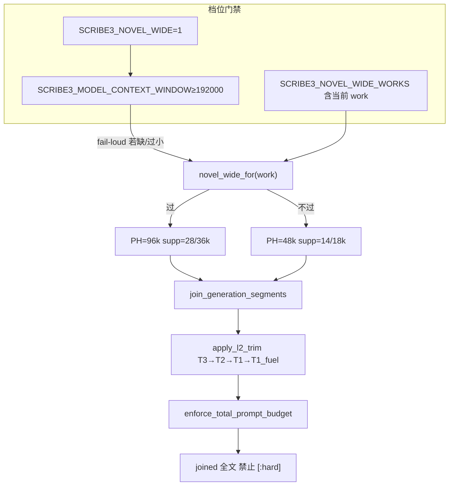

# 预算 / 上下文 · 最优半径（升窗 96k）

| 项 | 值 |
|----|----|
| 短名 | `budget-context-optimal` / `context-optimal` |
| 状态 | **草案 · 待升 96k**（rev.2 · 评审收口） |
| 日期 | 2026-08-13 |
| 作者 | Grok Design（待人审签） |
| 对照提交 | 预算真源相对 **`bb01748`**（`context_budget.py` 此后未改）；本文入仓 **`56f4eca`**；实现前再 `git show HEAD:scribe3/tests/test_novel_first_injection.py` |
| 定位 | 写路径 **下一阶段主动升窗** 到 96k；承认现网 48k 钉死；把爆炸半径写全、可回滚 |
| 验证 | **仅已部署 demo**（`tonglu.qing.blue` / `82.157.130.140`，`/opt/scribe3/app`）；轻量过滤单测；**不**在 Grok 机跑 `npm ci` / 全量 pytest / 本机 Surreal；不写活书正文 |
| 关联 | 写路径分层：`docs/plans/2026-08-13-scene-contract-unify.md`；审计钉：`docs/audits/ctx-audit-20260813/{FIX-LOOP,MATRIX,CEILINGS}.md` |

---

## Overview

现网写路径（`scribe3/context_budget.py`）生产默认是 **novel 信封 22k + `NOVEL_PROMPT_HARD=48000`**。三燃料已经是独立 supplemental 段（`story_ember` / `story_recall` / `story_causal`，档位 `L2_DROP_TIER["T1_fuel"]`），**不在** `L0_NEVER_CUT`。场面头走 `format_story_contract_head` → `_push("narrative_contract","redline")`，store 与 codec 同构。邻段差集 / compact / 空不 push 已落地。FIX-LOOP 明确：**禁止为刷分加大 48k**。

本设计的解不是「把常量改成 96000 然后全仓改测试」，而是：

1. **终态窗口仍是 96k**（novel 写路径升窗档 `get_prompt_hard() → 96000`），48k 不是终态。
2. **落地方式是分档**：默认常量继续钉 48k；`SCRIBE3_NOVEL_WIDE=1`（可另加数值别名，见 §3）才升窗。
3. 升窗时 **同步抬 supplemental 到 28k/36k**（否则 `effective_l2_cap = min(HARD, PH−L0−L1)` 仍被 18k 卡住）。
4. **信封保持 22k**，codex cap 保持 4500，**燃料段帽第一刀不涨**（仍 1500/4000/2500）。差集纪律保持。
5. 单独成章写清爆炸半径：谁会炸、炸多大、观测、回滚。

```text
现网（默认，必须可一键回到）
  envelope 22k · supplemental 14/18k · prompt_hard 48k · 燃料段帽 1.5/4/2.5k

升窗档（旗开 + 模型窗门禁 + 可选书白名单）
  envelope 22k 不变 · supplemental 28/36k · prompt_hard 96k · 燃料帽暂不改
  L2 仍 T3→T2→T1→T1_fuel；L0 永不裁；禁止 rendered[:hard] 尾截
  旗生效必须 compose recreate，不是 deploy_demo.sh hot / docker restart
```

---

## Background & Motivation

### 现网已落地（本方案必须承认，禁止假装还在旧世界）

对照 **`bb01748` 预算代码** 与 **`56f4eca` 已提交测试**（实现前禁止把工作区脏 diff 当成 HEAD）：

| 事实 | 真源 | 旧方案是否过期 |
|------|------|----------------|
| 硬顶 **48k**，不是 96k | `NOVEL_PROMPT_HARD = 48_000`；`get_prompt_hard()` 在 novel+V2 时 **直接返回该常量**，**忽略** `SCRIBE3_PROMPT_HARD` | 旧文状态写「已裁 96k」—— **作废** |
| 信封 **22k**（八块之和） | `NOVEL_ENVELOPE_TOKEN_BUDGET = 22_000`，`BLOCK_BUDGETS_NOVEL` | 旧文「信封 32k」—— **作废** |
| supplemental **soft 14k / hard 18k** | `DEFAULT_SUPPLEMENTAL_SOFT/HARD` | 旧文「22/28k」—— **作废** |
| 三燃料独立段、可后裁 | `write_assemble_v1._push(..., "supplemental")` ← `collect_story_fuel_segments`；`GENERATION_SEGMENT_LAYERS["story_*"]="supplemental"`；`L2_DROP_TIER["T1_fuel"]=("story_recall","story_causal","story_ember")` | 分层意图 **保留** |
| 场面头 L0，store 同构 | `format_story_contract_head`；`CHAPTER_META_ALLOWED` + `coerce_chapter_json_dict`；`budget_report.narrative_contract_injected` | **保留** |
| prefix 已拆；sincerity 已并入 anti_slop | 独立 `_push`：`identity` / `write_protocol` / `revision`；`prefix` = anti_slop 短核 + 章号；**不再** `_push("sincerity")` | 升窗不得再焊回独立 sincerity |
| envelope 八键可观测 | `envelope_block_lengths` 八键 | **保留** |
| 邻段差集已做 | craft↔procedural、codex↔canonical、brief_must↔outline/合同、discourse/revelation/write_protocol↔CORE、avoid 默认 omit、revision 非改稿不注入 | **当作升窗前已省下的字节** |
| FIX-LOOP 钉 48k | **38 个测试文件**各一条 `assert NOVEL_PROMPT_HARD == 48000`（钉的是**常量**，不是 getter） | 本设计是另一 goal，不得偷偷改常量冒充审计完成 |
| **已提交**的 novel-first 测 | `git show HEAD:scribe3/tests/test_novel_first_injection.py`：`NOVEL` 信封 **22_000**，`get_prompt_hard()==48_000` | **不要**把工作区未提交的 32k/96k 回退当现状，**禁止提交**那份脏改 |
| 真正过期的 V2 块断言 | 同文件 `test_flag_on_v2_budget` 写死 `canonical==6800` / `recent==4000`；`BLOCK_BUDGETS_V2` 现为 **7400 / 4400** | PR1 顺手改对齐，或单列小修；与 96k 无关 |
| getter 行为测 | `test_default_is_novel_22k_and_prompt_hard_48k`：`get_prompt_hard()==48_000`；`test_thicken_halfdone`：`prompt_hard >= 48_000` 且信封 **22_000**（HEAD） | PR1 默认关旗时仍绿；PR5 翻默认后前者要改期望 |

### 为何还要升到 96k

48k 在现网算术下几乎贴死：

```text
effective_l2_cap = min(SUPPLEMENTAL_HARD=18k, PROMPT_HARD=48k − L0 − L1)

L1 envelope ≈ 22k（满配）
L0 redline（identity / protocol / secret_guard / focalizer / 场面头 / event_drive /
            drama_* / revelation / deduction_final / final_reminder / …）
            典型 4–10k，肥章可更高
  注意：event_drive_hook 是 supplemental，不是 L0；sincerity 无独立段
→ 余给 L2 的常常 ≤ 18k，且经常被 HARD 先卡住
→ 爆窗时按 T3→T2→T1→T1_fuel 砍；燃料会在工艺之后被半裁或整段丢
```

用户目标不是「48k 当终态」。48k 是 FIX-LOOP / 注意力密度的 **护栏钉**；96k 是给可后补燃料与世界段留余量的 **下一阶段窗**。

### 痛点（2026-08-13 代码复核）

1. 旧方案正文自相矛盾：既写「不关 42k/48k」又写「窗口硬顶 96k / 信封 32k」。
2. 只改 `NOVEL_PROMPT_HARD` **不够**：HARD 仍 18k 时升到 96k **几乎不增加进模燃料**。
3. `get_prompt_hard()` 在生产默认（novel+V2）**短路返回常量**，现网没有可用的 96k 旋钮。
4. **38 个文件钉常量** `NOVEL_PROMPT_HARD==48000`。直接改常量 = 那 38 条全红 + 破坏 FIX-LOOP。
5. 工作区若把 `test_novel_first_injection.py` 改回 32k/96k，**不得入库**；已提交树已是 22k/48k。另：`test_flag_on_v2_budget` 的 6800/4000 才是已提交树上的过期断言。

---

## Goals & Non-Goals

### Goals

1. **终态窗 96k**：升窗档下 `get_prompt_hard() == 96000`，`get_total_prompt_budget()` 跟随（除非显式 `SCRIBE3_TOTAL_BUDGET`）。
2. **默认仍 48k**，直到 PR5 翻 `novel_wide_enabled` 默认值 + demo 浸泡通过。
3. 升窗后 L2 真的吃到余量：`get_supplemental_soft/hard()` 随档变为 28k/36k。
4. 信封 22k、codex 4500、燃料帽、差集/空不 push、L0 集合、T1_fuel 序 **行为不变**。
5. 爆炸半径可执行：测试分档、观测字段、compose recreate 回滚、限知不降级。
6. 验证只打已部署 demo；Grok 机只读 + 轻量抽查。

### Non-Goals

| # | 非目标 | 理由 |
|---|--------|------|
| NG1 | 第一刀把 `NOVEL_PROMPT_HARD` 改成 96000 并改掉 38 条常量钉 | 炸 FIX-LOOP |
| NG2 | 把信封抬到 32k / 把三燃料焊回 L0 | 注意力 + 现网冲突 |
| NG3 | 再做一套平行去重 | 差集已落地 |
| NG4 | 关掉 `PROMPT_HARD` / `TOTAL_BUDGET` | 模型/网关爆窗更糟 |
| NG5 | 产品字数刀当质量门 | 字数刀 ≠ 窗口刀 |
| NG6 | 升窗时加大讨论近窗 / 塞 `conversation_history` | 写路径窗 ≠ 讨论窗 |
| NG7 | 加大 `hybrid_recall` k / `causal_chain` depth | 另一实验 |
| NG8 | 改 I1–I8 / 宣称 / 灭灯 | 场面主权另案 |
| NG9 | 作者主表面把 96k 画成必须写满 | 见 B8 |
| NG10 | Grok 机全量测 / 本机 Surreal / 第二栈 | 资源纪律 |
| NG11 | PR1 放宽燃料段帽 | 见 OQ4 / PR1.1 |
| NG12 | 本 goal 实现 agentic 掉链近窗重建 | 见 OQ3 |

---

## Key Decisions

1. **终态 96k，默认 48k，用显式升窗旗。**  
   理由：FIX-LOOP + 38 个**常量钉**禁止静默改常量；注意力/成本/模型窗未浸泡。主开关只有 `SCRIBE3_NOVEL_WIDE`。数值别名 `SCRIBE3_NOVEL_PROMPT_HARD` 仅接受空或 `96000`；其它非空值 **fail-loud**（禁止运维以为设了 72k）。**不**复用 `SCRIBE3_PROMPT_HARD`。

2. **`NOVEL_PROMPT_HARD` 常量永远表示窄档钉 48000。**  
   理由：38 个文件钉的就是这个标识符。翻默认（PR5）**只**把 `novel_wide_enabled()` 的 env 默认从 `"0"` 改成 `"1"`，**不改常量**。另增「默认 `get_prompt_hard()==96000`」探针，并改 FIX-LOOP 一句为「禁止为刷分再加大（超过 96k）」。关 `SCRIBE3_NOVEL_WIDE=0` 仍回 48k。禁止把断言改成 `in (48000, 96000)`。

3. **信封保持 22k，不随窗翻倍。**  
   理由：旧文 32k 与 `BLOCK_BUDGETS_NOVEL` 不符；信封是注意力税最高的中段。

4. **升窗必须同步抬 supplemental：soft 28k / hard 36k。**  
   理由：只改 PH 而 HARD=18k 是假升窗。28/36 故意远小于 `96−22=74k`，留 ~32k 松弛。

5. **L2 裁剪序不变：T3→T2→T1→T1_fuel；保护段最后；L0 永不裁。**  
   禁止把 `story_*` 加进 `L0_NEVER_CUT` / `DRAMA_CORE_NAMES`。禁止把 `event_drive_hook` 改成 redline。

6. **差集纪律在 96k 下更严，不是更松。**  
   升窗 PR 不得以「现在容得下」回退 omit。

7. **`len(text)` 是工程同口径字符尺，不是真实 token 上界。**  
   `estimate_tokens` 注释写「保守上界」，实际是与 assembler 共用的 **字符计数**。中文 tokenizer 下真实 token **经常 ≥ 字符数**，因此 96k 字符可能已经大于 96k token。内部预算继续用字符尺（禁止引入第二套 tokenizer 当硬顶）。升窗 **必须** 另设 `SCRIBE3_MODEL_CONTEXT_WINDOW`（供应商宣称/实测 token 窗）。未设、非正整数、或 `< 2 × 96000` → `novel_wide_enabled()` **fail-loud**，禁止空开 wide。验收再对比 `usage.prompt_tokens`；`> 0.85 × 该窗` 则关旗。

8. **讨论路径不吃写路径 96k。**  
   近窗默认保持 12/600/2400/8000。掉链重建 **不在本 goal**。

9. **验证 = 已部署 demo 冒烟，不是改测试口径。**  
   实现前以 `git show HEAD:…` 为准，不以工作区脏文件为准。

10. **回滚必须两旗都清 + compose recreate。**  
    `deploy_demo.sh hot` / `docker restart` **不会**重读 `env_file`。运维 SSOT 是 `/opt/scribe3/app/deploy/prod/.env`（compose `env_file: .env`），**不要**改 `app/.env`。

11. **`effective_l2_cap` 参数为 None 时改调 getter。**  
    现网 `None` 回落 `DEFAULT_SUPPLEMENTAL_HARD` / `DEFAULT_PROMPT_HARD`（18k/42k），与 wide **脱节**。PR1 改成 `get_supplemental_hard()` / `get_prompt_hard()`，消灭第二套默认。测试也可显式传入，但生产与 `effective_l2_cap(l0,l1)` 无参路径必须吃到档位。

12. **升窗旗是进程级；浸泡必须收窄。**  
    加 `SCRIBE3_NOVEL_WIDE_WORKS`（逗号分隔 work slug）。**非空**则只对这些书走 96k，其它书仍 48k。空 = 全站（仅 PR5 之后允许默认空）。PR3 必须写成具体 slug，禁止空白名单浸泡活书。`get_prompt_hard(work=)` / assemble 咽喉传入当前 `work`。

13. **告警只用 `density_trace.drama_core_share`。**  
    分子 = `DRAMA_CORE_NAMES`（场面头 + event_drive + drama_contract + outline + brief_must）。`signal_density_proxy` 分子含已合并的 `sincerity`、不含场面头，**不作告警尺**。48k 基线 = PR3 开旗前同一批章 **N=10 次 assemble 中位数**；告警 = 相对该中位数下降 **超过 40%**（不是 `0.5 ×` 绝对值，避免常亮灯）。

14. **PR1 不改燃料段帽。**  
    只改注释（「窗护栏，现网 48k」）。放帽是浸泡后的可选 PR1.1。

---

## Proposed Design

### 1. 一句话架构

```text
profile = novel_48k（默认）| novel_96k（SCRIBE3_NOVEL_WIDE=1
           ∧ 模型窗门禁通过
           ∧ work 在白名单或白名单为空）

get_prompt_hard(work=)
  novel+V2 且 wide_for(work) → 96000
  novel+V2                   → 48000
  其它                       → SCRIBE3_PROMPT_HARD 或 42000

get_supplemental_{soft,hard}()
  wide（进程旗，与 work 相同门禁）→ 28000 / 36000
  默认 → 14000 / 18000
  SCRIBE3_SUPPLEMENTAL_* 仍可显式覆盖

effective_l2_cap(l0, l1, supplemental_hard=None, prompt_hard=None)
  None → get_supplemental_hard() / get_prompt_hard()
  禁止再回落 18k/42k 常量

信封 / 八块表 / 燃料帽 / DEFAULT_CODEX_INJECT_CAP
  两档共用，第一刀不随 wide 变

join_generation_segments → apply_l2_trim → enforce_total_prompt_budget
  算法不变；禁止 rendered[:hard]
```

### 2. 现网 vs 升窗档

| 旋钮 | 现网默认（novel） | 升窗档 `novel_96k` | 谁读 |
|------|-------------------|--------------------|------|
| `NOVEL_PROMPT_HARD` **常量** | **48000 钉死** | **仍 48000** | 38 个文件的常量钉 |
| `NOVEL_PROMPT_HARD_WIDE` | — | **96000**（新常量） | `get_prompt_hard()` |
| `get_prompt_hard()` | 48000 | 96000（过门禁且 work 命中） | `apply_l2_trim` / report |
| `DEFAULT_PROMPT_HARD` | 42000 | 不变 | 非 novel |
| `DEFAULT_TOTAL_PROMPT_BUDGET` | 42000（fallback） | 不变；live 跟随 getter | `get_total_prompt_budget()` |
| `NOVEL_ENVELOPE_TOKEN_BUDGET` | **22000** | **22000 不变** | assembler |
| supplemental soft/hard | 14000 / 18000 | **28000 / 36000** | `effective_l2_cap` |
| `DEFAULT_CODEX_INJECT_CAP` | 4500 | **4500 不变** | `cap_codex_text` |
| 燃料段帽 `FUEL_CAP_*` | 1500 / 4000 / 2500 | **第一刀不变** | `format_story_fuel_parts` |
| 检索 | k=5，depth=3，种子 3，行 8，query≤200 | **不变** | `write_assemble_context` |
| L2 序 | T3→T2→T1→T1_fuel | **不变** | `L2_DROP_TIER` |
| L0 | 现网集合 | **禁止增删燃料** | `L0_NEVER_CUT` |
| `SCRIBE3_MODEL_CONTEXT_WINDOW` | 不需要 | **必填正整数且 ≥192000** | `novel_wide_enabled()` |
| `SCRIBE3_NOVEL_WIDE_WORKS` | — | PR3 **必填** slug | `get_prompt_hard(work=)` |

典型头寸（**字符尺** `estimate_tokens`，≠ 供应商 token）：

```text
novel_48k
  L1 22k + L0 6k + L2_cap 18k ≈ 46k  → 贴 48k
  燃料满额 ≈ 8k，常与 craft/codex 争 18k

novel_96k（帽不改）
  L1 22k + L0 6k + L2_cap 36k ≈ 64k  → 距 96k ~32k 松弛
  燃料仍 ≤8k；多出来的 L2 先让已有段少被砍，而不是加长燃料
```



### 3. 常量 / 函数 / flag

在 `scribe3/context_budget.py`（**PR1**）：

```python
NOVEL_PROMPT_HARD = 48_000
NOVEL_PROMPT_HARD_WIDE = 96_000
WIDE_SUPPLEMENTAL_SOFT = 28_000
WIDE_SUPPLEMENTAL_HARD = 36_000
WIDE_MIN_MODEL_WINDOW = 2 * NOVEL_PROMPT_HARD_WIDE  # 192_000

def _parse_wide_request() -> bool:
    """只解析『是否请求升窗』，不含模型窗/书白名单。"""
    raw = (os.environ.get("SCRIBE3_NOVEL_PROMPT_HARD") or "").strip()
    if raw:
        if raw != str(NOVEL_PROMPT_HARD_WIDE):
            raise RuntimeError(
                f"SCRIBE3_NOVEL_PROMPT_HARD={raw!r} 非法；只接受空或 {NOVEL_PROMPT_HARD_WIDE}"
            )
        return True
    return _env_truthy("SCRIBE3_NOVEL_WIDE", "0")

def novel_wide_enabled() -> bool:
    """进程是否允许升窗。未过模型窗门禁则 fail-loud（禁止静默 48k）。"""
    if not _parse_wide_request():
        return False
    raw_win = (os.environ.get("SCRIBE3_MODEL_CONTEXT_WINDOW") or "").strip()
    if not raw_win.isdigit():
        raise RuntimeError("已请求 novel_wide 但未设正整数 SCRIBE3_MODEL_CONTEXT_WINDOW")
    if int(raw_win) < WIDE_MIN_MODEL_WINDOW:
        raise RuntimeError(
            f"SCRIBE3_MODEL_CONTEXT_WINDOW={raw_win} < {WIDE_MIN_MODEL_WINDOW}，拒绝升窗"
        )
    return True

def novel_wide_for_work(work: str | None) -> bool:
    if not novel_wide_enabled():
        return False
    allow = (os.environ.get("SCRIBE3_NOVEL_WIDE_WORKS") or "").strip()
    if not allow:
        return True  # 全站；PR3 禁止用空名单浸泡
    slugs = {p.strip() for p in allow.split(",") if p.strip()}
    return (work or "").strip() in slugs

def get_prompt_hard(*, work: str | None = None) -> int:
    if novel_envelope_enabled() and envelope_v2_enabled():
        if novel_wide_for_work(work):
            return NOVEL_PROMPT_HARD_WIDE
        return NOVEL_PROMPT_HARD
    raw = (os.environ.get("SCRIBE3_PROMPT_HARD") or "").strip()
    if raw.isdigit():
        return int(raw)
    return DEFAULT_PROMPT_HARD

def effective_l2_cap(l0_est, l1_est, *, supplemental_hard=None, prompt_hard=None) -> int:
    hard = get_supplemental_hard() if supplemental_hard is None else int(supplemental_hard)
    ph = get_prompt_hard() if prompt_hard is None else int(prompt_hard)
    room = max(0, int(ph) - max(0, int(l0_est)) - max(0, int(l1_est)))
    return min(max(0, int(hard)), room)
```

`apply_l2_trim` / `join_generation_segments` 必须把当前 `work` 传进 `get_prompt_hard(work=)`（assemble 已有 work）。无 work 的纯函数测走默认：白名单空则跟进程旗，白名单非空则窄档。

`story_constraint_prompt.py` **PR1 只改注释**：

```python
# 窗护栏（现网 48k 档）。不是「写够才算」。升窗后是否放宽见 PR1.1 / OQ4。
FUEL_CAP_EMBER = 1500
FUEL_CAP_RECALL = 4000
FUEL_CAP_CAUSAL = 2500
```

**PR2** 才登记旗与 report 字段：

| 旗 | 默认 | 含义 |
|----|------|------|
| `SCRIBE3_NOVEL_WIDE` | `0` | 升窗总开关 |
| `SCRIBE3_NOVEL_PROMPT_HARD` | `""` | 只接受空或 `96000`；其它 fail-loud |
| `SCRIBE3_MODEL_CONTEXT_WINDOW` | `""` | 供应商 token 窗；wide 时必填 ≥192000 |
| `SCRIBE3_NOVEL_WIDE_WORKS` | `""` | 书白名单；PR3 必填 |

`build_budget_report`（PR2）增加：`prompt_hard_profile`、`novel_wide`、`supplemental_soft/hard`、`model_context_window`、`wide_works`。

### 4. 物理序与裁剪

```text
identity / write_protocol / prefix（含 anti_slop 短核）/ revision /
structure_diversity / continue_snapshot / secret_guard / focalizer /
narrative_contract          ← 仅场面头，L0
story_ember / story_recall / story_causal   ← supplemental，T1_fuel
event_drive                 ← L0（无合同时）
event_drive_hook            ← supplemental（有合同；可被 L2 裁，默认 priority 55）
drama_contract / drama_vacuum / outline /
envelope / codex / … / final_reminder
# sincerity：无独立段（并入 prefix 的 anti_slop）
```

断言：`narrative_contract < story_ember < event_drive`（有燃料且有完整 drive 时）；`story_* not in L0_NEVER_CUT`；`event_drive_hook not in L0_NEVER_CUT`。

join 两段裁剪都保留；**禁止** `rendered[:hard]`。

### 5. 与模型 / 网关真窗

三列拆开，**禁止**把代码默认说成铜炉现网：

| 层 | 真源 | 值 |
|----|------|-----|
| 代码注册默认 | `settings.py` `llm.model`；`deepseek_client.DEFAULT_MODEL` | **`deepseek-v4-flash-0731`** |
| 设置台账 | `SCRIBE3_SETTINGS_DB` 可覆盖，热生效 | **未在本机证实** |
| demo 现网 | `deploy/prod/.env` 与容器内 `os.environ` / Outcome `model` | **PR3 开旗前必须读出来** |

仓库 **没有** 256k/128k 窗常量。公开材料称 V4 Flash 0731 有 1M 窗，**不能**当作铜炉已配置该模型的证据。

| 路径 | 代码默认走向 | 96k 字符何时允许 |
|------|----------------|------------------|
| 写 `with_tools=False` | `DeepSeekClient` + 上表模型 | 仅当 `SCRIBE3_MODEL_CONTEXT_WINDOW` 已按现网模型填且 ≥192000 |
| 写 `with_tools=True` | Hermes Responses | 同上 + PR3 必须记一笔 `usage.prompt_tokens`（工具回放） |
| 讨论 | 不升窗 | 不升 |

门禁在 `novel_wide_enabled()`（PR1 落地），不是散文。

### 6. 写路径接线

保持现网。升窗改预算函数 + assemble 传 `work`。不平行实现燃料，不改检索 knobs。

检索已核对：`hybrid_recall(k=5)`、`causal_chain(max_depth=3)`、种子 3、行 8、query `[:200]`。**没有**「事件标题≤80」锚点（`_clip_chars(vis, 80)` 是非焦点可见边界，不是标题帽）。旧文「标题≤80」作废。

### 7. 讨论路径

| 通道 | 行为 |
|------|------|
| `/chat/stream` | `_thread_history_for_prompt` 默认 12/600/2400/8000 + 摘要 ≤1600 |
| `/chat/agentic-stream` | `previous_response_id`；**不**传 `conversation_history`；掉链重建 **未做** |
| UI | `ChiefDock.jsx` `agentic: false` |

96k **不改变**上表。PR4 = 测试钉死这些默认，**不**做掉链重建。

---

## API / Interface Changes

| 面 | 变更 | 哪个 PR |
|----|------|---------|
| HTTP 路由 | 无新路径 | — |
| `get_prompt_hard(work=)` | 新增可选 work | **PR1** |
| `effective_l2_cap` None→getter | 消灭 18k/42k 第二默认 | **PR1** |
| `feature_flags` / `/debug/flags` | 登记四新旗 | **PR2** |
| injection-trace / budget-probe | `prompt_hard_profile` / `novel_wide` / supp / 模型窗 | **PR2** |
| 作者 UI | 不展示 96k 目标 | 禁止改 |
| MCP / store | 无 schema | — |

`budget_probe`（PR2）L2 余量：

```text
effective_L2_est = min(supplemental_hard, max(0, prompt_hard - envelope - l0_est_or_0))
```

无 L0 时标明偏乐观；assemble mode 用真实 `l2.effective_l2_cap`。

---

## Data Model Changes

**无表、无列、无迁移。** 预算是进程 env + 纯函数。

---

## 爆炸半径

### B1. 生成质量（灌水 / 复读 / 差集被忽视）

| | |
|--|--|
| **严重度** | **高** |
| **触发** | L2 18k→36k；有人拆差集；或过早放燃料帽 |
| **缓解** | 禁止回退差集。PR1 **不**放燃料帽。codex 4500 不动。不用 `signal_density_proxy` 刷分 |
| **观测** | `domain_lengths`、`l2.dropped`、差集 dropped 计数、人工 3 章、QC duplicate/filler |
| **回滚点** | **两旗都清** + compose recreate |

### B2. 限知 / 秘密

| | |
|--|--|
| **严重度** | **高** |
| **触发** | L0 guard 占比下降；recall 漏掩码 |
| **现网护栏** | `_hybrid_recall_for_write` 掩码；非焦点 unaware 不进 `deduction_final`；`secret_guard` redline |
| **会不会变差？** | 泄漏面不增大；**遵守率**可能下降。guard 保持短、靠前 |
| **观测** | `test_story_fuel_wire` 掩码测；demo joined 无真名；`secret_guard` 仍在 `segment_names` |
| **回滚点** | 清两旗 + recreate。秘密列无数据回滚 |

### B3. 注意力

| | |
|--|--|
| **严重度** | **高** |
| **触发** | 分母从 ~46k 字符涨到 ~64k；hook 仍可被裁，场面头占比下降 |
| **缓解** | 信封不涨；L2 hard 36k 不是 74k；不放燃料帽；有合同只 hook |
| **观测** | **只用** `drama_core_share` vs 开旗前 N=10 中位数；相对下降 >40% 再人工看 |
| **回滚点** | 清两旗 + recreate |

### B4. 成本与延迟

| | |
|--|--|
| **严重度** | **中** |
| **触发** | 均次字符 40–48k → 50–64k；`timeout=600` |
| **日帽** | `settings.py` 默认 **`0` = 无限**。`DEPLOY.md` 表格写 500。以 **demo `.env` / 设置台账现值为准**，PR3 必须读出。默认 0 时 **没有** 笔数保险丝 |
| **成本** | token 进 `provider_usage`。单价 **未核** 供应商价，禁止用「$2/1M × 500 次」当预算 |
| **缓解** | 白名单收窄浸泡；不满灌；看 `usage_summary` |
| **观测** | Outcome `prompt_tokens`；`context_tokens_p95`；是否 600s 内完成 |
| **回滚点** | 清两旗 + recreate。账单不可逆 |

### B5. 测试与契约

| | |
|--|--|
| **严重度** | **高** |
| **谁会炸** | **改常量** → 38 个文件的常量钉全红。**无旗改 getter 默认** → `test_default_is_novel_22k_and_prompt_hard_48k` 红（`get_prompt_hard()==48000`）。`test_thicken_halfdone` 的 `prompt_hard >= 48000` 在 96k 仍绿 |
| **不会炸（PR1）** | 38 条常量钉；HEAD 已是 22k/48k 的 novel 信封断言 |
| **脏工作区** | 若有人把上述测试改成 32k/96k：**禁止 commit** |
| **另修** | `test_flag_on_v2_budget`：6800/4000 → 7400/4400 |
| **缓解** | PR1 默认关旗 + `monkeypatch` 后 pop。PR5 只改旗默认，改 getter 探针，**不动** 38 常量钉 |
| **回滚点** | revert 代码 PR |

### B6. join / 裁剪算术

| | |
|--|--|
| **严重度** | **高** |
| **触发** | 只改 PH；或 `effective_l2_cap()` 仍走 18k/42k 常量；或加入 `[:hard]` |
| **缓解** | PR1 改 getter 回落；单测无参 `effective_l2_cap(l0,l1)` 在 wide 下必须反映 36k |
| **观测** | `l2.effective_l2_cap`、`dropped`、`over_budget`、`final_reminder_kept` |
| **回滚点** | 清旗。尾截代码必须 revert |

### B7. 讨论路径

| | |
|--|--|
| **严重度** | 误加大 history 则 **高** |
| **缓解** | PR4 钉死 12/600/8000；禁止 `conversation_history=`。掉链重建另债 |
| **回滚点** | 讨论文件本不该改 |

### B8. 产品文案

| | |
|--|--|
| **严重度** | **中** |
| **缓解** | 禁止把 `prompt_hard` 做成作者目标。调试面写「引擎硬顶 / 字符尺」 |
| **回滚点** | 撤文案 |

### B9. 回滚（一键回 48k）

**必须两键都清。** 只设 `WIDE=0` 而留下 `SCRIBE3_NOVEL_PROMPT_HARD=96000` 仍是 96k。

| 步骤 | 动作 |
|------|------|
| 1 | 只改 **`/opt/scribe3/app/deploy/prod/.env`**（compose `env_file: .env`）。**不要**改 `/opt/scribe3/app/.env` |
| 2 | 删除 `SCRIBE3_NOVEL_WIDE`、`SCRIBE3_NOVEL_PROMPT_HARD`、`SCRIBE3_MODEL_CONTEXT_WINDOW`（可选留）、`SCRIBE3_NOVEL_WIDE_WORKS` |
| 3 | **compose recreate**（在 `/opt/scribe3/app`）：`docker compose -f deploy/prod/docker-compose.yml --env-file deploy/prod/.env up -d backend` |
| 4 | **不要**指望 `./scripts/deploy_demo.sh hot` 或 `docker restart prod-backend-1` 重读 env。hot 只同步 Python 包 |
| 5 | `curl` budget-probe：`prompt_hard==48000`、`novel_wide==false` |
| 6 | 一次 assemble：场面头仍在 |

| | |
|--|--|
| **严重度** | 回滚操作本身低；**做错生效方式则假回滚（高）** |
| **不可逆** | LLM 账单；已写出正文质量。无新列 |
| **缓存** | 检索 TTL 60s/30s 不含 joined prompt |

### B10. 邻段交互表

| 段 | 现网层/档 | 96k 后 | 纪律 |
|----|-----------|--------|------|
| `envelope` | L1 永不裁 | 绝对值不应涨 | 禁止改 22k 表 |
| `canonical` | 信封内差集 | 不变 | 禁止拆差集 |
| `codex` | T1 cap 4500 | 更不易裁，cap 不变 | 禁止加大 cap |
| `craft` / `procedural` | T2 / 信封 | 更不易裁 | 禁止拆去重 |
| `outline` / `brief_must` | 保护段 | 更少半裁 | 禁止改 keep_beats / 复贴四义 |
| `drama_contract` / `drama_vacuum` | L0 | 不变 | 禁止注水刷密度 |
| `event_drive` | L0 | 不变 | 有合同不出全文 |
| `event_drive_hook` | **supplemental / registry L2**，可按默认 pri 55 被裁 | 更不易裁，**仍可裁** | **禁止**改 redline / 进 `L0_NEVER_CUT` |
| `narrative_contract` | L0 | 不变 | 禁止焊燃料 |
| `story_*` | T1_fuel | 更晚被裁；**帽不放** | 禁止进 L0 |
| `secret_guard` / `focalizer` / `deduction_final` | L0 | 文本不变，占比下降 | 禁止后移 |
| `identity` / `write_protocol` / `revision` / `prefix` | L0 | 不变 | revision 非改稿不注入 |
| `revelation_discipline` / `final_reminder` | L0，相对 CORE 差集 | 不变 | 禁止拆差集 |
| `sincerity` | **无独立段**（并入 anti_slop / prefix） | 不占窗 | 禁止再 `_push` |
| `anti_slop` | 在 prefix 短核里 | 不变 | 不独立加长 |
| T3 工艺段 | 仍最先丢 | 更不易裁尽 | 禁止抬成 T1 |
| `avoid` 等空不 push | T2/T3 | 不变 | 禁止「有空就注入」 |
| `provenance` | 额度 0 | 不变 | 进模必须 0 |
| `story_move` | 无计划零字节 | 不变 | 禁止无计划灌卡 |

---

## 与旧方案的 diff

### 保留

- 字数刀 ≠ 窗口刀。
- 场面头 L0，燃料可后裁。
- 物理序 `narrative_contract < story_ember < event_drive`。
- T1_fuel：recall → causal → ember。
- head / fuel 拆分；`field_line` 不截四义。
- 有合同不锯 event_drive 120 字。
- 因果失败 soft_fail。
- 检索 k=5 / depth=3 / 种子 3 / 行 8 / query≤200（**无**标题≤80）。
- 讨论有锚不灌 `conversation_history`。
- 不重开 I1–I8。验证只打 demo。

### 作废或改写

| 旧句 | 处置 |
|------|------|
| 「已裁 96k」/ 信封 32k / supp 22/28 | 作废 |
| 「不关 48k」与「硬顶 96k」并列 | 作废；默认 48k，wide 才 96k |
| 单 PR 含讨论近窗 20/1200/12000 | 缩小；PR4 只钉 12/600/8000 |
| 掉链近窗进 input 当本方案必做 | **移出本 goal**（OQ3） |
| 燃料帽注释「96k 窗下」 | PR1 改注释为「现网 48k 窗护栏」，**不**分档放帽 |
| 「改回 22k/48k 测试」 | **作废**。HEAD 已是 22k/48k |
| 「标题≤80」 | 作废（无写路径燃料锚点） |
| 「hot / docker restart 使 env 生效」 | 作废。必须 compose recreate |
| 「日帽默认 500」「settings 默认 qwen3.8-max」 | 作废。代码默认 cap=0、模型 `deepseek-v4-flash-0731` |

---

## Alternatives Considered

| 方案 | 弃因 |
|------|------|
| A. 直接改常量 96k | 38 常量钉 + FIX-LOOP |
| B. 只改 PH 不改 HARD | 假升窗 |
| C. 信封 32k | 与 22k 表冲突 |
| D. 关硬顶 | 爆窗 |
| E. 燃料进 L0 | 挤死信封 |
| F. 复用 `SCRIBE3_PROMPT_HARD` | 生产路径不读 |
| G. PR5 改常量而不是旗默认 | 38 钉全红，收益只是少一个间接层 |
| H. 第一刀同时放燃料帽 | B3 更早恶化；OQ4 未解 |

本方案 = 分档 96k + 真抬 L2 + 信封/帽不动 + 旗默认翻终态。

---

## Security & Privacy Considerations

- 不改掩码 / `reveal_secret_ids`。风险是遵守率（B2）。
- probe **永不**回传完整 prompt。
- 讨论不升窗。
- env 只在 demo 服务器，不入库。
- 白名单降低「全站误开」面。

---

## Observability

| 信号 | 用途 |
|------|------|
| `prompt_hard` / `novel_wide` / `prompt_hard_profile` | 档位（PR2） |
| `l2.effective_l2_cap` / `dropped` / `over_budget` | 裁剪是否真松 |
| `envelope_block_lengths` | 信封绝对值不涨 |
| `narrative_contract_injected` | 有合同必须 true |
| **`drama_core_share`** | **唯一密度告警**；对比开旗前 N=10 中位数 |
| `signal_density_proxy` | 仅调试，不告警 |
| `usage.prompt_tokens` vs `SCRIBE3_MODEL_CONTEXT_WINDOW` | `>0.85` 关旗 |
| `empty_story_*` | 与窗无关 |

告警：wide 且 `over_budget` → 查 L0；`drama_core_share` 相对基线下降 >40% → 人工；`provenance_in_prompt_tokens>0` → 立即修。

---

## Rollout Plan

```text
PR1 机械（默认 48k）
  context_budget getters + effective_l2_cap 改调 getter
  模型窗 fail-loud + work 白名单
  新测；修 V2 6800/4000
  不改燃料帽、不改 feature_flags、不改 report 键、不改 demo env
  禁止提交工作区 32k/96k 脏测

PR2 观测
  feature_flags 四旗 + build_budget_report + probe
  代码热更可用 hot（env 未变）

PR3 demo 浸泡
  先读现网 model / DAILY_CALL_CAP / usage
  填 MODEL_CONTEXT_WINDOW、WIDE=1、WIDE_WORKS=<指定书>
  compose recreate（不是 hot）
  采 48k 基线 N=10 后再开旗

PR4 钉死讨论近窗 12/600/8000（可选并行）
  不做掉链重建

PR5 翻默认 = novel_wide_enabled 默认 "1"
  不改 NOVEL_PROMPT_HARD 常量
  改 getter 探针 + FIX-LOOP 一句
  仍可用 WIDE=0 回 48k
```

回滚：B9。任何阶段清两旗 + recreate / revert PR。

---

## Open Questions

1. **翻默认冻结条件的 N？** 建议连续 20 次写 `prompt_tokens < 0.85×已填模型窗`、无 secret 真名、人工 3 章无复读。需产品拍 N。
2. **Hermes+工具真窗余量？** PR3 必须记一笔 `with_tools=true` 的 usage。若顶窗，再开「wide 仅纯生成」——**不**在 PR1 写进 `get_prompt_hard`（避免未测先分流）。
3. **agentic 掉链重建** 另开 goal，本设计不绑。
4. **燃料帽要不要放？** 默认不放。浸泡后若 T1_fuel 仍被半裁，再 PR1.1（2500/6000/4000 候选）。

（原 OQ5「CI 是否仍是 32k/96k」**关闭**：已提交树是 22k/48k。）

---

## References

- 预算真源：`scribe3/context_budget.py`（相对 `bb01748`）
- 写路径：`write_assemble_v1.py`、`write_assemble_context.py`、`story_constraint_prompt.py`、`injection_registry.py`
- 模型默认：`scribe3/settings.py` `llm.model` = **`deepseek-v4-flash-0731`**；`deepseek_client.DEFAULT_MODEL` 同值
- 日帽：`settings.py` `SCRIBE3_DAILY_CALL_CAP` 默认 **0**；`DEPLOY.md` 文档值 500 ≠ 代码默认
- 部署：`scripts/deploy_demo.sh`（`mode_hot` = rsync + `docker restart`，**不重读 env**）；`deploy/prod/docker-compose.yml` `env_file: .env`
- 审计：`docs/audits/ctx-audit-20260813/FIX-LOOP.md`

---

## PR Plan

### PR1 — `feat(context): 96k 升窗档机械，默认仍 48k`

- **影响文件**：`scribe3/context_budget.py`；`scribe3/story_constraint_prompt.py`（**仅注释**）；`scribe3/api/services/write_assemble_v1.py`（`join`/`get_prompt_hard` 传入 `work`，若现网未传）；`scribe3/tests/test_novel_wide_profile.py`（新）；`scribe3/tests/test_novel_first_injection.py`（**只**修 `test_flag_on_v2_budget` 6800/4000→7400/4400；可加 wide 用例；**禁止**把 22k/48k 改回 32k/96k）
- **依赖**：无
- **变更摘要**：`NOVEL_PROMPT_HARD_WIDE`、`novel_wide_enabled` / `novel_wide_for_work`、分档 getter、`effective_l2_cap` None→getter、模型窗 fail-loud、非法 `SCRIBE3_NOVEL_PROMPT_HARD` fail-loud。**不**改 `NOVEL_PROMPT_HARD`。**不**改 38 个常量钉。**不**改 `feature_flags.py`。**不**改 `build_budget_report` 新键。**不**放燃料帽。**不**改 demo env。
- **单测**：默认 `get_prompt_hard()==48000`；wide+窗=256000 后 ==96000 且无参 `effective_l2_cap` 随 36k；缺模型窗 raise；`PROMPT_HARD=72000` raise；白名单外 work 仍 48k；关旗回 48k；超窗场面头仍在。
- **验证**：点名上述测试。不跑全量。

### PR2 — `feat(context): flags + budget-probe 暴露 novel_wide`

- **影响文件**：`scribe3/feature_flags.py`；`context_budget.build_budget_report`；`api/routers/misc_routes.py`；`scribe3/tools/sample_budget_report.py`；相关小测
- **依赖**：PR1
- **变更摘要**：登记四旗；report/probe 增加 profile、wide、supp、模型窗、白名单。L2 余量公式写清 L0。作者 UI 不展示 96k。
- **验证**：`deploy_demo.sh hot`（**只热更代码**，env 未变）后 probe：`prompt_hard=48000`，`novel_wide=false`。

### PR3 — `ops(demo): 打开 novel_96k 浸泡`

- **影响文件**：仅服务器 **`/opt/scribe3/app/deploy/prod/.env`**（不入库）；可选 `DEPLOY.md` 补旗与「必须 recreate」
- **依赖**：PR1+PR2 已在 `origin/main`（代码可用 hot 先上去）
- **变更摘要**：
  1. 读现网：Outcome/`/settings` 的 `model`、`SCRIBE3_DAILY_CALL_CAP`、一笔 48k assemble 的 `prompt_tokens`
  2. 填 `SCRIBE3_MODEL_CONTEXT_WINDOW`（按该模型供应商窗；&lt;192000 则 **中止升窗**）
  3. `SCRIBE3_NOVEL_WIDE=1`、`SCRIBE3_NOVEL_WIDE_WORKS=<指定非压力书>`
  4. 开旗前采同一批章 N=10 `drama_core_share` 中位数
  5. **`docker compose -f deploy/prod/docker-compose.yml --env-file deploy/prod/.env up -d backend`**
  6. probe=`96000`；assemble 场面头在、secret 掩码、信封八键量级不变；记 `prompt_tokens`（含一笔 with_tools）
- **回滚**：B9。不写活书。

### PR1.1 — `feat(context): wide 燃料帽`（可选，浸泡后）

- **影响文件**：`story_constraint_prompt.py` + 一则测
- **依赖**：PR3 证明 T1_fuel 仍被半裁
- **变更摘要**：wide 时帽 2500/6000/4000。默认不做。

### PR4 — `test(discuss): 钉死近窗不随 96k 膨胀`

- **影响文件**：`prompt_blocks.py`（注释）；`misc_routes.py`（注释）；近窗小测
- **依赖**：无（可与 PR1 并行，勿同一 PR）
- **变更摘要**：锁 12/600/2400/8000；禁止 agentic 传 `conversation_history`。**不**实现掉链重建。
- **验证**：点名近窗测试。

### PR5 — `feat(context): 默认打开 novel_wide`

- **影响文件**：`context_budget.py`（`_env_truthy("SCRIBE3_NOVEL_WIDE", "1")` 或等价）；`test_default_is_novel_22k_and_prompt_hard_48k`（getter 期望 96000，并设测试用模型窗）；新探针「关 WIDE=0 则 48k」；`FIX-LOOP.md` / `MATRIX.md` 头注一句；`feature_flags` 默认
- **不改**：`NOVEL_PROMPT_HARD = 48000`；38 个常量钉
- **依赖**：PR3 浸泡通过 + 人审 OQ1
- **变更摘要**：生产默认 96k（仍要模型窗 env，否则 fail-loud——demo 必须保留 `MODEL_CONTEXT_WINDOW`）。`WIDE=0` 回 48k 至少一个版本。
- **验证**：recreate 后 probe=96000；关旗 recreate 后 48000；38 常量钉仍绿；getter 默认测更新。

---

*本文取代同路径旧稿及 rev.1（误把脏工作区 32k/96k、qwen 默认、hot 重读 env 写成事实）。短名与日期保留。*
