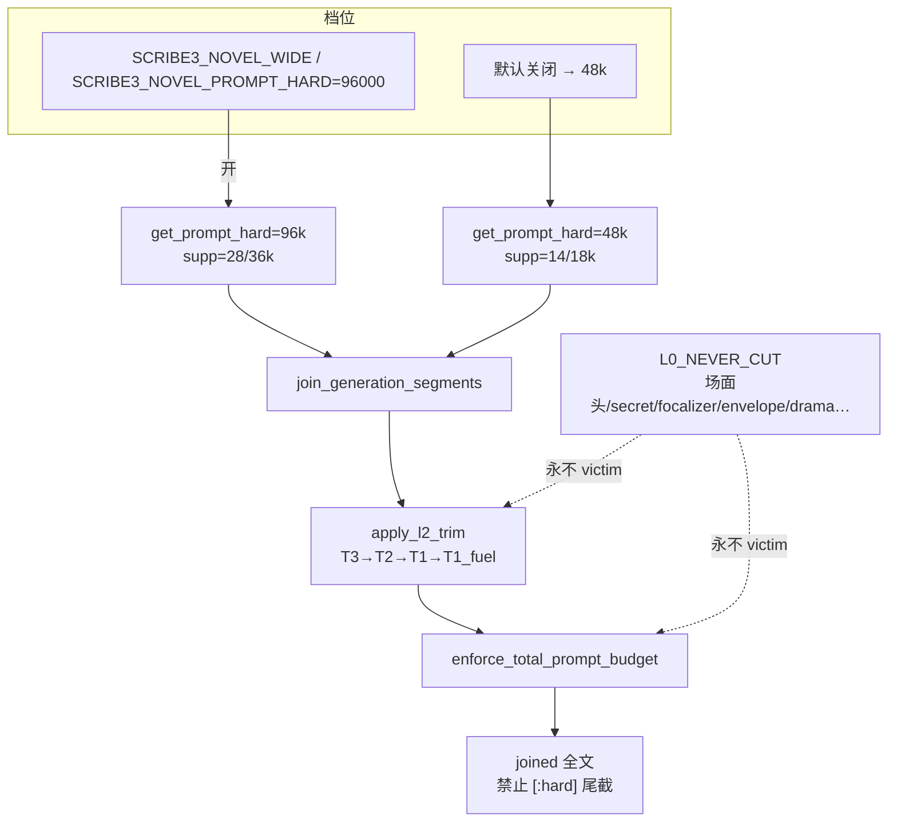

# 预算 / 上下文 · 最优半径（升窗 96k）

| 项 | 值 |
|----|----|
| 短名 | `budget-context-optimal` / `context-optimal` |
| 状态 | **草案 · 待升 96k** |
| 日期 | 2026-08-13 |
| 作者 | Grok Design（待人审签） |
| 对照 HEAD | `bb01748`（`fix(ctx): report whether the scene-contract head was injected`） |
| 定位 | 写路径 **下一阶段主动升窗** 到 96k；承认现网 48k 钉死；把爆炸半径写全、可回滚 |
| 验证 | **仅已部署 demo**（`tonglu.qing.blue` / `82.157.130.140`，`/opt/scribe3/app`）；轻量过滤单测；**不**在 Grok 机跑 `npm ci` / 全量 pytest / 本机 Surreal；不写活书正文 |
| 关联 | 写路径分层：`docs/plans/2026-08-13-scene-contract-unify.md`；审计钉：`docs/audits/ctx-audit-20260813/{FIX-LOOP,MATRIX,CEILINGS}.md` |

---

## Overview

现网写路径（`scribe3/context_budget.py`）生产默认是 **novel 信封 22k + `NOVEL_PROMPT_HARD=48000`**。三燃料已经是独立 supplemental 段（`story_ember` / `story_recall` / `story_causal`，档位 `L2_DROP_TIER["T1_fuel"]`），**不在** `L0_NEVER_CUT`。场面头走 `format_story_contract_head` → `_push("narrative_contract","redline")`，store 与 codec 同构。邻段差集 / compact / 空不 push 已落地。FIX-LOOP 明确：**禁止为刷分加大 48k**。

本设计的解不是「把常量改成 96000 然后全仓改测试」，而是：

1. **终态窗口仍是 96k**（novel 写路径 `get_prompt_hard() → 96000`），48k 不是终态。
2. **落地方式是分档**：默认常量继续钉 48k；`SCRIBE3_NOVEL_PROMPT_HARD=96000`（或等价 `SCRIBE3_NOVEL_WIDE=1`）才升窗。
3. 升窗时 **同步抬 `DEFAULT_SUPPLEMENTAL_{SOFT,HARD}`**（否则 `effective_l2_cap = min(HARD, PH−L0−L1)` 仍被 18k 卡住，96k 只是空数字）。
4. **信封保持 22k**，codex cap 保持 4500，差集纪律保持。多出来的窗是 L2 余量 + 硬顶松弛，不是「把 96k 写满」。
5. 单独成章写清爆炸半径：谁会炸、炸多大、观测、回滚。

```text
现网（默认，必须可一键回到）
  envelope 22k · supplemental 14/18k · prompt_hard 48k · 燃料段帽 1.5/4/2.5k

升窗档（flag 开）
  envelope 22k 不变 · supplemental 28/36k · prompt_hard 96k · 燃料段帽可放宽为窗护栏
  L2 仍 T3→T2→T1→T1_fuel；L0 永不裁；禁止 rendered[:hard] 尾截
```

---

## Background & Motivation

### 现网已落地（本方案必须承认，禁止假装还在旧世界）

对照仓库 HEAD `bb01748`，以下是代码事实，不是卷宗愿望：

| 事实 | 真源 | 旧方案是否过期 |
|------|------|----------------|
| 硬顶 **48k**，不是 96k | `NOVEL_PROMPT_HARD = 48_000`；`get_prompt_hard()` 在 novel+V2 时 **直接返回该常量**，**忽略** `SCRIBE3_PROMPT_HARD` | 旧文状态写「已裁 96k」且分层表写 96k —— **作废** |
| 信封 **22k**（八块之和） | `NOVEL_ENVELOPE_TOKEN_BUDGET = 22_000`，`BLOCK_BUDGETS_NOVEL` | 旧文「信封 32k」—— **作废** |
| supplemental **soft 14k / hard 18k** | `DEFAULT_SUPPLEMENTAL_SOFT/HARD` | 旧文「22/28k」—— **作废** |
| 三燃料独立段、可后裁 | `write_assemble_v1._push(..., "supplemental")` ← `collect_story_fuel_segments`；`GENERATION_SEGMENT_LAYERS["story_*"]="supplemental"`；`L2_DROP_TIER["T1_fuel"]=("story_recall","story_causal","story_ember")` | 分层意图 **保留**；「焊进 L0」已不存在 |
| 场面头 L0，store 同构 | `format_story_contract_head`；`CHAPTER_META_ALLOWED` + `coerce_chapter_json_dict`；`budget_report.narrative_contract_injected` | **保留** |
| prefix 已拆 | 独立 `_push`：`identity` / `write_protocol` / `revision` / `anti_slop`（anti_slop 并入 prefix 短核） | 旧文未写拆分 —— 升窗不得再焊回 |
| envelope 八键可观测 | `envelope_block_lengths` = focus/global/canonical/recent/procedural/reference/uncertainty/provenance | **保留** |
| 邻段差集已做 | craft↔procedural、codex↔canonical、brief_must↔outline/合同、discourse/revelation/write_protocol↔CORE、avoid 默认 omit、revision 非改稿不注入 | **当作升窗前已省下的字节**，禁止平行去重 |
| FIX-LOOP 钉 48k | `docs/audits/ctx-audit-20260813/FIX-LOOP.md`：禁止为刷分加大 `NOVEL_PROMPT_HARD`；约 **38** 个单测 `assert NOVEL_PROMPT_HARD == 48000` | 本设计是 **另一阶段 goal**，不得偷偷改测试口径冒充审计完成 |
| 过期测试仍写 32k/96k | `scribe3/tests/test_novel_first_injection.py`：`sum(BLOCK_BUDGETS_NOVEL)==32_000`、`get_prompt_hard()==96_000` | **已与代码矛盾**；第一刀要修测试对齐现网默认，而不是把代码改回 32k/96k |

### 为何还要升到 96k

48k 在现网算术下几乎贴死：

```text
effective_l2_cap = min(SUPPLEMENTAL_HARD=18k, PROMPT_HARD=48k − L0 − L1)

L1 envelope ≈ 22k（满配）
L0 redline（identity / protocol / secret_guard / focalizer / 场面头 / event_drive|hook /
            drama_* / revelation / sincerity / deduction_final / final_reminder / …）
            典型 4–10k，肥章可更高
→ 余给 L2 的常常 ≤ 18k，且经常被 HARD 先卡住
→ 爆窗时按 T3→T2→T1→T1_fuel 砍；燃料（世界此刻/因果/余烬）会在工艺之后被半裁或整段丢
```

用户目标不是「48k 当终态」，也不是「把字数刀当写戏结论」。48k 是 FIX-LOOP / 注意力密度的 **护栏钉**；96k 是给可后补燃料与世界段留余量的 **下一阶段窗**。升窗必须同时回答：注意力会不会被 22k 信封 + 工艺稀释、限知会不会被后段淹没、测试会不会全红、账单会不会翻倍、如何一键回 48k。

### 痛点（2026-08-13 代码复核）

1. 旧方案正文自相矛盾：既写「不关 42k/48k」又写「窗口硬顶 96k / 信封 32k」。
2. 只改 `NOVEL_PROMPT_HARD` **不够**：`apply_l2_trim` 的 L2 帽是 `min(HARD, PH−L0−L1)`。HARD 仍 18k 时，升到 96k **几乎不增加进模燃料**。
3. `get_prompt_hard()` 在生产默认（novel+V2）**短路返回常量**，现网没有可用的 96k 环境旋钮。
4. 38 个 FIX-LOOP 探针把 `== 48000` 当审计不变量。直接改常量 = 全红 + 破坏「禁止刷分加大」纪律。
5. `test_novel_first_injection.py` 仍断言 32k/96k，是上一刀「已裁 96k」的残骸，会误导下一轮实现。

---

## Goals & Non-Goals

### Goals

1. **终态窗 96k**：novel 写路径在升窗档下 `get_prompt_hard() == 96000`，`get_total_prompt_budget()` 跟随（除非显式 `SCRIBE3_TOTAL_BUDGET`）。
2. **默认仍 48k**，直到单独的「翻默认」PR + demo 浸泡通过。FIX-LOOP 的 48k 钉在翻默认前继续有效。
3. 升窗后 L2 真的吃到余量：`get_supplemental_soft/hard()` 随档变为 28k/36k。
4. 信封 22k、codex 4500、差集/空不 push、L0 集合、T1_fuel 序 **行为不变**（见邻段表）。
5. 爆炸半径可执行：测试分档、观测字段、一键回滚、限知不降级。
6. 验证只打已部署 demo；Grok 机只读 + 轻量抽查。

### Non-Goals

| # | 非目标 | 理由 |
|---|--------|------|
| NG1 | 第一刀把 `NOVEL_PROMPT_HARD` 改成 96000 并改掉全部 `== 48000` | 炸 FIX-LOOP；用户要求第一刀不得全改测试口径 |
| NG2 | 把信封抬到 32k / 把三燃料焊回 L0 | 与现网和注意力原则冲突 |
| NG3 | 再做一套平行去重 | 差集已落地，升窗不是重开审计 |
| NG4 | 关掉 `PROMPT_HARD` / `TOTAL_BUDGET`（`SCRIBE3_TOTAL_BUDGET=999999`） | Hermes/模型爆窗比裁燃料更糟 |
| NG5 | 产品字数刀（四义 40、场面 900、燃料 400/300/240）当质量门 | 字数刀 ≠ 窗口刀 |
| NG6 | 升窗时加大讨论近窗 / 每轮塞 `conversation_history` | 写路径窗 ≠ 讨论窗 |
| NG7 | 加大 `hybrid_recall` k / `causal_chain` depth | 检索 knobs 是另一实验 |
| NG8 | 改 I1–I8（soft 存稿、claim fail-closed、灭灯、revise-span） | 场面主权在 scene-contract-unify |
| NG9 | 作者主表面把 96k 画成「必须写满的进度条」 | 见爆炸半径 §8 |
| NG10 | Grok 机全量测 / 本机 Surreal / 第二套验证栈 | 资源纪律 |

---

## Key Decisions

1. **终态 96k，默认 48k，用显式升窗旗。**  
   理由：FIX-LOOP + 38 钉死测试禁止静默改常量；注意力/成本/模型窗未浸泡；必须一键回滚。`SCRIBE3_NOVEL_PROMPT_HARD=96000` 或 `SCRIBE3_NOVEL_WIDE=1` 才返回 96k。**不**复用 `SCRIBE3_PROMPT_HARD`——生产默认路径根本不读它。

2. **不把 `NOVEL_PROMPT_HARD` 常量改成 96000，直到「翻默认」PR。**  
   理由：该标识符已被审计测试当成「现网默认」。新常量 `NOVEL_PROMPT_HARD_WIDE = 96_000`。翻默认是最后一刀，单独评审。

3. **信封保持 22k，不随窗翻倍。**  
   理由：旧文 32k 与 `BLOCK_BUDGETS_NOVEL` 不符；信封是注意力税最高的中段。窗加倍若信封也加倍，场面头/secret_guard 占比再被稀释。升窗的字节给 L2 余量，不给 envelope 再灌 canon/recent。

4. **升窗必须同步抬 supplemental：soft 28k / hard 36k。**  
   理由：`effective_l2_cap = min(HARD, PH−L0−L1)`。只改 PH 而 HARD=18k，L2 不变。28/36 让燃料和世界段在 96k 下少被砍，同时 **故意不满 96−22=74k**，留下 30k+ 松弛吸收 L0 变肥，避免「有空了就把工艺灌满」。

5. **L2 裁剪序不变：T3→T2→T1→T1_fuel；保护段最后；L0 永不裁。**  
   理由：现网已验证；升窗不是重排注意力。禁止把 `story_*` 加进 `L0_NEVER_CUT` / `DRAMA_CORE_NAMES`。

6. **差集纪律在 96k 下更严，不是更松。**  
   理由：窗变大后模型更易复读。已有 subtract/compact/空不 push **禁止拆除、禁止「有空了就复贴」**。升窗 PR 不得以「现在容得下」回退 omit。

7. **`estimate_tokens ≈ len(text)` 是字符保守上界，96k 不是 tokenizer 真值。**  
   理由：中文真实 token 常 ≥ 字符数。96k 字符在 Qwen3.8-Max（官方评测口径 256k，部分路由 1M）上通常安全；若切到 64k/128k 档模型（部分 `deepseek-chat` 路由）可能真爆窗。升窗档必须记录 `prompt_hard` + `total_est` + 模型名；模型窗 < 2×`prompt_hard` 时拒绝升窗或 fail-loud。

8. **讨论路径不吃写路径 96k。**  
   理由：ChiefDock 现网 `agentic: false`；非 agentic 近窗仍是 `_thread_history_for_prompt` 默认 12/600/2400/8000；agentic 走 `previous_response_id`，**不**传 `conversation_history`。升窗不得把 history 条数/总字符加大。

9. **验证 = 已部署 demo 冒烟，不是改测试口径。**  
   理由：Grok 机内存不够跑全量；FIX-LOOP 的 48k 断言是审计不变量。验收看 `budget-probe.prompt_hard` 与一次 assemble 的 `l2.dropped` / `narrative_contract` 仍在。

10. **回滚只改 env + 热更，不写库。**  
    理由：预算是进程内常量/旗；`budget_report` 不落章。撤回旗后下一次 assemble 即 48k。不可逆数据：**无**（已发出的 LLM 账单不可追回，但稿/合同/秘密列不变）。

---

## Proposed Design

### 1. 一句话架构

```text
profile = novel_48k（默认）| novel_96k（SCRIBE3_NOVEL_PROMPT_HARD=96000 | SCRIBE3_NOVEL_WIDE=1）

get_prompt_hard()
  novel+V2 且 wide → 96000
  novel+V2         → 48000          # 常量 NOVEL_PROMPT_HARD 不动
  其它             → SCRIBE3_PROMPT_HARD 或 42000

get_supplemental_{soft,hard}()
  wide → 28000 / 36000
  默认 → 14000 / 18000
  仍允许 SCRIBE3_SUPPLEMENTAL_* 显式覆盖（运维 denser/tighter）

get_total_prompt_budget()
  SCRIBE3_TOTAL_BUDGET 正整数优先；≥900000 关全域裁
  否则跟随 get_prompt_hard()

信封 / 八块表 / SCENE_BUDGET_PROFILES_NOVEL / DEFAULT_CODEX_INJECT_CAP
  两档共用，不随 wide 变

join_generation_segments → apply_l2_trim → enforce_total_prompt_budget
  算法不变；禁止 rendered[:hard]
```

### 2. 现网 vs 升窗档（以代码为准重算）

| 旋钮 | 现网默认（novel） | 升窗档 `novel_96k` | 谁读 |
|------|-------------------|--------------------|------|
| `NOVEL_PROMPT_HARD` **常量** | **48000 钉死** | **仍 48000** | 38 个审计测试 |
| `NOVEL_PROMPT_HARD_WIDE` | — | **96000**（新常量） | `get_prompt_hard()` |
| `get_prompt_hard()` | 48000 | 96000 | `apply_l2_trim` / `build_budget_report` |
| `DEFAULT_PROMPT_HARD` | 42000 | 不变（非 novel 回滚档） | V2-only / compat |
| `DEFAULT_TOTAL_PROMPT_BUDGET` | 42000（仅 fallback） | 不变；live 跟随 `get_prompt_hard()` | `get_total_prompt_budget()` |
| `NOVEL_ENVELOPE_TOKEN_BUDGET` | **22000** | **22000 不变** | assembler |
| `DEFAULT_SUPPLEMENTAL_SOFT/HARD` | 14000 / 18000 | 函数返回 **28000 / 36000** | `effective_l2_cap` |
| `DEFAULT_CODEX_INJECT_CAP` | 4500 | **4500 不变** | `cap_codex_text` |
| 燃料段帽 `FUEL_CAP_*` | ember 1500 / recall 4000 / causal 2500 | **2500 / 6000 / 4000**（仅 wide；仍是窗护栏） | `format_story_fuel_parts` |
| 检索 | k=5，depth=3，种子 3，行 8，query≤200 | **不变** | `write_assemble_context` |
| L2 序 | T3→T2→T1→T1_fuel | **不变** | `L2_DROP_TIER` |
| L0 | 现网集合 | **禁止增删燃料** | `L0_NEVER_CUT` |

典型头寸（字符≈`estimate_tokens`）：

```text
novel_48k（现网）
  L1 22k + L0 6k + L2_cap 18k ≈ 46k  → 贴 48k 硬顶
  燃料满额 ≈ 1.5+4+2.5 = 8k，常与 craft/codex 争 18k

novel_96k
  L1 22k + L0 6k + L2_cap 36k ≈ 64k  → 距 96k 仍有 ~32k 松弛
  燃料满额 ≈ 2.5+6+4 = 12.5k，不再轻易把余烬挤掉
  禁止把松弛理解成「再灌 32k 工艺」
```



### 3. 常量 / 函数 / flag（具体到符号）

在 `scribe3/context_budget.py`：

```python
NOVEL_PROMPT_HARD = 48_000                 # 不变 · FIX-LOOP 钉
NOVEL_PROMPT_HARD_WIDE = 96_000            # 新
DEFAULT_PROMPT_HARD = 42_000               # 不变
DEFAULT_TOTAL_PROMPT_BUDGET = 42_000       # 不变（fallback）
DEFAULT_SUPPLEMENTAL_SOFT = 14_000
DEFAULT_SUPPLEMENTAL_HARD = 18_000
WIDE_SUPPLEMENTAL_SOFT = 28_000
WIDE_SUPPLEMENTAL_HARD = 36_000

def novel_wide_enabled() -> bool:
    raw = (os.environ.get("SCRIBE3_NOVEL_PROMPT_HARD") or "").strip()
    if raw.isdigit() and int(raw) >= NOVEL_PROMPT_HARD_WIDE:
        return True
    return _env_truthy("SCRIBE3_NOVEL_WIDE", "0")   # 默认关

def get_prompt_hard() -> int:
    if novel_envelope_enabled() and envelope_v2_enabled():
        return NOVEL_PROMPT_HARD_WIDE if novel_wide_enabled() else NOVEL_PROMPT_HARD
    raw = (os.environ.get("SCRIBE3_PROMPT_HARD") or "").strip()
    if raw.isdigit():
        return int(raw)
    return DEFAULT_PROMPT_HARD

def get_supplemental_hard() -> int:
    raw = (os.environ.get("SCRIBE3_SUPPLEMENTAL_HARD") or "").strip()
    if raw.isdigit():
        return int(raw)
    return WIDE_SUPPLEMENTAL_HARD if novel_wide_enabled() else DEFAULT_SUPPLEMENTAL_HARD

def get_supplemental_soft() -> int:
    raw = (os.environ.get("SCRIBE3_SUPPLEMENTAL_SOFT") or "").strip()
    if raw.isdigit():
        return int(raw)
    return WIDE_SUPPLEMENTAL_SOFT if novel_wide_enabled() else DEFAULT_SUPPLEMENTAL_SOFT
```

`feature_flags.py` 增补（`caution`）：

| 旗 | 默认 | 含义 |
|----|------|------|
| `SCRIBE3_NOVEL_WIDE` | `0` | 升窗档总开关 |
| `SCRIBE3_NOVEL_PROMPT_HARD` | `""` | 正整数；`>=96000` 视为 wide（与上者 OR） |

`build_budget_report()` 增补可观测键（不进 prompt）：

- `prompt_hard_profile`: `"novel_48k"` | `"novel_96k"` | `"v2_42k"` | …
- `novel_wide`: bool
- `supplemental_soft` / `supplemental_hard`（现网 l2 报告已有 hard，补 soft）

`story_constraint_prompt.py` 燃料帽改为函数，禁止写死「96k 窗下」却用 48k 数字：

```python
FUEL_CAP_EMBER_DEFAULT, FUEL_CAP_RECALL_DEFAULT, FUEL_CAP_CAUSAL_DEFAULT = 1500, 4000, 2500
FUEL_CAP_EMBER_WIDE, FUEL_CAP_RECALL_WIDE, FUEL_CAP_CAUSAL_WIDE = 2500, 6000, 4000

def fuel_caps() -> tuple[int, int, int]:
    if novel_wide_enabled():
        return FUEL_CAP_EMBER_WIDE, FUEL_CAP_RECALL_WIDE, FUEL_CAP_CAUSAL_WIDE
    return FUEL_CAP_EMBER_DEFAULT, FUEL_CAP_RECALL_DEFAULT, FUEL_CAP_CAUSAL_DEFAULT
```

`format_story_fuel_parts` 用 `fuel_caps()`。注释改为：「窗护栏，不是写够才算；48k 用 DEFAULT，96k 用 WIDE。」

### 4. 物理序与裁剪（升窗后仍成立）

```text
identity / write_protocol / prefix / revision / structure_diversity /
continue_snapshot / secret_guard / focalizer /
narrative_contract          ← 仅场面头，L0
story_ember / story_recall / story_causal   ← supplemental，T1_fuel
event_drive | event_drive_hook
drama_contract / drama_vacuum / outline /
envelope / codex / … / final_reminder
```

断言（已有测试，升窗不得破坏）：

- `narrative_contract < story_ember < event_drive`（有燃料时）
- `story_* not in L0_NEVER_CUT`
- 超窗：先 T3 工艺（material_recall / discourse_soft / story_move / storyline_polish / reference_craft / seed_words / author_prefs）→ T2 craft/phase/avoid/volume/request_constraint → T1 codex/purpose/pressure → **T1_fuel：recall → causal → ember** → 最后才半裁 `outline`/`brief_must`/`voice_anchor`

`join_generation_segments` 两段裁剪都保留：

1. `apply_l2_trim`：L2 超 `effective_l2_cap` 则半裁/丢 supplemental；再若 `_total()>prompt_hard` 整段丢 supplemental。
2. `enforce_total_prompt_budget`：全域再走同一 victim 序。  
**禁止**对 joined 做 `rendered[:hard]`。

### 5. 与模型 / 网关真窗

| 路径 | 现网默认 | 估窗 | 96k 字符是否安全 |
|------|----------|------|------------------|
| 写路径 `with_tools=False` | Qwen 官方 `qwen3.8-max-preview`（`settings` 默认 `llm.model`） | 评测口径 256k；部分路由宣称 1M | **通常安全**（96k 字符 + 生成 + 系统开销 ≪ 256k） |
| 写路径 `with_tools=True` | Hermes Responses `HERMES_RESPONSES` + profile `scribe3` | 网关再挂 MCP / 可能回放 previous | **未知叠加**；须看 demo 实际 `usage.prompt_tokens` |
| 讨论 agentic | 同上 Hermes；现网 UI `agentic:false` | 同左 | 本设计 **不升** 讨论窗 |
| 讨论非 agentic | `hermes_complete_stream` + Scribe 近窗 12/600/8k | 近窗本身 < 12k 字符 | 不改 |

`estimate_tokens` **不是** Qwen/DeepSeek tokenizer。中文真实 token 往往 ≥ `len(text)`。因此：

- 内部预算继续用字符上界（与 assembler 同口径，避免两套尺）。
- 升窗档验收必须对比 **供应商 `usage.prompt_tokens`** 与 `budget_report.l2.total_est`。若 `prompt_tokens > 0.85 × 模型窗`，关 wide 回 48k。
- 若 demo 切到 `deepseek-chat` 且供应商窗 ≤ 128k：96k 字符 **禁止作为默认**，保持 48k。

### 6. 写路径接线（不重做燃料）

保持现网，不平行实现：

- `write_assemble_v1._render_final_input`：场面头 `_push("narrative_contract","redline")`；`collect_story_fuel_segments` 三段 supplemental。
- `write_assemble_context.load_chapter_story_inputs`：合同 / traces / 声口 / 上章 `end_hook` / `hybrid_recall(k=5)` / `causal_chain(depth=3)`。
- `story_constraint_prompt.format_story_constraint_block`：仍只出 head（span / 旧测）。
- `injection_registry`：三燃料 `SegmentMeta(..., "L2", "head", "world")`，**不要**改成 L0。

升窗只改预算函数 + 燃料帽函数 + report 字段。

### 7. 讨论路径（本设计只锁边界）

现网：

| 通道 | 行为 |
|------|------|
| `/chat/stream` | 每轮 `_thread_history_for_prompt(..., max_msgs=12, max_chars_each=600, last_assistant=2400, max_total=8000)` + 早期摘要 ≤1600 |
| `/chat/agentic-stream` | `previous_response_id` 续接；**不**传 `conversation_history`；**不**把近窗拼进 input。掉链时 **没有** 旧方案写的「重建近窗前缀」（缺口另案，不绑 96k） |
| UI | `ChiefDock.jsx` `agentic: false` |

本设计：**96k 不改变上表任何默认。** 禁止有人「反正窗大了」把 12→80 或拆掉总字符帽。

---

## API / Interface Changes

| 面 | 变更 |
|----|------|
| HTTP 写/讨论路由 | **无**新路径。assemble 行为仅随 env 变顶 |
| `GET` injection-trace / budget-probe | 多返回 `prompt_hard`（已有）、`prompt_hard_profile`、`novel_wide`、`supplemental_hard` |
| `feature_flags` / `/debug/flags` | 登记两新旗 |
| 作者 UI | **不**把 96k 画成目标字数。上下文检查器八块仍是信封 22k 词元，不改文案口径 |
| MCP / store / 章 meta | **无 schema 变更** |

`budget_probe` 现网 `effective_L2_est = prompt_hard - envelope`（把 L0 算进 L2 余量，偏乐观）。升窗后应改为：

```text
effective_L2_est = min(supplemental_hard, max(0, prompt_hard - envelope - l0_est_or_0))
```

若 probe 无 L0 实测，标明 `l0_est=0 时偏乐观`，assemble mode 用真实 `l2.effective_l2_cap`。

---

## Data Model Changes

**无表、无列、无迁移。**

预算是进程 env + 纯函数。`narrative_contract` JSON 列、`CHAPTER_META_ALLOWED`、codec **不动**。`budget_report` 仍进程内（`get_last_write_budget_report`），重启即空。

回滚无脏数据。已产生的 Hermes `previous_response_id` 链与 48/96 无关（讨论不升窗）。

---

## 爆炸半径

每一面：严重度、触发、缓解、观测、回滚点。缺一不可。

### B1. 生成质量（灌水 / 复读 / 差集被忽视）

| | |
|--|--|
| **严重度** | **高** |
| **触发** | wide 开后 L2 从 ~18k 放到 36k；模型看见更多 craft/codex/燃料原文；作者或实现者觉得「有空了」把 avoid omit、canonical↔codex 差集、CORE 差集拆掉 |
| **机制** | 长上下文复读邻段；工艺段把场面头挤出注意力中段；燃料与 envelope.canonical 同事实两份 |
| **缓解** | KD-6：升窗 PR **禁止**回退差集。燃料帽 WIDE 仍封顶（12.5k 总量级）。codex cap 4500 不动。`signal_density_proxy` 不得因 total 变大而改公式含义——分母变大时 drama 占比下降是 **预期告警**，不是把戏剧段灌长来刷密度 |
| **观测** | `budget_report.domain_lengths` + `l2.dropped`；`canonical_codex_echoes_dropped` / `procedural_dedup_dropped`；抽 3 章 demo 人工看是否复读设定；QC `duplicate_lines` / filler |
| **回滚点** | 关 `SCRIBE3_NOVEL_WIDE`；差集代码不随旗关 |

### B2. 限知 / 秘密

| | |
|--|--|
| **严重度** | **高**（产品红线） |
| **触发** | L0 的 `secret_guard` / `focalizer` / `deduction_final` 永不裁，但 96k 里它们占比从 ~数个百分点降到一半；后段 `story_recall` 若漏掩码、或 deduction 非焦点 unaware 泄漏，更不易被模型「看见禁令」 |
| **现网已有护栏** | recall 入口 `secret` → `🔒 私密`（`_hybrid_recall_for_write`）；非焦点 unaware 不进 `deduction_final`；`secret_guard` 独立 redline；`reveal_secret_ids` 在 `CHAPTER_META_ALLOWED` |
| **缓解** | **禁止**为升窗放松掩码或把 guard 挪出 L0。WIDE 燃料加长时仍走同一 `_hybrid_recall_for_write`。物理序保持 guard/focalizer **在** 场面头与燃料 **之前**。不得把 recall 改 L0 |
| **会不会变差？** | 掩码逻辑不变则 **泄漏面不增大**；注意力稀释可能使模型 **更不遵守** 已注入的禁令（遵守率风险，不是新泄漏源）。缓解：保持 guard 短、靠前；`final_reminder` 仍 L0 尾部点限知 |
| **观测** | 单测 `test_story_fuel_wire.test_secret_masked_on_recall_entry`（48k/96k 都跑）；demo 带 secret 事实的章 assemble，joined 不得出现真名；`budget_report` 确认 `secret_guard` 段仍在 `segment_names` |
| **回滚点** | 关 wide。秘密列/揭示覆盖 **不**因升窗改写，无数据回滚 |

### B3. 注意力（场面头 / event_drive / 信封 22k 被稀释）

| | |
|--|--|
| **严重度** | **高** |
| **触发** | 同一 22k 信封 + ~1k 场面头，分母从 48k → 实际填充 ~64k（或被误填到 90k+） |
| **数字** | 场面头满四义+3 痕迹通常 **< 800 字符**。48k 里约 1.5%；64k 里约 1.2%；若有人把信封改 32k 再填满 96k，场面头 < 1%。event_drive 短标题「本章冲突时钟」同样被稀释 |
| **缓解** | 信封 **不涨**。L2 hard **36k 不是 74k**。outline 仍可靠前（`SCRIBE3_OUTLINE_AFTER_DRAMA=1`）。有合同只出 `event_drive_hook`，不双嘴。禁止用「密度 KPI」把 drama 段注水 |
| **观测** | `signal_density_proxy`（drama_redline / total）；`density_trace.drama_core_share`；`envelope_block_lengths` 八键绝对值应与 48k **同量级** |
| **回滚点** | 关 wide。若已误改信封表，回滚 commit（比关旗重） |

### B4. 成本与延迟

| | |
|--|--|
| **严重度** | **中**（账单） / **中**（超时） |
| **触发** | 每次写请求 prompt 字符中位数从「贴 40–48k」升到「50–64k」，最坏接近 96k；prefill 近似线性；`hermes_responses_events` 默认 `timeout=600` |
| **粗算** | 日帽 `SCRIBE3_DAILY_CALL_CAP` 默认 **500 次调用**（计笔数，**不计 token**）。token 只进 `provider_usage` 台账。若均次 input 从 48k→80k token，日 token 约 +60%。Qwen3.8-Max 量级若按 ~$2/1M input，500 次 × 32k 增量 ≈ **$32/日** 量级（订单以供应商账单为准，此处只数量级） |
| **demo 机** | 热更后端不加重构建；推理在网关/官方 API，**不**在 Grok 机。demo 机风险是 SSE 占连接与日志变大，不是本机 OOM |
| **缓解** | 不满灌；codex/信封不涨；观察 p95 写耗时。日帽仍是笔数保险丝——**不够**挡 token 膨胀，须看 `usage_summary` / ChiefDock H-10 |
| **观测** | Outcome `usage.prompt_tokens`；`context_cache` 的 `context_tokens_p95`；写 SSE 是否 600s 内 `response.completed` |
| **回滚点** | 关 wide。已产生账单不可逆 |

### B5. 测试与契约（改一个常量全红）

| | |
|--|--|
| **严重度** | **高**（工程） |
| **谁会炸** | 至少 38 个文件 `assert NOVEL_PROMPT_HARD == 48000`（FIX-LOOP 探针：`test_secret_guard_segment`、`test_deduction_final_cap`、`test_envelope_block_lengths`、`test_prefix_split`、`test_codex_canonical_diff`…）。另：`test_novel_first_injection.py` **已经**按 32k/96k 写，与 HEAD **不一致**（`test_block_budgets_v2_sum_18000` 期望 novel=32k；`test_default_is_novel_22k_and_prompt_hard_48k` 函数名写 22k/48k，**函数体却断言 32k/96k**） |
| **触发** | 把 `NOVEL_PROMPT_HARD` 改成 96000；或让 `get_prompt_hard()` 无旗返回 96k |
| **缓解 / 分档** | **第一刀不得改那 38 条。** 新增 `test_novel_wide_profile.py`：默认 `get_prompt_hard()==48000`；monkeypatch env 后 `==96000` 且 `effective_l2_cap` 随 HARD 变。把 `test_novel_first_injection.py` **改回与代码一致的 22k/48k**，并加 wide 用例。38 钉只在「翻默认」PR 才改成「默认常量仍叫 NOVEL_PROMPT_HARD 但值=96000」或改断言为 `in (48000, 96000)` —— **不建议**后者，会让审计钉变钝 |
| **与 FIX-LOOP 关系** | FIX-LOOP 仍要求「未开 wide 时常量=48000」。本设计是独立 goal，不是 ctx-audit-fix 的刷分手段 |
| **观测** | 过滤单测：`test_novel_wide_profile` + `test_story_fuel_wire` + `test_r8_story_constraint_assemble`（demo 机或已有 venv，**不是** Grok 机全量） |
| **回滚点** | 代码回滚该 PR。测试文件不在生产路径 |

### B6. join / 裁剪算术

| | |
|--|--|
| **严重度** | **高**（正确性） |
| **触发** | 只改 PH 不改 HARD；或有人在 join 末尾加 `joined[:hard]`「保底」；或 `enforce_total_prompt_budget` 与 `apply_l2_trim` 双裁把 L0 误标 supplemental |
| **现网不变量** | `apply_l2_trim` / `enforce_total_prompt_budget` 文档与实现均 **禁止** `rendered[:hard]`。L0 / `layer=="redline"` 永不 victim。outline 半裁保拍 |
| **升窗后** | 不变量 **仍成立**。变化只是 `ph` 与 `hard` 变大，循环更少进入。`over_budget=true` 在 96k 应显著变少；若仍 true，说明 L0+L1 已 >96k（异常肥，须查哪段误进 L0） |
| **缓解** | 单测：构造 L0=8k + env=22k + 燃料 20k + craft 20k，wide 下燃料应几乎保留、craft 先被砍；关 wide 时燃料被 T1_fuel 半裁，场面头仍在 |
| **观测** | `l2.effective_l2_cap`、`l2.dropped`、`total_enforce.over_budget`、`final_reminder_kept` |
| **回滚点** | 关 wide。若有人加入尾截，必须 revert 该代码（旗关救不了尾截） |

### B7. 讨论路径（Hermes 锚 vs Scribe 近窗）

| | |
|--|--|
| **严重度** | **中**（若误加大 history 则 **高**） |
| **触发** | 实现者把 96k 理解成「对话也可以塞 80 条全文」；或 agentic 同时传 `previous_response_id` + `conversation_history`（双份）；或掉链重建时把近窗拼进 **写路径** instructions |
| **现网** | 写路径 join **不含** 讨论 history。讨论近窗仅 `/chat/stream`。agentic 只锚续接 |
| **缓解** | KD-8。升窗 PR diff 不得改 `prompt_blocks._thread_history_for_prompt` 默认参数、不得在 `chat_agentic_stream` 加 `conversation_history=`。掉链重建是 **独立讨论债**，不在本 goal 实施 |
| **观测** | agentic 请求体无 `conversation_history`；写路径 `domain_lengths` 无 history 段名 |
| **回滚点** | 讨论代码本就不该改；若改了则 revert 讨论文件，与 wide 旗无关 |

### B8. 产品文案（作者把 96k 当必须写满）

| | |
|--|--|
| **严重度** | **中**（产品） |
| **触发** | 设置页/检查器/进度条出现「上下文 96k」「还可以再塞 3 万字」；或主编说「窗还没满继续补设定」 |
| **现网文案** | 检查器：「八块预算、来源与弃用理由」；顶栏字数是 **章正文**，不是 prompt。`BriefPanel`「超预算未注入」指材料条数 |
| **缓解** | **禁止**把 `prompt_hard` 暴露为作者目标。调试面（injection-trace / budget-probe）仅登录作者，文案写「引擎硬顶 / 字符上界，不是本章应写字数」。不改 `BookSection` 整稿目标字数语义 |
| **观测** | 前端 diff 无 96000 展示；产品文案评审 |
| **回滚点** | 撤 UI 文案。无数据 |

### B9. 回滚（一键回 48k）

| 步骤 | 动作 |
|------|------|
| 1 | demo 热更真源 env（`/opt/scribe3/app/deploy/prod/.env`，见 `scripts/deploy_demo.sh` / scene-contract-unify）：删除 `SCRIBE3_NOVEL_WIDE` 与 `SCRIBE3_NOVEL_PROMPT_HARD`，或显式 `SCRIBE3_NOVEL_WIDE=0` |
| 2 | `./scripts/deploy_demo.sh hot` 热更 backend（或只重启 `prod-backend-1` 使 env 生效——以脚本现行行为为准） |
| 3 | `curl` budget-probe：`prompt_hard==48000`、`novel_wide==false` |
| 4 | 一次 assemble：`l2.prompt_hard==48000`，场面头仍在 |

| | |
|--|--|
| **严重度** | 回滚本身 **低风险** |
| **不可逆** | LLM 账单；已写出的正文（内容质量）—— **不**自动删稿。合同/秘密/章 meta **无**因升窗产生的新列 |
| **缓存** | 检索 TTL（`context_cache` 60s/30s）不含 joined prompt；最多数十秒脏检索，不含 96k 正文指令。进程内 `get_last_write_budget_report` 重启即空 |
| **禁止** | force-push；清空 demo Surreal；为回滚改测试钉 |

### B10. 邻段交互表（MATRIX 仍占窗的大段）

「变」= 进模字节可能变长或更少被裁。「禁止变」= 升窗 PR 不得改其生成/去重/L0 归属。

| 段 | 现网层/档 | 96k 后 | 纪律 |
|----|-----------|--------|------|
| `envelope`（22k 八块） | L1 / 永不裁 | **行为不变**；绝对值不应涨 | **禁止**改 `BLOCK_BUDGETS_NOVEL` / 场景表总额 |
| `canonical`（信封内） | 差集相对 codex | **不变** | **禁止**拆 `subtract_canonical_lines_in_codex` |
| `codex` | T1，cap 4500 | 更不易被裁掉，但 cap **不变** | **禁止**加大 `DEFAULT_CODEX_INJECT_CAP` 当「用掉 96k」 |
| `craft` | T2，相对 procedural 去重 | 更不易被裁 | **禁止**拆去重；有空仍先于燃料留着（序不变） |
| `procedural`（信封） | 相对 craft compact | **不变** | 禁止复贴 |
| `outline` | 保护段，半裁保拍 | **行为不变**；更少半裁 | 禁止改 keep_beats |
| `brief_must` | 保护；相对大纲/合同差集 | **不变** | 禁止复贴四义 |
| `drama_contract` / `drama_vacuum` | L0 | **不变** | 禁止加长灌水刷密度 |
| `event_drive` / `event_drive_hook` | L0 / supplemental | **不变** | 有合同只 hook |
| `narrative_contract` | L0 | **不变**（作者原文） | 禁止 40 字刀、禁止焊燃料 |
| `story_ember/recall/causal` | T1_fuel | **变**：帽放宽、更晚被裁 | 禁止进 L0；recall 必须掩码 |
| `secret_guard` / `focalizer` / `deduction_final` | L0 | 文本 **不变**；相对占比下降 | 禁止后移、禁止加长设定 |
| `identity` / `write_protocol` / `revision` / `prefix` | L0 | **不变** | revision 非改稿仍不注入 |
| `revelation_discipline` / `sincerity` / `final_reminder` | L0，相对 CORE 差集 | **不变** | 禁止拆差集 |
| `material_recall` / `reference_craft` / `storyline_polish` / `discourse_soft` | T3 | 更不易被裁 | 仍最先丢；禁止抬成 T1 |
| `avoid` / `seed_words` / `volume_intro` / `phase_role` | T2/T3，空不 push | **不变** | 禁止「有空就默认注入」 |
| `pressure_drive` / `purpose` | T1 | 更不易被裁 | 仍对合同 traces / global 差集 |
| `provenance` | 额度 0 | **不变** | CEILINGS：进模必须为 0 |
| `story_move` | 无计划零字节 | **不变** | 禁止无计划灌卡 |

---

## 与旧方案的 diff

旧文路径相同、状态曾写「实施中 · 已裁 96k」。对照 HEAD，条款处置：

### 保留

- 字数刀 ≠ 窗口刀；禁止 400/900/40 当质量结论。
- 场面头 L0，燃料独立段可后裁；禁止燃料进 `L0_NEVER_CUT` / `DRAMA_CORE_NAMES`。
- 物理序 `narrative_contract < story_ember < event_drive`。
- T1_fuel 段内 recall → causal → ember；整体晚于 T3/T2/T1，早于 outline 保护段。
- `format_story_contract_head` / `format_story_fuel_parts` 拆分；assemble 禁止把燃料拼回 head。
- `field_line` 默认不截四义；禁止节不复贴四行。
- 有合同不把 `event_drive` 锯成 120 字「为合同让路」。
- 因果失败 `record_write_soft_fail`，不装成无链。
- 检索 knobs 收回 k=5 / depth=3 / 种子 3 / 行 8 / query≤200 / 标题≤80。
- 讨论：有 Hermes 锚不灌 `conversation_history`；双通道互斥。
- 不重开 I1–I8 / 宣称 / 灭灯。
- 验证只打 demo。

### 作废或改写

| 旧句 | 处置 |
|------|------|
| 状态「实施中 · 已裁 96k」 | **作废**。现网 48k；本文是待升草案 |
| 「不关 `PROMPT_HARD` / `TOTAL_BUDGET`（42k/48k 仍在）」与「窗口硬顶 novel **96k**」并列 | **自相矛盾，作废**。现网默认 48k；96k 是 wide 档 |
| 「信封 32k；supplemental soft 22k / hard 28k」 | **作废**。现网 22k / 14k / 18k；升窗档信封仍 22k，supp 改为 28/36 |
| 把 96k 写成已落地分层真源 | **作废**。分层真源以 `context_budget.py` 为准 |
| 单 PR 一把梭含讨论近窗 20/1200/12000 | **缩小**。讨论默认保持 12/600/8000；近窗加长是另 PR |
| 「agentic 掉链则近窗写进 input」当本方案必做 | **降级为 Open Question / 另债**。现网未做，不绑升窗 |
| 燃料帽注释「96k 窗下」却 1500/4000/2500 | **改写**为分档帽 |
| 实施节不写爆炸半径、不写 38 钉测试 | **由本文补全** |

---

## Alternatives Considered

| 方案 | 做法 | 弃因 |
|------|------|------|
| A. 生产默认直接 96k | `NOVEL_PROMPT_HARD=96000`，改 38 测 | 第一刀全红；FIX-LOOP 钉被毁；注意力/成本未浸泡；无廉价回滚 |
| B. 只改 PH 不改 supplemental | 窗面 96k，L2 仍 18k | **升窗是假的**；燃料仍先死；还付了「看起来很大」的产品误解 |
| C. 信封 32k + supp 22/28（旧文） | 与 `BLOCK_BUDGETS_NOVEL` 22k 冲突；注意力税加倍 | 作废；现网差集已按 22k 调过 |
| D. 关硬顶（`TOTAL_BUDGET=999999`） | 完全放开 | Hermes/模型爆窗；L0 无法保护注意力；旧文已弃 |
| E. 燃料进 L0 | 48k/96k 都砍不到余烬 | 挤死信封/codex；与可后裁矛盾 |
| F. 复用 `SCRIBE3_PROMPT_HARD` | 少一个旗 | 生产默认路径 **不读** 该变量；运维会以为设了 96k 其实仍 48k |

本方案 = **分档 96k（A 的终态 + 不是 A 的第一刀）+ 真抬 L2（拒绝 B）+ 信封不动（拒绝 C）**。

---

## Security & Privacy Considerations

- 升窗 **不**改变 secret 掩码、`reveal_secret_ids`、限知投影。风险是 **遵守率** 而非新通道（见 B2）。
- `budget-probe` / injection-trace **永不回传完整 prompt**（现网已遵守，升窗保持）。
- 更长 `story_recall` 仍必须掩码；单测在 wide 下重跑。
- 讨论不升窗，降低「世界观全案进气泡」风险。
- env 只在 demo 服务器，**不**提交 git。

---

## Observability

| 信号 | 位置 | 升窗后怎么用 |
|------|------|----------------|
| `prompt_hard` / 新 `prompt_hard_profile` / `novel_wide` | `build_budget_report`、budget-probe、injection-trace | 验收档位 |
| `l2.effective_l2_cap` / `dropped` / `over_budget` | 同上 | 48k 常见 dropped；96k 应明显减少 T1_fuel 半裁 |
| `domain_lengths` / `envelope_block_lengths` | 写路径 report | 信封绝对值不涨；燃料可涨 |
| `narrative_contract_injected` | `write_assemble_v1` | 必须仍 true（有合同时） |
| `signal_density_proxy` / `drama_core_share` | density_trace | 分母变大则占比下降 → 告警阈值按 profile 分档，禁止改公式刷分 |
| `usage.prompt_tokens` | Outcome / H-10 台账 | 与字符估对比；>0.85 模型窗则关 wide |
| soft_fail `empty_story_*` | 计数器 | 与窗无关；空/失败仍可区分 |

告警建议（demo 人工即可，不强制新系统）：

- wide 开且 `over_budget=true` → 查 L0 膨胀。
- wide 开且 `drama_core_share < 0.5 × 48k 基线` → 注意力稀释，考虑关 wide 或砍 T3 注入。
- `provenance_in_prompt_tokens > 0` → 与升窗无关，立即修。

---

## Rollout Plan

```text
PR1 机械（默认仍 48k）
  → 过滤单测绿（含新 wide 测 + 修 stale 32k/96k 测）
  → 不改 demo env

PR2 观测字段 + flags 登记
  → demo 热更后 probe 能看见 novel_wide=false, prompt_hard=48000

PR3 demo 升窗浸泡（只改服务器 env）
  → SCRIBE3_NOVEL_WIDE=1
  → deploy_demo.sh hot
  → 冒烟：probe=96000；assemble 场面头在、secret 掩码、信封八键量级不变
  → 观察 ≥1 个写作日的 usage / 密度 / 人工抽章

PR4（可选，不阻塞）讨论债：掉链近窗重建 —— 独立评审

PR5 翻默认（需人审）
  → 仅当 PR3 浸泡无 B1/B2/B4 恶化
  → 改常量或默认旗；此时才改 38 钉
  → 仍保留关旗回 48k 的能力一个版本
```

回滚：任何阶段撤 env / revert 单 PR。见 B9。

---

## Open Questions

1. **翻默认的冻结条件？** 建议：demo 连续 N 次写（N=20）`usage.prompt_tokens < 0.85×模型窗`、无 secret 真名进 joined、人工 3 章无明显复读。需产品拍板 N。
2. **Hermes+工具的真窗余量？** 须在 demo 对 `with_tools=true` 写一次，读 Outcome usage。若工具回放把真 token 推到危险区，wide 仅允许 `with_tools=false` 纯生成。
3. **agentic 掉链重建近窗** 是否另开 goal？现网未做，本设计不绑。
4. **燃料 WIDE 帽 2500/6000/4000 是否仍太大？** 可先只抬 HARD、帽保持 1500/4000/2500，看 T1_fuel 是否还被砍再放帽。
5. **`test_novel_first_injection.py` 在 CI 是否已跳过/失败？** 第一刀必须对齐 22k/48k，避免两人各改一边。

---

## References

- 现网真源：`scribe3/context_budget.py`、`scribe3/api/services/write_assemble_v1.py`、`write_assemble_context.py`、`story_constraint_prompt.py`、`injection_registry.py`、`narrative_contract.py`、`chapter_meta_codec.py`、`store/chapters.py`
- 审计：`docs/audits/ctx-audit-20260813/FIX-LOOP.md`、`MATRIX.md`、`CEILINGS.md`
- 场面主权：`docs/plans/2026-08-13-scene-contract-unify.md`
- 部署：`scripts/deploy_demo.sh`、`scribe3/DEPLOY.md`
- 模型默认：`scribe3/settings.py` `llm.model` = `qwen3.8-max-preview`；Hermes `HERMES_RESPONSES_API`

---

## PR Plan

### PR1 — `feat(context): 96k 升窗档机械，默认仍 48k`

- **影响文件**：`scribe3/context_budget.py`；`scribe3/story_constraint_prompt.py`（`fuel_caps()`）；`scribe3/feature_flags.py`；`scribe3/tests/test_novel_wide_profile.py`（新）；`scribe3/tests/test_novel_first_injection.py`（把 32k/96k 断言改回 **22k/48k**，另加 wide 用例）；`docs/plans/2026-08-13-budget-context-optimal.md`（若实现时微调数字）
- **依赖**：无
- **变更摘要**：加入 `NOVEL_PROMPT_HARD_WIDE`、`novel_wide_enabled()`、分档 `get_prompt_hard` / `get_supplemental_*`。**不**改 `NOVEL_PROMPT_HARD=48000`。**不**改那 38 个 `== 48000`。**不**改 demo env。单测：默认 48k；env 开后 96k 且 `effective_l2_cap` 随 36k HARD 变；关旗回到 48k；超窗场面头仍在、recall 先于 ember 被裁。
- **验证**：过滤上述测试（已有 venv 的机器或 demo 容器内 `python -m pytest` **点名文件**）。不跑全量。

### PR2 — `feat(context): budget-probe / report 暴露 novel_wide`

- **影响文件**：`context_budget.build_budget_report`；`api/routers/misc_routes.py`（budget-probe / injection-trace）；`scribe3/tools/sample_budget_report.py`（结论句从「48k 头寸够用」改为按 profile 分支）；相关小测
- **依赖**：PR1
- **变更摘要**：报告增加 `prompt_hard_profile`、`novel_wide`、`supplemental_hard/soft`。probe 的 L2 余量公式写清是否含 L0。作者 UI 不展示 96k 目标。
- **验证**：demo `deploy_demo.sh hot` 后登录打 budget-probe：`prompt_hard=48000`，`novel_wide=false`。

### PR3 — `ops(demo): 打开 novel_96k 浸泡`

- **影响文件**：仅 demo 服务器 `/opt/scribe3/app/deploy/prod/.env`（**不入库**）；可选 `scribe3/DEPLOY.md` 补两行旗说明
- **依赖**：PR1+PR2 已在 `origin/main` 并热更
- **变更摘要**：`SCRIBE3_NOVEL_WIDE=1`。热更/重启 backend。冒烟清单：
  1. `GET` budget-probe → `prompt_hard=96000`
  2. 容器内或调试面 assemble 一带合同+长召回的章 → `narrative_contract_injected=true`，四义原文在，secret 真名不在 joined
  3. `envelope_block_lengths` 总和仍约 22k 量级
  4. `l2.dropped` 相对升窗前减少 T1_fuel
  5. Outcome `prompt_tokens` 记录下来
- **回滚**：删旗，再 hot。不写活书。

### PR4 — `docs/fix(discuss): 钉死近窗不随 96k 膨胀`（可选、可并行）

- **影响文件**：`scribe3/api/services/prompt_blocks.py`（仅注释/断言默认仍 12/600/8000）；`scribe3/api/routers/misc_routes.py`（注释禁止 conversation_history）；`scribe3/tests/test_chat_persist_paths.py` 或小测锁默认参数
- **依赖**：无（建议不与 PR1 同 PR，避免审查面混）
- **变更摘要**：把「写路径升窗 ≠ 讨论升窗」写成测试钉。**不**实现掉链重建。
- **验证**：点名近窗测试。

### PR5 — `feat(context): 默认翻到 96k`（需人审，最后一刀）

- **影响文件**：`context_budget.py`（`novel_wide_enabled` 默认 true，**或** `NOVEL_PROMPT_HARD=96000` 并保留关旗回 48k）；那 38 个 FIX-LOOP 钉；`FIX-LOOP.md` / `MATRIX.md` 头注「现网硬顶」一句；`feature_flags` 默认
- **依赖**：PR3 浸泡通过 + 人审 Open Question 1
- **变更摘要**：生产默认 96k。关 `SCRIBE3_NOVEL_WIDE=0` 仍回 48k 至少一个版本。更新审计卷宗，避免下一轮 FIX-LOOP 把 96k 当刷分回滚。
- **验证**：demo 默认 probe=96000；关旗 probe=48000；过滤 38 钉 + wide 关档测试。

---

*本文取代同路径旧稿（「已裁 96k / 信封 32k / 不关 48k」自相矛盾版）。短名与日期保留。*
