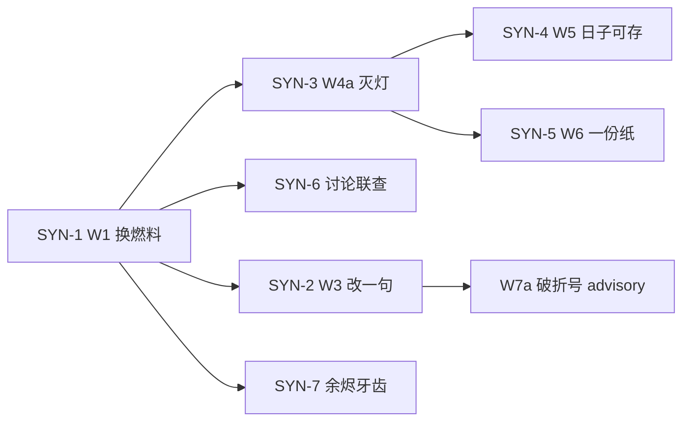

# 最终方案：写出好小说（铜炉 / scribe3）

| 项 | 值 |
|----|-----|
| **短名** | `final-good-novel-plan` |
| **地位** | **产品方案 SSOT / 北极星**（2026-08-13）。**实施入口**改指 [`2026-08-13-final-improvement-r8.md`](./2026-08-13-final-improvement-r8.md)（R8 裁断作者默认 / 无人值守 / 逃生封堵） |
| **日期** | 2026-08-13 |
| **产品** | 铜炉 · `scribe3/` |
| **验证** | 仅已部署 demo `https://tonglu.example.com` · `/opt/scribe3/app` · env **`/opt/scribe3/app/.env`** |
| **合法写** | orch / `save-chapter` / MCP `s3_*`；禁止 EMERGENCY 默认 |
| **本轮范围** | 方案与排期；**不**自动开工写代码 |

### 分层读法（防第三套公式）

| 你要什么 | 读哪份 |
|----------|--------|
| **先读这份** | 北极星、因果链、七条 P0、验收改口、明确不做 |
| **开工 / 写路径默认（R8）** | [`2026-08-13-final-improvement-r8.md`](./2026-08-13-final-improvement-r8.md) |
| 宣称 / 灭灯 / 存稿 soft 真值表 | [`2026-08-13-narrative-engine-product-mainline.md`](./2026-08-13-narrative-engine-product-mainline.md) |
| 合同怎么进 prompt、一句句改、allowlist（附录） | [`2026-08-13-write-path-story-constraints.md`](./2026-08-13-write-path-story-constraints.md) |
| beat_shape / story-ack / 旗矩阵 | [`2026-08-13-narrative-mainline.md`](./2026-08-13-narrative-mainline.md) |
| 四方审计原文 | [`docs/evidence/system-audit-20260813/`](../evidence/system-audit-20260813/) |

冲突时：**产品观感与 P0 名称以本文为准**；**排期与作者默认边界以 R8 为准**（融合稿里的字数地板 / 关 explore / draft 灌方法论不作默认）；宣称公式机判不另开；写路径载荷以 R8（禁止 `_push(format_contract_block)`）。

---

## 1. 北极星（一句话）

作者能稳定写出**人话、有戏、可续**的长篇。

- **人话**：村婆像村婆，不念条款，对白不拿「——」当急转。
- **有戏**：这一章世上真发生了一下不可逆的事，不是词表像冲突。
- **可续**：下一章开门还活在上一章的后果里。

主编是**持工具的编辑**，不是被喂技法的续写机。  
工程门、评分、齐套灯：**只诊断，不发绿，不进写作 prompt。**

---

## 2. 现状：一条因果链

```text
业务把「完成」定义成齐套灯 + 西式节拍
    → 交互只能演验收台（进章先大纲、主钮是过门）
        → 主笔 /chat/write 关工具、灌技法圣经 + facts_at[:40]
            → 图 / hybrid / 余烬再深，也没人在那一次调用里问库
                → 冷短句、破折号、合同词进嘴、章章重置
```

**已证实、不要再当未修：**

| 事实 | 证据 |
|------|------|
| 合同已落库，demo `STORY_COMPLETE=1` | `/opt/scribe3/app/.env`；`story_complete.py` |
| 起草模型看不见合同 | `write_assemble_v1` 有 `event_drive` / `drama_contract`，无 `_push("narrative_contract")`；且未登记物理序 |
| 存稿仍 GATE-B hard；AI 味 409 正交 | `evaluate_save_craft_gate`；用户裁定：**不**跟 W5 绑软 |
| 「改这段」仍整章 assemble | `WriteLayout.discussSel` → `/chat/write` |
| 讨论栏 `agentic:false` | `ChiefDock.jsx` 钉死，只读联查已实现未接 |
| 词表评分把像冲突写成完成 | `score_narrative_chapter.py` D1–D7 |

对标《乱世铜炉》：差在**人间日子、群像改钱路、笑闹后切异变、说书评点、事变章题**，不在更碎的短句。

---

## 3. 目标路径（作者看见的）


**≤6 步。** 大纲、节拍、演绎、双灯、旅程、系统图：全部折叠。

模型侧（作者看不见）：

```text
load_chapter_story_inputs
  = 场面必须发生（作者原文四义 +「禁止念条款」）
  + 1–3 条 traces / 上章余烬
  + hybrid_recall + 时间门图子图（经限知投影）
  + 角色嘴里不能知道的
→ 短 complete（关工具）
讨论栏：默认只读 agent（:8643 + s3_*）
改世界：仍走写 Run + 审批
```

---

## 4. 七条必做（P0）

只做「不改就写不出话本」的事。规格细节指向已有设计，本文管**验收改口**。

### SYN-1 · 写路径换燃料

模型只见场面与余烬，不见 GATE / 长短句 / 压迫感笼子。

- **做**：`format_story_constraint_block` + 物理序插在 `event_drive` 前；`load_chapter_story_inputs` 用 `hybrid_recall` + 图子图 **替换** `facts_at[:40]`。
- **禁止**：`_push(format_contract_block)` 原文（会把「拒交匙」喂进嘴里）。
- **挂靠**：write-path **W1 + W2**。
- **验收**：组装单测 `order_indices["narrative_contract"] < order_indices["event_drive"]`；instructions 不得出现 `GATE` / `可开写` / `机判过关`；作者 request「别搞得像 GATE」不得被剥。

### SYN-2 · 改一句只改一句

- **做**：`ProseEditor`「改这段」→ `POST /revise-span` **只预览**；`hermes_complete` + ≤400 字系统块；脏编辑器走既有 `save-chapter`。
- **禁止**：`apply=true` 第三条写通道；默认 `scope=chapter`。
- **挂靠**：write-path **W3**。
- **验收**：划选一句，返回 diff/片段；整章须点「重写整章」二次确认。

### SYN-3 · 灭灯

主表面只问「这章日子改了没有」。

- **做**：干掉「机判过关」「材料够了，可以开写」；`may_claim_scaffold` / `craft-gates.ok` 诊断化。
- **挂靠**：product-mainline **P6a / P3** = **W4a / W4b**。
- **验收**：主 CTA 是写/改/人签；任何 chip 不得说「过关」「可以开写」。

### SYN-4 · 先写日子必须合法

- **做**：存稿 `GATE_SAVE_MODE=soft` → 200+warnings（真值表照抄 product-mainline §4.2）；点章默认**稿纸**不是大纲；大纲格允许作者打字。
- **不绑**：finalize「AI 味」409 **保持正交**（用户 2026-08-13 裁定）；`danger_draft` 只旁路 finalize，不旁路 GATE-B。
- **挂靠**：**W5** + 最小 IA。
- **验收**：材料不齐也能存草稿；警告条带不说「验收通过」。

### SYN-5 · 一份场面纸

- **做**：稿纸页眉一行——**本章日子 / 必须发生哪一下 / 留下哪一痕**。对象仍是 `narrative_contract`，不新建表。
- **禁止**：合同主栏 + 五阶段 + 双灯 + GCD **并存**（并存 = W6/P7 失败）。
- **挂靠**：**W6**（验收改口后的 P7）。
- **欲望四格**：可展开的私房备忘，不当门票、不当主灯。

### SYN-6 · 讨论默认只读联查

- **做**：`ChiefDock` 默认 `agentic: true`（`:8643` + `s3_*`）；instructions 只留身份 + 本轮问题。纯寒暄可降级 complete。
- **不做**：把 `/chat/write` 改成写 Run；不扩 draft 工具面。
- **挂靠**：无新设计号；产品铁律「主编=编辑」。

### SYN-7 · 余烬进下一章

- **做**：W1 注入 `prior_consequences`（人话 1–3 条）；ingest 抽事件须带 `participants`+`effects` 才走 `add_event`。
- **不进** `may_claim_story` 机判（防又一张词表）；只走人灯文案与验收。
- **验收**：无余烬不得点亮「日子改了」的人灯文案。

---

## 5. 五个业务对象（映射旧物，不新造）

| 只留 | 映射 | 滚出表面 |
|------|------|----------|
| **手稿** | `save-chapter` 正文 | — |
| **场面** | `narrative_contract` 的 write-path 载荷 | drive / PDC / drama / purpose 当完成 |
| **余烬** | `prior_consequences` + 带 effects 的 event | D5 十三词到场 |
| **说书位与声口** | 默认全知可评点；角色嘴走知识边 | 叙述者禁说；演绎 80 字门票 |
| **事变章题** | 现有 `title`（四字事变） | `label=done` 当故事完成 |

岁时、群像钱路、笑闹切异变：若做，**只写进场面纸字段**，不新开五个工位。

---

## 6. 调用形状（Hermes / Surreal 用对）

| 场景 | 正确形状 | 现网偏差 |
|------|----------|----------|
| 起草一段散文 | 编排取数 → `hermes_complete` 关工具 | 灌 8 层技法 + 无合同 |
| 改一句 | 小上下文 complete | 整章 `/chat/write` |
| 核对世界 | 只读 agent + `s3_*` | `agentic:false` 假 Hermes 速答 |
| 改正典 / 结构 | 写 Run + 审批 | 部分表单/种子绕晕 |

Surreal **不换底座**。3.2.4 最该接到写路径、现在没接的三样：

1. 命题 hybrid（HNSW+FTS+RRF+章门）
2. 时间门图子图 / 2–3 跳因果
3. 章回指（经限知，禁止倾倒全书）

auth / settings / ledger / Hermes `state.db` 保持平台面，**不是**第二剧情库。

---

## 7. 声口（人话，不当 claim 闸）

写入故事约束 + 修订器 + advisory：

- 对白禁止中句「——」急转（打断/未完句可留，如「侧门——」被掐）。
- 角色不得念「拒交 / 勾账 / 减半笔 / 暂不深探」。
- 「拒交」若是作者写的**回合动作**，可留在场面纸欲望行；禁止同义剥戏核。

**不**把破折号送进 `may_claim_story`。

---

## 8. 明确不做

- 换供应商；剧情进 Hermes memory；EMERGENCY 默认写
- 第二套 Surreal / 正典外迁；为图好看给器物造目击者
- 再加 Agent、第六张戏核表、新阶段、独立「岁时工位」
- human-blind ≥9.5；D1–D7 / NorthStar 当完成
- 破折号进宣称 hard；通用不可逆动词表
- 删除 `verify_craft_compliance` 或拆掉 `save-chapter`
- 启用 `scribe-novel-v2`（含不存在的 `s3_render_scene`）
- 旅程胶囊 / 四栏 / 活地图当第一眼
- 把 H9 / `may_claim_serializable` 产品化

---

## 9. 开工顺序



| 波次 | 做 | 可并行 |
|------|-----|--------|
| **1** | W1 合同+物理序+hybrid/图+余烬字段；W4a 灭「机判过关」；点章=稿纸 | 是 |
| **2** | W2 工程词/处方剥离；SYN-6 `agentic:true` | W1 后 |
| **3** | W3 revise-span；大纲可手写 | W1 后 |
| **4** | W5 存稿 soft；W6 页眉场面纸；ingest `effects` | W4a 后 |
| **5** | W4b/W4c 工程表面防回归；W7a/W7b | 不挡小说增量 |

用户此前说「先落仓、先不写代码」——**本文落地即方案完成**。开工须另令。

---

## 10. 验收（demo 冒烟，不另起栈）

**必绿（波次 1–4 后）：**

1. 点第五章直接进稿纸，能打字，不必先过 80 字大纲。
2. 生成一段的 system 里能看到场面/余烬，看不到 GATE / 可开写 / 机判过关。
3. 划一句「改这段」只回这一句；不整章覆盖。
4. 讨论「灰七现在知道什么」走工具取库，不靠背 prompt。
5. 材料不齐可存草稿（warnings）；人 ack 才说「日子改了」。
6. 下一章注入里能读到上一章人话余烬。

**禁伪绿：** keyword 刷分、粘贴上章、`gate_b.ok` 当 PASS 标题、human-blind≥9.5。

---

## 11. 关键裁定（备忘）

| 题 | 裁定 |
|----|------|
| 合同为何没进 prompt | assemble `_push` 漏接 + 未登记物理序 = P2 未做 |
| 四字段会不会变成 beat sheet | 公式不改；载荷与表面改成场面/痕迹 |
| 限知 vs 说书 | 投影不拆；默认叙述可评点；门票撤 |
| 落笔 complete vs 持工具 | 散文 complete；取数在编排；讨论只读 agent |
| AI 味 409 跟不跟 GATE soft | **不绑**（用户已决） |
| 最不合理的一层 | 主笔调用形状用错（编辑做成续写机）；业务与交互是它的上游 |

---

## 12. 文档与证据

- 本方案：`docs/plans/2026-08-13-final-good-novel-plan.md`
- 宣称 / Kill List / soft 表：`docs/plans/2026-08-13-narrative-engine-product-mainline.md`
- 写路径接线：`docs/plans/2026-08-13-write-path-story-constraints.md`
- 审计：`docs/evidence/system-audit-20260813/audit-synthesis.md` 及 hermes/surreal/novel/ux

---

*终稿 · 2026-08-13 · 实施入口。细节以被引用文档为准，开工顺序与验收改口以本文为准。*
