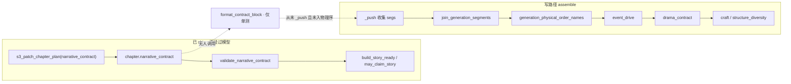
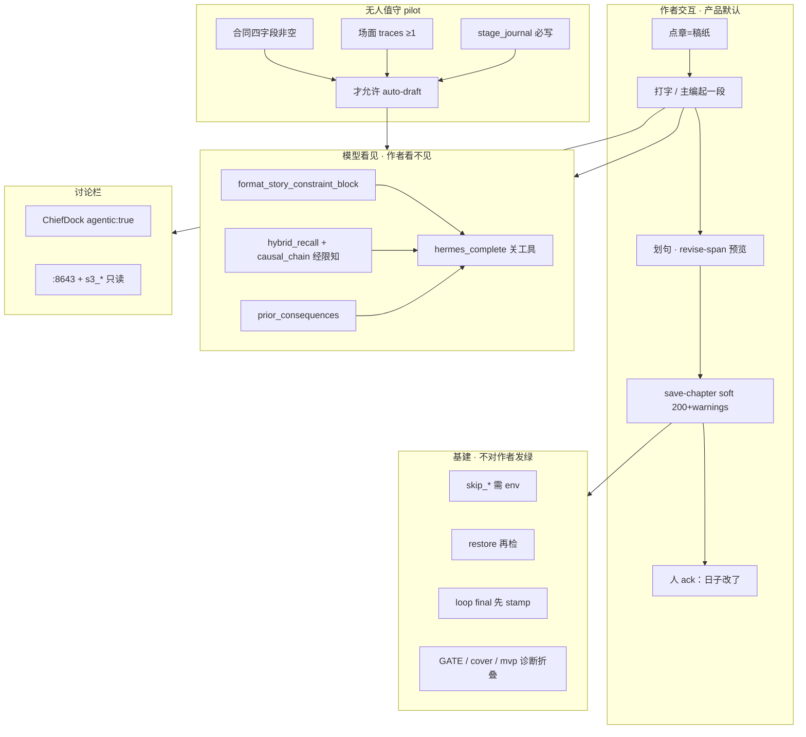
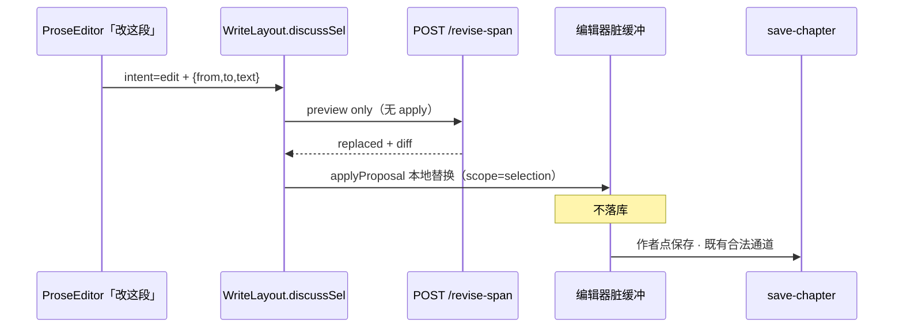
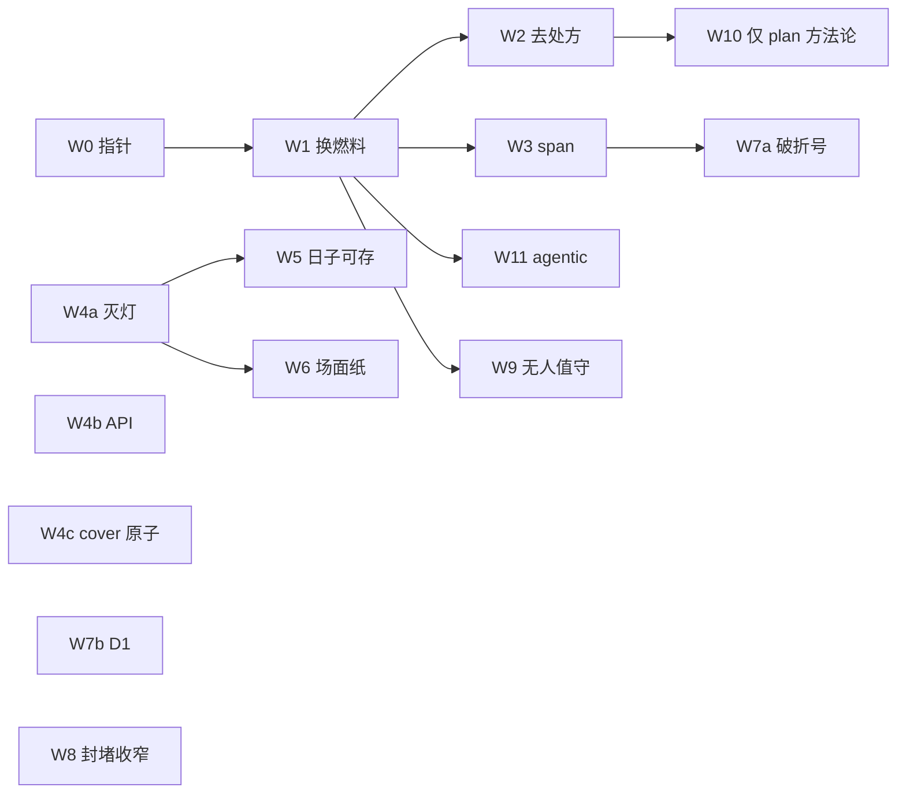
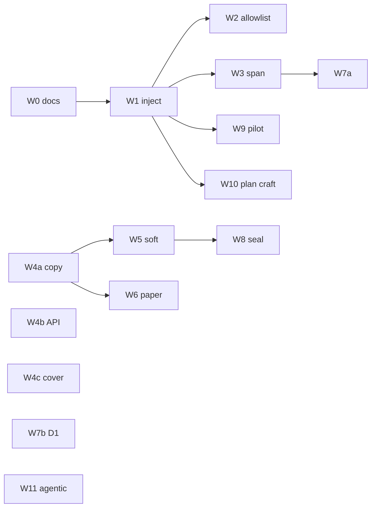

# 最终改进方案 R8 · 场面进 prompt、日子可先存、无人值守才齐套

| 项 | 值 |
|----|----|
| **短名** | `final-improvement-r8` / `最终改进方案 R8` |
| **文档状态** | **Draft · pending review**（待人审签执行） |
| **作者** | Grok Design（待人审签） |
| **日期** | 2026-08-13 |
| **产品** | 铜炉 / tonglu · 代码 `scribe3/` |
| **仓库** | `/home/admin/projects/scribe-writing-system` |
| **建议落仓** | `docs/plans/2026-08-13-final-improvement-r8.md` |
| **定位** | **实施入口**（工程师只读本文即可开工）。宣称/存稿 soft 真值表仍引用 product-mainline；span/allowlist 细节可回看 write-path R3，但本文自洽可执行。 |
| **输入** | 用户融合 R7（`/tmp/grok-1000/user-fused-r7.md`）；产品入口 `docs/plans/2026-08-13-final-good-novel-plan.md`；write-path R3；product-mainline；`docs/evidence/system-audit-20260813/audit-synthesis.md`；2026-08-13 代码再核实 |
| **验证环境** | **仅已部署 demo** `https://tonglu.qing.blue` · SSH `ubuntu@82.157.130.140` · 应用 `/opt/scribe3/app` |
| **运维 env SSOT** | **`/opt/scribe3/app/.env`**（不是 `.env.production.local`） |
| **合法写通道** | orch proposal/apply、`save-chapter`、intent-goals、MCP `s3_patch_chapter_*` / `s3_add_chapter`；**禁止** EMERGENCY 默认。`POST /revise-span` / `s3_revise_span` **v1 只预览，不落库**，不算第三条正文覆写通道 |
| **产品完成 SSOT** | `docs/plans/2026-08-13-narrative-engine-product-mainline.md`（宣称 / 存稿 soft 真值表 / UI 表面规格） |
| **产品北极星** | `docs/plans/2026-08-13-final-good-novel-plan.md`（七条 P0 / 验收改口） |
| **技术附录** | `docs/plans/2026-08-13-narrative-mainline.md`（schema / beat_shape / claim 旗） |
| **写路径旧稿** | `docs/plans/2026-08-13-write-path-story-constraints.md`（R3；排期与作者默认以 **本文** 为准） |
| **禁令** | 禁 human-blind ≥9.5 当产品门；禁 Grok 机全量 `npm ci` / 本机 Surreal / 第二栈；禁第三套宣称公式 |

> **与既有文档的 supersede（钉死 · 防第三套 SSOT）**  
> | 层 | 以谁为准 |  
> |----|----------|  
> | 北极星、七条 P0 名称、作者可见验收改口 | **final-good-novel-plan** |  
> | 完成/宣称公式、`may_claim_story`、FORBIDDEN 键 | **product-mainline** |  
> | 存稿 soft **真值表 / flag 解析伪代码 / HTTP 样例** | **product-mainline §4.2**（本文 **不重写** 第二套表） |  
> | cover clamp 原子语义 | **product-mainline §7.1 / P3b** |  
> | P3 顶键 / craft-gates JSON / P6a 字段优先级 | **product-mainline** |  
> | **作者默认 vs 无人值守 vs 逃生封堵 的边界** | **本文 R8**（融合 R7 的矛盾在此裁断） |  
> | 写路径注入载荷 + 物理序 + allowlist + span 修订 | **本文**（继承 write-path；禁止 `_push(format_contract_block)`） |  
> | 融合 R7 中与本文冲突的默认（字数地板、关 explore、draft 灌方法论、stamp 挡手存） | **作废为默认**；条目见 §裁决总表 |  
> 本设计 **不重开宣称旗**；demo `STORY_COMPLETE=1` 已生效。

---

## Overview

合同已落库、demo 宣称已切 `may_claim_story`，但起草时模型 **看不见场面**。根因不是「没做合同模块」，而是 assemble 真主路径漏接：`write_assemble_v1._render_final_input` 有 `_push("event_drive")` / `_push("drama_contract")`，**全文件无** `narrative_contract` / `format_contract_block`；`format_contract_block` 只在单测里被调用。模型可见序以 `generation_physical_order_names()` 为准——只 `_push` 不登记，块会被排到 `final_reminder` 前。

同时，写作阶段把 GATE / 长短句 / 压迫感笼子 / PALETTE / 定量配额喂给关工具的 complete；讨论栏 `ChiefDock` 钉死 `agentic: false`；「改这段」仍走 `/chat/write` 全量 assemble；standard 长文 GATE-B 409。产品在通关，书不在过。

融合 R7 把四方审计（SYN-1–7）和门控封堵（B11–B17）叠进同一作者默认，造成 **不能同时成立** 的三套默认：

1. **W5 + SYN-4**：日子先写必须合法 → `GATE_SAVE_MODE=soft`（200 + warnings）。  
2. **W8 + B14**：默认关 explore soft + 正文必须 stamp 后才落库。  
3. **W9 + Goal 10**：pilot 前 synopsis≥500 / beats≥2000 / deduction≥3000 / draft≥10000，且改 `verify_craft_compliance` 门槛。

再叠加 **W10 草稿/定稿再灌 ≤200 字方法论** 与 **W2 写路径去 craft** 打架；**W6 合同主栏** 与审计「一份场面纸」打架。

**R8 北极星不变**：人话、有戏、可续。主编是持工具的编辑。工程门、评分、齐套灯：**只诊断，不发绿，不进写作 prompt。**

**R8 一句话架构（裁断后）**：

```text
作者交互默认 =
    点章=稿纸
  + 模型只见场面/余烬/限知世界（W1）零工程门零配额（W2）
  + 改这段 → revise-span 预览（W3，hermes_complete，禁 apply）
  + save-chapter GATE_SAVE_MODE=soft（W5，无字数地板）
  + 页眉一份场面纸（W6；五灯并存=失败）
  + 讨论默认 agentic:true（SYN-6）
  + finalize AI-grade 409 与 W5 正交（用户已决）

无人值守 pilot 自动起草 =
    合同四字段非空 + 场面痕迹 ≥1（W9）
  − 删除 500/2000/3000/10000 字数硬下限

基建封堵（不对作者伪装成「先齐套」）=
    封 skip_craft_gate / restore 必须再检 / 逃生旗改 env（W8）
  − 不默认关闭 explore（W5 才是产品 soft）
  − stamp 只约束 kind=final，不挡手存草稿
```

---

## 裁决总表（B1–B17 · W0–W10 · SYN-1–7 · 一条不丢）

处置含义：

| 处置 | 含义 |
|------|------|
| **Keep** | 按本文规格做；进入对应 PR |
| **Split** | 拆成「作者默认 / 无人值守 / 基建」后只保留半边；另一半 Drop 或改口 |
| **Drop** | 不作产品默认、不进 PR 验收；理由一句话 |
| **Defer** | 真、但不挡「写出下一场戏」；P1 或不排期 |

### SYN-1–7

| ID | 原主张（融合 R7 / 审计） | 处置 | 一句话理由 | 落点 |
|----|--------------------------|------|------------|------|
| **SYN-1** | 写路径换燃料：场面+余烬+hybrid/图，不见 GATE/长短句 | **Keep** | 小说在这一次 complete 里写出来；燃料错则一切灯闸白拆 | W1 + W2 |
| **SYN-2** | 改一句只改一句；禁 apply | **Keep** | 整章再生毁掉已通的人话 | W3 |
| **SYN-3** | 灭灯：主表面只问日子改了没有 | **Keep** | 作者认灯不认戏 | W4a + W4b |
| **SYN-4** | 先写日子必须合法；点章=稿纸；大纲可手写 | **Keep** | 话本先坐实日子；字数地板不得挡手存 | W5 + 点章 IA；**不**绑 W9 字数 |
| **SYN-5** | 一份场面纸，不是第十张戏核表 | **Split** | 做 W6，但验收改口为页眉日子/必须发生/痕迹；四格变私房备忘 | W6 |
| **SYN-6** | 讨论默认只读联查 `agentic:true` | **Keep** | 现网 `ChiefDock.jsx` L337/L902 钉死 false；不改 `/chat/write` 为写 Run | **PR-W11** |
| **SYN-7** | 余烬进下一章；ingest 须 `participants`+`effects` | **Keep** | 可续=下章活在后果里；余烬 **不** 进 `may_claim_story` | W1 + W8 ingest 收口 |

### W0–W10（及实施补号 W11）

| ID | 原主张 | 处置 | 一句话理由 | 落点 |
|----|--------|------|------------|------|
| **W0** | 文档落仓 + 双向指针 | **Keep** | 防双实施 SSOT | 本文落仓；改 product-mainline / final-good-novel-plan / write-path 指针 |
| **W1** | `_push` + 物理序 + hybrid/图/余烬 | **Keep** | `_push` 序 ≠ 模型所见序；召回用现网 `hybrid_recall`/`causal_chain`，禁止臆造 `graph_subgraph` | PR-W1 |
| **W2** | 源头去长短句/配额/PALETTE + allowlist | **Keep** | 处方是冷短句根因；allowlist 只剥回潮 | PR-W2 |
| **W3** | `discussSel` → `/revise-span` 预览；`hermes_complete`；禁 apply | **Keep** | 第三条写通道比漏改更危险 | PR-W3 |
| **W4a** | 灭「机判过关」文案束 | **Keep** | 宣称 JSON 已是 story，表面仍工程 | PR-W4a |
| **W4b** | `story_ready` 顶键 / craft-gates 诊断化 | **Keep** | 规格照抄 product-mainline P3 | PR-W4b |
| **W4c** | cover clamp 单独原子 PR | **Keep** | registry `"1"` vs `_flag(..., "0")` 分叉；禁与 P6a 捆 | PR-W4c |
| **W5** | `GATE_SAVE_MODE=soft` 作者存稿 200+warnings | **Keep** | **作者交互的存稿默认**；AI-grade **不绑** | PR-W5 |
| **W6** | 合同主栏 | **Split** | 对象仍是 `narrative_contract`；**验收=页眉场面纸**；五灯并存=失败 | PR-W6 |
| **W7a** | 对白「——」advisory | **Keep**（P1） | 约束+修订+检测；**不**进 claim | PR-W7a |
| **W7b** | D1=evidence 覆盖 | **Keep**（P1） | 防词表伪收敛；不挡小说增量 | PR-W7b |
| **W8** | 关 7 条绕过 + 输出自由化 + 关 explore + stamp 后落库 | **Split** | 只留封逃生/restore 再检/max_tokens/删字数指令；**不**关 explore；stamp **只**约束 final | PR-W8 |
| **W9** | pilot 前 500/2000/3000/10000 + journal | **Split** | **仅无人值守**；删字数地板；改「合同非空+痕迹」；journal 只绑 pilot | PR-W9 |
| **W10** | 各阶段 ≤200 字方法论，含 draft/final | **Split** | **只** outline/beats/deduce；**永不**进 draft/final 散文 assemble | PR-W10 |
| **W11** | （R7 无号）SYN-6 | **Keep** | 独立可合，避免埋进 W2 漏接 | PR-W11 |

### B1–B17

| ID | 断点 | 处置 | 一句话理由 | PR |
|----|------|------|------------|-----|
| **B1** | 合同未进 assemble | **Keep** | `_push` + 物理序同步；载荷用新组块不是 `format_contract_block` | W1 |
| **B2** | 工程门透出模型/主灯 | **Split** | prompt 侧 W2；存稿侧 W5；**不要**用 W8 关 explore 当 B2 | W2 + W5 |
| **B3** | 「改这段」仍整章 assemble | **Keep** | 咬 `WriteLayout.discussSel`，不是只给摘录钮 | W3 |
| **B4** | 「机判过关」 | **Keep** | `readerReadyGate.js` L11 仍写死 | W4a |
| **B5** | 合同主栏 IA | **Split** | 同 W6：场面纸验收，不是好莱坞四格门票 | W6 |
| **B6** | story_ready / craft-gates.ok / scaffold | **Keep** | 诊断化；规格 product-mainline P3 | W4b |
| **B7** | cover 原子 clamp | **Keep** | 单独原子；禁半拉子 | W4c |
| **B8** | 对白破折号中句急转 | **Keep**（低优先） | 约束+修订+advisory；不进 claim | W1 + W3 + W7a |
| **B9** | 评分器词表当完成 | **Keep**（P1） | D1 改 evidence 读序 | W7b |
| **B10** | chief 先齐脚手架=完成 | **Keep** | `chiefSeed.js` 仍 GATE-B hint | W2 |
| **B11** | loop 先 `save_chapter` 后 stamp | **Split** | **只修 loop/kind=final**；手存草稿仍 W5 可落、stamp 失败不回滚日子 | W8 |
| **B12** | max_tokens=8192 + 字数指令自相矛盾 | **Keep** | 章生成 ≥16384；删目标字数话术；**不加**输出硬下限 | W8 |
| **B13** | pilot 无脚手架前置；R7 要改 GATE 字数门槛 | **Split** | 无人值守要「有场面」；**禁止**把 500/2000/10000 写进 `verify_craft_compliance` | W9 |
| **B14** | 默认关闭 `SCRIBE3_EXPLORE_SOFT_SAVE` | **Drop** | 作者默认改走 W5；关 explore 与 SYN-4 抢同一逃生；§4.2 矩阵保留不改默认 | — |
| **B15** | restore-version 跳过工艺门 | **Keep** | 恢复后必须再跑 `evaluate_save_craft_gate`；soft 下 warnings，STRICT 才 409；kind=final 须再 stamp | W8 |
| **B16** | `skip_craft_gate` / `danger_draft` / `skip_finalize_gate` 客户端开放 | **Keep** | 改 env 门闩 + 审计；请求字段仍可传但默认拒 | W8 |
| **B17** | 无 `stage_journal` 即 skip | **Split** | **仅 pilot 强制写 journal**；作者手写路径无 journal 仍 skip（不把日子写成非法） | W9 |

### 融合 R7 目标句（防止「表外复活」）

| R7 句 | 处置 | 一句话 |
|--------|------|--------|
| Goal 8「关闭全部 7 条 GATE-B 绕过」 | **Split** | 只关逃生旗/restore 漏检/final 先落库；不关 W5、不关 explore 默认 |
| Goal 9 输出自由化（max_tokens、删字数指令、不加输出硬门） | **Keep** | 与 W8 输出半边一致 |
| Goal 10 脚手架字数地板当充分度 | **Drop** | 与 W8「不加字数硬下限」、W2 去配额、SYN-4 日子合法 **三重矛盾**；会经 `verify_craft_compliance` 漏回作者 409 |
| Goal 11 阶段方法论含 draft/final | **Split** | 只留 plan 三阶段；draft/final 方法论 **Drop** |
| Goal 12 讨论 `agentic:true` | **Keep** | W11 |
| Goal 13 点章=稿纸；字数门不挡作者 | **Keep** | 与 Goal 10 原文打架处，以本句与 SYN-4 为准 |
| KD-W19「正文落库必须后于 craft stamp」 | **Drop 为作者默认** | 若照字面，W5 手存草稿会死；收窄为 B11 Split |
| KD-W20/W21 输入端 500/2000/3000/10000 | **Drop** | 字数不是场面；会逼注水 |
| KD-W22「7 条绕过默认全关」 | **Split** | 同 Goal 8 |

---

## Background

### 本会话已证实（代码 + 方案交叉 · 2026-08-13 再核实）

| # | 事实 | 锚点 |
|---|------|------|
| 1 | 合同已落库；demo `STORY_COMPLETE=1` | `store/chapters.py` L396–409 读写 `narrative_contract`；MCP `s3_patch_chapter_plan(narrative_contract=)`；`/opt/scribe3/app/.env` |
| 2 | assemble **未** `_push("narrative_contract")` | `write_assemble_v1.py` `_render_final_input`：`_push("event_drive")` L236、`_push("drama_contract")` L260；**全文件 grep 0 命中** `narrative_contract` / `format_contract_block` |
| 3 | `format_contract_block` 存在但未接线 | `narrative_contract.py` L234–248；仅 `tests/test_narrative_contract.py` 调用 |
| 4 | 模型被灌长短句/压迫感/配额/PALETTE | `structure_style.py` L30–33「长短交错」；`craft.py` ENGINES L20–91（「每 500 字」「每章≥3」「2-4 个」「95% 闭嘴」）+ PALETTE L94+；`write_assemble_v1` L91–106 / L303–308 恒注入 |
| 5 | 工程门仍挡 **standard 长文** 存稿 | `evaluate_save_craft_gate` L1097–1106 → `misc_routes.save_chapter` L481–490 **409**。短稿 `< _PROSE_ENFORCE_MIN=80` 放行。仓库 **无** `GATE_SAVE_MODE` |
| 6 | explore soft **默认开**，且是今日唯一 soft 逃生 | `quality_enablement_flags.py` `SCRIBE3_EXPLORE_SOFT_SAVE` 默认 True；`verify_craft_compliance.explore_soft_save_enabled` L941–948 |
| 7 | `danger_draft` 只旁路 finalize，**不**旁路 GATE-B | save 先 craft 再 finalize（`misc_routes.py` L472–532） |
| 8 | skip 三旗对任意客户端开放 | `api/models.py` L422–426；`misc_routes.py` L478 / L586 直读请求 |
| 9 | loop 定稿先落库再 stamp | `chapters.py` `_finalize` L140–144 `save_chapter` 后才 `loop_stamp_kind_final` |
| 10 | restore-version **显式跳过**工艺门 | `chapters.py` L290–316 注释 + 直接 `save_chapter` |
| 11 | 「改这段」仍全量 chat | `ProseEditor.jsx` L242–244 → `WriteLayout.discussSel` L674–691 seed `/chat/write` |
| 12 | 讨论栏关工具 | `ChiefDock.jsx` L337 注释、L902 `agentic: false` |
| 13 | 点章默认大纲相 | `ManuscriptDirectory.jsx` L26 / L256 `phase: 'outline'` |
| 14 | 主灯完成话术仍在 | `readerReadyGate.js` L11「机判过关」；`ChapterMetaPane.jsx` L255–261「开写前要齐 / 可以开写」；`WriteLayout.jsx` L548 toast「机判可读…确认给读者」 |
| 15 | `hybrid_recall` / `causal_chain` **已实现、写路径零调用** | `store/recall.py` L79–95 / L243–247；assemble 只把 `event_graph_from_store_chapter` 写入 budget 观测（`write_assemble_v1.py` L597–607），**不进 instructions** |
| 16 | 物理序表无合同名 | `context_budget.generation_physical_order_names` L766–800：`prefix → event_drive → …`；未列名段排到 `final_reminder` 前（`ordered_generation_segments` L475–480） |
| 17 | 章 loop `max_tokens=8192`；steer 仍「目标 4800–5500」 | `chapters.py` L110；`execution_contract.py` L45–48、L380–385 |
| 18 | B7 无 journal → skip | `verify_craft_compliance.py` L602–623 |
| 19 | cover 读源分叉 | `feature_flags.py` registry `SCENE_COVER_IN_CLAIM` 默认 `"1"`；`scene_cover_in_claim()` 在 STORY 开时 `_flag(..., "0")`（`story_complete.py` L31–35） |
| 20 | 评分 D1 仍是 `CONF_LEX`+对白条数 | `scripts/score_narrative_chapter.py` L28–31、L83–92；rubric `anti_stuffing_v2` |
| 21 | 动稿关工具 | `write.py` `chat_write_post` L97–100：`_write_intent` 为真则 `with_tools=False` |

### 深层因果（审计已证，不另开公式）

```text
业务把「完成」定义成齐套灯 + 西式节拍
    → 交互只能演验收台（进章先大纲、主钮是过门）
        → 主笔 /chat/write 关工具、灌技法圣经 + envelope 记忆
            → hybrid / 图 / 余烬 没人在写的那次调用里问库
                → 冷短句、破折号、合同词进嘴、章章重置
```

对标《乱世铜炉》应抬：**村社岁时、群像改钱路、笑闹后切异变、说书评点、事变型章题**。不是更碎短句。

### 为何合同没进 prompt（代码级）



**谁该 push、谁漏了**

| 角色 | 路径 | 状态 |
|------|------|------|
| **真主路径** | `scribe3/api/services/write_assemble_v1.py` → `_render_final_input` → `_push` | **漏** |
| 合同格式化 | `narrative_contract.format_contract_block` | 已写、未调用；**写路径禁止调用** |
| 读章 | `st.get_chapter(chapter).get("narrative_contract")` | store 已能读 |
| 物理序 | `context_budget.generation_physical_order_names` | 表中无此名 |
| 召回 | `store.hybrid_recall(query, chapter, k=5)` / `causal_chain` | 已实现；assemble **零引用** |

---

## Goals & Non-Goals

### Goals

1. **根因闭合**：assemble v1 `_push("narrative_contract")` **且**登记物理序（合同在 `event_drive` 前）；单测锁 join 后 `order_indices`。  
2. **写作阶段模型零工程门、零定量配额、零 PALETTE**；allowlist 在 join **前**按段剥，跳过 `request_constraint`。  
3. **合同防泄漏**：四义行保留作者原文；禁词只进「禁止：」节；禁止把「拒交」当账房黑话从欲望行剥掉。  
4. **默认一句句改**：`discussSel` → `POST /revise-span` 仅预览；`hermes_complete`；禁 `apply=true`；整章走「重写整章」。  
5. **作者日子合法**：`GATE_SAVE_MODE=soft`；点章=稿纸；大纲可手写；**无** 500/2000/10000 地板。  
6. **一份场面纸**：页眉日子 / 必须发生 / 痕迹；五灯并存=失败。  
7. **讨论只读联查**：`ChiefDock` 默认 `agentic: true`。  
8. **余烬可续**：`prior_consequences` 注入；ingest 事件缺 `effects` 不进真图。  
9. **逃生封堵但不伪装齐套**：skip 改 env；restore 再检；loop final 先 stamp；explore 默认 **不关**。  
10. **无人值守有场面**：pilot 自动 draft 前合同非空 + 痕迹；无字数硬门。  
11. **脚手架方法论不污染正文**：W10 只进 outline/beats/deduce。  
12. **B1–B17 / W0–W10 / SYN-1–7 全部有处置**；product-mainline 未做的 P\* 由本文 W\* 开工，**不另写第二套真值表**。  
13. **验证**：仅已部署 demo 冒烟；合法写通道。

### Non-Goals

| # | 非目标 | 理由 |
|---|--------|------|
| NG1 | 删除 `verify_craft_compliance` / finalize / Surreal | 基建保留；诊断仍需 |
| NG2 | 破折号进 `may_claim_story` hard | 评测已否决 |
| NG3 | 重写 Pilot / 换 Hermes / 全书 plot solver | 爆炸半径 |
| NG4 | LLM 文学分 / human-blind ≥9.5 当产品门 | 假绿禁令 |
| NG5 | 通用不可逆动词表替代篇章 traces | 换词表仍可刷 |
| NG6 | EMERGENCY 默认；Grok 机全量测 / 本机 Surreal / 第二栈 | 纪律 |
| NG7 | 改 `format_contract_block` 的 claim/UI 语义 | 展示仍用原文 |
| NG8 | 把 `/chat/write` 改成写 Run；扩 draft 工具面 | 工具回合抢散文；审计裁 3 |
| NG9 | 作者路径抬 GATE-B 字数门槛 | 与 SYN-4 / W5 矛盾 |
| NG10 | 默认关闭 explore soft | W5 才是产品 soft |
| NG11 | 第三套宣称公式 / 新戏核表 / 新 Agent / 新阶段 | 防 SSOT 分裂 |
| NG12 | 启用 `scribe-novel-v2` / 不存在的 `s3_render_scene` | 审计明确不做 |
| NG13 | AI-grade 409 随 W5 变 advisory | **用户 2026-08-13 已决不绑** |

---

## Proposed Design

### 双轨（必须画清，否则实现者会把 W9 写进 save-chapter）



### 作者可见流（≤6 步）


大纲、节拍、演绎、双灯、旅程、系统图：**全部折叠**。五者与场面纸+双灯+GCD **并存 = W6 失败**。

### 模型可见 / 不可见（写作阶段）

```text
写作阶段模型可见 =
    场面必须发生（作者原文四义 +「禁止念条款」）
  + 1–3 条 traces / 上章余烬
  + hybrid_recall + 因果链（经限知投影）
  + 角色嘴里不能知道的
  + 声口（有 register 才追加；缺省仅限知 + 禁对白中句「——」）

写作阶段模型不可见 =
    GATE-A/B、scene_cover、craft-gates.ok、mvp/journey、
    字数/Q1、D1–D7、停环、anti_meta 检测器 id、「可开写」、
    机判过关、AI-grade 红绿灯、
    PALETTE、定量配额、sensory「稳定感官签名」、
    structure_diversity_block、
    字数目标/字数约束、
    draft/final 的 stage_craft 方法论

落正文默认 = 「改这段」→ revise-span 预览 → 脏编辑器 → save-chapter
整章 regenerate = ConfirmDialog「重写整章」
宣称绿 = may_claim_story（product-mainline；人 ack）
```

限知默认改口（继承审计裁 2）：投影能力 **不拆**；默认叙述位 = 全知可评点；限知句写成「角色嘴里不能知道的」，禁止写成「叙述者不能说的」。

---

### A. 写路径换燃料（B1 · W1 · SYN-1 · SYN-7）

#### A.1 模块分工（只准这一套）

| 模块 | 职责 |
|------|------|
| `scribe3/story_constraint_prompt.py` | **纯函数、零 store IO**：组块、禁词节、voice 缺省句 |
| `scribe3/api/services/write_assemble_context.py` | **唯一 IO**：`load_chapter_story_inputs(st, chapter)` |

禁止双 helper。禁止写路径 import `format_contract_block`（单测锁）。

#### A.2 保守组块（否决同义改写欲望）

不实现会把「拒交铜匙」改成「把钥匙捂住」的 `rewrite_field_as_scene`。「拒交」是回合动作，**不是**账房黑话。

```python
CONTRACT_META_BAN = frozenset({
    "conflict_beats", "shape_ok", "validation.ok", "narrative_contract.v1",
})
DIALOGUE_CLAUSE_BAN = frozenset({"勾半笔", "减半笔", "暂不深探"})

def field_line(kind: str, text: str, *, max_chars: int = 40) -> str:
    """四义行 = 作者原文截断。只删英文字段名/机检 id，不做同义改写。"""

def format_story_constraint_block(
    contract: dict | None,
    *,
    evidence_must_show: list[str] | None = None,
    prior_consequences: str = "",
    voice: dict | None = None,
    recall_context: str = "",
    causal_graph: str = "",
    max_chars: int = 900,
) -> str:
    """空合同 → ""。四义行原文；禁止节 = 四字段整句 + DIALOGUE_CLAUSE_BAN。"""
```

**目标块形态**

```text
【本章必须发生的场面】（写戏，不要念条款）
欲望：拒交铜匙、挨过夜审
阻力：（作者原文截断）
回合：（作者原文截断）
代价：（作者原文截断）
必须留下的痕迹：
- （evidence_must_show，最多 3 条）
禁止：
- 角色嘴里不得复述上面四行原句，也不得把「勾半笔」「减半笔」「暂不深探」当出口语
- 对白里不得用「——」做中句急转（迟疑用「……」或把话掐断另起一句）
限知：角色嘴里不能知道焦点者此刻看不见/听不见/摸不到的；叙述者可以评点
【世界此刻】（经限知投影，≤400 字）
【前因后果】（≤300 字）
【上章余烬】
- （prior_consequences 1–3 条人话）
```

**不变式（单测锁）**

| # | 输入 | 欲望/回合行 | 「禁止：」节 |
|---|------|-------------|--------------|
| 1 | desire=`拒交铜匙、挨过夜审` | **可以**出现「拒交」 | 含该整句；含「角色嘴里不得复述」 |
| 2 | 同上 | **不得**出现「必须说出拒交」 | — |
| 3 | 已是口语 | 原样（截断外一字不改） | 仍列整句 |
| 4 | 含 `validation.ok` | 英文字段名被删 | — |
| 5 | 无 voice | **不得**出现「冷锅婆」 | 仅限知 + 禁「——」 |

#### A.3 IO：用现网 API，禁止臆造

```python
def load_chapter_story_inputs(st, chapter: int) -> dict:
    """唯一 IO。缺列/抛错由调用方 fail-soft，本函数尽量不抛。"""
    ch = st.get_chapter(chapter) or {}
    contract = ch.get("narrative_contract") or {}
    return {
        "contract": contract,
        "evidence_must_show": load_evidence_must_show(ch),  # 见 §F
        "voice": ((contract.get("bindings") or {}).get("scene_voice") or None),
        "prior_consequences": _build_prior_consequences(st, chapter),
        "recall_context": _hybrid_recall_for_write(st, chapter),
        "causal_graph": _causal_subgraph_for_write(st, chapter),
    }
```

| 数据源 | 现网函数（禁止改名另写） | 约束 |
|--------|--------------------------|------|
| 命题检索 | `st.hybrid_recall(query, chapter, k=5)`（`store/recall.py` L79） | query = 合同四义截断 + synopsis 前 80 字；经限知投影；≤400 字 |
| 因果链 | `st.causal_chain(event_id, direction="backward", max_depth=3)`（L243） | 取本章/上章已落 event；**无** `graph_subgraph` 这个 API |
| 余烬 | 上章 `add_event` 且 `effects` 非空者，压成 1–3 条人话 | 无则空串；人灯不得点「日子改了」 |
| 去重 | 合同块非空 → `event_drive` 截到 ≤120 | `_drama_block` 不删；禁止 drama 贴 GATE/条数 |

**不要**用 `facts_at[:40]` 当主燃料。v1 prefix 已不走 `_editor_system`（I1）；envelope 记忆 ≠ 命题 hybrid。W1 是 **在合同块内** 接 hybrid/图，不是再倾倒 40 条 fact。

fail-soft：缺列 / 非法 / 抛错 → **不 push** + `record_write_soft_fail("narrative_contract_skip")`。空四字段 → `""` → 不 push。`NARRATIVE_CONTRACT` 关时有列仍 fail-soft 注入。

#### A.4 `_push` + 物理序（同一 PR，缺一不可）

落点：`_render_final_input` 在收集 `event_drive` **前**：

```python
# write_assemble_v1.py · _render_final_input
from scribe3.api.services.write_assemble_context import load_chapter_story_inputs
from scribe3.story_constraint_prompt import format_story_constraint_block
try:
    _inputs = load_chapter_story_inputs(st, chapter)
    _nc_txt = format_story_constraint_block(**_inputs) if _inputs else ""
except Exception as _sf_e:
    soft_fail("write_assemble_narrative_contract", _sf_e, ...)
    _nc_txt = ""
if _nc_txt:
    _push("narrative_contract", "redline",
          _domain_input(f"chapter:{chapter}:narrative-contract",
                        "narrative_contract", _nc_txt))
```

**同一 PR 必须改**

| 文件 | 改动 |
|------|------|
| `context_budget.generation_physical_order_names` | `prefix` 后、`event_drive` **前** 插入 `"narrative_contract"` |
| `GENERATION_SEGMENT_LAYERS` | `"narrative_contract": "redline"` |
| `L0_NEVER_CUT` | 加入 `"narrative_contract"` |
| `injection_registry.SEGMENT_REGISTRY` | `SegmentMeta("narrative_contract", "L0", "head", "redline")` 紧挨 `event_drive` 前 |
| `DRAMA_CORE_NAMES` | 加入（戏核密度观测） |

**单测锁**：`order_indices["narrative_contract"] < order_indices["event_drive"]`；名在物理序与 `L0_NEVER_CUT`；更新 `test_novel_first_injection.py` / `test_p1_scheme.py`。验收以 **join 后 `order_indices`** 为准，不是 `_push` 源码序（KD-W14）。

---

### B. 零工程词 / 零配额（B2 prompt 半边 · B10 · W2）

#### B.1 先改源头

| 块 | 动作 |
|----|------|
| `structure_style.structure_diversity_block` | **写路径整块不注入**（不是改文案） |
| `build_craft_block` 写路径分支 | **全部不注入**（讨论/质检面板仍可读完整技法） |
| PALETTE | **整块不进写路径** |
| `discourse_craft_ssot.py`「交错长短句」 | 同改 tip 或 `prepare_write_discourse_soft` 剥离 |
| `_write_protocol_block` | `scope` 默认 **selection**；`chapter` 标明「仅作者明确要求整章重写」 |
| `_anti_slop_floor_block` | 保留禁 AI 腔；**删除**「每 N 字 / 至少 N 个」 |
| `_final_reminder` | 可留声口/限知；不得加 GATE/字数 |
| `chiefSeed.js` | 删 GATE-B B1/B2/B3 hint；改「大纲/节拍是材料参考，不是完成」；保留 `SCAFFOLD_FORBID_SAVE` |
| MCP `s3_patch_chapter_plan` 文档串 | 完成 = 故事合同 + 人读，不是 GATE-B |

#### B.2 Allowlist（只剥回潮）

新纯函数 `scribe3/prompt_allowlist.py`。

接线：`_render_final_input` **内部**、`apply_soft_activation` **之后**、`join_generation_segments` **之前**（现网锚点 `write_assemble_v1.py` L568–589）。跳过 `name == "request_constraint"`。

**禁止**：在 `guard_write_instructions` 剥整串；禁止包 `_push`。

```python
ENGINEERING_LEAK_PATTERNS: tuple[re.Pattern, ...] = (
    re.compile(r"\bGATE-[AB]\b", re.I),
    re.compile(r"gate_[ab]\.ok", re.I),
    re.compile(r"scene_cover"),
    re.compile(r"mvp_pass|journey_pass|PASS_FORMULA"),
    re.compile(r"craft-gates|\bcraft_gates\b"),
    re.compile(r"WORDCOUNT|prose_cn\s*>=?\s*\d+"),
    # 禁止裸 \bD[1-7]\b（误伤「D3 巷」）
    re.compile(r"D[1-7]\s*[–\-]\s*D[1-7]|anti_stuffing|CONF_LEX"),
    re.compile(r"可开写|机判过关|材料够了"),
    re.compile(r"anti_meta\.\w+|claim_blocking"),
    re.compile(r"每章\s*≥\s*\d+|每\s*\d+\s*字|95%\s*闭嘴"),
)
SKIP_SEGMENT_NAMES = frozenset({"request_constraint"})
```

单测：系统段无 GATE / 可开写 / 机判过关 / 「每章≥」；必须出现「【本章必须发生的场面】」；作者「D3 巷」「城门闸」「别搞得像 GATE 过关」保留。

---

### C. 一句句改（B3 · W3 · SYN-2）

**默认修订 = 收紧已上线手稿选区，不是新开平行入口。**



| 入口 | v1 行为 |
|------|---------|
| `ProseEditor`「改这段（只动选区）」 | `discussSel` **改调** `POST /revise-span` |
| `ChapterStudio` / `RichEditor` | 同 revise-span + dirty，不立即 saveDraft |
| `SelectionQuoteActions` | **次入口**；禁止当手稿主 CTA |
| 聊这段 | 仍 seed 主编 |
| 整章 | `chapters.py` loop **只认** `scope=chapter`；文案「重写整章」+ ConfirmDialog |

**为何还要新 HTTP**：旧 `⟦PROPOSAL scope=selection⟧` 能换字，但生成仍走全量 assemble，模型可回 `scope=chapter`。

#### C.1 LLM 与 API（钉死）

新模块 `scribe3/revise_span.py`：**不**调用 `st.save_chapter`。

1. 调用 **`scribe3.llm.hermes_complete(prompt, system=…)`**（`llm.py` L244–256）。`with_tools` 不适用此薄 complete。禁止 `_collect_write` / `_assemble_write_instructions_v1`。  
2. 系统块 = `span_revise_system()`（硬帽 ≤400 字）+ `format_story_constraint_block`（可再截）。user = 选区 ±2 句 + instruction。  
3. 失败 → HTTP **503** `llm_failed`；不得做成「纯规则去破折号」当唯一路径。  
4. 请求体出现 `apply` → 400 `apply_not_supported`。恒 `applied: false`。  
5. `mode`: `span` \| `word`；v1 不接受 `chapter`。  
6. MCP `s3_revise_span` 只预览，**不**进合法写通道清单。  
7. 前端 `reviseSpanEnabled`；关则回退旧 chat。

```json
POST /revise-span
{ "work": "main", "seq": 20,
  "target": {"quote": "香债——今晚就得清", "from": 182, "to": 193},
  "instruction": "改成口语，去掉破折号，别把合同原句塞进嘴里",
  "mode": "span" }
```

```json
200 { "status": "ok", "mode": "span", "replaced": "…", "start": 182, "end": 193,
      "diff": "@@ …", "applied": false }
```

| code | HTTP | 含义 |
|------|------|------|
| `span_not_found` | 404 | quote/line 未命中 |
| `span_ambiguous` | 409 | 多处命中，须给 start/end |
| `apply_not_supported` | 400 | 出现 `apply` 或试图落库 |
| `mode_invalid` | 400 | 未知 mode / `chapter` |
| `llm_failed` | 503 | complete 超时/空/抛错 |

---

### D. 灭灯与 API 表面（B4/B6/B7 · W4a/W4b/W4c · SYN-3）

**不重写 product-mainline 真值表。** 开工指针：

| 断点 | 规格 SSOT | PR | 本文额外约束 |
|------|-----------|-----|--------------|
| P6a 文案 | product-mainline §4.3 / §6.1 | **W4a** | 不与 cover 捆 |
| 顶键 story_ready / craft-gates / scaffold | product-mainline P3 | **W4b** | — |
| cover 原子 | product-mainline §7.1 / P3b | **W4c 单独** | STORY=0 强制参与；unset→出 claim；显式 1 过渡 |

W4a 必改：`readerReadyGate.js`「机判过关」；`WriteLayout.jsx` L548 toast；scaffold「可开写」降权为「材料」。任何 chip 不得说「过关」「可以开写」。

---

### E. 作者存稿 soft（B2 存稿半边 · W5 · SYN-4）

**作者交互的存稿默认 = product-mainline §4.2 `MODE=soft`。** demo env 设 `SCRIBE3_GATE_SAVE_MODE=soft`。STRICT=1 回滚 hard。

本文 **不附第二套表**。实现者必须按 §4.2.1–4.2.5 写 `resolve_gate_save_mode` / HTTP 样例 / explore 矩阵。

额外钉死：

| 项 | 裁定 |
|----|------|
| 字数地板 | **禁止** 在 `verify_craft_compliance` 把 synopsis/beats/draft 抬到 500/2000/10000 |
| toast | 「材料诊断…（≠故事完成）」；禁「验收通过」 |
| finalize AI-grade | **保持正交**，可仍 409；`danger_draft` 仍只旁路 finalize |
| 点章 | `ManuscriptDirectory` **不要**写死 `phase:'outline'`；默认进稿纸 |
| 大纲格 | 允许作者手写；审批只拦改别人的章/世界 |

---

### F. 一份场面纸（B5 · W6 · SYN-5）

对象仍是 `chapter.narrative_contract`，**不新建表**。

**验收（失败条件显式）**：

- 稿纸页眉一行可见：**本章日子 / 必须发生哪一下 / 留下哪一痕**。  
- 欲望/阻力/回合/代价 = **可展开的私房备忘**，不当门票、不当主灯。  
- **合同主栏 + 五阶段页签 + 双灯 + GCD 并存 = W6/P7 失败。**  
- 标题/红字/绿字同改：

| 现文案（`ChapterMetaPane.jsx`） | 目标 |
|--------------------------------|------|
| L255「开写前要齐的材料」 | 「材料参考」 |
| L258「还不齐 · 不建议开写」 | 「材料还可再写」 |
| L261「材料够了，可以开写」 | 删除或「材料参考已填」 |
| `chapterContractGate` 80 字 / beats≥3 **error** | **info** |

evidence 主栏与评分 **同一函数** `load_evidence_must_show`（见 §H）。不要第三套表。

product-mainline §6.2 IA 树保留为 **深编折叠**，不进第一眼。

---

### G. 声口（B8 · W7a）

不是 claim hard。三处：

1. 故事约束块「禁止」节（W1）。  
2. `revise_span`：instruction 空且选区含中句「——」急转 → 默认改口语。  
3. `critique` 新增 `dialogue_emdash_pivot`（只扫引号内）；`severity=advisory`；**不**进 `may_claim_story`。

保留 `03_style.py` 引号内跳过破折号的 **叙述层密度** 规则，避免和 AI-grade 409 混绑。

---

### H. 评分降级（B9 · W7b · P1）

`scripts/score_narrative_chapter.py` → `anti_stuffing_v3`，保留 v2 入口。

```text
load_evidence_must_show(chapter) =
    bindings = chapter.narrative_contract.bindings.evidence_must_show
    if bindings 非空 list（去空白后 ≥1）:
        return dedupe(bindings)[:3]
    else:
        return project_pressure_stairs(chapter.pressure_drive)[:3]
    两者皆空 → [] → D1 = null（从 composite 剔除）
```

| 维 | 目标 |
|----|------|
| **D1** | `evidence_coverage`（子串或 bigram Jaccard≥0.35）；空 → null；**不再当完成 KPI** |
| D2 | 诊断计数；满分不得仅靠 `TURN_COST` |
| D4 | 形态诊断 ≠ 戏成立 |
| D5 | 无传入 `prior_keywords` → 跳过或低权；**同时**处理写死 `core=("香债",…)` |
| 停环 | D1 封顶不再驱动停环 |

**claim 公式不变。**

---

### I. 门控封堵收窄（B11/B12/B15/B16 · W8）

W8 **不再**承担「让日子非法」。作者 soft 是 W5。

#### I.1 做

| 项 | 规格 |
|----|------|
| **B16 逃生旗** | `SCRIBE3_ALLOW_SKIP_GATES` 默认 `0`。请求仍可带 `skip_craft_gate` / `skip_finalize_gate` / `danger_draft`，env 关 → 400/忽略 + audit `skip_denied`。env 开 → 放行 + audit `skip_craft_gate work= seq=`。**禁止**证据当验收通过 |
| **B15 restore** | `restore_chapter_version` 在 `save_chapter` 后（或前）跑 `evaluate_save_craft_gate`。MODE=soft → 200 + warnings，不 409 卡死作者自己的存档。STRICT 或要 stamp final → 须过 hard / 再 stamp。响应带 `craft_gate` |
| **B11 loop final** | `chapters.py` `_finalize`：**先** `loop_stamp_kind_final`（或等价 evaluate），stamp 失败则 **不**把该稿标 final；若已 `save_chapter` 须回滚 final 标记或明确 `kind=checkpoint`。**不**禁止作者手存未 stamp 草稿 |
| **B12 输出** | 章生成（loop / 整章 write）`max_tokens≥16384`。删除 `execution_contract.format_default_drama_steer` / `BASE_LENGTH_STEER` 中「目标 4800–5500」「soft 下限约 2400」「宁短勿凑字」类 **字数目标**。保留「场面写透不得草草收场」「禁止注水」。**删除 `soft_len_floor` 作为产品话术**（函数参数可留以免炸单测，但默认 steer 不再打印字数）。**不加** `_check_prose_length` / `MIN_PROSE_FINAL` |
| **ingest 余烬牙** | 抽取事件缺 `participants` 或 `effects` → **不**走 `add_event` 真图（可记 soft_fail）。`did` 路径现网已带 effects（`ingest.py` L300–321）；补的是 **delta.events** 空 effects 分支 |

#### I.2 明确不做（W8 Drop）

| 项 | 理由 |
|----|------|
| 默认 `SCRIBE3_EXPLORE_SOFT_SAVE=0`（B14） | W5 是产品 soft；关 explore 会在 W5 未上时卡死探索、W5 已上时无增量 |
| 「任何正文必须 stamp 后才 `save_chapter`」 | 与 SYN-4 / W5 直接冲突 |
| 抬 GATE-B 字数门槛 | 漏回作者 409 |

explore 矩阵 **原样保留** product-mainline §4.2.2。

---

### J. 无人值守前置（B13/B17 · W9）

**只作用于** `pilot.py` / `pilot_actions/draft.py` 的 **自动 draft 步进**。

**断言（缺一 park，返回缺项列表，禁止静默跳过）**：

1. `narrative_contract` 四字段（desire/obstacle/turn/cost）去空白后均非空；  
2. `load_evidence_must_show` 至少 1 条（人标 traces 或压力楼梯投影）；  
3. 本步已写 `stage_journal`（B17 收窄：无 journal → **pilot fail**，不是 GATE-B 对作者 fail）。

**禁止**：

- `verify_craft_compliance.py` 改 `synopsis_min_chars=500` / beats 总字数 2000 / deduction 3000 / draft 10000；  
- 把上述地板接到 `evaluate_save_craft_gate`；  
- 用字数当质量。

scene_truth≥80 **不**作为开写门票（审计裁 2）；pilot 若已有该检查可保留为 **warn**，不 park。

---

### K. 阶段方法论（W10 · Split）

新模块 `scribe3/stage_craft_prompt.py`（纯函数）。段名 `stage_craft`，layer=`advisory`，每段 ≤200 字。

| 阶段 | 注入？ | 内容要点 |
|------|--------|----------|
| outline / plan | **是** | 因果倒推 + 信息增量 + 章末未解决动作；禁流水账 |
| beats | **是** | 进入→事件→退出；相邻升级；至少一拍翻转 |
| deduce | **是** | 信息差地图；认知落差；勿把限知写成叙述者闭嘴 |
| **draft** | **否** | 场面已由 W1 约束块承担；再灌「草稿构造法」= 新 craft |
| **final** | **否** | 定稿走 span 修订 + 既有 QC；不灌方法论 |

与 move-library：招式只在 approved plan 的 draft/final 进；W10 只进 plan 三阶段 → **物理上不重叠**。禁止用 W10 把配额改头换面（「至少一拍翻转」是结构检验，不是「每章≥3 闲笔」）。

空洞 `_phase_role_block`（`misc_helpers.py` L242–265）在 plan/beats/deduce **可被** `stage_craft` 替代；draft/final 的 phase_role 删 GATE/条数口吻即可，**不**换成 200 字写法圣经。

---

### L. 讨论默认只读联查（SYN-6 · W11）

| 项 | 规格 |
|----|------|
| 默认 | `ChiefDock.jsx` `send()`：`agentic: true`（走 `/chat/agentic-stream` → `:8643` + `s3_*`） |
| instructions | 只留身份 + 本轮问题 +「世界由工具取，禁止背 prompt」 |
| 纯寒暄 | 可降级 complete（无工具意图） |
| **不做** | `/chat/write` 改写 Run；扩 draft 工具面 |
| 跨书串库 | 保持现有 work 隔离；这是当初钉死 false 的理由，要用隔离修，不用关工具修 |

验收：右栏问「灰七现在知道什么」必须出现 `s3_*` 工具调用，不是只背 envelope。

---

### M. 余烬与人灯（SYN-7）

- W1 注入 `prior_consequences`（1–3 条人话）。  
- 无余烬 → **不得**点亮「日子改了」的 **人灯文案**（UI）。  
- **不**把余烬塞进 `may_claim_story` 机判。  
- ingest：`effects`+`participants` 空则不 `add_event`。

---

## API / Interface

### 已存在（不改宣称语义）

| 端点 | 增量 |
|------|------|
| `POST /story-ack` | 保持；P6a CTA 绑它 |
| `POST /save-chapter` | 顶键 `story_ready`；soft 时 `craft_gate.code=ok_gate_soft`（§4.2 样例） |
| `POST /post-check` | 顶键 `story_ready` |
| `GET /craft-gates` | `scaffold_ok` + `role` + `story_pass` |
| `s3_patch_chapter_plan` | 已有 `narrative_contract`；改完成话术 |
| `s3_save_chapter` | 与 HTTP 同表 |

### 新增 `POST /revise-span`

见 §C。鉴权、work 隔离与 save-chapter 同级。

### 写路径 envelope / trace

`envelope_trace.budget_report.domain_lengths` 应出现 `narrative_contract` 键（可 0）。density 只观测，不当 KPI。

### Flag（作者默认）

| Flag | 本文动作 |
|------|----------|
| `SCRIBE3_GATE_SAVE_MODE` | **新**；demo=`soft`；规格 §4.2 |
| `SCRIBE3_GATE_SAVE_STRICT` | **新**；回滚 hard |
| `SCRIBE3_EXPLORE_SOFT_SAVE` | **不改默认**（仍可 1） |
| `SCRIBE3_ALLOW_SKIP_GATES` | **新**；默认 0 |
| `reviseSpanEnabled` | 前端；关则回退 chat |
| `SCENE_COVER_IN_CLAIM` registry | W4c 改默认 `"0"`（按 P3b，单独 PR） |

---

## Data Model

| 存储 | 变更 |
|------|------|
| `chapter.narrative_contract` | **无新列**。可选 `bindings.evidence_must_show: string[]`；缺省不否决 `contract.ok` |
| `pressure_drive` 楼梯 traces | **不改 schema**；空 bindings 时投影 |
| `bindings.scene_voice` | 可选 `{register, ban_dialogue_emdash}` |
| event `participants` / `effects` | **不改 schema**；ingest 空则不建边 |
| 新表 | **无** |
| 回滚 | 不 push；`GATE_SAVE_STRICT=1`；`reviseSpanEnabled=false`；列保留 |

`validate_narrative_contract` **不**因缺 evidence 失败。

---

## Alternatives Considered

### Alt-1. 原样落地融合 R7（W5+W8 关 explore+W9 字数地板同一作者默认）

| 利 | 弊 |
|----|----|
| 一份文档全做 | 日子先写非法；GATE 抬门槛=新 409；与「不加字数硬下限」自打耳光 |

**否决为默认。** 拆双轨后分别 Keep。

### Alt-2. 只靠 explore soft，不做 `GATE_SAVE_MODE`

| 利 | 弊 |
|----|----|
| 现网已通 | 作者默认 `create_mode=standard` 仍 409；日子合法藏在隐式模式里 |

**否决。** W5 才是产品 soft。

### Alt-3. 原样 `_push(format_contract_block)`（product-mainline §9）

| 利 | 弊 |
|----|----|
| 一行调用 | 合同词进嘴已实证 |

**否决为载荷**；落点（`_push`+物理序）采纳。

### Alt-4. 只扩旧 PROPOSAL selection，不新开 `/revise-span`

| 利 | 弊 |
|----|----|
| 前端已通 | 仍全量 assemble；可回 `scope=chapter` |

**否决为唯一路径。**

### Alt-5. `revise-span apply=true` 直写

| 利 | 弊 |
|----|----|
| 少点一次保存 | 第三条写通道；绕章锁 / craft / finalize / ingest |

**否决。**

### Alt-6. W10 灌进 draft/final 替代 craft

| 利 | 弊 |
|----|----|
| 「有方法」的安慰 | 换一套 200 字圣经；与 W2 目标相反 |

**否决。** 只留 plan 三阶段。

### Alt-7. 本文：作者 soft × 基建封堵 × 无人值守要场面不要字数

**采纳。**

---

## Security & Privacy

| 主题 | 处理 | 严重度若违反 |
|------|------|----------------|
| Auth / work 隔离 | `/revise-span` 与 save 同会话；禁跨 work | **高** |
| 第三条写通道 | v1 禁 apply；MCP 只预览 | **高** |
| skip_* | env 默认关 + audit；禁当验收捷径 | **高** |
| EMERGENCY | 默认关 | **高** |
| 日志 | 故事约束 / 选区禁止全文 dump；只记 span 长、mode、leak id | 中 |
| agentic 讨论 | 只读 `s3_*`；改世界仍走写 Run + 审批 | **高** |
| 限知 | hybrid/因果经投影；禁止倾倒全书 | 中 |
| 合同原文 | 库内仍作者原文；prompt 四义行亦原文 | 中 |

---

## Observability

| 信号 | 用途 |
|------|------|
| `soft_fail narrative_contract_skip` | 注入失败率 |
| `engineering_leak_stripped` | allowlist 是否被再污染 |
| `budget_report.domain_lengths.narrative_contract` | 块是否真进 envelope |
| `order_indices` 抽样 | 物理序回归 |
| `revise_span` vs 手稿「改这段」打到 `/chat/write` | KD-W15 是否咬主路径 |
| `s3_*` 次数（讨论栏） | SYN-6 |
| `skip_denied` / `skip_craft_gate` audit | B16 |
| `restore` 响应含 `craft_gate` | B15 |
| D1 `null` 率 | 防静默退回词表 |
| `dialogue_emdash_pivot` 计数 | 声口 |
| `scaffold_diag.ok ∧ ¬may_claim_story` | 工程齐≠故事完成 |

### demo 冒烟（只打已部署栈）

```text
1) 点第五章：进稿纸，能打字，不必先过 80 字大纲
2) 有合同章：chat/write trace 含 narrative_contract；
   order_indices[narrative_contract] < order_indices[event_drive]
3) instructions 无 GATE / 可开写 / 机判过关 / 「每章≥」/ PALETTE 身体处方
4) 合同含「拒交」：禁止节含该词；欲望行无「必须说出拒交」
5) 「改这段」→ POST /revise-span 200 applied:false；带 apply → 400
6) 材料不齐长文 save-chapter：MODE=soft → 200 + warnings（§4.2）
7) 主表面无「机判过关」「可以开写」
8) 讨论「灰七现在知道什么」出现 s3_* 
9) 下一章块能读到上章余烬（若上章 event 有 effects）
10) skip_craft_gate 无 env → 不得 200 当验收
11) finalize AI-grade 仍可 409（证明未误绑 W5）
```

**禁伪绿**：keyword 刷分、粘贴上章、`gate_b.ok` 当 PASS、human-blind≥9.5。

---

## Rollout



| 波次 | PR | 可并行 | SYN |
|------|-----|--------|-----|
| **1** | W0 · W1 · W4a · W4c · W7b | 是 | SYN-1 · SYN-3 · SYN-7 注入 |
| **2** | W2 · W3 · W11 · W4b | W1 后 | SYN-2 · SYN-6 |
| **3** | W5 · W6 · W8 | W4a 后 | SYN-4 · SYN-5 |
| **4** | W9 · W10 · W7a | 不挡作者增量 | 无人值守 / P1 |

| 阶段 | 退出 |
|------|------|
| W1 上 demo | join 后合同在 drive 前；禁词只在禁止节 |
| W3 | 「改这段」预览 200；脏；无落库 |
| W4a | 无「机判过关」 |
| W5 | soft 存稿 200（§4.2） |
| W6 | 页眉场面纸；五灯不并存 |
| W11 | 讨论打到 s3_* |
| 回滚 | 不 push；`GATE_SAVE_STRICT=1`；`reviseSpanEnabled=false` |

运维：`/opt/scribe3/app/.env` + `./scripts/deploy_demo.sh`（或 `hot`）。**不要**等 GHA。本轮 **先落文档**；W* 实现等人审签后再开工。

---

## Risks

| 风险 | 严重度 | 缓解 |
|------|--------|------|
| 实现者把 W9 字数写进 GATE-B | **高** | 本文 Drop；W9 files **禁止**改 `verify_craft_compliance` 门槛 |
| 只 `_push` 不登记物理序 | **高** | W1 强制序表 + `order_indices` 单测 |
| 转写把戏核改歪 | **高** | v1 不改写四义行 |
| `apply=true` 第三条通道 | **高** | 请求含 apply → 400 |
| 「改这段」仍打 chat | **高** | 改 `discussSel`；观测点击比 |
| stamp 挡手存草稿 | **高** | B11 收窄为 loop final |
| 关 explore 卡死日子 | **高** | B14 Drop |
| W10 回流 draft 成新 craft | **高** | 物理上禁止 draft/final 段 |
| W6 做出五灯并存 | **高** | 验收显式失败 |
| allowlist 误伤「D3 巷」/作者骂 GATE | 中 | 按段剥；跳过 `request_constraint` |
| hybrid 噪声 / 剧透 | 中 | 章门 + 限知 + 400 字硬顶；fail-soft |
| agentic 误写世界 | **高** | 只读工具面；写仍审批 |
| soft 脏稿 | **高** | warnings 可见；STRICT；finalize 正交 |
| cover 半拉子 | **高** | W4c 单独按 P3b |
| 双实施 SSOT | **高** | W0 指针；不重写真值表 |
| 余烬缺 effects | 中 | ingest 空 effects 不建图 |
| max_tokens 成本 | 低 | 只抬章生成；span 仍小上下文 |

---

## Open Questions

| # | 问题 | 建议默认 |
|---|------|----------|
| Q1 | 转写用规则还是小 LLM？ | **已关**：v1 不改写四义行 |
| Q2 | `revise-span` apply？ | **已关** |
| Q3 | finalize AI-grade 是否随 W5 advisory？ | **已决不绑** |
| Q4 | evidence 进 contract.ok？ | **否** |
| Q5 | `format_contract_block` 改签名服务写路径？ | **否** |
| Q6 | W9 要不要保留「软建议字数」（仅日志）？ | **否**（避免再漏回 UI） |
| Q7 | explore 默认是否在 W5 soak 后改 0？ | **本轮不改**；另令 |

无未决需人当场二选一的产品题（矛盾已裁）。审签后按 PR 表开工。

---

## References

### 仓库

- `docs/plans/2026-08-13-final-good-novel-plan.md` — 北极星 / P0 / 验收改口  
- `docs/plans/2026-08-13-narrative-engine-product-mainline.md` — 宣称 / §4.2 soft / P3 / P3b / P6a / P7  
- `docs/plans/2026-08-13-write-path-story-constraints.md` — write-path R3 附录  
- `docs/plans/2026-08-13-narrative-mainline.md` — schema / beat_shape  
- `docs/evidence/system-audit-20260813/audit-synthesis.md` — SYN-1–7  
- 融合输入：`/tmp/grok-1000/user-fused-r7.md`  
- 代码：`write_assemble_v1.py` · `write_assemble_context.py` · `narrative_contract.py` · `story_complete.py` · `context_budget.py` · `injection_registry.py` · `verify_craft_compliance.py` · `finalize_gate.py` · `misc_routes.py` · `chapters.py` · `write.py` · `llm.py` · `craft.py` · `structure_style.py` · `execution_contract.py` · `store/recall.py` · `store/events.py` · `ingest.py` · `feature_flags.py` · `quality_enablement_flags.py` · `scripts/score_narrative_chapter.py` · `web/src/WriteLayout.jsx` · `ChiefDock.jsx` · `ChapterMetaPane.jsx` · `ManuscriptDirectory.jsx` · `readerReadyGate.js` · `chapterContractGate.js` · `chiefSeed.js` · `ProseEditor.jsx`

### 写作工艺

- Janice Hardy：revision ≠ rewrite  
- Writer's Digest / Gotham：定稿逐句  
- 码良：禁止清单优于「写得文学」  
- 对标：仓库 `乱世铜炉.md`

---

## Key Decisions

| ID | 决策 | 理由 |
|----|------|------|
| **KD-R8-1** | 作者交互 save = **W5 soft**；无 500/2000/10000 地板 | SYN-4；字数地板与日子合法、W8「不加输出硬门」、W2 去配额三重冲突 |
| **KD-R8-2** | W8 **只**封 skip / restore 再检 / env 逃生 / loop-final stamp / max_tokens+删字数指令 | 封的是漏洞，不是作者写日子 |
| **KD-R8-3** | **B14 Drop**：不默认关 explore | W5 才是产品 soft；§4.2 矩阵保留 |
| **KD-R8-4** | W9 **仅无人值守**；断言=合同非空+痕迹≥1；**删字数地板**；禁止改 GATE 门槛文件 | 防 W9 漏回 save-chapter 409 |
| **KD-R8-5** | B11 stamp **只**约束 kind=final / loop 定稿，不挡手存 | 否则 KD-W19 原文杀死 W5 |
| **KD-R8-6** | W10 **只** outline/beats/deduce；**永不**进 draft/final | 与 W2 去 craft 一致 |
| **KD-R8-7** | W6 验收 = 页眉日子/必须发生/痕迹；**五灯并存=失败** | 审计 SYN-5；不改 `may_claim_story` 公式 |
| **KD-R8-8** | AI-grade 409 **不绑** W5 | 用户 2026-08-13 已决 |
| **KD-R8-9** | 合同根因 = v1 `_push` 漏接 + **未登记物理序** = P2 未做 | 代码核实 |
| **KD-R8-10** | 写路径禁止 `format_contract_block`；新建 `format_story_constraint_block` | 防条款进嘴 |
| **KD-R8-11** | 模型可见序 = `generation_physical_order_names` / join 后 `order_indices` | `_push` 序会骗人 |
| **KD-R8-12** | `revise-span` v1 **禁止 apply**；LLM = `hermes_complete` | 合法通道纪律；禁全量 assemble |
| **KD-R8-13** | 讨论默认 `agentic:true`（W11）；不改 `/chat/write` 为写 Run | SYN-6；裁 3 |
| **KD-R8-14** | 召回用现网 `hybrid_recall(query, chapter, k)` + `causal_chain`；禁止臆造 API | 代码核实 |
| **KD-R8-15** | 余烬不进宣称机判 | 防又一张词表 |
| **KD-R8-16** | cover 按 P3b **单独** W4c | 防半拉子 |
| **KD-R8-17** | 宣称/soft 规格继承 product-mainline；本文管排期与默认边界 | 防双 SSOT |
| **KD-R8-18** | 合法通道 / 禁 EMERGENCY / 仅 demo / 禁 human-blind≥9.5 | 全局纪律 |
| **KD-R8-19** | PALETTE + 定量配额整体退出写路径 | 机械执行触发器 |
| **KD-R8-20** | 负面约束优于正面配额 | 禁止清单比「每章≥3」有效 |
| **KD-R8-21** | 点章=稿纸；脚手架充分度不挡作者进章 | SYN-4 / Goal 13 |
| **KD-R8-22** | 默认修订咬 `discussSel` / `ProseEditor` | 不是摘录次入口 |
| **KD-R8-23** | D1 读序 bindings → pressure 楼梯 → 皆空 null | 防读空栏假降级 |
| **KD-R8-24** | 本设计是实施入口；final-good-novel-plan 仍是产品北极星 | 分层，不第三套公式 |

---

## PR Plan

每 PR 可独立 review / merge。验证：改完 `./scripts/deploy_demo.sh` 打已部署栈；**禁止** Grok 机全量 npm / 本机 Surreal。P3/P3b/P4/P5/P6a/P7 规格细节只引用 product-mainline。**本次只落文档，不改代码**；W* 等人审签。

### PR-W0 · 文档落仓 + 双向指针

| 项 | 内容 |
|----|------|
| **标题** | `docs: R8 final improvement as write-path implementation entry` |
| **files** | `docs/plans/2026-08-13-final-improvement-r8.md`（本文）；`docs/plans/2026-08-13-final-good-novel-plan.md`（实施入口改指本文；北极星仍本文档）；`docs/plans/2026-08-13-narrative-engine-product-mainline.md` PR 表加「实施以 R8 W* 为准」；`docs/plans/2026-08-13-write-path-story-constraints.md` 顶部标明排期/默认以 R8 为准 |
| **deps** | 无 |
| **description** | 防双实施 SSOT。不改运行时。 |

### PR-W1 · B1 合同注入 + 物理序 + hybrid/图/余烬

| 项 | 内容 |
|----|------|
| **标题** | `feat(write): register+push narrative_contract before event_drive` |
| **files** | `scribe3/story_constraint_prompt.py`（新）；`scribe3/api/services/write_assemble_context.py`；`write_assemble_v1.py`；`context_budget.py`；`injection_registry.py`；`scribe3/tests/test_story_constraint_prompt.py`；`test_write_assemble_contract_push.py`；`test_novel_first_injection.py`；`test_p1_scheme.py` |
| **deps** | 无 |
| **description** | `_push`+物理序同步。`hybrid_recall(query, chapter, k=5)` + `causal_chain(..., max_depth=3)` + `prior_consequences`。单测 `order_indices`；禁 import `format_contract_block`；拒交可留欲望行。 |

### PR-W2 · B2 零工程词 + B10 chief

| 项 | 内容 |
|----|------|
| **标题** | `fix(write): strip engineering leaks before join; chief narrative-first` |
| **files** | `scribe3/prompt_allowlist.py`（新）；`write_assemble_v1.py`（soft_activation 后、join 前）；`structure_style.py`；写路径 `build_craft_block` 分支；`discourse_craft_ssot.py`；`write_assemble_blocks.py`；`web/src/lib/chiefSeed.js`；`mcp/tools_write.py` 文档串 |
| **deps** | 建议 W1 后 |
| **description** | 源头去配额/PALETTE/长短句；allowlist 剥回潮；跳过 `request_constraint`。 |

### PR-W3 · B3 一句句改（预览 only）

| 项 | 内容 |
|----|------|
| **标题** | `feat(revise): POST /revise-span preview; wire ProseEditor 改这段` |
| **files** | `scribe3/revise_span.py`；`api/routers/write.py`；`scribe3/llm.py`（只调用既有 `hermes_complete`）；`mcp/tools_write.py` `s3_revise_span`；`web/src/api.js`；`WriteLayout.jsx` `discussSel`；`ProseEditor.jsx`；`ChapterStudio.jsx` / `RichEditor.jsx`；`selAction.js`；`SelectionQuoteActions.jsx`；`web/src/lib/featureFlags.js`；整章 ConfirmDialog |
| **deps** | W1 |
| **description** | **无 apply**。LLM=`hermes_complete` + system≤400。禁全量 v1 assemble。关 flag 回退 chat。 |

### PR-W4a · B4 P6a 文案

| 项 | 内容 |
|----|------|
| **标题** | `fix(ui): story phase labels; kill 机判过关` |
| **files** | `readerReadyGate.js`；`WriteLayout.jsx` toast/CTA/chips；纯函数测 |
| **deps** | 无 |
| **description** | 照抄 product-mainline §4.3 / §6.1。不改 cover。 |

### PR-W4b · B6 P3 API

| 项 | 内容 |
|----|------|
| **标题** | `fix(api): story_ready top-level; craft-gates diagnostic; scaffold demote` |
| **files** | `write.py` post-check；`misc_routes.py` save；`quality.py`；`reader_ready.py` |
| **deps** | 无硬依赖 |
| **description** | 照抄 product-mainline P3。 |

### PR-W4c · B7 P3b cover 原子

| 项 | 内容 |
|----|------|
| **标题** | `fix(story): story-mode cover default out of claim` |
| **files** | `story_complete.py`；`feature_flags.py` registry default `"0"`；FORBIDDEN + unset 单测 |
| **deps** | **禁止**与 W4a 捆；**禁止**只改 get_flag 读源 |
| **description** | 逐字 product-mainline §7.1 / P3b。 |

### PR-W5 · 存稿 soft（= P5）

| 项 | 内容 |
|----|------|
| **标题** | `feat(craft): GATE_SAVE_MODE soft HTTP 200 warnings` |
| **files** | `evaluate_save_craft_gate`；`feature_flags.py` MODE/STRICT + 弃用别名；`misc_routes.py`；`mcp/tools_write.py`；`WriteLayout.jsx` warnings 条带；`ManuscriptDirectory.jsx` 默认稿纸 |
| **deps** | 建议 W4a |
| **description** | **照抄** §4.2。点章=稿纸。**禁止**改 synopsis_min_chars 等门槛。 |

### PR-W6 · 场面纸（= P7 验收改口）

| 项 | 内容 |
|----|------|
| **标题** | `feat(ui): scene-paper header; kill 开写完成感` |
| **files** | `ChapterMetaPane.jsx`；`chapterContractGate.js`；`ChapterStudio.jsx` banner；story-ack CTA；evidence 主栏 |
| **deps** | W4a |
| **description** | 页眉日子/必须发生/痕迹。五灯并存=失败。规格细节可看 product-mainline P7 折叠树。 |

### PR-W7a · B8 破折号检测

| 项 | 内容 |
|----|------|
| **标题** | `fix(critique): dialogue emdash pivot advisory` |
| **files** | `critique/rules_parts/03_style.py` 或新 `08_voice.py` |
| **deps** | 建议 W3 |
| **description** | advisory；不进 claim。 |

### PR-W7b · B9 D1 evidence

| 项 | 内容 |
|----|------|
| **标题** | `fix(score): D1 evidence_must_show; keep v2 entry` |
| **files** | `scripts/score_narrative_chapter.py`；读序 helper（可与 `story_constraint_prompt` 共用） |
| **deps** | 无 |
| **description** | bindings → pressure 楼梯 → 皆空 null；处理 D5 `core` 硬编码。 |

### PR-W8 · 门控封堵收窄 + 输出自由化

| 项 | 内容 |
|----|------|
| **标题** | `fix(craft): env-gate skips; restore recheck; stamp-before-final; free length talk` |
| **files** | `chapters.py`（`_finalize` 顺序；`restore_chapter_version` 再检）；`misc_routes.py`；`api/models.py`；`verify_craft_compliance.py`（**只**接 MODE，**不**改字数门槛、**不**改 explore 默认）；`execution_contract.py`（删字数目标话术）；`write.py` / `chapters.py` `max_tokens≥16384`；`ingest.py`（events 缺 effects 不 `add_event`）；`tests/test_gate_bypass_sealed.py` |
| **deps** | 无硬依赖；建议 W5 同波或之后（restore 再检才能 soft） |
| **description** | B11/B12/B15/B16。**不做 B14**。不加输出硬下限。 |

### PR-W9 · 无人值守场面前置

| 项 | 内容 |
|----|------|
| **标题** | `feat(pilot): require contract+traces before auto-draft` |
| **files** | `scribe3/pilot.py`；`pilot_actions/draft.py`；`tests/test_scaffold_prerequisite.py` |
| **deps** | W1 |
| **description** | 仅 auto-draft。合同四字段非空 + traces≥1 + 写 journal。**禁止**改 `verify_craft_compliance` 字数常量。缺项 park 列表。 |

### PR-W10 · plan 阶段方法论（不含 draft/final）

| 项 | 内容 |
|----|------|
| **标题** | `feat(write): stage_craft for outline/beats/deduce only` |
| **files** | `scribe3/stage_craft_prompt.py`；`write_assemble_v1.py`（仅 plan/beats/deduce 分支）；`context_budget.py`（`stage_craft` 段）；单测锁 draft/final **无**该段 |
| **deps** | W1；建议 W2 后 |
| **description** | ≤200 字构造法。单测：draft/final assemble 不得出现「大纲构造法」「草稿构造法」。 |

### PR-W11 · SYN-6 讨论联查

| 项 | 内容 |
|----|------|
| **标题** | `fix(ui): ChiefDock default agentic true for readonly tools` |
| **files** | `web/src/ChiefDock.jsx`；讨论 instructions 瘦身（assemble_discuss 若灌技法则同批剥） |
| **deps** | 无；可与 W2 并行 |
| **description** | 默认 `agentic: true`。不改 `/chat/write`。验收：问「他此刻知道什么」打到 `s3_*`。 |

### 依赖总图


