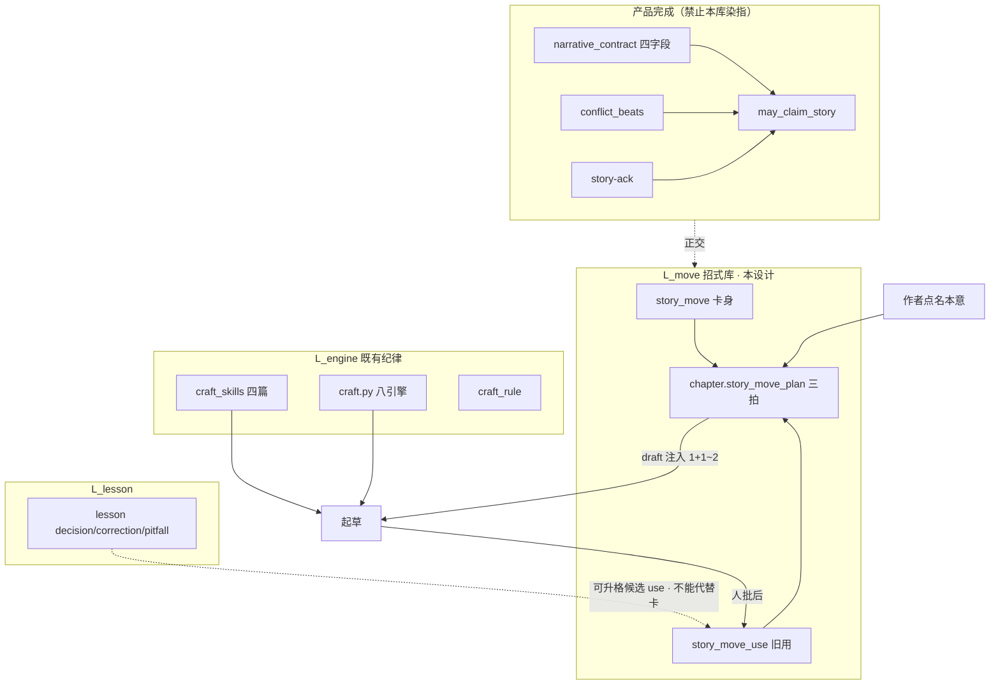
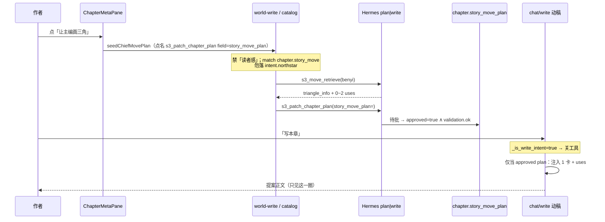
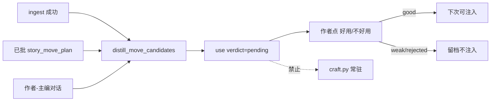

# 故事招式库 · 命名可操作的绕法卡片（Story Move Library）

| 项 | 值 |
|----|-----|
| **短名** | `move-library` / `故事招式库` |
| **文档状态** | **Draft R3**（R2 + 画三角强制 `runPhase=plan`） |
| **作者** | Grok Design（待人审签） |
| **日期** | 2026-08-13 |
| **产品** | 铜炉 / tonglu · 代码 `scribe3/` |
| **仓库** | `/home/admin/projects/scribe-writing-system` |
| **建议落仓路径** | `docs/plans/2026-08-13-move-library-design.md` |
| **验证环境** | **仅已部署 demo** `https://tonglu.qing.blue` · SSH `ubuntu@82.157.130.140` · 应用 `/opt/scribe3/app`；运维 env SSOT **`/opt/scribe3/app/.env`** |
| **合法写通道** | orch proposal/apply、`save-chapter`、intent-goals、MCP `s3_patch_chapter_*` / `s3_add_chapter`。招式计划 **只** 扩 `s3_patch_chapter_plan(story_move_plan=)`；**不** 新增 Hermes 写工具。use 人批走登录 REST（对标 `POST /story-ack`）。**禁止** EMERGENCY 默认 |
| **Surreal** | **3.x only**（demo 3.2.4）；NS=`scribe3`，一书一 `db=<work slug>`；禁止 `type::thing` |
| **完成/宣称 SSOT** | **`docs/plans/2026-08-13-narrative-engine-product-mainline.md`**（`may_claim_story`）。本设计 **不** 改宣称公式、**不** 复活工程 PASS 话术 |
| **写路径注入序** | 载荷/物理序以 `docs/plans/2026-08-13-write-path-story-constraints.md` 为准；本设计只 **新增** 一段 `story_move`，不重开合同块 |
| **明确拒绝的前序方向** | 修辞情境 taxonomy、Zettelkasten PKM、记叙/说明/议论体裁树、检索工程优先 |

---

### 读法（工程师 · 第一周）

1. **Overview + 分层图** — 招式卡回答什么、不回答什么。  
2. **产品模型 §1–§2** — 本意怎么存、何时合并、反模式。  
3. **作者环 + 写路径注入** — 三拍何时提出、动稿关工具时如何仍注入。  
4. **Data / API / Seed** — 表、MCP、第一张卡原文。  
5. **Key Decisions + PR Plan** — 按序开工。

---

## Overview

铜炉已有三层「写法纪律」，但缺一层作者真正在要的东西：**命名、可操作、按「本意」取一张的故事构造招式**。

现网能管的是：

- `scribe3/craft_skills/` 四篇 + `s3_skill_read`：**落笔纪律**（限知 / 潜台词 / 转场 / 节奏）
- `scribe3/craft.py` 八引擎：**句子/展示纪律**（身体先行、温度、闲笔、比喻、潜台词、感官、浸泡、留白）
- `craft_rule` per-work：**题材特化正则/禁令**
- `lesson.py`：**章级决策/纠偏/坑**，不是节拍卡片
- `structure_style.py`：**段型同构指纹**，不是绕法公式
- `narrative_contract` / `may_claim_story`：**戏有没有发生**（完成宣称），不是「这段怎么绕」

用户已否决修辞分类与 PKM。他们给的规范例是 **三角信息法**：

> 想表达任何信息，先画个三角。别上来掏底牌。先写反面 → 再破功 → 回到本意。

本设计新增 **L_move 招式库**：

```text
一张招式卡回答（心智；**种子/catalog 勿抄「读者感」三字**）：
  「本意是 X，别直线说 X，按这个结构绕一圈。」

检索键 = 本意（要表达的信息）× 绕法（招式）
       ≠ 体裁 / 表达方式 / 语义相似散文

写时注入 = **仅当章上已有 approved 计划**：1 张卡 + 1–2 条同本意 good use（只迁方法，禁仿词）
无 approved plan → 写路径 **零字节**（不猜 request_text）
写后沉淀 = use 变厚；卡身极少改
```

**一句话**：招式库是 **构造层**（这段绕哪条公式），喂写作质量；**不是** 完成/宣称 SSOT，**不是** 又一套工程绿灯。



---

## Background & Motivation

### 为什么需要

作者要的不是「再多一篇技法 wiki」，而是 **当场能用的绕法**：给出本意，立刻有公式、有直线病、有正反例、有自己书里用过的三拍。没有这一层时，模型会：

1. **直线陈述**（写穷就写抠门、买不起）——信息到了，故事没到。  
2. **把 `craft_skills` / `craft.py` 当构造**——限知、身体信号解决不了「先反后正」。  
3. **用语义相似章当参考**（`s3_chapter_recall`）——召回的是表面散文，诱发仿写。  
4. **把 lesson 当招式**——lesson 是「反转别压章尾」这类决策句，没有三拍公式。

### 现网锚点（2026-08-13 代码核实）

| 层 | 路径 | 现网事实 | 与招式库关系 |
|----|------|----------|--------------|
| 落笔纪律 | `scribe3/craft_skills.py` · `craft_skills/*.md` | 4 篇；`skills_index_block()` **仅** `with_tools=True` 注入；`s3_skill_read` | **不是**招式。索引纪律可复用，卡不可并入 md |
| 句子纪律 | `scribe3/craft.py` `PUBLIC_ENGINE_KEYS` | 8 段恒注入 `write_assemble_v1` `_push("craft")` | 展示层；禁把三角公式写进 ENGINES |
| 题材禁令 | `store/voice_craft.py` `craft_rule` | per-work 正则 | 不混 |
| 章课 | `lesson.py` + `store/chat_ai.py` `add_lesson` | ingest 后蒸馏；kind∈{decision,correction,pitfall}；HNSW 512 | **可**产出升格候选；**不可**当 use 表 |
| 段型 | `structure_style.py` | 同构 run / 章末公式；advisory | 用作 **禁复表面**，不作检索键 |
| 完成合同 | `narrative_contract.py` · migration **134** | desire/obstacle/turn/cost；`may_claim_story` | **正交**。三拍 ≠ 四字段 |
| 写路径 | `write_assemble_v1._assemble_write_instructions_v1` | `_push` 有 event_drive / drama / craft / outline；**无** story_move | 本设计接线点 |
| 动稿关工具 | `api/routers/write.py` + `_is_write_intent` | `_WRITE_VERB_RE`；动稿 `with_tools=False` | 注入必须 **服务端检索**，不能靠模型调工具 |
| 讨论编译 | `write_assemble_discuss.assemble_discussion_system` | 禁写作围栏；**不能落库** | 只可口头提案；落 plan 必须 world-write |
| Hermes include | `deploy/hermes/mcp_servers.yaml` | **fail-closed**：新工具不写 include 就不暴露；`test_provision_hermes` 钉 read⊆只读、write⊆WRITE_GATED | PR-3a **必改** yaml + plan overlay |
| 编排目录 | `orchestration/catalog.py` `intent.northstar.match_keywords` 含 **「读者感」** | `"读者感" in "想让读者感到穷"` 为真 → 误进 `s3_set_intent` | 种子禁「读者感」；新域 `chapter.story_move` |
| 世界写判定 | `web/src/lib/hermesRunIntent.js` `WORLD_WRITE_FORCE = /(s3_[a-z_]+|…)/` | 点名 `s3_*` **离开**无工具 discuss | 画三角必须走 world-write 种子 |
| plan profile | `PLAN_SCAFFOLD_ALLOWED_TOOLS` + `scribe3_plan_read` | 现网无 retrieve | 加 retrieve |
| draft/final/deduce profile | `ChiefDock` `isScaffoldPhase` 用**点击当下** `phase` 开 Run | `scribe3_draft_read` / deduce **无** retrieve；`onNavigatePhase` 同 tick 改不了本回合 `runPhase` | **发送侧**强制 `runPhase='plan'`（§3.3），**不**把 retrieve 扩进 draft/deduce |
| 召回 | `s3_chapter_recall` / `s3_hybrid_recall` / `recall_lessons` | 散文 / 命题 / 章课 | 不作招式键 |
| 仿写防护先例 | `reference_craft.py` `_UNSAFE_MECHANISM` | 只迁 mechanism | **照抄策略** |
| 旗 | `feature_flags.FLAG_REGISTRY` | 最新叙事旗到 `SCRIBE3_CONTRACT_DRIVE_STRICT` | 本设计加 `SCRIBE3_MOVE_LIBRARY` |
| 迁移 | `scribe3/migrations/` | 最新 **135** | 本设计 **136** |
| SystemHub | `web/src/system/SystemHub.jsx` skills | 只读 craft_skills | **另开**「招式」段，禁止并进 skills |
| 章契约 UI | `ChapterMetaPane` + `chapterContractGate.js` | 材料齐套 soft；product-mainline 要清工程话术 | 招式面文案必须是「这一圈」，禁止「可开写」 |

### 痛点（用户已拍板，不重审）

- 直线思维把信息当故事。  
- 同族说法（欲扬先抑、先给期望再打碎、用热闹写孤独）若公式仍是 **假→破→真**，应并进三角卡的 **use/例**，不要开新卡。  
- 写时不要倾倒整库。  
- 卡身稳定，**uses 变厚**。  
- 相似段落连续性 = 同一招式的旧三拍，不是任意相似散文。

---

## Goals & Non-Goals

### Goals

1. **产品对象**：命名招式卡；最小字段 **本意、公式、直线病、正反例**；检索键 = 本意 × 绕法。  
2. **作者环**：MetaPane「让主编画三角」= **world-write 种子**（同 `seedChiefNarrativeWrite`）→ catalog `chapter.story_move` → `s3_move_retrieve` + `s3_patch_chapter_plan(story_move_plan=)` 待批。discuss **不得**落库。  
3. **写路径**：flag 开 **且** `story_move_plan.approved==true` 且 `validation.ok` 时，draft/final **服务端**注入 1 卡 + 公式 + 至多 2 条 good use；否则 **零字节**。工具索引只出现在 `with_tools=True`。  
4. **学习环**：章后抽出候选 use；**人批**才进 good；永不自动升格为 `craft.py` 常驻文案。  
5. **数据**：repo 种子 JSON（≤20，首卡仅三角）+ 每书 Surreal 表；uses 一书一库。  
6. **与宣称正交**：`story_move_plan` **不得**进入 `build_story_ready` / `may_claim_story`；UI 不得因有招式而发绿。  
7. **验证**：只打已部署 demo（retrieve / assemble 段 / 记一条 use）。  

### Non-Goals

| # | 非目标 | 理由 |
|---|--------|------|
| NG1 | 修辞情境 / 体裁 / Zettelkasten 分类树 | 用户已拒 |
| NG2 | 检索工程优先（先调 embedding 再想卡） | 先有可操作卡 |
| NG3 | 把招式并进 `craft_skills/*.md` 或 `s3_skill_read` | 生命周期不同，双 SSOT |
| NG4 | 把 use 塞进 `lesson` kind | lesson 是决策句，无三拍；合并会污染召回 |
| NG5 | 用 `s3_chapter_recall` 当招式召回 | 召回散文 → 仿写 |
| NG6 | 改 `may_claim_story` / 复活 GATE 完成话术 | product-mainline 禁令 |
| NG7 | v1 作者自建新公式卡、跨书共享 uses | 种子未泡；一书一库 |
| NG8 | 把三拍写入 `chapter.beats` | beats 是故事 GCD；`ALLOWED_BEAT_TYPES` 无立/转/落 |
| NG9 | 整库倾倒、仿写正例台词 | 产品红线 |
| NG10 | Grok 机 `npm ci` / 本机 Surreal / 全量 pytest / 第二栈 | 资源纪律 |
| NG11 | EMERGENCY 写、默认 REST 世界写 | 写通道禁令 |
| NG12 | 把「观众比角色多知道一步」做成新招式卡 | 已是 `craft_skills/限知视角.md` 的 dramatic irony |

---

## Proposed Design

### 1. 产品模型：什么是招式

**招式 (story_move)** = 一条 **命名的、可执行的绕法公式**。作者带着「要表达的信息」来取它，而不是带着体裁来取它。

| 问题 | 招式库答 | 别人答 |
|------|----------|--------|
| 这段绕哪条公式？ | **本库** | — |
| 这场戏欲望/阻力/回合/代价？ | — | `narrative_contract` |
| 焦点能看见什么？ | — | 限知 skill + epistemic_guard |
| 情绪怎么展示？ | — | `craft.py` body/subtext |
| 上章纠偏过什么？ | — | `lesson` |
| 段型是否连刷？ | — | `structure_style` |

#### 1.1 卡最小字段（实现必须齐）

| 字段 | 代码名 | 约束 |
|------|--------|------|
| 名称 | `name` | 中文显示名，如 `三角信息法` |
| slug | `id`（JSON）→ 库列 `slug` | 稳定 id，如 `triangle_info`；record `story_move:triangle_info` |
| 一句话 | `one_liner` | ≤40 字；索引用 |
| 本意提示 | `benyi_hint` | 适用本意的说明（自由文本，**不**当检索否决） |
| 本意同义词 | `benyi_aliases[]` | **只**本意近义（穷/拮据/买不起）。**禁止**放绕法俗名 |
| 公式 | `formula` 对象 → 库列 `formula_json` | 有序拍：`role` + `name` + `hint`；`arrow` 规范化串 |
| 公式族 | `formula_family` | 合并键，如 `false_break_true` |
| 直线病 | `straight_line` | 上来就掏底牌会长什么样 |
| 正反例 | `examples_pos[]` / `examples_neg[]` → `examples_json` | **方法摘要** + 出处；`beats.text` 禁专名/台词 |
| 用法 | `usage` | 作者口吻的操作句 |
| 绕法俗名 | `aliases[]` → 库列 `aliases`（JSON 数组串） | 欲扬先抑、先给期望再打碎…；**只**绕法名，不当本意 |

卡身 **很少改**。正例里的电影/小品是 **教具**，注入时只留方法三拍，不留对白。

#### 1.2 本意怎么表示（KD-M1）

**本意**是作者 **这一圈要让读者感到/知道的信息**（穷、悲惨、孤独），不是书级北极星，不是体裁。口语可说「感到穷」，**产品/种子/catalog 禁用「读者感/读者感到」子串**（现网 `intent.northstar.match_keywords` 含 `"读者感"`，会误进 `s3_set_intent`）。

| 方案 | 结论 |
|------|------|
| 封闭词表（穷/悲/怒…） | **拒绝**。会滑回 taxonomy |
| 纯 embedding、不存原文 | **拒绝**。作者无法点名、无法合并 |
| 卡间 embedding + `sim≥0.48` 否决 | **v1 拒绝**。唯一卡 `triangle_info` 的 `benyi_hint` 是「任何本意」；「复仇」对 aliases 向量可能 <0.48，会做成「本意必须像种子词」 |
| **本意自由文本写在 plan；v1 卡恒为三角；uses 才 HNSW** | **采用** |

存储：

- 章计划：`story_move_plan.benyi` 自由文本（作者原话，≤16 字展示、≤40 字硬顶）
- 卡：`benyi_hint` + `benyi_aliases`（穷/拮据/买不起）— **展示/教具/第 2 张卡出现后的竞争预留**
- uses 向量：`embed(use.benyi)`，`scribe3/embed.py` **BAAI/bge-small-zh-v1.5 · 512 维**（与 `lesson` 同模型）
- **卡表 `embedding` 列 v1 可建可不填；不得当注入门、不得对 `retrieve` 做 sim 否决**

**v1 `retrieve_story_move(benyi, move_id=None)` 写死：**

```text
if not (benyi or "").strip():
    return []          # 无本意 → 无卡
if move_id:
    return [that card] if exists else []
return [triangle_info] # 恒这一张；不对卡做 embedding 否决
```

第 2 张卡出现后再定义卡间竞争。uses 侧仍 `sim≥0.48`（见 §5.3）。

**不是本意**：

- `intent:main.reader_feeling`（书级北极星，`store/intent.py`）
- `synopsis` 整段（太噪，禁止当 query 主锚）
- `chapter.beats[].text`（故事事件）
- draft `request_text` 里的口语（**不**在 assemble 里猜本意）

**本意只在作者环写入 plan**（world-write 种子问「本意是什么」）。写路径 **只读** 已批 `story_move_plan.benyi`。

#### 1.3 何时必须合并（KD-M2）

```text
normalize(formula.arrow) ∈ 假→破→真 的同构
  （含 反面→破功→本意、期望→打碎→真相、热闹→间隙→孤独 若仍是三拍假破真）
→ 禁止新卡；写入三角卡的 examples 或一条 use。
```

同构判定（纯函数 `same_formula_family(a, b) -> bool`）。**v1 无写路径调用方**（禁止作者建卡）；PR-1 实现 + 单测即可，assemble / store **不得**调用。

```python
_ROLE_CANON = {"假": "假", "反": "假", "反面": "假", "期望": "假", "热闹": "假", "胜利": "假",
               "破": "破", "转": "破", "破功": "破", "打碎": "破", "间隙": "破", "露怯": "破",
               "真": "真", "落": "真", "本意": "真", "真相": "真", "孤独": "真", "失败": "真"}

def _norm_arrow(s: str) -> str:
    t = (s or "").replace("->", "→").replace("－", "→").replace("-", "→")
    t = "".join(t.split())
    return t

def _role_seq(formula: dict) -> tuple[str, ...]:
    return tuple(_ROLE_CANON.get(b.get("role") or "", b.get("role") or "")
                 for b in (formula or {}).get("beats") or [])

def same_formula_family(a: dict, b: dict) -> bool:
    if (a.get("formula_family") or "") and a.get("formula_family") == b.get("formula_family"):
        return True
    if _norm_arrow(a.get("formula", {}).get("arrow")) == "假→破→真" and \
       _norm_arrow(b.get("formula", {}).get("arrow")) == "假→破→真":
        return True
    sa, sb = _role_seq(a.get("formula") or {}), _role_seq(b.get("formula") or {})
    return bool(sa) and sa == sb
```

「热闹→间隙→孤独」若三拍 `role` 标成 假/破/真（或能经 `_ROLE_CANON` 归一）→ 同族。未标 role、只有俗名 → **不**自动判同族（避免误吞真·不同公式）。

**新卡门槛**（v1.1+）：拍的 **归一 role 序列** 不同。v1 不执行。

#### 1.4 反模式

| 反模式 | 处理 |
|--------|------|
| 按记叙/议论/体裁检索 | 代码不提供 genre 参数 |
| 把整库拼进 prompt | `retrieve()` 硬顶 1 卡 |
| 注入《不差钱》台词 | `sanitize_move_inject` **剥**引号/书名号对白/超长拍，**不**整段 drop |
| 连续三章同一三角同一表面 | `consecutive_same`：仍注入公式，加换物象令；uses 避开最近章 |
| 自动把 use 写进 `craft.py` | 无此代码路径 |
| 招式 ok → 章完成 | 禁止接线 `story_complete.py` |
| 与 skills 混目录 | 独立 `scribe3/story_moves/` + 独立 MCP |

---

### 2. 分层与既有资产边界

```text
L_story     叙事完成     narrative_contract / conflict_beats / story-ack
L_move      招式构造     story_move / story_move_plan / story_move_use     ← 本设计
L_engine    落笔+句子    craft_skills + craft.py + craft_rule
L_lesson    章课         lesson（可升格进 uses，不能代替卡）
L_surface   段型多样性   structure_style（禁复表面）
L_ref       参考指纹     reference_craft（只迁 mechanism；先例）
```

`discourse_soft` / `storyline_polish` 仍是 L3 讲法/连载，**不是**招式。不要把三角公式塞进 `discourse_inject.py`。

---

### 3. 作者环（动稿前）

作者要感到这是 **编故事**，不是齐套工程。文案禁用：「材料够了」「可开写」「PASS」「gate」「读者感/读者感到」。

**唯一主路径（已由现网代码定死，不是 Open Question）**：

```text
MetaPane「让主编画三角」
  → seedChiefMovePlan = focusChiefWithSeed(点名 s3_patch_chapter_plan + field=story_move_plan)
  → WORLD_WRITE_FORCE 命中 s3_*  → Hermes 世界写（不是 discuss）
  → catalog.resolve → chapter.story_move
  → plan/write profile 可见 s3_move_retrieve + s3_patch_chapter_plan
  → 待批写入 story_move_plan
```

discuss 只可口头聊三拍，**不可落库**（`assemble_discussion_system` 禁围栏、无写工具）。种子若只丢进 discuss，点名 `s3_*` 会被 `WORLD_WRITE_FORCE` 拉走；若留在无工具讨论则 retrieve 调不到。



#### 3.1 本意从哪来

| 入口 | 行为 |
|------|------|
| **主**：MetaPane「让主编画三角」 | world-write 种子问「本意是什么（穷/悲惨/…），别直线说」 |
| 章契约「这一圈」 | 只读本意 + 三拍；缺则灰字「还没画」 |
| 节拍阶段 | 可对照展示「三拍 ↔ 故事拍」，**禁止**把立/转/落写进 `chapter.beats` |
| 书级 intent | **不**自动当本意 |
| discuss | 可聊，**不**写 plan |

#### 3.2 catalog + resolve（PR-4 必改）

新增 `orchestration/catalog.py` 域（`write_tools` **仅**已有写工具）：

```python
{
    "domain": "chapter.story_move",
    "label": "章招式/这一圈",
    "match_keywords": (
        "本意", "招式", "三角信息法", "画三角", "别直线", "这一圈",
        "field=story_move_plan", "story_move_plan",
        # 禁止：「读者感」「读者感到」「北极星」
    ),
    "match_force": (
        "field=story_move_plan",
        "画三角", "写招式计划", "本意是",
        # s3_patch_chapter_plan 放 force 会与 outline/beats 共享 +100；
        # 字段加权必须补上（见下）
    ),
    "read_tools": ("s3_get_chapter", "s3_move_retrieve", "s3_move_list"),
    "write_tools": ("s3_patch_chapter_plan",),  # ⊆ WRITE_GATED；无新写工具
    "required_outcome": "write_proposal",
    "channel": "world_write",
    "phase_hint": "plan",
    "ui": {"entry": "manuscript", "phase": None, "right_tab": "chief",
           "layout_mode": "collaboration", "panel": "chapter_meta"},
    "instruction_duty": (
        "域纪律(章招式):先 s3_move_retrieve(benyi) 取三角公式；"
        "用 s3_patch_chapter_plan(seq, story_move_plan={...}) 写本意+立/转/落；"
        "禁止 s3_set_intent；禁止 s3_save_chapter 完成本任务；"
        "本意≠书级北极星。"
    ),
}
```

`resolve._score_entry` 仿 outline/beats 字段加权（约 L43–55）：

```python
if plan_tool or re.search(r"s3_patch_chapter_plan", t):
    if domain == "chapter.story_move" and re.search(
        r"story_move_plan|field\s*=\s*story_move_plan|画三角|本意是|招式", t, re.I
    ):
        score += 90
```

种子必须带 `field=story_move_plan`，避免与大纲/节拍抢同一 `s3_patch_chapter_plan` force。

`tests/test_orchestration.py` 增：`"本意是穷，画三角"` / 含 `field=story_move_plan` → `chapter.story_move`；**不得** `intent.northstar`。`test_catalog_write_tools_subset_of_write_gated_or_empty` 继续绿。

#### 3.3 主编种子（`chiefSeed.js`）

与 `seedChiefNarrativeWrite` **同形**：点名写工具 + `focusChiefWithSeed`。`scaffoldToolContract('story_move')`：

```javascript
{ tool: 's3_patch_chapter_plan', field: 'story_move_plan' }
// 禁止 gateHint 工程句；禁止「读者感/读者感到/可以开写/GATE」
```

```javascript
export function seedChiefMovePlan({ seq, benyi = '' } = {}) {
  const n = Number(seq) || seq
  const hint = [
    `使用工具 s3_patch_chapter_plan(seq=${n}, field=story_move_plan) 提交写入提案。`,
    `先 s3_move_retrieve(benyi=${benyi || '（先问作者：本意是什么）'}) 取一张招式（v1 即三角信息法）。`,
    '按公式给出立/转/落三拍（每拍一个场面，≤40字）。别直线说本意。',
    '禁止 s3_set_intent。不要谈 GATE、不要说可以开写。',
    SCAFFOLD_FORBID_SAVE,
  ].join('\n')
  return seedChiefNarrativeWrite('story_move', `第 ${n} 章招式计划`, hint)
}
```

`WORLD_WRITE_FORCE` 已匹配 `s3_[a-z_]+` 与「提交写入提案」——本种子会进 Hermes，不会留在无工具 discuss。`seedIn`（`ChiefDock.jsx` ~L503）对含 `s3_` 的种子 **80ms 后自动 send**。

**从 draft/final/deduce 点「画三角」：强制本回合 `runPhase='plan'`（KD-M18）**

现网 `ChiefDock`（~L754–770）：`outline|beats|plan|deduce|draft|final` 一律 `isScaffoldPhase`，`runPhase = phase`（点击当下的章 tab）。`orchestrateBeforeSend` 的 hard focus / `onNavigatePhase` 改 UI 是异步的，**不会**改掉本回合 `runPhase`。catalog `phase_hint: "plan"` 也管不到这次 Run。

| 方案 | 结论 |
|------|------|
| ① 发送侧强制 `runPhase='plan'` | **采用**。招式计划语义就是 plan 脚手架；R2 已把 retrieve 放进 plan include |
| ② 把 retrieve 扩进 `scribe3_draft_read` / deduce allowlist | **拒绝**。扩大动稿/演绎工具面；draft 已有 `s3_save_chapter`，不宜再混检索 |
| ③ 种子写「retrieve 没有就默填三角」 | **拒绝**。对模型撒谎，且拿不到书内旧用 |

实现（PR-4 必改 `ChiefDock.jsx` + `chiefSeed.js`）：

```javascript
// chiefSeed.js
export function isStoryMovePlanSeed(text) {
  return /field\s*=\s*story_move_plan|story_move_plan/.test(String(text || ''))
}

// ChiefDock send（在算 runPhase / 调 orchestrateBeforeSend 之前）
const forcePlan = isStoryMovePlanSeed(q)
const orchPhase = forcePlan ? 'plan' : (phase || '')
orchestrateBeforeSend(q, { chapter: chForScope, phase: orchPhase, ... })
// isScaffoldPhase 分支之后：
if (forcePlan && chForScope != null) runPhase = 'plan'
// api.runWrite({ phase: runPhase }) → run_scope=chapter:N:plan → scribe3_plan
```

- **禁止**把 phase 置空（会落到全写 profile，脚手架禁令，见 `scaffold_forces_stage_profile`）。  
- `onNavigatePhase('plan')` 可作下一拍 UI 对齐，**不是**本回合机制。  
- outline/beats 本就走 plan profile，override 幂等。  
- retrieve **只**进 `scribe3_plan_read` + `PLAN_SCAFFOLD_ALLOWED_TOOLS` + 全写 `scribe3_read`（空 phase 世界写）。**不**改 `scribe3_draft_read` / `scribe3_deduce_read` / `DEDUCE_ALLOWED_TOOLS` / draft·final `allowed_tools`。

#### 3.4 SPA 不做成工程绿系统

| 位置 | 做 | 不做 |
|------|----|------|
| `ChapterMetaPane` | 「这一圈」：本意、招式名、三拍原文；缺则灰字「还没画」；按钮调 `seedChiefMovePlan` | StatusDot 绿/红当完成；「材料够了」 |
| `chapterContractGate.js` | **不**把 plan 纳入 B1/B2/B3 | 新 error 挡开写 |
| SystemHub | 只读 **repo JSON** 种子目录（运维，无 `?work=`） | 作者主路径；**不**读书库 uses |
| WriteChat | 动稿不依赖工具 | 在提案里复述整卡正例 |

信息密度：与 `ChapterStudio` 同一钩子 `loadIaDensity()`（`scribe3/web/src/lib/iaDensity.js`，`localStorage s3.ia.density`）。`essential`：只显示「招式名 · 本意」一行；`standard`/`full`：展开三拍 +「好用吗」。

---

### 4. 写路径注入（动稿）

#### 4.1 纪律（必须遵守现网）

1. **工具索引只挂带工具路径** — 对齐 `craft_skills.skills_index_block` 与 `test_write_instructions_index_only_with_tools`。  
2. **写意图关工具** — `write.py`：`_wt = ... and not _write_intent`。`_WRITE_VERB_RE` 含「写|改|续写|本章|展开…」，「这章想写穷先画三角」也会关工具。  
3. **卡选择不依赖 Hermes**：assemble 读已批 plan 的 `move_id`/`benyi`，v1 卡恒 `triangle_info`。  
4. **注入闸门（唯一）**：`flag 开 ∧ story_move_plan.approved==true ∧ validation.ok ∧ benyi 非空` 才注入 1 卡 + ≤2 good uses。否则 **零字节**。不从 `request_text` / 讨论猜本意。  
5. **禁止仿写** — 只迁方法；uses 经 `sanitize_move_inject`（剥词，非整段 reject）。  
6. **物理序必须登记** — `_push` ≠ 模型所见（write-path KD-W14）。必须同时改 `generation_physical_order_names`、`SEGMENT_REGISTRY`、`GENERATION_SEGMENT_LAYERS`、`L2_DROP_TIER`。

#### 4.2 新段 `story_move`

| 项 | 值 |
|----|-----|
| 段名 | `story_move` |
| `_push` layer | `"supplemental"` |
| `GENERATION_SEGMENT_LAYERS["story_move"]` | `"supplemental"`（**必改**，`test_l2_drop_tier_single_source` / join 缺 layer 回落此表） |
| registry | `SegmentMeta("story_move", "L2", "head", "frame")` |
| 物理序 | 紧挨 **`outline` 之后**（两分支都要写，见下） |
| vs 合同 | **永远不得**插到 `narrative_contract` 之前（write-path 将该段放 `event_drive` 前、L0 永不裁） |
| `L2_DROP_TIER` | **T1**（与 `purpose` / `pressure_drive` 同档）。**不**进 T2（否则比 craft 先丢，口头「先看见绕哪圈」做不到） |
| `GEN_SEGMENT_PROTECTED` / `L0_NEVER_CUT` | **不进** |
| 字符硬顶 | **600**（卡摘要 ≤280 + 每条 use ≤140 ×2 + 换物象令 ≤40） |
| flag 关 / 无 approved plan | **零字节** |

**T1 取舍（写清后果）**：预算紧时先丢 T3（material/discourse/reference）再丢 T2（craft/avoid），然后才半裁 T1。招式段晚于句子处方被裁，早于仍可能被丢掉——半裁序先砍 uses，保留「本意+arrow+本章三拍」4 行。不要口头 L2-head 却放 T2。

**`generation_physical_order_names` 两分支**（`SCRIBE3_OUTLINE_AFTER_DRAMA` 默认 1）：

```text
# outline_after=1（默认）：outline 在 drama_vacuum 后、envelope 前
prefix → event_drive → [narrative_contract · write-path] → drama_* → outline → story_move → envelope → …

# outline_after=0：outline 进 mid
prefix → event_drive → [narrative_contract] → drama_* → envelope → … → outline → story_move → volume_intro → …
```

验收单测：默认旗 `order_indices["outline"] < order_indices["story_move"] < order_indices["envelope"]`；若 `narrative_contract` 已入序，则 `narrative_contract < story_move`。

**与 write-path-story-constraints 合入序**：两份都改 `write_assemble_v1` / `context_budget` / `injection_registry`。后合者 **rebase 物理序**，禁止各写一份 `generation_physical_order_names`。招式 PR 假设合同段若存在则已在 `event_drive` 前。

半裁顺序（`format_move_block`）：uses → 正例教具 → 直线病 → 只留「本意+arrow+本章三拍」。

#### 4.3 注入载荷（禁止整卡、禁止台词）

```text
【招式·三角信息法】本意：穷。别直线写抠门/买不起。
公式：大方（假）→ 抠门（破）→ 穷（真）。
本章三拍：先装大方请客 → 掏不出露怯 → 落回穷。
直线病：上来就哭穷。
同本意旧用（只迁方法，禁复述物象/对白/专名）：
- 立：当众抢付；转：袋里不够；落：改口改小数。
禁止模仿上例用词；同一招式必须换场面与物件。
```

实现：`scribe3/story_move.py`

```python
MOVE_INJECT_CAP = 600
USE_TEXT_CAP = 40          # 单拍
USE_INJECT_CAP = 140       # 一条 use 三拍合计
SEED_DIALOGUE_BAN = True

def format_move_block(card: dict, plan: dict | None, uses: list[dict], *,
                      consecutive_same: bool = False) -> str:
    """纯函数。无 store。超长按半裁序截。"""
    ...

def sanitize_move_inject(text: str) -> str:
    """剥书名号/引号对白、截断超长拍。禁止整段 drop。

    不得字面套用 reference_craft._UNSAFE_MECHANISM（那是整段 continue 丢弃，
    命中「专名|书名|人名」或 _QUOTED_TEXT 会让教具/换物象令整条消失）。
    该词表仅作注入后扫描：命中则记 meta.unsafe_hits 并再截 40 字，仍保留拍。
    """
    ...
```

`write_assemble_v1._render_final_input` 在 `_push("outline")` 后：

```python
if move_library_enabled():
    _mv = _domain_input(
        f"chapter:{chapter}:story-move", "story_move",
        _story_move_write_block(st, chapter),  # 只读章 plan；不读 request_text
    )
    _push("story_move", "supplemental", _mv)
```

`_story_move_write_block` 放 `write_assemble_context.py`，fail-soft：无 approved plan / `validation.ok` 假 / 旗关 → `""`。永不抛死组装。

#### 4.4 工具索引（仅 with_tools）

`story_move.moves_index_block()`，形状对齐 `skills_index_block`：

```text
## 故事招式库（按本意取 1 张）
本意是 X、别直线说时，先 s3_move_retrieve(benyi=X)；
写前用 s3_patch_chapter_plan(story_move_plan=) 记下三拍。禁止整库粘贴、禁止仿写正例。
- triangle_info：三角信息法 · 假→破→真
```

挂点：`write_assemble_v1` 在 `if with_tools:` 里与 `skills_index_block()` 相邻。world-write / plan profile 指令可带同样索引（工具已 include）。**`with_tools=False` 不得出现 `s3_move_` 字样**（单测钉死）。

#### 4.5 与合同 / outline / brief

| 块 | 关系 |
|----|------|
| 未来 `narrative_contract` 注入（write-path P2） | 合同是「必须发生的戏」；招式是「怎么绕着说」。合同在前或与 event_drive 同区；招式在 outline 后。两段禁止合并 |
| `_outline_block(mode=write)` | 故事拍；招式三拍另段。不要把三拍塞进 outline |
| `_brief_must_sections_write_block` | 不把招式列入 must 工程清单 |
| `build_craft_block` | 句子纪律；三角公式 **禁止** 写入 ENGINES |
| `structure_diversity_block` | 注入后若 `consecutive_same`，招式段自带换物象令即可，不改 diversity 文案 |

#### 4.6 `_is_write_intent` 假阳

已知：`本章节奏如何` 被测成 write-intent（`tests/test_proposal.py`）。本设计 **不** 放宽正则（爆炸半径大，属 write-path 另案）。

缓解：

- 画三角走 **world-write 种子**（`seedChiefMovePlan`），动词用「画三角 / 本意是」，避免「写本章」。  
- 动稿轮关工具：assemble **只**在已批 plan 时注入。  
- 无 approved plan：零字节（不猜 request_text）。

---

### 5. 相似段落 / uses 召回

#### 5.1 存什么

`story_move_use` **一条** = 一次真实绕圈，不是卡身：

| 字段 | 含义 |
|------|------|
| `id` | record 裸 id。plan 源：`{move_id}_{chapter}`（如 `triangle_info_12`）；作者补记：`um_{uuid8}` |
| `move_id` | `triangle_info` |
| `benyi` | 作者本意原文 |
| `beats` | 三拍方法摘要（已消毒） |
| `chapter` | 章号 |
| `verdict` | `pending` / `good` / `weak` / `rejected` |
| `source` | `plan` / `talk` / `author` |
| `note` | 好不好用（人写，≤80） |
| `embedding` | `embed(benyi)` |
| `prose_fp` | 可选，绑定当时正文指纹，防改稿后错挂 |
| `invalid_at` | 软删 |

**幂等**：`add_story_move_use` 对 `(move_id, chapter)` 且 `verdict=pending` 且 `invalid_at IS NONE` → **UPDATE** 三拍/本意，不堆第二条。`UPSERT type::record('story_move_use', $id)`。同章同招式 good 已存在则不再写 pending。

**只迁方法**：落库前 `beats[*].text` 必须过 `sanitize_move_inject`；禁止存超过 40 字的拍（防粘贴台词）。

#### 5.2 范围

| 范围 | v1 |
|------|----|
| 卡目录 | repo 种子 upsert 进 **本书 DB**（一书一库，无 NS 级表） |
| uses | **仅本书** |
| 跨书共享 | **不做** |
| 种子正例 | 卡身上的教具；无 good use 时最多注入 **1 条**种子方法摘要（仍消毒） |

#### 5.3 怎么取

`retrieve_uses(st, move_id, benyi, chapter, k=2)`：

1. `embed(benyi)`  
2. HNSW：与 `recall_lessons` **同形**  
   `embedding <|{max(k*3, 6)},{max(40, k*3)}|>`  
   （**禁止** KNN×WHERE；`invalid_at` / `verdict` / `move_id` 在 Python 滤）  
3. 过滤：`move_id` 相同、`verdict==good`、`chapter < 当前`、非最近 `consecutive_same` 窗口内的章  
4. `sim ≥ MOVE_USE_MIN_SIM`（= `lesson.RECALL_MIN_SIM` **0.48**；只用于 uses，**不对卡**）  
5. 返回最多 2 条  

**不要**：

- 用 `s3_chapter_recall(query=本意)` 当主召回  
- 用 `structure_style.paragraph_fingerprint` 当招式键  

**要**：

- `s3_chapter_recall` / `s3_recent_phrases` 继续作 **避面**（已用短语）  
- 若注入的 use 来自第 N 章，可附 `avoid`：该章 `distinctive_phrases` 不进招式段（避免段已有 `_avoid_directive`）；招式段只写「禁复述上例物象」  

#### 5.4 连续三角发油

`count_recent_same_move(st, move_id, chapter, lookback=2)`：

- 近 2 章 plan 或 good use 同 `move_id` → `consecutive_same=True`  
- 注入加一句换物象令  
- uses 排除这 2 章（逼模型换场面，而不是换卡——公式仍对）  

`structure_style` 写后 isomorphism 仍 advisory，与本库独立。

#### 5.5 与 lesson 召回并行

`_purpose_and_lessons_write_block` **保持不变**。lesson 继续按 synopsis+beats 语义召回决策句。招式 uses 只按 本意×move_id。两段可同时存在；去重只做「同一句原文」级（几乎不会撞）。

---

### 6. 学习环



规则：

1. **触发**：与 `lesson.distill_chapter` 同事件（`ingest_policy` / `ingest_bg` 成功路径），**另函数** `distill_move_use`，fail-soft。  
2. **幂等表**：migration 136 新建 `move_distill_marker`（**不要**复用 `067 distill_marker` 同行，会与 lesson 的 `msg_count/last_turn` 打架）。`MiscMixin` 风格增 `get/set_move_distill_marker`。  
3. **抽取**：本意 + `move_id`（只允许已有 slug，默认 `triangle_info`）+ 三拍摘要。来源优先 **已批 plan**（零 LLM）；无 plan 才 LLM 看对话。  
4. **LLM**：`build_move_distill_prompt` / `parse_move_distill` 全文见下；最多 1 条；无把握 `[]`。  
5. **人批前不是 good**。ingest 只写 `pending`。  
6. **人批主路径 = REST** `POST /story-move-uses/{id}/review`（登录 + `assert_user_may_access_work`，对标 `POST /story-ack`，**无** MCP 审批框）。SPA「刚才那圈好用吗？」只打这条 REST。  
7. **不**把 `s3_move_review_use` 当作者主按钮。v1 **不**挂 Hermes write include。主编坞若要评，走同一 REST 或以后再议。  
8. **永不**把 good use 拼进 `ENGINES` / `craft_skills` md。  
9. lesson 蒸馏不得兼写 `story_move_use`。

`build_move_distill_prompt`（无 plan 时）：

```python
MOVE_DISTILL_MAX = 1

def build_move_distill_prompt(messages: list[dict]) -> str:
    lines = []
    for m in messages[-80:]:
        role = "作者" if m.get("role") == "user" else "主编"
        lines.append(f"[{m.get('turn') or '?'}] {role}:{(m.get('text') or '')[:400]}")
    convo = "\n".join(lines)
    return (
        "从下面这章作者-主编对话里，判断是否用了「三角信息法」绕法"
        "（先写本意反面 → 破功 → 落回本意）。只提取方法，不提取剧情事实。\n"
        "只输出 JSON 数组（0 或 1 条）：\n"
        '{"move_id":"triangle_info","benyi":"≤16字本意",'
        '"beats":[{"role":"假","text":"≤40字场面"},'
        '{"role":"破","text":"≤40字"},{"role":"真","text":"≤40字"}]}\n'
        "硬规则：\n"
        "1. 对话里没有明确绕法/三拍就返回 []；\n"
        "2. 严禁复述世界状态（谁丢了信物、谁是卧底）——那些归本体；\n"
        "3. beats.text 禁止台词、书名号、人名专名，只写功能场面（当众付账/袋空/改口）；\n"
        "4. move_id 只能是 triangle_info；\n"
        "5. 拿不准就 []。\n"
        f"对话记录:\n{convo}"
    )
```

`parse_move_distill`：只收 `move_id=="triangle_info"`；三拍 role∈{假,破,真}；每拍 `cn_len` 4–40；过 `sanitize_move_inject`；坏 JSON → `[]`。

---

### 7. 数据模型

#### 7.1 为什么不是「只加一篇 md」

见 Alternatives。结论：**repo 种子 JSON（卡身 SSOT）+ 每书表（uses / plan / 向量）**。

#### 7.2 目录与模块

| 路径 | 职责 |
|------|------|
| `scribe3/story_moves/triangle_info.json` | 第一张卡（也是模板） |
| `scribe3/story_moves/*.json` | 后续 ≤19 张；v1 可以只有 1 张 |
| `scribe3/story_move.py` | 纯函数：校验、合并、消毒、format、retrieve 排序 |
| `scribe3/store/story_move.py` | `StoryMoveMixin`：唯一 `_query` / `_execute_write` |
| `scribe3/store/surreal.py` | mixin 挂入 `SurrealStore` |
| `scribe3/migrations/136_story_move.surql` | 表 + 章字段 |
| `scribe3/mcp/tools_read.py` | `s3_move_list` / `read` / `retrieve` |
| `scribe3/mcp/tools_write.py` | **只扩** `s3_patch_chapter_plan(story_move_plan=)`；v1 **不**新增 `s3_move_set_plan` |
| `scribe3/deploy/hermes/mcp_servers.yaml` | fail-closed include（见 API） |
| `scribe3/run_stage_policy.py` | `PLAN_SCAFFOLD_ALLOWED_TOOLS` + retrieve |
| `scribe3/orchestration/catalog.py` · `resolve.py` | 域 `chapter.story_move` + 字段加权 |
| `scribe3/api/routers/chapters.py`（或同栈） | work-scoped REST 读 + review |
| `scribe3/tests/test_story_move.py` | **纯函数**（Grok 机可跑、无 Surreal） |

#### 7.3 Migration 136（Surreal 3.x）

```surql
-- scribe3 · 136_story_move.surql
-- 招式库：卡目录 + 使用记录；章计划 JSON 串（镜像 narrative_contract）
-- 禁止 type::thing；HNSW 512 与 lesson 同维；KNN 过滤在 Python

DEFINE TABLE IF NOT EXISTS story_move SCHEMAFULL;
DEFINE FIELD IF NOT EXISTS slug ON story_move TYPE string;
DEFINE FIELD IF NOT EXISTS name ON story_move TYPE string;
DEFINE FIELD IF NOT EXISTS one_liner ON story_move TYPE string;
DEFINE FIELD IF NOT EXISTS formula_family ON story_move TYPE string;
DEFINE FIELD IF NOT EXISTS formula_json ON story_move TYPE string;
DEFINE FIELD IF NOT EXISTS straight_line ON story_move TYPE string;
DEFINE FIELD IF NOT EXISTS usage ON story_move TYPE option<string>;
DEFINE FIELD IF NOT EXISTS aliases ON story_move TYPE option<string>;        -- JSON 数组：绕法俗名
DEFINE FIELD IF NOT EXISTS benyi_aliases ON story_move TYPE option<string>;  -- JSON 数组：本意同义词
DEFINE FIELD IF NOT EXISTS examples_json ON story_move TYPE option<string>;  -- {pos:[], neg:[]}
DEFINE FIELD IF NOT EXISTS benyi_hint ON story_move TYPE option<string>;
DEFINE FIELD IF NOT EXISTS origin ON story_move TYPE string DEFAULT 'seed';
DEFINE FIELD IF NOT EXISTS seed_rev ON story_move TYPE int DEFAULT 1;
DEFINE FIELD IF NOT EXISTS embedding ON story_move TYPE option<array<float>>; -- v1 可空；不当注入门
DEFINE FIELD IF NOT EXISTS created_at ON story_move TYPE datetime;
DEFINE INDEX IF NOT EXISTS idx_story_move_slug ON story_move FIELDS slug UNIQUE;
DEFINE INDEX IF NOT EXISTS idx_story_move_vec ON story_move FIELDS embedding HNSW DIMENSION 512 DIST COSINE;

DEFINE TABLE IF NOT EXISTS story_move_use SCHEMAFULL;
DEFINE FIELD IF NOT EXISTS move_id ON story_move_use TYPE string;
DEFINE FIELD IF NOT EXISTS benyi ON story_move_use TYPE string;
DEFINE FIELD IF NOT EXISTS beats_json ON story_move_use TYPE string;
DEFINE FIELD IF NOT EXISTS chapter ON story_move_use TYPE int;
DEFINE FIELD IF NOT EXISTS verdict ON story_move_use TYPE string
  ASSERT $value IN ['pending', 'good', 'weak', 'rejected'];
DEFINE FIELD IF NOT EXISTS source ON story_move_use TYPE string
  ASSERT $value IN ['plan', 'talk', 'author'];
DEFINE FIELD IF NOT EXISTS note ON story_move_use TYPE option<string>;
DEFINE FIELD IF NOT EXISTS prose_fp ON story_move_use TYPE option<string>;
DEFINE FIELD IF NOT EXISTS invalid_at ON story_move_use TYPE option<datetime>;
DEFINE FIELD IF NOT EXISTS created_at ON story_move_use TYPE datetime;
DEFINE FIELD IF NOT EXISTS embedding ON story_move_use TYPE option<array<float>>;
DEFINE INDEX IF NOT EXISTS idx_story_move_use_vec ON story_move_use FIELDS embedding HNSW DIMENSION 512 DIST COSINE;

DEFINE TABLE IF NOT EXISTS move_distill_marker SCHEMAFULL;
DEFINE FIELD IF NOT EXISTS chapter ON move_distill_marker TYPE int;
DEFINE FIELD IF NOT EXISTS msg_count ON move_distill_marker TYPE int;
DEFINE FIELD IF NOT EXISTS last_turn ON move_distill_marker TYPE string;
DEFINE FIELD IF NOT EXISTS ts ON move_distill_marker TYPE datetime;

DEFINE FIELD IF NOT EXISTS story_move_plan ON chapter TYPE option<string>;
```

**JSON ↔ 行映射（upsert 必须按此折叠）**

| 种子 JSON | 库列 | 折叠 |
|-----------|------|------|
| `id` | `slug` + record id | `UPSERT type::record('story_move', $slug)` |
| `name` `one_liner` `formula_family` `straight_line` `usage` `benyi_hint` `seed_rev` | 同名列 | 原样 |
| `formula` 对象 | `formula_json` | `json.dumps`，读时 `json.loads` |
| `examples_pos` + `examples_neg` | `examples_json` | `{"pos":[...],"neg":[...]}` |
| `aliases` | `aliases` | JSON 数组串；**只**绕法俗名 |
| `benyi_aliases` | `benyi_aliases` | JSON 数组串；**只**本意同义词 |
| — | `embedding` | v1 可空；seed 不强制 embed |

`欲扬先抑` **只**进 `aliases`，不进 `benyi_aliases`。

#### 7.4 `chapter.story_move_plan` JSON

```json
{
  "schema": "story_move_plan.v1",
  "move_id": "triangle_info",
  "benyi": "穷",
  "beats": [
    {"role": "假", "name": "立", "text": "先装大方请客"},
    {"role": "破", "name": "转", "text": "袋里不够当场露怯"},
    {"role": "真", "name": "落", "text": "改口改小数，落回穷"}
  ],
  "approved": true,
  "source": "chief"
}
```

**无 `locked` 字段**（v1 不需要锁计划；删以免实现者猜）。

`validate_story_move_plan(raw) -> dict` 归一并附 `validation: {ok, errors}`：

- 缺拍 / 空本意 / 未知 `move_id` / 拍未消毒 → `validation.ok=false`。  
- **仍可写**（引导，对齐 `narrative_contract`），但写入时若调用方传 `approved=true` 而 `validation.ok=false`：**强制 `approved=false`**（服务端钳制，禁止「脏 approved」）。  
- assemble 注入：`approved==true` **且** `validation.ok` **且** `benyi` 非空。缺一则零字节。

`ChaptersMixin.get_chapter` SELECT 增 `story_move_plan`，解析镜像 `narrative_contract`。  
`update_chapter_meta` `allowed` 增 `"story_move_plan"`，JSON 串存储。

#### 7.5 种子 upsert

`StoryMoveMixin.seed_story_moves()`：

- 读 `scribe3/story_moves/*.json`  
- 按 `id` upsert；`origin='seed'` 的卡身以 repo 为准（`seed_rev` 升高才覆盖公式/直线病）  
- **不**覆盖 uses  
- 调用点：`apply_schema` 成功后 **或** 首次 `list_story_moves`（幂等）。推荐挂 `ConnectionMixin._apply_schema_once` 末尾 fail-soft，避免新书空目录。  
- 卡向量失败：卡仍入库，向量空。**v1 retrieve 不读卡向量**（恒三角）。uses 向量失败 → 该条 use 不进 HNSW，retrieve_uses 少一条，fail-soft。

#### 7.6 Store 公开 API（业务层禁 `_query`）

```python
class StoryMoveMixin:
    def list_story_moves(self) -> list[dict]: ...
    def get_story_move(self, slug: str) -> dict | None: ...
    def seed_story_moves(self) -> dict: ...
    def retrieve_story_move(self, benyi: str, *, move_id: str | None = None) -> list[dict]:
        """v1：benyi 非空 ⇒ [triangle_info]（或显式 move_id）；无 embedding 否决。"""
    def retrieve_story_move_uses(self, move_id: str, benyi: str, chapter: int, k: int = 2) -> list[dict]: ...
    def add_story_move_use(self, ...) -> dict:  # 见 §5.1 幂等 id
    def review_story_move_use(self, use_id: str, verdict: str, note: str = "") -> dict: ...
    def list_story_move_uses(self, **filt) -> list[dict]: ...
    def get_story_move_plan(self, seq: int) -> dict: ...
    def count_recent_same_move(self, move_id: str, chapter: int, lookback: int = 2) -> int: ...
    def get_move_distill_marker(self, chapter: int) -> dict | None: ...
    def set_move_distill_marker(self, chapter: int, msg_count: int, last_turn: str) -> None: ...
```

全部 `_query` / `_execute_write` 只活在此 mixin。`test_eh_residual.test_next_layer_adapters_no_private_store` 继续钉死。

---

## API / Interface Changes

### MCP（独立读家族；写只扩已有 plan 工具）

`GET /mcp/catalog` 由 `mcp_catalog_build` 扫 `def s3_*` **只**服务 SystemHub 地图。Hermes **fail-closed**：`scribe3/deploy/hermes/mcp_servers.yaml` 写明「新工具不写进来就不暴露」；`test_provision_hermes` 交叉校验 include ⊆ 真实工具且 read/write 分家。

| 工具 | 门 | Hermes include | 作用 |
|------|----|----------------|------|
| `s3_move_list` | read | `scribe3_read` + `scribe3_plan_read` | 索引 |
| `s3_move_read` | read | `scribe3_read` + `scribe3_plan_read` | 单卡 |
| `s3_move_retrieve` | read | `scribe3_read` + **`scribe3_plan_read` 仅此两处** | 画三角发送侧强制 `runPhase=plan` 才能看见；**不**进 draft/deduce include |
| `s3_patch_chapter_plan` | 已有 WRITE_GATED | 已在 `scribe3_write` / `scribe3_plan_write` | **v1 唯一写入口**：扩参 `story_move_plan=` |
| `s3_move_set_plan` | — | **不实现 / 不 include** | KD-M11：禁止第二条 Hermes 写入口 |
| `s3_move_record_use` / `s3_move_review_use` | — | **v1 不挂** | ingest 写 pending；人批走 REST |

一律带 `work`。catalog `chapter.story_move.write_tools = ("s3_patch_chapter_plan",)` ⊆ `WRITE_GATED`（`test_catalog_write_tools_subset_of_write_gated_or_empty`）。

**PR-3a/4 必改清单（漏一项则主编调不到 retrieve）：**

| 文件 | 改动 |
|------|------|
| `deploy/hermes/mcp_servers.yaml` | `scribe3_read.include` + `scribe3_plan_read.include` 加 list/read/retrieve |
| `overlay.scribe3_plan.yaml` | 已挂 `scribe3_plan_read`；改 yaml include 即可，确认 provision 重跑 |
| `run_stage_policy.PLAN_SCAFFOLD_ALLOWED_TOOLS` | 加 `s3_move_retrieve`（及 list/read） |
| `run_tool_filter._DISCUSS_READ_ALLOW` | 加 list/read/retrieve（discuss 可读；仍不能写） |
| `tests/test_provision_hermes.py` | retrieve ∈ plan_read **且** ∉ `scribe3_draft_read` / `scribe3_deduce_read` / write include |
| `ChiefDock.jsx` + `chiefSeed.isStoryMovePlanSeed` | **发送侧** `runPhase='plan'`（§3.3）；单测：draft tab 种子仍 `chapter:N:plan` |

**为什么不扩 `s3_skill_read`**：skill 是静态 md、无 uses、无本意检索、无待批。

### REST（work-scoped；公网带 `/api` 前缀）

前端 `VITE_API_BASE` 默认 `/api`；后端路由 **无** `/api` 前缀。验收写「公网 `GET /api/story-moves?work=` = 后端 `GET /story-moves?work=`」。

| 方法 | 后端路径 | 说明 |
|------|----------|------|
| GET | `/story-moves?work=` | 书库索引；旗关 → `{enabled:false, moves:[]}` |
| GET | `/story-moves/{slug}?work=` | 单卡 |
| POST | `/story-moves/retrieve?work=` | body `{benyi, chapter?}`；旗关 `{enabled:false}` |
| GET | `/chapters/{seq}/story-move-plan?work=` | 读计划 |
| POST | `/story-move-uses/{id}/review?work=` | `{verdict, note}` 作者点判 |

**鉴权**：挂 `chapters.py` **一类 work-scoped 栈**（`assert_user_may_access_work`）。**禁止**加入 `auth/middleware.py` `_GLOBAL_PREFIXES`（`/craft-skills` 是仓库静态 md、无 `?work=`，招式 uses 一书一库，照抄 = 任意登录用户扫别人书）。

review 对标 `POST /story-ack`（`write.py` `story_ack_ep`）：登录 + work 所有权，**无** MCP `commit_if_approved`。

SystemHub 运维目录：`GET /story-move-seeds`（无 work）读 **repo JSON**，可进 `_GLOBAL_PREFIXES` 或与 `/craft-skills` 同策略——**只**种子卡身，零 uses。

写 plan **不**开新 REST 世界写。

### SPA

- `api.js`：`storyMoves(work)` / `retrieveStoryMove` / `reviewStoryMoveUse` / `chapterStoryMovePlan`（一律带 work）  
- `ChapterMetaPane`：「这一圈」+ `seedChiefMovePlan`；密度 `loadIaDensity()`  
- SystemHub section `moves`：repo 种子只读  

### 旗（单 SSOT）

```python
# feature_flags.FLAG_REGISTRY
Flag("SCRIBE3_MOVE_LIBRARY", "0", "故事招式库：检索/注入/MCP/章计划", "story_move", "caution")

# scribe3/story_move.py（仿 story_complete_enabled 的薄封装，但读 FLAG_REGISTRY）
def move_library_enabled() -> bool:
    from scribe3.feature_flags import flag_truthy
    return flag_truthy("SCRIBE3_MOVE_LIBRARY")
```

- **不要** `settings.get_setting` / `quality_enablement_flags._get`（未进 `settings.REGISTRY` 的键会 KeyError 再回落，与 `.env` 双 SSOT）。  
- **不要** v1 改 `settings.py`。设置中心旋钮另 PR，并声明 DB vs env 谁赢。  
- 关旗：读 API / MCP retrieve **统一** `{enabled: false, ...}`（禁止 404，避免 SPA 当未部署）。注入零字节。表可留。  
- **不**另开 inject 旗。

---

## Data Model Changes

见 §7。迁移策略：

1. 文件 `136_story_move.surql` 进仓库。  
2. demo `deploy_demo.sh hot` 后 **新开连接** 跑 `apply_schema`（一书一库：对验收书与要试用的 slug 各打一次读写即可触发）。  
3. 旧书无 plan 字段 → 读端 `{}`。  
4. 回滚：旗改 `0`；**不** DROP 表（uses 是作者资产）。  

禁止在迁移里 `CREATE` 种子行（embedding 不可移植）；种子走 Python upsert。

---

## Seed content

### 第一张卡（实现必须逐字段落地）

文件：`scribe3/story_moves/triangle_info.json`

```json
{
  "id": "triangle_info",
  "name": "三角信息法",
  "one_liner": "先写反面，再破功，回到本意。",
  "formula_family": "false_break_true",
  "benyi_hint": "任意本意（穷、悲惨、孤独、失败…）。v1 不按此否决检索。",
  "benyi_aliases": ["穷", "拮据", "买不起", "悲惨", "孤独", "失败"],
  "aliases": ["欲扬先抑", "先给期望再打碎", "装阔露怯", "懂事破防"],
  "formula": {
    "arrow": "假→破→真",
    "beats": [
      {"role": "假", "name": "立", "hint": "先写本意的反面/假象，铺期望"},
      {"role": "破", "name": "转", "hint": "破功、露怯、破防，假象撑不住"},
      {"role": "真", "name": "落", "hint": "落回本意的本质，不解说"}
    ]
  },
  "straight_line": "上来就掏底牌：写穷就直接抠门、买不起；写悲惨就哭穷卖惨。只是陈述信息，不是故事。",
  "examples_pos": [
    {
      "source": "小品教具（出处不进注入）",
      "benyi": "穷",
      "beats": [
        {"role": "假", "text": "当众抢着付账"},
        {"role": "破", "text": "袋空改口"},
        {"role": "真", "text": "落回抠门"}
      ]
    },
    {
      "source": "电影教具（出处不进注入）",
      "benyi": "穷",
      "beats": [
        {"role": "假", "text": "婚礼上撒钱装阔"},
        {"role": "破", "text": "阔撑不住收手"},
        {"role": "真", "text": "穷自己回来"}
      ]
    },
    {
      "source": "教具·生日",
      "benyi": "悲惨",
      "beats": [
        {"role": "假", "text": "雨里不哭还护物件"},
        {"role": "破", "text": "盯着一点渣又不敢碰"},
        {"role": "真", "text": "悲惨自己落地"}
      ]
    }
  ],
  "examples_neg": [
    {
      "benyi": "穷",
      "straight": "直接写抠门、买不起东西。"
    },
    {
      "benyi": "悲惨",
      "straight": "单亲外卖员的女儿要蛋糕、要春游钱，上来就哭就卖惨。"
    }
  ],
  "usage": "想表达任何信息，先画个三角。别上来掏底牌，先给反方向铺垫，翻回来劲儿才够大。",
  "seed_rev": 1
}
```

公式教具（卡内注释语义，不进库也可）：写穷 = 大方（假）→ 抠门（破）→ 穷（真）。

### 同族候选（v1 **不建卡**，并入三角）

| 俗名 | 处理 |
|------|------|
| 欲扬先抑 | **merge** → alias + 例 |
| 先给期望再打碎 | **merge** |
| 用热闹写孤独 | 若仍是热闹(假)→间隙(破)→孤独(真) → **merge**，本意=孤独的一条例 |
| 用胜利写失败 | **merge**，本意=失败 |
| 装阔露怯 / 懂事破防 | **merge**（用户原例） |

### 观察名单（公式不同才开第 2 张；v1 不开）

| 候选 | 公式直觉 | 开卡门槛 |
|------|----------|----------|
| 两镜对照 | 无「破」，并置即本意 | 三角泡过、作者反复点名 |
| 物件三次转义 | 1→2→3 递进 | 且不与 `motif` 双写 |
| 错位兑现 | 许 A 得 B | 拍角色不是假破真 |
| 观众比角色多知道一步 | — | **永不做卡**；属 `限知视角.md` |

v1 种子 **≤1 张实卡**（三角）+ JSON 模板。文档允许总数 ≤20，实现上禁止为凑数开空卡。

---

## Alternatives Considered

### A. 扩展 `craft_skills/*.md` + `s3_skill_read`

| 优点 | 缺点 |
|------|------|
| 零新表；渐进披露已通 | 无 uses、无人批、无本意检索；与落笔纪律双 SSOT；动稿关工具后模型读不到全文；SystemHub skills 会混 |

**否决**。只复用「索引仅 with_tools」这条纪律。

### B. 按体裁/表达方式检索（记叙/说明/议论）

用户已拒。且与「本意×绕法」正交：同一「穷」在任何体裁都该先画三角。

### C. uses 存在 `lesson` 表

| 优点 | 缺点 |
|------|------|
| 少一张表；ingest 已蒸馏 | kind 白名单无三拍；`recall_lessons` 会把「假→破→真」当决策句灌进 purpose 段；MERGE_SIM 会吞反向纠偏；lesson 升格路径是 `s3_craft_rule_add`，会把绕法变成题材正则 |

**否决**。独立 `story_move_use`。

### D. 仅 repo md、不落 Surreal

无法 HNSW 本意、无法 uses 变厚、无法章计划与一书一库对齐。种子仍用 JSON 进 repo，**运行态必须进库**。

### E. 全书倾倒 / 先做检索平台

违反「≤20 卡、三角做模板、检索工程不优先」。

### F. v1 无卡检索：有本意/plan 就灌唯一卡

与 NG2「检索不优先」、Issue 4 更贴：assemble 不调卡向量，有 approved plan 就 `format_move_block(triangle_info, plan, uses)`。

**采纳为卡选择策略**（§1.2 已写死）。仍保留 `s3_move_retrieve`：主编画三角时给公式+旧用，不是卡竞争。uses 的 HNSW 仍要——召回的是 **书内旧三拍**，不是第二张卡。

---

## Security & Privacy Considerations

| 威胁 | 严重度 | 缓解 |
|------|--------|------|
| 正例台词被模型抄进正文 | **高** | 种子 `beats.text` 只留功能场面；sanitize **剥**不整段丢；uses 拍长硬顶 |
| 限知泄漏（use 里写了角色不该知道的） | 中 | uses 只存方法，不存设定；不进 envelope canonical |
| 跨书串库 | 中 | 一书一 DB；REST work-scoped；**不**进 `_GLOBAL_PREFIXES` |
| 待批写绕过 | 中 | 只扩已有 `s3_patch_chapter_plan` 审批 |
| review REST 被刷 | 低 | 登录 + 一书所有权；只改 verdict |
| embedding 把正文当本意 | 中 | 禁止 synopsis 整段作 query |
| 模型把公式当台词念出 | 中 | 注入写「落回本质，不解说」；与 write-path 合同禁词同一精神 |
| prompt 预算挤掉合同/戏剧 | 中 | T2 可裁；600 字硬顶；不进 L0 |

威胁模型不包含「招式完成宣称」——该路径物理上不接线。

---

## Observability

- `format_move_block` 返回同时记 `meta`：`{enabled, fed, move_id, benyi, uses, chars, consecutive_same, truncated, unsafe_hits}`  
- 写入 `join_generation_segments` 的 `bud_rep["story_move"]`（对齐 `discourse_soft` / `storyline_inject`）  
- ContextInspector / injection-trace 可见段名 `story_move`  
- 日志：`scribe3.story_move` INFO 检索命中；fail-soft 走 `soft_fail('write_assemble_story_move', ...)`  
- **禁止**指标名叫 `move_pass` / `ok` 当完成。可用 `story_move_injected{work,move_id}` 计数。  
- 告警：无。缺卡不是故障。

---

## Rollout Plan

| 阶段 | 动作 |
|------|------|
| 代码默认 | `SCRIBE3_MOVE_LIBRARY=0`，零字节 |
| PR-1…2 合入 | 表+种子；旗关 API **统一** `{enabled:false}` |
| PR-3a/3b 合入 | retrieve + 注入在；demo **先不改 env**；只 `hot` |
| PR-4 SPA | demo 机 `./scripts/deploy_demo.sh frontend`（**禁止** Grok 机 `npm ci`）+ `hot` |
| soak | `/opt/scribe3/app/.env` 加 `SCRIBE3_MOVE_LIBRARY=1`；`hot` + 若有 UI 则 `frontend`；选 **一书** 画一圈 |
| 回滚 | env 改 `0` + `hot`；表保留 |
| 全开 | 三角在真人章里好用后再论第 2 张卡 |

与 product-mainline 并行：本旗 **不**依赖 `STORY_COMPLETE`。两旗正交。

---

## Verification（仅已部署 demo）

**禁止**：Grok 机 `npm ci`、Playwright、本机 Surreal、全量 pytest、第二套 compose。

纯函数 `tests/test_story_move.py` 可在有现成 `.venv` 时单文件跑；**不是**验收门。验收 = demo 冒烟。

后端（Grok 机只 SSH；demo 机执行）：

```bash
./scripts/deploy_demo.sh hot
# 1) 旗关：GET /api/story-moves?work=<slug> → {enabled:false}；assemble 无【招式·
# 2) .env 开旗后 hot
# 3) 登录 cookie + 该书所有权：
#    GET  /api/story-moves?work=<slug>          → enabled + triangle_info
#    POST /api/story-moves/retrieve?work=       → {benyi:"穷"} 1 卡（无 embedding 否决）
# 4) 无 plan：assemble 零字节 story_move
#    store 夹具写入 approved plan 后 assemble → 见「假→破→真」；无教具台词/专名
# 5) 合法通道 s3_patch_chapter_plan(story_move_plan=) 写下三拍后再动稿，instructions 含本章三拍
# 6) ingest 出 pending use → POST /api/story-move-uses/{id}/review → retrieve 见 1 use
```

前端（**必须**在 demo 机构建，PR-4/6）：

```bash
# 在 ubuntu@82.157.130.140、/opt/scribe3/app
./scripts/deploy_demo.sh frontend
```

UI 冒烟：

- MetaPane 有「这一圈」；无 plan 时灰字「还没画」，**无**绿点/「可开写/PASS」
- 「让主编画三角」进世界写（指令含 `s3_patch_chapter_plan` + `field=story_move_plan`），**不含**「读者感」  
- **从 draft tab** 点同一按钮：该 Run `run_scope` 为 `chapter:N:plan`（不是 draft），工具面能调 `s3_move_retrieve`
- `chapterContractGate` 仍不含 plan
- 关旗：后端零字节；UI 不出现完成语义

不把 `craft-gates.ok` / `may_claim_story` 当本功能 PASS。

---

## Relationship to narrative-engine-product-mainline

| 点 | 约束 |
|----|------|
| 完成公式 | **只** `may_claim_story`。招式缺/在 **都不**影响宣称 |
| 工程表面 | 招式 UI 禁用「可开写/机判过关/PASS」 |
| 写路径 | 遵守 write-path：不 `_push(format_contract_block)` 原文；本段是新段 |
| `story_complete.py` | **禁止** import 本库 |
| craft-loop | 招式好坏可作 CL 运营材料，**不是** CL-B hard、不是 mvp_pass |
| dual-lamp | 不改灯 |

---

## Open Questions

仅真分叉（其余已在文中拍板；「是否走 discuss」**不是**分叉——现网 `WORLD_WRITE_FORCE` 已定主路径为 world-write）：

1. **作者自建新公式卡的时机** — v1 关闭。何时开留给 soak 后。  
2. **三拍是否在 UI 对照映射到某条 `chapter.beats`** — 数据层永不混写；虚线对照等 product-mainline Phase C 合同主栏，避免再堆工程表。

---

## Risks & Mitigations

| 风险 | 严重度 | 缓解 |
|------|--------|------|
| 模型仿写教具/旧用场面 | **高** | 种子只留功能场面；sanitize 剥不整丢；换物象令；avoid |
| 连续三角发油 | **高** | `consecutive_same` lookback=2；v1 第 3 章起几乎恒真——只换物象不换卡 |
| write-intent 假阳关工具 | 中 | 服务端只读 approved plan；画三角走 world-write |
| 种子误进北极星 | **高** | 禁「读者感」；catalog 新域 + 字段加权 |
| Hermes 调不到 retrieve | **高** | yaml + plan allowlist 必改 |
| 与 craft_skills 双 SSOT | 中 | 独立目录/MCP/Hub section |
| token 挤占戏剧 | 中 | 600 字；**T1** 半裁 uses；永不裁合同 |
| uses embedding 误召 | 中 | 0.48 只用于 uses；卡侧无否决 |
| REST 抄 craft-skills 鉴权 | **高** | work-scoped；禁 `_GLOBAL_PREFIXES` |
| 宣称双 SSOT | **高** | 物理不接线 story_complete |
| 旗开无 plan 乱注入 | 中 | **仅** approved∧validation.ok 才注入 |

---

## References

- 用户规范例：三角信息法（穷 / 悲惨）  
- `docs/plans/2026-08-13-narrative-engine-product-mainline.md`  
- `docs/plans/2026-08-13-write-path-story-constraints.md`  
- `docs/plans/2026-08-13-narrative-mainline.md`（合同技术附录）  
- `docs/plans/craft-loop.md`（块门，不吞并）  
- `scribe3/craft_skills.py` · `craft.py` · `lesson.py` · `structure_style.py`  
- `scribe3/api/services/write_assemble_v1.py` · `write.py` · `write_stream._is_write_intent`  
- `scribe3/reference_craft.py`（只迁 mechanism）  
- `scribe3/store/chat_ai.py` `add_lesson` / `store/recall.py` `recall_lessons`  
- `scribe3/migrations/065_lesson.surql` · `134_narrative_contract.surql`  
- `scribe3/feature_flags.py` · `injection_registry.py` · `context_budget.py`  
- `scribe3/mcp/tools_read.py` `s3_skill_read` · `tools_write.py` `s3_patch_chapter_plan`  
- `scribe3/deploy/hermes/mcp_servers.yaml` · `run_stage_policy.py` · `orchestration/catalog.py` · `resolve.py`  
- `scribe3/web/src/lib/hermesRunIntent.js` · `chiefSeed.js` · `iaDensity.js`  
- `scribe3/auth/middleware.py` `_GLOBAL_PREFIXES` · `story_complete.story_complete_enabled`  
- `scribe3/GLOSSARY.md` 组六/组七（PR-6 补「招式计划 / `story_move` domain」）

---

## Key Decisions

| ID | 决定 | 理由 |
|----|------|------|
| **KD-M1** | 本意自由文本写在 plan；v1 卡恒 `triangle_info`；**不对卡做 embedding 否决**；uses 才 HNSW | 避免「本意必须像种子词」；NG2 |
| **KD-M2** | `same_formula_family` 纯函数契约见 §1.3；v1 **仅单测、无写路径调用** | 禁止作者建卡 |
| **KD-M3** | 新层 L_move；不并入 craft_skills / craft.py / lesson | 生命周期与召回键不同 |
| **KD-M4** | 动稿关工具 ⇒ assemble 读 **已批 plan** 注入；索引仍只 with_tools | 现网 `chat_write` |
| **KD-M5** | **仅** `approved∧validation.ok∧benyi` 才注入 1 卡+≤2 uses；否则零字节 | 消除闸门自相矛盾 |
| **KD-M6** | uses 一书一库；人批 REST 主路径；永不升格引擎 | 卡身稳、uses 厚 |
| **KD-M7** | 章计划独立 JSON；无 `locked`；**不**写入 beats / contract / claim | 完成 SSOT 不可污 |
| **KD-M8** | 单旗只走 `FLAG_REGISTRY`+`flag_truthy`；关旗 API `{enabled:false}` | 禁 get_setting 双 SSOT |
| **KD-M9** | v1 只种子三角一张；绕法俗名只进 `aliases` | 先可操作 |
| **KD-M10** | 观众比角色多知道一步 **不做卡** | 已是限知 skill |
| **KD-M11** | v1 **只**扩 `s3_patch_chapter_plan`；**不**实现 `s3_move_set_plan` 为 Hermes 写入口 | fail-closed include；少通道 |
| **KD-M12** | 物理序紧挨 outline 后（两分支）；**T1**；永不在 `narrative_contract` 前；必改 `GENERATION_SEGMENT_LAYERS` | 与 write-path 合入须 rebase |
| **KD-M13** | 不改 `_WRITE_VERB_RE`；画三角 **唯一** world-write 种子，不是 discuss | `WORLD_WRITE_FORCE` 已定 |
| **KD-M18** | 招式种子发送强制 `runPhase='plan'`；**不**把 retrieve 扩进 draft/deduce | 同 tick `onNavigatePhase` 改不了本回合 profile；plan 才有 retrieve |
| **KD-M14** | UI「这一圈」；禁完成/齐套/「读者感」 | product-mainline + catalog |
| **KD-M15** | 新读工具必须写 `mcp_servers.yaml` + `PLAN_SCAFFOLD_ALLOWED_TOOLS` + `test_provision_hermes` | Hermes 不自动挂工具 |
| **KD-M16** | REST work-scoped；禁 `_GLOBAL_PREFIXES`；Hub 种子读 repo | 一书所有权 |
| **KD-M17** | `consecutive_same` 为唯一命名；公网 `/api/...` = 后端 `/...` | 实现者不猜 |

---

## PR Plan

每 PR 可独立审；后者依赖前者。验证一律 demo 冒烟，不在 Grok 机跑重活。

### PR-0 · 落仓设计

- **标题**：`docs: 故事招式库设计（move-library）`  
- **文件**：`docs/plans/2026-08-13-move-library-design.md`（本文）；`docs/SESSION.md` 加短入口「继续 招式库」  
- **依赖**：无  
- **变更**：指针；声明完成 SSOT 仍是 product-mainline  

### PR-1 · 纯函数 + 种子卡

- **标题**：`feat(story-move): 三角信息法 schema / 合并 / 消毒 / 注入格式`  
- **文件**：`scribe3/story_move.py`、`scribe3/story_moves/triangle_info.json`、`scribe3/tests/test_story_move.py`  
- **依赖**：PR-0  
- **变更**：`validate_*`、`same_formula_family`（**仅测**）、`sanitize_move_inject`（剥词）、`format_move_block`、种子 JSON（字段拆分 + 功能场面）  
- **测**：纯函数（现成 venv 单文件即可）  

### PR-2 · 表 + mixin + 种子 upsert

- **标题**：`feat(story-move): migration 136 + StoryMoveMixin`  
- **文件**：`migrations/136_story_move.surql`（含 `benyi_aliases`、`move_distill_marker`）、`store/story_move.py`、`store/surreal.py`、`store/chapters.py`、`store/connection.py`  
- **依赖**：PR-1  
- **变更**：3.x 表；use id 幂等；卡 retrieve 恒三角；业务层零 `_query`  
- **测**：demo 一书 `apply_schema` + `list_story_moves` 见三角  

### PR-3a · 旗 + store retrieve + REST 读 + Hermes 读 include

- **标题**：`feat(story-move): flag + retrieve API + hermes read include`  
- **文件**：`feature_flags.py`、`story_move.move_library_enabled`、`mcp/tools_read.py`、`deploy/hermes/mcp_servers.yaml`、`run_stage_policy.py`、`run_tool_filter.py`、`tests/test_provision_hermes.py`、`api/routers/chapters.py`（work-scoped）、**不**改 `settings.py` / `quality_enablement_flags.py`  
- **依赖**：PR-2  
- **变更**：旗默认 0；关旗 `{enabled:false}`；retrieve 恒三角；yaml + plan allowlist  
- **测**：demo `hot`；旗关/开 retrieve；未登录或错 work 403  

### PR-3b · assemble 注入 + 物理序

- **标题**：`feat(story-move): assemble inject + physical order`  
- **文件**：`write_assemble_v1.py`、`write_assemble_context.py`、`injection_registry.py`、`context_budget.py`（`generation_physical_order_names` 两分支 + `GENERATION_SEGMENT_LAYERS["story_move"]="supplemental"` + `L2_DROP_TIER` T1）  
- **依赖**：PR-3a；若 write-path W\* 已合，**rebase** 序，招式不得先于 `narrative_contract`  
- **变更**：仅 approved plan 注入；无 plan 零字节  
- **测**：demo 夹具 plan → trace 有 `story_move`；无 plan / `with_tools=False` 无 `s3_move_`；`order_indices` outline < story_move < envelope  

### PR-4 · plan 写通道 + catalog + SPA

- **标题**：`feat(story-move): patch plan + chapter.story_move + 这一圈`  
- **文件**：`mcp/tools_write.py`（**只**扩 `s3_patch_chapter_plan`）、`orchestration/catalog.py`、`orchestration/resolve.py`、`tests/test_orchestration.py`、`chiefSeed.js`（含 `isStoryMovePlanSeed`）、`ChiefDock.jsx`（强制 `runPhase=plan`）、`ChapterMetaPane.jsx`、`SystemHub.jsx`（repo 种子）、`api.js`  
- **依赖**：PR-3b  
- **变更**：world-write 种子；禁读者感；draft/final/deduce 点画三角仍走 plan profile  
- **测**：demo 机 `frontend`+`hot`；MetaPane「这一圈」；resolve → `chapter.story_move`；**从 draft tab 点按钮** Hermes `run_scope=chapter:N:plan` 且工具面有 retrieve；写下三拍后再动稿见本章三拍  

### PR-5 · 学习环

- **标题**：`feat(story-move): pending use 蒸馏 + REST review`  
- **文件**：`story_move.py` `build_move_distill_prompt`/`parse`、`ingest_policy.py` / `ingest_bg.py`、`POST /story-move-uses/{id}/review`、MetaPane 好用吗  
- **依赖**：PR-4  
- **变更**：ingest 只 pending；人批主路径 REST（类 story-ack）；**不**挂 MCP review 进 Hermes  
- **测**：demo 记一条 → review good → retrieve 见 use  

### PR-6 · demo soak 与文档指针

- **标题**：`docs/ops: 招式库 demo soak`  
- **文件**：`docs/SESSION.md`；`docs/ops/` 清单；`GLOSSARY.md` 组六/七一行  
- **依赖**：PR-5  
- **变更**：`.env` 开旗（运维，不进 git）；`hot`+`frontend`  
- **测**：一文一圈 + UI 灰字/禁绿灯；回滚改 0  

**不做的 PR**：改 `story_complete.py`、改 GATE 文案、第二张卡、跨书 uses、放宽 `_WRITE_VERB_RE`、把招式并进 skills、新增 `s3_move_set_plan` Hermes 写入口、把 REST 放进 `_GLOBAL_PREFIXES`。
