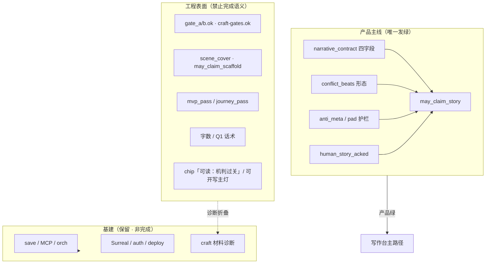
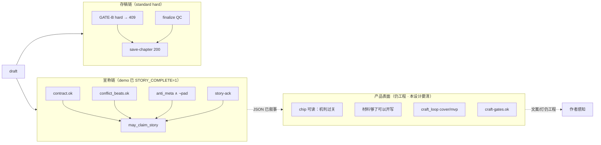
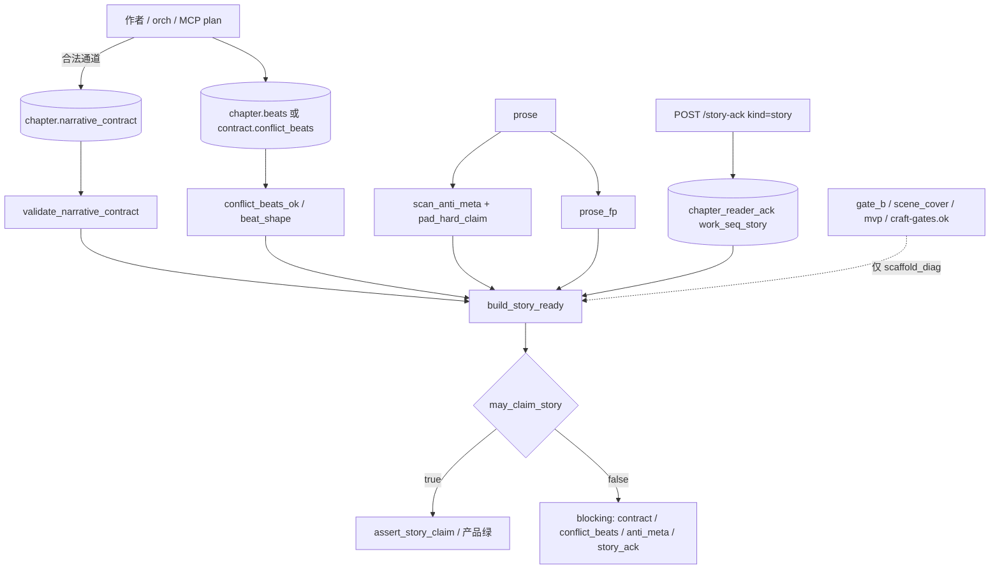
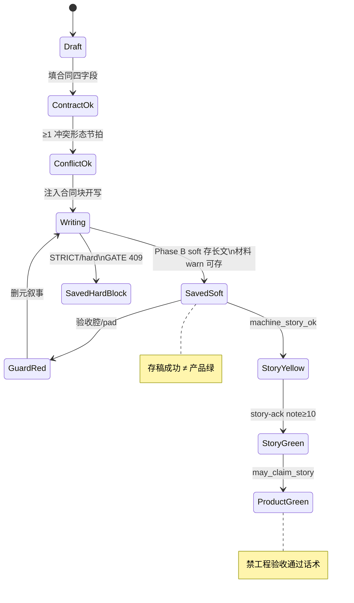
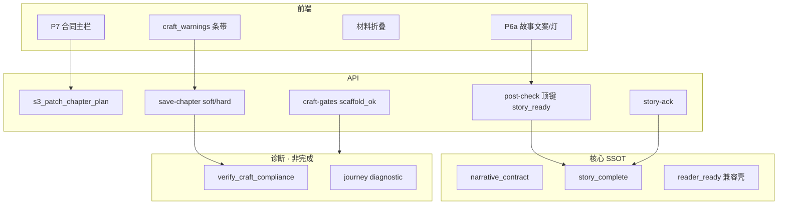
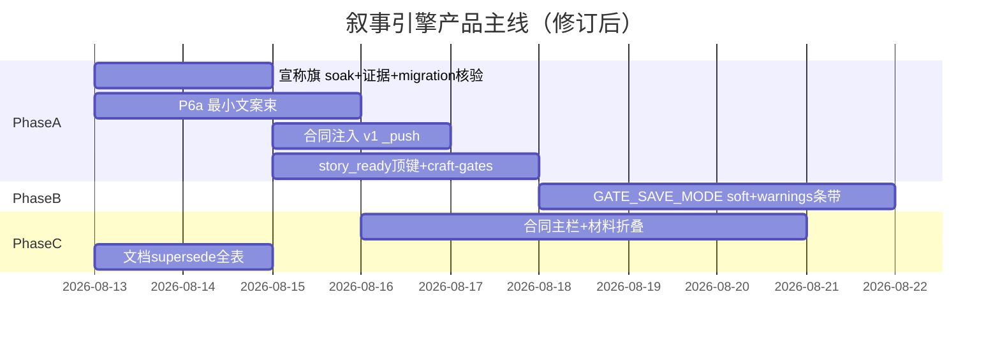
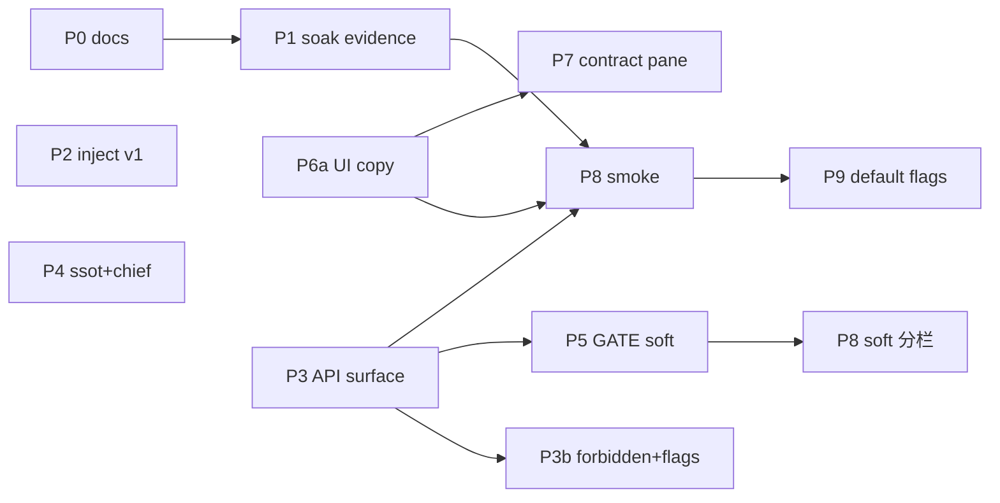

# 叙事引擎主线 · 工程表面清除（Narrative Engine as Product Mainline）

| 项 | 值 |
|----|-----|
| **短名** | `narrative-engine-product-mainline` / `叙事引擎主线·工程表面清除` |
| **文档状态** | **Reviewed · design consensus（0 open）** · R3；待人审签执行 |
| **作者** | Grok Design（待人审签） |
| **日期** | 2026-08-13 |
| **产品** | 铜炉 / tonglu · 代码 `scribe3/` |
| **仓库** | `/home/admin/projects/scribe-writing-system` |
| **验证环境** | **仅已部署 demo** `https://tonglu.qing.blue` · SSH `ubuntu@82.157.130.140` · 应用 `/opt/scribe3/app`；禁止 Grok 机全量 `npm ci` / 本机 Surreal / 第二栈 |
| **运维 env 文件** | **`/opt/scribe3/app/.env`**（现网 SSOT；**不是** `.env.production.local`） |
| **合法写通道** | orch proposal/apply、`save-chapter`、intent-goals、MCP `s3_patch_chapter_*` / `s3_add_chapter`；**禁止** EMERGENCY 默认 |
| **前序设计** | `docs/plans/2026-08-13-narrative-mainline.md`（R2 技术规格） |
| **本设计定位** | **产品级升级 / 收敛**：叙事引擎 = 产品主线 SSOT；工程项从「完成/绿/通过」表面**彻底干掉**（基建保留） |
| **建议落仓路径** | `docs/plans/2026-08-13-narrative-engine-product-mainline.md` |
| **写路径实施** | [`docs/plans/2026-08-13-final-improvement-r8.md`](./2026-08-13-final-improvement-r8.md)：P2/P3/P3b/P4/P5/P6a/P7 **开工以 R8 W\* 为准**；规格细节仍引用本文对应节。allowlist/span 细表可回看 [`write-path-story-constraints.md`](./2026-08-13-write-path-story-constraints.md)。禁止 `_push(format_contract_block)` 原文。 |
| **最终方案入口** | [`docs/plans/2026-08-13-final-good-novel-plan.md`](./2026-08-13-final-good-novel-plan.md)（北极星、P0、验收改口）；开工顺序以 R8 为准 |

---

### 与 `narrative-mainline.md` 的 supersede 关系（钉死 · 双向）

| 维度 | 以谁为准 |
|------|----------|
| **产品完成 / 宣称 / UI 主路径 / 证据 PASS 标题 / 验收定义** | **本设计**（`narrative-engine-product-mainline`） |
| **存稿 GATE soft 旗名与策略** | **本设计** `SCRIBE3_GATE_SAVE_MODE`（见 §4.2）；mainline 的 `SCRIBE3_CONTRACT_SOFTENS_GATE_B` **作废为独立旗**，仅作 `MODE=contract_soft` 的**弃用别名**（见 §7.2） |
| **技术规格细节**（`beat_shape` 伪代码、contract schema、claim flag 四格矩阵、story-ack id、claim 错误码） | 可**引用** `narrative-mainline` R2；冲突时以本设计 Key Decisions 为准 |
| **已 ship 且正确的部分** | **吸收不重写**：`narrative_contract.py`、`story_complete.py`、migrations 134/135、feature_flags 原子、story-ack API、MCP plan 扩参、tests、anti_stuffing_v2 D1–D7、**demo 已开 STORY_COMPLETE** |
| **本设计相对 mainline 的升级** | ① 工程表面 **Kill List**（全出口）② 存稿 GATE **可实现 soft 规格** ③ 前端 **最小文案升 Phase A** + IA Phase C ④ 文档/flag supersede 双向钉死 |

**PR-P0 必改指针（双向，防双 SSOT）**：

```text
# 本设计落仓后，下列文件顶部必须含：
**完成/宣称公式 SSOT（product supersede）**:
  以 docs/plans/2026-08-13-narrative-engine-product-mainline.md 为准。
  narrative-mainline R2 为技术实现附录；dual-lamp / craft-loop 仅护栏与材料诊断。
**存稿 soft 旗 SSOT**: SCRIBE3_GATE_SAVE_MODE（本设计 §4.2）；
  SCRIBE3_CONTRACT_SOFTENS_GATE_B = 弃用别名 → MODE=contract_soft。

# narrative-mainline.md 必须删除或改写其自指句：
# 「完成/宣称公式 SSOT = narrative-mainline.md」→ 改为指向本设计
# dual-lamp / craft-loop：生效条件改为「宣称公式已随 STORY_COMPLETE=1 在 demo 生效；
#   剩余 = UI/证据/存稿 soft 清理」
```

---

### 读法（工程师 · 第一周）

1. **Overview + Goals + Kill List** — 什么叫「干掉」、什么叫「保留基建」。  
2. **完成真值表 + 现网事实基线** — 宣称已切 story；表面仍工程。  
3. **§4.2 存稿 soft 真值表 + HTTP 样例** — Phase B 可实现规格。  
4. **Key Decisions + PR Plan** — P1 降级为 soak；P6a 最小文案进 Phase A。

---

## Overview

铜炉 **后端宣称路径已切叙事**（demo `/opt/scribe3/app/.env` 已设 `SCRIBE3_STORY_COMPLETE=1`、`SCENE_COVER_IN_CLAIM=0`；`may_claim_story` 为 claim SSOT），且合同/story-ack/beat_shape 模块已 ship。  
但**产品表面仍是工程绿灯系统**：作者仍被「可读：机判过关」「材料够了，可以开写」「gate_b / journey_pass / mvp_pass」引导去刷脚手架；standard 存稿仍 GATE hard；证据与 CLI 仍工程 PASS 话术；写路径未注入合同块。

用户定调：

> **我要的就是叙事引擎。** 叙事相关是主线。**把工程相关的都干掉**（从产品完成/绿/通过表面）。

本设计给出**最佳改造方案**：

1. **叙事引擎 = 唯一产品完成标准**（`may_claim_story` 链）。  
2. **工程表面 Kill List** 全出口清除完成语义（含 `may_claim_scaffold`、craft-gates 顶层 `ok`、CLI、skip 旁路、chief 话术）。  
3. **基建保留**：Surreal、登录、部署、合法写通道、craft 诊断函数、finalize QC。  
4. **分阶段**：Phase A = **宣称已开（防回归）+ 最小 UI 文案束 + 注入 + 证据** → Phase B 存稿 soft → Phase C 合同主栏 IA。  
5. **产品主表面清除** 以 **A（含 P6a）+ C** 合并口径验收；勿把「仅后端 claim JSON」当完整产品交付。



---

## Background & Motivation

### 当前状态（2026-08-13 代码 + demo SSH 再核实）

#### 已 ship · 含 demo 宣称旗（勿再当「产品未开」）

| 资产 | 路径 / 事实 |
|------|-------------|
| 合同纯函数 | `scribe3/narrative_contract.py`：validate / beat_shape（**CONFLICT_LEX-only**）/ conflict_beats_ok / migrate / `format_contract_block` |
| 故事完成公式 | `scribe3/story_complete.py`：`build_story_ready` / `assert_story_claim` / `may_claim_story` |
| migrations 文件 | `134_narrative_contract.surql`、`135_chapter_ack_kind.surql`（**文件在 app ≠ 库内已 DEFINE**；P1/P8 须读章核验） |
| flags 注册表 | `feature_flags.py`：代码默认 `STORY_COMPLETE=0`；`SCENE_COVER_IN_CLAIM` registry 默认 `"1"`（与 runtime clamp 有分叉，见 §7.1） |
| **demo 运行时** | **`/opt/scribe3/app/.env`**：`STORY_COMPLETE=1`、`SCENE_COVER_IN_CLAIM=0`、`GATE_IN_STORY_CLAIM=0`、`NARRATIVE_CONTRACT=1`、`WORDCOUNT_STORY_HARD=0`；进程 `story_complete_enabled()=True`，`clamp` 后 cover **不进** claim |
| story-ack | `POST /api/story-ack` → **401**（需鉴权），**非 404** — 端点已挂 |
| store / API / MCP / tests / D1–D7 | 同前序；模块在 `/opt/scribe3/app/scribe3/` |

#### 仍「工程假绿 / 产品表面未清」（本设计焦点 · 2026-08-13）

| 痛点 | 核实锚点 | 产品伤害 |
|------|----------|----------|
| **UI 旧 dual-lamp 文案主导感知** | `readerReadyGate.js`：`可读：机判过关，请通读确认`；**忽略**后端 `lamps.reader.label="故事"`，只映射 `phase`；`WriteLayout` toast「机判可读…确认给读者」 | 作者以为机判过=完成（**宣称 JSON 已是 story，表面仍是工程**） |
| **章契约 / 材料主栏 = 工程齐套** | `chapterContractGate.js`：synopsis/truth ≥80 **error**；`MIN_BEAT_TEXTS=3` **error**；`ChapterMetaPane`「**材料够了，可以开写**」 | 主路径不是合同四字段 |
| **scaffold 主 chip「可开写」** | `scaffoldLabel` + dual-lamp 并列主区 | 材料齐完成感 |
| **`may_claim_scaffold`** | `reader_ready.py` story 路径仍发 claims 键 | 客户端可当「可宣称开写=完成」 |
| **存稿 GATE-B hard** | `evaluate_save_craft_gate` standard → `misc_routes` **409**；MCP 同源 | 先刷齐套再写戏 |
| **`GET /craft-gates` 顶层 `ok`** | `quality.py`：`ok = ga∧gb∧gc∧gd` | e2e/CLI 当旅程完成 |
| **journey_pass / PASS_FORMULA / CLI** | `journey_pass` · `craft_gate_cli.py` · 单测 happy-path 叙事 | 工程 PASS 混称故事 |
| **`skip_craft_gate`** | HTTP `SaveChapterReq` + MCP | 可被当验收捷径 |
| **craft-loop 完成话术** | `craft_loop_ssot.py`：`CL-B5-H1_cover`、mvp、H9 | 证据假绿 |
| **写路径未注入合同块** | `write_assemble_v1._assemble_write_instructions_v1` 有 `_push("event_drive")`，**无** narrative_contract | 起草不见合同 SSOT |
| **`story_ready` 非顶键** | post-check/save 仅 `reader_ready`；`story_ready` **嵌在** reader_ready（且仅 STORY 路径完整映射） | 客户端发现难；flag 关时丢弃 |
| **chief / 代理脚手架话术** | `chiefSeed.js` 等 | 诱导先齐 GATE |
| **文档双 SSOT 风险** | mainline 自指完成公式；softens 旗名分叉 | 实现者分叉 |
| **degen 旗未接线** | `DEGEN_IN_STORY_CLAIM` 注册但 `build_story_ready` **未读** | 文档公式超前（见 §3） |

#### 现网两条链（产品视角 · 修正后）



### 为何需要「产品级升级」而非再贴一份 mainline

`narrative-mainline` 已正确回答公式与 flag 原子；demo **宣称侧已开**。  
用户要的是 **产品主线彻底切叙事 + 工程表面干掉**——UI 主灯、证据标题、存稿激励、CLI/`craft-gates.ok`、文档完成宣称。剩余工作不是「再开一次旗」，而是 **表面清除 + 存稿 soft + IA**。

---

## Goals & Non-Goals

### Goals

1. **叙事 = 产品主线 / SSOT / UI 主路径 / 完成宣称唯一标准**  
   章/场/冲突/欲望/阻力/回合/代价/限知/弧光/事件/`narrative_contract`/`conflict_beats`/story-ack。  
2. **工程表面清除**：完成、可读宣称、证据 PASS 标题、前端主灯、**craft-gates 顶层 ok、may_claim_scaffold、CLI journey、skip 捷径话术** 等 **不得** 由工程项单独点亮为「故事/章完成」。  
3. **宣称侧保持 100% 叙事（demo 已开）+ 防回归原子检查**（Phase A 后端部分）：  
   - 保持 `STORY_COMPLETE=1` ∧ `SCENE_COVER_IN_CLAIM=0` ∧ story-ack 可达  
   - soak 证据 + migration 库内核验 + 禁半拉子回归 checklist  
   - **非**「还要再开一次旗」为主交付  
4. **Phase A 最小产品表面**：P6a 文案束（机判过关→故事/戏；toast/CTA）**与**宣称 SSOT 同阶段必做；**产品主表面清除** 以 A（含 P6a）+ C 合并验收。  
5. **存稿侧 GATE 去完成激励**（Phase B）：可实现 soft 规格（§4.2）；**永不**产品完成。  
6. **前端 IA**（Phase C）：主栏合同四字段 + 冲突节拍；材料/脚手架二级折叠。  
7. **文档/旗双向 supersede**（P0）。  
8. **可回滚、可增量 PR**；claim 切换禁止半拉子。  
9. **验证纪律**：仅已部署 demo 冒烟；禁 gate_b / craft-gates.ok 当 PASS 标题；D1–D7 为写作验收协议，非 claim 公式。

### 「干掉」精确定义

| 用户说的「干掉」 | 含义 |
|------------------|------|
| **是** | 工程项 **不得** 再当：章完成、可读/故事宣称、证据 PASS 标题、前端主灯、完成话术、CLI/旅程「故事 PASS」 |
| **不是** | 拆掉 Surreal / 登录 / 部署 / 合法写通道 / `verify_craft_compliance` 诊断函数 / finalize 极端 QC |

**反例（违反本设计）**：删除 `verify_craft_compliance.py`、关闭 Surreal、拆掉 `save-chapter`、默认 EMERGENCY 写——**一律禁止**。

### Non-Goals

| # | 非目标 | 理由 |
|---|--------|------|
| NG1 | 一夜删除 `verify_craft_compliance` 或 GATE 实现 | 诊断与通道仍需；Phase B soft 即可 |
| NG2 | LLM 文学分 / human-blind ≥9.5 当产品门 | 假绿；产品禁令 |
| NG3 | keyword-spam / 粘贴上章当质量 | anti_stuffing 已有 |
| NG4 | 重写 Pilot / 替换 Hermes / 全书 plot solver | 爆炸半径 |
| NG5 | EMERGENCY 默认验收 | 写路径禁令 |
| NG6 | Grok 机 npm ci / 本机 Surreal / 第二栈 | 资源纪律 |
| NG7 | `may_claim_serializable` / H9 全产品化 | 恒 false |
| NG8 | 强制网文模板腔填四字段 | 合同≠套路 |
| NG9 | 把 `DEGEN_IN_STORY_CLAIM` 当 v1 已实现 hard | **未接线**；仅预留（§3） |

---

## Proposed Design

### 1. 一句话架构

```text
产品绿（唯一）=
    narrative_contract.ok
  ∧ conflict_beats.ok
  ∧ anti_meta.ok_for_claim ∧ ¬pad
  ∧ human_story_acked(prose_fp, note≥10)

工程齐套 / scene_cover / mvp / journey / craft-gates.ok / may_claim_scaffold / 字数
  → 仅 diagnostic（材料/脚手架二级）
  → 永不单独 may_claim_story / 证据 PASS 标题 / 主灯完成文案
```

### 2. 叙事主线 SSOT 图



**数据流要点（已实现 vs 待做）**

| 环节 | 状态 | 路径 |
|------|------|------|
| 合同 validate + beat_shape | **已 ship** | `narrative_contract.py` |
| `build_story_ready` / claim 切换 | **已 ship · demo 已开** | `story_complete.py`；`.env` STORY=1 |
| story-ack | **已 ship · 可达** | `/story-ack` 401≠404 |
| 写路径注入合同块 | **未接线** | `write_assemble_v1` `_push` 顺序，见 §9 |
| `story_ready` 顶键 | **未做** | 现嵌 `reader_ready`；见 §API |
| 前端最小文案 | **未做** | P6a |
| 前端合同主栏 | **未做** | P7 |
| GATE soft | **explore 有；standard hard** | Phase B §4.2 |

### 3. 完成真值表（产品强制）

```text
# v1 已接线（与 story_complete.build_story_ready 一致）
may_claim_story =
    contract.ok
  ∧ conflict_beats.ok
  ∧ anti_meta.ok_for_claim
  ∧ ¬pad_hard_claim
  ∧ human_story_acked
  # 可选过渡：STORY_COMPLETE=1 且 SCENE_COVER_IN_CLAIM=1 时额外 ∧ scene_cover
  # （demo 已 SCENE_COVER_IN_CLAIM=0 → 不参与）

# 预留 · 未接线（NG9）：勿当已 ship
# SCRIBE3_DEGEN_IN_STORY_CLAIM：registry 有，build_story_ready 未读 degen_hard
# 实现前不得写入验收「必须 degen 合取」；接线 PR 另开或从公式删除

may_claim_readable = may_claim_story   # 别名 · STORY_COMPLETE=1
may_claim_serializable = false
may_claim_scaffold = **禁止产品完成语义**（见 Kill List：降级/改名）

FORBIDDEN_CLAIM_KEYS（文档强制；代码断言见 PR-P3b）=
  gate_a.ok, gate_b.ok, journey_pass, PASS_FORMULA,
  craft_gates.ok 作为故事完成,
  scene_cover.ok, quality.Q1, prose_cn>=1500,
  mvp_pass, beat_count>=3 作为充分,
  may_claim_scaffold 作为故事/可读完成,
  lamps.reader.ok 旧「文学可读」语义,
  CL-B5-H1_cover, skip_craft_gate 当验收通过
```

**`SCRIBE3_GATE_IN_STORY_CLAIM` 必须保持 0**（danger）。  
**`SCRIBE3_WORDCOUNT_STORY_HARD` 必须保持 0**。

### 4. 工程表面 Kill List（核心交付）

> 每项：**动作** = 干掉（完成语义）/ 降级（诊断）/ 保留基建。  
> 「干掉」= 从完成/宣称/主灯/证据 PASS 标题移除；**不是**删代码。  
> **反例**：删除 `verify_craft_compliance.py` / 关 Surreal / 拆 `save-chapter` **违反本设计**。

#### 4.1 完成 / 宣称 / API

| 项 | 现状 | 动作 | 目标行为 | 主要路径 | PR |
|----|------|------|----------|----------|-----|
| `may_claim_readable` 旧公式 | demo 已 alias story | **保持** alias；禁旧 cover 充分 | = `may_claim_story` | `reader_ready` / `story_complete` | 已做；P1 防回归 |
| `scene_cover` 进 claim | demo cover=0 | **保持出 claim**；diag only | `scene_cover_diag` | flags + clamp | P1 soak |
| **`may_claim_scaffold`** | story 路径仍发 bool | **降级** | 改名 `scaffold_diag.ok` 或 claims 内标 `role:diagnostic`；**禁止** UI 当「可宣称完成」；文档禁进 FORBIDDEN 充分 | `reader_ready.py` | **P3** |
| `gate_b.ok` → scaffold 灯 | post/save 传入 | **降级** label「材料」 | 永不进 story claim | `write.py` · `misc_routes` | P3/P6 |
| **`GET /craft-gates` 顶层 `ok`** | `ok=ga∧gb∧gc∧gd` | **干掉完成语义** | 顶层改 `scaffold_ok`（或保留 `ok` 但强制 `role:"diagnostic"` + `not_story_complete:true`）；并列 `story_pass` 对象 | `quality.py` | **P3** |
| `journey_pass` / `PASS_FORMULA` | quality + CLI | **干掉故事 PASS 话术** | `role:diagnostic`；CLI 标题「材料/脚手架诊断」 | `verify_craft_compliance` · `craft_gate_cli.py` | **P3** |
| 单测 journey happy-path 叙事 | `test_craft_compliance_gates.py` | **降级注释/改名** | 断言 scaffold 诊断，不称「故事完成」 | tests | P3 |
| `mvp_pass` / craft-loop | ssot + 证据 | **干掉当可读** | `scaffold_mvp_pass`；`story_pass` 另计 | `craft_loop_ssot.py` | **P4** |
| `CL-B5-H1_cover` | ssot | **干掉完成** | diag only | 同上 | P4 |
| 字数 / Q1 | hard 已 soft | **防回归** | WORDCOUNT_STORY_HARD=0 | quality | P1 |
| H9 / 可连载 | false | **保持** | 不产品化 | — | — |
| `assert_reader_claim` 文案 | 可能仍「场面未覆盖」 | **映射 story** | message「本章戏成立」 | `reader_ready` · `write.py` | P3 |

#### 4.2 存稿 / 通道 · Phase B 可实现规格（钉死）

| 项 | 现状 | 动作 | 目标 | 路径 |
|----|------|------|------|------|
| GATE-B/A standard hard | 长 prose → **HTTP 409** | **Phase B soft** | 材料 warn；**永不**产品完成 | `evaluate_save_craft_gate` |
| explore soft-save | `create_mode=explore` ∧ `EXPLORE_SOFT_SAVE` → allowed+warnings | **保留** | 与 MODE 矩阵合成（下表） | 现网 |
| finalize / degen | 可 409 | **保留基建** | 与 craft soft **正交** | `finalize_gate` |
| anti_meta save | 默认不 409 | **保留** | claim 挡 | — |
| **`skip_craft_gate`** | HTTP/MCP 可旁路 | **产品禁令** | 默认拒绝非 staff；若放行 **audit log** `skip_craft_gate work= seq=`；**禁止**证据当验收通过 | `misc_routes` · `mcp/tools_write` · models | **P3/P5** |
| 合法写通道 | orch/MCP/save | **保留基建** | 禁 EMERGENCY 默认 | — |

##### 4.2.1 Flag 语义（SSOT · 取代 mainline `CONTRACT_SOFTENS_GATE_B` 独立旗）

| Flag | 类型 | 默认 | 含义 |
|------|------|------|------|
| `SCRIBE3_GATE_SAVE_MODE` | enum 字符串 | **`hard`**（registry；demo Phase B1 可设 `soft`） | `hard` \| `soft` \| `contract_soft` |
| `SCRIBE3_GATE_SAVE_STRICT` | bool | **`0`** | **`1` 时强制等价 MODE=hard**（运维回滚；**优先于 MODE**） |
| `SCRIBE3_EXPLORE_SOFT_SAVE` | 现网 | 默认开 | 仅当 `create_mode=explore` 时生效（现逻辑） |
| `SCRIBE3_CONTRACT_SOFTENS_GATE_B` | **弃用别名** | 未注册 / 忽略为 0 | 仅当 **env 未设置** `SCRIBE3_GATE_SAVE_MODE` 键且 softens=1 → 视作 `contract_soft`；**显式** `MODE=hard` **不被**别名覆盖 |

**解析伪代码（实现锁）**：

```python
def resolve_gate_save_mode() -> str:
    # 唯一 STRICT 旗名（禁止再注册 GATE_SAVE_MODE_STRICT）
    if flag_truthy("SCRIBE3_GATE_SAVE_STRICT"):
        return "hard"  # 绝对优先于 MODE 与弃用别名

    mode_env_set = "SCRIBE3_GATE_SAVE_MODE" in os.environ  # 显式键存在即算设置（含 hard）
    raw = (os.environ.get("SCRIBE3_GATE_SAVE_MODE")
           if mode_env_set
           else (get_flag("SCRIBE3_GATE_SAVE_MODE") or "hard"))
    raw = str(raw or "hard").strip().lower()
    # 不接受 1/0 作为 MODE（避免与 bool 旗混淆）；非法 → hard + log
    if raw in ("hard", "soft", "contract_soft"):
        mode = raw
    else:
        mode = "hard"
        log_warn("invalid GATE_SAVE_MODE", raw)

    # 弃用别名：仅当 MODE **未**在 env 显式设置时，softens=1 → contract_soft
    # 显式 GATE_SAVE_MODE=hard 即使 softens=1 仍保持 hard（运维写 hard 即硬拦）
    if (not mode_env_set) and mode == "hard" and flag_truthy("SCRIBE3_CONTRACT_SOFTENS_GATE_B"):
        mode = "contract_soft"
        log_info("alias CONTRACT_SOFTENS_GATE_B → contract_soft (MODE unset)")
    return mode
```

##### 4.2.2 真值表：MODE × STRICT × explore × create_mode

| STRICT | MODE | create_mode | EXPLORE_SOFT | 实质 prose 齐套失败时 | HTTP / MCP |
|--------|------|-------------|--------------|------------------------|------------|
| **1** | * | * | * | **hard 拦** | **409** `craft_gate_*` |
| 0 | hard | standard | * | hard 拦 | **409**（现网） |
| 0 | hard | explore | 1 | soft（现 explore 路径） | **200** + `warnings[]` + `code=ok_explore_soft` |
| 0 | hard | explore | 0 | hard 拦 | **409** |
| 0 | **soft** | standard | * | **soft**（本设计 B1 目标） | **200** + `craft_warnings[]` + `code=ok_gate_soft` |
| 0 | **soft** | explore | 1 | soft（同 explore） | **200** + warnings |
| 0 | **contract_soft** | * | * | 见 §4.2.3 | contract.ok→200+warn；else **409** |
| * | * | * | * | 评估抛错 | **503** `craft_gate_error`（**不变**） |
| skip_craft_gate=true | * | * | * | 见产品禁令；若 staff 放行则 allowed | 200 + **audit**；非验收 |

**`allowed=true` 时永不表示 `may_claim_story`。**

##### 4.2.3 `contract_soft` 伪代码（B1 **可选不实现**；B1 默认做 `soft`）

```python
def should_soften_gate_b(st, seq, mode: str) -> bool:
    if mode == "soft":
        return True
    if mode != "contract_soft":
        return False
    ch = st.get_chapter(seq) or {}
    raw = ch.get("narrative_contract")
    if not raw:
        return False  # 缺列 → hard
    c = validate_narrative_contract(raw)
    return bool((c.get("validation") or {}).get("ok"))

# evaluate_save_craft_gate 内：
#   若 should_soften...: 将 A/B hard fail → warn，append craft_warnings，allowed=True
#   文案 detail 强制含「材料诊断」且 code 前缀 ok_gate_soft / ok_contract_soft
#   禁止 code 含 pass/complete/story
```

##### 4.2.4 返回 JSON / HTTP 样例（soft standard）

```http
HTTP/1.1 200 OK
```

```json
{
  "status": "saved",
  "seq": 5,
  "craft_gate": {
    "allowed": true,
    "code": "ok_gate_soft",
    "detail": "材料诊断未齐（已 soft 存稿，≠故事完成）",
    "create_mode": "standard",
    "gate_save_mode": "soft",
    "warnings": [
      {"id": "B2", "detail": "节拍不足", "gate": "B", "severity": "material_diagnostic"}
    ],
    "reports": {"gate_b": {"ok": false, "role": "diagnostic"}}
  },
  "story_ready": {
    "phase": "red",
    "claims": {"may_claim_story": false}
  }
}
```

**hard 仍 409**（形状保持现网 `detail.code/message/blocking/reports`）。  
**MCP `s3_save_chapter`**：与 HTTP **同表**——soft 时 `status=ok` + `warnings`；hard 时 error/`code=craft_gate_*` 不落库。

##### 4.2.5 Phase B 退出与前端最小可见（防半拉子）

- **后端**：MODE=soft 时 200 + warnings（上样例）。  
- **前端（P5 必含最小可见，不必等 P7）**：`WriteLayout` 存稿响应若有 `craft_gate.warnings` / `craft_warnings` → **toast 或条带**「材料诊断：…（≠故事完成）」；至少 1 处可见。  
- **不可**把 soft 存稿 toast 写成「验收通过」。

#### 4.3 前端 UI / IA

| 项 | 现状 | 动作 | 目标 | 阶段 / PR |
|----|------|------|------|-----------|
| chip「可读：机判过关」 | `phaseLabel` | **干掉文案** | 「故事：可确认/已确认/未过关」；优先服务端 label / `story_ready.phase` | **Phase A · P6a** |
| toast「机判可读…给读者」 | WriteLayout | **改** | 「护栏过 / 请确认本章戏是否成立」 | **P6a** |
| 「可宣称给读者」 | WriteLayout | **改绑** | 仅 `may_claim_story`；「可宣称本章戏成立」 | **P6a** |
| scaffold「可开写」主 chip | dual-lamp 并列 | **降权** | 视觉次级 / 文案「材料」；P7 折叠 | P6a 降权 → **P7** 折叠 |
| **「材料够了，可以开写」** | ChapterMetaPane | **降级** | 「材料参考齐」或移入折叠；禁「完成」感主句 | **P7**（P6a 可先改一字「参考」） |
| 章契约 error 80 字/3 拍 | chapterContractGate | **降级** | 合同四字段 error；条数 info | **P7** |
| 合同主栏 | 无 | **新建** | 四字段 + 冲突节拍 | **P7** |
| story-ack CTA | 可能 reader-ack | **主路径** | note≥10 → `/story-ack` | P6a/P7 |
| `dualLampChips` | 忽略 story label | **修** | 优先 `claims.may_claim_story`、`story_ready.phase`、服务端 `lamps.reader.label` | **P6a** |

#### 4.4 证据 / 脚本 / 代理 / 文档

| 项 | 动作 | 目标 | PR |
|----|------|------|-----|
| 证据标题 `gate_b PASS` / craft-gates.ok | **干掉** | PASS 标题必须 story 字段 | P1/P4/P8 |
| craft-loop TEMPLATE / ssot | **解绑** | story_pass vs scaffold_mvp | P4 |
| dual-lamp / mainline / craft-loop 顶部 | **Superseded-by** | 完成→本设计；宣称已生效 | **P0** |
| **`chiefSeed.js` / MCP 工具描述** | **改写** | 禁「先齐脚手架才算完成」；优先合同四字段 + 冲突节拍 | **P4 附录**（可与 P0 文档一句） |
| H9 历史话术 | **降级** | ≠ may_claim_story | P4 |

#### 4.5 保留基建（明确不杀）

Surreal / 登录 / 会话 / 部署 / `deploy_demo.sh` / orch·MCP·save 合法通道 / `verify_craft_compliance` 函数体 / `anti_meta` 护栏 / `finalize_gate` / `narrative_drive` 注入 / D1–D7 评分脚本。

### 5. 存稿 vs 宣称分列



| 维度 | 宣称 / 产品完成 | 存稿 / 写通道 |
|------|-----------------|---------------|
| 合同 | **hard** 进 may_claim_story | 不因缺合同 409（引导） |
| 冲突形态 | **hard** | 不挡 save |
| anti_meta | **hard** 挡 claim | 默认不挡 save |
| GATE-A/B | **永不** claim | Phase A 现 hard；**Phase B soft**（§4.2） |
| scene_cover | 仅 diag（demo 已出 claim） | 不挡 |
| craft-gates.ok | **永不**故事完成 | 只读诊断 |
| 人读 | story-ack **必要** | 不必要 |
| finalize degen | **v1 不进 claim**（未接线） | 可 409 |
| skip_craft_gate | **禁止当验收** | staff+audit 或拒 |

### 6. 前端 IA

#### 6.1 Phase A 最小表面（P6a · 不依赖合同主栏大改）

```text
必做：
- phaseLabel / dualLampChips 叙事化（故事 R/Y/G）
- toast / CTA「本章戏成立」
- may_claim_story 绑定「可宣称」
- scaffold 文案「材料」+ 视觉次级（可不折叠）

不做（留给 P7）：
- 合同四字段编辑主栏
- 材料 accordion 全量 IA
- beats 条数 error→info 全量
```

#### 6.2 Phase C 目标 IA

```text
写作台主栏
├── 叙事合同四字段
├── 冲突节拍 + shape_ok
├── 故事灯 R/Y/G
├── 护栏提示
└── story-ack CTA

二级折叠「材料 / 脚手架」
├── 大纲 / 场景真相 / 演绎（原 GATE-B）
├── scene_cover_diag
└── gate 明细 role=diagnostic
```

#### 6.3 纯函数 / 组件清单

| 文件 | 改动 |
|------|------|
| `readerReadyGate.js` | P6a：phaseLabel；优先 story claims/phase/label |
| `WriteLayout.jsx` | P6a toast/CTA；P5 warnings 条带 |
| `ChapterMetaPane.jsx` | P7 主栏合同；材料折叠；改「可以开写」 |
| `chapterContractGate.js` | P7 合同字段 issues |
| `chiefSeed.js` | P4 代理话术 |

### 7. Flag 与文档 supersede

#### 7.1 Flag 矩阵

| Flag | 代码 registry 默认 | demo `.env`（现网） | Phase C 后目标 | 备注 |
|------|-------------------|---------------------|----------------|------|
| `NARRATIVE_CONTRACT` | 1 | **1** | 1 | |
| `STORY_COMPLETE` | **0** | **1** | 1（P9 可改代码默认） | claim 走 story |
| `SCENE_COVER_IN_CLAIM` | 现 registry **`"1"`**（P3b 后见下） | **0** | story=1 时有效默认 **0** | **P3b 原子修**（下）；禁止裸 get_flag 吃旧 registry 1 |
| `GATE_IN_STORY_CLAIM` | 0 | 0 | 0 | 禁止 1 |
| `WORDCOUNT_STORY_HARD` | 0 | 0 | 0 | |
| `DEGEN_IN_STORY_CLAIM` | 0 | — | 0 | **未接线** |
| `GATE_SAVE_MODE` | **新** `hard` | Phase B1→`soft` | `soft` | §4.2 |
| `GATE_SAVE_STRICT` | **新** 0 | 0 | 0 | **唯一** STRICT 旗名；优先 hard |
| `CONTRACT_SOFTENS_GATE_B` | **弃用别名** | — | 勿新用 | 仅 MODE **unset** 时 → contract_soft |

**Flag SSOT 修复 · cover 原子（P3b 硬约束 · 禁止半拉子）**：

> **风险**：若 P3b 仅把 `scene_cover_in_claim` 改为裸 `get_flag("SCRIBE3_SCENE_COVER_IN_CLAIM")`，而 registry 仍 default=`"1"`，则在 `STORY_COMPLETE=1` 且 **未**写 cover env 的环境会把 **cover 重新合入 claim**——与现网 ` _flag(..., "0")` 及产品目标相反。

**P3b 必须同 PR 原子落地（下列任选实现，验收同一）——禁止「只改读取源不改语义默认」**：

```python
def scene_cover_in_claim() -> bool:
    """STORY 路径：cover 默认不进 claim；仅显式 env=1 作过渡合取。"""
    if not story_complete_enabled():
        return True  # dual-lamp 旧路径：cover 必须参与
    # STORY=1：语义默认 False；禁止裸 get_flag 吃 registry "1"
    if "SCRIBE3_SCENE_COVER_IN_CLAIM" not in os.environ:
        return False  # unset → 出 claim（与现 _flag default "0" 对齐）
    return flag_truthy("SCRIBE3_SCENE_COVER_IN_CLAIM")  # 显式 1 才过渡进 claim

def clamp_claim_flags() -> dict:
    sc = story_complete_enabled()
    if not sc:
        cover_eff = True  # 强制 cover 参与；非法 cover=0 被抬回 1 + log
        # ... existing clamp ...
    else:
        cover_eff = scene_cover_in_claim()  # 上式：unset→False；显式1→True
    return {"STORY_COMPLETE": sc, "SCENE_COVER_IN_CLAIM": cover_eff, ...}
```

**同 PR 建议（强烈）**：`feature_flags` registry 将 `SCRIBE3_SCENE_COVER_IN_CLAIM` default 改为 **`"0"`**，且 description 注明「仅 STORY_COMPLETE=0 时由 clamp 强制视为 1」。  
**P9** 可再改 `STORY_COMPLETE` registry 默认 1；**不得**把「story 下 cover 默认 0」拖到仅 P9——P3b 已保证语义。

**验收（P3b 单测强制）**：

```text
STORY=1、unset SCENE_COVER env
  → clamp_claim_flags()["SCENE_COVER_IN_CLAIM"] is False
  → machine_story_ok 不含 scene_cover 合取
  → debug/flags 有效展示与 clamp 一致（或注明 effective vs registry）
STORY=1、env SCENE_COVER_IN_CLAIM=1
  → cover_eff True（过渡半步）
STORY=0
  → cover 强制参与 claim（与 KD16 矩阵一致）
禁止单独 merge「get_flag 读 registry 默认 1」而无上式 clamp/默认。
```

**宣称侧原子约束（demo 已开 · 防回归）**：

```text
STORY_COMPLETE=1 部署必须：
  有效 SCENE_COVER_IN_CLAIM=0（unset 或显式 0；仅显式 1=过渡）
  POST /story-ack 可达（非 404）
  migration 135 kind 可写
禁止 STORY_COMPLETE=0 且 cover 有效 0 影响 claim（clamp 抬回 1）
```

#### 7.2 文档 / 旗 supersede 表

| 文档/旗 | 状态 | 生效 |
|---------|------|------|
| **本设计** | **产品完成 + 存稿 soft 旗 SSOT** | 审签后 |
| `narrative-mainline.md` | 技术附录；**改自指句**；完成公式让位 | P0 |
| dual-lamp 设计 | 完成语义 Superseded；**宣称已在 demo 生效**；剩余 UI/证据 | P0 + P6a |
| craft-loop.md | mvp≠story；0.4 附录 | P0/P4 |
| `CONTRACT_SOFTENS_GATE_B` | **弃用** → `GATE_SAVE_MODE=contract_soft` | P0 + P5 |
| 证据 TEMPLATE | 禁 gate_b / craft-gates.ok PASS 标题 | P4/P8 |

### 8. 目标架构



### 9. 写路径注入（钉落点）

| 项 | 钉死 |
|----|------|
| **主路径** | `scribe3/api/services/write_assemble_v1.py` → `_assemble_write_instructions_v1` 内 **`_push`** |
| **插入点** | 在 `_push("event_drive", ...)` **之前**（作者合同优先）或紧后；推荐 **前**：`_push("narrative_contract", "redline", format_contract_block(...))` |
| **数据** | `st.get_chapter(chapter).get("narrative_contract")`；缺/非法 → **fail-soft 不 push** |
| **长度** | `format_contract_block(..., max_chars=180)` |
| **与 drive 去重** | 若 contract 块非空，可将 `_event_drive_block` 结果再截断（目标合计引导可观测；drive 侧参考现 `MAX_EVENT_DRIVE` 常量/块长，合同已含 opposition 摘要时 drive ≤120 字） |
| **context 层** | `write_assemble_context.py` 可提供 helper，但 **验收以 v1 主路径 envelope 含【叙事合同】为准** |
| **PR** | **P2** |

### 10. 代理 / orch

- 建章 / plan **优先**四字段 + CONFLICT_LEX 冲突句。  
- **禁止**诱导「先齐 GATE / craft-gates.ok 才算完成」。  
- `chiefSeed.js` 与 MCP 工具描述：脚手架 patch 保留合法，但完成标准指向 story（P4）。  
- story-ack note≥10；十维分不进 claim。

---

## API / Interface Changes

### 已存在（demo 已产品化宣称）

| 端点 | 说明 |
|------|------|
| `POST /story-ack` | kind=story；note≥10；**demo 可达** |
| `POST /reader-claim` | STORY=1 → assert_story_claim |
| `s3_patch_chapter_plan(narrative_contract=)` | 已扩 |
| `build_story_ready` | SSOT |

### 增量

#### A. 顶键 `story_ready`（P3 · 挂载点钉死）

| 挂载点 | 文件 | 行为 |
|--------|------|------|
| post-check 响应 | `api/routers/write.py`（post_check 组装 `resp` 处） | **顶键** `story_ready` = `build_story_ready(...)`（fail-soft omit + log） |
| save-chapter 响应 | `api/routers/misc_routes.py`（现 attach reader_ready 旁） | **顶键** `story_ready` 并列 |
| 兼容 | 继续 `reader_ready.story_ready` 双写 ≥2 minor | 内嵌可保留 |
| flag 关 | 仍计算 `story_ready` **只读预热**；`claims` 保持旧 dual-lamp | 预热不切换 claim |
| flag 开 | `claims` 已是 story；顶键与内嵌一致 | demo 现状 |

**契约测试 / demo curl**：断言 `story_ready.schema` 或 `story_ready.phase` 存在；`claims.may_claim_story` 为 bool。

#### B. craft-gates（P3）

```json
{
  "work": "main",
  "seq": 5,
  "role": "diagnostic",
  "not_story_complete": true,
  "scaffold_ok": false,
  "ok": false,
  "ok_meaning": "scaffold_only_deprecated_alias",
  "gate_a": {"ok": true, "role": "diagnostic"},
  "gate_b": {"ok": false, "role": "diagnostic"},
  "journey": {"ok": false, "role": "diagnostic", "pass": false},
  "story_pass": {
    "role": "completion",
    "claims": {"may_claim_story": false},
    "note": "from build_story_ready when prose available; else null"
  }
}
```

> `ok` 保留为 **deprecated 别名** = `scaffold_ok`，避免瞬间砸 e2e；文档与 CLI 禁称故事完成。

#### C. save soft（P5 · 见 §4.2.4）

#### D. `may_claim_scaffold`（P3）

```json
"claims": {
  "may_claim_story": false,
  "may_claim_readable": false,
  "may_claim_scaffold": false,
  "scaffold_claim_deprecated": true
}
```

或不再输出 `may_claim_scaffold`，仅 `scaffold_diag.ok`（二选一；推荐 **保留键一个 minor + deprecated 脚注**，UI 不读）。

---

## Data Model Changes

| 存储 | 状态 | 说明 |
|------|------|------|
| `chapter.narrative_contract` | 文件 134 已有 | P1/P8：**库内** GET chapter 核验字段可 round-trip |
| `chapter_reader_ack.kind` | 文件 135 已有 | story-ack 可写核验 |
| 新列 | 无必须 | soft 仅 flag |
| 回滚 | 不 drop | `STORY_COMPLETE=0` / `GATE_SAVE_STRICT=1` |

---

## Alternatives Considered

### A1. 仅靠已开 flag + 不改 UI — **否决为完整方案**

宣称 JSON 已叙事，但作者表面仍 dual-lamp 工程话术；不满足「干掉工程表面」。

### A2. 删除全部 GATE / craft 代码 — **否决**

空壳长文、回归失明；违反「保留基建」。

### A3. 宣称已开 + 表面清除 + 存稿 soft + IA（本设计）— **采纳**

### A4. 只升 narrative_drive 为完成输入 — **否决为唯一路径**

contract 已 ship 且 demo 宣称依赖之。

### A5. LLM 裁判戏 hard claim — **否决**

---

## Security & Privacy Considerations

| 主题 | 处理 |
|------|------|
| Auth / work 隔离 | 不变 |
| skip_craft_gate | 非 staff 拒绝或强制 audit；禁验收捷径 |
| EMERGENCY | 默认关 |
| 日志 | claim deny / skip_craft 结构化；禁 prose 全文 dump |
| soft 存稿 | 不降 auth；finalize 正交可仍 409 |

---

## Observability

| 信号 | 用途 |
|------|------|
| `story_ready.phase` | R/Y/G |
| `scaffold_diag.ok ∧ ¬may_claim_story` | **核心健康度**（工程齐≠故事完成） |
| `craft_warnings` 条数（soft 后） | 脏稿监控 |
| `conflict_beats.prop_like` | 道具词 |
| D1–D7 + 连续 Δ&lt;0.2 | **写作验收协议**（非 claim） |
| skip_craft 审计计数 | 旁路滥用 |
| flag clamp / debug 一致性 | 防 registry 分叉 |

### 验收定义（demo）

```text
【宣称 / UI 必选 · Phase A+P6a】
1) .env 仍 STORY_COMPLETE=1 且 cover=0；story-ack 非 404
2) migration：GET 章 narrative_contract 可写可读（或明确 degraded）
3) 正负例 may_claim_story JSON
4) UI 无「机判过关=完成」；CTA/toast 故事/戏话术
5) 证据标题无 gate_b / craft-gates.ok 当故事 PASS

【GATE soft · Phase B 可选分栏】
6) MODE=soft：缺材料长文 → 200 + warnings 可见（前端条带）
7) 仍不可 may_claim_story（无合同/ack）
8) STRICT=1 回滚 → 409

【Phase C】
9) 合同主栏默认；材料折叠
```

---

## Rollout Plan



| 阶段 | 内容 | 退出标准 |
|------|------|----------|
| **Phase A** | 宣称防回归 soak；**P6a 文案**；注入；顶键 story_ready；craft-gates/scaffold 诊断化；证据 disclaimer | 验收必选栏 1–5 |
| **Phase B** | GATE_SAVE_MODE soft + 前端 warnings 可见 | 可选栏 6–8 |
| **Phase C** | 合同主栏 + 材料折叠 + 契约降级 | 栏 9 |
| **产品主表面清除** | **A（含 P6a）+ C** 合并口径 | 勿宣称「仅 A 后端=交付完成」 |
| **回滚** | STORY=0；GATE_SAVE_STRICT=1；cover clamp | 列保留 |

**运维路径**：一律 `/opt/scribe3/app/.env` + `deploy_demo.sh hot`。

---

## Risks

| 风险 | 严重度 | 缓解 |
|------|--------|------|
| 误以为还要「开宣称旗」延误 UI | **高** | 本文事实基线；P6a 立即开工 |
| soft 脏稿 | **高** | warnings 可见；STRICT 回滚；finalize 正交；contract_soft 可选 |
| LEX 刷形态 | **高** | R2 已锁；note≥10；D1–D7 |
| 人读空 ack | **高** | note≥10 CTA |
| craft-gates.ok 仍被 e2e 当完成 | **中** | P3 role + CLI 改名 |
| skip_craft 滥用 | **中** | 禁令+audit |
| registry/cover 分叉 | **中** | P3/P9 统一 get_flag |
| 文档双 SSOT | **中** | P0 双向改自指 |
| degen 文档超前 | **低** | §3 标未接线 |

---

## Open Questions

| # | 问题 | 建议默认 |
|----|------|----------|
| Q1 | B1 直接 `soft` 还是先 `contract_soft`？ | **B1=`soft`**；contract_soft 可选不进 B1 |
| Q2 | 代码默认 STORY_COMPLETE 改 1？ | demo 已 1；**P9** soak 后改 registry |
| Q3 | `may_claim_scaffold` 删键还是 deprecated？ | **deprecated 一 minor** |
| Q4 | craft-gates `ok` 是否 rename breaking？ | **保留 ok=scaffold 别名** + scaffold_ok + role |
| Q5 | fulfillment 进 hard？ | 否 |

---

## Key Decisions

| ID | 决策 | 理由 |
|----|------|------|
| **KD-P1** | 叙事引擎 = 产品完成唯一 SSOT | 用户定调 |
| **KD-P2** | Kill List 去完成语义，不删基建；反例明确 | 防 reckless kill |
| **KD-P3** | 吸收 R2 已 ship + **demo 宣称已开** | 不重做开旗 |
| **KD-P4** | 本设计 supersede 完成 **与** 存稿 soft 旗；mainline 技术附录；`CONTRACT_SOFTENS_GATE_B` 弃用别名 | 防双旗/双 SSOT |
| **KD-P5** | Phase A 后端 = **防回归 soak + 证据 + migration 核验**，不是再开旗 | 事实基线 |
| **KD-P5b** | **P6a 最小文案束属 Phase A 必做**；产品主表面 = A+C | 用户要表面干掉 |
| **KD-P6** | 存稿 soft：`GATE_SAVE_MODE` + STRICT 优先；HTTP 200+warnings；与 explore 矩阵钉死 | 可实现 |
| **KD-P7** | Phase C 合同主栏；材料二级 | IA=完成表面 |
| **KD-P8** | FORBIDDEN 含 craft-gates.ok、may_claim_scaffold、skip 验收 | 全出口 |
| **KD-P9** | 注入落点 = `write_assemble_v1` `_push` before/near event_drive | 真主路径 |
| **KD-P10** | D1–D7 = 写作验收协议 ≠ claim | |
| **KD-P11** | 合法通道 / 禁 EMERGENCY / 禁 human-blind≥9.5 / 仅 demo | |
| **KD-P12** | PR 增量；P6 可立即开工；P8 分必选/可选栏 | |
| **KD-P13** | degen 合取 = **预留未接线**；FORBIDDEN 代码断言进 P3b | 文档诚实 |
| **KD-P14** | claim 旗统一读取源，但 **STORY=1 时 cover 语义默认 0**（unset→出 claim）；**禁止**裸 get_flag 吃 registry `"1"` 单独 merge；P3b 与 clamp/registry 原子 | 防 cover 重新进 claim |
| **KD-P15** | skip_craft_gate 产品禁令 + audit，非完成捷径 | |

---

## References

- `docs/plans/2026-08-13-narrative-mainline.md`  
- `docs/plans/2026-08-12-reader-ready-dual-lamp-design.md`  
- `docs/plans/craft-loop.md`  
- 代码：`narrative_contract.py` · `story_complete.py` · `reader_ready.py` · `feature_flags.py` · `verify_craft_compliance.py` · `api/routers/write.py` · `misc_routes.py` · `quality.py` · `mcp/tools_write.py` · `store/chapters.py` · `adapter_ops.py` · `write_assemble_v1.py` · `web/.../readerReadyGate.js` · `chapterContractGate.js` · `WriteLayout.jsx` · `ChapterMetaPane.jsx` · `chiefSeed.js` · `scripts/craft_loop_ssot.py` · `tools/craft_gate_cli.py`  
- demo：`/opt/scribe3/app/.env` · `https://tonglu.qing.blue`

---

## PR Plan

> 每 PR 可独立 review/merge。  
> **宣称旗 demo 已开** → P1 降级为 soak/证据。  
> **P6a 可立即开工**（不依赖再开旗）。

### PR-P0 · 文档落仓 + 双向 supersede

| 项 | 内容 |
|----|------|
| **标题** | `docs: narrative-engine product mainline supersedes completion SSOT` |
| **影响** | 本设计落仓；**改** mainline 自指完成公式句；dual-lamp/craft-loop 顶部 Superseded-by；一行存稿 soft 旗 SSOT；宣称「demo 已生效，剩 UI/证据/soft」 |
| **依赖** | 无 |
| **描述** | 含 Kill List 反例句；不改运行时。 |

### PR-P1 · demo 宣称 soak + 证据 + migration 核验（**非开旗主交付**）

| 项 | 内容 |
|----|------|
| **标题** | `test(demo): story-complete soak checklist + migration field proof` |
| **影响** | `docs/evidence/narrative-engine-phase-a-*/`；runbook：读 `/opt/scribe3/app/.env`；curl story-ack≠404；GET 章 `narrative_contract` round-trip；正负例 claim；**防回归**「勿把 STORY 改回 0 且 cover 退」 |
| **依赖** | 无（现网已开） |
| **描述** | 状态：**ops 开旗 Done**；本 PR = 证据与核验。 |

### PR-P2 · 写路径注入（v1 `_push`）

| 项 | 内容 |
|----|------|
| **标题** | `feat(write): push narrative_contract block in assemble v1` |
| **影响** | **`write_assemble_v1.py`** `_assemble_write_instructions_v1`：在 `event_drive` 前 `_push("narrative_contract", ...)`；可选 helper 于 context；单测/组装片段断言 |
| **依赖** | 无 |
| **描述** | 见 §9；fail-soft；drive 去重一句。 |

### PR-P3 · API 表面净化（顶键 story_ready · craft-gates · scaffold claim · 文案）

| 项 | 内容 |
|----|------|
| **标题** | `fix(api): story_ready top-level; craft-gates diagnostic; scaffold claim demote` |
| **影响** | `write.py` post-check；`misc_routes.py` save attach；`quality.py` craft-gates；`reader_ready` may_claim_scaffold deprecated；claim messages 中文「戏成立」；`craft_gate_cli.py` 标题；journey `role:diagnostic` |
| **依赖** | 无硬依赖；与 P1 并行 |
| **描述** | 两处顶键 story_ready；flag 关预热；契约 curl/字段断言。 |

### PR-P3b · FORBIDDEN 单测 + cover 读取统一（**原子 · 禁半拉子**）

| 项 | 内容 |
|----|------|
| **标题** | `fix(story): forbidden claim keys; story-mode cover default out of claim` |
| **影响** | `story_complete.py`（`scene_cover_in_claim` / `clamp_claim_flags` 按 §7.1 伪代码）；**建议同改** `feature_flags.py` registry `SCENE_COVER_IN_CLAIM` default=`"0"`；单测：FORBIDDEN 键；**STORY=1 unset cover → cover_eff False**；STORY=1 显式 cover=1 → True；STORY=0 → cover 强制参与 |
| **依赖** | 可与 P3 同 PR；**不**依赖 P9；**禁止**「只改 get_flag 读源、不改 story 语义默认」的独立 commit |
| **描述** | 消除 registry 默认 1 与 runtime 默认 0 分叉时**不得**把 cover 重新合入 claim。degen 标未接线。P9 仅可选再改 STORY 代码默认 1。 |

### PR-P4 · craft_loop_ssot + 证据 + chief 话术

| 项 | 内容 |
|----|------|
| **标题** | `fix(craft-loop): story_pass vs scaffold_mvp; chief seed narrative-first` |
| **影响** | `craft_loop_ssot.py`；craft-loop.md；证据 TEMPLATE；**`chiefSeed.js`**（及 MCP 描述若有完成话术） |
| **依赖** | P1 证据目录可并行 |
| **描述** | cover 出完成；代理禁「先齐脚手架=完成」。 |

### PR-P5 · Phase B GATE soft（可实现规格）

| 项 | 内容 |
|----|------|
| **标题** | `feat(craft): GATE_SAVE_MODE soft with HTTP 200 warnings` |
| **影响** | `evaluate_save_craft_gate`；`feature_flags` 注册 MODE/STRICT；弃用别名 softens；`misc_routes` + `mcp/tools_write`；**WriteLayout 最小 warnings toast/条带**；skip_craft 审计或拒绝策略 |
| **依赖** | P3 的 role/文案 **建议同批或先合**；**不**依赖 P7 |
| **描述** | §4.2 真值表；demo env `GATE_SAVE_MODE=soft`；STRICT 回滚测。 |

### PR-P6a · Phase A 最小文案束（**可立即开工**）

| 项 | 内容 |
|----|------|
| **标题** | `fix(ui): story phase labels; kill 机判过关 completion copy` |
| **影响** | `readerReadyGate.js`；`WriteLayout.jsx` toast/CTA/chips；纯函数测 |
| **依赖** | **无**（demo claims 已是 story） |
| **描述** | dualLampChips 读 may_claim_story / story_ready.phase / 服务端 label；scaffold 降权文案「材料」。 |

### PR-P6 / PR-P7 · Phase C 合同主栏 + 材料折叠

| 项 | 内容 |
|----|------|
| **标题** | `feat(ui): narrative contract primary pane; scaffold accordion` |
| **影响** | `ChapterMetaPane.jsx`；`chapterContractGate.js`；story-ack CTA 完整 |
| **依赖** | P6a；plan API 已有 contract |
| **描述** | 干掉「材料够了，可以开写」完成感主句；条数 error→info。 |

### PR-P8 · 综合冒烟（分栏验收）

| 项 | 内容 |
|----|------|
| **标题** | `test(demo): narrative-engine product surface smoke` |
| **影响** | evidence 目录 |
| **依赖** | **硬依赖** P1 + **P6a** +（建议 P3）；**可选** P5 soft 分栏 |
| **描述** | 验收定义必选栏必须绿；GATE soft 分栏可后置。 |

### PR-P9 ·（可选）代码默认 STORY_COMPLETE=1

| 项 | 内容 |
|----|------|
| **标题** | `chore(flags): default STORY_COMPLETE=1 after soak` |
| **影响** | `feature_flags.py` `STORY_COMPLETE` default `"1"`；验收 debug≡clamp（cover 语义已由 **P3b** 保证） |
| **依赖** | P8 必选栏绿 + soak；**依赖 P3b 已合**（cover 原子） |
| **描述** | 新环境默认叙事宣称；**不**再承担「story 下 cover 默认 0」（P3b 已做）；env STORY=0 可回滚。 |

### 依赖总图（修订）



| 顺序建议 | PR | 可并行 |
|----------|-----|--------|
| 1 | P0 · **P6a** · P2 · P1 | **是**（P6a 不等人） |
| 2 | P3 · P3b · P4 | 是 |
| 3 | P5 · P7 | P3/P6a 后 |
| 4 | P8 必选栏 | P1+P6a+P3 |
| 5 | P9 | 可选 |

---

*End of design document · R2 评审修订。*
