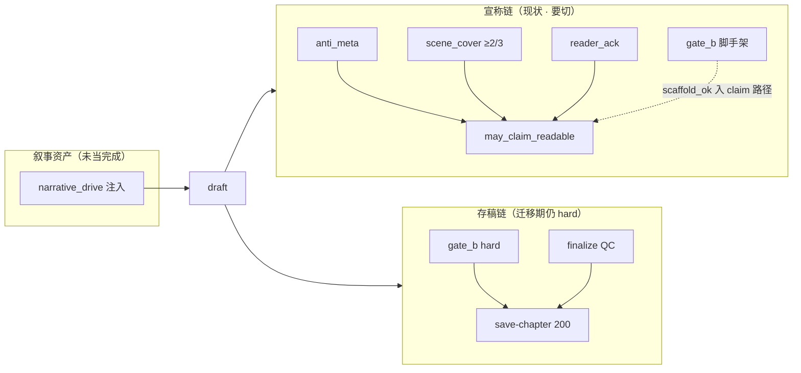
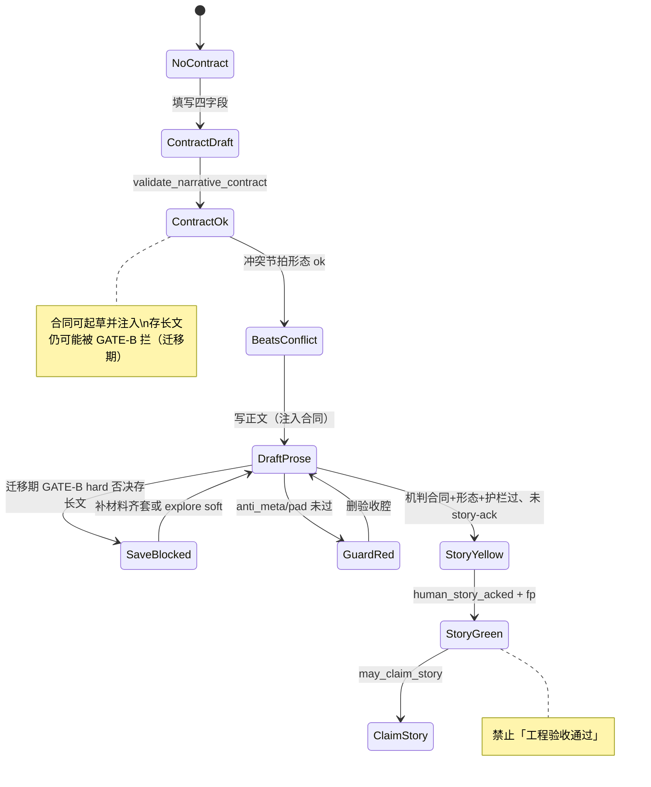
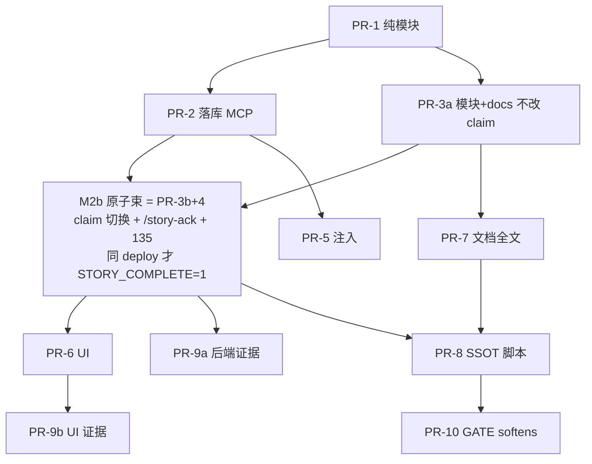

# 叙事引擎主线改造（Narrative-First SSOT · 工程门降级为护栏）

| 项 | 值 |
|----|-----|
| **短名** | `narrative-mainline` / `story-complete-contract` |
| **文档状态** | Draft · **R2 修订**（评审 R2：3b+4 原子束；beat_shape 收紧） |
| **作者** | Grok Design（待人审签） |
| **日期** | 2026-08-13 |
| **产品** | 铜炉 / tonglu · 代码 `scribe3/` |
| **仓库** | `/home/admin/projects/scribe-writing-system` |
| **验证环境** | **仅已部署 demo** `https://tonglu.qing.blue` · SSH `ubuntu@82.157.130.140`；禁止 Grok 机全量 `npm ci` / 本机 Surreal / 第二栈 |
| **合法写通道** | orch proposal/apply、`save-chapter`、intent-goals、MCP `s3_patch_chapter_*` / `s3_add_chapter`；**禁止** EMERGENCY 当默认 |
| **前序已 ship** | craft-loop 0.3.1（`docs/plans/craft-loop.md`）；dual-lamp（`docs/plans/2026-08-12-reader-ready-dual-lamp-design.md` + `reader_ready.py`）；narrative_drive rev.2.3（`docs/plans/2026-08-10-narrative-event-engine.md`） |
| **触发证据** | `book_qe_live5`：ch2 验收腔、ch4 道具词节拍+装清冷静物散文仍工程绿；ch5 叙事合同（desire/obstacle/turn/cost + 冲突节拍）人感「好多了」（`docs/evidence/full-chapter-ch5-20260813/`） |
| **会话结论升级** | 叙事合同 = **唯一「故事完成」标准**；工程项 **只护栏、不发绿**。本设计 = **全系统主线改造**，非局部 UI 文案 |
| **R1 焦点** | flag 原子矩阵；落库唯一路径；story-ack 模型；conflict_beats 可测规格；GATE 存稿 vs 宣称分列；dual-lamp supersede 三件套；Q1 已 soft 纠偏；API JSON/错误码 |
| **R2 焦点** | **KD21**：`STORY_COMPLETE=1` 与 `/story-ack`+135 **同 deploy 原子束（PR-3b+4）**；`beat_shape` **禁止**仅 ACTION_HINT 过关 + 负例锁 |

> **完成/宣称公式 SSOT（product supersede）**: 以 [`docs/plans/2026-08-13-narrative-engine-product-mainline.md`](./2026-08-13-narrative-engine-product-mainline.md) 为准。  
> 本文档 = **技术实现附录**（contract schema / beat_shape / claim 旗矩阵 / story-ack）；产品完成、UI 主路径、证据 PASS 标题、存稿 soft 旗名以 product-mainline 为准。  
> **存稿 soft 旗 SSOT**: `SCRIBE3_GATE_SAVE_MODE`；`SCRIBE3_CONTRACT_SOFTENS_GATE_B` = 弃用别名 → `MODE=contract_soft`。  
> demo 宣称（`STORY_COMPLETE=1` / cover 出 claim）**已生效**；剩余 = UI/证据/存稿 soft / 合同主栏。

---

### 读法（工程师 · 第一周）

1. **Overview + Goals（分列表）+ Key Decisions** — 主线、宣称 vs 存稿、KD14–18。  
2. **§4 真值表 + §5.2 flag 四格矩阵** — **禁止** cover 先退 story 未进。  
3. **§3.3 conflict_beats 伪代码** + **Data Model 唯一路径** + **API JSON 样例**。  
4. **PR Plan** — PR-3 默认不改 live claim；claim 切换与 story 公式同发。

---

## Overview

铜炉今天有多层「绿」：GATE-A/B 齐套、craft-loop 块 hard、dual-lamp 的灯 R（`anti_meta` + `scene_cover` 关键词覆盖 + 人 ack）、以及 `narrative_drive` 引导注入。  
**已缓解（勿再当未修痛点）**：`quality.Q1` 字数在代码侧已 **hard=False**（dual-lamp 后，`verify_content_quality.py` L86–100）；craft-loop 亦禁「仅 prose≥1500 宣称正文绿」。  
**仍假绿**：`scene_cover` + `gate_b` + `reader-claim` + 人 ack 仍可对 **ch4 道具词节拍** 发 `may_claim_readable`；历史证据包/H9 话术仍可能与工程绿混称。

本设计把产品主线 **彻底切到叙事引擎**：

> **章/场/冲突/欲望/阻力/回合/代价/限知/弧光/事件 = SSOT 与 UI 主路径。**  
> **「故事完成」= 叙事合同 + 冲突节拍形态 + 护栏 + 人读确认，而不是任何工程红绿灯。**  
> **工程项（beats 条数、scene_cover 关键词、gate_b.ok、mvp_pass、字数话术…）在「完成/宣称」侧永不单独发绿；存稿/通道侧迁移期仍可能 hard 拦（见 Goals 分列表）。**

### 与已有方案的关系 + Supersede 清单

| 协议 | 关系 |
|------|------|
| **narrative-event-engine rev.2.3** | **吸收并升级**：`narrative_drive` 保留引导；完成主输入为 **作者可填** `narrative_contract`（可与 drive 投影） |
| **dual-lamp** | **supersede 完成语义**（见下表）；护栏 anti_meta 保留 |
| **craft-loop 0.3.1** | **拆分**：`scaffold_mvp_pass` vs `story_pass`；块序/人主裁/taxonomy 保留 |
| **novel-quality-first / drama_beats** | 词表/GCD **复用**；默认不把 drama park 升为产品完成门 |

**Supersede 清单（文件 · 作废公式 · 生效 flag · 生效 PR）**

| 文件/模块 | 作废或降级的完成公式 | 生效条件 | PR |
|-----------|----------------------|----------|-----|
| `docs/plans/2026-08-12-reader-ready-dual-lamp-design.md` §Claims | `machine_reader_ok = anti_meta ∧ scene_cover ∧ ¬pad` 作为 **可读宣称充分**；`may_claim_readable = machine_ok ∧ human_acked` 作为产品完成 | `SCRIBE3_STORY_COMPLETE=1`（**且** 同 deploy：cover 退出 + story-ack 可达） | **PR-3a docs + M2b 原子束（PR-3b+4）** |
| `scribe3/reader_ready.py` | 上式 live claim | 同上 | **PR-3b+4 束** |
| `scribe3/web/.../readerReadyGate.js` | chip「可读：机判过关」当完成 | 前端 PR-6；后端 flag 后字段映射 | PR-6 |
| `docs/plans/craft-loop.md` / `scripts/craft_loop_ssot.py` | `CL-B5-H1_cover: scene_cover.ok` 进完成；`mvp_pass` 当可读 | PR-3 至少 disclaimer；完整解绑 PR-8 | PR-3 docs + PR-8 |
| `journey_pass` / `PASS_FORMULA` | 当「旅程故事完成」 | 永不进 `may_claim_story`（KD2）；报告标 diagnostic | PR-4 起文案 |

文档顶部须加一行（PR-3 必选 docs 片段，**不得**拖到仅 PR-7）：

```text
**完成/宣称公式 SSOT（superseded）**: 以 docs/plans/2026-08-13-narrative-mainline.md
（本设计落仓名）为准；dual-lamp 仅护栏 + 材料诊断。
```

---

## Background & Motivation

### 已缓解 vs 仍假绿（2026-08-13 再核实）

| 状态 | 项 | 出处 |
|------|-----|------|
| **已缓解** | `quality.Q1` 净文≥1500 **不再 hard 否决** `quality_ok` | `verify_content_quality.py` L86–100 `hard=False` |
| **已缓解** | craft-loop 禁止仅字数宣称正文绿；dual-lamp 长度 soft | `craft-loop.md`、dual-lamp 设计 |
| **已缓解** | anti_meta 挡验收腔 **claim**（默认不 409 存草稿） | `anti_meta_narration.py`、`SCRIBE3_ANTI_META*` |
| **仍假绿** | `scene_cover` 关键词 ≥2/3 进 `machine_reader_ok` / claim | `reader_ready.py` L172–178；ch4 `beat_ratio: 1.0` |
| **仍假绿** | `gate_b.ok` + reader-claim 当章「完成」话术 | ch4 SUMMARY；`assert_reader_claim` |
| **仍假绿** | 证据包/H9 与工程绿混称历史 | craft-loop PASS 路径 |
| **仍挡写** | standard 模式实质 prose GATE-B **hard 否决存稿**（含 min_beats=3） | `evaluate_save_craft_gate`；**≠ 完成宣称**，但激励仍偏工程 |
| **未落库** | `narrative_contract` 仅 ch5 **证据 JSON**，**无** Surreal 列/代码 | 全库检索除 evidence 外无落点 |

### 现网完成路径（写前必懂）



### 关键代码锚点（2026-08-13 核实 · 含偏差）

| 锚点 | 路径 | 现网角色 / 偏差 |
|------|------|-----------------|
| GATE-A/B | `verify_craft_compliance.py` | 存稿 hard 可挡；`PASS_FORMULA_KEYS`=A∧B∧C-Det∧D_min；**字数不进** craft PASS |
| 存稿 craft | `misc_routes.save_chapter` → `evaluate_save_craft_gate` | prose≥80 enforce；**不查**合同 |
| MCP 对称 | `mcp/tools_write.py` `s3_save_chapter` | 同 craft gate |
| 定稿 QC | `finalize_gate.check_finalize_for_save` | 与 craft **正交** |
| dual-lamp | `reader_ready.py` | R = anti_meta ∧ scene_cover ∧ ¬pad；claim 需 ack |
| `may_claim_serializable` | `reader_ready.py` L231 | **恒 `False`**（`# needs H9 external`）；设计有、**代码未接 H9** |
| post-check | `api/routers/write.py` | 透出 lamps/claims；`require_scene_cover=True` |
| 前端契约 | `web/src/lib/chapterContractGate.js` | synopsis/truth cn_len&lt;80 **error**；beats MIN=3 |
| 前端双灯 | `readerReadyGate.js` + `WriteLayout.jsx` | 「可开写」「可读：机判过关」 |
| 叙事驱动 | `narrative_drive.py` + pilot + **`write_assemble_context.py`（经 `write_assemble` re-export）** | 引导；低压 drama_weak 不挡 |
| meta 白名单 | `store/chapters.py` L994–1000 | synopsis/beats/…/**narrative_drive**/stage_state；**无 narrative_contract** |
| drive 落库 | `migrations/118_narrative_drive.surql` | SCHEMAFULL：`option<string>` JSON；未 DEFINE 则丢/报错 |
| reader_ack | `migrations/133_chapter_reader_ack.surql` + `adapter_ops.upsert_reader_ack` | local=`{work}_{seq}` **一章一行**；**无 kind** |
| Q1 | `verify_content_quality.py` | **hard=False**（已 soft） |
| plan MCP | `s3_patch_chapter_plan` | 仅 synopsis/beats/truth/deductions/involved；**无合同参数** |
| 旗 | `feature_flags.py` | `NARRATIVE_ENGINE=1`；`ANTI_META*`；**尚无** STORY_COMPLETE |

---

## Goals & Non-Goals

### Goals

1. **主线 SSOT**：章级 **`chapter.narrative_contract`**（desire/obstacle/turn/cost）+ 冲突向节拍形态 + 护栏 + 人读 = **唯一故事完成机检输入**。  
2. **完成真值表产品化**：`may_claim_story` **仅**由上式定义；工程齐套 **不得** 单独置 true。  
3. **宣称侧工程门降级**：scene_cover、gate.ok、mvp_pass、beats **条数作为充分条件**、字数话术 — 退出 claim（见分列表）。  
4. **UI 主路径**：合同四字段、冲突节拍、drive 摘要为主；脚手架/材料为次级诊断。  
5. **写路径注入**：合同块进 draft 组装；合法通道一致。  
6. **兼容与迁移**：flag **原子切换** claim 公式；旧书 degraded 不假绿；可回滚。  
7. **supersede 三件套**：文档状态 + 代码默认 + 过渡别名（§7）。  
8. **验证纪律**：仅 demo；证据含合同字段与 **expected JSON**；禁 gate_b 当 PASS 标题。

### 「干掉」与「保留」精确表（**完成/宣称** vs **存稿/通道** 分列）

| 项 | 完成 / 宣称（claim · 证据标题） | 存稿 / 写通道（save · MCP） | 备注 |
|----|--------------------------------|----------------------------|------|
| **gate_a/b.ok** | **干掉**：不得 `may_claim_*` / 故事完成 | **迁移期保留** hard 挡实质 prose（standard）；文案「材料不足」≠验收通过 | M4 目标见 KD17 |
| **beats 条数 ≥3** | **干掉**：条数 **不是** claim 充分条件 | **迁移期仍** gate_b B2 hard（min_beats=3）可挡存长文 | Goals **不得**读成「条数不再挡存稿」 |
| **scene_cover** | **干掉**：退出 claim（`STORY_COMPLETE=1` 时） | 不挡 save | 保留 diagnostic 字段 |
| **字数 / Q1=1500** | **干掉话术与证据混称**；代码 hard **已 soft**；防回归 `WORDCOUNT_STORY_HARD=0` | 不挡 save（Q1 非 craft gate） | 勿再写「现网 Q1 hard」 |
| **mvp_pass / journey_pass** | **干掉**当可读/可连载 | 不影响 save | 改名 scaffold 回归 |
| **双灯 R 旧语义** | **干掉**「机判可读=文学 pass」 | soft 透出 | → story / guard 映射 |
| **anti_meta** | **保留护栏**：否决 claim | 默认 **不** 409 save | |
| **极端 degen / 限知泄露** | 默认 **不进** claim 公式 | **保留** finalize 可 409 | 见 `SCRIBE3_DEGEN_IN_STORY_CLAIM` 默认 0 |
| **审批 / auth / 合法通道** | — | **保留** | |
| **Surreal / 登录 / 部署** | — | **不在范围** | 勿删基建 |

### Non-Goals

| # | 非目标 | 理由 |
|---|--------|------|
| NG1 | 一夜删除 `verify_craft_compliance` | 诊断与迁移期 save 仍需 |
| NG2 | LLM 文学分替代人读 | 假绿 |
| NG3 | human-blind ≥9.5 | 产品禁令 |
| NG4 | discourse 默认 finalize blocking | must-keep |
| NG5 | 重写 Pilot / 替换 Hermes | 范围 |
| NG6 | 全书 plot graph 求解器 | 爆炸半径 |
| NG7 | Grok 机 npm ci / 本机 Surreal / 第二栈 | 资源纪律 |
| NG8 | EMERGENCY 默认验收 | 写路径禁令 |
| NG9 | rev.1 落地 `may_claim_serializable` / H9 全产品化 | **显式推迟**（见 KD15）；保持 false |
| NG10 | 强制网文模板腔填四字段 | 合同≠套路 |

---

## Proposed Design

### 1. 一句话架构

```text
叙事主线 = narrative_contract（章列 SSOT）
  + conflict beat 形态
  + narrative_drive（引导注入，可投影）
  + anti_meta / finalize（护栏）
  + human_story_acked(prose_fp)

may_claim_story =
    contract.ok
  ∧ conflict_beats.ok          # 形态 only；≠ 戏成立
  ∧ anti_meta.ok_for_claim
  ∧ ¬pad_hard_claim
  ∧ human_story_acked

# 下列键禁止写入 claims / story 完成（文档约束，不是可运行谓词）
FORBIDDEN_CLAIM_KEYS =
  gate_a.ok, gate_b.ok, journey_pass, scene_cover.ok,
  quality.Q1, prose_cn>=1500, mvp_pass, beat_count>=3 作为充分,
  lamps.reader.ok 旧「文学可读」语义

scaffold_diag = gate_b 等  # 仅诊断 chip「材料」
```

**命名统一**：持久化与 API 一律 `human_story_acked`（布尔）；动作名 `story-ack`；禁止混用 `human_story_ack` 作布尔字段名。

### 2. 目标状态机（产品 · 诚实迁移期）



### 3. 核心对象：`narrative_contract`（章级 SSOT）

#### 3.1 Schema（`narrative_contract.v1`）

```python
{
  "schema": "narrative_contract.v1",
  "version": 1,
  "desire":   str,
  "obstacle": str,
  "turn":     str,
  "cost":     str,
  "conflict_beats": list | None,  # 可选；None → 用 chapter.beats
  "bindings": {
    "narrative_drive_fp": str,
    "focalizer": str,
    "open_promise_ids": list[str],
  },
  "validation": {
    "ok": bool,
    "errors": list[str],
    "warnings": list[str],
  },
  "source": "author|orch|assembled|migrated",
  "locked": bool,
}
```

**最小可写（contract.ok）**：四字段各 `cn_len ≥ MIN_FIELD_CHARS`（**KD18：默认 8**，与 drama `MIN_FIELD=4` **刻意分叉**——完成门槛严于 GCD 拍字段；常量名 `CONTRACT_MIN_FIELD_CHARS=8`）。占位词表对齐 `drama_beats._COST_PLACEHOLDERS` 扩展（无/暂无/TODO/待补…）。

#### 3.2 落库唯一路径（KD14 · 关闭歧义）

| 项 | 钉死值 |
|----|--------|
| **列名** | `chapter.narrative_contract` |
| **类型** | `option<string>` JSON 串（**镜像** `narrative_drive` / `beats_meta`） |
| **migration** | **`134_narrative_contract.surql`**（下一序号；现最高 133） |
| **DEFINE** | `DEFINE FIELD IF NOT EXISTS narrative_contract ON chapter TYPE option<string>;` |
| **写** | `update_chapter_meta` 白名单 **加入** `narrative_contract`；与 drive 同分支 `json.dumps` |
| **读** | `get_chapter`：`json.loads` → dict（镜像 drive L382–395） |
| **禁止** | 塞进未 DEFINE 的 meta 袋；禁止仅内存/证据 JSON 当生产真源 |

**PR-2 验收**：`s3_patch_chapter_plan(..., narrative_contract={...})` 或扩参后 `GET chapter` 可见四字段且 Surreal 不丢。

**MCP（钉死，非空话）**：

- **扩** `s3_patch_chapter_plan` 增加可选参数 `narrative_contract: dict | None`（与 synopsis/beats 同工具，待批 commit）。  
- **不**塞进 `s3_patch_chapter_meta`（该工具只做 title/label/volume）。  
- 审批前：`validate_narrative_contract`；`ok=false` → 仍可写（引导）但返回 `warnings`；非法非 dict → `status=error` 不写入。  
- orch proposal JSON 路径：`chapter.narrative_contract` 或 plan patch 同名字段；**apply 不因 validation.ok=false 阻断**（与缺 drive 一致）；缺字段仅 advisory。

#### 3.3 与 `narrative_drive` 的关系

| 对象 | 问题 | 完成角色 |
|------|------|----------|
| **narrative_contract** | 欲望—阻力—回合—代价（作者可直接填） | **主完成输入** |
| **narrative_drive** | 外力/对立/期限导航 | 注入 + 投影；默认不单独否决 claim |

投影与合成（PR-2 **必须**单测）：

```text
contract → drive（author-primary）: 空 drive 时从四字段合成可注入 drive
drive → contract（兼容旧书）: migrate_contract_from_drive；source=assembled；warnings
drift: bindings.narrative_drive_fp 不一致 → warn；仅 SCRIBE3_CONTRACT_DRIVE_STRICT=1 否决 claim
```

**为何双对象（见 Alternatives A5）**：ch5 实证字段名；drive 可合成空洞；作者 IA 四格优于嵌套 opposition/deadline。

#### 3.4 冲突节拍 `conflict_beats_ok`（可测规格）

**原则**：只做 **形态**；**不做**正文兑现（fulfillment 另轨 soft）。  
**形态过 ≠ 戏成立**（人读仍必需）。

**数据源**：

```text
items = contract.conflict_beats if 非空 list else chapter.beats
# 改 chapter.beats 后：下次 build_story_ready 重算；不写回 contract 除非显式 patch
# post-check 顶键 conflict_beats: { ok, total, prop_like: [...], items: [{text, shape_ok, reasons}] }
```

**常量（`narrative_contract.py`，单测锁定）**：

```python
CONTRACT_MIN_FIELD_CHARS = 8
BEAT_MIN_CHARS = 6  # cn_len
# 冲突/对立/行动线索（封闭 frozenset · 可增但须改测）
CONFLICT_LEX: frozenset[str] = frozenset({
    "拦", "讨", "逼", "拒", "抵", "揭", "追", "逃", "威胁", "债", "选",
    "对峙", "交锋", "挡住", "拦住", "不肯", "被迫", "代价", "两难",
    "夺", "抢", "锁", "封", "跪", "咬", "撞", "踢", "挡", "压",
    "要挟", "勒索", "撕", "毁", "破", "杀", "伤", "骗", "瞒",
    # ch5 冲突句常用对抗/纠缠动作（非虚词）
    "扯", "跟", "缠", "撵", "拦下", "讨债",
})
# 与 drama_beats.TURN_COST_LEX 交集可 soft 加分，不单独 hard
PROP_LIKE_MAX = 6  # cn_len ≤ 此且无冲突线索 → prop_like

# 虚词/体标记：仅诊断，**不得**单独使 shape_ok（R2 收紧）
ACTION_HINT = ("了", "着", "住", "过", "来", "去", "给", "把", "被", "让")

_PLACEHOLDERS = frozenset({"无", "有", "n/a", "暂无", "待补", "TODO", "无代价", "-", "—"})
```

**硬规则（R2 · 防 ACTION_HINT 刷绿）**：

```text
shape_ok  ⟺  has_lex   # 至少命中 CONFLICT_LEX 一字/词
# ACTION_HINT 单独出现（含 cn_len≥8）→ 一律 fail reason=action_hint_only
# 形态过 ≠ 戏成立；人读 + note≥10 仍必要
```

**伪代码（实现锁 · R2）**：

```python
def beat_shape(text: str) -> tuple[bool, list[str]]:
    t = cn_strip(text)
    if not t:
        return False, ["empty"]
    if t in _PLACEHOLDERS:
        return False, ["placeholder"]
    n = cn_len(t)
    if n < BEAT_MIN_CHARS:
        return False, ["too_short"]
    has_lex = any(k in t for k in CONFLICT_LEX)
    has_hint = any(a in t for a in ACTION_HINT)
    if n <= PROP_LIKE_MAX and not has_lex:
        return False, ["prop_like"]  # ch4「湿脚印」
    if has_lex:
        return True, []
    # 无 CONFLICT_LEX：无论是否有 了/着/去/把… → 不过
    if has_hint:
        return False, ["action_hint_only"]  # R2：禁止虚词动作刷形态
    return False, ["no_conflict_clue"]

def conflict_beats_ok(items: list) -> dict:
    texts = [beat_text(b) for b in items]
    texts = [t for t in texts if t.strip()]
    shaped = []
    prop_like = []
    for t in texts:
        ok, rs = beat_shape(t)
        shaped.append({"text": t, "shape_ok": ok, "reasons": rs})
        if "prop_like" in rs or (not ok and "too_short" in rs):
            prop_like.append(t)
    n_ok = sum(1 for x in shaped if x["shape_ok"])
    # hard：≥1 条 shape_ok（条数≥3 仅为 UI 建议，非充分）
    return {
        "ok": n_ok >= 1,
        "total": len(texts),
        "valid": n_ok,
        "prop_like": prop_like,
        "items": shaped,
    }
```

**正/反例表（单测锁定 · 含 R2 过松负例；≥12 条）**

| # | 文本 | 期望 | 说明 |
|---|------|------|------|
| 1 | 冷锅婆拦门讨香债 | shape_ok | CONFLICT_LEX：拦/讨/债 |
| 2 | 灰狸扯袖口要跟去 | shape_ok | LEX：扯/跟（**非**靠「去」） |
| 3 | 半袋热灰倒进空锅抵账 | shape_ok | LEX：抵 |
| 4 | 湿脚印 | prop_like fail | 道具标签 |
| 5 | 侧门灰 | prop_like fail | |
| 6 | 匙齿缺口 | prop_like fail | |
| 7 | 他走了 | fail `too_short` 或 `action_hint_only` | 短 + 仅「了」 |
| 8 | 铜匙在桌上 | fail `no_conflict_clue` | 静物 |
| 9 | 她被迫在债契上按了手印 | shape_ok | LEX：被迫/债 |
| 10 | 对峙 | fail `too_short` | &lt;6 |
| 11 | 他把铜匙放在桌上了 | fail `action_hint_only` | **R2**：把/了，无对立词 |
| 12 | 她走过去看了看侧门 | fail `action_hint_only` | **R2**：过/了，无冲突词 |
| 13 | 她慢慢走过去拿钥匙 | fail `action_hint_only` | **R2**：过/去，逛式动作 |
| 14 | 他把假片塞给灰狸打发走 | shape_ok 若含 LEX 扩展；否则 fail | 实现锁：若无「扯/跟/逼…」→ 须加戏核词或改写为含 LEX；**默认**「打发」**不在** LEX → **fail**（防宽） |

**PR-1 单测要求**：上表 #1–#13 必须 assert；#11–#13 标注注释 `R2 action_hint_only`。禁止实现者用「仅 ACTION_HINT ∧ n≥8」复活旧路径。

**反刷（soft，不进 hard ok）**：

- 可选：≥1 条 beat 与 `obstacle` 或 `turn` 的 **字符 bigram 重叠 ≥1** → 否则 `warnings: beat_contract_loose`（**不**否决 `conflict_beats.ok` rev.1）。  
- 禁止把整句 desire 粘贴进正文刷 fulfillment（fulfillment soft；anti_meta 可扩合同复述 soft）。  
- **ACTION_HINT 残差**：R2 已 hard 关闭「仅虚词过关」；若未来扩 LEX 过宽，优先加人读而非再开 ACTION_HINT 捷径。

### 4. 完成真值表（强制）

```text
# 护栏
anti_meta.ok_for_claim  = 无 claim_blocking hit
pad_hard_claim          = 现网尾段堆叠规则
degen_hard.ok           = finalize 既有；默认 **不** 进入 may_claim_story
                          # 仅 SCRIBE3_DEGEN_IN_STORY_CLAIM=1 时合取（默认 0）

# 叙事机判
contract.ok             = 四字段过最小阈值
conflict_beats.ok       = ≥1 冲突形态节拍（§3.4）
fulfillment.soft_ok     = 正文痕迹；rev.1 不进 hard

# 人
human_story_acked       = story-ack 行存在 ∧ prose_fp 匹配 ∧ note 达最低（§5.3）

# 宣称
may_claim_story         = contract.ok ∧ conflict_beats.ok
                        ∧ anti_meta.ok_for_claim ∧ ¬pad_hard_claim
                        ∧ human_story_acked
                        ∧ (DEGEN_IN_STORY_CLAIM ? degen_hard.ok : true)

may_claim_readable      = may_claim_story   # 别名（STORY_COMPLETE=1）；deprecated 名保留 ≥2 minor

may_claim_serializable  = **rev.1 恒 false**（KD15）
                        # 不实现 H9 存储；文档保留扩展位

# 诊断（可展示，不可 claim）
scaffold_diag.ok        = gate_b.ok
scene_cover_diag        = 旧 scene_cover 结果
length_diag             = cn_len soft
```

### 5. API / 模块 / Flag

#### 5.1 模块

| 模块 | 职责 |
|------|------|
| `scribe3/narrative_contract.py` | validate / migrate / project / format / beat_shape |
| `scribe3/story_complete.py` | `build_story_ready` / `assert_story_claim` |
| `reader_ready.py` | 兼容包装；flag 下委托 story 或旧式 |

#### 5.2 Feature flags 与 **二维矩阵（硬约束）**

| Flag | 默认 | 含义 |
|------|------|------|
| `SCRIBE3_NARRATIVE_CONTRACT` | 0→1 @PR-2 demo | 列读写 + validate |
| `SCRIBE3_STORY_COMPLETE` | **0** 至 **M2b 原子束（PR-3b+4）** 同 deploy 才可 1 | claim 走 story 公式；**单独合 3b 时旗必须保持 0** |
| `SCRIBE3_SCENE_COVER_IN_CLAIM` | **1** | 仅当 `STORY_COMPLETE=1` 时允许置 0；**代码强制** |
| `SCRIBE3_GATE_IN_STORY_CLAIM` | 0 且禁止为 1 | |
| `SCRIBE3_WORDCOUNT_STORY_HARD` | 0 | 禁止字数进 story |
| `SCRIBE3_CONTRACT_DRIVE_STRICT` | 0 | |
| `SCRIBE3_DEGEN_IN_STORY_CLAIM` | 0 | |
| `SCRIBE3_ANTI_META*` | 现网 | 护栏 |

**四格真值表（实现必须 lock）**

| STORY_COMPLETE | SCENE_COVER_IN_CLAIM | machine / claim 语义 |
|----------------|----------------------|----------------------|
| **0** | **1**（强制） | **现 dual-lamp**：`machine_reader_ok = anti_meta ∧ scene_cover ∧ ¬pad`；`may_claim_readable = machine ∧ reader_ack`；忽略 cover 旗若被误设为 0 → **clamp 为 1 并 log** |
| **0** | 0 | **非法组合**：**禁止生效**；启动/请求时 clamp cover→1 |
| **1** | **0**（推荐） | **新公式**：`may_claim_story`（§4）；`scene_cover` 仅 `scene_cover_diag`；`machine_reader_ok` **deprecated** = `guards_ok`（仅 anti_meta∧¬pad）或省略 |
| **1** | 1 | 过渡：story 公式 **额外**要求旧 cover.ok（不推荐；仅回滚半步） |

**硬约束（KD16 + KD21）**：

```text
1. 禁止在 STORY_COMPLETE=0 时让 SCENE_COVER_IN_CLAIM=0 影响 build_reader_ready / assert_*。
2. live claim 切换：STORY_COMPLETE 0→1 与 SCENE_COVER_IN_CLAIM 1→0
   与 POST /story-ack + migration 135（kind 分 id）**同一 deploy 原子**（见 KD21 / M2b 束）。
3. PR-3a：仅加 story_complete.py + 单测 + docs supersede 片段 + craft_loop_ssot disclaimer；**默认不改** live claim。
4. （KD21）禁止在无 /story-ack 或无 135 的 backend 上将 STORY_COMPLETE=1：
   否则全部 claim 永久 story_ack_required（完成路径断裂，劣于 cover 假绿）。
```

**开旗前运维检查（demo · 强制）**：

```text
# 1) migration 134+135 已应用（GET chapter 有 narrative_contract 列语义；ack kind 可写）
# 2) 端点已注册（非 404）：
curl -sS -o /dev/null -w "%{http_code}" -X POST "$BASE/story-ack" \
  -H "Content-Type: application/json" -d '{"seq":1,"prose":"x","note":""}'
# 期望：400/401/403/409/422 等业务码，**不是** 404
# 3) 然后才允许 env STORY_COMPLETE=1 并 deploy_demo.sh hot
```

**回滚**：

| 操作 | 结果 |
|------|------|
| `STORY_COMPLETE=0` | 旧 dual-lamp claim；cover 强制参与 |
| 仅 `SCENE_COVER_IN_CLAIM=1` 且 story=1 | 新公式仍跑，但加 cover 合取（更严） |
| 仅关 story 开 cover=0 | **非法** → clamp |
| 已写 contract 后关 flag | **仍注入** contract 块（fail-soft）；claim 走旧公式 |
| 仅 merge PR-3b 未带 PR-4 | **旗保持 0**；禁止在该 commit 的 deploy 开 STORY_COMPLETE |

#### 5.3 HTTP / MCP 接线

| 端点 | 变化 |
|------|------|
| `POST /save-chapter` | 响应 **并列** `story_ready`（可 null）；**不**因缺合同 409；GATE-B 行为不变（迁移期） |
| post-check（write router） | **双写**：保留 `reader_ready`；**并列** `story_ready`；`claims` 内同时有 `may_claim_story` 与别名 `may_claim_readable`（flag=1 时同值） |
| `POST /reader-ack` | **保留**；kind=reader 语义；local 仍 `{work}_{seq}` **或** 迁到 `{work}_{seq}_reader`（见下） |
| `POST /story-ack` | **新**（PR-4 锁定，不「扩展或」摇摆） |
| `POST /reader-claim` | `STORY_COMPLETE=1` → 内部 `assert_story_claim`；错误码见下 |
| plan MCP | `narrative_contract` 参数 |
| craft-gates | 报告加 `"role": "diagnostic"`；可选 `story_pass` 分轨对象 |

##### story-ack 存储（KD14 扩展 · 关闭 Q1）

**决策**：扩 `chapter_reader_ack` 表字段 `kind`，**record id = `{work}_{seq}_{kind}`**，`kind ∈ {reader, story}`。

```surql
-- 135_chapter_ack_kind.surql（或并入 134 批次）
DEFINE FIELD IF NOT EXISTS kind ON chapter_reader_ack TYPE option<string>;
-- 读旧行 local=work_seq 时视为 kind=reader（兼容）
```

```python
def upsert_reader_ack(self, work, seq, *, prose_fp, note="", user_id=None, kind="reader"):
    local = f"{work}_{int(seq)}_{kind}"  # 打破一章一行覆盖
    ...
def get_reader_ack(self, work, seq, kind="reader"):
    local = f"{work}_{int(seq)}_{kind}"
    # fallback: 旧 id f"{work}_{seq}" if kind==reader
```

**story-ack 体**：

```json
{
  "seq": 5,
  "prose": "...",
  "note": "本章戏成立：香债拦门后热灰抵账，代价是暂不碰侧门。",
  "kind": "story"
}
```

- `note` **cn_len ≥ 10**（机检）；否则 400 `story_ack_note_short`。  
- CTA 文案强制短问卷：「用一句话说明本章戏是否成立」。  
- `human_story_acked` **只**看 kind=story；**不**用 reader-ack 冒充。  
- 别名期：`may_claim_readable` 在 STORY_COMPLETE=1 时 **依赖 story-ack**，不再依赖 reader-ack（避免双 ack 打架）。STORY_COMPLETE=0 时仍只认 reader-ack。

##### `may_claim_serializable` / H9（KD15）

- **rev.1 不实现**：保持 `false`；Goals **不**把可连载宣称列为必达。  
- 扩展位（未来）：`POST /story-claim` body `intent=serializable` + note≥10 + anti_meta + 旁表；**非本设计阻断项**。

#### 5.4 写路径注入

- 入口：`write_assemble_context`（经 `write_assemble` re-export）。  
- `format_contract_block` **≤180 字**；与 `_event_drive_block`（`MAX_EVENT_DRIVE_BLOCK=220`）去重：若 contract 已含 opposition 摘要则 drive 块压缩至 ≤120。  
- 顺序：`contract_block` → `event_drive_block` → `drama_block` → …  
- flag 关时：有列仍 **fail-soft 注入**（回滚友好）。

#### 5.5 存稿门策略

| 门 | 迁移期 | 目标（KD17） |
|----|--------|--------------|
| GATE-B hard 挡存长文 | **保留** standard | M4：**有 `contract.ok` 时** GATE-B hard→warn（新旗 `SCRIBE3_CONTRACT_SOFTENS_GATE_B` 默认 0→1 @M4），或推荐 explore soft-save |
| 缺合同 | 不 409 | 不变 |
| anti_meta save | 默认关 | 不变 |
| finalize QC | 保留 | 不变 |

**状态机诚实句**：合同可起草；**存长文仍可能被 GATE-B 拦（迁移期）**——UI「可开写/合同优先」≠「可存长文」。

### 6. 前端 IA

| 区域 | 目标 |
|------|------|
| 合同编辑 | 四字段主路径（PR-6）；PR-2 后 API 可写即算 **M1 退出**（不依赖 UI） |
| chips | **叙事** phase + **护栏** + **材料**（次级） |
| beats | placeholder 冲突句；**条数 error→info**（PR-6：`MIN_BEAT_TEXTS` 仅 info，不再 error 挡心理） |
| story-ack CTA | 强制 note 一句 |
| 宣称 | 绑定 `may_claim_story` |

**允许的 soft UI vs 禁止的 claim/证据**

| 允许 soft UI | 禁止 |
|--------------|------|
| 「材料未齐（GATE-B）」「大纲可再写细」「建议 3 条冲突节拍」 | 证据标题 `gate_b PASS` 当章完成 |
| 「护栏：验收腔」 | 「验收通过」「工程绿」「可读机判通过」单独当完成 |
| 「故事合同未满」 | PASS.md 仅列 scene_cover/字数 |

**模板修改列表（PR-9）**：`docs/evidence/craft-loop-TEMPLATE/**`、`docs/plans/craft-loop.md` disclaimer、`scripts/craft_loop_ssot.py` 字段注释、dual-lamp 设计顶部 Superseded-by。

### 7. dual-lamp / craft-loop supersede 字段映射

| 旧字段 | STORY_COMPLETE=0 | STORY_COMPLETE=1 |
|--------|------------------|------------------|
| `lamps.scaffold` | 可开写诊断 | 同左，脚注≠故事完成 |
| `lamps.reader` | 旧 phase | **deprecated**；映射 `lamps.guard`（anti_meta/pad）+ `lamps.story`（phase red/yellow/green） |
| `machine_reader_ok` | 旧三元 | **deprecated** → `guards_ok` 或 `story_ready.guards.ok` |
| `may_claim_readable` | 旧 | **alias** = `may_claim_story`（保留 ≥2 minor） |
| `may_claim_serializable` | false | false（rev.1） |
| `human_acked` | reader-ack | story 路径用 `human_story_acked`；reader 仅诊断 |

**PR-3a 必选 docs**：dual-lamp 顶部 Superseded-by + craft_loop_ssot disclaimer「cover 不进 claim（flag=1 后）」。  
**PR-7**：全文附录 craft-loop 0.4；可与 PR-8 衔接，**不**再作为 claim 切换前置唯一文档。

### 8. 代理 / orch

- 建章模板带四字段；最短路径禁验收腔/道具词节拍。  
- story-ack 诱导点击：note≥10 机检降低空点。  
- 十维/代理分不进 story_complete。

### 9. 风险与缓解

| 风险 | 严重度 | 缓解 |
|------|--------|------|
| PR-3 放空 claim（cover 退 story 未进） | **致命** | KD16 矩阵 + clamp + **M2b 束（3b+4）** |
| `STORY_COMPLETE=1` 无 `/story-ack` | **致命** | KD21：同 deploy；开旗前 curl 非 404 |
| 仅 ACTION_HINT 刷冲突形态 | 高 | R2：`shape_ok ⟺ has_lex`；负例 #11–#13 单测锁 |
| 合同/冲突句最短路径 + 人盲点 ack | 高 | note≥10；形态词表；人主裁；不宣称满分 |
| 双 SSOT drift | 中 | 单向合成测；strict 默认关 |
| GATE 仍挡存 | 中 | 分列表诚实；KD17 M4 softens |
| 旧书无合同 | 中 | migrate_from_drive |
| SSOT 脚本与 claim 分叉 | 中 | PR-3a disclaimer；PR-8 解绑 |

---

## API / Interface Changes

### `build_story_ready` 返回形状（样例）

```json
{
  "contract": {
    "ok": true,
    "errors": [],
    "warnings": [],
    "desire": "…",
    "obstacle": "…",
    "turn": "…",
    "cost": "…"
  },
  "conflict_beats": {
    "ok": true,
    "total": 3,
    "valid": 3,
    "prop_like": [],
    "items": [{"text": "冷锅婆拦门讨香债", "shape_ok": true, "reasons": []}]
  },
  "guards": {
    "anti_meta": {"ok_for_claim": true, "hits": []},
    "pad_hard_claim": false,
    "ok": true
  },
  "scaffold_diag": {"gate_b_ok": true, "label": "材料"},
  "scene_cover_diag": {"ok": true, "beat_ratio": 1.0, "note": "diagnostic_only"},
  "human_story_acked": false,
  "claims": {
    "may_claim_story": false,
    "may_claim_readable": false,
    "may_claim_serializable": false
  },
  "phase": "yellow",
  "prose_fp": "abcd1234abcd1234"
}
```

### post-check 顶键（双写期）

```json
{
  "reader_ready": { "...旧结构...": true },
  "story_ready": { "...上样例...": true },
  "lamps": {
    "scaffold": {"ok": true, "label": "材料"},
    "guard": {"ok": true, "label": "护栏"},
    "story": {"phase": "yellow", "label": "故事"}
  },
  "claims": {
    "may_claim_story": false,
    "may_claim_readable": false,
    "may_claim_serializable": false
  }
}
```

双写 **至少 2 minor** 或至前端 PR-6 全切；之后 `reader_ready` 可瘦身为兼容 stub。

### save-chapter 响应嵌套

```json
{
  "status": "saved",
  "seq": 5,
  "craft_gate": {"allowed": true, "code": "ok"},
  "finalize": {"allowed": true},
  "story_ready": { "phase": "red", "contract": {"ok": false}, "claims": {} },
  "reader_ready": { "lamps": {}, "claims": {} }
}
```

`story_ready` 计算失败 → **fail-soft omit** + log（对齐现 reader_ready attach）。

### claim 409 / 拒绝错误码表

| code | HTTP | 含义 |
|------|------|------|
| `story_ack_required` | 409 | 缺 story-ack 或 fp 不匹配（STORY_COMPLETE=1） |
| `reader_ack_required` | 409 | 旧路径（STORY_COMPLETE=0） |
| `reader_claim` / `story_claim` | 409 | 机判未过；`blocking` 含 `contract` / `conflict_beats` / `anti_meta.*` / `pad_hard_claim` |
| `story_ack_note_short` | 400 | note&lt;10 |
| `flag_off` | 200 allowed | 仅当 ANTI_META_BLOCK_CLAIM=0 等旧行为 |

```json
{
  "allowed": false,
  "code": "story_claim",
  "detail": "叙事合同或冲突节拍未过，或护栏未过",
  "blocking": ["contract", "conflict_beats"],
  "story_ready": {}
}
```

### craft-gates 分轨样例

```json
{
  "gate_b": {"ok": true, "role": "diagnostic"},
  "story_pass": {"ok": false, "role": "completion", "claims": {"may_claim_story": false}}
}
```

### orch proposal 最小片段

```json
{
  "tool": "s3_patch_chapter_plan",
  "seq": 5,
  "narrative_contract": {
    "desire": "查侧门/弄清昨夜脚印与匙齿",
    "obstacle": "冷锅婆香债拦门 + 灰狸缠斗",
    "turn": "热灰抵半债 + 假片打发灰狸",
    "cost": "答应暂不碰侧门；父名阴影挂上夜审"
  },
  "beats": [
    {"text": "冷锅婆拦门讨香债"},
    {"text": "灰狸扯袖口要跟去"},
    {"text": "半袋热灰倒进空锅抵账"}
  ]
}
```

`validation.ok=false` → apply **不**阻断；返回 warnings。

---

## Data Model Changes

| 存储 | 变更 |
|------|------|
| `134_narrative_contract.surql` | `DEFINE FIELD … narrative_contract option<string>` |
| `135_chapter_ack_kind.surql` | `kind` 字段；id 策略 `{work}_{seq}_{kind}` |
| `update_chapter_meta` allowed | +`narrative_contract` |
| `get_chapter` | loads dict |
| 无删列 | 回滚不 drop |

**demo migration 运维一句**：

```text
SSH ubuntu@82.157.130.140
# 与既有 demo 迁移惯例一致：在 app 容器/目录执行 migrate 入口
# （deploy_demo.sh hot 若已含 migrate 则随热更；否则：
#  cd /opt/scribe3/app && python -m scribe3.migrate   # 以仓库实际入口为准）
# 失败：GET chapter 无 narrative_contract 字段 → story patch 503/丢字段；
# 热更 backend 前须 migration 成功；ack 未迁时 /story-ack → 503「请先迁移」
# （对齐 dual-lamp reader_ack 503 行为）
```

---

## Alternatives Considered

### A1. 仅改 UI 文案 — 否决

claim 公式仍 scene_cover；ch4 仍绿。

### A2. 删除全部 GATE — 否决

空壳存稿与回归失明；与护栏保留冲突。

### A3. LLM 裁判戏是否成立作 hard — 否决

不稳、假绿；可未来 soft 附录。

### A4. 合同 SSOT + 护栏 + 人读 + 工程诊断 — **采纳**

### A5. 不引入 `narrative_contract`，只把 `narrative_drive` 升为 claim 输入 — **否决为唯一路径**

| 维度 | 只升 drive | 合同 + drive（本设计） |
|------|------------|------------------------|
| 作者可填性 | 嵌套 inciting/opposition/deadline，IA 重 | 四扁平字段，ch5 实证 |
| 空洞合成 | ensure 可产出 drama_weak 空壳仍「有对象」 | contract.ok 最小字数硬约束 |
| 双写成本 | 无 | 有；用单向合成 + drift warn 控制 |
| 与证据对齐 | 字段名不一致 | 与 ch5 SUMMARY 一致 |

**要求**：若保留双对象，PR-2 **必须** `contract→drive` 与 `drive→contract` 合成单测（已写入 PR-2）。

---

## Security & Privacy Considerations

| 主题 | 处理 |
|------|------|
| Auth | 同既有会话；work 隔离见 `docs/L1-AUTH-ISOLATION.md` |
| 审批 | 世界写 proposal；正文 save 不变 |
| 数据 | 合同与 prose 同级；**禁止**日志全文 dump |
| Claim 审计 | **rev.1 仅结构化日志**（`story_claim denied code=… work=… seq=…`）；**不**新增 audit 表/行 |
| 危险旗 | EMERGENCY / ANTI_META_BLOCK_SAVE 默认关 |

---

## Observability

| 信号 | 用途 |
|------|------|
| `story_ready.phase` | red/yellow/green |
| `may_claim_story` vs 旧 readable | 迁移对比 |
| `conflict_beats.prop_like` 率 | 道具词残留 |
| `scaffold_diag.ok ∧ ¬may_claim_story` | **核心健康度** |
| flag clamp 事件 | 非法 cover=0 被纠正次数 |
| 日志 | claim deny；**无**新 audit 表 |

---

## Rollout Plan

| 阶段 | 内容 | 退出标准 |
|------|------|----------|
| **M0** | 纯模块 + 单测（`pytest scribe3/tests/test_narrative_contract.py` **无 Surreal**；**禁止** Grok 机全量依赖） | 测绿 |
| **M1** | 列 + 白名单 + MCP 可写；**仅 API 可写即过**（不依赖 UI） | GET 见四字段 |
| **M2a** | story_complete 模块 + 单测 + docs supersede 片段 + ssot disclaimer；**live claim 不变** | PR-3a |
| **M2b** | **原子束**：`STORY_COMPLETE=1` + cover 退出 claim + **`POST /story-ack` + migration 135** + claim 接线（= **PR-3b+4 同 PR 或同 `deploy_demo.sh hot`**） | 开旗前 story-ack 非 404；正例 ack→claim；负例 JSON |
| **M3** | 前端主路径 | chips/合同编辑 |
| **M4** | KD17 softens GATE 决策落地（旗）+ craft-loop 公式 | 合同优先可存长文（flag） |
| **M5** | 证据包模板清零混称 | PR-9 |

**回滚**：见 §5.2；已写合同仍注入；claim 旧公式。

### 验证（demo）

```text
1. migration 134/135 成功
2. deploy_demo.sh hot
3. health/ready
4. patch narrative_contract + 冲突 beats → save-chapter
5. post-check：story_ready 可解析
6. story-ack note≥10 → claim allowed
7. 负例 expected：
   claims.may_claim_story === false
   blocking 含 "contract" 或 "conflict_beats"
8. 验收腔正文 → anti_meta 挡
9. UI 可选；后端 milestone 可用纯 HTTP 关闭（PR-9a）
```

---

## Open Questions

| # | 问题 | 状态 |
|----|------|------|
| Q1 | story-ack 与 reader-ack 同表？ | **关闭 → KD14**：同表 + kind + 分 record id |
| Q2 | 存稿是否永远 GATE-B hard？ | **迁移期是**；**M4 目标** `CONTRACT_SOFTENS_GATE_B` 或 explore 默认（KD17）——实现默认仍 hard 至 M4 旗开启 |
| Q3 | fulfillment 进 hard？ | **否** rev.1 |
| Q4 | 高压要求 drive.ok？ | 仅 STRICT 旗 |
| Q5 | craft-loop 0.4 文档 | PR-3a 片段 + PR-7 全文 |
| Q6 | 多场景多合同？ | rev.1 一章一合同 |

---

## Key Decisions

| ID | 决策 | 理由 |
|----|------|------|
| **KD1** | 合同四字段 = 故事完成主输入 | ch5 实证 |
| **KD2** | 工程齐套/scene_cover/字数话术/mvp 退出 **完成宣称** | 假绿根因 |
| **KD3** | anti_meta 等为护栏，不发文学绿 | 防验收腔 |
| **KD4** | `human_story_acked` + fp 为 claim 必要 | 禁代理自闭环 |
| **KD5** | narrative_drive 保留引导 | 已 ship |
| **KD6** | 冲突节拍 **形态** > 条数 | 打掉道具词 cover |
| **KD7** | 存草稿不因缺合同 409；claim 才 hard | 引导优先 |
| **KD8** | dual-lamp 完成语义 supersede 为 story_ready | 增量 |
| **KD9** | mvp = 脚手架回归；story_pass = 叙事完成 | 禁混称 |
| **KD10** | 仅 demo；合法通道；禁 EMERGENCY 默认 | 纪律 |
| **KD11** | 字数永不 hard 进 story_complete | 防回归灌水话术 |
| **KD12** | scene_cover 诊断；仅随 STORY_COMPLETE 退出 claim | ch4 |
| **KD13** | 基建不在「干掉」范围 | 防误解 |
| **KD14** | **唯一落库** `chapter.narrative_contract` option&lt;string&gt; JSON + 134 migration + 白名单；ack **`{work}_{seq}_{kind}`** | SCHEMAFULL；防覆盖 |
| **KD15** | **rev.1 不实现** `may_claim_serializable`/H9 产品化；恒 false | 降范围；代码本就 false |
| **KD16** | **flag 原子**：禁止 STORY_COMPLETE=0 时 cover 退出生效；claim 切换同 deploy | 防 claim 放空更松 |
| **KD17** | GATE-B 存稿 hard **迁移期保留**；M4 以 `CONTRACT_SOFTENS_GATE_B` 或 explore 落地「合同优先可存」；宣称侧已降级 | 诚实激励 |
| **KD18** | `CONTRACT_MIN_FIELD_CHARS=8` 与 drama MIN_FIELD=4 **刻意分叉** | 完成严于拍字段 |
| **KD19** | `may_claim_readable` 别名保留 ≥2 minor；`DEGEN_IN_STORY_CLAIM` 默认 0 | 兼容；正交 finalize |
| **KD20** | PR-3 拆 a（模块+docs）/ b；PR-9 拆后端/UI 冒烟 | 风险窗口 |
| **KD21** | **`STORY_COMPLETE=1` deploy 必须同时含**：（a）claim 公式切换+cover 退出 claim（b）`POST /story-ack`+kind 存储（migration 135）（c）开旗前端点非 404。实现上 = **PR-3b+4 原子束（M2b）**；单独 merge 3b 时 **旗保持 0** | 新公式硬依赖 `human_story_acked`；半开则 claim 全红不可达 |
| **KD22** | `beat_shape`：**`shape_ok ⟺ CONFLICT_LEX 命中`**；ACTION_HINT **不得**单独成立；负例 #11–#13 单测锁 | 防虚词动作最短路径 |

---

## References

- `docs/plans/2026-08-10-narrative-event-engine.md` rev.2.3  
- `docs/plans/2026-08-12-reader-ready-dual-lamp-design.md`（完成公式 **待 Superseded-by**）  
- `docs/plans/craft-loop.md` 0.3.1  
- `docs/L1-AUTH-ISOLATION.md`  
- `docs/evidence/full-chapter-ch{4,5}-20260813/`  
- 代码：`narrative_drive.py` · `reader_ready.py` · `anti_meta_narration.py` · `verify_craft_compliance.py` · `verify_content_quality.py`（Q1 soft）· `drama_beats.py` · `api/routers/write.py` · `misc_routes.py` · `mcp/tools_write.py` · `store/chapters.py` · `store/adapter_ops.py` · `migrations/118_narrative_drive.surql` · `133_chapter_reader_ack.surql` · `write_assemble_context.py` / `write_assemble` · `feature_flags.py` · `web/src/lib/chapterContractGate.js` · `readerReadyGate.js` · `WriteLayout.jsx`

---

## PR Plan

> 每 PR 可独立 review/merge；**claim 语义切换禁止半拉子**。

### PR-1 · `narrative_contract` 纯模块 + 单测

| 项 | 内容 |
|----|------|
| **标题** | `feat(narrative): narrative_contract validate/beat_shape (no I/O)` |
| **影响** | `scribe3/narrative_contract.py`；`scribe3/tests/test_narrative_contract.py` |
| **依赖** | 无 |
| **描述** | validate/migrate/project/format/beat_shape（**R2：`shape_ok⟺has_lex`**）；§3.4 正反例 **#1–#13** 单测锁定（含 action_hint_only 负例）。运行：`pytest scribe3/tests/test_narrative_contract.py -q`（**无 Surreal**；Grok 机禁止全量 npm/全量 pytest）。 |

### PR-2 · 持久化 + 白名单 + MCP plan 扩参 + 合成测

| 项 | 内容 |
|----|------|
| **标题** | `feat(narrative): chapter.narrative_contract field + plan patch` |
| **影响** | `migrations/134_narrative_contract.surql`；`store/chapters.py`；`mcp/tools_write.py` `s3_patch_chapter_plan`；ensure 合成；单测 contract↔drive |
| **依赖** | PR-1 |
| **描述** | KD14 唯一路径；GET 可见；非法 dict error；validation.ok=false 可写+warnings。 |

### PR-3a · `story_complete` 模块 + docs supersede 片段 + ssot disclaimer（**不改 live claim**）

| 项 | 内容 |
|----|------|
| **标题** | `feat(narrative): story_complete module + supersede docs (claim unchanged)` |
| **影响** | `story_complete.py` + 单测真值表；dual-lamp/craft-loop **顶部 Superseded-by / disclaimer**；`craft_loop_ssot.py` 注释 cover 不进 claim（未来） |
| **依赖** | PR-1 |
| **描述** | 实现公式函数但 **默认旗关**；生产 claim 仍 dual-lamp。 |

### PR-3b+4 · **M2b 原子束**（claim 切换 + story-ack · 禁止分 deploy 开旗）

> **KD21 硬约束**：下列能力必须 **同一 PR merge 到 main 并同一 `deploy_demo.sh hot`**，或拆两个 PR 时 **后者未上线前 `STORY_COMPLETE` 保持 0**。  
> **禁止** 图读成「先合 3b 开旗 → 再补 story-ack」。

| 项 | 内容 |
|----|------|
| **标题（推荐单 PR）** | `feat(narrative): M2b story claim + POST /story-ack (atomic)` |
| **若拆两个 PR** | `3b`: claim 切换代码（**默认旗 0**）+ `4`: story-ack/135/接线；**仅当 4 已部署** 才在 demo env 将 `STORY_COMPLETE=1` |
| **影响（整束）** | `reader_ready.py` / `story_complete` 委托；`feature_flags` + clamp；**`POST /story-ack`**；`adapter_ops` kind id；**`135_chapter_ack_kind.surql`**；`write.py` claim 错误码；save/post-check 双写 `story_ready` |
| **依赖** | PR-3a；PR-2（合同列）已上 demo |
| **描述** | 同 deploy：（a）cover 退出 claim（b）story 公式（c）story-ack 可达。开旗前 curl story-ack ≠ 404。单独 merge 半截 → **旗保持 0**。 |
| **下游依赖本束** | PR-6、PR-8、PR-9a 依赖「束已部署且可 story-ack」，不依赖「仅 3b」。 |

### PR-5 · 写路径注入 contract_block

| 项 | 内容 |
|----|------|
| **标题** | `feat(write): inject narrative_contract block (cap 180)` |
| **影响** | `write_assemble_context.py`（经 write_assemble） |
| **依赖** | PR-2 |
| **描述** | 顺序与 drive 去重；总引导块可观测。可早于 claim。 |

### PR-6 · 前端主路径

| 项 | 内容 |
|----|------|
| **标题** | `feat(ui): narrative contract pane + story chips` |
| **影响** | ChapterMeta / chapterContractGate / readerReadyGate→story / WriteLayout |
| **依赖** | **PR-3b+4 束**（story-ack 与 claims 字段） |
| **描述** | 条数 error→info；story-ack CTA note；映射表文案。纯函数测勿全量 npm ci。 |

### PR-7 · craft-loop 0.4 附录全文

| 项 | 内容 |
|----|------|
| **标题** | `docs: craft-loop story_pass appendix (0.4)` |
| **影响** | `docs/plans/craft-loop.md`；落仓本设计 |
| **依赖** | PR-3a 已有片段 |
| **描述** | 完整公式与块 hard 改绑说明。 |

### PR-8 · craft_loop_ssot / 话术解绑

| 项 | 内容 |
|----|------|
| **标题** | `fix(craft-loop): story_pass SSOT; cover/Q1 out of completion` |
| **影响** | `scripts/craft_loop_ssot.py`；证据模板 |
| **依赖** | **PR-3b+4 束**、PR-7 |
| **描述** | scaffold_mvp vs story_pass；Q1 仅诊断话术。 |

### PR-9a · demo 后端冒烟证据（可无 UI）

| 项 | 内容 |
|----|------|
| **标题** | `test(demo): narrative-mainline HTTP smoke + negative JSON` |
| **影响** | `docs/evidence/narrative-mainline-*/` |
| **依赖** | **PR-3b+4 束**（含 story-ack） |
| **描述** | 正负例 expected 字段；纯合法 HTTP；关闭后端 milestone。 |

### PR-9b · UI 冒烟（可选后置）

| 项 | 内容 |
|----|------|
| **标题** | `test(demo): narrative-mainline UI chips smoke` |
| **依赖** | PR-6、PR-9a |

### PR-10 · GATE softens（M4 · 原可选升主路径决策）

| 项 | 内容 |
|----|------|
| **标题** | `feat(craft): CONTRACT_SOFTENS_GATE_B or explore default soft-save` |
| **影响** | `evaluate_save_craft_gate` |
| **依赖** | PR-8、KD17 产品确认开启默认 |
| **描述** | 合同优先可存长文；仍非文学绿。 |

### 依赖总图



```text
# 反模式（禁止）
PR-3b merge + STORY_COMPLETE=1  →  之后再合 PR-4
# 合法
(PR-3b+4 同 PR) 或 (3b 旗=0 → 4 上线 → 同 hot 开旗=1)
```

---

## Revision Summary

| 日期 | 说明 |
|------|------|
| 2026-08-13 | 初稿 |
| 2026-08-13 R1 | 评审修订：flag 四格+原子切换；落库 134 唯一路径；ack kind id；conflict 伪代码与例表；宣称/存稿分列；Q1 已 soft；API JSON/错误码；A5；KD14–20；PR-3 拆 a/b；serializable 推迟；supersede 清单 |
| 2026-08-13 R2 | **KD21**：M2b = PR-3b+4 原子束（claim×story-ack×135 同 deploy）；依赖图合并框；开旗 curl 检查。**KD22**：`shape_ok⟺has_lex`，禁 ACTION_HINT 单独过关；负例 #11–#13 单测锁 |

**Status:** Draft · **R2** · 可按 PR-1/2/3a 开工；**开 `STORY_COMPLETE=1` 仅允许 M2b 原子束（PR-3b+4）同热更**。
