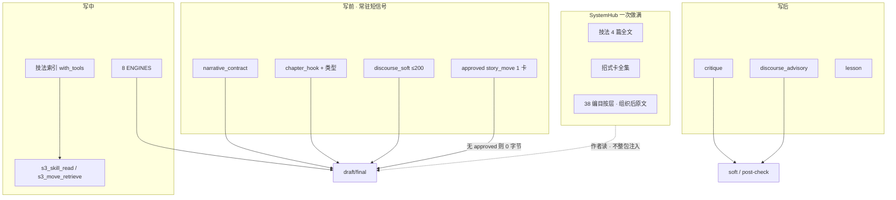

# 设计文档：oh-story 38 方法论 × 铜炉现网 · 全局最优融合架构

| 项 | 值 |
|----|-----|
| **文档标题** | 铜炉 / scribe3 · 38 篇分层一次交齐（原文进现网层 · 绕法抽尽成卡全集 · 禁止整包倾倒 prompt） |
| **作者** | Grok Design（系统架构） |
| **日期** | 2026-08-13 |
| **状态** | **Draft · rev.3（用户裁决并入）** |
| **DESIGN_ID** | `c82c4110` |
| **产品** | 铜炉（tonglu）/ scribe3 |
| **代码根** | `/home/admin/projects/scribe-writing-system/scribe3/` |
| **方法论 SSOT 行** | `oh-story-claudecode-main/skills/story-long-write/references/` 38 篇 |
| **重叠子集** | `story-setup/references/agent-references/` 25 篇（同名 = 同源，不另开行） |
| **会话交付** | 设计稿 `/tmp/grok-1000/grok-design-doc-c82c4110.md` · 摘要 `/tmp/grok-1000/grok-design-summary-c82c4110.md` · 落仓 `docs/plans/2026-08-13-oh-story-38-fusion.md` |
| **对齐并消费（禁止平行第五套库）** | 四层话语 `docs/plans/2026-08-12-discourse-layer-optimal.md` · 招式库 `docs/plans/2026-08-13-move-library-design.md` · 技法 `craft_skills/` · `craft.py` ENGINES · `craft_rule` · `lesson` · critique / `chapter_hooks` / `narrative_contract` |
| **验收环境** | 已部署 demo `https://tonglu.qing.blue` · SSH `ubuntu@82.157.130.140` · `/opt/scribe3/app`；**只冒烟已部署栈** |
| **本设计轮不做** | 实现产品代码（本回合只改设计）；文学 KPI；硬拦形容词；第二套 NLP；38 个新文件丢进 `craft_skills/` |

**rev.3 相对 rev.2**：用户闭合全部 Open Questions。交付从「Week-1 MVP / 渐进」改为 **分层一次做满**；38 原文必须组织进现网层（产品内可读）；招式 **卡全集一次交齐**（不是 38 张同构卡）；女频不进默认 UI；`planes.js` 保留 `id='skills'`。

---

### 读法（工程师 · 完整包）

1. **§概述 + §第一性** — 完善 ≠ 倾倒 prompt；完善 = 原文进层 + 绕法抽尽成卡。  
2. **§招式卡全集 vs 误以为 38 张卡** — 直接回答「oh-story 是不是都该进招式卡」。  
3. **§38 行归位表** — 每篇一个产品内落点（女频除外不进默认 UI）。  
4. **§Proposed Design + §PR Plan** — 全部 PR 必达，可分批合并，没有「以后再说」。  
5. **§Acceptance** — 只打已部署 demo。

---

## 概述

oh-story 38 篇是 **agent 工作流百科**（**566 472 字节 / 12 932 行**）。铜炉已有故事实体、话语四层、技法 4 篇、八引擎、章课、critique、叙事合同、注入预算。用户裁决（rev.3）：

> **按照规则把原文都组织到现在的系统里边**；**要最完善的功能，不要渐进，不要 MVP**。

最优架构一句话（rev.3）：

> **分层一次做满：38 篇原文按层 ingest 进现网对象（产品内可浏览组织后的全文或结构化字段）；绕法公式按 KD-M2 抽尽成招式卡全集（v1 一次交齐）；落笔纪律并进 4 篇技法；禁词进 critique；清单/钩/开篇/大纲进对应面板；写路径仍按层短注入，永不 `_push` 38 个文件名。**

完善 **不是**：38 个 md 丢进 `craft_skills/`；38 张同构招式卡；566KB 倒进 draft。  
完善 **是**：作者在铜炉里按层读到组织后的内容，写时按层消费（approved 招式段、技法索引、L3 discourse、合同/钩计划）。

招式检索键不变：**本意 × 绕法公式**。`same_formula_family` 仍是合并闸。女频手册 **不进默认 UI**（本书无女频）。

---

## 背景与动机

### 1. 现网已闭合的层（必须消费，禁止重开）

2026-08-13 代码核对：

| 层 | 回答的问题 | 现网载体（真实符号） | 本方案一次做满的增量 |
|----|------------|----------------------|----------------------|
| ① 故事 | 发生了什么、欠什么账 | `outline` / `drama_beats` / `promise` / `event_graph` / `narrative_contract.py` / `story_complete.may_claim_story` / `brief` omit | 开篇/大纲/人设/金手指字段从 38 组织进面板；**可读**组织后原文 |
| ② 话语中观 | 谁在看、多近、何时给信息 | `discourse_inject` 三键；`epistemic_guard`；`限知视角.md` | 消费已有；不另开 Genette 专篇 |
| ③ 话语微观 | 句子是否窒息、是否展示 | `craft.py` 8 槽；rhythm / telling / oversat；`discourse_advisory` | 4 技法收齐 38 里的落笔纪律补丁 |
| ④ 连载动力 | 读者会不会翻下一章 | `chapter_hooks`；`hook_on_page` / `info_delta`；`narrative_drive` | 钩类型枚举 + 连载面板吃 hooks-* 组织文 |
| L_skill | 落笔纪律 | `craft_skills/` **仅 4 篇** + `s3_skill_read`；索引仅 `with_tools=True` | **仍 4 文件**；补丁一次写满（非 38 个新 md） |
| L_engine | 句子处方 | `PUBLIC_ENGINE_KEYS` 8 | **禁止**三角/卡公式写入 ENGINES |
| L_rule | 本书题材禁令 | `craft_rule`；`genres.py` opt-in（反面词表，不作生成模板） | 题材目录进 **浏览编目**，不进生成模板 |
| L_lesson | 章级决策句 | `LESSON_KINDS={decision,correction,pitfall}` | 不升格为 use |
| L_critique | 禁词/指纹 | `_common.py`、`find_ai_tics` / `find_god_view` | 作者可在设置/编目读词表；禁止再抄进技法 |
| L_move | 本意 × 绕法 | 设计已闭合；代码 **0 命中** | **本方案必达**：move-library 实现 + **卡全集 5 张** + 厚 uses |
| 跨章弧 | 可选标签 | storyline；`promise_mode=omit` | 不重开 |
| 注入预算 | 注意力有限 | `SEGMENT_REGISTRY`；`discourse_soft`∈T3；`structure_diversity`∈L0 | **禁止** 38 文件名入段；discourse 禁入 L0 |
| 完成宣称 | 戏是否可宣称 | `may_claim_story` | **正交**，不改 |
| 阻塞 | 什么能挡 finalize | `is_blocking_issue` | **DISCOURSE 永不进入** |

旗标：沿用 `SCRIBE3_DISCOURSE_*`；招式用 move-library 的 **`SCRIBE3_MOVE_LIBRARY`**（本方案不另起旗名）。  
迁移：最高号 **136**；招式表 **137+**。本方案 **有 schema**（招式库表，必达）。

### 2. 痛点

| ID | 痛点 | 伤害 |
|----|------|------|
| **P1** | 38 篇是文件系统百科，铜炉是一书一库 + 写路径编译 | 原样复制 = 第五套库 |
| **P2** | 566KB 进 draft → Lost-in-the-Middle | 中间公式变噪声 |
| **P3** | 同构绕法各开一卡，或不同构硬塞三角 aliases | 卡爆炸 / retrieve 喂错 |
| **P4** | banned 已在 critique | 双 SSOT + 三重刷屏 |
| **P5** | 题材公式当生成模板 | 模板网文机；`genres.py` 已禁 |
| **P6** | 作者只能看见 4 行技法，原文在 git 树 | 「组织进系统」失败 |
| **P7**（rev.3） | 把完善理解成 MVP / 16 条折叠敷衍 | 用户已否决渐进 |

### 3. 融合单位

oh-story 按阶段加载百科；铜炉按 **产品对象 + 消费面** 分层。融合单位是 **文件内可执行原子**，不是「一篇 = 一张卡」。文件级指定 **写所有者 + 产品内落点**。

---

## 第一性与外部经验

### 写出好小说的最小充分条件

| # | 条件 | 产品层 | 作者何时需要 |
|---|------|--------|--------------|
| **F1** | **戏发生了** | ① + `narrative_contract` + `may_claim_story` | 写前合同；写后宣称 |
| **F2** | **怎么讲清楚且有立场** | ② 热奈特距离·聚焦·时间 | 写前一句；写后全知 advisory |
| **F3** | **句子能呼吸、能展示** | ③ + L_skill + L_engine | 8 引擎常驻；技法按需 |
| **F4** | **读者会翻下一章** | ④ | 钩规划；`hook_on_page` |
| **F5** | **本意不直线砸脸** | L_move 卡全集 | **仅** approved plan 注入 1 卡 |
| **F6** | **不复读、禁词不刷** | critique / avoid / structure_style | 写后 |

工作流/清单/题材目录 **不是** 好小说充分条件，但 rev.3 要求它们 **进产品面板**（可读、可勾选），只是 **不进 draft 全文**。

### 写前 / 写中 / 写后



| 时机 | 进 prompt | 按需 / 面板 | **永不进 draft** |
|------|-----------|-------------|------------------|
| 写前 | 合同、事件、大纲、brief omit、限知 banner、钩计划+类型一句、已批 1 卡 | 技法全文、招式 retrieve、38 编目、人设/开篇面板 | 38 原始文件名、21 题材公式全书、女频手册 |
| 写中 | 8 引擎、avoid、anti_slop | `s3_skill_read` | 工作流 SOP 全文 |
| 写后 | — | 清单勾选、编目重读、lesson | 新 `methodology.*` issue；discourse blocking |

### 外部经验（检索摘录）

- [Show, don't tell](https://en.wikipedia.org/wiki/Show,_don%27t_tell) / 契诃夫碎玻璃：行动与感官代替作者说明 → F3；已由 `ENGINES.body` + telling。不硬拦形容词。  
- Hemingway 冰山 1/8（*Death in the Afternoon*）：`ENGINES.restraint` + `promise_mode=omit`。  
- [Genette / Signo](https://www.signosemio.com/pages/genette/narratology.php)：距离、零/内/外聚焦、时间顺序·速度·频率 → ② 已有三键 + 限知。  
- McKee [Do Your Scenes Turn?](https://mckeestory.com/do-your-scenes-turn/)：场景须翻转价值 → `narrative_contract` 四字段。  
- Truby 场景小故事：[writeswithtools scene structure](https://writeswithtools.com/2021/04/26/scene-structure-elements-of-a-scene/)。  
- [马良 · 节奏与爽点（2026-03-09）](https://maliangwriter.com/blog/novel-pacing-hook-design-guide/)：章末三行、钩进蓝图、AI 匀速。  
- [连载篇幅手记](https://www.threads.com/@motiple_dreamcreator/post/DChLk56z3Kx)：章是钩子单元。  
- Liu et al. [Lost in the Middle](https://aclanthology.org/2024.tacl-1.9/), TACL 2024。  
- Anthropic [Effective context engineering](https://www.anthropic.com/engineering/effective-context-engineering-for-ai-agents)（2025-09-29）：注意力预算、渐进披露 **工具**（不是砍产品功能）。  
- Tian Pan [Context Stuffing](https://tianpan.co/blog/2026-04-09-context-stuffing-antipattern-llm-production)。  
- 仓库：`context_budget.py` L0 永不裁；`craft_skills` 索引+工具；招式无 plan 零字节。

**对「不要渐进」的解释**：Anthropic 的渐进披露是 **prompt 工程**（按需取全文），不是产品砍 scope。产品功能一次做满；模型上下文仍然按层短给。

---

## 目标与非目标

### Goals（完整交付可验收）

| # | 目标 | demo 冒烟 |
|---|------|-----------|
| **G1** | 38 行归位 **进仓且进产品**；按层浏览（女频默认隐藏） | SystemHub 编目 count=37 可见 + #12 不在默认列表；点开非空组织正文或字段 |
| **G2** | 三栏做满：技法（4 篇含 38 纪律补丁）\| 招式（卡全集+取用）\| 38 编目 | 招式 API ≠ `craftSkills`；卡数 = **5** |
| **G3** | 招式库按 move-library **一次实现** + 本设计卡全集与 uses | flag 开且 approved 才有 `story_move` 段；无 plan 零字节 |
| **G4** | 清单 / 钩类型 / 开篇·大纲要点 **都做** | 面板可点；injection-trace **无** 清单全文段 |
| **G5** | 写路径不倾倒 38 文件名 | assemble 段名无 `anti-ai-writing` 等 |
| **G6** | critique 词表零复制进技法 md | 4 篇不含 banned 全表 |
| **G7** | discourse 不进 blocking；不污染 L0 | `is_blocking_issue` 不含 discourse；`structure_diversity` 不增长方法论 |
| **G8** | 验收 = 已部署 demo | 见 §Acceptance |

### Non-Goals

| # | 非目标 | 理由 |
|---|--------|------|
| **NG1** | 38 个新文件进 `craft_skills/` | 注意力税 + 生命周期混乱 |
| **NG2** | 38 张招式卡 / 三角写进 ENGINES | 多数不是本意×绕法 |
| **NG3** | 招式并进 `s3_skill_read` | 双 SSOT |
| **NG4** | 实体解决窒息 | 微观问题 |
| **NG5** | `s3_chapter_recall` 当招式召回 | 仿写 |
| **NG6** | 文学 ≥9.5 / 硬拦形容词 / 第二 NLP | 产品禁令 |
| **NG7** | discourse → `is_blocking_issue`；污染 L0 | 已拍板 |
| **NG8** | 独立方法论 wiki、不接线写路径 | 能看不能用；改为编目 **接层面板** |
| **NG9** | Grok 机全量 npm/pytest/本机 Surreal | 资源规则 |
| **NG10** | 改 `may_claim_story` | 正交 |
| **NG11** | 女频自动 seed / 女频默认入口 | 用户：没有女频书 |
| **NG12** | 把「渐进/砍 scope」当最优 | 用户否决 MVP |

### Must-Keep

四层 SSOT；`promise_mode=omit`；`structure_diversity` L0；`soft_fail`；技法索引仅 with_tools；`genres.py` 套路不作生成模板；招式 ≠ 技法。

---

## 归位裁决规则

1. 已在 critique？→ `keep-in-critique` + 编目指向设置/词表（作者可读）。  
2. 本意×可命名绕法？→ `same_formula_family`：假破真 → **并三角**；不同构 → **卡全集独立卡**（§招式卡全集）。  
3. 落笔纪律？→ merge 进现有 4 技法（不新 md）。  
4. 戏/人设/大纲/伏笔/状态？→ ① 面板字段 + 编目组织文。  
5. 钩/期待/章末？→ ④ 枚举 + 连载面板。  
6. 工作流/清单/产物模板？→ **面板必做**（`ingest-to-panel`），零 draft 全文。  
7. 题材/商业目录？→ **编目可浏览**（`ingest-to-catalog`），禁止当生成模板。  
8. 女频？→ **`archive-only`**，归位表保留，默认 UI 不展示。

消费面：`gen-short` / `tool-full` / `post-detect` / `author-browse` / `plan-pick` / `never-draft`。

---

## 公式族谓词（KD-M2 · 卡全集共用）

```text
same_formula_family(x, false_break_true) ⟺
  有序拍归一化 ∈ { 假→破→真, 反面→破功→本意, 期望→打碎→真相, 表面意义→颠覆→本意 }

作用对象可变（信息 / 身份标签 / 对话底牌 / 物件象征 / 时间顺序）——对象变、公式不变 → 并三角。
```

**不得并三角、但属于本意×绕法 → 独立卡（v1 一次交齐）：**

| 残差公式 | 为何不是假破真 | 独立卡 |
|----------|----------------|--------|
| 立 **真** 羁绊 → 撕裂 → 余韵 | 先真后痛，不是先假后真 | `bond_tear` |
| 对方长论 → 一字回应 | 无假信息，权力长度差 | `one_word_crush` |
| 辩解 → 沉默 → 「随意」 | 话量衰减，不是揭假 | `speech_wither` |
| 露一角 → 切线/未完 → 加码留扣 | 不给全量，没有「假面」 | `withhold_escalate` |

清单、工作流、禁词、开篇范式、钩**类型**、人设字段、题材目录：**不是绕法**，不进卡表。

---

## 招式卡全集 vs 误以为 38 张卡

用户问：**「oh-story 里边的都应该进招式卡吧？」**

**回答：** 都应该 **进系统**（按层组织）。**只有**「想表达 X，别直线说，按公式绕一圈」才进 `story_move` 卡。工作流、禁词表、题材目录、状态账本、开篇模板、钩类型枚举 **不是** 绕法，做成 38 张卡会污染 retrieve（KD-M2 失败），也答错第一性。

**完善 = 原文进层 + 绕法抽尽成卡全集**，不是 38 张同构卡。

再读 `reversal-toolkit` / `hooks-*` / `opening-design` / `writing-craft` / `plot-core-methods` / `dialogue-mastery` / `emotional-methods` 后的抽尽结果：

### 卡全集（v1 = 5 张，一次交齐）

| name | slug | formula_family | 公式 arrow | 直线病 | 来源篇 | 为何独立 / 为何并入 |
|------|------|----------------|------------|--------|--------|---------------------|
| 三角信息法 | `triangle_info` | `false_break_true` | 假→破→真 | 上来掏底牌 | #5 三层反差；#9 对话反转；#19 暗牌/假意顺从/打脸；#20 伪提示顺序；#31 身份/视角/动机/信息/认知/时间线/虚晃一枪/打脸；#33 装逼打脸；#38 金锁物件三拍+数字反差；#26 高潮假胜 | **1 张 + 厚 uses**。时间线反转 = 假序→物证破→真序，同族。嵌套反转 = 三角用两次，不新卡。「无反转」写进 usage，禁止硬塞 |
| 羁绊三板斧 | `bond_tear` | `true_tear_aftertaste` | 立真→撕裂→余韵 | 「他们很相爱所以很痛」 | #11 `emotional-methods` | 铺的是真质感，谓词假 |
| 一字碾压 | `one_word_crush` | `long_then_one` | 长论→一字→压服 | 对等对骂 / 自报实力 | #9 压制模式 | 地位长度差，非假破真 |
| 话死 | `speech_wither` | `shrink_to_silence` | 辩解→沉默→随意 | 「我心死了」 | #9 心死模式 | 话量衰减 |
| 延宕加码 | `withhold_escalate` | `show_cut_raise` | 露一角→切线/未完→加码留扣 | 一次倒空答案或爽点 | #20 分层钩/延迟引爆；`节奏控制` 延宕；震惊分层 | 不给全量，无假面 |

**retrieve 合同：**

- `欲扬先抑` / `金锁三拍` / `装逼打脸` / `暗牌` → `triangle_info`  
- `羁绊撕裂` / `三板斧` → `bond_tear`（**不得**命中三角）  
- `心死` → `speech_wither`  
- `压制` / `一字回应` → `one_word_crush`  
- `延宕` / `分层钩` → `withhold_escalate`  

**明确不是卡、必须进现网层（一次做完）：**

| 原子 | 落点 |
|------|------|
| 钩类型（悬念/危机/反转/情绪/信息…） | `beats_meta.chapter_hook_type` + ④ 面板 |
| 开篇范式 / 黄金三章禁令 / 困境·优势切入 | ① 开篇工具 + 编目组织文 |
| 质量清单场景三项 | 合同语义 + 清单面板（勾选不进 prompt） |
| 人设三层标签 | 角色字段；反差 **uses** 进三角 |
| 信息差（读者知角色不知） | `限知视角.md`（move-library NG12） |
| 倒计时/代价/弱者钩 | ④ 连载，不是卡 |
| banned / anti-ai | critique + 设置中心可读 |
| 本节速记 | envelope（已有） |
| 日更/回炉 SOP | 工作流面板 |
| 21 公式 / 题材骨架 | 编目浏览，**禁止**生成模板 |
| 女频手册 | 归位表归档，**默认 UI 无入口** |

---

## 38 行归位表（SSOT）

同源：`AR` = 在 `agent-references/`（25）。`deslop` = 已进 critique。

**融合动作（rev.3）：** `keep-in-critique` / `ingest-to-panel` / `ingest-to-catalog` / `ingest-to-fields` / `merge-into-<skill\|triangle\|card>` / `reuse` / **`archive-only`**（仅 #12）。不再用「drop-or-defer 以后再说」当交付逃逸。

| # | 文件 | 同源 | 一句话职责 | 归入层 | 现网是否已有 | 融合动作（产品内落点） |
|---|------|------|------------|--------|--------------|------------------------|
| 1 | `anti-ai-writing.md` | AR + deslop | AI 指纹、三遍去 AI | L_critique + ③ | find_ai_tics / god_view / degeneration / restraint | **keep-in-critique** + 编目指向检测说明与引擎留白；作者可读组织摘要 |
| 2 | `artifact-protocols.md` | — | 产物模板 | L_workflow | outline / promise / char_state | **ingest-to-panel**：字段映射表；不复制磁盘模板 |
| 3 | `banned-words.md` | AR + deslop | 毒句式+禁用词 | L_critique | `_BANNED_LEXICON` | **keep-in-critique** + 设置中心可读词表 |
| 4 | `character-basics.md` | AR | 主配反派卡 | ① | character_profile | **ingest-to-fields** + 编目全文组织进角色向导 |
| 5 | `character-design-methods.md` | AR | 三层反差等人设 | ① + 三角 uses | 角色卡 | **ingest-to-fields**；三层反差 **merge-into-triangle uses** |
| 6 | `character-relations.md` | AR | 关系/感情线 | ① | character_relation | **ingest-to-fields** + 编目 |
| 7 | `commercial-core-methods.md` | — | 卖点/留存/金手指商业 | ④ + ① 编目 | 鸿沟≈contract | **ingest-to-catalog**（选题可读）；留存/鸿沟 **ingest-to-panel** ④/合同；禁当生成模板 |
| 8 | `cross-book-recall.md` | — | 跨书召回预算 | L_workflow | reference_craft | **reuse** 召回+预算；编目写清三道防线；禁当招式召回 |
| 9 | `dialogue-mastery.md` | AR | 对话模式/功能/权力 | L_skill + 3 卡 | 对话潜台词 / subtext | **merge-into-对话潜台词**（功能门、禁复述）；反转→三角；压制→`one_word_crush`；心死→`speech_wither` |
| 10 | `emotional-arc-design.md` | AR | 卷级情绪弧 | ① 标签 | storyline / emotion_scale | **ingest-to-fields** 弧标签 + 编目 |
| 11 | `emotional-methods.md` | AR | 羁绊三板斧 | L_move `bond_tear` + ① | 静默拍 | **lift-to-move `bond_tear`**；信物字段 ①；**禁止**三角 alias |
| 12 | `female-audience-writing.md` | — | 女频安全感/文案 | — | 无女频书 | **archive-only**：只留归位表，**默认 UI 不展示、不 seed craft_rule** |
| 13 | `format-and-structure.md` | AR | 一段一戏、标点 | ③ | anti_slop / 节奏 | **reuse** 检测 + 编目组织文；merge 疏密进节奏技能 |
| 14 | `genre-catalog.md` | AR | 题材骨架 | 编目 | genres.py 4 包 | **ingest-to-catalog** 只读；禁止生成套公式 |
| 15 | `genre-core-mechanics.md` | AR | 核心梗/冲突网 | ① 编目 | intent / outline | **ingest-to-catalog** + 选题检查句 |
| 16 | `genre-readers.md` | AR | 读者/书名/平台 | 编目 | 无 | **ingest-to-catalog**（营销可读） |
| 17 | `genre-writing-formulas.md` | AR | 21 公式 | 编目 | genres.py 禁模板 | **ingest-to-catalog**；**禁止**进 ENGINES / draft |
| 18 | `hooks-chapter.md` | AR | 章钩类型 | ④ | resolve_chapter_hook | **ingest-to-panel** + `chapter_hook_type` 枚举；组织文进连载栏 |
| 19 | `hooks-paragraph.md` | — | 11 段钩 | ④ + 三角 | 限知 | **拆分**：信息差→限知；暗牌/假意/打脸→三角；倒计时/代价/弱者→④ 面板；不开 11 卡 |
| 20 | `hooks-suspense.md` | AR | 悬念≠伏笔、分层钩 | ④ + `withhold_escalate` | promise / hook / info_delta | **reuse** 伏笔/悬念分家；伪提示顺序→三角；分层/延迟引爆→`withhold_escalate` |
| 21 | `opening-design.md` | AR | 黄金三章/开篇 | ① 开篇工具 | 大纲 | **ingest-to-panel** 开篇检查+范式；天气开头 soft 检测 |
| 22 | `outline-conflict.md` | AR | 矛盾/主线 | ① | contract / drama | **ingest-to-panel** 冲突向导 |
| 23 | `outline-methods.md` | AR | 五步大纲 | ① | outline / beats | **ingest-to-panel** 大纲步骤 |
| 24 | `outline-rhythm.md` | AR | 升级感/期待 | ①+④ | narrative_drive | **ingest-to-panel** 节奏规划 |
| 25 | `outline-structure-theory.md` | — | 幕结构/换地图 | ① 编目 | event_graph | **ingest-to-catalog**；因果 **reuse** event_graph |
| 26 | `plot-core-methods.md` | AR | 小纲/高潮/卡文 | ① + 三角假胜 | 场景转换 | **ingest-to-panel**；假胜 **merge-into-triangle**；转场 reuse 技能 |
| 27 | `plot-emotion-system.md` | — | 递进对抗/爽点 | ④ | serial / stakes | **ingest-to-panel** ④ advisory |
| 28 | `plot-frameworks.md` | — | 题材循环框架 | 编目 | 无 | **ingest-to-catalog** 只读 |
| 29 | `plot-special-topics.md` | — | 金手指/扫榜/对标 | ① 设定 | ontology | **ingest-to-fields** 金手指拆分；扫榜只编目说明，不做扫榜产品 |
| 30 | `quality-checklist.md` | AR | 章/场景/章尾清单 | L_workflow | post-check / contract | **ingest-to-panel** 清单（必做）；场景三项并合同；勾选不进 prompt |
| 31 | `reversal-toolkit.md` | AR | 六类反转+嵌套 | 三角 uses | promise payoff | **merge-into-triangle uses**（类型=例）；无反转→三角 usage；编目可读全文组织版 |
| 32 | `state-tracking.md` | — | 本节速记 | ① envelope | focus/canonical/recent | **reuse** envelope；编目说明「即上下文组装」 |
| 33 | `style-combat-face.md` | AR | 装逼打脸/战斗 | 三角 + 编目 | 无战斗引擎 | 打脸 **merge-into-triangle**；战斗三板斧 **ingest-to-catalog** |
| 34 | `style-craft.md` | — | 镜头/白描/视角 | ③+② | 限知+8 引擎 | **reuse** 引擎；视角并中观；编目组织文；不新开镜头技能文件 |
| 35 | `style-genre-modules.md` | AR | 分题材风格 | L_rule | craft_rule | **reuse** per-work；手册 **ingest-to-catalog** |
| 36 | `workflow-daily.md` | — | 日更 SOP | L_workflow | continue_snapshot | **ingest-to-panel** 日更步骤 |
| 37 | `workflow-revision.md` | — | 回炉 SOP | L_workflow | revise_span | **ingest-to-panel** 回炉步骤 |
| 38 | `writing-craft.md` | AR | 身体/物件三拍/动静/揉进 | ③ + 三角 | body / 节奏 / critique | 1/9 **reuse** 引擎+critique；5/8 **merge-into-节奏**；物件三拍+数字 **merge-into-triangle**（金锁同构，不开第六卡）；三维度揉进并限知/引擎说明 |

### 分流统计（rev.3）

**按主归属层（38）：**

| 层 | 篇数 | 行号 |
|----|------|------|
| ① 故事 | 12 | 4, 5, 6, 10, 21, 22, 23, 24, 25, 26, 29, 32 |
| ② 中观 | 0 | 已由话语层承担 |
| ③ 微观 | 3 | 13, 34, 38 |
| ④ 连载 | 4 | 18, 19, 20, 27 |
| L_move（主归属） | 2 | 11, 31 |
| L_skill | 1 | 9 |
| L_rule | 1 | 35 |
| L_critique | 2 | 1, 3 |
| L_workflow | 5 | 2, 8, 30, 36, 37 |
| 编目主归属（题材/商业/框架） | 7 | 7, 14, 15, 16, 17, 28, 33 |
| archive-only | 1 | 12 |

（#33 打脸原子进三角，文件主落点编目。）

**按产品落点动作（主动作，38）：**

| 动作 | 篇数 |
|------|------|
| ingest-to-panel / fields | 14 |
| ingest-to-catalog | 8 |
| keep-in-critique | 2 |
| reuse（现网已覆盖，编目交叉引用） | 5 |
| merge-into skill/triangle/独立卡 | 8 |
| archive-only | 1 |

**招式卡：5**（不是 38）。**新技法 md：0**。**AR：25**（#25/#27/#34 为 `—`）。

---

## Proposed Design

### 1. 原文如何「组织进现在的系统」

**禁止：** 把 38 个原始 md 复制为 `craft_skills/*.md`；写路径 `_push` 文件名；只链 oh-story git 树。

**必做 ingest：**

```
scribe3/author_method/
  index.js          # 38 行：file, layer, action, card_slugs[], ui:'show'|'hidden'
  bodies/<id>.md    # 组织后正文：按层小标题；生成公式段标 do_not_inject
```

`bodies` 从 oh-story **改写组织**（删 Phase 路由、对标磁盘路径；保留可执行律与例子方法摘要）。作者在 SystemHub 点开即读。检测词表与 4 技法、5 卡是 **写所有者**；bodies 是 **只读投影**，冲突以写所有者为准。

### 2. SystemHub 单一入口（三栏做满）

`planes.js`：**保留 `id: 'skills'`**，label 改为 **「技法与招式」**（KD-16）。

```
系统中心 → 写作系统 → 技法与招式
┌─────────────┬─────────────┬──────────────────┐
│ 技法        │ 招式        │ 38 编目（按层）   │
│ 4 篇全文    │ 5 卡+uses   │ 37 可见 / #12 隐 │
│ s3_skill_read│ 取用/计划  │ 点开 bodies      │
└─────────────┴─────────────┴──────────────────┘
页脚：句子处方在写路径 8 引擎，不做成卡
```

章工作台：MetaPane「选用招式」→ world-write 种子 → `story_move_plan`（move-library 合同）。可选 5 卡，默认检索仍可落三角。

### 3. 写路径（完善 ≠ 倾倒）

沿用 `write_assemble_v1._push`。增量：

| 段 | 规则 |
|----|------|
| L0 合同 / event / drama | 消费 |
| L0 `structure_diversity` | **禁止**塞 38 文案 |
| `craft_skills_index` | 仍 4 行，仅 with_tools |
| L3 `craft` | 8 引擎；**禁**卡公式 |
| L3 `discourse_soft` | ≤200；可含已选钩类型一句 |
| L3 `story_move` | `SCRIBE3_MOVE_LIBRARY` ∧ approved ∧ validation.ok → **1 卡 + 至多 2 uses**；否则 **0 字节** |
| 38 原始 md | **永不** `_push` |

### 4. 技法补丁（仍 4 文件，一次写满）

| 技能 | 从 38 并入的纪律（非绕法） |
|------|---------------------------|
| 对话潜台词 | 每句功能三选一；禁复述已知；问答乒乓禁令（压制/心死 **改为卡**，技能只留地位博弈总则） |
| 节奏控制 | 一动一静、疏密、静默拍；延宕 **指针** 到 `withhold_escalate` 卡 |
| 限知 | 信息差/戏剧反讽（#19）；三维度「只写此刻感知」 |
| 场景转换 | 已覆盖；编目交叉引用即可 |

### 5. 招式实现

按 `2026-08-13-move-library-design.md` **整包实现**（表、retrieve、plan、assemble、Hermes include、人批 use）。种子 JSON **5 卡**，uses 变厚。migration **137+**。旗 `SCRIBE3_MOVE_LIBRARY`。

`genres.py` 字段名 `moves` ≠ L_move：加注释，避免混淆。

### 6. 面板一次做完

| 面板 | 内容 |
|------|------|
| 清单 | #30 抽可勾选项；场景目标/阻碍/变化 = 合同，不新检测器 |
| 钩 | `chapter_hook_type` 枚举 + 规划句 |
| 开篇 | 黄金三章检查 + 困境/优势切入（#21） |
| 大纲 | 五步/冲突/节奏要点（#22–24） |
| 日更/回炉 | #36/#37 步骤映射现网阶段 |
| 编目 | 其余 catalog 篇只读 |

---

## API / 界面变更

| 变更 | PR | 说明 |
|------|-----|------|
| SystemHub 三栏 + 38 编目阅读器 | F1 | id=`skills`；label「技法与招式」 |
| `author_method/index.js` + bodies | F2 | 38 行 SSOT；#12 `ui:hidden` |
| 4 技法补丁 | F3 | 仍 4 slug |
| move-library 全实现 + 5 卡种子 | M1–Mn / F4 | 见 move-library PR 序，**本方案必达** |
| `GET /story-moves`、`s3_move_retrieve`、`s3_patch_chapter_plan(story_move_plan=)` | 同上 | 不新开 Hermes 写工具种类 |
| `chapter_hook_type` + 开篇/清单/大纲面板 | F5 | beats_meta JSON，无新表亦可 |
| 设置中心 banned 可读 | F3 旁路 | 已有阈值设置则挂链 |

---

## 数据模型与迁移

| 对象 | 策略 |
|------|------|
| 组织后原文 | 仓库 `author_method/bodies`（git），非 Surreal 第五库 |
| 归位 index | `author_method/index.js` |
| 招式卡/uses/plan | move-library 表；**137+** |
| 技法 | 仍 4 md |
| critique | `_common.py` |
| 女频 | 无表、无 seed |

回滚：关 `SCRIBE3_MOVE_LIBRARY` → 招式零字节；UI 可回单列技法；bodies 只读不影响写路径。

---

## Alternatives Considered

### A. 38 篇原样进 `craft_skills/`（否决）

566KB + 38 索引行；检测与构造混生命周期。用户也否决「丢进技法库」。

### B. 只 critique 暗移植（否决为唯一策略）

作者不可见，与「原文组织进系统」冲突。

### C. 38 张招式卡（否决）

工作流/词表/目录不是本意×绕法。用户问题的正确回答见 §招式卡全集，**不是**做成 38 卡。

### D. **分层一次做满**（采用 · rev.3 最优）

分层消费 + 原文进层 + 卡全集 5 张 + 面板齐套 + 写路径短注入。  
**rev.2 的「渐进/W1 只 IA」从最优定义中删除。**

### E. 独立 wiki 不接线（否决）

能看不能用。改为编目接层面板。

---

## Security & Privacy

| 风险 | 严重度 | 缓解 |
|------|--------|------|
| 对标原文进正例 → 仿写 | 高 | mechanism only；卡正例禁专名台词 |
| bodies 指令语气污染 draft | 中 | 永不 `_push` bodies；`do_not_inject` 段 |
| 招式写面扩大 | 中 | 既有 world-write 审批；discuss 不落库 |
| 女频/题材公式当生成模板 | 中 | catalog 只读；genres.py 禁模板 |

---

## Observability

| 信号 | 用途 |
|------|------|
| assemble 段名 | 无 38 文件名 |
| `craft_skills_index` 行数 | = 4 |
| `story_move` fed/approved | 无 plan ⇒ fed=false |
| 种子卡数 | = 5 |
| 编目可见行 | = 37（#12 hidden） |
| `discourse_soft.chars` | ≤200 |
| issues types | 无 `methodology.*`；discourse 不进 blocking |

---

## Rollout Plan

**交付定义 = 下表全部 Must 合入 demo 并冒烟通过。** 可分 PR 合并，**没有可选以后再说。**

| 序 | 内容 | 旗 | 回滚 |
|----|------|----|------|
| 1 | 设计落仓 + author_method 38+bodies | — | 删目录 |
| 2 | SystemHub 三栏+编目阅读器 | — | 还原 JSX |
| 3 | 4 技法补丁 + banned 可读 | — | 回退 md |
| 4 | move-library schema 137+ + 5 卡 + retrieve/plan/assemble | `SCRIBE3_MOVE_LIBRARY` | 关旗零字节 |
| 5 | 钩类型+开篇+清单+大纲+工作流面板 | — | 藏入口 |

灰度：招式旗可先开后关；编目只读无写风险。验收只打 demo。

---

## 风险

| 风险 | 严重度 | 缓解 |
|------|--------|------|
| 作者以为少卡=功能不全 | 中 | 编目展示 37 篇组织文；卡页写清「同构已并入三角 uses」 |
| bodies 膨胀维护 | 中 | 投影服从写所有者；冲突以卡/技能/critique 为准 |
| 5 卡仍可能被要求拆成 38 | 中 | §招式卡全集即答；拆卡须过公式族谓词 |
| 技能补丁变百科 | 中 | 绕法走卡，技能只留纪律 |
| 实现量大 | 中 | PR 可分，范围不可砍 |

---

## Key Decisions

| ID | 决策 | 理由 |
|----|------|------|
| **KD-1** | 最优 = **D 分层一次做满**（删渐进/MVP） | 用户：「不要渐进，不要 MVP」 |
| **KD-2** | 一篇一个写所有者；原子可拆，禁双 SSOT | 责任矩阵 |
| **KD-3** | **一次交齐完整融合**；PR 可分但全部 Must | 用户裁决 |
| **KD-4** | 假破真全部并三角（含金锁物件三拍、假胜、六类反转、暗牌、打脸、三层反差、数字） | KD-M2 |
| **KD-5** | **卡全集 v1 = 5 张**：`triangle_info` / `bond_tear` / `one_word_crush` / `speech_wither` / `withhold_escalate`。不是 38 张，也不是「先一张以后再说」 | 抽尽不同构绕法 |
| **KD-6** | critique 词表不抄进技法 | 防刷屏 |
| **KD-7** | **女频不进默认 UI、不自动 seed**；#12 archive-only | 用户：「没有女频书」 |
| **KD-8** | ② 消费话语层，不从 38 抬理论 | 无 Genette 专篇 |
| **KD-9** | 写路径永不 `_push` 38 文件名；无 approved 招式零字节 | Lost-in-the-middle |
| **KD-10** | **38 原文组织进现网层**（bodies+字段+面板）；不链 git 树敷衍 | 用户：「按照规则把原文都组织到现在的系统里边」 |
| **KD-11** | 不改 `may_claim_story` | 正交 |
| **KD-12** | 招式实现并入本方案必达；旗名仍 `SCRIBE3_MOVE_LIBRARY`；migration 137+ | 不另起炉灶 |
| **KD-13** | 验收只 demo 冒烟；无文学 KPI | 全局强制 |
| **KD-14** | 清单场景三项并合同，不新检测器 | McKee = 四字段 |
| **KD-15** | 技法与招式分栏禁止混列表 | 两库不等 |
| **KD-16** | **保留 `planes.js` `id='skills'`**，只改 label「技法与招式」 | 用户：「你来定」→ 降测试面 |

---

## Open Questions

| # | 问题 | 状态 | 用户原话 / 解释 |
|---|------|------|-----------------|
| Q1 | 参考栏是否只展示一句、是否链 git 原文？ | **闭合（用户裁决）** | 「按照规则把原文都组织到现在的系统里边」。**解释：** ingest 进现网层，产品内可读组织后全文或字段；≠ 38 raw md 进 `craft_skills/`；≠ 只链 oh-story git。 |
| Q2 | section id 是否改名？ | **闭合（用户裁决）** | 「你来定」。**最终决定：保留 `id='skills'`，只改 label。** 见 KD-16。 |
| Q3 | 物件三拍是否第二卡？oh-story 是否都应进招式卡？ | **闭合（用户裁决）** | 用户质疑为何还问第二卡，并倾向方法论进招式能力。**解释：** 金锁并三角（不开第六卡）。完善 = 绕法抽尽成 **5 张卡全集** + 非绕法进层；**不是** 38 张卡。见 §招式卡全集。 |
| Q4 | 女频是否自动 seed？ | **闭合（用户裁决）** | 「没有女频书」。删除自动 seed；#12 **archive-only**，不进默认 UI。KD-7。 |
| Q5 | 归位 JSON 放哪、是否只 16 条？ | **闭合（用户裁决）** | 完善要求 **38 行进产品编目**（#12 隐藏）。`author_method/index.js` 必达，不再是可选敷衍。 |

---

## PR Plan

> 本回合 **不实现产品代码**。下列 **全部必达**，可独立合并，**无「可选 F6」**。

| PR | 内容 | 依赖 | demo 验收 |
|----|------|------|-----------|
| **PR-F0** | 本设计落 `docs/plans/2026-08-13-oh-story-38-fusion.md` | — | 仓内文档为 rev.3 |
| **PR-F1** | SystemHub：label「技法与招式」；三栏骨架；编目按层 | F0 | `id=skills`；招式栏 ≠ craftSkills |
| **PR-F2** | `author_method/index.js` 38 行 + bodies 组织文；#12 hidden | F0 | 可见 37；点开非空；`AR`=25 |
| **PR-F3** | 4 技法一次补丁；banned 设置中心可读链 | F0 | slug 仍 4 |
| **PR-M1…** | **move-library 全实现**（137+、retrieve、plan、assemble、Hermes yaml、人批 use） | move-library 合同 | 无 plan 零字节；flag 在 `/debug/flags` |
| **PR-F4** | 种子 **5 卡** + 厚 uses（按 §卡全集） | M1 | retrieve 合同见上表；卡数=5 |
| **PR-F5** | 钩类型 + 开篇工具 + 清单面板 + 大纲/日更/回炉面板 | F1 | 勾选后 trace 无 checklist 段；钩类型只多一句 |

**禁止的 PR：** 38 md → `craft_skills/`；`methodology` 第五 Surreal 库；discourse blocking；L0 污染；女频默认入口。

---

## Acceptance（demo only）

环境：`https://tonglu.qing.blue` · `/opt/scribe3/app`。

1. 健康 / 登录 / 系统中心三栏。  
2. 编目按层可浏览 **37** 篇组织文；**无**女频入口。  
3. 技法 4 篇可读补丁后全文。  
4. 招式 5 卡可取用；无 approved plan 时 injection-trace **无** `story_move` 正文。  
5. 段名不含 38 原始文件名；`structure_diversity` 不因方法论增长。  
6. 清单/钩/开篇面板可用；checklist 不进 prompt。  
7. post-check：无 `discourse.*` issue type；finalize 不因话语阻塞。  
8. **不**跑 Grok 机全量 npm/pytest/本机 Surreal。

---

## References

### 本仓库

- `docs/plans/2026-08-12-discourse-layer-optimal.md`  
- `docs/plans/2026-08-13-move-library-design.md`  
- `scribe3/craft_skills.py` / `craft_skills/*.md` / `craft.py`  
- `scribe3/context_budget.py` / `injection_registry.py` / `api/services/write_assemble_v1.py`  
- `scribe3/critique/_common.py` / `chapter_hooks.py` / `discourse_*.py` / `narrative_contract.py` / `lesson.py` / `story_complete.py` / `genres.py` / `feature_flags.py`  
- `scribe3/web/src/system/planes.js` · `SystemHub.jsx`  
- `scribe3/migrations/136_thread_response_set_at.surql`  
- oh-story 38 篇见归位表  

### 外部

- [Show, don't tell — Wikipedia](https://en.wikipedia.org/wiki/Show,_don%27t_tell)  
- Hemingway, *Death in the Afternoon* (1932)  
- [Genette Narratology — Signo](https://www.signosemio.com/pages/genette/narratology.php)；Genette, *Narrative Discourse*, 1980  
- McKee, [Do Your Scenes Turn?](https://mckeestory.com/do-your-scenes-turn/)  
- [Truby 场景结构笔记](https://writeswithtools.com/2021/04/26/scene-structure-elements-of-a-scene/)  
- [马良 · 网文节奏与爽点](https://maliangwriter.com/blog/novel-pacing-hook-design-guide/)（2026-03-09）  
- [连载篇幅手记](https://www.threads.com/@motiple_dreamcreator/post/DChLk56z3Kx)  
- Liu et al., [Lost in the Middle](https://aclanthology.org/2024.tacl-1.9/), TACL 2024  
- Anthropic, [Effective context engineering](https://www.anthropic.com/engineering/effective-context-engineering-for-ai-agents)（2025-09-29）  
- Tian Pan, [Context Stuffing Antipattern](https://tianpan.co/blog/2026-04-09-context-stuffing-antipattern-llm-production)  

---

## PR Plan

（见上文专节。落地序：**F0 文档 → F1 IA → F2 38 编目+bodies → F3 技法 → M\* 招式库 → F4 五卡种子 → F5 面板**。全部 Must。）
