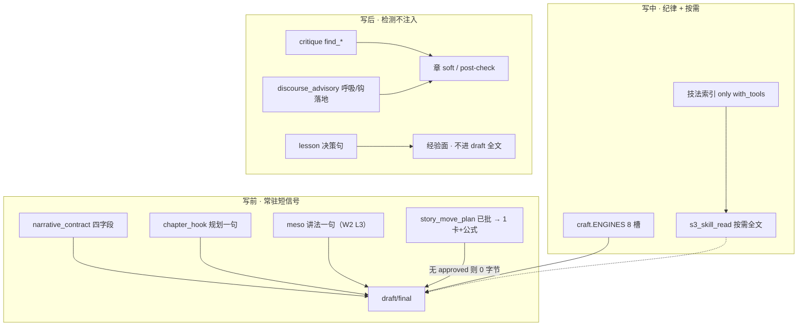
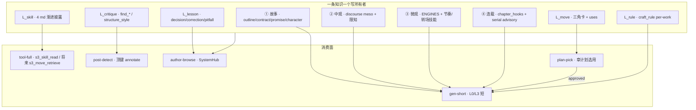

# 设计文档：oh-story 38 方法论 × 铜炉现网 · 全局最优融合架构

| 项 | 值 |
|----|-----|
| **文档标题** | 铜炉 / scribe3 · 38 篇方法论分层归位与单一导航面（写出好小说优先，禁止整包倾倒） |
| **作者** | Grok Design（系统架构） |
| **日期** | 2026-08-13 |
| **状态** | **Draft · rev.2**（复评：KD-M2 公式族谓词一贯执行；AR 同源列对齐磁盘；PR-F5 / 参考栏 16 条） |
| **DESIGN_ID** | `c82c4110` |
| **产品** | 铜炉（tonglu）/ scribe3 |
| **代码根** | `/home/admin/projects/scribe-writing-system/scribe3/` |
| **方法论 SSOT 行** | `oh-story-claudecode-main/skills/story-long-write/references/` 38 篇 |
| **重叠子集** | `story-setup/references/agent-references/` 25 篇（与上表同名 = 同源，不另开行） |
| **会话交付** | 设计稿 `/tmp/grok-1000/grok-design-doc-c82c4110.md` · 摘要 `/tmp/grok-1000/grok-design-summary-c82c4110.md` |
| **对齐并消费（禁止平行第五套库）** | 四层话语 `docs/plans/2026-08-12-discourse-layer-optimal.md` · 招式库 `docs/plans/2026-08-13-move-library-design.md` · 技法 `craft_skills/` · `craft.py` ENGINES · `craft_rule` · `lesson` · critique / `chapter_hooks` / `narrative_contract` |
| **验收环境** | 已部署 demo `https://tonglu.qing.blue` · SSH `ubuntu@82.157.130.140` · `/opt/scribe3/app`；**只冒烟已部署栈** |
| **本轮不做** | 实现代码 / commit / deploy；38 篇全文粘贴；文学 KPI；硬拦形容词；第二套 NLP 情绪库；把 38 篇整包进 `craft_skills` |

---

### 读法（工程师 · 第一周）

1. **§概述 + §第一性** — 先看「写出好小说」六条如何否决整包移植。  
2. **§38 行归位表** — 每篇一个写所有者、一个融合动作。  
3. **§Proposed Design** — 消费面、作者环、SystemHub 导航、少量 lift。  
4. **§公式族谓词 + §Key Decisions** — F4 开工前先过 KD-M2 尺；Week-1 无 38 张卡。  
5. **§Acceptance** — 一律 demo 冒烟；无文学分。

**rev.2 修订**：统一 `same_formula_family(false_break_true)`；#11/#9 停止过并三角；物件三拍默认并三角（KD-5 不再预开第二卡）；AR 列去掉误标 3 行；钩类型 PR 号改为 F5；参考栏锁定 16 条。

---

## 概述

oh-story 的 38 篇 `story-long-write/references` 是一套 **agent 工作流百科**（合计 **566 472 字节 / 12 932 行**，约 **18–20 万汉字**）。铜炉现网已经有 **故事实体、话语四层、技法 4 篇、八引擎、章课、critique 禁词/去 AI、叙事合同、注入预算**。用户要的不是「把 wiki 搬进产品」，而是：**从第一性写出好小说出发，38 篇拆进正确层，作者只看见一个入口。**

最优架构一句话：

> **分层消费，一条知识一个写所有者；常驻只留戏与纪律的短信号；绕法进招式库（本意×公式）；落笔纪律进技法；禁词/指纹进 critique；题材/清单/日更流进作者可选面；永不把 38 篇倒进 draft prompt。**

Week-1 只交付 **归位表 + SystemHub 导航 IA + 0 张新技法卡 + 0 张新招式卡（招式库按既有 move-library 设计只保三角）**。能否并进三角 **只** 看 `same_formula_family(false_break_true)`（§公式族谓词），不是看俗名像不像绕法。招式库 **禁止并入** `craft_skills` / `s3_skill_read`。

---

## 背景与动机

### 1. 现网已闭合的层（必须消费，禁止重开）

2026-08-13 代码核对：

| 层 | 回答的问题 | 现网载体（真实符号） | 状态 |
|----|------------|----------------------|------|
| ① 故事 | 发生了什么、欠什么账、戏有没有发生 | `outline` / `drama_beats` / `promise` / `event_graph` / `narrative_contract.py` / `story_complete.may_claim_story` / `brief` omit 伏笔 | **已落地**；migration **134** 合同 |
| ② 话语中观 | 谁在看、多近、何时给信息 | `discourse_inject.meso_line_from_chapter`（`beats_meta.distance_intent/pov_stance/time_strategy`）；`epistemic_guard`；`craft_skills/限知视角.md` | **W2 注入已接线** L3 `discourse_soft` |
| ③ 话语微观 | 句子是否窒息、是否展示 | `craft.py` `PUBLIC_ENGINE_KEYS` 8 槽；`find_rhythm_uniformity` / `find_emotion_telling` / oversat；`discourse_advisory` | **W1 advisory 已落地** |
| ④ 连载动力 | 读者会不会翻下一章 | `chapter_hooks.resolve_chapter_hook`；`detect_hook_on_page` / `detect_info_delta`；`narrative_drive` | **规划≠落地** 已分家 |
| L_skill | 落笔纪律（不是绕法） | `scribe3/craft_skills/` **仅 4 篇** + `craft_skills.py` `s3_skill_read`；`skills_index_block()` **仅 `with_tools=True`** | 限知 / 潜台词 / 节奏 / 转场 |
| L_engine | 句子处方 | `craft.py` `ENGINES`：body / temperature / idle / metaphor / subtext / sensory / soak / restraint | 恒注入 `write_assemble_v1._push("craft")` |
| L_rule | 本书题材禁令 | `store/voice_craft.py` `craft_rule`；`genres.py` **opt-in 题材包**（只落 critique 反面词表，**不作生成模板**） | per-work |
| L_lesson | 章级决策句，无三拍 | `lesson.py` `LESSON_KINDS={decision,correction,pitfall}` | 可升格候选，不可当 use |
| L_critique | 同招复读、禁词、AI 指纹 | `critique/_common.py`（oh-story banned/anti-ai 已移植）；`find_ai_tics` / `find_god_view` / `structure_style` | **不要再抄进技法 md** |
| L_move | 本意 × 绕法 | **设计已闭合** `2026-08-13-move-library-design.md`；代码 **`story_move` / `SCRIBE3_MOVE_LIBRARY` / `s3_move_*` 全仓库 0 命中** | 待按该设计实现，本方案只归位不重开 |
| 跨章弧 | 可选标签 | `storyline` + Insight 内嵌；`promise_mode=omit` | **非叙事核心** |
| 注入预算 | 注意力有限 | `injection_registry.SEGMENT_REGISTRY` L0–L3；`context_budget.L0_NEVER_CUT` / `L2_DROP_TIER`（`discourse_soft`∈T3） | **discourse 禁入 L0 `structure_diversity`** |
| 完成宣称 | 戏是否可宣称 | `story_complete.py` `may_claim_story` | **与招式/技法正交** |
| 阻塞 | 什么能挡 finalize | `review/blocking.py` `is_blocking_issue` | **DISCOURSE 永不进入** |

旗标：`FLAG_REGISTRY` 已有全套 `SCRIBE3_DISCOURSE_*`（含 `DISCOURSE_BLOCKING` 仅改展示 severity）。**尚无** `SCRIBE3_MOVE_LIBRARY`（归招式库 PR，不在本方案抢注语义）。

迁移：最高号 **`136_thread_response_set_at.surql`**。下一可用 **137+**。招式库表若落地走 137+；本融合 Week-1 **零 schema**。

### 2. 痛点（为什么 38 篇不能「搬进来」）

| ID | 痛点 | 伤害 |
|----|------|------|
| **P1** | 38 篇是 oh-story **文件系统 agent 工作流**（Phase 路由、对标目录、`拆文库/`），铜炉是 **一书一 Surreal + 写路径编译** | 原样移植会平行第五套「方法论库」 |
| **P2** | 566KB 方法论若进 draft：远超 L3 craft / T3 可裁段；与 Liu et al. 2024「Lost in the Middle」+ Anthropic 注意力预算直接冲突 | 模型只记住头尾禁令，中间公式变噪声 |
| **P3** | 同构绕法（欲扬先抑 / 装逼打脸 / 虚假提示）若各开一卡；或把 **不同构** 的羁绊三板斧 / 对话心死硬塞进三角 aliases | 卡爆炸，或 `retrieve` 喂错公式；与招式库 KD-M2 合并闸冲突 |
| **P4** | banned / anti-ai / god_view / telling **已在 critique** | 再抄进技法 = 双 SSOT + post-check 三重刷屏 |
| **P5** | 题材目录 / 21 公式 / 女频手册 **不是**好小说充分条件 | 注入会把铜炉写成「模板网文机」；`genres.py` 已明确套路只作反面词表 |
| **P6** | 作者没有单一入口：SystemHub 只有「技能与技法」四行 | 招式/作者参考/引擎不可见 → 要么看不见，要么被误并进 skills |

### 3. 38 篇不是铜炉缺失的「第五层」

oh-story 按 **写作阶段加载百科**（决策路由表）。铜炉按 **产品对象 + 消费面** 分层。二者正交：同一篇文件往往同时含「故事规划 + 绕法 + 禁令 + 工作流」。融合的单位不是文件，是 **文件内的可执行原子**；文件级只指定 **写所有者**，避免双写。

---

## 第一性与外部经验

### 写出好小说的最小充分条件（产品可操作版）

这六条是 **归位否决器**。一篇（或一段）进哪一层，只看它服务哪一条；不服务任一条件的，进作者可选或 defer。

| # | 条件 | 产品层 | 作者何时需要 |
|---|------|--------|--------------|
| **F1** | **戏发生了**：欲望 / 阻力 / 转折 / 代价 | ① 故事 + `narrative_contract` + `may_claim_story` | 写前：合同四字段；写后：能否宣称 |
| **F2** | **怎么讲清楚且有立场**：谁看见、多近、何时给信息 | ② 话语中观（热奈特：距离·聚焦·时间） | 写前：一句讲法；写后：越界全知 advisory |
| **F3** | **句子能呼吸、能展示** | ③ 微观 + L_skill + L_engine | 写中：8 引擎常驻；技法按需 `s3_skill_read` |
| **F4** | **读者会翻下一章** | ④ 连载动力 | 写前：`chapter_hook` 规划；写后：`hook_on_page` |
| **F5** | **本意不直线砸脸** | L_move 招式库（本意 × 绕法） | 写前：批准的一张卡；无 plan → **零字节** |
| **F6** | **同一招式不复读、禁词不刷** | critique / `avoid` / `structure_style` | 写后检测；禁词不进技法 md |

**非充分条件**（38 篇里大量存在，禁止当作「写出好小说」的底座）：

- 日更/回炉工作流、产物模板、跨书召回协议  
- 题材目录、21 套公式、女频/商业选题、扫榜  
- 50 条质量清单（清单是记忆辅助，不是戏）

### 写前 / 写中 / 写后：作者真正需要什么



| 时机 | 该常驻（进 prompt） | 该按需（工具/面板） | **永不进 draft prompt** |
|------|---------------------|---------------------|-------------------------|
| 写前 | 合同、事件驱动、大纲、伏笔 brief（omit 列表正文）、限知 banner、钩子规划、已批招式 1 张 | 技法全文、招式 retrieve、角色卡、卷纲、对标机制摘要 | 38 篇原文、题材公式全书、质量清单 50 条、日更 SOP、商业手册 |
| 写中 | 8 引擎、avoid、anti_slop、voice_anchor | `s3_skill_read`、本章状态（envelope 已做「本节速记」） | 工作流步骤、agent-references 副本 |
| 写后 | —（检测结果挂既有顶键） | 作者浏览技法/招式/参考；lesson 升格待批 | 检测器全文方法论；discourse 进 `issues` 新 type；blocking |

### 外部经验（检索摘录，禁止空口「业界都这样」）

#### 展示而非告知

- [Show, don't tell — Wikipedia](https://en.wikipedia.org/wiki/Show,_don%27t_tell)：读者应通过行动、潜台词、感官经历故事，而不是作者说明。契诃夫传统：「不要告诉我月光照耀，给我看碎玻璃上的反光。」  
- **产品映射**：F3。已由 `ENGINES["body"]`（身体→行动→沉默→语言）+ `find_emotion_telling` 落地。**不**再开「展示而非告知」技法篇。Bell / Card 的例外（全程 showing 会累死读者）支持现网「疏密」：过场允许 telling。**禁止**把「展示」做成硬拦形容词。

#### 冰山原则

- Hemingway, *Death in the Afternoon*（1932），转述见 [Iceberg / theory of omission](https://en.wikipedia.org/wiki/Show,_don%27t_tell) 与 [onthecobblestoneroad.com/iceberg](https://onthecobblestoneroad.com/iceberg/)：「冰山的尊严在于只有八分之一露出水面；作者因无知而省略只会留下空洞。」  
- **产品映射**：`ENGINES["restraint"]` 已写「信息冰山：前史/设定只露 1/8」。`promise_mode=omit` 禁止把开放伏笔清单砸进正文——那是 **工程版冰山**：作者/系统知道账，读者只看到水面上的动作。

#### 热奈特叙事话语（距离 · 视角 · 时间）

- Genette, *Narrative Discourse*（英译 1980）；综述 [signosemio.com — Genette Narratology](https://www.signosemio.com/pages/genette/narratology.php)：  
  - **距离**：叙述化言语 → 间接 → 自由间接 → 转述言语（越来越近）。  
  - **聚焦**：零聚焦（全知）/ 内聚焦 / 外聚焦。  
  - **时间**：顺序（倒叙/预叙）、速度（停顿/场景/概要/省略）、频率。  
- **产品映射**：F2。现网 `discourse_inject` 三键 `distance_intent / pov_stance / time_strategy` 即此三分；`限知视角.md` = 内聚焦执行律；`find_god_view` = 零聚焦越界指纹。oh-story **没有**独立的 Genette 专篇——中观缺口已由话语层设计补上，**不必从 38 篇再抬一篇「视角理论」**。

#### 西式故事工程：场景 = 目标-冲突-转折

- McKee, *Story*：场景是连续时空里通过冲突使人物生活价值发生可感转向的行动；价值电荷首尾相同 = **非事件**。[mckeestory.com/do-your-scenes-turn](https://mckeestory.com/do-your-scenes-turn/)；课堂笔记归纳：「No matter locations or length, a scene is unified around desire, action, conflict, and change.」  
- Truby, *The Anatomy of Story*：场景是小故事，含欲望、对手、计划、战斗、揭示（场景内用 twist 代替全书自我揭示）。见 [writeswithtools.com scene structure](https://writeswithtools.com/2021/04/26/scene-structure-elements-of-a-scene/)。  
- **产品映射**：F1。`narrative_contract` 四字段 desire/obstacle/turn/cost **就是** McKee 场景的产品合同。`quality-checklist`「场景有目标/阻碍/变化」是同一条的清单方言 → **不要第二套场景检测**，并进合同 / soft precheck。

#### 中文网文：钩子、信息差、爽点密度、章末留扣

- [马良写作 · 网文节奏与爽点（2026-03-09）](https://maliangwriter.com/blog/novel-pacing-hook-design-guide/)：节奏 = 信息投放与情绪刺激的频率，不是写快写慢；章末最后三行决定追读；钩子必须进蓝图；AI 最大问题是「太均匀」。给出悬念式 / 反转式 / 情绪炸弹 / 信息投放四类钩，以及小爽点每章、中爽点每 3–5 章。  
- [起点连载篇幅经验（Threads 作者手记）](https://www.threads.com/@motiple_dreamcreator/post/DChLk56z3Kx)：女频曾建议 3k/章以便做钩；改组后 2k/章成为多数习惯——**章是追读计费与钩子单元**，不是文学章。  
- oh-story 自身：`hooks-chapter.md` 按情绪选钩；`hooks-suspense.md` 明确 **悬念 ≠ 伏笔**（短揭晓 vs 长埋线）；`hooks-paragraph.md` 信息差 / 暗牌 / 倒计时。  
- **产品映射**：F4。`chapter_hooks` = 蓝图里的钩；`detect_hook_on_page` = 最后三行有没有落地；`detect_info_delta` = 本章信息增量。爽点密度 **只做 advisory**，禁止文学 KPI、禁止「每 3000 字必须爽」硬闸。

#### 「prompt 倾倒方法论会失败」——工程证据

- Liu et al., 2024. [Lost in the Middle: How Language Models Use Long Contexts](https://aclanthology.org/2024.tacl-1.9/). *TACL* 12:157–173. 长上下文呈 **U 型**：头尾召回强，中间崩溃。  
- Anthropic, 2025-09-29. [Effective context engineering for AI agents](https://www.anthropic.com/engineering/effective-context-engineering-for-ai-agents)：**注意力预算有限且边际递减**；要「最小高信号 token 集」；工具应即时取用（progressive disclosure），不要预装整库；系统提示要在「过硬编码」与「假共享语境」之间取海拔。  
- Tian Pan, 2026-04-09. [The Context Stuffing Antipattern](https://tianpan.co/blog/2026-04-09-context-stuffing-antipattern-llm-production)：1M 窗口不是许可证；塞满后准确率掉、开始对无关文档幻觉拼接。引用同一 Liu 文 + Chroma context-rot。  
- **仓库内已落地的预算设计**（必须继续遵守）：  
  - `context_budget.py`：L0 永不裁（`structure_diversity` 在内）；`discourse_soft` ∈ T3 先裁。  
  - `craft_skills.py` 定案 B：索引几行 + `s3_skill_read` 全文——**已经是 Anthropic 式渐进披露**。  
  - `write_assemble_v1.py`：技法索引 **仅 `with_tools=True`**；动稿关工具则不说谎。  
  - 招式库设计：无 approved plan → **零字节**。  
- **量化否决 Alternative A**：38 篇 56.6 万字节。按 UTF-8 汉字约 3 字节/字 ≈ **19 万字**。现网 novel envelope 才 32k token、L3 craft 是 T2 可裁段。整包倾倒 ≈ 把 T3 参考区撑爆两个数量级，且中间 30 篇公式会落在 U 型谷底。

---

## 目标与非目标

### Goals

| # | 目标 | 可度量验收（demo 冒烟，非文学 KPI） |
|---|------|-------------------------------------|
| **G1** | 38 行归位表成为融合 SSOT；一篇一个写所有者 | 本文件表；后续 `docs/plans` 落仓时逐行可引用 |
| **G2** | 作者单一导航面：技法 / 招式 / 不展示只进引擎 / 可选参考 | SystemHub `planes.js` 分栏可见；招式 **不** 出现在 `api.craftSkills` |
| **G3** | 写路径消费纪律：常驻短、按需全文、写后检测 | assemble 无 38 文件名；`craft_skills_index` 仍仅 4 行；无 plan 无 `story_move` 段 |
| **G4** | 同构绕法并进三角 uses，不开 38 卡 | 种子 JSON 仍 1 张 `triangle_info`；uses/aliases 可增，卡数 Week-1=1 |
| **G5** | 已在 critique 的禁词/反 AI **零复制**进技法 | `craft_skills/*.md` 不含 banned 词表 |
| **G6** | 消费既有话语/合同/钩子，不新建检测家族 | `issues[]` 不新增 `methodology.*`；discourse 仍不进 `is_blocking_issue` |
| **G7** | Week-1 = 归位 + IA；完整 lift 不阻塞定义 | 见 PR Plan |

### Non-Goals

| # | 非目标 | 理由 |
|---|--------|------|
| **NG1** | 38 篇整包进 `craft_skills/` | P2 注意力税；用户已否决 |
| **NG2** | 38 张招式卡 / 把三角写进 ENGINES | 多数不是本意×绕法；句子层≠构造层 |
| **NG3** | 招式并进 `s3_skill_read` | 生命周期不同（卡稳定 / uses 变厚 vs md 部署） |
| **NG4** | 用实体/storyline 解决窒息 | 窒息属微观 |
| **NG5** | 用 `s3_chapter_recall` 当招式召回 | 召回散文 → 仿写 |
| **NG6** | 文学 ≥9.5 / 硬拦形容词 / 第二套情绪 NLP | 产品禁令 |
| **NG7** | discourse 进 `is_blocking_issue`；污染 L0 `structure_diversity` | 已拍板 |
| **NG8** | 平行第五套「方法论」Surreal 表 / wiki 产品不接线 | Alternative E 否决为默认 |
| **NG9** | Grok 机全量 npm/pytest/本机 Surreal；第二验收栈 | 主机资源规则 |
| **NG10** | 改 `may_claim_story` | 完成宣称正交 |
| **NG11** | 本设计实现招式库代码 | 归 `move-library` PR 序 |

### Must-Keep

- 四层 SSOT + 跨章弧仅标签  
- `promise_mode=omit`；伏笔只经 brief/promise  
- `structure_diversity` L0 红线身份  
- `soft_fail`；finalize 既有红线  
- 技法渐进披露；动稿 `with_tools=False` 不注入索引  
- `genres.py`：套路 **只** 作 critique 反面，不作生成模板  

---

## 归位裁决规则（用于填表）

对每篇问四问，按序停：

1. **是否已在 critique 检测？** → `keep-in-critique`（禁止再抄 md）。  
2. **是否是「本意 X，按公式绕」且公式可命名？** → 先跑 **§公式族谓词** `same_formula_family(false_break_true)`：是 → **`merge-into-triangle`**（禁止新卡、禁止用俗名绕过闸）；否 → 纪律归技法 / 规划归 ①，**不要**写进三角 `aliases`。仅当公式可命名 **且** 谓词为假 **且** 人审确认残差不可还原时，才 `lift-to-move` 新卡。  
3. **是否是落笔纪律（限知/潜台词/节奏/转场/展示）且现网 4 篇+8 引擎未覆盖？** → `lift-to-skill`；已覆盖 → `reuse` 或 `merge-into-<existing skill/engine>`。  
4. **是否是戏/人物/大纲/伏笔/状态？** → ① 故事，`reuse` 现网实体。  
5. **是否是钩子/期待/爽点/章末？** → ④，`reuse` `chapter_hooks` / discourse serial。  
6. **是否是工作流/清单/产物模板？** → `keep-as-workflow`，作者面板，零注入。  
7. **是否是题材目录/商业选题/平台文案？** → `drop-or-defer`（可选浏览，默认关）。

消费面标记：`gen-short` 生成前短注入 / `tool-full` 工具按需 / `post-detect` 写后 / `author-browse` 只读 / `plan-pick` 章计划选用 / `never-draft`。

---

## 公式族谓词（KD-M2 执行尺 · F4 开工前必读）

招式库合并闸只有一句：**公式仍是假→破→真，才并三角；禁止新卡。** 本设计的 L-USES / 归位「merge-into-triangle」/ KD-4 / KD-5 **共用**下面谓词，禁止用俗名（「三板斧」「权力易主」「物件三拍」）代替公式测试。

```text
same_formula_family(card_or_method, false_break_true) ⟺
  可抽出有序三拍，且归一化 arrow ∈ {
    假 → 破 → 真,
    反面 → 破功 → 本意,
    期望 → 打碎 → 真相,
    表面意义 → 颠覆 → 本意落地
  }
  作用对象可以是信息、身份标签、对话底牌、物件象征——对象变了，公式没变，仍并三角。

不得并三角（谓词为假）的典型残差：
  · 铺的是「真羁绊」再撕裂（先真后痛，不是先假后真）
  · 话越来越短 / 一字回应（地位博弈纪律，无假破真三拍）
  · 卷级情绪弧、清单、工作流
```

| 候选俗名 | 谓词 | F4 动作 |
|----------|------|---------|
| 欲扬先抑、装逼打脸、打脸框架、伪提示揭晓、暗牌、对话**反转**模式（嚣张→亮底牌→沉默）、三层标签反差、数字反差、物件三拍（金锁：暖礼物→金包铜→丢弃） | **真** | `aliases` / `examples` 并三角；**不开新卡** |
| 羁绊三板斧（真铺垫→撕裂→余韵）、对话**压制**、对话**心死** | **假** | **禁止**进三角 `aliases`；铺垫/关系留 ①；余韵留 `节奏控制` 静默拍；压制/心死留 `对话潜台词` 地位博弈 |
| 「立→转→落」若人审找出 **不可** 还原为假破真的残差 | 待审 | 才允许 W2 **提案**第二卡；默认不交付 |

`retrieve("羁绊撕裂")` / `retrieve("心死")` **不得**因 aliases 命中 `triangle_info`。`retrieve("欲扬先抑")` / `retrieve("金锁三拍")` 应命中三角。

---

## 38 行归位表（SSOT）

同源列：`AR` = 亦存在于 `agent-references/`（25 篇）。`deslop` = story-deslop 已大量进 critique。

| # | 文件 | 同源 | 一句话职责 | 归入层 | 现网是否已有 | 融合动作 |
|---|------|------|------------|--------|--------------|----------|
| 1 | `anti-ai-writing.md` | AR + deslop | 识别 8 类 AI 指纹、三遍去 AI、章末总结体 | L_critique + ③ | **有**：`critique/_common.py`、`find_ai_tics`、`find_god_view`、`find_degeneration`、`ENGINES.restraint` anti_essay | **keep-in-critique**；never-draft 全文 |
| 2 | `artifact-protocols.md` | — | oh-story 文件系统产物模板（卷纲/伏笔.md/对标） | L_workflow | **有等价实体**：`outline`、`promise`、`char_state`、timeline、reference；**无** md 模板目录 | **keep-as-workflow**：只做「模板字段 → 现网表」映射文档；**drop** 磁盘模板复制 |
| 3 | `banned-words.md` | AR + deslop | 毒句式 + 一级禁用词分级表 | L_critique | **有**：`_BANNED_LEXICON`、`_TOXIC_PATTERNS`、`find_ai_tics`、`craft_rule.allow` | **keep-in-critique**；词表变更走 critique + 设置中心阈值，不进技法 |
| 4 | `character-basics.md` | AR | 主/配/反派卡模板与动机链 | ① 故事 | **有**：`character_profile`、`character_relation`、ontology | **reuse** 角色面板；author-browse；never-draft |
| 5 | `character-design-methods.md` | AR | 三层标签反差等人设操作 | ① + L_move(uses) | 角色卡有；**无**「反差三层」命名招式 | **reuse** 设计向导；三层反差（身份/表现/内核）= 假→破→真 → **merge-into-triangle uses** |
| 6 | `character-relations.md` | AR | 关系类型、感情线、好感度 | ① 故事 | **有**：`character_relation`、relation_touch | **reuse**；author-browse；不抬技法 |
| 7 | `commercial-core-methods.md` | — | 卖点、金手指商业、留存支柱、选题 | 作者可选 | 部分「鸿沟/期待」≈ ④ / contract | **drop-or-defer** 选题/卖点论；留存四支柱的「章必须有未完成期待」**reuse** 进 ④ 文案，不整篇注入 |
| 8 | `cross-book-recall.md` | — | 多对标跨书召回预算与防线 | L_workflow | **有**：`reference_craft`、`material_recall`（L3 T3）、仿写只迁 mechanism | **reuse** 现网召回+预算；**禁止**当招式召回；正文阶段副书不进文风（与该篇三道防线同构，已有） |
| 9 | `dialogue-mastery.md` | AR | 对话模式、每句功能、权力博弈 | L_skill | **有**：`对话潜台词.md` + `ENGINES.subtext` | **merge-into-对话潜台词**（补「每句至少推进/期待/人设」+ 禁止复述已知；**压制**=长论→一字、**心死**=辩解→沉默→「随意」归地位博弈，**禁止**三角 aliases）；仅 **反转模式**（嚣张→亮底牌→沉默）`same_formula_family` 为真 → **merge-into-triangle uses** |
| 10 | `emotional-arc-design.md` | AR | V/W/延迟满足等卷级情绪弧 | ① 可选标签 | **有**：storyline 标签、`emotion_scale` | **reuse** 为卷/弧 **可选**标签；非核心；never-draft |
| 11 | `emotional-methods.md` | AR | 羁绊铺设→撕裂→余韵三板斧 | ① 故事 | 余韵≈ `节奏控制` 静默拍 / `ENGINES.restraint`；关系/物件字段可承载信物 | **reuse** ①（真铺垫不是「假」；卷级情感弧 ≠ 场景假破真）。余韵 **reuse** 静默拍。**禁止** alias「羁绊撕裂/三板斧」进三角；第二斧「反差法」若抽成「先暖后碎」只可作三角 **example 方法摘要**，不得当检索俗名 |
| 12 | `female-audience-writing.md` | — | 女频安全感/主动性/平台文案 | 作者可选 / L_rule | 无女频默认包；`genres.py` 短篇包 opt-in | **drop-or-defer**；若本书声明女频，安全锚点可落 **craft_rule** 一条，不进通用技法 |
| 13 | `format-and-structure.md` | AR | 一段一戏剧单元、长短交错、标点 | ③ 微观 | **有**：anti_slop 标点、critique 破折号/省略号、`节奏控制.md` 段层 | **reuse**；格式检测 **keep-in-critique**；不整篇注入 |
| 14 | `genre-catalog.md` | AR | 追妻/重生等题材骨架速查 | 作者可选 | `genres.py` 4 个短篇包（opt-in，反面词表） | **drop-or-defer**；浏览可选；**禁止**当生成公式 |
| 15 | `genre-core-mechanics.md` | AR | 核心梗三层、微创新、冲突网 | ① 规划 / 可选 | 北极星 intent、outline | **drop-or-defer** 手册；「偏离核心梗」可进作者选题检查，不进 draft |
| 16 | `genre-readers.md` | AR | 读者画像、书名简介、平台差异 | 作者可选 | 无（营销面） | **drop-or-defer** |
| 17 | `genre-writing-formulas.md` | AR | 21 个题材章结构公式 | 作者可选 | `genres.py` 明确 **不作生成模板** | **drop-or-defer**；与 NG 一致 |
| 18 | `hooks-chapter.md` | AR | 按本章情绪选章首/章尾钩类型 | ④ 连载 | **有**：`resolve_chapter_hook` + `detect_hook_on_page` | **reuse**；类型表可进钩子枚举数据（计划字段），**gen-short** 只保留已选类型一句 |
| 19 | `hooks-paragraph.md` | — | 11 种段级钩 + 组合禁忌 | ④ + L_move(uses) | 信息差≈限知 dramatic irony；无 11 卡 | **拆分**：信息差 **reuse** 限知；暗牌/假意顺从 **merge-into-triangle**；倒计时/代价 **reuse** ④；**不开 11 张招式卡** |
| 20 | `hooks-suspense.md` | AR | 悬念≠伏笔、期待接力、信息顺序 | ④ + ① | **有**：promise=伏笔；hook=悬念；info_delta | **reuse**；四种信息顺序（疑问→伪提示→答案）**merge-into-triangle uses** |
| 21 | `opening-design.md` | AR | 黄金三章/开篇禁令与题材开头 | ① 故事 | 大纲/前三章计划；部分禁令在 checklist | **reuse** 开书向导（author）；「天气开头」等 **post-detect** 可并 quality soft，不整篇注入 |
| 22 | `outline-conflict.md` | AR | 矛盾四重、主线支线、对抗 | ① 故事 | **有**：contract、event_drive、drama_beats | **reuse** 大纲冲突面板；与 F1 同构，不新检测 |
| 23 | `outline-methods.md` | AR | 五步大纲、八节点、细纲 | ① / L_workflow | **有**：outline、beats | **keep-as-workflow** 大纲 UI 步骤；never-draft |
| 24 | `outline-rhythm.md` | AR | 升级感三步、情绪模块、期待真空 | ① + ④ | narrative_drive、pressure_drive | **reuse** 节奏/升级规划；爽点间隔只 advisory |
| 25 | `outline-structure-theory.md` | — | 一二级结构、三五六幕、换地图 | 作者可选 | event_graph 因果；不必搬幕理论 | **drop-or-defer** 理论；因果链 **reuse** event_graph |
| 26 | `plot-core-methods.md` | AR | 小纲四步、高潮逆推、卡文、转场 | ① / L_workflow | **有**：`场景转换.md`；大纲 | **keep-as-workflow**；转场纪律已在技能 → **reuse** 不重复抬 |
| 27 | `plot-emotion-system.md` | — | 递进对抗、爽点密度、读者欲望四步 | ④ 连载 | discourse serial、stakes soft | **reuse** ④ advisory；「斗地主角力」进故事规划口吻，不进 ENGINES |
| 28 | `plot-frameworks.md` | — | 题材循环框架大全（RPG/双线/手牌） | 作者可选 | 无，且易变模板 | **drop-or-defer** |
| 29 | `plot-special-topics.md` | — | 金手指拆分、扫榜、对标、同人 | ① 设定 / 可选 | ontology 能力；扫榜非产品 | **drop-or-defer** 扫榜/市场；金手指拆分 **reuse** 设定字段说明 |
| 30 | `quality-checklist.md` | AR | 章/开篇/场景/章尾清单 | L_workflow | post-check、contract、hooks、telling | **keep-as-workflow** 作者可选核对；场景三项 **reuse** 合同，禁止 50 盒进 prompt |
| 31 | `reversal-toolkit.md` | AR | 六类反转+嵌套+误导 | L_move + ① | 无独立反转实体；揭示≈ promise payoff | **merge-into-triangle uses**（类型当本意别名/例，不 7 张卡）；「无反转」保护写进卡 usage |
| 32 | `state-tracking.md` | — | 「本节速记」筛选协议 | ① / envelope | **有**：envelope focus/canonical/recent、char_state | **reuse**；该协议即现网上下文组装，**不抄第二份速记** |
| 33 | `style-combat-face.md` | AR | 装逼打脸、爽点释放、战斗三板斧 | 作者可选 + uses | 无战斗引擎；装逼=假→破→真 | **drop-or-defer** 战斗手册；打脸框架 **merge-into-triangle uses** |
| 34 | `style-craft.md` | — | 镜头/白描/视角/「然后呢」/毒点 | ③ + ② | **有**：限知、8 引擎、soak、节奏 | **reuse**；视角节并话语中观默认句；**不**新开「镜头写法」技能（Week-1） |
| 35 | `style-genre-modules.md` | AR | 分题材风格模块 | L_rule | **有**：`craft_rule` + `genres.py` opt-in | **reuse** per-work 规则；手册本身 **drop-or-defer** |
| 36 | `workflow-daily.md` | — | 日更续写 SOP（对标四件套） | L_workflow | 写循环、continue_snapshot、envelope | **keep-as-workflow** 映射到现网阶段；never-draft |
| 37 | `workflow-revision.md` | — | 回炉/局部修改 SOP | L_workflow | `revise_span`、chapter_version | **keep-as-workflow** |
| 38 | `writing-craft.md` | AR | 身体替代情绪、物件三拍、动一静、三维度揉进、标点 | ③ + L_engine | 身体=`ENGINES.body`+telling；标点=critique；节奏技能有静默拍 | **拆分**：**reuse** 1/9 进引擎与 critique；5/8 **merge-into-节奏控制**（一动一静、疏密）；物件三拍金锁例（暖→金包铜→丢弃）谓词为真 → **默认 merge-into-triangle uses**（不开 W2 卡）；数字反差同并三角。仅当人审证明「立→转→落」有不可还原残差时才 **提案** 第二卡 |

### 分流统计

**按主归属层（每篇一行，38）：**

| 层 | 篇数 | 行号 |
|----|------|------|
| ① 故事 | 13 | 4, 5, 6, 10, 11, 21, 22, 23, 24, 25, 26, 29, 32 |
| ② 话语中观 | 0（无专篇；已由话语层+限知承担） | — |
| ③ 话语微观 | 3 | 13, 34, 38 |
| ④ 连载动力 | 4 | 18, 19, 20, 27 |
| L_move | 1 | 31 |
| L_skill | 1 | 9 |
| L_rule | 1 | 35 |
| L_critique | 2 | 1, 3 |
| L_workflow | 5 | 2, 8, 30, 36, 37 |
| 作者可选 / defer | 8 | 7, 12, 14, 15, 16, 17, 28, 33 |

② 为 0 是特征不是缺口：热奈特中观 **不是** oh-story 38 篇的资产，是铜炉话语层已经补上的层。

**按融合动作（主动作，38）：**

| 动作 | 篇数 | 含义 |
|------|------|------|
| **reuse** | 16 | 现网实体/引擎/钩子已覆盖，只接线不搬文（rev.2：#11 改 reuse） |
| **drop-or-defer** | 10 | 非充分条件；可选浏览，默认不进产品写路径 |
| **keep-as-workflow** | 6 | 作者阶段面板，零 draft 字节 |
| **merge-into-X** | 4 | 并进已有技能/三角 uses/节奏技能（#9/#19/#31/#38） |
| **keep-in-critique** | 2 | 检测 SSOT 已在 critique |
| **lift-to-skill（新 md）** | **0** | Week-1/2 不新增技法文件 |
| **lift-to-move（新卡）** | **0（W1 默认；W2 亦不默认开卡）** | 物件三拍默认并三角；第二卡仅残差逃生门 |

**agent-references 25 篇**：磁盘 25 文件名与上表 `AR` **一一对应**（`comm` 对齐；#25/#27/#34 只在 long-write，同源列为 `—`），**不另开 25 行**。story-deslop 的 banned/anti-ai 与 #1/#3 同源，继续只维护 critique。

---

## Proposed Design

### 1. 产品心智：知识的写所有者 × 消费面



**禁止的边：**

- L_move → `craft_skills/*.md`  
- L_critique 词表 → 技法 md  
- 38 原文 → `structure_diversity` / prefix  
- discourse finding → `is_blocking_issue`  
- lesson → story_move_use 自动升格  
- `s3_chapter_recall` → 招式 retrieve  

### 2. 作者可见的一个入口（导航 IA）

现网：`web/src/system/planes.js` 写作系统仅 `{ id: 'skills', label: '技能与技法' }`；`SystemHub.jsx` ~406–421 只读 `api.craftSkills`。

**改为同一 section 内三栏（一个入口，禁止新顶栏、禁止第五产品页）：**

```
系统中心 → 写作系统 → 「技法与招式」（原 skills 改名）
┌──────────────────┬──────────────────┬──────────────────┐
│ 技法 L_skill     │ 招式 L_move      │ 参考（可选）     │
│ 4 篇落笔纪律     │ 三角信息法       │ defer∪workflow  │
│ s3_skill_read    │ 本意×绕法        │ 约 16 条标题     │
│                  │ 无卡时空态文案   │ 默认折叠/不注入  │
└──────────────────┴──────────────────┴──────────────────┘
页脚一条：「句子处方在写路径引擎内，不在此列出」→ 链到工艺设置 / craft 8 键只读说明
```

| 栏 | 数据源 | 空态 | 与写路径关系 |
|----|--------|------|----------------|
| 技法 | `list_skills()` 现网 | 不应空（4 篇） | 索引仅 with_tools |
| 招式 | 将来 `GET /story-moves`；**W1 用静态种子预览**（三角一文，不写库） | 「招式库将随 move-library 上线；现在用『让主编画三角』种子」 | 无 approved plan 零字节 |
| 参考 | `drop-or-defer` ∪ `keep-as-workflow` 的 **标题+一句+层**（**16 条**：defer 10 + workflow 6）。**不是** 38 行全文、也不是 38 条可点目录 | 折叠 | never-draft |
| 引擎（不展示为卡） | `PUBLIC_ENGINE_KEYS` | — | 恒注入 craft 段 |

**改名**：`planes.js` `skills` → label **「技法与招式」**（id 可仍 `skills` 以免测试大炸，或加 alias）。招式列表 **禁止** 调用 `craftSkills` API。

章工作台（非 SystemHub）：MetaPane 已规划「让主编画三角」（move-library）。本方案 **不** 在章上堆 38 方法论开关。

### 3. 写路径：什么进 assemble

沿用 `api/services/write_assemble_v1.py` `_push` 序。本融合 **只约束，不重开物理序**。

| 段 | 现网 | 本方案增量 |
|----|------|------------|
| L0 `narrative_contract` / `event_drive` / `drama_*` | 已有 | 消费；对应 F1 |
| L0 `structure_diversity` | 已有 | **禁止**塞方法论 |
| prefix `craft_skills_index` | 仅 with_tools，4 行 | 仍 4 行；merge 进既有 md 不增加索引行数目标（W1） |
| L3 `craft` | 8 引擎 | **禁止**把三角公式写进 ENGINES |
| L3 `discourse_soft` | ≤200 字 meso+serial | 钩子类型若章上已选，可占 serial 自定义一句（已有 `serial_note`） |
| L3 `storyline_polish` | omit 伏笔 | 保持 |
| **将来** L3 `story_move` | **无代码** | 按 move-library：flag∧approved∧validation.ok 才注入 1+2 uses |
| 任何 `oh-story/.../references/*.md` | 无 | **永远不** `_push` |

### 4. 少量 lift（缺什么才抬）

Week-1 **零新文件、零新表**。

| ID | Lift | 为什么算「缺」 | 为什么其它不抬 |
|----|------|----------------|----------------|
| **L-IA** | SystemHub 三栏；第三栏只挂 16 条 defer∪workflow 标题 | 作者不可见招式/参考边界 | 完整 38 行元数据留给 **PR-F2**，不在第三栏假装「38 本都可点」 |
| **L-MERGE-DIALOGUE** | `对话潜台词.md` 补：每句功能三选一、禁复述已知、压制/心死地位博弈 | 现网有策略三问，缺「功能门」与心死/压制操作句 | 不整篇搬；**反转模式**走 L-USES 不走本补丁当三角 |
| **L-MERGE-RHYTHM** | `节奏控制.md` 补「一动一静 / 疏密」各一段 | 现网有句/段/场与静默拍，缺动-静交替操作句 | 不搬 writing-craft 全文；余韵不新开技能 |
| **L-USES** | 三角 `aliases`/`examples` **仅**谓词为真者：欲扬先抑、装逼打脸、打脸框架、伪提示揭晓、暗牌、对话反转模式、三层反差、数字反差、物件三拍（金锁） | `same_formula_family(false_break_true)` | **禁止** aliases：羁绊撕裂/三板斧、压制、心死。不开新卡 |
| **L-HOOK-ENUM** | `beats_meta.chapter_hook_type` 可选枚举（悬念/危机/反转/情绪/信息） | 规划钩有字符串无类型，类型表在 #18 | 检测仍 `hook_on_page`，不新 family；落地 **PR-F5** |
| **L-PROP** | **默认不交付**第二卡。物件三拍并三角。仅人审残差不可还原时 **提案** W2 卡 | 金锁例已是假破真 | 禁止 KD-5 写成「允许新卡」而跳过合并闸 |

**明确不抬成技法的：** 白描、五感、身体替代情绪、镜头——已在 8 引擎。展示而非告知——已在 body+telling。冰山——已在 restraint + omit。

### 5. 与招式库 / 技法库的硬边界

| | 技法 L_skill | 招式 L_move |
|--|--------------|-------------|
| 问句 | 落笔时守什么纪律？ | 本意 X 怎么绕一圈？ |
| 形状 | markdown 核心律 + 手法 | 本意、公式拍、直线病、正反例 |
| 生命周期 | 仓库部署，少改 | 卡身稳，uses 变厚 |
| 注入 | 索引常驻（有工具时）；全文工具 | **仅** approved plan |
| 检索 | slug | 本意 × 绕法（无 embedding 否决） |
| 例 | 限知：看不见的不写 | 三角：反面→破功→本意 |
| 禁止 | 写进三角公式 | 写进限知/身体先行 |

`genres.py` 里字段名 `moves` 是 **短篇题材包的招式清单字符串**，与 L_move 表 **不是同一对象**；后续改名或加注释避免作者/工程师混淆（PR 里一小段，不在本周改语义）。

### 6. 工作流映射（keep-as-workflow，不实现 oh-story 目录）

| oh-story 步骤 | 铜炉现网 |
|---------------|----------|
| 本节速记 | envelope `focus` + char_state + brief |
| 日更 Step2 对标四件套 | `reference_craft`（mechanism only）+ 文风 `voice_anchor` |
| 细纲 | `outline` / beats / contract |
| 追踪/伏笔.md | `promise` + brief_must；正文 omit |
| 回炉备份 | `chapter_version` / revise_span |
| 质量清单 | 作者可选核对 + 已有 post-check |

---

## API / 界面变更

### 现网（before）

- `GET` craft skills 列表 / 单篇全文（SystemHub 技法）。  
- 无 story_move API。  
- `planes.js` 单 section「技能与技法」。

### 本方案（after · 分 PR）

| 变更 | 何时 | 说明 |
|------|------|------|
| SystemHub 三栏 UI | **PR-F1** | 技法走旧 API；招式栏 W1 读 **静态** `web` 或 `docs` 目录里的三角预览+归位摘要，**不** 新后端表 |
| `GET /story-moves` 等 | **move-library PR**，非本融合抢跑 | 见既有设计 |
| `beats_meta.chapter_hook_type` | **PR-F5** | 可选字符串，无 migration（`beats_meta` 已是 JSON） |
| 新 MCP / Hermes 工具 | **无**（本方案） | 招式工具归 move-library 的 yaml include |
| 38 篇文件复制进仓库产品路径 | **无** | 归位表即索引 |

---

## 数据模型与迁移

| 对象 | 策略 |
|------|------|
| 38 篇原文 | 留在 oh-story 树；铜炉 **不** 复制为第三份 wiki |
| 归位目录 | 可选 `scribe3/web/src/system/methodPlacement.js`（38 行元数据：file/layer/action/one_liner）。**无 Surreal** |
| 招式表 | 仍按 move-library；migration **137+**（136 已被 `thread_response_set_at` 占用——**修正**该设计文里「本设计 136」的过时号） |
| 技法 md | 仍 4 文件；允许小段 merge，禁止新文件直到有「现网四篇+八引擎都答不上」的纪律 |
| critique 词表 | 继续 `_common.py` + 设置中心阈值 |
| 完成宣称 | 不改 |

**回滚**：UI 三栏用旗或前端开关；关则回单列技法。零 schema 回滚 = 还原 `planes.js` / `SystemHub.jsx`。

---

## Alternatives Considered

### A. 38 篇原样进 `craft_skills/`（否决）

- 注意力税：56.6 万字节 vs L3 可裁段；Liu 2024 U 型 + Anthropic 注意力预算。  
- 索引从 4 行变 38 行，动稿关工具时更不能注入全文 → 模型要么看不见，要么 with_tools 讨论被百科淹死。  
- 把检测类（banned）与构造类（三角）混进同一生命周期。  
- **否决**。

### B. 只继续 critique 暗移植，作者不可见

- 优点：零 UI、已部分完成（#1/#3）。  
- 缺点：作者要「画三角 / 选钩」时无处可去；方法论变成警察不是工具；与招式库已拍板的作者环冲突。  
- **否决为唯一策略**；保留为 F6 的实现面。

### C. 全部做成招式卡（否决）

- 38 篇里工作流、词表、题材目录、清单 **没有**「本意×绕法」。  
- 会逼出 38 张卡 + 与 KD-M2 合并闸对打。  
- **否决**。

### D. 分层归位 + 单一导航面 + 按需消费（**采用**）

- 满足第一性六条、消费现网层、作者看得见边界、写路径零倾倒。  
- 代价：作者不能「一键打开 38 本圣经」——这是特性。  
- Week-1 可交付（IA + 表），不阻塞 move-library。

### E. 独立「方法论 wiki」产品页，不接线写路径（否决为默认）

- 作者能看但写时用不上 = 第二套死文档。  
- 与「一个入口」冲突；必衍生维护双份。  
- **可**作为 SystemHub 第三栏的折叠「参考」（只标题+一句），**不可**做成独立产品页。

---

## Security & Privacy

| 风险 | 严重度 | 缓解 |
|------|--------|------|
| 把对标原文/书名公式当正例注入 → 仿写/侵权 | 高 | 已有 `reference_craft._UNSAFE_MECHANISM`；招式正例禁专名台词（move-library）；跨书召回副书不进文风 |
| 方法论 prompt 注入（md 里的指令语气「必须执行」）污染系统角色 | 中 | 不把 38 原文送进 draft；技能 md 保持短核心律 |
| 新表/新工具扩大写面 | 中 | 本方案 Week-1 无新 MCP、无新 Surreal；招式写通道仍走既有 world-write 审批 |
| 密钥进 git | 低 | 不改 `.env` |

威胁模型不新增主体：仍是「作者 + 主编 agent + 已登录 REST」。

---

## Observability

| 信号 | 来源 | 告警/用途 |
|------|------|-----------|
| assemble 段名集合 | injection-trace / budget_report | 断言 **无** `oh_story_*` / 无 38 文件名 |
| `craft_skills_index` 行数 | 密度 trace | W1 期望 4；回归防膨胀 |
| `discourse_soft.chars` | 已有 meta | ≤200 |
| 将来 `story_move` fed/approved | move-library | 无 plan 必须 `fed=false` |
| post-check `issues` types | 已有 | 不含 `methodology.*`；emotion_telling 条数不因本方案增加 |
| SystemHub 招式栏点击 | 可选前端埋点 | 只作 IA 是否被找到，不作文学 KPI |

不设「文学分」「爽点达标率」看板。

---

## Rollout Plan

| 阶段 | 内容 | 旗 | 回滚 |
|------|------|----|------|
| **Week-1** | 本设计落 `docs/plans/`；PR-F1 导航 IA + 静态归位目录；招式栏空态 | 无需新旗；可用现有页面 | 还原 SystemHub |
| **Week-2** | L-MERGE 两处技能补丁；L-USES 随三角种子；L-HOOK-ENUM | 技能补丁随部署；钩类型无旗 | 回退 md |
| **并行** | move-library 按原 PR 序实现（137+） | `SCRIBE3_MOVE_LIBRARY`（该设计的旗） | 关旗 = 招式零字节 |
| **Month** | 第三栏 16 条参考展开；**默认仍 1 张三角卡**。仅当人审残差提案通过才考虑第二卡 | 参考栏默认折叠 | 折叠参考 / 不合并第二卡 |

灰度：IA 对所有书可见（只读）；写路径行为 Week-1 **零变化**。  
验收：**只打** `tonglu.qing.blue` / `/opt/scribe3/app` 已部署栈。

---

## 风险

| 风险 | 严重度 | 缓解 |
|------|--------|------|
| 作者期望「38 本全部可点开全文」 | 中 | 第三栏只给一句+层；全文留 oh-story 树或外链说明「不进写路径」 |
| merge 进技能 md 变相膨胀 | 中 | 每篇技能增量硬顶约 40 行；超则拒绝，改 uses |
| 与 move-library 抢 migration 号 / 旗名 | 中 | 本方案 W1 零 schema、不注册 MOVE 旗 |
| 把 `genres.py` 的 `moves` 当成 L_move | 低 | 注释+IA 文案区分 |
| 钩子类型枚举诱导章末公式复读 | 中 | `structure_style` 已打章末公式；类型只作计划，落地仍 hook_on_page |
| 文档落仓后无人执行归位闸 | 中 | PR 检查：新增 `craft_skills/*.md` 必须引用本表动作 ≠ drop |

---

## Key Decisions

| ID | 决策 | 理由 |
|----|------|------|
| **KD-1** | 最优 = **方案 D**：分层归位 + SystemHub 单一入口三栏 + 按需消费 | 第一性六条 + 注意力证据 + 现网层已闭合 |
| **KD-2** | 38 行文件级 **一个写所有者**；文件内原子可拆到 uses/技能补丁，但禁止双 SSOT | 与话语层责任矩阵同构 |
| **KD-3** | Week-1 **零**新技法 md、**零**新招式卡、**零** Surreal；只 IA + 表 | 用户：「先归位表 + 导航 + 少量 lift」 |
| **KD-4** | 并三角 **当且仅当** `same_formula_family(false_break_true)`。默认并入：欲扬先抑、装逼打脸、打脸框架、伪提示揭晓、暗牌、对话反转模式、三层反差、数字反差、物件三拍（金锁）。**禁止** aliases：羁绊三板斧/羁绊撕裂、对话压制、对话心死 | 招式库 KD-M2；对象（信息/标签/底牌/物件）可变，公式不可冒充 |
| **KD-5** | 物件三拍 **默认并三角**（金锁例已是假→破→真）。W2 第二卡 **不是**默认交付，只是「人审证明残差不可还原」的逃生门 | 防止「立→转→落」新名字跳过合并闸；与 KD-4 / Q3 / L-PROP 同一谓词 |
| **KD-6** | 已进 critique 的 banned/anti-ai/god_view/telling **禁止**再写入技法 | 防三重刷屏 |
| **KD-7** | 题材目录/21 公式/女频/商业/扫榜 = **defer**，且遵守 `genres.py`「不作生成模板」 | 非 F1–F6 充分条件 |
| **KD-8** | ② 中观不从 38 篇抬理论；消费话语层三键 + 限知 | oh-story 无 Genette 专篇 |
| **KD-9** | 写路径 **永不** `_push` oh-story 文件；招式仍零字节除非 approved | Lost-in-the-middle + 既有预算 |
| **KD-10** | 不实现独立方法论 wiki 产品（否决 E 默认） | 能看不能用 |
| **KD-11** | 本设计不改 `may_claim_story`、不把招式/清单纳入完成宣称 | 正交 |
| **KD-12** | 本设计不抢 `SCRIBE3_MOVE_LIBRARY` 与 migration 137 | 写所有者 = move-library |
| **KD-13** | 验收只冒烟已部署 demo；无文学 KPI | 全局强制 |
| **KD-14** | `quality-checklist` 场景三项并进合同语义，不新检测器 | McKee 场景 = 已有四字段 |
| **KD-15** | SystemHub 技法与招式 **分栏禁止混列表** | 用户已确认两库不等 |

---

## Open Questions

| # | 问题 | 建议默认 |
|---|------|----------|
| Q1 | 第三栏「参考」是否链到 oh-story 仓库原文（需作者环境有该树）？ | **不链仓库路径**；只展示归位一句。要全文去 oh-story skill，不进铜炉 |
| Q2 | `planes.js` section id 是否从 `skills` 改名？ | **保留 id=`skills`**，只改 label，降低前端测试面 |
| Q3 | 物件三拍要不要开第二卡？ | **默认不要。** 金锁例谓词已真，F4 并三角。仅当人审书面指出「立→转→落」有不可还原为假破真的残差时，才允许 W2 **提案**（仍须过 KD-M2） |
| Q4 | 女频书是否自动 seed 一条 craft_rule？ | **否**；作者 opt-in |
| Q5 | 归位 JSON 放 web 还是只留 docs？ | W1 可只 docs。F1 第三栏硬编码或过滤 16 条即可；完整 38 行进 **PR-F2**，不进浏览主列表 |

---

## PR Plan

> 本轮任务 **不实现、不 commit、不 deploy**。下列为设计落地后的独立 PR 序。

| PR | 内容 | 依赖 | 验收（demo 冒烟） |
|----|------|------|-------------------|
| **PR-F0** | 本设计落入 `docs/plans/2026-08-13-oh-story-38-fusion.md`（从 `/tmp` 拷贝） | — | 文档在仓；无代码 |
| **PR-F1** | SystemHub：label「技法与招式」；三栏；招式空态；参考折叠 = **defer∪workflow 16 条标题+一句+层**（不是 38 本） | F0 | 打开系统中心可见分栏；技法仍 4 篇；招式栏 **不是** craftSkills 数据；第三栏条目数 = 16 |
| **PR-F2** | （可选）`methodPlacement.js` **完整 38 行**归位 SSOT（测 layer/action）；F1 第三栏只 **filter** `action ∈ {drop-or-defer, keep-as-workflow}` → 16 条，禁止把 38 行渲染成「都可点」 | F0（可先于或后于 F1） | 行数=38；`AR` 行=25；第三栏消费侧 count=16 |
| **PR-F3** | `对话潜台词.md`（功能门 + **压制/心死** 地位博弈，不写三角公式）+ `节奏控制.md`（一动一静/疏密）各 ≤40 行 | F0 | `list_skills` 仍 4 slug；`s3_skill_read` 可见新小节 |
| **PR-F4** | 三角种子 aliases/examples 按 **§公式族谓词** 并入（随 **move-library 种子 PR**） | move-library PR-1 + 本文 KD-4 | 仍 1 张卡；`retrieve(欲扬先抑)` / 金锁三拍 命中三角；`retrieve(羁绊撕裂)` / `心死` **不**命中 |
| **PR-F5** | `beats_meta.chapter_hook_type` 可选 + UI 下拉；serial_note 可带类型 | 话语层已合 | 写预览无类型全文倾倒；只多一句 |
| **PR-F6** | 作者可选 checklist 面板（从 #30 抽 8–12 项，勾选不进 prompt） | F1 | 勾选后 injection-trace **无** checklist 段 |
| **PR-M\*** | 招式库实现 | 既有 move-library PR Plan | 不在本设计展开 |

**不要做的 PR：** 复制 38 个 md 进 `craft_skills/`；新建 `methodology` 表；discourse blocking；L0 污染。

---

## Acceptance（demo only）

环境：`https://tonglu.qing.blue` · `/opt/scribe3/app`。

1. 健康 / 登录 / 打开系统中心（F1 后）三栏存在。  
2. `GET /debug/flags`：话语旗仍在；**无**本方案私加的 blocking 旗。  
3. 任选一章 inject-preview / injection-trace：段名不含 `anti-ai-writing` 等 38 文件名；`structure_diversity` 长度不因本方案增长。  
4. `craft_skills` 列表长度 = 4。  
5. post-check：`emotion_telling` 条数基线不涨；无 `discourse.*` issue type；finalize 不因话语/方法论阻塞。  
6. **不**跑 Grok 机 `npm ci` / 全量 pytest / 本机 Surreal。

---

## References

### 本仓库

- `docs/plans/2026-08-12-discourse-layer-optimal.md` — 四层 SSOT、Week-1 E、discourse 永不 blocking。  
- `docs/plans/2026-08-13-move-library-design.md` — L_move 本意×绕法；禁并入 craft_skills。  
- `scribe3/craft_skills.py` / `craft_skills/*.md` — 4 篇 + 渐进披露。  
- `scribe3/craft.py` `ENGINES` — 8 句子处方。  
- `scribe3/context_budget.py` / `injection_registry.py` — L0/L3、T3 可裁、`discourse_soft`。  
- `scribe3/api/services/write_assemble_v1.py` — `_push`；skills 仅 with_tools。  
- `scribe3/critique/_common.py` — oh-story banned/anti-ai 已移植。  
- `scribe3/chapter_hooks.py` / `discourse_*.py` / `narrative_contract.py` / `lesson.py` / `story_complete.py` / `genres.py` / `feature_flags.py`。  
- `scribe3/web/src/system/planes.js` · `SystemHub.jsx`。  
- `scribe3/migrations/136_thread_response_set_at.surql` — 现网最高号。  
- oh-story 38 篇路径见归位表。

### 外部

- Wikipedia, [Show, don't tell](https://en.wikipedia.org/wiki/Show,_don%27t_tell) — 行动与感官代替作者说明；Hemingway 冰山 1/8。  
- Hemingway, *Death in the Afternoon* (1932) — 冰山/省略理论（转述同上）。  
- Guillemette & Lévesque, [Genette Narratology](https://www.signosemio.com/pages/genette/narratology.php) — 距离、聚焦（零/内/外）、时间（顺序/速度/频率）。  
- Genette, *Narrative Discourse*, Cornell, 1980。  
- McKee, [Do Your Scenes Turn?](https://mckeestory.com/do-your-scenes-turn/) — 场景须翻转价值电荷。  
- Truby 场景小故事结构，见 [Scene Structure: Elements of a Scene](https://writeswithtools.com/2021/04/26/scene-structure-elements-of-a-scene/)。  
- 马良写作，[网文节奏与爽点设计](https://maliangwriter.com/blog/novel-pacing-hook-design-guide/)（2026-03-09）— 章末三行、钩子进蓝图、爽点分级、AI 匀速病。  
- [连载篇幅与钩子单元（作者手记）](https://www.threads.com/@motiple_dreamcreator/post/DChLk56z3Kx)。  
- Liu et al., [Lost in the Middle](https://aclanthology.org/2024.tacl-1.9/), TACL 2024.  
- Anthropic, [Effective context engineering for AI agents](https://www.anthropic.com/engineering/effective-context-engineering-for-ai-agents)（2025-09-29）— 注意力预算、渐进披露。  
- Tian Pan, [Context Stuffing Antipattern](https://tianpan.co/blog/2026-04-09-context-stuffing-antipattern-llm-production)（2026-04-09）。

---

## PR Plan

（见上文专节；此处不重复表。落地顺序：**F0 文档 → F1 IA → F3 技能小补 → 并行 move-library → F4 uses / F5 钩类型 → F6 可选清单**。）
