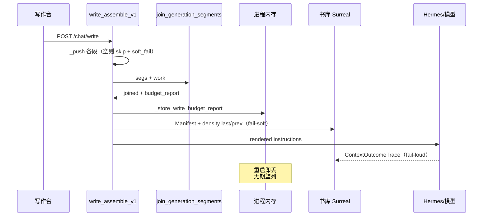
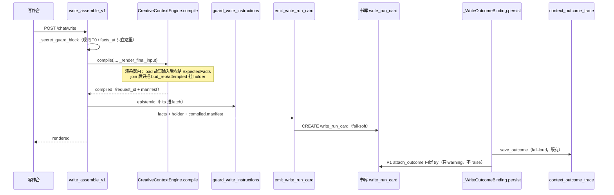

# 铜炉 Run 卡：期望 × 实际 × 质量（系统分析主账）

> **已被取代（2026-08-14）**  
> 本文不再是观测 SSOT。用户否定「只有运行结果」的 Run 卡主账。  
> 现行设计：[`docs/plans/2026-08-14-pipeline-analysis-log.md`](2026-08-14-pipeline-analysis-log.md)（逐步 `pipeline_log`）。`2026-08-14-pipeline-trace.md` 亦已降级。
> 本文保留：期望谓词、红绿对照尺、fail-soft、禁 prompt。卡降为链上 `contrast_summary`。

| 项 | 值 |
|----|----|
| **文档标题** | 写 / 存 / 宣称一次一张 Run 卡（期望 × 实际 × 质量） |
| **作者** | Grok Design |
| **日期** | 2026-08-13 |
| **状态** | **Superseded**（见 2026-08-14-pipeline-trace） |
| **产品** | 铜炉 / tonglu · 代码 `scribe3/` |
| **仓库** | `/home/admin/projects/scribe-writing-system` |
| **建议入库路径** | `docs/plans/2026-08-13-run-observability.md` |
| **验证** | **仅已部署 demo**（`tonglu.qing.blue` / `82.157.130.140` / `/opt/scribe3/app`）。禁止 Grok 运行机 `npm ci` / 全量 pytest / 本机 Surreal / 第二套库 |
| **运维 env SSOT** | **`/opt/scribe3/app/deploy/prod/.env`**（compose 目录相对 `env_file: .env`；容器 `working_dir=/opt/scribe3/app/deploy/prod`）。**不要**改 `/opt/scribe3/app/.env`（现网只有叙事小旗，不是 backend 进程环境），也**不要**改 `app/.env.production.local` |
| **关联** | 升窗 `docs/plans/2026-08-13-budget-context-optimal.md`；场面头 `scribe3/story_constraint_prompt.py`；注册表 `scribe3/injection_registry.py`；Outcome `scribe3/context_outcome.py` |

> **读法（工程师）**  
> 1. Key Decisions → Overview → 红/绿判定 → schema → 期望谓词表。  
> 2. P0 即可开工；P1–P3 按 PR Plan 独立合。  
> 3. 已裁事项不再出现在 Open Questions。

---

## Overview

现网写路径的观测是碎探针：`budget_report` 只活在进程内存（`get_last_write_budget_report()`），`soft_fail` 是全局计数，`/debug/injection-trace` 只有「最近一次」，`ContextOutcomeTrace` 只管模型成/败/用量/hash，`ContextTurnView` 只覆盖信封八块，章上 `density_trace` 只 last+prev。`SEGMENT_REGISTRY` 已是段目录，但从未和「这一次该不该进」对照。

本设计交付 **一书一库、按次落 Surreal 的 Run 卡**：一次写 / 存 / 宣称 = 一张卡。卡上每一行是：

```text
步骤 | 期望 | 实际 | 原因/质量
场面合同 | 要有 | 有 | 四义+痕迹
上章余烬 | 要有 | 有 | 字数/帽
前因后果 | 要有 | 空 | empty_story_causal   ← 该有却空 = 红
戏剧真空 | 不该有 | 无 | 有 goal 或 conflict，正确
招式     | 不该有 | 无 | 旗关，正确
```

期望 **事先** 由 `SEGMENT_REGISTRY`（36 条）+ 物理序 extra + 当时旗 + 章事实算出，禁止事后用 `*_injected` 反推「该不该」。红绿是分析尺：不该跑而没跑 = 绿；该跑而空/失败/被裁光 = 红。质量列回答「跑得好不好」（空喊合同、召回漏真名、燃料只剩标题、宣称 96k 是否真 96k），**不是**书评、**不是** 52 段文学分。

主真相是铜炉自己的卡，钉在该书 Surreal，用 `request_id` 与 Outcome 并列。Langfuse / Phoenix / SigNoz / hermes-otel / Hermes Dashboard **不是**主账本。

---

## Background & Motivation

### 分析员要回答的三句（本设计的产品合同）

| # | 问题 | 今日能否回答 | 卡上对应 |
|---|------|--------------|----------|
| 1 | 该跑什么？ | 不能。只有事后 `*_injected` / `*_skip_reason` | `rows[].expected` |
| 2 | 跑没跑？ | 半能。进程内最近一次；重启丢；对不上某次写 | `rows[].actual` + 落库 |
| 3 | 跑得好不好？ | 不能。density 只 last+prev；Outcome 不管 assemble 缺段 | `rows[].quality` + `quality` |

这 **不是** 合规审计（谁删用户、谁登录、谁改 setting）。那些账继续各过各的，本设计不吞并。

### 现网碎探针（2026-08-13 代码复核）

| 探针 | 锚点 | 缺什么 |
|------|------|--------|
| `budget_report` | `write_assemble_v1._render_final_input` join 后写入；`write_assemble._LAST_WRITE_BUDGET_REPORT` | 进程内存；无期望列；重启丢 |
| `*_injected` / `*_skip_reason` | 同文件 ~958–999：`narrative_contract` / `drama_vacuum` / `revision` / `avoid` / `seed_words` / `story_move` 等 | 只有实际+原因，没有「该不该」 |
| `record_write_soft_fail` | `write_assemble.py` 进程计数 | 对不上 `request_id` |
| `GET /debug/injection-trace` | `misc_routes.get_injection_trace` | 最近一次；无历史；无 `?work=` |
| `ContextOutcomeTrace` | `context_outcome.py`；`_WriteOutcomeBinding.persist` | 模型成/败/用量/hash；不管 assemble 少段 |
| `context_turn_bind` | 迁移 111；`ContextTurnView` | 信封八块 + selected/rejected；不是段期望 |
| `density_trace` | `density_trace_store.upsert_density_trace` | 章上 last+prev 两帧；不是一次运行 |
| `SEGMENT_REGISTRY` | `injection_registry.py` **36** 条（L43–80）；物理序另含 `identity` / `write_protocol` / `revision` / `continue_snapshot` / `benchmark_advisory` 等 extra | 目录在，对照从未做 |
| `audit_event` | 迁移 124 | 几乎只 hook `pilot_state` / `memory_item.status` |
| `auth_audit` / `setting_audit` | SQLite | 登录与设置，不是写路径 |
| `approval_audit` | 内存 500 条 | 审批环，不是本 goal |

### 一次写的真实时间线（今日）



分析员无法打开「第 16 章那一次写」看：场面合同该不该进、前因是否空、96k 是否撒谎。

### 痛点量化

- 典型写路径 `budget_report` 已有 20+ 个 `*_injected` / `*_skip_reason` 键，但 **零个** `*_expected`。
- `soft_fail` 计数跨请求累加：`empty_story_causal` +1 无法回到某次 `request_id`。
- demo 多 worker / 热更后 injection-trace 空，现场只能靠日志碰运气。
- Outcome 与 assemble 成功解耦：模型 `succeeded` 仍可能场面头根本没 push。

---

## Goals & Non-Goals

### Goals

| 优先级 | 目标 | 验收口径 |
|--------|------|----------|
| **P0** | 写路径 assemble 结束出卡；落该书 Surreal；`GET` 列表 + 单次；`/debug/injection-trace` 变成最近一张卡的别名或并列 | demo 写一次 → 书库能按 `request_id` 读回卡；重启后仍在；injection-trace 能看到同一张 |
| **P1** | 卡挂 Outcome（模型用量 / status 同一张纸）；窗档与 L2 `dropped` 进质量列 | 卡上同时有 `assemble_ok` 与 `outcome.status`；`quality.window` / `quality.l2` 可判 96k 诚实与燃料被裁 |
| **P2** | 存稿、宣称同一卡形状（`kind=save` / `kind=claim`） | 列表可按 kind 滤；行集合可不同，顶栏字段同构 |
| **P3** | 调试面时间线；作者主表面最多一行，不当工程墙 | 调试页能按章刷卡；作者栏一行「3 红 / 12 绿」可点进调试 |

### Non-Goals

| # | 非目标 | 理由 |
|---|--------|------|
| NG1 | HTTP 访问日志当审计 | 答不了三句；也不是本账 |
| NG2 | 存完整提示词 / 96k 正文 | 已裁；泄密 + 体积 |
| NG3 | 52 段文学分 / 书评 | 质量是分析尺 |
| NG4 | Langfuse / Phoenix / SigNoz / hermes-otel / Hermes Dashboard 当主账 | 已裁；最多以后补网关/工具跳 |
| NG5 | 扩 `context_outcome_trace` 当卡 | Outcome 是不可变窄合同（091/092 READONLY）；assemble 在模型前发生 |
| NG6 | 把 `auth_audit` / `setting_audit` / `audit_event` / `approval_audit` 收编为主路径 | 互不相认且答错问题 |
| NG7 | Grok 机 `npm ci` / 全量 pytest / 本机 Surreal / 第二套库 | 资源纪律 |
| NG8 | 作者主表面工程墙 / 把卡当 GATE 挡写 | 观测 fail-soft |
| NG9 | 另起观测栈或企业审计产品 | 一书一库即可 |

---

## Key Decisions

1. **主真相 = 铜炉自己的 Run 卡，按书落 Surreal，跟 `request_id` / Outcome 钉在一起。**  
   理由：分析员要按书、按章、按次回答三句。进程内存与外部 SaaS 都做不到「跟这本书的这一次写」对齐。Outcome 已有 `request_id`（`ContextRequest.request_id = uuid4().hex`），卡用同一枚钉子。

2. **新表 `write_run_card`，不扩 `context_outcome_trace`。**  
   理由：Outcome 是模型执行窄留痕（status / usage / hash），091/092 字段 READONLY + 三元组 UNIQUE，落库失败 **终止生成**（`_WriteOutcomeBinding.persist`）。卡是 assemble 观测、fail-soft、有 TTL、P2 还要覆盖存稿/宣称（那些路径甚至没有 Outcome）。并列用 `request_id` / 可选 `outcome_id`，禁止把两套合同焊成一张宽表。

3. **不是合规审计。**  
   理由：用户已裁。`auth_audit`（谁登录）、`setting_audit`、`audit_event`（pilot/memory hook）、`approval_audit`（内存 500）继续各过各的。本卡只服务系统分析。

4. **不要把 Langfuse / Phoenix / SigNoz / hermes-otel / Hermes Dashboard 当主账本。**  
   理由：它们看不见 `SEGMENT_REGISTRY` 期望谓词，默认还想收提示词，且不在书库事务里。最多 P3 以后用 `request_id` 做次优跳转（网关/工具 span）。

5. **不要存完整提示词。**  
   理由：已裁。卡只存段名、期望布尔、实际枚举、原因码、长度、digest、质量标量。`content_digest` 可有；正文、破绽词表、secret value 禁止入卡。

6. **期望必须事先算，且等于「assemble 会尝试 `_push`」的充要条件。**  
   理由：用 `*_injected` 反推会把「空合同没 push」标成「不该跑」。谓词必须复用现网门（phase / 焦点者 / `end_hook` / 旗），否则系统性假红。冻结点：故事输入已加载、燃料 `_push` 之前。

7. **红绿是对照函数，不是书评。**  
   「不该跑而没跑」绿；「该跑而空 / 失败 / L2 整段丢」红。质量另列（空喊、漏真名、标题还在内容被裁、窗档撒谎）。行红与质量差可同时存在。

8. **出卡 / 落库 / Outcome 卡补丁失败不得挡生成、不得挡存稿。**  
   观测主路径 fail-soft + 日志。现网 T0（`_secret_guard_block` 的 `facts_at`；`EpistemicLeakError`）保持原纪律，**禁止为出卡再打 `facts_at`**。P1 `attach_outcome` 不得写进 `persist()` 会 re-raise 的 try。

9. **旗 `SCRIBE3_RUN_CARD` 默认开。**  
   关旗：不落库、不跑重质量扫描；assemble / join / 生成字节不变。进程内 last report 仍可写（兼容 injection-trace）。

10. **读 API 与 injection-trace 同权：登录作者；跨书跟 L1 owner。**  
    `/debug/*` 今日不在 `_GLOBAL_PREFIXES`，走默认书归属。新接口必须带 `?work=`（或 path slug），走 `assert_user_may_access_work`。admin 可跨书。永不回传 prompt。

11. **验证 = 已部署 demo 冒烟。**  
    轻量过滤单测（纯函数、无 Surreal）可在 demo 机跑；Grok 机只读 + 编辑。

12. **P0 只接线写路径；存稿/宣称 P2 同形不同 `kind`。**  
    禁止 P0 顺手改 `save_chapter` / `assert_reader_claim` 主链。

---

## Proposed Design

### 1. 一句话架构

```text
_render_final_input：故事输入已加载后冻结 ExpectedFacts（事先算，不看 injected）
  → _push / join；bud_rep + attempted_names 只挂进程内 holder（此处不 CREATE）
compile() 返回（此时才有 compiled.manifest）
  → guard_write_instructions
  → 唯一一次 emit_write_run_card（request_id + manifest_id + actual_input_hash）
  → 进程内 last_card 供 /debug/injection-trace
  → （P1）模型终态 persist() 成功之后，另包 fail-soft attach_outcome（禁止 raise）
```

### 2. 目标时间线



### 3. 模块落点（禁止再开平行 assemble）

| 新/改 | 路径 | 职责 |
|-------|------|------|
| **新** | `scribe3/run_card.py` | **零 I/O 纯函数**：`ExpectedFacts`、`expected_for`、`skip_reason_for`、`classify_actual`、`row_verdict`、`build_run_card`、`summarize_verdict`。禁止 import store / `facts_at` |
| **新** | `scribe3/run_card_collect.py` | **有 I/O**：`collect_expected_facts(st, ...)`。只给 assemble 用；PR1 不写此文件 |
| **新** | `scribe3/run_card_store.py` | fail-soft 落库 / 列表 / 单次 / `purge_write_run_cards_older_than` / 进程内 last card。对标 `density_trace_store.py` |
| **新** | `scribe3/store/run_card_ops.py` | `SurrealStore` mixin：`CREATE ONLY type::record('write_run_card', $run_id)`（`$run_id` 纯 hex）/ SELECT / UPDATE outcome 补丁 / DELETE TTL |
| **新** | `scribe3/migrations/139_write_run_card.surql` | 一书一库 SCHEMAFULL。现网最新已落地编号为 **138**（`138_story_move.surql`）；实现前再 `ls scribe3/migrations \| tail`，若已有 139 则顺延 |
| **改** | `scribe3/store/surreal.py` | mixin 挂入 `SurrealStore` |
| **改** | `scribe3/api/services/write_assemble_v1.py` | 故事输入加载后冻结 facts；join 后只填 holder；**`compile()` + `guard_write_instructions` 之后**才 `emit_write_run_card` |
| **改** | `scribe3/api/services/write_stream.py` | P1：`persist()` 里 `save_outcome` **成功之后的内层 try** 调 `attach_outcome_to_run_card`；attach **禁止 raise** |
| **改** | `scribe3/api/routers/misc_routes.py` | `GET /debug/run-cards`、`GET /debug/run-cards/{run_id}`；`get_injection_trace(work: str = "main")` 并列最近卡（**必须带 annotations 再 rebind**） |
| **改** | `scribe3/feature_flags.py` | 注册 `SCRIBE3_RUN_CARD`（默认 `"1"`） |
| **改** | `scribe3/run_card_store.py` + `POST /debug/run-cards/purge` | P0 只保证手动 purge；自动清见 §TTL，不暗示表自己过期 |
| **改 P2** | `misc_routes.save_chapter`、`write.reader_claim_ep` | 同形卡 `kind=save\|claim`（见 §P2 行表） |
| **改 P3** | `scribe3/web/src/api.js` + 小调试面 | `runCards` / `runCard`；作者栏一行 |

不改：`join_generation_segments` 裁剪算法、信封预算、`SEGMENT_REGISTRY` 物理序、Outcome 不可变合同。

### 4. 出卡时机（P0 写路径）— 单一时间线

对照 `write_assemble_v1.py` 现网顺序（禁止再写「join 后已有 compiled」）：

| 步 | 代码位置 | 有什么 | 做什么 |
|----|----------|--------|--------|
| 1 | L154–157 `_secret_guard_block` | `facts_at`（现网 **唯一** T0 查库）；返回值可含「本章揭示」**或**「破绽词硬约束」 | 算完 `_secret_guard_txt` 后写入 `holder["secret_guard_nonempty"] = bool(_secret_guard_txt.strip())`（**与 `_push` 同口径**）。可选另记 `has_unpublished_markers = "破绽词" in txt` 供质量列。**禁止再打 `facts_at`** |
| 2 | L250 `_render_final_input` 开头 | 尚无 `compiled` | 只 `_push` identity/prefix… |
| 3 | L287–317 `load_chapter_story_inputs` 之后、燃料 `_push` 之前 | 故事输入已在内存 | **冻结** `ExpectedFacts`（`collect_expected_facts`，有 I/O 但复用本次已加载的 `_inputs` / holder，不重查 secret） |
| 4 | L907 `join_generation_segments` | `bud_rep` | 把 `report` / `attempted_names` / 燃料 `empty_story_*` skip 补进 holder。**此处禁止 CREATE** |
| 5 | L1025–1048 `ContextRequest` + `compile(...)` | `compile` **返回后**才有 `compiled` | 取 `compiled.request.request_id`、`compiled.manifest.manifest_hash`、`compiled.manifest.actual_input_hash` |
| 6 | L1235–1256 `guard_write_instructions` | epistemic hits | 写入 `latch` |
| 7 | `return rendered` **之前** | 上述全部齐 | **唯一一次** `emit_write_run_card` |

`request_id` 只来自 `compiled.request.request_id`（与 L1026 `uuid.uuid4().hex` 同一对象）。测试若绕过 Engine、没有 `compiled`：卡仍建，`request_id=None`，`run_id` 用纯 hex `sha256(work|chapter|kind|clock_ns)[:24]`，并记 `quality.notes=["no_request_id"]`。

`emit_write_run_card` 伪代码：

```python
def emit_write_run_card(*, st, work, chapter, phase,
                        facts: ExpectedFacts, bud_rep: dict,
                        attempted_names: set[str],
                        segs_after_join: list[dict],
                        request_id: str | None,
                        manifest_id: str | None,
                        actual_input_hash: str | None,
                        latch: dict | None = None,
                        recall_text: str | None = None) -> dict | None:
    if not run_card_enabled():          # 关旗：零 I/O，含不跑质量扫描、不 CREATE
        return None
    t0 = time.monotonic()
    try:
        card = build_run_card(
            facts=facts, bud_rep=bud_rep,
            attempted_names=attempted_names,
            request_id=request_id, manifest_id=manifest_id,
            actual_input_hash=actual_input_hash, latch=latch,
            recall_text=recall_text,   # 仅内存；扫完即丢
        )
        persist_run_card(st, card)      # fail-soft
        remember_last_run_card(card)
        return card
    except Exception as e:
        logging.getLogger("scribe3.run_card").warning(
            "emit_write_run_card fail-soft work=%s ch=%s: %s", work, chapter, e,
            exc_info=True,
        )
        return None
    finally:
        dt = (time.monotonic() - t0) * 1000
        logging.getLogger("scribe3.run_card").info(
            "run_card_emit_ms=%.1f work=%s ch=%s", dt, work, chapter,
        )
```

预算：含扫描 + 单次 CREATE 的 **p95 &lt; 50ms**；超时/失败丢弃，不重试。纯函数 `build_run_card` 目标 &lt; 5ms。

**禁止**把 `emit` 放进 `_push` 循环。**禁止**在 `join_generation_segments` 内出卡。**禁止**在 join 后、`compile()` 返回前 CREATE（那时没有 `manifest_id`）。**禁止**出两张卡。

### 5. 期望必须事先算

`collect_expected_facts` **有 I/O**，家在 `scribe3/run_card_collect.py`（或 `write_assemble_v1` 内私有函数），**不要**放进号称零 I/O 的 `run_card.py`。

冻结点：**`load_chapter_story_inputs` 已返回、燃料 `_push` 之前**（约 L287–317）。不必早于 identity `_push`。只读章 / 旗 / 本次已加载的 `_inputs` / holder，不读 `*_injected`。

```python
@dataclass(frozen=True)
class ExpectedFacts:
    work: str
    chapter: int
    phase: str                         # 原始
    normalized_phase: str              # strip().lower()
    with_tools: bool
    is_revision: bool
    has_focalizer: bool                # bool((focalizer or "").strip())
    # 章事实
    contract_has_scene: bool          # contract_has_scene_fields
    contract_field_present: tuple[str, ...]  # 非空的 desire/obstacle/turn/cost
    trace_count: int                  # evidence_must_show 条数
    has_prev_chapter: bool            # chapter > 1 且 get_chapter(n-1) 存在
    prev_end_hook: bool               # 上章 narrative_drive.end_hook 非空
    beats_has_goal: bool
    beats_has_conflict: bool
    should_drama_vacuum: bool         # should_inject_drama_vacuum(beats)
    secret_guard_nonempty: bool       # holder：bool(_secret_guard_txt.strip())，与 _push 同口径
    has_unpublished_markers: bool     # 可选：块含「破绽词」硬约束；只给质量列，不驱动期望
    has_synopsis: bool
    has_beats: bool
    has_seed_words: bool
    has_volume_intro: bool
    has_brief_must: bool
    has_pressure_drive: bool
    has_author_prefs: bool
    has_voice_anchor: bool
    has_purpose: bool
    has_materials: bool
    has_reference_briefs: bool
    has_storyline_meta: bool
    has_discourse: bool
    has_deduction: bool
    has_scene_truth: bool
    has_extra_instructions: bool
    has_craft_rules: bool
    reread_ok: bool                   # ack 或未要求重读
    # 旗 / 计划
    registry_mode: str
    move_library: bool
    move_plan_approved: bool          # approved ∧ validation.ok
    narrative_engine: bool
    drama_vacuum_flag: bool
    storyline_inject: bool
    discourse_advisory: bool
    structure_diversity: bool
    volume_intro_flag: bool
    benchmark_inject: bool            # SCRIBE3_BENCHMARK_INJECT / benchmark_inject_enabled()
    envelope_v2: bool
    novel_wide: bool
    prompt_hard: int
    prompt_hard_profile: str
    supplemental_soft: int
    supplemental_hard: int
    model_context_window: str
```

实现约束：

- 复用已加载的 `_inputs`（`load_chapter_story_inputs` 本次返回值）以及 `contract_has_scene_fields` / `should_inject_drama_vacuum` / `is_revision_request` / `plan_from_chapter` + `validate_story_move_plan` / `resolve_write_caps(work)`。禁止复制第二套四义谓词。
- **`facts_at` 的 T0 只属于 `_secret_guard_block`（L154）。出卡禁止再打 `facts_at`。** `secret_guard_nonempty` / `has_unpublished_markers` 只读 holder（由已算出的 `_secret_guard_txt` 派生）。secret_guard 查库失败仍按现网上抛；collect 不会成为第二故障面。
- 旗读取走 `feature_flags.get_flag` / 既有 `*_enabled()`（含 `benchmark_inject_enabled`），禁止另开口径。

### 6. 红 / 绿判定（可单测纯函数）

现网 `budget_report` **没有**统一 `skip_reason` map。必须用表驱动取出；燃料空原因今日只进 `record_write_soft_fail`，**出卡前 assemble 必须补进 `bud_rep`**，禁止读全局计数。

```python
# run_card.py — 与 write_assemble_v1 现网键对齐
_SKIP_KEYS: dict[str, tuple[str, ...]] = {
    "narrative_contract": ("narrative_contract_skip_reason",),
    "revision": ("revision_skip_reason",),
    "write_protocol": ("write_protocol_skip_reason",),
    "avoid": ("avoid_skip_reason",),
    "phase_role": ("phase_role_skip_reason",),
    "revelation_discipline": ("revelation_skip_reason",),  # 不是 revelation_
    "seed_words": ("seed_words_skip_reason",),
    "volume_intro": ("volume_intro_skip_reason",),
    "request_constraint": ("request_constraint_skip_reason",),
    "continue_snapshot": ("continue_snapshot_skip_reason",),
    "story_move": ("story_move_skip",),
    "story_ember": ("story_ember_skip_reason",),
    "story_recall": ("story_recall_skip_reason",),
    "story_causal": ("story_causal_skip_reason",),
}

def skip_reason_for(name: str, bud_rep: dict) -> str | None:
    for k in _SKIP_KEYS.get(name, ()):
        v = bud_rep.get(k)
        if v:
            return str(v)
    nested = {
        "storyline_polish": bud_rep.get("storyline_inject") or {},
        "discourse_soft": bud_rep.get("discourse_soft") or {},
        "story_move": bud_rep.get("story_move") or {},
    }.get(name)
    if isinstance(nested, dict) and nested.get("skip_reason"):
        return str(nested["skip_reason"])
    return None


def dropped_tags(*lists: list[str]) -> list[str]:
    """l2.dropped ∪ total_enforce.dropped。"""
    out: list[str] = []
    for lst in lists:
        out.extend(lst or [])
    return out


ActualKind = Literal["present", "empty", "absent", "dropped", "failed"]
Verdict = Literal["green", "red"]

_FULL_DROP_SUFFIXES = (":drop", ":prompt_hard_drop", ":total_drop")
_HALF_SUFFIXES = (":tail_half", ":keep_beats", ":total_half")

def classify_actual(
    name: str,
    *,
    domain_lengths: dict[str, int],
    skip_reason: str | None,
    dropped: list[str],          # L2 ∪ O1
    attempted_names: set[str],   # join **前**尝试过的域名（空串也记）
) -> tuple[ActualKind, str]:
    tags = [d for d in dropped if d == name or d.startswith(name + ":")]
    full = any(d == name or any(d.endswith(s) for s in _FULL_DROP_SUFFIXES) for d in tags)
    half = any(any(d.endswith(s) for s in _HALF_SUFFIXES) for d in tags)
    n = int(domain_lengths.get(name) or 0)
    if full:
        return "dropped", tags[0] if tags else f"{name}:drop"
    if skip_reason and skip_reason.endswith("_error"):
        return "failed", skip_reason
    if n > 0:
        return "present", "half_cut" if half else "injected"
    if name in attempted_names or (skip_reason or "").startswith("empty_"):
        return "empty", skip_reason or "empty"
    return "absent", skip_reason or "not_pushed"


def row_verdict(expected: bool, actual: ActualKind) -> Verdict:
    """该跑而空/失败/整段丢 = 红；不该跑而没跑 = 绿；不该跑却进了 = 红。"""
    if expected:
        return "green" if actual == "present" else "red"
    if actual in ("absent", "empty", "dropped", "failed"):
        return "green"
    return "red"


def card_verdict(rows: list[RunCardRow]) -> Verdict:
    return "red" if any(r.verdict == "red" for r in rows) else "green"
```

`attempted_names` 约定：assemble 对某段调用 `_push` 之前就把 name 记入 set（**空串也记**）。`_push` 对空串直接 return、不入 `segs`；若用 join **后** `segment_names` 当 attempted，被裁段会变成 `absent`，和「空」分不清。

燃料：`collect_story_fuel_segments` 空段时，出卡前写：

```python
bud_rep["story_ember_skip_reason"] = "empty_story_ember"   # 若未注入
bud_rep["story_recall_skip_reason"] = "empty_story_recall"
bud_rep["story_causal_skip_reason"] = "empty_story_causal"
```

半裁（`tail_half` / `keep_beats` / `total_half`）且 `domain_lengths>0`：行 **绿**，质量列 `trimmed`。整段 `drop` / `prompt_hard_drop` / `total_drop` 且期望为真：红。

`summarize_verdict(rows) -> {green, red, unexpected_present, missing_required}` 供列表摘要与作者一行。

### 7. 期望谓词表

`expected_for(name, facts: ExpectedFacts) -> tuple[bool, str]`。每一行 = **assemble 会尝试 `_push` 的充要条件**（对照 `write_assemble_v1._render_final_input`），不是「文学上该有」。`len(SEGMENT_REGISTRY) == 36` 由 PR1 单测锁住。

**A. 注册表段（36 条）**

| name | expected 当且仅当 | expected_reason（真 / 假） |
|------|-------------------|----------------------------|
| `prefix` | 恒真（anti_slop + 章号） | `always_l0` |
| `secret_guard` | **`facts.secret_guard_nonempty`**（`bool(_secret_guard_txt.strip())`）。`_secret_guard_block`（`prompt_blocks.py` L254–268）在 **仅有 `revealed_labels`、无 unpublished `leak_markers`** 时仍产出「【核心悬念·本章揭示】」非空串；assemble L276 无条件 `_push`，空串才跳过。因此：无私密空块 → 期望假 = 绿；仅揭示章 / 有破绽词 → 期望真。**禁止**用「仅有未揭示破绽词」当期望（会把揭示段标成 unexpected_present）。禁止写「恒真 / always_l0」 | `secret_guard_nonempty` / `secret_guard_empty` |
| `focalizer` | 恒真 | `always_l0` |
| `structure_diversity` | `facts.structure_diversity` | `flag_on` / `flag_off` |
| `narrative_contract` | `facts.contract_has_scene` | `has_scene_fields` / `no_scene_fields` |
| `story_ember` | **`facts.prev_end_hook`**（`load_chapter_story_inputs` 只在上章 `narrative_drive.end_hook` 非空时才有余烬）。第 2 章无 hook → 期望假 = 绿。禁止只用 `has_prev_chapter` | `prev_end_hook` / `no_end_hook` |
| `story_recall` | 恒真（写路径总尝试世界此刻） | `write_always_recall` |
| `story_causal` | `facts.has_prev_chapter` | `has_prev_chapter` / `first_chapter`。**故意**与余烬不同口径：有上章却空 = 红（`empty_story_causal`） |
| `event_drive` | `facts.narrative_engine and not facts.contract_has_scene` | `engine_no_scene` / `scene_uses_hook_or_engine_off` |
| `event_drive_hook` | `facts.narrative_engine and facts.contract_has_scene` | `engine_scene_hook` / `no_hook` |
| `drama_contract` | 恒真 | `always_l0` |
| `drama_vacuum` | `facts.drama_vacuum_flag and facts.should_drama_vacuum` | `no_goal_and_conflict` / `has_gcd_or_flag_off`。`should_inject` = **无实质 goal 且无实质 conflict**（有一个就不注入） |
| `outline` | `facts.has_synopsis or facts.has_beats` | `has_outline_src` / `empty_outline_src` |
| `envelope` | 恒真 | `always_l1` |
| `codex` | `facts.envelope_v2` | `envelope_v2` / `v1` |
| `seed_words` | `facts.has_seed_words` | `seeds_present` / `no_seeds` |
| `craft` | `facts.has_craft_rules` | `has_craft_rules` / `no_craft_rules` |
| `phase_role` | `facts.normalized_phase` 非空且有对应块 | `phase_set` / `no_phase` |
| `avoid` | 恒 **假**（现网默认 omit） | `default_omit` |
| `revelation_discipline` | **`facts.has_focalizer`**（`_revelation_discipline_block` 无焦点者恒返空）。与未揭示秘密无关。clip 后 `revelation_echo_core` 空 = **实际 empty**，期望仍真 → 红 | `has_focalizer` / `no_focalizer` |
| `sincerity` | 恒 **假**（已并入 anti_slop） | `merged_into_prefix` |
| `purpose` | `facts.has_purpose` | `has_purpose` / `no_purpose` |
| `volume_intro` | `facts.volume_intro_flag and facts.has_volume_intro` | `vol_intro` / `no_vol_intro` |
| `brief_must` | `facts.has_brief_must` | `has_brief` / `no_brief` |
| `pressure_drive` | `facts.has_pressure_drive` | `has_pd` / `no_pd` |
| `author_prefs` | `facts.has_author_prefs` | `has_prefs` / `no_prefs` |
| `voice_anchor` | `facts.has_voice_anchor` | `has_voice` / `no_voice` |
| `reference_craft` | `normalized_phase in {draft,final} and facts.has_reference_briefs` | `ref_briefs` / `no_ref_or_wrong_phase` |
| `storyline_polish` | `facts.storyline_inject and facts.has_storyline_meta` | `sl_meta` / `sl_off_or_empty` |
| `discourse_soft` | `facts.discourse_advisory and facts.has_discourse` | `discourse_on` / `discourse_off` |
| `story_move` | `facts.move_library and facts.move_plan_approved` | `move_approved` / `flag_off_or_plan_missing` |
| `deduction_final` | **`normalized_phase in {draft,final} and facts.has_deduction`**（L725–766；plan/deduce 不 `_push`） | `draft_final_deduction` / `wrong_phase_or_no_deduction` |
| `material_recall` | **`normalized_phase in {draft,final} and facts.has_materials`**（L725–774） | `draft_final_materials` / `wrong_phase_or_no_materials` |
| `final_reminder` | 恒真 | `always_l0` |
| `scene_truth_proj` | **`normalized_phase == "deduce"`**（L777–790；draft/final 有场景真相也不 push） | `phase_deduce` / `not_deduce` |
| `request_constraint` | `facts.has_extra_instructions` | `has_extra` / `no_extra` |

**B. 注册表外、assemble 会 `_push` 的 extra（必须入卡）**

| name | expected | 说明 |
|------|----------|------|
| `identity` | 真 | `_editor_identity_block()` 恒有 |
| `write_protocol` | 真 | 现网短核协议；空则 skip，红 |
| `revision` | `facts.is_revision` | 非改稿不该有 = 绿 |
| `continue_snapshot` | `facts.reread_ok` | 未 ack 且要求重读 → 期望假 |
| `tool_scope` | `facts.with_tools` | 关工具不该有 |
| `craft_skills_index` | `facts.with_tools` | 同上 |
| `benchmark_advisory` | **`normalized_phase in {draft,final} and facts.benchmark_inject`**（L739–753；旗默认 `"0"`。漏登则会「未登记却 present → 红」） | `bench_on` / `bench_off_or_wrong_phase` |
| `prefix` 子件 | 不单列 | `prefix` 行只代表 anti_slop+章号 |

未在 A∪B、却出现在 `domain_lengths` 的名字：期望假，`expected_reason=unregistered`；若 `present` → 红。

PR1 必须锁的样例（防假红）：

1. 招式旗关 → `story_move` 期望假、实际 absent = 绿  
2. 有 goal **或** conflict → `drama_vacuum` 期望假 = 绿  
3. 第 1 章 → `story_causal` 期望假；`story_ember` 期望假  
4. 第 2 章、无 `end_hook` → `story_ember` 期望假 = 绿；`story_causal` 仍期望真  
5. `phase=deduce`、章有 scene_truth → `scene_truth_proj` 期望真；`deduction_final` / `material_recall` 期望假  
6. `phase=draft`、无焦点者 → `revelation_discipline` 期望假（即使有未揭示秘密）  
7. 无秘密命题、`_secret_guard_txt` 空 → `secret_guard` 期望假  
8. `SCRIBE3_BENCHMARK_INJECT=1` + draft → `benchmark_advisory` 期望真，不得 unregistered 红  
9. **仅揭示章**：有 `revealed_labels`、无 unpublished `leak_markers` → `secret_guard` **期望真**（块非空会 `_push`），不得 unexpected_present。`has_unpublished_markers` 可为假（质量列）

### 8. 质量尺（分析，不是书评）

质量在 `build_quality(...)` 里算，写入卡顶栏 `quality` 与相关 `rows[].quality`。P0 必须落地前四项；窗档/L2 与 Outcome 分列可在 P0 先占位、P1 填实。

| 尺 | 判定 | 写入 | 红？ |
|----|------|------|------|
| **合同空喊** | `contract_has_scene` 但任一四义命中 `narrative_contract._is_slogan_or_placeholder` 或 `is_drive_template_turn`；或 `trace_count==0` | `quality.contract = {slogan: bool, missing_traces: bool, fields: [...]}`；行 `narrative_contract.quality` | 行仍按期望×实际；空喊只进质量，**另计** `quality.flags` 含 `contract_slogan`（列表可滤）。不把「有段但空喊」改成行红——行红留给空/失败 |
| **召回漏秘密真名** | 只扫 **join 后** 仍在的 `story_recall` 内存文本（裁掉则扫不到，诚实）。硬顶前 **4000** 字，超出记 `quality.recall.truncated=true`。同口径 marker 扫描；只存 `hit_count`，不存 marker 明文。关旗不扫描 | `quality.recall = {secret_hit_count: int, truncated: bool, scanned_chars: int}` | `hit_count>0` → 质量红旗 `recall_secret_leak` |
| **燃料标题还在内容被裁光** | `story_*` 文本在 `format_story_fuel_parts` 标题之后 body 去空白长度 &lt; 8；或 `domain_lengths[name] &lt;= len(标题)+2` | `rows[story_*].quality = {title_only: bool, chars, cap}` | `title_only` 且期望真 → **行红**（等价于空） |
| **宣称 96k 是否真 96k** | `prompt_hard_profile=="novel_96k"` 当且仅当 `prompt_hard==96000` 且 `novel_wide` 且 `supplemental_hard==36000`（现网 `resolve_write_caps`） | `quality.window = {profile, prompt_hard, supplemental_hard, novel_wide, honest: bool}` | `honest==false` → 质量红旗 `window_lie` |
| **L2 dropped**（P1 填实） | `bud_rep["l2"]["dropped"]` 原样 + 按段聚合 | `quality.l2 = {dropped: [...], effective_l2_cap, l2_est, soft_exceeded}` | 期望真且整段 drop → 已由 `row_verdict` 变红 |
| **门闩警告条数**（P1/P2） | write：epistemic hits 数（scrub 后仍记）。save/claim：`evaluate_save_craft_gate.warnings` + finalize `advisory_items` | `quality.latch = {count, kinds: [...]}` | 只计数，不挡 |
| **Outcome vs assemble**（P1） | `assemble_ok=true` 与 `outcome.status` 分开 | `outcome_status` / `assemble_ok` 顶栏 | 模型失败 ≠ assemble 失败；列表可双色 |
| **secret_guard 形态**（不改行红） | 由 holder：`has_unpublished_markers` vs 仅揭示 | `rows[secret_guard].quality = {reveal_only: bool}` | 仅揭示章行仍绿；不把「本章揭示」当成漏防 |

**禁止**：把 `signal_density_proxy`（分子含已合并的 sincerity、不含场面头）当告警尺。戏剧密度继续用 `density_trace.drama_core_share`（已有设计 KD），卡上只 **引用** slim density，不另发明 KPI。

扫描召回文本时：在内存做完即丢正文。卡 JSON **不得** 带 `text` / `instructions` / `markers` 明文。关旗 `SCRIBE3_RUN_CARD=0` 时 `emit` 第一行 return，**含不跑扫描、不 CREATE**。

### 9. 进程内 last card（injection-trace）

对标 `_LAST_WRITE_BUDGET_REPORT`：

```python
# run_card_store.py
_LAST_RUN_CARD: dict = {}
_LOCK = threading.Lock()

def remember_last_run_card(card: dict) -> None: ...
def get_last_run_card() -> dict: ...
```

`get_injection_trace` 改为：

```python
def get_injection_trace(work: str = "main"):
    """对照 get_debug_audit_log(work: str = "main")。必须保留 annotations，
    rebind 的 FunctionType 只有拷了 __annotations__ FastAPI 才认 query。"""
    last_rep = get_last_write_budget_report() or {}
    last_card = get_last_run_card()
    persisted = None
    try:
        persisted = latest_run_card(_store_for(work), work=work, kind="write")
    except Exception:
        persisted = None
    # 有 ?work=：优先该书库 latest。无显式 work 时中间件仍会用默认 slug 做 L1；
    # handler 默认 "main"。OQ4：若库空则回落本进程 last，并在 note 写清。
    card = persisted or last_card or None
    if not last_rep:
        last_rep = build_budget_report(work=work)
    src = "db" if persisted else ("memory" if last_card else None)
    return {
        "surface": "debug.injection_trace",
        "work": work,
        "registry_mode": (card or last_rep).get("registry_mode"),
        "budget_report": last_rep,
        "run_card": _public_card(card) if card else None,
        "run_card_source": src,
        "note": (
            "run_card 为期望×实际×质量；budget_report 并列。永不回传 prompt。"
            f" source={src}；无 work 时为默认书+本进程 last。"
        ),
    }
```

旧前端只读 `budget_report` 不炸。P3 再让 `api.js` 认 `run_card`。

---

## API / Interface Changes

### 鉴权（P0 必须与现网一致）

| 规则 | 实现 |
|------|------|
| 未登录 | `SCRIBE3_AUTH_ENABLED=1` 时中间件 401（与 injection-trace 相同） |
| 跨书 | 必须 `?work=<slug>`；`resolve_effective_work` → `assert_user_may_access_work`；非 owner 403；不存在 404 |
| admin | `user_owns_work` 已放行 admin |
| 省略 work | 回落 `SCRIBE3_WORK`/`main` 并 **仍做归属**（禁止靠省略读他人书） |
| 响应 | 永不含 `instructions` / 段正文 / secret value / leak_markers 明文 |

`/debug/injection-trace` 今日无 `work` 形参。P0 改成 **`work: str = "main"`**（与 `get_debug_audit_log` 同款，**必须带 annotations**）。rebind：

```python
_re = types.FunctionType(_fn.__code__, core.__dict__, 'get_injection_trace',
                         _fn.__defaults__, _fn.__closure__)
if _fn.__annotations__:
    _re.__annotations__ = dict(_fn.__annotations__)
```

PR3 demo 冒烟：带 `?work=<他人书>` 应 403；OpenAPI 上该参数为 query。忘拷 annotations 时 FastAPI 不认 query，中间件仍用 `?work=` 做 L1，handler 却读默认书内存卡——必须测出来。

### 新路由

挂在 `misc_routes` 现有 debug 注册表旁（`router.add_api_route` 同款 rebind）。

```text
GET /debug/run-cards?work=&chapter=&kind=&verdict=&limit=20
GET /debug/run-cards/{run_id}?work=
POST /debug/run-cards/purge?work=          # 可选，对标 /debug/audit-purge
```

**列表响应**（无段正文）：

```json
{
  "ok": true,
  "work": "shu_xxx",
  "surface": "debug.run_cards",
  "count": 2,
  "items": [
    {
      "run_id": "a1b2c3d4e5f6789012345678",
      "request_id": "e3b0…",
      "outcome_id": null,
      "kind": "write",
      "chapter": 16,
      "phase": "draft",
      "created_at": "2026-08-13T12:00:00Z",
      "verdict": "red",
      "summary": {"green": 28, "red": 2, "missing_required": ["story_causal", "narrative_contract"]},
      "assemble_ok": true,
      "outcome_status": null,
      "prompt_hard_profile": "novel_96k",
      "quality_flags": ["empty_required"]
    }
  ]
}
```

**单次响应**：上表 + `rows[]` + `quality` + `facts_digest`（布尔/计数，无正文）+ `l2`。

`limit` 默认 20，硬顶 100。`kind` ∈ `write|save|claim`。`verdict` ∈ `red|green`。

### 写路径对外不变

`POST /chat/write` 响应不强制带整卡。P3 可在 SSE `done` 帧加一行：

```json
{"run_card": {"run_id": "a1b2…", "verdict": "red", "red": 2}}
```

作者主表面最多消费这一行。缺省不展示工程表。

---

## Data Model Changes

### 为何新表而不是扩 Outcome / 章字段 / audit_event

| 方案 | 否决原因 |
|------|----------|
| 扩 `context_outcome_trace` | 091/092 READONLY；合同是模型三元组；assemble 在模型前；存稿无 Outcome；落库失败会挡生成 |
| 章上 JSON 像 `density_trace` | 只 last+prev，丢历史；一次章多次写会互相覆盖 |
| `audit_event` | SCHEMALESS hook 表；现只 pilot/memory；TTL 语义是合规向 |
| `ai_run_trace` | 074 含 `instructions` / `input_text` 字段（Hermes Runs 链）；本卡禁止提示词；不要混写 |

### 迁移 `139_write_run_card.surql`（建议正文）

一书一库。`apply_schema` 按 `f.stem` 去重，必须新文件。STYLE 对齐 111 / 091：SCHEMAFULL、IF NOT EXISTS、无正文。

```surql
-- 139_write_run_card.surql · 写/存/宣称 Run 卡（期望×实际×质量）
-- 不含提示词正文 / secret value / leak_markers 明文。
DEFINE TABLE IF NOT EXISTS write_run_card SCHEMAFULL;

DEFINE FIELD IF NOT EXISTS run_id ON write_run_card TYPE string;
DEFINE FIELD IF NOT EXISTS work ON write_run_card TYPE string;
DEFINE FIELD IF NOT EXISTS chapter ON write_run_card TYPE int;
DEFINE FIELD IF NOT EXISTS kind ON write_run_card TYPE string
  ASSERT $value IN ['write', 'save', 'claim'];
DEFINE FIELD IF NOT EXISTS phase ON write_run_card TYPE option<string>;
DEFINE FIELD IF NOT EXISTS request_id ON write_run_card TYPE option<string>;
DEFINE FIELD IF NOT EXISTS manifest_id ON write_run_card TYPE option<string>;
DEFINE FIELD IF NOT EXISTS actual_input_hash ON write_run_card TYPE option<string>;
DEFINE FIELD IF NOT EXISTS outcome_id ON write_run_card TYPE option<string>;
DEFINE FIELD IF NOT EXISTS outcome_status ON write_run_card TYPE option<string>;
DEFINE FIELD IF NOT EXISTS outcome_usage ON write_run_card TYPE option<object> FLEXIBLE;
DEFINE FIELD IF NOT EXISTS assemble_ok ON write_run_card TYPE bool;
DEFINE FIELD IF NOT EXISTS verdict ON write_run_card TYPE string
  ASSERT $value IN ['green', 'red'];
DEFINE FIELD IF NOT EXISTS summary ON write_run_card TYPE object FLEXIBLE;
DEFINE FIELD IF NOT EXISTS rows ON write_run_card TYPE array;
DEFINE FIELD IF NOT EXISTS rows.* ON write_run_card TYPE object FLEXIBLE;
DEFINE FIELD IF NOT EXISTS quality ON write_run_card TYPE object FLEXIBLE;
DEFINE FIELD IF NOT EXISTS facts ON write_run_card TYPE object FLEXIBLE;
DEFINE FIELD IF NOT EXISTS caps ON write_run_card TYPE object FLEXIBLE;
DEFINE FIELD IF NOT EXISTS l2 ON write_run_card TYPE object FLEXIBLE;
DEFINE FIELD IF NOT EXISTS density ON write_run_card TYPE option<object> FLEXIBLE;
DEFINE FIELD IF NOT EXISTS quality_flags ON write_run_card TYPE array;
DEFINE FIELD IF NOT EXISTS quality_flags.* ON write_run_card TYPE string;
DEFINE FIELD IF NOT EXISTS schema_ver ON write_run_card TYPE string;
DEFINE FIELD IF NOT EXISTS created_at ON write_run_card TYPE datetime VALUE time::now() READONLY;

DEFINE INDEX IF NOT EXISTS write_run_card_id_idx ON write_run_card FIELDS run_id UNIQUE;
DEFINE INDEX IF NOT EXISTS write_run_card_request_idx ON write_run_card FIELDS request_id;
DEFINE INDEX IF NOT EXISTS write_run_card_work_ch_idx ON write_run_card FIELDS work, chapter, created_at;
DEFINE INDEX IF NOT EXISTS write_run_card_kind_idx ON write_run_card FIELDS kind, created_at;
DEFINE INDEX IF NOT EXISTS write_run_card_created_idx ON write_run_card FIELDS created_at;
```

**可变字段**：仅 `outcome_id` / `outcome_status` / `outcome_usage` 允许 P1 `UPDATE`（模型结束后补丁）。其余 CREATE 后不改。不要对整行 READONLY——否则 Outcome 补丁要第二张表。

### `run_id` 生成（禁止 `rc:` 冒号）

现网 mixin 惯例是 `CREATE ONLY type::record('<table>', $id)`，id 为 **纯 hex**（`outcome_id` 即 sha256 hex）。`type::record('write_run_card', 'rc:ab12…')` 会被第二枚冒号拆成非法 record。`GET /debug/run-cards/{run_id}` 带冒号也增加网关编码负担。`mt:` 前缀只活在**字符串字段**，不是主键。

```python
run_id = sha256(
    f"{work}\0{kind}\0{request_id or ''}\0{chapter}\0{created_ns}".encode()
).hexdigest()[:24]          # 仅 [0-9a-f]，无冒号、无 rc:
# 展示层若要前缀：API 可回 display_id="rc:"+run_id，handler 剥掉后再查。
# mixin 主键只用纯 hex。
```

```python
# store/run_card_ops.py
self._execute_write(
    "CREATE ONLY type::record('write_run_card', $run_id) SET run_id=$run_id, ...",
    {"run_id": run_id, **fields},
)
# 查询：WHERE run_id=$run_id 或 type::record('write_run_card', $run_id)
```

有 `request_id` 时同一请求重试出卡：先按 `request_id+kind` 查，存在则跳过 CREATE（幂等）。

### 行 JSON（`rows.*`）

```python
{
  "name": "story_causal",
  "tier": "L2",                 # 来自 SEGMENT_REGISTRY；未登记 = "extra"
  "expected": True,
  "expected_reason": "has_prev_chapter",
  "actual": "empty",            # present|empty|absent|dropped|failed
  "actual_reason": "empty_story_causal",
  "chars": 0,
  "digest": None,               # 有文本则 sha256 hex；无则 null
  "verdict": "red",
  "quality": {"title_only": False, "cap": 2500}
}
```

`digest` 是段字节哈希，便于对拍「同一期望是否换了内容」，**不能**反推正文。

### `facts` / `caps` 存什么

只存 `ExpectedFacts` 的布尔与计数 + `resolve_write_caps` 的数字。禁止把 `end_hook` 原文、合同四义原文写入 `facts`。

### Store mixin 形状

```python
# store/run_card_ops.py
class RunCardOpsMixin:
    def create_only_write_run_card(self, run_id: str, fields: dict) -> None: ...
    def get_write_run_card(self, run_id: str) -> dict | None: ...
    def get_write_run_card_by_request(self, request_id: str, kind: str = "write") -> dict | None: ...
    def list_write_run_cards(self, *, chapter=None, kind=None, verdict=None, limit=20) -> list[dict]: ...
    def update_write_run_card_outcome(self, request_id: str, *, outcome_id, status, usage) -> None: ...
    def purge_write_run_cards_older_than(self, days: int) -> None: ...
```

挂入 `store/surreal.py` 的 `SurrealStore(...)` mixin 列表，紧挨 `ContextOpsMixin`。

TTL：`SCRIBE3_RUN_CARD_TTL_DAYS` 默认 **21**。现网 `audit_event` **不是**表级 TTL：`128_audit_ttl_index.surql` 只建索引；`purge_audit_events` 由 `POST /debug/audit-purge` 与产品清理入口手动调。**P0 只保证** `POST /debug/run-cards/purge` + mixin `purge_write_run_cards_older_than`。不要暗示「21 天自动消失」。若要自动清，另开一小 PR 把 purge 挂进现有 `agent_crons` 清理函数（`agent_crons.py` 只是 cron **目录/开关**，不是现成的 audit 转盘）。不挂则按估算最多堆过 27MB/书，可接受。禁止 Surreal 企业审计模块。

### 存储量估算

| 假设 | 值 |
|------|-----|
| 每书每天写 | 活跃书 20–80 次 assemble（含试写/重试）；存稿+宣称另计 10–20 |
| 每卡体积 | 行 ≤ 50 × ~180 B ≈ 9 KB；加 facts/quality/caps ≈ **12–16 KB** |
| 80 写/天 × 16 KB | ≈ 1.3 MB/天/书 |
| 21 天 TTL | ≈ **27 MB/书** 上限（活跃）；冷书近 0 |
| 对比 | 一章散文常 10–40 KB；卡远小于正文与 Manifest |

风险不在磁盘，在 **写路径同步 CREATE 的尾延迟**。控制：单次 CREATE、无事务套模型调用、失败丢弃、不重试循环。

---

## 失败纪律

| 场景 | 行为 |
|------|------|
| `build_run_card` 抛错 | 吞掉、打 `warning`、生成继续 |
| Surreal CREATE 失败 | 同上；进程内 last_card 仍尽量 remember |
| 关旗 `SCRIBE3_RUN_CARD=0` | **零 I/O**：不扫描、不 CREATE；join 与 rendered 字节不变 |
| `_secret_guard_block` / `facts_at` 失败 | **保持现网 T0 上抛**（L154，与卡无关）。出卡 **禁止**再打 `facts_at` |
| `collect_expected_facts` 抛错 | fail-soft：仍 emit 一张 `quality.notes=["facts_collect_failed"]` 的降级卡，或整张跳过；**不得**挡 `compile` |
| `EpistemicLeakError` 且 fail-loud | 保持上抛；卡若尚未 emit（guard 在 emit 前），则没有卡，诚实 |
| Outcome `save_outcome` 失败 | **保持现网 fail-loud 终止生成**（`persist()` re-raise） |
| Outcome **卡补丁** `attach_outcome` 失败 | **只 warning，不 raise**（见下节）。SSE 仍 `done`，正文仍出 |
| 迁移 139 `apply_schema` 失败 | **挡开书**（`connection.py` 聚合成 `RuntimeError`；demo `SCHEMA_SOFT=0`）。**不是**出卡 fail-soft。关旗也开不了书。只能修 surql |
| 读 API 书不存在 / 非 owner | 404 / 403 |
| 卡 JSON 混入疑似 prompt | `_public_card` 白名单键；未知键丢弃 |

`assemble_ok`：P0 = join 成功且 rendered 非空。epistemic scrub 仍算 ok（段已进，只是擦了词）。

### P1 Outcome 补丁：禁止写进 fail-loud 路径

`_WriteOutcomeBinding.persist`（`write_stream.py` L652–659）对 `_save_write_context_outcome` **整段 try 后 re-raise**。`_stream_write.run_terminal_callbacks`（L111–112）对 `on_terminal` **不吞异常**。这与「Outcome 失败终止生成」一致，不要改。

若把 `attach_outcome_to_run_card` 写在同一个会 raise 的 `try` 里，卡 UPDATE 失败会 **连带终止生成**，违反 KD-8。规定：

```python
def persist(self, trace: dict) -> None:
    try:
        outcome = _save_write_context_outcome(self._store, self.manifest_trace, trace)
    except Exception:
        logging.getLogger("scribe3").error(
            "Context Outcome 落库失败，终止本次生成", exc_info=True,
        )
        raise
    # save 成功之后：内层 try，只 warning，绝不 raise
    try:
        attach_outcome_to_run_card(
            self._store,
            request_id=str((self.manifest_trace or {}).get("request_id") or ""),
            outcome_id=outcome.outcome_id,
            status=outcome.status,
            usage=outcome.usage,
        )
    except Exception:
        logging.getLogger("scribe3").warning(
            "attach_outcome_to_run_card fail-soft", exc_info=True,
        )
```

也可放在 `persist()` 之外、Outcome 成功后另调——同样禁止 raise。PR4 验收：人为让 UPDATE 失败，SSE 仍 `done`、正文仍出。

---

## Security & Privacy Considerations

| 威胁 | 严重度 | 缓解 |
|------|--------|------|
| 卡内存 96k 提示词 / 破绽词明文 | **高** | schema 无 text 字段；质量扫描只留计数；单测锁 `rows` 不含 `text`/`instructions`；`_public_card` 白名单 |
| 跨书读卡 | **高** | L1 `?work=` + owner；admin 例外已有 |
| 未登录扫 `/debug/run-cards` | 中 | 与 injection-trace 同权，AUTH 开则 401 |
| `run_id` 枚举 | 低 | 24 hex 熵；无 work 归属仍 403 |
| Outcome error 回流进卡 | 中 | P1 只抄 `status` + 数值 `usage`；**不**抄 `error` 原文（Outcome 自己已 redact+截断，卡侧仍不要） |
| 出卡拖慢写路径被用来 DoS | 低 | fail-soft + 单 CREATE；超时即丢 |

威胁模型 **不包括**「用卡做合规举证」——本设计明确非审计。

---

## Observability

卡本身就是观测。另外：

| 信号 | 方式 |
|------|------|
| `run_card_persist_ok` | 结构化日志 `info` / 失败 `warning`；可挂 `envelope_trace["run_card_id"]` |
| `run_card_emit_ms` | 可选 debug 计时；P0 不必进指标系统 |
| 红卡率 | 不进作者 KPI；调试列表 `verdict=red` 即可 |
| 告警 | P0 不接 pager。demo 冒烟：写后 GET 200 且 `run_card` 非空 |
| 与 density | 卡上 `density` 存 slim（`density_trace_store._DENSITY_KEYS`），不取代章 last+prev |

**禁止** 把「卡落库成功数」当成本 KPI。

---

## Rollout Plan

1. **代码默认开**（`SCRIBE3_RUN_CARD` 默认 `"1"`）。关旗回滚：改 **`/opt/scribe3/app/deploy/prod/.env`** 设 `SCRIBE3_RUN_CARD=0`，再 **compose recreate**（或 `docker compose up -d --force-recreate backend`）。`deploy_demo.sh hot` 是 `docker cp` + `docker restart`，**不重读 `env_file`**。不要改 `/opt/scribe3/app/.env` 或 `.env.production.local`。  
2. 迁移 139 随 `apply_schema` 首次 `_store_for` 该书时幂等执行；失败不标 `_migration`，demo `SCRIBE3_SCHEMA_SOFT=0` 会 **抛 RuntimeError → 整书写路径不可用**。这不是出卡 fail-soft。关旗也救不了坏 schema。  
3. **PR2 顺序**：先对 **一本非主线试写书** `_store_for` 一次，确认 `_migration` 含 `139_write_run_card`，**再**热更到活书会碰到的 worker。迁移正文只用 `IF NOT EXISTS`，禁止 `OVERWRITE` 误伤旧表。  
4. demo 写一章 → GET 列表 → 再对活书。禁止为验收清空 demo 库。生产不要开 `SCHEMA_SOFT`。  
5. 回滚：关旗（recreate）即停**写卡**；旧卡不自动消失，靠 `POST /debug/run-cards/purge`。不必 DROP TABLE。  
6. P1–P3 各自可关（P1 无补丁则 outcome 列保持 null，不炸读）。

---

## 风险（显式）

| 风险 | 严重度 | 缓解 |
|------|--------|------|
| 出卡拖慢写路径 | 中 | 关旗零 I/O；扫描硬顶 4000 字；**emit 含 I/O p95 &lt; 50ms**，失败丢弃 |
| 卡本身变大 | 中 | 禁正文；行 ≤ 注册表 36 + extra；估算 &lt; 30 MB/书；**不会自动 TTL** |
| 误把「不该跑」标红 | **高** | 谓词 = 真实 `_push` 门；PR1 锁 deduce-only scene_truth、无焦点者 revelation、无 end_hook 余烬 |
| 燃料 `story_recall` 恒期望真导致「新书无世界」假红 | 中 | 质量与行分离；若噪声大改 `has_any_facts_or_codex`（OQ1） |
| 139 语法错误挡开书 | **高** | 先试写书 apply_schema；失败修 surql，不要 SCHEMA_SOFT 蒙混活书 |
| P1 attach 写进 persist() 挡生成 | **高** | save 成功后内层 try；PR4 验收 UPDATE 失败仍 SSE done |
| 密钥 / 提示词泄漏 | **高** | 见 Security；单测禁止键 |
| 与 Outcome fail-loud 认知混淆 | 中 | 文档与 API 把 `assemble_ok` / `outcome_status` 分成两列 |
| injection-trace 旧客户端 | 低 | `budget_report` 并列保留 |

---

## Alternatives Considered

### A. Langfuse（或 Phoenix / SigNoz）当主账

Hermes 官方插件能记 turn / generation / tool span，用法在 `docs/external/hermes-agent-docs/**/observability/langfuse`。  
**次优原因**：① 看不到 `SEGMENT_REGISTRY` 与章事实，算不出「该跑」；② 默认轨迹含提示词，与已裁禁令冲突；③ 账在书库外，重启/换网关就断钉；④ 铜炉要的是期望×实际，不是 token 账单。  
**保留**：P3+ 可用 `request_id` 做「打开网关跳」的次优链接，**永不**反写主卡。

### B. 只扩 `/debug/injection-trace` 内存

改 last report 加上 `expected_*`。  
**次优原因**：重启丢、多 worker 各看各的、对不上历史写、答不了「第 16 章那次」。可作开发便利，不能当主账。本设计已把它降为别名。

### C. Surreal 企业审计 / 扩 `audit_event`

`audit_event` 是 EVENT hook + TTL 索引，现只 pilot/memory。  
**次优原因**：无期望谓词；SCHEMALESS 易灌正文；语义是状态变更审计，不是一次 assemble 对照。不要把分析卡塞进合规桶。

### D. hermes-otel / Hermes Dashboard

Dashboard 管 model catalog / cron（`scribe3/deploy/hermes/README.md`）。OTel span 适合网关跳。  
**次优原因**：span 没有「有四义吗 / 招式旗关了吗」。可补跳，不可当段目录账本。

### E. 把卡焊进 `context_outcome_trace`

一次 JOIN 查询最爽。  
**次优原因**：见 KD-2。Outcome 不可变 + fail-loud + 无存稿路径。焊上去会逼 assemble 失败也挡生成，或逼 Outcome 变宽、破坏 091 合同。

---

## P2：存稿 / 宣称同形卡（PR5 可实现粒度）

P0 **禁止**改 `save_chapter` / `assert_reader_claim` 主链。本节只约束 PR5。

### 顶栏同构，行名不同

`kind=save|claim` 仍用 `write_run_card` 同行形状：`{name, expected, actual, actual_reason, verdict, quality}`。没有 `ContextRequest`：

```python
request_id = uuid.uuid4().hex     # 或 SaveChapterReq 若将来有 id；P2 新 uuid 即可
run_id = sha256(f"{work}\0{kind}\0{request_id}\0{seq}\0{ns}".encode()).hexdigest()[:24]
```

### 行名与期望（save）

对照 `misc_routes.save_chapter`（L464+）。**expected 一律真**（存稿路径总会跑这些门）；actual = 门的结果，不是段 `_push`。

| name | expected | actual=present 当 | actual=failed / empty |
|------|----------|-------------------|------------------------|
| `craft_gate` | 真 | `evaluate_save_craft_gate.allowed` | 409 `craft_gate` / `craft_gate_error` |
| `finalize_gate` | 真 | `check_finalize_for_save.allowed` | 409 `finalize_gate` |
| `strict_scene` | `exp_state.get_strict_scene(work)` | `evaluate_strict_scene_gate.allowed` | 409 `strict_scene`；旗关 → 期望假、actual absent = 绿 |
| `pilot_busy` | 真（入口总会查） | 未触发 `_guard_pilot_busy` | 409 busy |
| `loop_busy` | 真 | 未 `_chapter_op_busy` | 409 loop |
| `persist_chapter` | 真 | `st.save_chapter` 成功 | 异常 empty/failed |

`quality.latch`：`warnings` + finalize `advisory_items` 条数（200 带警告也出卡）。

### 行名与期望（claim）

对照 `write.reader_claim_ep` + `assert_reader_claim`。

| name | expected | actual=present 当 |
|------|----------|-------------------|
| `reader_claim` | 真 | `assert_reader_claim.allowed` |
| `reader_ack` | `require_ack` | ack 有效 |
| `anti_meta` | `flag_truthy(SCRIBE3_ANTI_META_BLOCK_CLAIM)` | 无 claim_blocking hit |
| `scaffold_gate_b` | 真（会查） | `gate_b(...).ok` 或查询失败记 empty 不挡宣称主链 |

### 409 与 200 都要出卡

出卡代码必须在 **`raise HTTPException` 之前** 的 `finally` 或独立 `try`：

```python
card_emitted = False
def _emit_save_card(verdict_rows, http_status):
    nonlocal card_emitted
    if card_emitted or not run_card_enabled():
        return
    card_emitted = True
    try:
        emit_write_run_card(..., kind="save", assemble_ok=(http_status == 200))
    except Exception:
        logging.getLogger("scribe3.run_card").warning("save run_card fail-soft", exc_info=True)

try:
    cg = evaluate_save_craft_gate(...)
    if not cg.get("allowed"):
        _emit_save_card(rows_from(cg), 409)
        raise HTTPException(409, ...)
    ...
    st.save_chapter(...)
    _emit_save_card(ok_rows, 200)
    return ...
except HTTPException:
    raise
except Exception:
    _emit_save_card(failed_rows, 503)
    raise
```

规则：

- 出卡异常 **不得** 盖掉原 409/200。
- 409 时仍要有卡，否则分析员看不见「哪扇门红」。
- 不得把出卡放进会改变 HTTP 状态的主 `try` 而不吞。

---

## Open Questions

仅未裁项。下列 **不要再议**：主账是不是 Langfuse、要不要存 prompt、是不是合规审计、验证是不是 demo。

| ID | 问题 | 建议默认（可在实现 PR 里按此走，不必再开会） |
|----|------|----------------------------------------------|
| OQ1 | `story_recall` 在全新空世界是否仍期望真？ | P0 保持恒真；若试写书假红过多，改为 `has_any_facts_or_codex` |
| OQ2 | 作者一行的文案语气 | P3 再用；建议「本章上次写：2 项该进未进」禁止「质量 3.2 分」 |
| OQ3 | TTL 14 还是 30 | 默认 21；env 可改；不是产品问题 |
| OQ4 | 多 worker 下 injection-trace 无 work 时读谁的内存 | P0：有 `?work=` 读库 latest；无 work 读本进程 last。文档写清 |

---

## References

- `scribe3/api/services/write_assemble_v1.py` — `_push` / join / `*_injected` / `request_id`
- `scribe3/api/services/write_assemble.py` — `_LAST_WRITE_BUDGET_REPORT` / `record_write_soft_fail`
- `scribe3/injection_registry.py` — `SEGMENT_REGISTRY` / `density_trace_for_segments`
- `scribe3/context_budget.py` — `join_generation_segments` / `resolve_write_caps` / `apply_l2_trim` / `L2_DROP_TIER`
- `scribe3/story_constraint_prompt.py` — `format_story_contract_head` / `format_story_fuel_parts` / 燃料帽
- `scribe3/narrative_contract.py` — `contract_has_scene_fields` / slogan 谓词
- `scribe3/drama_beats.py` — `should_inject_drama_vacuum`
- `scribe3/story_move.py` — `prepare_write_story_move` / `flag_off` / `plan_missing`
- `scribe3/context_outcome.py` / `store/context_ops.py` / 迁移 091–093
- `scribe3/density_trace_store.py` / `store/adapter_ops.py` density 字段
- `scribe3/api/routers/misc_routes.py` — injection-trace / budget-probe / save_chapter
- `scribe3/api/services/write_stream.py` — `_WriteOutcomeBinding`
- `scribe3/auth/middleware.py` / `docs/L1-AUTH-ISOLATION.md`
- `scribe3/feature_flags.py` — `SCRIBE3_NOVEL_WIDE` / `SCRIBE3_INJECTION_REGISTRY` / `SCRIBE3_MOVE_LIBRARY`
- `scribe3/migrations/138_story_move.surql` — 现网最新编号
- `docs/plans/2026-08-13-budget-context-optimal.md` — 窗档与 `work` 贯穿

---

## PR Plan

每 PR 可独立审、独立合；后面的 PR 可以缺省降级（outcome 列 null、无存稿卡、无 UI）。

### PR1 — 纯函数：期望谓词 + 红绿 + 卡 JSON

- **标题**：`run-card: ExpectedFacts / row_verdict / build_run_card（无 I/O）`
- **文件**：`scribe3/run_card.py`（新）；`scribe3/tests/test_run_card.py`（新，纯函数，无 Surreal）；可选 `scribe3/feature_flags.py` 先注册旗
- **依赖**：无
- **内容**：只实现 `run_card.py` 纯函数（`expected_for` / `skip_reason_for` / `classify_actual` 含 `total_drop`/`total_half` / `row_verdict` / `build_run_card`）。**不要**写 `collect_expected_facts`（有 I/O，属 PR3）。单测锁 §7 样例 1–9（含仅揭示章 `secret_guard` 期望真）；锁 `len(SEGMENT_REGISTRY)==36`；锁 `rows` 无 `text`/`instructions`；锁 slogan 只进 `quality`
- **验收**：demo 机跑 `python -m pytest scribe3/tests/test_run_card.py -q`（**禁止**全量 pytest / 本机 Surreal）

### PR2 — 迁移 + mixin + fail-soft 落库

- **标题**：`run-card: 139 write_run_card 表与 store mixin`
- **文件**：`scribe3/migrations/139_write_run_card.surql`；`scribe3/store/run_card_ops.py`；`scribe3/store/surreal.py`；`scribe3/run_card_store.py`
- **依赖**：PR1（import `build_run_card` 可后置，本 PR 也可先只写 mixin + 手拼 dict）
- **内容**：`CREATE ONLY type::record('write_run_card', $run_id)`，`$run_id` 纯 hex；按 `request_id+kind` 幂等；list/get；`POST /debug/run-cards/purge` + mixin purge。不暗示自动 cron
- **验收**：先对 **试写书** `_store_for` 一次，确认 `_migration` 有 `139_write_run_card` 且该书 API 仍 200；**再**让活书 worker 吃到迁移。surql 只用 IF NOT EXISTS。不写活书正文

### PR3 — 写路径接线 + 读 API + injection-trace 并列（**P0 闭环**）

- **标题**：`run-card: assemble 出卡 + GET /debug/run-cards + injection-trace 别名`
- **文件**：`write_assemble_v1.py`；`misc_routes.py`；`feature_flags.py`；`web/src/api.js`（只加 client，可不做 UI）；`WRITE_ASSEMBLE_REBIND_NAMES` 若需导出 emit
- **依赖**：PR1 + PR2
- **内容**：`run_card_collect.py`（有 I/O，复用 `_inputs` / holder，**禁止 `facts_at`**）；故事输入加载后冻结 facts；join 后补 `story_*_skip_reason` + `attempted_names`；**`compile()` + guard 之后**才 emit；`GET /debug/run-cards`；`get_injection_trace(work: str = "main")` **带 annotations 再 rebind**
- **验收（demo）**：自有书写一次；`GET /api/debug/run-cards?work=<slug>&limit=5` 200 且 `request_id`/`manifest_id` 非空；`GET /api/debug/injection-trace?work=<slug>` 含 `run_card`；他人书 403；OpenAPI 认 `work` query；JSON 无 instructions；关旗后再写，库不再增行

### PR4 — P1：挂 Outcome + 窗档/L2 质量列填实

- **标题**：`run-card: attach Outcome + window/L2 quality`
- **文件**：`write_stream.py`（`persist()` 里 **save 成功后的内层 try**）；`run_card.py` quality.window / quality.l2
- **依赖**：PR3
- **内容**：按 `request_id` UPDATE `outcome_*`；attach **禁止 raise**；不抄 `error` 原文；`honest` 窗档尺；`quality.l2.dropped` 含 O1 `total_*`
- **验收**：单次卡同时有 `assemble_ok` 与 `outcome_status`；**人为让 UPDATE 失败，SSE 仍 `done`、正文仍出**

### PR5 — P2：存稿 / 宣称同形卡

- **标题**：`run-card: kind=save|claim 同形出卡`
- **文件**：`misc_routes.save_chapter`；`write.reader_claim_ep`（及 stamp 宣称入口若单独）；`run_card.py` 增加 `build_gate_run_card`
- **依赖**：PR3（不依赖 PR4）
- **内容**：按上文「P2」节行表实现；`request_id` 新 uuid；**409 与 200 都出卡**（`raise` 前 `try`/`finally`）；出卡异常不得盖掉 HTTP 状态
- **验收**：存一次 200、一次 craft 409，列表 `kind=save` 两张；宣称 409 仍有 `kind=claim` 卡；响应状态码与无出卡时一致

### PR6 — P3：调试时间线 + 作者一行

- **标题**：`run-card: debug 时间线与作者一行摘要`
- **文件**：小调试页或复用既有 debug 面板；章侧栏一行；`api.js`
- **依赖**：PR3
- **内容**：按章倒序卡；点进单次表。作者面只 `本章上次写：N 红`，禁止工程墙
- **验收**：作者面 DOM 不渲染 `rows[]` 全表

各 PR 合入后按用户偏好快进 `origin/main`。代码热更可用 `./scripts/deploy_demo.sh hot`。**迁移**：试写书先 `_store_for`。**旗变更**：改 `/opt/scribe3/app/deploy/prod/.env` 后 **compose recreate**，`hot` 不够。
