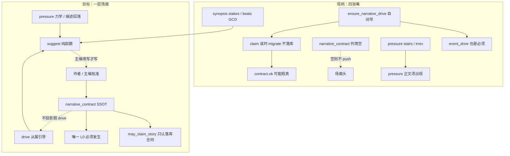
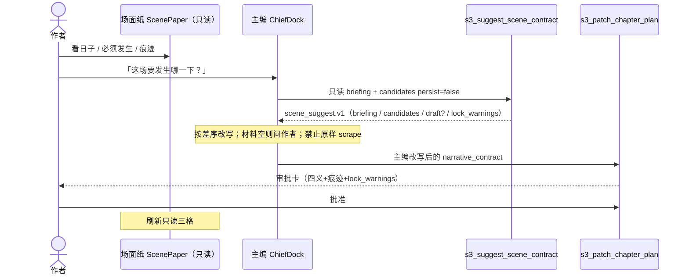
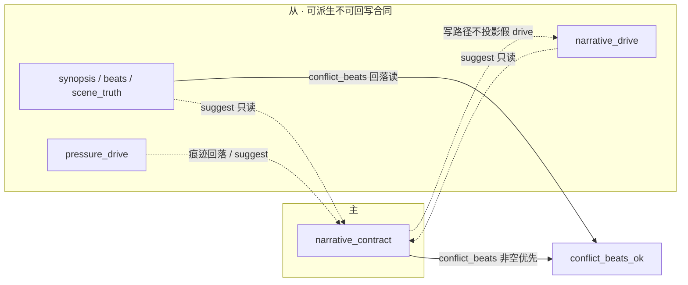
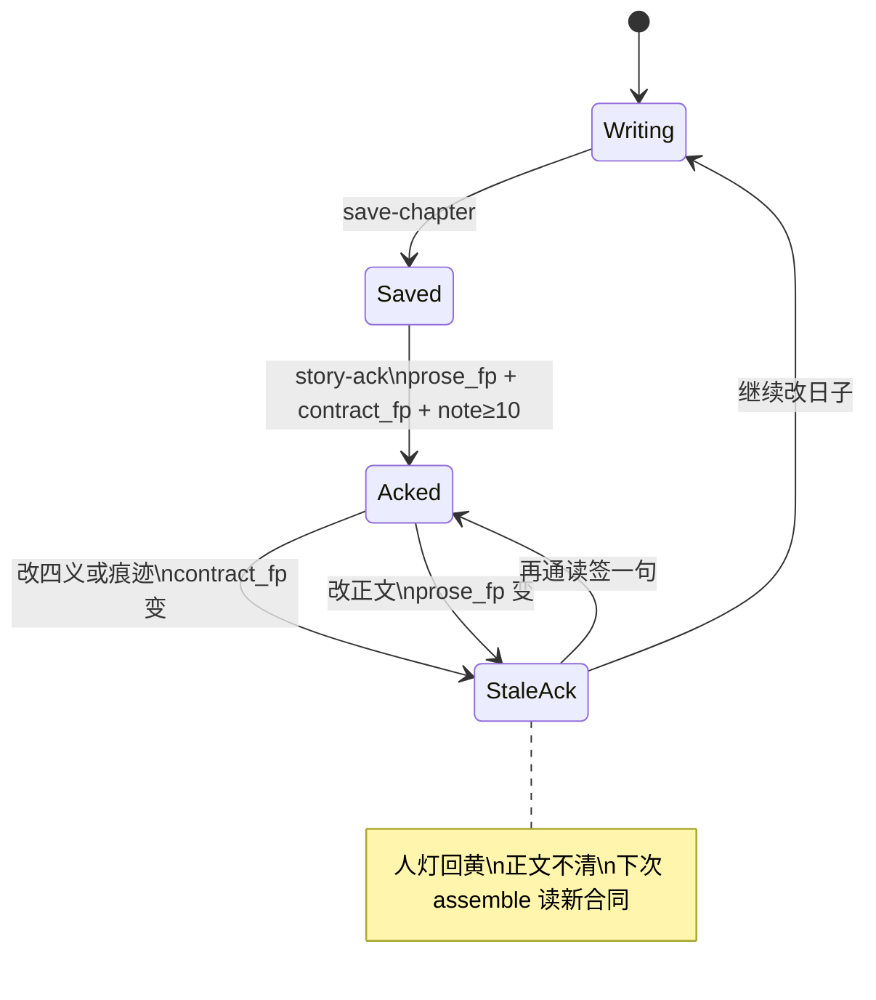
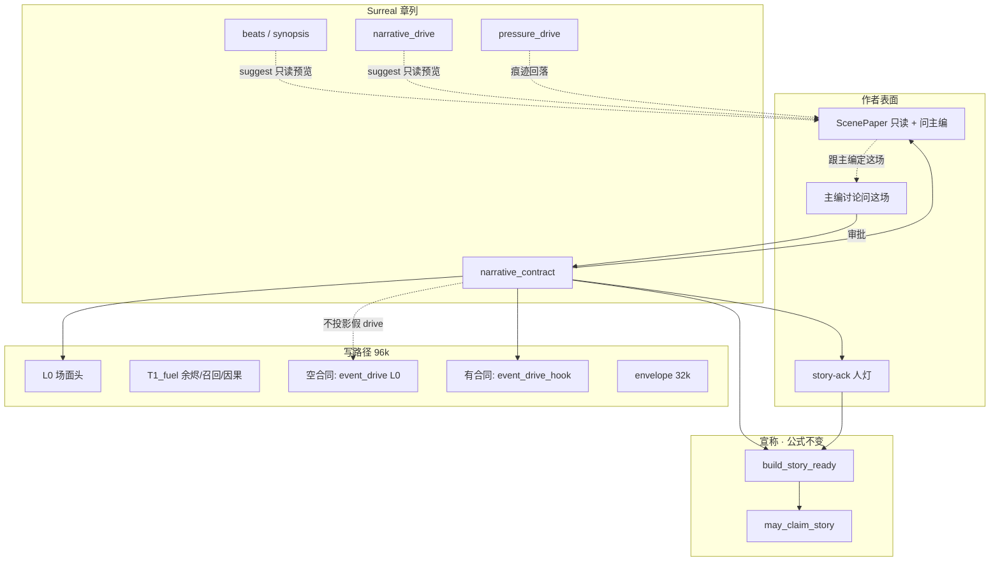
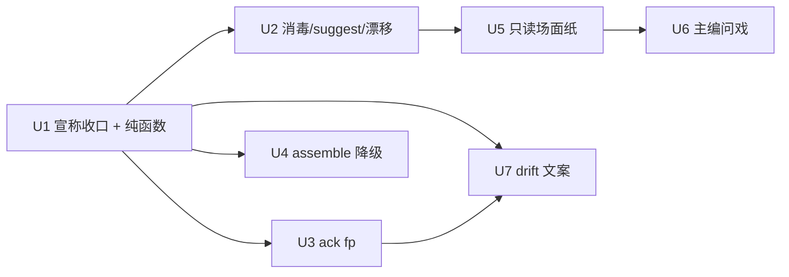

# 场面合同统一：一层场面、三层从属（Scene Contract Unify）

| 项 | 值 |
|----|-----|
| **短名** | `scene-contract-unify` / `场面合同统一` |
| **文档状态** | Draft · R6（**不定格、不手填** · 主编有 briefing/咬合/章差序）· 待人审签 |
| **作者** | Grok Design（待人审签） |
| **日期** | 2026-08-13 |
| **产品** | 铜炉 / tonglu · 代码 `scribe3/` |
| **仓库** | `/home/admin/projects/scribe-writing-system` |
| **建议落仓** | `docs/plans/2026-08-13-scene-contract-unify.md`（与本文同步） |
| **验证环境** | **仅已部署 demo** `https://tonglu.example.com` · SSH `ubuntu@203.0.113.10` · 应用 `/opt/scribe3/app` · env **`/opt/scribe3/app/deploy/prod/.env`**（热更真源，见 `scripts/deploy_demo.sh`；**不是** `app/.env`） |
| **合法写通道** | orch proposal/apply、`save-chapter`、MCP `s3_patch_chapter_plan`（场面合同**仅此产品入口**）；HTTP PATCH 合同只作测试/紧急后门，产品 UI 不调；禁止 EMERGENCY 默认 |
| **北极星** | 人话、有戏、可续。主编是持工具的编辑。工程灯/GATE 不得回作者主表面。 |
| **本设计定位** | **全局整合 / 最优化裁断**：把已散落的四义、痕迹、drive、pressure、场面纸、宣称、无人值守 **收成一层场面**。不是再贴一张表，不是再加一个 detector，不是第三套 `may_claim_*`。 |

### 与既有文档的 supersede（钉死 · 防第四套场面）

| 层 | 以谁为准 |
|----|----------|
| 北极星、七条 P0 名称、验收改口 | `docs/plans/2026-08-13-final-good-novel-plan.md` |
| 完成/宣称公式 `may_claim_story`、FORBIDDEN 键、存稿 soft 真值表 | `docs/plans/2026-08-13-narrative-engine-product-mainline.md` |
| 作者默认 / 无人值守 / 逃生封堵 | `docs/plans/2026-08-13-final-improvement-r8.md` |
| 写路径分层：场面头 L0、燃料可后裁、96k 窗 | `docs/plans/2026-08-13-budget-context-optimal.md` |
| schema / `beat_shape` / claim 旗矩阵 / story-ack 存储形状 | `docs/plans/2026-08-13-narrative-mainline.md`（技术附录） |
| **谁是「本章必须发生」、作者如何定场面、drive/pressure 谁从、空合同写正文、合同变更如何失效人灯** | **本文** |

本设计 **不重开** `STORY_COMPLETE`，**不改** `may_claim_story` 合取项集合，**不**把字数地板、GATE、scene_cover 拉回完成公式。只修「场面合同在系统里有三套嘴」这一结构性裂口。

> **完成/宣称公式 SSOT（product supersede）**：仍以 `narrative-engine-product-mainline.md` 为准。  
> **场面主权 SSOT**：以本文为准。`story_complete._load_contract` 读时 `migrate_contract_from_drive` **退出宣称路径**（见 KD-U4）。

---

## Overview

铜炉已经有章列 `chapter.narrative_contract`（desire / obstacle / turn / cost + `bindings.evidence_must_show`）、写路径 L0 场面头、宣称 `may_claim_story`、无人值守 `unattended_scene_ok`、页眉场面纸只读三格。这些零件各自正确，但 **没有统一主权**：

- 作者 **看不见四义、也定不了场面**。`ChapterMetaPane` 场面纸只读且无「跟主编定这场」；`chiefSeed.js` 有大纲/节拍/演绎种子，**没有**四义种子；REST `ChapterMetaReq` **没有** `narrative_contract`。
- 「本章必须发生」同时从四处说话：合同 L0、`event_drive` L0、`pressure_drive` 不可逆痕迹、大纲 stakes / 节拍 GCD。模型与作者各听一套。
- 宣称路径在合同列空时 **静默** `migrate_contract_from_drive`（读时拼、不落库），等于用自动编的 drive 冒充作者场面。这与「四义是作者的场面合同，不是写章时自动编的戏核」直接冲突。
- R8 W6 要求稿纸 **页眉** 日子/必须发生/痕迹；现网只做在 `ChapterMetaPane`，`WriteLayout` / `ChapterStudio` 正文顶仍是材料 banner，并残留「不建议开写」。

本设计的解法是 **一层场面、三层从属**：

```text
作者场面合同（唯一「必须发生」）
    chapter.narrative_contract
    + bindings.evidence_must_show
        │
        ├─ 不投影假 drive（有合同只推场面头 + 可选 event_drive_hook）
        ├─ 单向建议 ← synopsis / beats / drive / pressure（可看、须经主编审批才落库，绝不自动落库）
        └─ 痕迹回落 → pressure stairs.evidence_must_show（仅展示 / 评分 / 燃料；不当第三套完成公式）
```

作者 **不手填四义**。页眉场面纸只读；定场面 = 跟主编说话 → 只读 suggest → `adopt_scene_suggest` → `s3_patch_chapter_plan` 审批。R5 钉死的是 **通道**；R6 钉死 **怎么填**：场面 briefing + 四义咬合 + 章差序。禁止把 `suggest_scene_contract` 的 scrape 当填法（那是 `ensure_narrative_contract` 换皮，NG4）。空合同写正文对作者合法；`validation.ok`、无人值守、`may_claim_story` 仍要四义齐。合同变更使人灯回黄，不清稿。人灯指纹 **不含** pressure 回落。briefing / `check_scene_lock` **不进**宣称合取。

---

## Background & Motivation

### 现网已 ship（勿再当未做）

| 资产 | 锚点 | 角色 |
|------|------|------|
| 合同纯函数 | `scribe3/narrative_contract.py` | `validate_narrative_contract`、`migrate_contract_from_drive`、`project_drive_from_contract`、`format_contract_block`（写路径 **禁止** 调用） |
| 场面头 / 燃料 | `scribe3/story_constraint_prompt.py` | `format_story_contract_head`（L0）、`format_story_fuel_parts`、`load_evidence_must_show` |
| 写路径注入 | `write_assemble_v1._render_final_input` + `write_assemble_context.load_chapter_story_inputs` | 有字段才 `_push("narrative_contract")`；空合同不 push |
| 物理序 / 96k | `context_budget.py` | `narrative_contract` ∈ `L0_NEVER_CUT`；`story_*` ∈ `T1_fuel` 可后裁 |
| 落库 | `store/chapters.py` `update_chapter_meta` allowed；migration `134_narrative_contract.surql` | JSON 串列 |
| MCP 写 | `mcp/tools_write.py` `s3_patch_chapter_plan(..., narrative_contract=)` | 校验失败仍可写 + warnings |
| 宣称 | `story_complete.py` `build_story_ready` / `assert_story_claim` | demo `STORY_COMPLETE=1` |
| 无人值守 | `unattended_scene.py` + `pilot_actions/draft.py` | 合同 ok + ≥1 痕迹，否则 park 人话 |
| 场面纸只读 | `ChapterMetaPane.jsx` + `web/src/lib/scenePaper.js` | 日子=`title`，必须发生=`turn\|\|desire`，痕迹=`loadEvidenceMustShow` |
| 讨论联查 | `ChiefDock.jsx` L901 `agentic: true` | R8 W11 已开 |

### 痛点（2026-08-13 代码复核）

| # | 裂口 | 核实 | 产品伤害 |
|---|------|------|----------|
| 1 | **作者无法定场面** | 无 `seedChapterScene`；主编不问这场戏；场面纸只读且无「跟主编定这场」 | 合同列长期空；L0 场面头经常不 push |
| 2 | **三套「必须发生」** | assemble 同时 `_push` 合同头 + `event_drive`（`format_event_drive_block` 标题「本章事件驱动（冲突/事件主时钟·优先执行）」）+ 可选 `pressure_drive`（「正文须出现…」） | 模型念条款 / 两套戏核打架 |
| 3 | **宣称读时拼合同** | `story_complete._load_contract`：无列则 `migrate_contract_from_drive`，**不落库** | 自动编的 drive 可让 `contract.ok` 变真 → 第三套完成入口 |
| 4 | **drive 自动 ensure，合同从不 ensure** | `ensure_narrative_drive` 写库；合同无对应 | 系统更爱自动戏核，作者场面缺位 |
| 5 | **场面纸不在稿纸页眉** | 只在 MetaPane；`ChapterStudio.ContractSoftBanner` 仍写「不建议开写」 | W6 验收失败形态仍在 |
| 6 | **主编不问这场戏** | `chiefSeed` 无四义；`selContext` **仅** `phase==='draft'` 写「据大纲/节拍把草稿往下推」；`final` / 无 phase 落默认「当前选中:第 N 章」 | 讨论先齐脚手架 |
| 7 | **合同变更不碰人灯** | story-ack 只绑 `prose_fp`（`adapter_ops.upsert_reader_ack`） | 改四义后旧 ack 仍绿 |
| 8 | **REST 与 MCP 不对称** | store 白名单有列；HTTP PATCH 模型没有字段 | 测试后门缺字段；产品入口应只走 MCP 审批 |

### 深层因果

```text
业务把「场面」同时做成：作者合同、自动 drive、力学 PDC、大纲 stakes
    → 没有人规定谁主谁从
        → 宣称路径用 migrate 把空合同补成「像有合同」
            → 没把「跟主编定这场」做成入口（作者不手填四义，又没有说话定场面的主路径）
                → 作者空着手写日子，模型看见 event_drive + 材料 GATE 话术
                    → 戏核漂移、人灯与场面脱节
```

对标北极星：**有戏** = 这一章世上真发生了一下不可逆的事，而且这件事是 **作者定的**，不是词表/ensure 编的。

---

## Goals & Non-Goals

### Goals

1. **一层场面**：`chapter.narrative_contract` 是唯一「本章必须发生」SSOT。四义 + `bindings.evidence_must_show` 是作者场面合同。
2. **作者能看见 / 定场面**：页眉只读三格；**说话定场面**（主编代拟 + 审批）。展开四义只读。大纲/drive/pressure 只出 **建议**，不自动落库。`adopt_scene_suggest` 只在服务端/MCP 进待批 plan。
3. **单向派生**：drive/outline/pressure → contract **仅建议**。写路径 **不**投影假 drive。禁止双向同步器。
4. **空合同写正文合法**（作者路径）；无人值守仍要合同+≥1 痕迹。存稿不因缺合同 409。
5. **主编默认问这场戏**，人话，不灌 GATE / 齐套 / 可开写。
6. **合同变更失效人灯**：story-ack 绑定 `prose_fp ∧ contract_fp`；不清正文、不重跑 assemble 缓存。
7. **写路径一张嘴**：有合同时 L0 只有场面头；续势走 `event_drive_hook`（物理序紧挨 `event_drive`），不再自称「必须发生」。
8. **宣称公式不变**：仍是 `may_claim_story`；只堵住「空合同被 migrate 冒充」。
9. **验证**：仅已部署 demo 冒烟；Grok 机禁止全量 npm / 本机 Surreal。
10. **主编定场面有方法论**：场面 briefing、四义咬合、每章差序。suggest 只出 **candidates**；禁止 scrape 当填法。

### Non-Goals

| # | 非目标 | 理由 |
|---|--------|------|
| NG1 | 第三套 `may_claim_*` / 新完成公式 | 用户已裁；product-mainline 已是 SSOT |
| NG2 | 新表、新列当第二套场面（除 ack 上可选 `contract_fp`） | 「再贴一张表」正是本设计要灭的 |
| NG3 | 新 detector / 新 CONFLICT_LEX / 新评分维当完成 | 不靠词表刷绿 |
| NG4 | 写章时 `ensure_narrative_contract` 自动编四义落库 | 四义不是自动戏核 |
| NG5 | 字数地板当质量 / GATE 回主表面 | 北极星 + R8 |
| NG6 | 删 `narrative_drive` / `pressure_drive` / `verify_craft_compliance` | 基建与引导保留，改从属关系 |
| NG7 | 双向同步 synopsis↔合同↔drive↔PDC | 必漂移、必三套必须 |
| NG8 | 把 `/chat/write` 改成写 Run | R8 NG8 |
| NG9 | Grok 机全量测 / 本机 Surreal / 第二栈 | 资源纪律 |
| NG10 | 好莱坞四格当门票 / 五灯并存主表面 | R8 W6 失败条件 |
| NG11 | 把 `suggest` 四字段直接当已成立合同；briefing 当第二套场面 SSOT | scrape 填格 = `ensure_narrative_contract` 换皮；briefing 只是只读上下文 |

---

## Proposed Design

### 1. 一句话架构

```text
场面主权 =
    落库的 narrative_contract（四义 + traces）
  + 页眉场面纸只读（日子 / 必须发生 / 痕迹）
  + 定场面 = 跟主编说话 → briefing + candidates → 主编改写 → adopt → plan 审批
  + suggest_* / assemble_scene_briefing / check_scene_lock 纯函数（永不写库、不进宣称）

写路径 =
    有合同：L0 = format_story_contract_head
            event_drive_hook（仅 end_hook，不进 L0_NEVER_CUT）
            pressure 对合同 traces 去重「正文须出现」
    无合同：assemble 字节级现状（不 push 场面头；event_drive 仍 L0 引导）

宣称 =
    既有 may_claim_story
  − 禁止用 migrate_contract_from_drive 充当 contract.ok
  + story-ack 校验 contract_fp

无人值守 =
    既有 unattended_scene_ok（合同 ok + traces≥1）
  − 不自动填四义
```

### 2. 主权图（现网 → 目标）



### 3. 对象分层（谁主谁从、谁进 prompt、谁只诊断）

| 对象 | 主权 | 落库 | 进 prompt | 进宣称 | 进无人值守 | 作者表面 |
|------|------|------|-----------|--------|------------|----------|
| **`narrative_contract` 四义** | **主** | 章列 JSON | **L0 场面头**（有字段才 push） | `contract.ok` | 必须 ok | 页眉 + 可展开私房备忘 |
| **`bindings.evidence_must_show`** | **主 · 痕迹** | 合同 bindings | L0「必须留下的痕迹」≤3 | 不单独发绿 | ≥1 | 页眉第三格 |
| **`chapter.title`** | 日子 | 既有 | 不进场面头 | 否 | 否 | 页眉第一格 |
| **`narrative_drive`** | **从 · 引导** | 可 `ensure` | 有合同时 **降级钩子**；无合同时可 L0 引导 | **不得**再经 migrate 冒充合同 | 不替代合同 | 材料/「怎么往前推」折叠 |
| **`pressure_drive`** | **从 · 力学** | 旗控 bootstrap | **T1** supplemental；永不 L0；有合同 traces 时 **禁止**再写「正文须出现」同迹（新去重，见 §9） | 否 | 痕迹 **回落源**（仅当 bindings 空；**不进** `contract_fp`） | 页眉第三格可回落展示；不进人灯 |
| **`synopsis` / `beats` / `scene_truth` / `deductions`** | **从 · 材料** | 既有 patch | outline / deduce 段；非「必须发生」 | `conflict_beats` 仍可读 `chapter.beats`（形态 only） | 否 | 材料备忘折叠 |
| **`chapterContractGate.js`** | **诊断** | 无 | **禁止**进写作 prompt | 否 | 否 | 折叠；error→info（R8 未做完的继续做） |
| **`format_contract_block`** | 展示/单测 | 无 | **禁止** `_push` | 否 | 否 | 可用作私房备忘压缩预览 |
| **D1 `evidence_coverage`** | 评分诊断 | 无 | 否 | **不进** claim | 否 | 辅助面 |

**痕迹读序（已 ship，保持唯一函数，禁止第三套）**

```text
load_evidence_must_show(ch) =
    bindings.evidence_must_show 去空白后 ≥1  → 取最多 3 条
    else pressure.irreversible.evidence_must_show
    else pressure.progress.stairs[].evidence_must_show
    else []
```

Python：`story_constraint_prompt.load_evidence_must_show`  
JS：`web/src/lib/scenePaper.js` `loadEvidenceMustShow`  
两边算法必须继续同序。本设计只加：

- **作者写入只写 bindings**。
- pressure 回落 **不得**在保存合同时回写成 bindings（除非主编审批 `adopt_scene_suggest` 的待批 plan）。**禁止** UI 一键写库。
- **人灯 / `contract_fp` 禁止传入** `load_evidence_must_show` 结果（KD-U13）。
- `stairs[].text` **不得**当痕迹（回落只认 `evidence_must_show`）。**落 PR-U1**：改 `story_constraint_prompt.load_evidence_must_show` 与 `scenePaper.js` 同序；改 `test_evidence_read_order_bindings_then_pressure`：仅 `stairs: [{text: "门开了一线"}]`、无 `evidence_must_show` → `[]`。冒烟：只靠 stair 文案的旧章页眉第三格可能变「尚未标痕迹」（展示变化，**不进人灯**）。

### 4. 作者如何看见 / 定场面（问题 1）

三条通道，**作者不定格、不填表**：



**禁止**场面纸 input / PATCH 手填 / 「用这版」直写库。落库只走主编审批。`adopt_scene_suggest` 只在 **MCP/服务端** 把建议变成待批 plan 体。

#### 4.1 场面纸只读（展示 · 不是入口）

场面合同仍是「这一章日子要发生哪一下」，但 **作者用说话定，不用填格子**。与大纲/节拍同一 AGENTIC：只读展示 + 主编审批写入。

| 现网事实 | 本设计 |
|----------|--------|
| `AGENTIC_BOUNDARY_DECISION.md`：UI 直填 = 缺陷 | **不新开场面手填例外**。synopsis / beats / truth / 四义一律审批 |
| 场面纸只读三格 | 保留并升到稿纸第一眼；按钮只「跟主编定这场」 |
| R8 大纲可手写未落地 | 本设计 **不** 借机把手填扩到场面 |

实现：

- 共享组件 `web/src/ScenePaper.jsx`（从 MetaPane 抽出）：**只读**三格 + 展开四义只读 + 「跟主编定这场」。
- **挂载 1**：`ChapterStudio` `phase=final` 第一眼最顶。
- **挂载 2**：`DraftTab` 顶同一组件。
- **挂载 3**：`ChapterMetaPane` 复用；标题改为「材料参考」。
- **禁止** `api.patchChapter({ narrative_contract })` 作为产品入口；HTTP PATCH 合同仅测试/紧急后门，产品 UI 不调。
- **禁止**好莱坞四格门票、可编辑 input。

页眉映射（继承 R8 W6，禁止新列）：

| 页眉格 | 数据源 | 空时文案 |
|--------|--------|----------|
| 日子 | `chapter.title`（**只展示**；改题走既有章标题编辑 / `s3_patch_chapter_meta`，ScenePaper 不写 title） | `第 N 章` |
| 必须发生 | `turn`，空则 `desire`，截断展示 ≤24 | 「尚未写必须发生」 |
| 痕迹 | `loadEvidenceMustShow(ch)[0]`（展示可回落 pressure） | 「尚未标痕迹」 |

四义（欲望/阻力/回合/代价）= **可展开私房备忘**，不当主灯、不当门票。

**页眉 ≠ `validation.ok`（产品句 · 钉死）**

```text
页眉两格（必须发生 + 痕迹）= 日子意图：够写、够注入 L0（有 turn/desire 即 push 场面头）。
validation.ok / unattended_scene_ok / may_claim_story
  = 仍要四义各自 cn_len≥8 且非占位（公式不改）。
展开区须写：「要宣称本章戏成立 / 交给无人值守，还需要阻力与代价。」
禁止把 contract.ok 改成「有 turn 即可」。
```

#### 4.2 主编代拟 + 批准（**主路径 · KD-U2**）

复用既有 `s3_patch_chapter_plan(narrative_contract=)` + 只读 `s3_suggest_scene_contract`。**不新写工具**（R6 只扩 suggest 返回 briefing + candidates，见 §4.4.4）。

新增种子 `seedChapterScene(seq, contract)`（`chiefSeed.js`），作业顺序即 §4.4.4：

```text
1. 先 s3_suggest_scene_contract(seq=N) 拿 briefing + candidates（persist=false，不是已落库合同）。
2. 先用人话讲这场戏：发生哪一下、谁拦、留下什么。材料不够就问作者，不要凑字。
3. 再落四义+≤3痕迹，每条能指回 briefing.source。
4. 自检咬合（check_scene_lock 的人话版）；与上章 turn 撞车则改。
5. s3_patch_chapter_plan(seq=N, narrative_contract={desire,obstacle,turn,cost,bindings:{evidence_must_show:[…]}}) 提交我批准。
未获批准不得声称已落库。若场面合同已变，旧提案会被拒，须按最新场面重拟。
不要先齐大纲/节拍。不要说 GATE、可开写、材料够了。不要把建议四格原样当合同。
```

`scaffoldToolContract` 增 scope `scene` / `场面` / `narrative_contract` → 同工具、`field=narrative_contract`。

#### 4.3 建议但不落库（系统通道）

纯函数，**零 store 写**。现网 `narrative_drive` 是 **嵌套**（`inciting_force.summary`、`opposition.who_or_what/wants`、`scene_turn`、`deadline_or_cost.if_fail`）。`migrate_contract_from_drive` 只读扁平 `want/goal/inciting/opposition`，且 `opposition` 为 dict 时会变成 `"{'who_or_what': ...}"`。

**禁止** `suggest_scene_contract` wrap / 调用 `migrate_contract_from_drive`。migrate 可留作扁平兼容或标 `@deprecated`，**不得**当 suggest 内核。

```python
# scribe3/narrative_contract.py（扩展，禁止新模块当第三套公式）

def _drive_str(drive: dict, *path: str) -> str:
    """沿嵌套路径取字符串；中段为 dict 则继续；叶子为 dict 则空串（禁 str(dict)）。"""
    ...

def suggest_scene_contract(
    chapter: dict | None,
    *,
    prev: dict | None = None,
    inventory: dict | None = None,
    next_chapter: dict | None = None,
) -> dict:
    """candidates + 可选 draft + lock_warnings + briefing。persist 恒 False。
    禁止 first-hit scrape 填满四格再假装 adopted_would_be.ok。"""
    briefing = assemble_scene_briefing(
        chapter, prev=prev, inventory=inventory,
        neighbor_contracts=_neighbor_pair(prev, next_chapter),
    )
    candidates = _scene_candidates(briefing)  # 每格 list[{text, source}]
    draft, needs_author = _draft_if_qualified(candidates)  # 过 4.4.1 启发式才填
    lock = check_scene_lock(draft, prev_contract=(prev or {}).get("narrative_contract"))
    adopted = adopt_scene_suggest(draft) if draft and not needs_author else adopt_scene_suggest(None)
    return {
        "schema": "scene_suggest.v1",
        "persist": False,
        "briefing": briefing,
        "candidates": candidates,
        "draft": draft,                 # 可能四格皆空
        "needs_author": needs_author,
        "lock_warnings": lock["warnings"],
        "adopted_would_be": adopted,    # 空 draft → 空合同 ok=false
    }

def adopt_scene_suggest(suggest: dict | None) -> dict:
    """主编改写后的载荷 → 可落库合同。服务端/MCP 映射器；不是 scrape 原样、不是 UI「用这版」。"""
    s = suggest if isinstance(suggest, dict) else {}
    traces = s.get("traces") if isinstance(s.get("traces"), list) else []
    traces = [str(t).strip() for t in traces if str(t).strip()][:3]
    raw = {
        "schema": SCHEMA,
        "version": 1,
        "desire": str(s.get("desire") or "").strip(),
        "obstacle": str(s.get("obstacle") or "").strip(),
        "turn": str(s.get("turn") or "").strip(),
        "cost": str(s.get("cost") or "").strip(),
        "conflict_beats": None,
        "bindings": {
            "evidence_must_show": traces,
            "adopted_from": "suggest",
        },
        "source": "orch",
        "locked": False,
    }
    return validate_narrative_contract(raw)
```

**candidates 取源**（建议池，**不是**落库、**不是**「谁先非空谁赢」）：

| 字段 | 候选从哪列（每条带 `source`；主编按 §4.4.3 差序改写） |
|------|------------------------|
| desire | `here.drive.inciting`（嵌套 `inciting_force.summary`，禁 `str(dict)`）→ 扁平 `want/goal/inciting`（仅 `str`）→ `here.synopsis` 首句 → `prev.end_hook` / `prev.contract.turn` 的下一手 |
| obstacle | `here.drive.opposition`（`wants` / `who_or_what`，仅 `str`）→ 扁平 `opposition/force`（仅 `str`） |
| turn | `here.beat[i]` 且 `shape_ok` → 扁平 `turn/event`（str）。`here.drive.scene_turn` **可列候选**但标 `template=true` 若匹配 `因「…」局势被迫转向`（`compose_narrative_drive_dict` L349）；**禁止**进 draft |
| cost | `here.drive.if_fail` / `deadline_or_cost.if_fail` → `meta.stakes`（`brief.parse_chapter_meta`）→ 扁平 `cost/stake`（str） |
| traces | **仅当** 现合同 bindings 空：`pressure.irreversible.evidence_must_show` 再 `progress.stairs[].evidence_must_show`（**不要** `stairs[].text`） |

取源 ≠ 落库。主编必须按 §4.4.3 差序改写。**禁止** first-hit scrape 填满四格再出 `adopted_would_be.ok`。

单测锁（PR-U1）：

- 嵌套 ensure 形 drive → candidates.desire 含 `inciting_force.summary`，obstacle **不含** `"{'who`。
- 仅有模板 `scene_turn`（`因「…」局势被迫转向`）→ draft.turn 空；**不得**四格填满。
- 空章 / 空材料 → briefing.prev 空、candidates 空、`needs_author=true`、draft 空。
- 上章 turn「热灰抵半债」出现在本章 draft.turn → `lock_warnings` 含 `repeat_prev_turn`。
- 主编改写后的载荷经 `adopt_scene_suggest`：bindings 非空、`source=orch`、无 `persist/sources`。
- `story_ready.suggest` 的 `validation.ok` / `adopted_would_be.validation.ok` **不得**写入 `contract.ok`。

**读建议（两通道同源，同一纯函数）**

- HTTP：`GET /chapter?seq=&include_suggest=1`（`api.chapter`）**同时**返回 `scene_briefing` + `scene_suggest`（`candidates` / `draft` / `needs_author` / `lock_warnings` / `adopted_would_be`）。**不新开 query 旗**。U2 **必做**。**禁止**新开 `GET /chapters/{seq}`（PATCH 仍走 `/chapters/{seq}`）。
- MCP：**不新工具名**。扩只读 `s3_suggest_scene_contract(seq)` 返回 `{persist:false, briefing, candidates, draft, lock_warnings, adopted_would_be}`。主编先 suggest 再按差序改写，再 `s3_patch_chapter_plan`。

**落库只信** `adopt_scene_suggest` 的输出（主编改写后的载荷），经 **已批准的 `s3_patch_chapter_plan`**。HTTP PATCH 合同 = 测试/紧急后门，产品 UI 永不调。建议预览可只读展示 candidates + lock_warnings；按钮只有「跟主编定这场 / 让主编按建议拟一版」（打开讨论，不写库）。**禁止** UI「用这版 / 用建议」直写库。

**禁止**：`ensure_*` / suggest 工具把结果写入 `narrative_contract`。禁止调用 `ensure_narrative_contract`。禁止把 `compose_narrative_drive_dict` 的模板句当 turn 真源。

#### 4.4 主编怎么定这场（方法论 · 上下文 · 章差序）

R5 只钉通道。本节是「主编怎么填」的产品 SSOT。没有本节，实现会把 scrape 当填法。

##### 4.4.1 四义方法论（人话，不是标签）

| 格 | 问的是 | 合格 | 不合格 |
|----|--------|------|--------|
| desire | 这场开始焦点人物要做成哪一件具体事 | 可见、可失败、本章能对上 | 「查明真相」「活下去」 |
| obstacle | 当场谁/什么规矩/哪笔债拦着 | 能上台、能对手 | 「局势」「命运」「局势/对立面」（drive 默认 who） |
| turn | 世上真发生的那一下，之后回不去 | 一个动作改变关系或债 | 大纲复述、氛围总结、drive 模板句 `因「…」局势被迫转向，代价面：…`（`compose_narrative_drive_dict`） |
| cost / traces | 留下什么收不回 | 读者能看见（物、约、伤、名） | 「付出代价」「心情沉重」 |

**咬合纪律**（`check_scene_lock`，**只 advisory warnings**，不改 `validation.ok`，不进 `may_claim_story`）：

1. 阻力拦的是这场欲望（不是另起一摊）。码：`obstacle_not_on_desire`。
2. 回合改的是这场阻力（turn 不得与 desire 近重复 / 同义粘贴）。码：`turn_repeats_desire`。
3. 代价从回合里长出来（traces 至少 1 条能被看见）。码：`trace_not_visible`。
4. 本场 turn 不得与 **上章 turn** 同构复读（共享 ≥8 字子串或明显同句改写）。码：`repeat_prev_turn`。

材料空 → 主编**问作者**，禁止为凑 `cn_len≥8` 编口号。`needs_author=true`，draft 空。

```python
def check_scene_lock(
    contract: dict | None,
    *,
    prev_contract: dict | None = None,
) -> dict:
    """只 advisory。不改 validation.ok / 不进 may_claim_story。"""
    # 返回 {"warnings": [{"code", "message"}, ...]}
```

合格启发式（只挡 draft，不挡 candidates 展示）：口号/模板/「局势」「命运」「付出代价」→ 该格 draft 留空。

##### 4.4.2 场面 briefing（只读上下文包 · 不是 SSOT）

纯函数，**零 store 写**。禁止 briefing 进写路径 L0；只给讨论 / suggest。

```python
def assemble_scene_briefing(
    here: dict | None,
    prev: dict | None = None,
    inventory: dict | None = None,
    neighbor_contracts: list | None = None,  # N-1 与 N+1（若有）
) -> dict:
    """schema=scene_briefing.v1; persist=False. 禁止当合同。"""
```

必须包含：

1. **here**：`seq`、`title`、`synopsis`（≤400 字）、`beats`（最多 8 条，text + `shape_ok`）、`scene_truth`、已有合同四义、drive 摘要（`inciting_force.summary` / `opposition.who_or_what|wants` / `scene_turn` / `end_hook` / `deadline_or_cost.if_fail`）、bindings traces、`focalizer`、`brief.parse_chapter_meta` 的 `role` / `pressure` / `stakes` / `hook`。
2. **prev**：`seq`、`title`、合同四义、`end_hook` / `drive.end_hook`、traces、未决（hook / overdue）。
3. **volume_pos**：同上 `parse_chapter_meta(role/pressure/stakes/hook)`。
4. **inventory**：**复用** `narrative_drive.assemble_narrative_inventory`（`ensure_narrative_drive` 已用的那份，禁止新库存系统）。展示 `overdue_promises` 与带威胁的 `open_promises`（最多 5 条）。逾期过滤沿用 `volume_signals.overdue_promises_in_range`。open 来自 `st.open_promises()`。
5. **neighbors**：N-1 / N+1 的 `contract.turn` + `desire` 各一行（防同 turn 连跑）。

候选行必须带 `source` id：`here.synopsis`、`here.beat[i]`、`here.drive.inciting`、`prev.contract.turn`、`prev.end_hook`、`inventory.promise:{id}`、`meta.stakes` 等。

截断（防撑爆讨论窗）：synopsis≤400，beats≤8，inventory≤5，neighbors 只一行。

**I/O 装载**（U2 / U6，不是纯函数）：

```python
def load_scene_briefing(st, seq) -> dict:
    """get_chapter(N) / N-1 / N+1 + assemble_narrative_inventory(st, seq)，再交 assemble_scene_briefing。"""
```

##### 4.4.3 章差序（每章逻辑）

```text
第 N 章场面
  = 上章未决（钩 / 债 / 痕迹）本场必须碰到或当面推迟
  + 本章大纲/节拍里「这一下」
  + 库存到期债禁（优先于空转氛围）
  − 不得与第 N-1 章 turn 同构复读
```

字段映射 = **怎么想**，不是 scrape 先命中先赢：

| 字段 | 主编怎么取（优先序是「差事」） |
|------|--------------------------------|
| desire | 上章未决的下一手，或大纲里的具体动作；**禁止**原样粘 `inciting_force.summary` |
| obstacle | 当场能上台的拦法（人/规矩/物）；禁止「局势/对立面」 |
| turn | 节拍里 `shape_ok` 的那一条，或作者一句话「发生哪一下」；禁止 drive 模板句 `因「…」局势被迫转向` |
| cost/traces | 回合的可见后果；`pressure.evidence_must_show` 仅当 bindings 空且像物件/约定/伤/名 |

##### 4.4.4 主编作业顺序（种子必须写成这个）

与 §4.2 `seedChapterScene` **同一份**，不得另写一套：

```text
1. 先 s3_suggest_scene_contract(seq=N) 拿 briefing + candidates（persist=false，不是已落库合同）。
2. 先用人话讲这场戏：发生哪一下、谁拦、留下什么。材料不够就问作者，不要凑字。
3. 再落四义+≤3痕迹，每条能指回 briefing.source。
4. 自检咬合（check_scene_lock 的人话版）；与上章 turn 撞车则改。
5. s3_patch_chapter_plan(...) 提交批准。未获批准不得声称已落库。
不要先齐大纲/节拍。不要说 GATE、可开写、材料够了。不要把建议四格原样当合同。
```

### 5. 与 synopsis / beats / drive / pressure 的单向关系（问题 2）



**纪律（实现锁）**

1. **禁止**「合同改了就重写 synopsis / beats / pressure」的同步 job。  
2. **禁止**「大纲改了就重写合同」。`ensure_narrative_drive` 在 synopsis_fp 变化时重算 **drive** 的既有行为 **保留**（引导），但 **不得** 级联写合同。  
3. **本设计不置 `locked`**，只认 `source`。ensure / bootstrap **不得**改 `source in {author, orch}` 的合同。`locked` 字段可留在 schema，第一轮读写忽略。  
4. **写路径不投影假 drive**。现网 `project_drive_from_contract` 产出扁平 `inciting/opposition/turn/cost`，`format_event_drive_block` **读不到**（要 `inciting_force.summary`）。有合同且 drive 空 → **只推场面头**，不合成嵌套 drive 去骗注入。该函数可标 deprecated 或改产出 v1 嵌套，但 U4 **不调用**它。  
5. `conflict_beats`：仍 `resolve_beat_items`（合同列表优先，否则 `chapter.beats`）。**不**为宣称另造节拍表。PATCH 消毒 **丢弃**客户端塞的 `conflict_beats`（防刷形态）。  
6. PDC `bootstrap_pdc_from_texts` 保持旗控、力学用；**不得**在作者路径自动当场面合同。

**「三套必须发生」裁断**

| 句子 | 裁断后谁说 |
|------|------------|
| 本章必须发生哪一下 | **只**场面头（作者原文 `turn`/`desire`） |
| 正文须留下哪一痕 | **只**场面头 traces（bindings 优先） |
| 冲突/事件怎么往前推 | `event_drive`：有合同时改称「章末钩 / 续势」，删「优先执行 / 必须」 |
| 岔路/不可逆力学 | `pressure_drive` T1，作者不可见主表面 |
| 大纲里谁付出代价 | 材料；可建议进 `cost` |

### 6. 空合同写正文 vs 无人值守（问题 3）

| 路径 | 缺四义 | 缺痕迹 | 行为 |
|------|--------|--------|------|
| **作者手写 / save-chapter** | 合法 | 合法 | 200 + 可选 warnings；**不** `_push` 场面头 |
| **作者让主编起一段 `/chat/write`** | 合法 | 合法 | 同左；模型主要吃 envelope/codex/drive 引导 |
| **宣称 `may_claim_story`** | **否**（`contract.ok=false`） | 不单独否决 | 红/黄；**不再**用 migrate 变绿 |
| **无人值守 auto-draft** | park | park | 既有人话：「无人值守起草需要场面合同与至少一条痕迹」 |
| **GATE_SAVE_MODE=soft** | 不 409 | 不 409 | 与 R8 W5 一致 |

**页眉已有 turn/desire、四义不齐**：写正文合法、L0 只推已有行、宣称永远红、无人值守永远 park。这是故意的，不是漏规格。展开区必须说明「还需要阻力与代价」。

UI 空合同时：页眉第三格「尚未标痕迹」是 **软提示**，文案禁止「不建议开写 / 材料不够不能写 / 工艺门」。`ContractSoftBanner` 与 `setPhaseP` toast 的「不建议开写」**删除**，改为「这场还没定必须发生（不拦先写日子）」。完整灭灯清单见 §11。

### 7. 主编默认讨论如何问这场戏（问题 4）

不新 Agent，不新阶段。改 **已有** 讨论前缀与建议条。

`ChiefDock.jsx` `selContext` 现网三处 **不是同一句**，必须分别改：

| phase | 现网 prefix | 目标 prefix | 建议条 |
|-------|-------------|-------------|--------|
| `draft` | 「据大纲/节拍把草稿往下推」 | 「正在过第 N 章的日子。先看 briefing / 上章未决，再问这场必须发生哪一下、留下哪一痕；不要只改建议条。」 | `这场要发生哪一下？` / `改完世上留下什么收不回的痕迹？` |
| `final` | 落到默认「当前选中:第 N 章」 | 同上人话（稿纸更该问场面；须带上章未决） | 同上 |
| 无 `phase` 的章选中 | 「当前选中:第 N 章」 | 同上人话 | 同上 |
| `outline` | 讨论大纲 | 保留；加一句「大纲里的代价可以建议进场面，不要先说齐套」 | 不改主建议 |
| `beats` / `deduce` | 拆拍 / 限知 | 保留；禁 GATE 词 | 不改 |

**不要**为问场面把 `phase_role` 加回 `/chat/write`。`_phase_role_block` 的 draft/final 若 W2 已剥，保持剥掉；若仍在，只删 GATE/字数腔，**不为场面问句加长写作 complete**。问场面只留在讨论栏（`agentic: true`，与写路径分离）。

### 8. 合同变更与 assemble / 宣称失效（问题 5）



#### 8.1 `contract_fp`

```python
def contract_content_fp(contract: dict | None) -> str:
    """人灯指纹：只认落库四义 + bindings.evidence_must_show。
    禁止传入 load_evidence_must_show / pressure stairs。"""
    c = validate_narrative_contract(contract)
    raw = (c.get("bindings") or {}).get("evidence_must_show") or []
    if isinstance(raw, str):
        traces = [raw.strip()] if raw.strip() else []
    elif isinstance(raw, list):
        traces = [str(t).strip() for t in raw if str(t).strip()][:3]
    else:
        traces = []
    payload = "|".join([
        cn_strip(c.get("desire") or ""),
        cn_strip(c.get("obstacle") or ""),
        cn_strip(c.get("turn") or ""),
        cn_strip(c.get("cost") or ""),
        cn_strip("·".join(traces)),
    ])
    return hashlib.sha256(payload.encode("utf-8")).hexdigest()[:16]
```

空合同 → 稳定指纹（四空串），避免 `None` 分叉。页眉展示仍可用 `load_evidence_must_show`。

单测锁：仅改 `pressure_drive.progress.stairs` → `contract_content_fp` 不变 → `human_story_acked` 不变。

#### 8.2 story-ack 绑定

扩 `chapter_reader_ack`：**可选**字段 `contract_fp`（migration **`137_ack_contract_fp.surql`**；**136 已被** `136_thread_response_set_at.surql` 占用）。表 SCHEMALESS，`DEFINE FIELD IF NOT EXISTS` 即可。  
`upsert_reader_ack(..., contract_fp=)`（服务端重算，忽略客户端传入）；`build_story_ready`：

```text
human_story_acked ⟺
    ack.kind=story
  ∧ ack.prose_fp == prose_fp(prose)
  ∧ ack.contract_fp == contract_content_fp(落库合同)   # 无第二参
  ∧ cn_len(note) ≥ 10
```

旧行无 `contract_fp`：视为 **不匹配**（宁可回黄，不可假绿）。demo 书需再签一次——可接受。

U3 响应 / `story_ready.phase` 文案至少一句：**「场面或确认已过期，请再签」**（不要干等 U7）。

**不**把 contract_fp 合进 `may_claim_story` 公式的新因子名字；它只是既有 `human_story_acked` 的匹配加严。

#### 8.3 assemble

合同变更 **不**需要显式作废 prompt 缓存：`load_chapter_story_inputs` 每次读章。若存在 envelope/context cache 按章 key，changefeed 已有 `invalidate`；本设计不新开缓存层。

#### 8.4 人灯文案（advisory，对标 `drive_prose_drift`）

`GET /chapter/execution-soft-status` 或 `story_ready` 增：

```json
"contract_drift": {
  "drift": true,
  "reason": "contract_fp_changed",
  "advisory": "场面改了，通读看看日子还对不对（不会清掉正文）"
}
```

**禁止**自动清 `prose`。与 `execution_contract.drive_prose_drift` 同哲学。

`SCRIBE3_CONTRACT_DRIVE_STRICT`（registry 已有、默认 0）：**继续默认关**。本设计 **不**用它否决 claim；claim 只走人灯匹配。避免第三套 drift 硬门。

### 9. 写路径：有合同时只留一张「必须」嘴

现网（`write_assemble_v1._render_final_input`）：

```text
prefix
narrative_contract     L0  【本章必须发生的场面】
story_ember / recall / causal   T1_fuel
event_drive            L0  【本章事件驱动…优先执行】
drama_contract         L0
…
pressure_drive         T1（旗开）
```

目标：

```text
有合同（contract_has_scene_fields，与 format_story_contract_head 同一谓词：
  任一 desire/obstacle/turn/cost 非空）：
  L0 场面头 = 唯一「必须发生」
  钩子段：
    - 新段名 event_drive_hook（禁止复用 event_drive 名后只改 _push layer）
    - 不进 L0_NEVER_CUT / 不进 DRAMA_CORE_NAMES
    - GENERATION_SEGMENT_LAYERS["event_drive_hook"] = "supplemental"
    - injection_registry：SegmentMeta("event_drive_hook", "L2", "head", "world")
    - **必须**写入 `generation_physical_order_names`：紧挨 `event_drive`
      （燃料后、drama 前）。禁止只靠 registry extra（未列名会被追加到 `final_reminder` 之后）
    - format_event_drive_hook_only(drive)：只取 drive.end_hook（去空白）
    - 标题：「章末还悬着」；禁止「必须 / 优先执行 / 本章事件驱动」
    - end_hook 空 → 不 push
    - 无 opener 句（字段未定义就不写）
  pressure_drive：保持 T1；有合同 traces 时新去重（见下）

四义全空：
  assemble **保持字节级现状**：不 push 场面头（format_story_contract_head 已返回 ""）；
  仍 _push("event_drive", "redline", format_event_drive_block(...))。
  U4 只动「有四义」分支。
```

**物理序（钉死 · 与 `context_budget.generation_physical_order_names` 同表）**

```text
prefix
narrative_contract
story_ember / story_recall / story_causal
event_drive            # 仅空合同分支 push
event_drive_hook       # 仅有合同且 end_hook 非空；紧挨 event_drive
drama_contract
…
final_reminder
```

`assert_physical_order_indices` **必须改**（现网硬性要求组装结果含 `event_drive`，且 `story_ember` 夹在 contract 与 `event_drive` 之间）：

```text
drive_slot = indices.get("event_drive") or indices.get("event_drive_hook")
# 有合同允许 event_drive 缺席
# 有 hook：nc < event_drive_hook < drama
# 无 hook：nc < drama（ember 若在：nc < ember < drama）
# 空合同：保持现网 event_drive < drama < envelope < codex < final_reminder
# hook 若在：必须 < final_reminder（禁止 extra 追加到队尾）
```

**为何不能只改 `_push` layer**：`_event_drive_block` 现网不读合同，只 `format_event_drive_block`。`GENERATION_SEGMENT_LAYERS["event_drive"]="redline"`，`injection_registry` 里 event_drive 是 L0，`L0_NEVER_CUT` **按 name** 保护。只改 layer=supplemental **仍不会被 L2 裁**。必须新段名 **且** 插入物理序列表。本设计选 **新段名 `event_drive_hook`**。

**pressure「正文须出现」去重（现网没有，须新写）**

`_format_p0b` **只**在 PDC 内部把 stairs 与 `irrev.evidence_must_show` 去重，**不读**合同 bindings。`_format_p0` 仍写「正文须出现「…」」。

U4 在 `render_pressure_drive_block` / `_format_p0`：若场面头 traces（**仅 bindings**，不用 pressure 回落）非空，则：

- irrev / stairs 的 `evidence_must_show` 与合同 traces 去空白后相等或互为子串 → **删该行「正文须出现」**；
- 整段 P0 因此变空 → 不注入假合同头。

单测锁：

- 有合同 join：不得同时出现「优先执行」与「【本章必须发生的场面】」。
- 合同 traces=`掌心嵌下的灰印` 且 PDC irrev 同句：join **不得**再出现「正文须出现「掌心嵌下的灰印」」。
- 空合同：`event_drive` 仍在 `L0_NEVER_CUT`，物理序断言保持现网（`test_r8_story_constraint_assemble.py` 空合同例不改）。
- 有合同 + `end_hook`：join 中「章末还悬着」在场面头之后、`final_reminder` 之前；`assert_physical_order_indices` 允许无 `event_drive`。
- 有合同无 hook：只要求 `nc < drama`。

`drama_contract`（GCD）保留 L0：它是节拍走法，不是第二句「必须发生」。不在本设计改名。

### 10. `story_complete._load_contract` 收口（宣称侧唯一行为变化）

现网：

```python
raw = ch.get("narrative_contract")
if not raw:
    drive = ch.get("narrative_drive")
    if drive:
        return migrate_contract_from_drive(drive)  # 读时拼，不落库
```

目标：

```python
raw = ch.get("narrative_contract")
if not raw:
    return validate_narrative_contract(None)  # missing_contract → ok=False
return validate_narrative_contract(raw)
```

`build_story_ready` 可另附 `suggest` 诊断块（`story_ready.suggest`），**不得**把 suggest.validation.ok 写入 `contract.ok`。

这不是新公式，是让既有公式遵守「作者合同」。

### 11. 前端 IA（W6 补完，不是 P7 好莱坞主栏）

```text
ChapterStudio 稿纸 phase=final（第一眼）
├── ScenePaper 三格（日子 / 必须发生 / 痕迹）← 只读
│     └── 展开：只读四义 + 只读 candidates / lock_warnings 预览 + 「跟主编定这场」
│           脚注：要宣称 / 无人值守还需要阻力与代价
│           禁止「用建议」直写库；预览不是已填合同
├── 其下才是材料条 / ContractSoftBanner（若还留）
├── 手稿 / 主编
└── 折叠
      ├── 材料备忘（大纲/节拍/真相）一律 info
      ├── 本章怎么往前推（drive 三行）
      └── 写完对照 / 场面改了请通读

DraftTab 顶：同一 ScenePaper（必做，否则 draft 漏页眉）
```

**灭灯清单（PR-U5 必须点名改，漏一条 = 失败）**

| 位点 | 现网 | 目标 |
|------|------|------|
| `ChapterStudio.jsx` `ContractSoftBanner` L80 | 「不建议开写」 | 删；改「这场还没定必须发生（不拦先写日子）」或整条只谈场面 |
| 同文件 `setPhaseP` 切 `final` 的 toast L758 | 「章前契约未齐…不建议开写；存实质正文仍可能被工艺门拦截」 | 「这场还没定必须发生（不拦先写日子）」；禁「工艺门」 |
| banner 标题 L68 | 「开写前材料 / 写完对照」 | 「材料参考」或「写完对照」 |
| `ChapterMetaPane.jsx` L211 | 「开写前要齐的材料摘要」 | 「材料参考」 |
| `chapterContractGate.js` | synopsis/truth `<MIN_WRITABLE_CHARS=80`、beats `<MIN_BEAT_TEXTS=3` 为 **error** | **一律 info**；文案「材料还可再写」；禁 80 字当质量门槛 |
| `mergedSoftBannerSummary` / `contractSoftSummary` | 「开写前：」 | 「材料参考：」 |
| `readerReadyGate.js` 文件头 | 「可开写 / 可给读者」 | 改注释；chip 不得说「可开写」 |
| `ChapterSoftCards.jsx` | 「开写前检查」 | 「材料参考」（可随 U5 或标 P1；主表面三处必改） |
| `ChapterMetaPane.test.jsx` | 用例名「空 synopsis 显示不建议开写」；「不调用 patchChapter」 | 改断言；场面纸仍不调 patchChapter |

失败条件（继承 R8，仍有效）：

- ScenePaper 不是 `phase=final` **第一眼最顶**（被 `ChapterMaterialRefs` / banner 压住）= 失败。  
- 合同主栏四格 + 五阶段页签 + 双灯 + GCD **并存第一眼** = 失败。  
- chip / toast / banner 再说「可开写 / 机判过关 / 不建议开写 / 工艺门」= 失败。  
- DraftTab 无场面纸 = 失败。

### 12. 数据流总图



---

## API / Interface Changes

### HTTP

| 端点 | 变化 |
|------|------|
| `PATCH /chapters/{seq}` | `ChapterMetaReq` 增可选 `narrative_contract`。**产品入口不是 PATCH**：产品 UI 永不调；仅测试/紧急后门。**在 `patch_chapter` 消毒**（不要只靠 store dump）：见下。ok=false 仍 **200** + `warnings`（现网只回 `{status,seq}`，须扩响应）。 |
| `GET /chapter?seq=&include_suggest=1` | **U2 必做**（现网读章口 `get_chapter` / 前端 `api.chapter` → ``/chapter?seq=``）。无 query 不加 `scene_suggest` / `scene_briefing`。**同一 query 扩载荷**：`scene_briefing` + `candidates` / `draft` / `needs_author` / `lock_warnings` / `adopted_would_be`。**不新开 query 旗**。**不要**新开 `GET /chapters/{seq}`。 |
| `POST /story-ack` | 服务端算 `contract_fp` 写入；忽略客户端 fp；不匹配时文案「场面或确认已过期，请再签」 |
| `POST /reader-claim` / post-check | `story_ready.contract` 只来自落库列；可并列 `suggest`；**禁止** `suggest.*.ok` → `contract.ok` |
| `GET /chapter/execution-soft-status` | 增 `contract_drift` advisory（U7；U3 已有最短人话） |

**PATCH 消毒（`patch_chapter` 内，U2 必做）**

```text
非 dict → 422
四义 last-write-wins（desire/obstacle/turn/cost 以本次为准，各截断 500 字）
bindings：merge 旧章，不得整包覆盖
  本次可写：evidence_must_show、adopted_from
  未传则从当前章拷回：scene_voice、narrative_drive_fp
  丢掉客户端：conflict_beats、locked、source、persist/sources、其它陌生 bindings
source 强制本次通道（PATCH 测试后门=`author`；MCP 批准产品路径=`orch`）
validate_narrative_contract 后再写
```

```python
def sanitize_narrative_contract_write(raw, *, source: str, prev: dict | None = None) -> dict:
    """prev = 章上已有合同。四义覆盖；bindings 保留 scene_voice / narrative_drive_fp。"""
```

单测：章上已有 `bindings.scene_voice`，PATCH 只带 turn → 读回声口仍在（测试通道）。

**MCP vs PATCH（产品写 vs 测试后门）**

- **产品写只走 MCP 批准**，`source=orch`。
- HTTP PATCH `source=author` **仅测试/紧急后门**；产品 UI 永不调。
- **四义** 以本次提案为准、**不 merge** 旧 desire/turn；**bindings 保留键 merge**（上式）。
- **批准前合同 fp 漂移 → 拒绝，禁止 last-write-wins 盖已落库合同**（用户裁断 Q2）：
  1. `s3_patch_chapter_plan` 生成待批提案时，快照 `base_contract_fp = contract_content_fp(当时落库合同)`，写入提案元数据。
  2. `commit_if_approved` 落库前再算当前 fp。
  3. 若与快照不等 → **不写库**，人话：「这场的场面已经变了，请按最新场面重拟后再批。」
  4. 空合同→空合同（两边都是空四义指纹）视为未漂移。
  5. 批准卡仍展示将写入的四义（方便人看），但不能在漂移时强盖。

**不**新开 `/narrative-contract` 资源。

### MCP

| 工具 | 变化 |
|------|------|
| `s3_patch_chapter_plan` | **已有**参数；U2：批准后 `source=orch`；走同一 `sanitize_*`；**批准前 fp 漂移则拒写** |
| `s3_get_chapter` | 已返回合同；描述改为「含场面合同，勿与 GATE 齐套混淆」 |
| `s3_suggest_scene_contract` | **第一轮做**（只读，**不新工具名**）。返回 `{persist:false, briefing, candidates, draft, lock_warnings, adopted_would_be}`；内部 `load_scene_briefing` + 纯函数同源。**无写权限**。catalog / `_common` 只读清单登记。 |

### 前端

| 文件 | 变化 |
|------|------|
| `web/src/ScenePaper.jsx` | 新：只读页眉 + 只读展开（candidates / lock_warnings 预览，**不是**已填合同）+ 「跟主编定这场」（打开讨论，不写库） |
| `web/src/lib/scenePaper.js` | `scenePaperView`、空文案；**禁止**完整 JS suggest 当落库真源 |
| `web/src/api.js` | `chapter(seq)` 支持 `include_suggest` query（打 `/chapter?seq=`；只读预览） |
| `ChapterStudio.jsx` | final 第一眼页眉；DraftTab 顶；灭灯清单 |
| `ChapterMetaPane.jsx` + `.test.jsx` | 复用 ScenePaper；标题「材料参考」；**不**调 `patchChapter` |
| `chapterContractGate.js` | error→info；禁 80 字质量 |
| `chiefSeed.js` | `seedChapterScene` |
| `ChiefDock.jsx` | draft / final / 无 phase 三处 prefix |

### 关键接口（实现锁）

```python
# narrative_contract.py

def contract_content_fp(contract) -> str: ...          # 无 traces 第二参
def assemble_scene_briefing(here, prev=None, inventory=None, neighbor_contracts=None) -> dict: ...
def check_scene_lock(contract, *, prev_contract=None) -> dict: ...  # 只 advisory
def suggest_scene_contract(chapter, *, prev=None, inventory=None, next_chapter=None) -> dict: ...
def adopt_scene_suggest(suggest: dict | None) -> dict: ...          # 主编改写后的载荷
def load_scene_briefing(st, seq) -> dict: ...                      # I/O；U2
def sanitize_narrative_contract_write(raw, *, source: str, prev: dict | None = None) -> dict: ...
def contract_has_scene_fields(contract) -> bool:
    c = validate_narrative_contract(contract)
    return any(c.get(k) for k in ("desire", "obstacle", "turn", "cost"))

# story_complete.py

def _load_contract(st, seq):
    # 禁止 migrate_contract_from_drive
    ...

# story_complete.build_story_ready 增：
#   contract_fp, ack.contract_fp；suggest 不得写入 contract.ok
```

---

## Data Model Changes

### `chapter.narrative_contract`（不改 schema 名）

```json
{
  "schema": "narrative_contract.v1",
  "version": 1,
  "desire": "",
  "obstacle": "",
  "turn": "",
  "cost": "",
  "conflict_beats": null,
  "bindings": {
    "evidence_must_show": ["掌心嵌下的灰印"],
    "narrative_drive_fp": "",
    "adopted_from": "suggest|none",
    "scene_voice": null
  },
  "source": "orch",
  "locked": false,
  "validation": {"ok": false, "errors": [], "warnings": []}
}
```

`source` 落库：产品路径 **`orch`**（MCP 批准）；`author` 仅 HTTP PATCH 测试/紧急后门。消毒层强制写入，客户端不可自报。  
`assembled` / `migrated` **只允许出现在 suggest 内存对象**。  
`locked`：**本设计不置、不读**；ensure 只认 `source`。

### `chapter_reader_ack`

```surql
-- 137_ack_contract_fp.surql   （136 已是 thread previous_response_set_at）
DEFINE FIELD IF NOT EXISTS contract_fp ON chapter_reader_ack TYPE option<string>;
```

无需新表。SCHEMALESS + `IF NOT EXISTS`。旧行缺字段 → 人灯不匹配。

### 迁移策略

1. 134 已存在：合同列。U1 只改读路径，不改列。  
2. **137**：ack 加 `contract_fp`。demo 部署后既有 story-ack 回黄，作者再签。  
3. **不做** 批量把 drive migrate 进合同列（那会把自动戏核洗成作者合同）。

---

## Alternatives Considered

### A1. 只做主编代拟，禁止手填（严格对话驱动写）· **CHOSEN**

- **做法**：场面纸只读；唯一产品写通道 = 主编审批 MCP（`adopt_scene_suggest` → 已批 `s3_patch_chapter_plan`）。符合 `AGENTIC_BOUNDARY_DECISION.md` 字面。**不改 AGENTIC，不新开场面例外。**  
- **选用**：用户 2026-08-13 明确「我不希望手填」。定场面 = 跟主编说话 → 只读 suggest → 服务端 adopt → 作者批准。空合同写正文仍合法。

### A2. `ensure_narrative_contract` 对标 `ensure_narrative_drive`

- **做法**：写前自动从大纲/drive 填四义落库。  
- **弃因**：用户已裁「不是写章时自动编的戏核」。会立刻制造假合同，宣称变假绿。

### A3. 删 `narrative_drive` / 与合同合并一张 JSON

- **做法**：一个对象既是作者四义又是 ensure 结构。  
- **弃因**：drive 有 inventory / 债禁 / POV 相机等引导字段；与作者四格合并会迫使作者填工程结构，或 ensure 覆盖作者原文。双对象保留，但 **写路径不投影假 drive**（本设计落实从属）。

### A4. 合同变更即清 prose / 强制重写

- **做法**：fp 变则 blank 正文。  
- **弃因**：日子先写合法；作者改「必须发生」常是微调。对标 `drive_prose_drift`：advisory，不清稿。

### A5. 保持 claim 读时 migrate（兼容旧书）

- **做法**：空合同仍可用 drive 过 `contract.ok`。  
- **弃因**：这就是第三套完成入口。旧书要宣称：跟主编批一版建议即可，成本低于假绿。

### A6. 有合同则完全不 `_push` event_drive

- **做法**：比 hook-only 更小；删续势。  
- **弃因**：`end_hook` 是章间可续的最小燃料。U4 只留 hook，已去掉「必须/优先执行」。整段不推会让「上一章还悬着」从写路径蒸发。

### A7. 页眉只定 turn+痕迹，把 `contract.ok` 降成「有 turn 即可」

- **做法**：宣称 / 无人值守跟页眉对齐。  
- **弃因**：**改公式**（NG1）。阻力与代价是「有戏」的一半；页眉是日子意图，不是完成门槛。

### A8. 手填场面纸为主路径 + AGENTIC 例外（旧 R4 选用 · 已弃）

- **做法**：ScenePaper 可编辑 input；产品 UI 调 PATCH；须改 `AGENTIC_BOUNDARY_DECISION.md` 增场面合同例外。  
- **弃因**：用户 2026-08-13 明确「我不希望手填」。

### A9. 把 `compose_narrative_drive_dict` 输出直接当合同

- **做法**：`scene_turn` / `inciting_force.summary` 原样写入四义。  
- **弃因**：模板句「因「xxx」局势被迫转向」+ 自动戏核。等于 `ensure_narrative_contract`（NG4）。

### A10. 新工具 `s3_scene_briefing`

- **做法**：单独 MCP 工具拉上下文。  
- **弃因**：工具膨胀。扩已有 `s3_suggest_scene_contract` 即可（KD-U21）。

---

## Security & Privacy Considerations

| 威胁 | 严重度 | 缓解 |
|------|--------|------|
| 客户端 PATCH 合同注入超大 JSON / 脚本 / locked / conflict_beats | 中 | `sanitize_*`：四义覆盖；bindings merge 保留 `scene_voice` / `narrative_drive_fp`；各 500 字截断；强制 source；非 dict 422 |
| 主编工具把合同当世界事实写入 envelope | 中 | 场面头已禁角色复述四行；hybrid_recall query 仍 ≤200 字 |
| 建议接口泄露他书章 | 低 | 与 `get_chapter` 同 auth / work 隔离 |
| ack 行写入他人 contract_fp 伪造绿 | 低 | fp 服务端重算，不信任客户端传入的 contract_fp 作为唯一真源（客户端可省略） |
| HTTP PATCH 后门被滥用改 synopsis | 中 | 产品 UI 不调 PATCH；测试后门仍只接受 `narrative_contract` 键；不放开 MetaPane 叙事直写禁令的其它字段 |

---

## Observability

| 信号 | 类型 | increment 位点 | 用途 |
|------|------|-----------------|------|
| `write_assemble` 已有 `narrative_contract_skip` | 计数 | `_render_final_input` except（**空合同不记**） | 组装失败 |
| `scene_contract_empty_on_write` | 计数 | `write_assemble_v1._render_final_input`：`not contract_has_scene_fields` 且本轮确要写正文 | 观测空合同起草；不告警 |
| `story_ack_contract_mismatch` | 计数 | `build_story_ready`：有 story-ack 但 fp 不匹配 | 人灯回黄 |
| `scene_suggest_adopted` | 计数 | MCP 批准落库（消毒后 `adopted_from==suggest`）；PATCH 测试通道同样计数 | 采纳率 |
| `unattended` park `missing` | 已有 | `unattended_scene_ok` | 值守缺项 |
| 日志 | info | `sanitize_narrative_contract_write` / `story_ack_ep` | `source` / `validation.ok` / fp[:8] |

告警：不要对「空合同写正文」告警。可对「STORY_COMPLETE=1 且 `_load_contract` 再出现 migrate 调用」做回归断言（单测，不是 pager）。

---

## Rollout Plan

1. **PR 序**：见文末 PR Plan。先纯函数 + 宣称收口，再 REST/ack，再 assemble 降级，最后 UI/主编话术。  
2. **旗**：不新开产品旗。`NARRATIVE_CONTRACT` 已 1。不改 `STORY_COMPLETE`。  
3. **demo**：`./scripts/deploy_demo.sh` 热更；env 核对应 **`/opt/scribe3/app/deploy/prod/.env`**。冒烟打已部署栈，**勿**对 demo 库跑会清空 ack 的全量套件：  
   - 空合同 `save-chapter` 200；  
   - MCP 批准后回读四义；`GET /chapter?seq=&include_suggest=1` 只读 briefing + candidates（产品 UI 不写）；空章 `needs_author=true`；sanitize 单测仍可用 PATCH（测试通道）：adopt 后 traces 在 bindings；PATCH 只改 turn 不丢 `scene_voice`；  
   - 无合同 `build_story_ready.contract.ok==false`（即使有 drive）；`suggest.ok` 不进 `contract.ok`；  
   - 上章 turn「热灰抵半债」、本章 draft 含同一 ≥8 字 → `lock_warnings` 含 `repeat_prev_turn`；  
   - 改合同后旧 story-ack 不再 `human_story_acked`；响应含「请再签」；  
   - 仅改 pressure stairs → 人灯不变；  
   - 有合同 assemble 不含「优先执行」与场面头并存；同迹无第二张「正文须出现」。  
4. **回滚**：**不写**应急 migrate 旗（不进 registry、U1 也不留死开关）。宣称收口回滚 = **git revert U1**。UI 回滚不影响宣称收口。  
5. **风险**：见下。

### Risks

| 风险 | 严重度 | 缓解 |
|------|--------|------|
| demo 上仅有 drive、无合同的章从可黄变红 | 中 | 预期；页眉「跟主编按建议拟一版 / 跟主编定这场」打开讨论；不自动写 |
| 有合同后 drive 引导变弱，续写丢钩 | 中 | hook-only 保留 `end_hook`；无 hook 才不 push |
| 作者继续空合同写日子 | 中 | 主编默认问这场 + 页眉「跟主编定这场」+ suggest 只读预览；空合同写正文仍合法 |
| 主编仍把 candidates 原样提交 | 中 | 种子禁止原样；draft 空则 `needs_author`；审批卡展示 `lock_warnings` |
| briefing 过厚撑爆讨论窗 | 低 | 各块截断：synopsis≤400，beats≤8，inventory≤5，neighbors 只一行 |
| 旧 ack 全员回黄 | 低 | 再签一句；比假绿好 |
| `ChapterMetaReq` 扩字段被滥用直写 beats | 低 | 产品 UI 不调 PATCH；测试后门只接受合同键；审批纪律不改其它字段 |

---

## Open Questions

用户 2026-08-13 裁断「按最优方案最全能力实现」。下表均为 **已决议**，实施不得再当开放项。

| # | 问题 | 决议 |
|---|------|------|
| **Q1** | 第一轮是否做只读 MCP `s3_suggest_scene_contract`？ | **做**。`persist: false`；与 `GET /chapter?include_suggest=1` 同源。载荷含 briefing + candidates（**不是**已填合同）。落库只信主编改写后的 `adopt_scene_suggest` + **已批** `s3_patch_chapter_plan`。HTTP PATCH 合同只作测试/紧急后门，**不是**产品落库。**禁止**自动落库。 |
| **Q2** | MCP 批准前合同 `contract_fp` 相对提案快照漂移？ | **拒绝**并人话「这场的场面已经变了，请按最新场面重拟后再批。」**禁止** last-write-wins 盖已落库合同。 |
| **Q3** | 应急 migrate 旗？日子（title）是否走 ScenePaper？ | **不写**应急旗，回滚 = git revert U1。页眉展示 title；**改题仍走既有章标题编辑**，ScenePaper 不改题。 |

---

## Key Decisions

| ID | 决策 | 理由 |
|----|------|------|
| **KD-U1** | **一层场面**：只有落库 `narrative_contract` 能说「本章必须发生」。drive / pressure / 大纲 / GATE 全部从属或诊断。 | 现网四张嘴是空合同+假绿+模型念条款的根因。 |
| **KD-U2** | **主编审批为主路径**；场面纸只读、不定格、不手填；suggest 永不自动落库。**不改** `AGENTIC_BOUNDARY_DECISION.md`（无场面例外）。synopsis/beats/truth/四义一律审批。场面仍是作者意图，但作者用说话定、用批准落库。 | 用户 2026-08-13 明确「我不希望手填」。 |
| **KD-U3** | **单向派生，禁止同步器**。写路径 **不**投影假 drive。drive/大纲/PDC 只建议回合同。 | 扁平 `project_drive_from_contract` 喂不进 `format_event_drive_block`。 |
| **KD-U4** | **`_load_contract` 禁止 migrate**。空列 = `missing_contract`。suggest 可展示；**不得**把 `suggest.ok` 写入 `contract.ok`。不留应急 migrate 旗。 | 堵住第三套宣称入口。 |
| **KD-U5** | **空合同写正文合法**；无人值守仍要合同+痕迹。 | R8 SYN-4 / W9。 |
| **KD-U6** | **有合同则新段 `event_drive_hook`**（仅 `end_hook`），不进 `L0_NEVER_CUT`。**必须**插入 `generation_physical_order_names`（燃料后、drama 前，紧挨 `event_drive`）。`assert_physical_order_indices` 有合同时允许 `event_drive` 缺席。无合同 `event_drive` 字节级现状。有合同 traces 时 PDC **新去重**「正文须出现」。 | 只改 layer / 只加 registry 会把钩子排到 `final_reminder` 后。 |
| **KD-U7** | **story-ack = prose_fp ∧ contract_fp ∧ note≥10**。改场面或改正文都回黄。不清稿。 | 人灯对应当前场面。 |
| **KD-U8** | **痕迹 SSOT = bindings.evidence_must_show**；pressure 只回落展示/评分/燃料。 | 禁止第三套 traces 表。 |
| **KD-U9** | **不新完成公式、不新 detector、不新戏核表**。W6 页眉补完，不复活好莱坞主栏。 | 用户原话。 |
| **KD-U10** | **主编讨论**分别改 draft / final / 无 phase 三处 prefix。禁 GATE 黑话。不问场面灌回 `/chat/write`。 | 现网三处 prefix 不同。 |
| **KD-U11** | **REST 扩字段仍做**（测试/紧急后门 + `sanitize_*` 与 MCP 共用）。**产品 UI 不调 PATCH**。PATCH `source=author` 仅测试后门；MCP 批准 `source=orch`。四义以本次提案为准；**bindings merge** 保留 `scene_voice` / `narrative_drive_fp`。MCP 批准前 **fp 漂移拒写**（KD-U18），**不得盖已落库合同**。 | 现网 validate 会透传 locked/conflict_beats；整包覆盖会抹掉声口。 |
| **KD-U12** | **验证只打已部署 demo**；env=`deploy/prod/.env`；Grok 机禁止全量 npm / 本机 Surreal。 | 主机纪律 + 热更真源。 |
| **KD-U13** | **`contract_fp` 只用落库四义 + `bindings.evidence_must_show`**。禁止传入 `load_evidence_must_show`。 | pressure ensure 不得误黄人灯。 |
| **KD-U14** | **主编/MCP 经 `adopt_scene_suggest` 落库主编改写后的载荷**。traces → bindings；丢 persist/sources。**禁止** UI「用建议」直写库、禁止整包 PATCH / JS 手拼、禁止把 candidates 原样当合同。HTTP 读建议：`GET /chapter?seq=&include_suggest=1`（briefing + candidates 只读）。MCP：扩 `s3_suggest_scene_contract`。禁止新开 `GET /chapters/{seq}`。 | 否则第三格静默丢失；scrape 会变成假合同。 |
| **KD-U17** | **`stairs[].text` 不得当痕迹**。回落只认 `evidence_must_show`。U1 改 Py+JS 与 `test_evidence_read_order_*`。 | 现网单测把 `text` 当痕迹；不点名 PR 会漏改或测红。 |
| **KD-U18** | **第一轮做只读 `s3_suggest_scene_contract`**；落库永不经该工具。**MCP 批准前 `contract_fp` 漂移则拒写**（人话重拟；**不含**盖已落库合同）。ScenePaper **不改** `title`。不写应急 migrate 旗。**不含 AGENTIC 例外**。 | 用户裁断 Q1–Q3；「最全能力」含主编只读建议，不含盖已落库合同。 |
| **KD-U15** | **页眉两格 ≠ `validation.ok`**。够写够注入；宣称/值守仍要四义齐。不把 `contract.ok` 改成有 turn 即可。 | 避免实现做成「填了必须发生=合同齐」。 |
| **KD-U16** | **本设计不置 `locked`**，只认 `source`。 | 现网无人写 locked。 |
| **KD-U19** | **定场面 = briefing + 咬合 + 章差序**。suggest 只出 candidates；禁止 scrape 当填法。briefing 不是 SSOT、不进 L0、不进宣称。 | 通道不等于填法；否则 NG4 换皮。 |
| **KD-U20** | **`check_scene_lock` 只 advisory**。不改 `contract.ok` / `may_claim_story`。 | 用户不重开完成公式。 |
| **KD-U21** | **不新 MCP 工具**。扩 `s3_suggest_scene_contract` 返回 briefing + candidates + lock_warnings。库存复用 `assemble_narrative_inventory`。 | 工具膨胀无收益。 |

---

## References

- `docs/plans/2026-08-13-final-good-novel-plan.md` — 北极星 / P0  
- `docs/plans/2026-08-13-final-improvement-r8.md` — 作者默认 / 无人值守 / W6 场面纸  
- `docs/plans/2026-08-13-narrative-engine-product-mainline.md` — `may_claim_story`  
- `docs/plans/2026-08-13-narrative-mainline.md` — schema / beat_shape / ack 存储  
- `docs/plans/2026-08-13-budget-context-optimal.md` — L0 vs T1_fuel / 96k  
- `docs/plans/2026-08-10-narrative-event-engine.md` — `narrative_drive`  
- `scribe3/narrative_contract.py` · `story_complete.py` · `story_constraint_prompt.py` · `unattended_scene.py`  
- `scribe3/narrative_drive.py`（`assemble_narrative_inventory` / `compose_narrative_drive_dict` / `ensure_narrative_drive`）· `scribe3/brief.py` `parse_chapter_meta` · `scribe3/volume_signals.py` `overdue_promises_in_range`  
- `scribe3/pressure_drive.py` · `execution_contract.py`  
- `scribe3/api/services/write_assemble_v1.py` · `write_assemble_context.py`  
- `scribe3/mcp/tools_write.py` `s3_patch_chapter_plan`  
- `scribe3/web/src/ChapterMetaPane.jsx` · `lib/scenePaper.js` · `lib/chiefSeed.js` · `ChiefDock.jsx` · `ChapterStudio.jsx`  
- `scribe3/AGENTIC_BOUNDARY_DECISION.md` — 正典审批；**本设计不增场面例外**  

---

## PR Plan

每张 PR 可独立审、可独立合。后序 PR 不依赖未合的 UI 也能在 demo 上行为正确（宣称更诚实优先于页眉好看）。

### PR-U1 · 宣称只认落库合同 + fp / suggest / adopt

| 项 | 内容 |
|----|------|
| **标题** | `fix(story): stop migrate-as-claim; add contract_fp, suggest, adopt` |
| **Files** | `scribe3/narrative_contract.py`（`contract_content_fp` **无第二参** / `assemble_scene_briefing` / `check_scene_lock` / `suggest_scene_contract` **candidates+draft+lock_warnings、不 wrap migrate** / `adopt_scene_suggest` / `contract_has_scene_fields` / 嵌套 drive 取值）；`scribe3/story_complete.py`（`_load_contract` 去 migrate；`story_ready` 挂 `contract_fp` + `suggest`）；`scribe3/story_constraint_prompt.py`（`load_evidence_must_show` **不再**把 `stairs[].text` 当痕迹）；`scribe3/web/src/lib/scenePaper.js` 同序；`docs/plans/2026-08-13-narrative-mainline.md` §3.3 **删** claim 路径 migrate；`scribe3/tests/test_narrative_contract.py`；`scribe3/tests/test_story_complete_no_migrate.py`（新）；`scribe3/tests/test_r8_story_constraint_assemble.py` `test_evidence_read_order_bindings_then_pressure`（仅 text → `[]`） |
| **Deps** | 无 |
| **说明** | 空列不再靠 drive 把 `contract.ok` 变真。**不**写应急 migrate 旗。单测：有嵌套 drive 无合同 → `contract.ok is False`；candidates.desire 来自 `inciting_force.summary` 且非 dict 垃圾串；**scrape first-hit 不得**用模板 `scene_turn` 填满四格；上章 turn 子串进本章 draft.turn → `repeat_prev_turn`；空材料 → draft 空 + `needs_author`；adopt 后 bindings 非空；`suggest.validation.ok` 不得写入 `contract.ok`；仅 pressure stairs 变 → fp 不变；仅 `stairs[].text` → traces `[]`。不改 assemble 文案。 |

### PR-U2 · HTTP/MCP 消毒 + 只读 suggest + 批准漂移拒写

| 项 | 内容 |
|----|------|
| **标题** | `feat(api): sanitize contract; read-only suggest; reject stale plan` |
| **Files** | `scribe3/api/models.py` `ChapterMetaReq`；`scribe3/api/routers/chapters.py` `get_chapter`（`GET /chapter?seq=&include_suggest=1` **扩** briefing）+ `patch_chapter`（消毒 merge + 200+warnings；**测试/紧急后门**）；`scribe3/narrative_contract.py` 或邻接模块 `load_scene_briefing(st,seq)`（调 `assemble_narrative_inventory` + N/N-1/N+1）；`scribe3/mcp/tools_read.py`（**`s3_suggest_scene_contract` 只读**，同载荷）；`scribe3/mcp/_common.py` / catalog（只读清单）；`scribe3/mcp/tools_write.py`（批准后 `source=orch` + 同 `sanitize_*` + **提案快照 `base_contract_fp`，批准前漂移拒写**）；`scribe3/web/src/api.js`（`chapter` 传 `include_suggest`）；`scribe3/tests/test_chapter_patch_contract.py`；`scribe3/tests/test_suggest_scene_mcp.py`（新：persist 字段、无写；漂移拒写；载荷含 briefing） |
| **Deps** | 建议 U1（adopt/suggest/sanitize 同形） |
| **说明** | **产品写只走 MCP 批准**；HTTP PATCH 合同仅测试/紧急，产品 UI 不调。非 dict 422；四义覆盖；bindings merge 保留 `scene_voice` / `narrative_drive_fp`；强制 source；500 字截断；ok=false 仍写。`include_suggest` 接现网读章口，**同时**回 briefing。只读 MCP 与 HTTP 同源，**禁止自动落库**。批准前 fp 漂移 → 不写库 + 人话「这场的场面已经变了，请按最新场面重拟后再批。」单测可用 PATCH 验 merge/漂移：只 PATCH turn → 声口仍在；空→空不算漂移；**已落库合同变后批旧提案 → 拒**。increment `scene_suggest_adopted`。 |

### PR-U3 · story-ack 绑定 contract_fp

| 项 | 内容 |
|----|------|
| **标题** | `feat(ack): bind story-ack to contract_fp` |
| **Files** | `scribe3/migrations/137_ack_contract_fp.surql`；`scribe3/store/adapter_ops.py`；`scribe3/api/routers/write.py` `story_ack_ep`（人话「场面或确认已过期，请再签」）；`scribe3/story_complete.py` 匹配加严；相关单测 |
| **Deps** | **硬依赖 U1** |
| **说明** | 服务端重算 fp（只用 bindings）。旧 ack 缺字段 → 未确认。increment `story_ack_contract_mismatch`。勿等 U7 才有人话。 |

### PR-U4 · 写路径有合同则 drive 降级

| 项 | 内容 |
|----|------|
| **标题** | `fix(write): event_drive_hook when scene contract present` |
| **Files** | `scribe3/narrative_drive.py`（`format_event_drive_hook_only` 仅 `end_hook`）；`scribe3/api/services/write_assemble_context.py` `_event_drive_block`（`contract_has_scene_fields`）；`scribe3/api/services/write_assemble_v1.py`；`scribe3/context_budget.py`（**`generation_physical_order_names` 插入 `event_drive_hook` 于 `event_drive` 旁**；改 `assert_physical_order_indices`；层 supplemental / **勿**进 `L0_NEVER_CUT`）；`scribe3/injection_registry.py`（新 SegmentMeta L2）；`scribe3/pressure_drive.py`（`_format_p0` 对合同 traces 去重）；`scribe3/tests/test_r8_story_constraint_assemble.py` / `test_novel_first_injection.py` / `test_p1_scheme.py`（有合同允许无 `event_drive`；空合同例保持现状） |
| **Deps** | 建议 U1 |
| **说明** | 有四义：不得「优先执行」与场面头并存；hook 在场面头后、`final_reminder` 前；同迹不得再「正文须出现」。空合同 assemble **字节级现状**。increment `scene_contract_empty_on_write`。禁止只靠 registry extra。 |

### PR-U5 · 稿纸页眉场面纸只读 + 「跟主编定这场」+ 灭灯

| 项 | 内容 |
|----|------|
| **标题** | `feat(ui): ScenePaper first-eye header; kill 开写话术` |
| **Files** | `web/src/ScenePaper.jsx`；`web/src/lib/scenePaper.js`；`web/src/api.js`（`chapter(..., { includeSuggest: true })` → `/chapter?seq=&include_suggest=1`）；`ChapterStudio.jsx`（final 第一眼 + DraftTab 顶 + banner/toast）；`ChapterMetaPane.jsx` + `ChapterMetaPane.test.jsx`；`chapterContractGate.js`（一律 info，禁 `MIN_WRITABLE_CHARS` 当 error）；`readerReadyGate.js` 注释 |
| **Deps** | **硬依赖 U2** |
| **说明** | **无 input**；**无 patchChapter**；第一眼只读三格；展开只读四义 + 只读建议预览；按钮「跟主编定这场」打开主编种子（不写库）。灭灯清单见 §11。用例：不调用 `patchChapter`。 |

### PR-U6 · 主编问这场戏 + 种子

| 项 | 内容 |
|----|------|
| **标题** | `feat(chief): ask the scene; seedChapterScene` |
| **Files** | `web/src/lib/chiefSeed.js` + `chiefSeed.test.js`；`ChiefDock.jsx` `selContext`（**分别**改 draft / final / 无 phase）；`ScenePaper.jsx` 按钮 |
| **Deps** | 建议 U5；无 U5 也可先合种子；建议 U2（种子点名 `s3_suggest_scene_contract`） |
| **说明** | ScenePaper 按钮只「跟主编定这场」（打开讨论，不写库）。种子全文 = §4.4.4 作业顺序（先 briefing + candidates，禁止原样当合同）。`selContext` draft/final/无 phase 须提 **上章未决 / briefing**，不要只改建议条。建议条只挂 draft/final/无 phase。**不要**把 `phase_role` 加回 `/chat/write`。 |

### PR-U7 · 场面漂移 advisory（人灯旁路）

| 项 | 内容 |
|----|------|
| **标题** | `feat(soft): contract_drift advisory on execution-soft` |
| **Files** | `scribe3/api/routers/chapters.py` execution-soft；`ChapterMetaPane.jsx` / `ChapterStudio` 一句人话；单测 |
| **Deps** | **硬依赖 U1**；建议 U3 |
| **说明** | 只 advisory。不清稿。不进 claim 合取新键。U3 已有最短「请再签」。 |

### PR DAG



**可并行**：U2 ∥ U3 ∥ U4（皆只依赖 U1）。  
**不要捆**：U4 与 U5（一个改模型嘴，一个改作者表面）。  
**不要把 U1 和 UI 捆成大 PR**（宣称收口应先上 demo，旧书假绿立刻停）。
