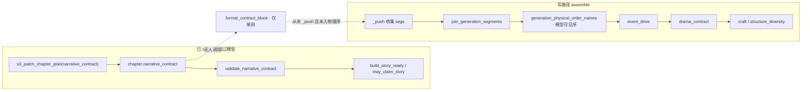
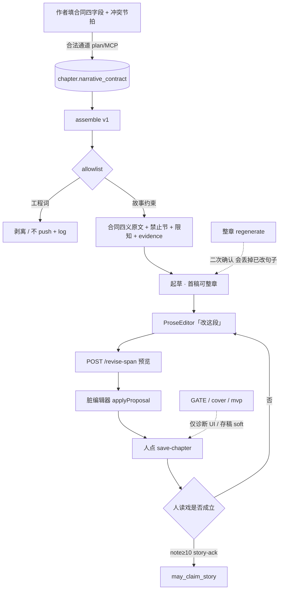
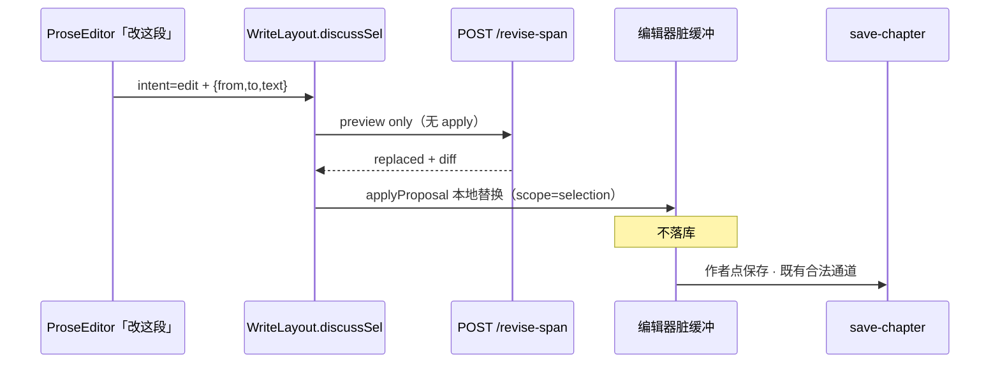
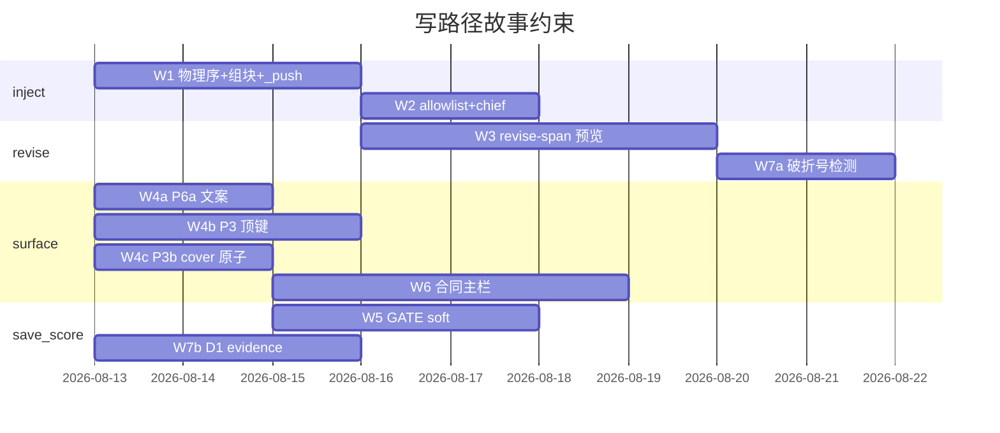
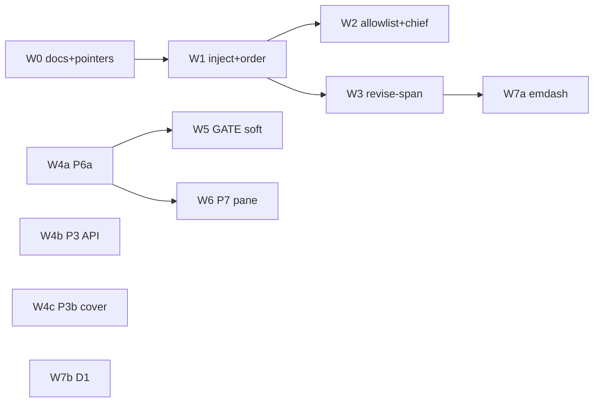

# 写路径只见故事约束 · 一句句改（Write-Path Story Constraints）

| 项 | 值 |
|----|----|
| **短名** | `write-path-story-constraints` / `写路径故事约束` |
| **文档状态** | **Superseded for schedule/defaults by R8** · 规格附录仍有效 · R3 |
| **作者** | Grok Design（待人审签） |
| **日期** | 2026-08-13 |
| **产品** | 铜炉 / tonglu · 代码 `scribe3/` |
| **仓库** | `/home/admin/projects/scribe-writing-system` |
| **建议落仓** | `docs/plans/2026-08-13-write-path-story-constraints.md` |
| **验证环境** | **仅已部署 demo** `https://tonglu.example.com` · SSH `ubuntu@203.0.113.10` · 应用 `/opt/scribe3/app` |
| **运维 env SSOT** | **`/opt/scribe3/app/.env`**（不是 `.env.production.local`） |
| **合法写通道** | orch proposal/apply、`save-chapter`、intent-goals、MCP `s3_patch_chapter_*` / `s3_add_chapter`；**禁止** EMERGENCY 默认。`POST /revise-span` / `s3_revise_span` **v1 只预览，不落库**，不算第三条正文覆写通道 |
| **最终方案入口** | [`docs/plans/2026-08-13-final-good-novel-plan.md`](./2026-08-13-final-good-novel-plan.md)（北极星） |
| **实施入口** | [`docs/plans/2026-08-13-final-improvement-r8.md`](./2026-08-13-final-improvement-r8.md)（排期 / 作者默认 / W5×W8×W9 裁断） |
| **产品完成 SSOT** | `docs/plans/2026-08-13-narrative-engine-product-mainline.md`（宣称/存稿 soft/UI 表面） |
| **技术附录** | `docs/plans/2026-08-13-narrative-mainline.md`（schema / beat_shape / claim 旗） |
| **本设计定位** | **写路径执行层**：回答「合同为何没进 prompt」；钉死 **故事约束注入 / 工程门禁进模型 / 默认 span 修订**；并把 product-mainline **未落地断点 B1–B10 全部接线** |
| **禁令** | 禁 human-blind ≥9.5 当产品门；禁 Grok 机全量 `npm ci` / 本机 Surreal / 第二栈 |

> **与 product-mainline 的 supersede 关系（钉死 · 防双实施 SSOT）**  
> | 层 | 以谁为准 |  
> |----|----------|  
> | 完成/宣称公式、`may_claim_story`、FORBIDDEN 键 | **product-mainline** |  
> | 存稿 soft **真值表 / flag 解析伪代码 / HTTP 样例** | **product-mainline §4.2**（本设计 **不重写** 第二套表） |  
> | cover clamp **原子语义**（STORY=0 强制参与、unset→出 claim、显式 1 过渡） | **product-mainline §7.1 / P3b** |  
> | P3 顶键 `story_ready`、craft-gates JSON（`ok_meaning` / `story_pass`）、flag 关仍预热 | **product-mainline §API** |  
> | P6a 字段优先级、P7 主栏树 | **product-mainline §4.3 / §6** |  
> | chief / craft-loop 完成话术 | **product-mainline P4** |  
> | **写路径注入载荷 + 物理序 + allowlist + span 修订** | **本设计**（升级 §9：不得 `_push(format_contract_block)` 原文） |  
> **实施排期**：**以 R8（`2026-08-13-final-improvement-r8.md`）W\* 为准**。本文保留 allowlist / span / 组块细表；作者默认边界（W5 soft、不关 explore、W9 无字数地板、W10 不进 draft）以 R8 裁断为准。规格细节仍引用 product-mainline §x。  
> 本设计 **不重开宣称旗**；demo `STORY_COMPLETE=1` 已生效。

---

## Overview

合同已落库、demo 宣称已切 `may_claim_story`，但起草时模型 **看不见叙事合同**。根因不是「没做合同模块」，而是 **assemble 真主路径漏接**：`write_assemble_v1._assemble_write_instructions_v1` 的 `_push` 有 `event_drive` / `drama_contract`，**从未** `_push("narrative_contract")`；`format_contract_block` 只在单测里被调用。这正是 product-mainline **P2 未做**。且模型可见序以 `generation_physical_order_names` 为准——只 `_push` 而不登记物理序，块会被排到 `final_reminder` 前，合同仍不优先。

同时，写作阶段把工程红绿灯和技法处方（GATE、长短句、压迫感、craft）喂给模型，产出冷短句、对白中句「——」急转、合同账房词进嘴；落正文默认整章 regenerate。本设计把写路径改成：

1. **模型只见故事约束**（场面必须发生、限知、声口、不可逆证据）；**零工程门**。  
2. **合同进 prompt 但防泄漏**（四义行保留作者原文；禁词只进「禁止：」节，角色不得念条款）。  
3. **生成后修订默认收紧已有「改这段」** → `/revise-span` 预览；整章降为「重写整章」。  
4. **B1–B10 接线排期**；product-mainline 规格不另写第二套真值表。

---

## Background & Motivation

### 本会话已证实的痛点（代码 + demo + 评测 · 勿当未核实）

| # | 事实 | 锚点 |
|---|------|------|
| 1 | 合同已落库；demo `STORY_COMPLETE=1` | `store/chapters.py` 读写 `narrative_contract`；MCP `s3_patch_chapter_plan(narrative_contract=)`；`/opt/scribe3/app/.env` |
| 2 | assemble **未** `_push("narrative_contract")` | `write_assemble_v1.py` `_render_final_input`：有 `_push("event_drive")` L236、`_push("drama_contract")` L260；**全文件无** `narrative_contract` / `format_contract_block` import |
| 3 | `format_contract_block` 存在但未接线 | `narrative_contract.py` L234–248；仅 `tests/test_narrative_contract.py` 调用 |
| 4 | 模型被注入长短句/压迫感/craft | `structure_style.structure_diversity_block`「长短交错」；`craft.py` ENGINES `temperature`「节奏切换（长短句）」+ PALETTE「被关在笼子里」压迫感；`write_assemble_v1` prefix 恒注入 |
| 5 | 产出冷短句 + 对白破折号急转 + 合同词进嘴 | 深度评测：诚实稿 ch20–22 冷锅婆/灰狸引号内「——」中句急转；用户一眼看出 |
| 6 | 冷锅婆不像老太婆 | 评测：原文村妇用称谓/省略号迟疑，不以「——」做反转拼接 |
| 7 | 工程门仍挡存稿 | **standard 长文** GATE-B 仍 409（`verify_craft_compliance.py` L1097–1106 → `misc_routes.save_chapter` L481–490）。短稿 `< _PROSE_ENFORCE_MIN` 放行；`create_mode=explore` 可 soft；`skip_craft_gate` 仍存在（产品禁令）。**`danger_draft` 只旁路 finalize，不旁路 GATE-B**（save 先 craft 再 finalize）。finalize AI-grade 可 409，与 craft **正交** |
| 8 | 评分环 D1–D7 词表代理冲突，停环伪收敛 | `scripts/score_narrative_chapter.py` D1=`CONF_LEX`+对白条数；ch16–19 刷分被 skeptic 打回；连续 Δ&lt;0.2 停环 |
| 9 | 对标《乱世铜炉》差在人间秩序/群像机关/笑闹切异变/说书人，**不在更碎短句** | 评测 report + `乱世铜炉.md` |
| 10 | product-mainline **P2/P5/P6a/P7 均未做** | 仓库无 `GATE_SAVE_MODE`；`readerReadyGate.js` 仍「机判过关」；`ChapterMetaPane` 仍「材料够了，可以开写」 |

### 1. 为何合同没进 prompt：代码级根因



> **KD-W14**：`_push` 调用序 ≠ 模型所见序。未列入 `generation_physical_order_names()` 的段名**不会被丢**，但会被 `ordered_generation_segments` 排到 `final_reminder` 之前（`context_budget.py` L475–480）。验收必须以 **join 后 `order_indices`** 为准。

**谁该 push、谁漏了**

| 角色 | 路径 | 状态 |
|------|------|------|
| **真主路径** | `scribe3/api/services/write_assemble_v1.py` → `_assemble_write_instructions_v1` → 内嵌 `_render_final_input` → `_push(name, layer, text)` | **漏** |
| 合同格式化 | `narrative_contract.format_contract_block` | **已写、未调用** |
| 读章入口 | `st.get_chapter(chapter).get("narrative_contract")` | store **已能读**（`store/chapters.py` L396–409） |
| 兼容投影 | `migrate_contract_from_drive` / `project_drive_from_contract` | 已写；assemble **未用** |
| 设计指定落点 | product-mainline **§9 / PR-P2**：「在 `event_drive` 前 `_push("narrative_contract", "redline", format_contract_block(...))`」 | **PR 未合** |
| 技术附录指定 | narrative-mainline **§5.4 / PR-5**：经 `write_assemble_context` 注入 | **亦未合**；且验收应以 v1 envelope 为准 |

**现网 `_push` 收集序（2026-08-13 核实 · 节选）≠ 模型所见**

```text
# write_assemble_v1._render_final_input 收集：
prefix → event_drive → drama_* → envelope → craft → … → final_reminder
# 全文件 grep narrative_contract / format_contract_block → 0 命中

# 模型所见 = join_generation_segments → generation_physical_order_names()
# context_budget.py L766+ 现网表头：
prefix → event_drive → drama_contract → drama_vacuum → [outline] → envelope → …
# 表中无 narrative_contract → 若只 _push 不登记，块会落到 final_reminder 前
```

**与 P2 未做的关系（一句话）**

> 合同 SSOT、宣称公式、MCP 扩参、demo 开旗都已做完；**唯独「让起草模型看见合同」这一厘米没接**。作者填了四字段，claim 能判 `contract.ok`，Hermes 仍只看见 `narrative_drive` 摘要 + 戏剧 GCD + craft 技法。P2 就是这厘米；本设计在 P2 之上再加 **禁词只进「禁止：」节**（字段行保留作者原文）和 **工程词 allowlist**，并 **强制登记物理序**，避免「接上了但块在文末 / 模型照抄条款当台词」。

**次因（会加重泄漏，即使接上 P2 原文也会坏）**

`format_contract_block` 现实现：

```234:248:scribe3/narrative_contract.py
def format_contract_block(contract: Any, *, max_chars: int = 180) -> str:
    ...
    lines = [
        "【叙事合同】",
        f"欲望：{(c.get('desire') or '')[:40]}",
        f"阻力：{(c.get('obstacle') or '')[:40]}",
        f"回合：{(c.get('turn') or '')[:40]}",
        f"代价：{(c.get('cost') or '')[:40]}",
    ]
```

四字段 **原文** 进 prompt → 模型把「拒交匙 / 勾半笔 / 暂不深探」当必须出口语。product-mainline §9 若原样落地，会制造本会话已见的合同词进嘴。

### 2. 工程门透出给模型 / UI 主灯

| 出口 | 现状 | 伤害 |
|------|------|------|
| 写路径 prefix | `structure_diversity_block`「长短交错」；`craft.py` temperature「长短句」+ 压迫感身体句 | 冷短句当文学 |
| 主编种子 | `chiefSeed.js` `gateHint: 'GATE-B B1/B2/B3…'`；「须非空 / ≥3 条」 | 代理先齐脚手架=完成 |
| 章契约 UI | `chapterContractGate.js` synopsis/truth ≥80 **error**；beats MIN=3 **error** | 材料齐=可开写 |
| 主栏文案 | `ChapterMetaPane.jsx` L261「材料够了，可以开写」 | 完成感 |
| 双灯 | `readerReadyGate.js`「可读：机判过关」；`WriteLayout` toast「机判可读」 | 机判=完成 |
| 存稿 | standard **长文** GATE-B **409**；finalize AI-grade 可 409（正交） | 短稿/explore soft/skip 另计；`danger_draft` **不能**绕过 GATE-B |
| API | `GET /craft-gates` 顶层 `ok=ga∧gb∧gc∧gd`；`claims.may_claim_scaffold` | e2e/CLI 当旅程完成 |
| 评分 | D1 CONFLICT_LEX 当压力 KPI | 刷词停环 |

### 3. 整篇改是默认路径（正文主表面已有「改这段」，但仍走全量 chat）

| 已有资产 | 现状（2026-08-13 核实） | 为何不够 |
|----------|-------------------------|----------|
| `ProseEditor.jsx` L242–255 气泡 **「改这段」** | 正文主修订入口 | `intent=edit` → `WriteLayout.discussSel` |
| `WriteLayout.jsx` `discussSel` L674–691 | seed「给我 2-3 个侧重不同的候选」+ `focusChiefTab` | **仍走 `/chat/write` 全量 assemble** |
| `applyProposal.js` | `scope=selection` + 选区偏移替换；`scope=chapter` 整章覆盖 | 围栏若回 chapter 会丢掉已改句 |
| `ChapterStudio` / `RichEditor` | 草稿同样 `selEditPrompt` → 右栏主编 | 同路径 |
| `SelectionQuoteActions` | 存 / 引入 / 聊；**无改稿钮** | **不是**手稿主表面；只作大纲/设定摘录次入口 |
| `_write_revision_block` | prompt 已写「默认 span」 | 无 API 牙齿 |
| `_write_protocol_block` | `scope=chapter` 列第一位 | 模型倾向整章围栏 |
| `chapters.py` loop L112–115 | **只认 `scope=chapter`** 当整章 regenerate | 与 ConfirmDialog「重写整章」单独列；**禁止**和选区修订混用 |

Janice Hardy：revision 是在已有场次上改传达，rewrite 才动骨头。Writer's Digest：定稿是逐句选词。Gotham：先一章一场。**用整章再生假装修订 = 丢掉已改过的句子。**

**B3 牙齿必须咬 `discussSel` /「改这段」**，不是只给 `SelectionQuoteActions` 加钮。

### 4. 对标与写作经验（检索补强）

对标《乱世铜炉》应抬的是：**村社岁时主层、群像改钱路、笑闹后切异变、说书评点、事变型章题**。不是更碎的短句。

写作工艺（见 References）：修订 ≠ 重写；定稿逐句；禁止清单比「写得文学」有效（眼神中透露出、段首写景、破折号）；中文设定应禁止对白中句「——」急转（token 癖好，非村婆口语）。

---

## Goals & Non-Goals

### Goals

1. **根因闭合**：assemble v1 `_push` **且**登记 `generation_physical_order_names`（合同在 `event_drive` 前）；单测锁 `order_indices` 与 allowlist。  
2. **写作阶段模型零工程门**：系统段不得出现 GATE / scene_cover / mvp / journey / 可开写 / 字数话术 / anti_stuffing 维名 / craft-gates；allowlist 在 join **前**按段剥，**跳过** `request_constraint`。  
3. **合同防泄漏**：四义行保留作者原文；禁词只进「禁止：」节（角色不得念条款）；**禁止**把「拒交」当账房黑话从欲望行剥掉。  
4. **默认一句句改**：收紧既有 `ProseEditor`「改这段」/ `WriteLayout.discussSel` → `POST /revise-span` **仅预览**；脏写编辑器 + 既有 `save-chapter`；整章 regenerate 二次确认。  
5. **断点 B1–B10 接线排期**（见闭合清单）；product-mainline 未做的 P\* **由 W\* 开工，规格细节仍引用 product-mainline**，本设计不另写第二套真值表。  
6. **评分降级词表**：D1 不再当完成 KPI；`evidence_must_show` 读序 = bindings 非空用之，否则投影 `pressure_drive` 楼梯。  
7. **验证**：仅已部署 demo 冒烟；合法写通道；revise-span 不落库。

### Non-Goals

| # | 非目标 | 理由 |
|---|--------|------|
| NG1 | 删除 `verify_craft_compliance` / finalize / Surreal | 基建保留；诊断仍需 |
| NG2 | 把声口破折号升为与冲突同级的 **claim hard 闸** | 评测已否决；写入约束+修订器即可 |
| NG3 | 重写 Pilot / 替换 Hermes / 全书 plot solver | 爆炸半径 |
| NG4 | LLM 文学分 / human-blind ≥9.5 当产品门 | 假绿禁令 |
| NG5 | 用通用不可逆动词表替代篇章锚定 evidence | 换一张词表仍可刷 |
| NG6 | EMERGENCY 默认；Grok 机全量测 / 本机 Surreal / 第二栈 | 纪律 |
| NG7 | 一夜改 `format_contract_block` 的 claim/UI 展示语义 | 展示仍用原文；写路径新函数也以原文四义行为主 |

---

## Proposed Design

### 一句话

```text
写作阶段模型可见 =
    合同四义（作者原文截断；禁词只在「禁止：」节）
  + 限知 / scene_truth 投影
  + 声口（bindings.scene_voice；缺省仅限知 + 禁对白中句「——」）
  + 本章 evidence_must_show（读序见 §F）
  + 前章已发生后果（短）

写作阶段模型不可见 =
    GATE-A/B、scene_cover、craft-gates.ok、mvp/journey、
    字数/Q1、D1–D7、停环、anti_meta 检测器 id、「可开写」、
    机判过关、AI-grade 红绿灯

落正文默认 = 手稿「改这段」→ revise-span 预览 → 脏编辑器 → save-chapter
整章 regenerate = ConfirmDialog「重写整章」+ confirm_full_rewrite（chapters.py 只认 scope=chapter）
宣称绿 = 仍走 may_claim_story（product-mainline；人 ack）
```

### 目标写作流



---

### A. Prompt 分层（写作阶段可见 vs 不可见）

#### A.1 对照表（工程门 vs 故事约束）

| 类别 | 项 | 写作 prompt | 诊断 UI / API | 存稿 | 宣称 `may_claim_story` |
|------|----|-------------|---------------|------|------------------------|
| 故事 | 合同四义（作者原文 + 禁止节） | **注入** | 主栏可编原文 | 不挡 | **hard** `contract.ok` |
| 故事 | 冲突节拍形态 | 可注入「必须发生的动作」人话 | 主栏 shape | 不挡 | **hard** ≥1 shape_ok |
| 故事 | 限知 / scene_truth | **注入**（已有 focalizer / deduce） | 二级 | 不挡 | 不进公式 |
| 故事 | 声口 + 禁破折号急转 + 禁合同词 | **注入**（约束，非闸） | 修订器可修 | 不挡 | **不**进 claim |
| 故事 | `evidence_must_show` 1–3 条具体句 | **注入** | 人标 | 不挡 | 不进 v1 claim；进评分 **D1**（§F.2） |
| 故事 | 前章后果短摘要 | **注入**（continue_snapshot 已有则去重） | — | — | — |
| 工程 | GATE-A/B `.ok`、beats≥3、synopsis/truth 80 | **禁** | 材料折叠 | Phase B **soft** | **禁** |
| 工程 | scene_cover / mvp_pass / journey_pass | **禁** | 诊断 | 不挡 | **禁**（demo cover 已出 claim） |
| 工程 | craft-gates 顶层 ok | **禁** | `scaffold_ok` + role | — | **禁** |
| 工程 | 字数 / Q1 / WORDCOUNT | **禁** | soft 诊断 | 不挡 | **禁** |
| 工程 | D1–D7 / 停环 | **禁** | 评分卡次级 | — | **禁**（写作协议 ≠ claim） |
| 工程 | anti_meta 规则原文 / 检测器 id | **禁**；可留一句「不要写验收腔」 | 护栏灯 | 默认不 409 | **hard** 挡 claim |
| 工程 | 「材料够了可以开写」 | **禁** | 改「材料参考」 | — | **禁** |
| 工程 | finalize AI-grade | **禁**进 instructions | 诊断 | 可仍 409（正交；danger_draft） | 不进 v1 claim |
| 工程 | `may_claim_scaffold` | **禁**当完成话术 | deprecated | — | **禁** |

#### A.2 注入块：新函数，不复用原文 `format_contract_block`

**模块分工（只准这一套，禁止双 helper）**

| 模块 | 职责 |
|------|------|
| `scribe3/story_constraint_prompt.py` | **纯函数、零 store IO**：组块、禁词节、voice 缺省句 |
| `scribe3/api/services/write_assemble_context.py` | **唯一 IO**：`load_chapter_story_inputs(st, chapter)` 读合同 / evidence / voice / 前章后果 |

**v1 保守策略（可测不变式 · 否决同义改写欲望）**

不实现会把「拒交铜匙」改成「把钥匙捂住」的 `rewrite_field_as_scene`。「拒交」是回合动作，与 `TURN_COST` / 对标正文同词，**不是**账房黑话。

```python
# 工程字段名 / 机检 id：永不进四义行
CONTRACT_META_BAN = frozenset({
    "conflict_beats", "shape_ok", "validation.ok", "narrative_contract.v1",
})

# 仅写入「禁止：」节，提醒角色不要念条款；不从欲望/阻力/回合/代价行剥离
DIALOGUE_CLAUSE_BAN = frozenset({
    "勾半笔", "减半笔", "暂不深探",  # 机检黑话 / 作者备忘
    # 「拒交」「勾账」可以留在四义行（戏核动词）；禁止的是「必须说出口」
})

def field_line(kind: str, text: str, *, max_chars: int = 40) -> str:
    """四义行 = 作者原文截断。只删英文字段名/机检 id 子串，不做同义改写。"""
    t = (text or "").strip()
    for tok in CONTRACT_META_BAN:
        t = t.replace(tok, "")
    return f"{kind}：{t[:max_chars]}"

def format_story_constraint_block(
    contract: dict | None,
    *,
    evidence_must_show: list[str] | None = None,
    prior_consequences: str = "",
    voice: dict | None = None,
    max_chars: int = 420,
) -> str:
    """空合同 → ""。四义行原文；禁止节 = 四字段整句 + DIALOGUE_CLAUSE_BAN。"""
```

**不变式（单测锁）**

| # | 输入 | 欲望/回合行 | 「禁止：」节 |
|---|------|-------------|--------------|
| 1 | desire=`拒交铜匙、挨过夜审` | **可以**出现「拒交」「钥匙」「夜审」 | 含该**整句**；含「角色嘴里不得复述合同原句」 |
| 2 | 同上 | **不得**出现「必须说出拒交」 | — |
| 3 | desire=`他今晚想把钥匙捂死`（已是口语） | **原样**（截断外一字不改） | 仍列整句 |
| 4 | desire 含 `validation.ok` | 该英文字段名被删 | — |
| 5 | 无 voice | **不得**出现「冷锅婆」；只有限知 + 禁对白中句「——」 | — |

**目标块形态（示例 · 铜炉书可另挂 `scene_voice`，默认模板禁止写死角色名）**

```text
【本章必须发生的场面】（写戏，不要念条款）
欲望：拒交铜匙、挨过夜审
阻力：（作者原文截断）
回合：（作者原文截断）
代价：（作者原文截断）
必须留下的痕迹：
- （evidence_must_show 投影，最多 3 条）
禁止：
- 角色嘴里不得复述上面四行原句，也不得把「勾半笔」「减半笔」「暂不深探」当出口语
- 对白里不得用「——」做中句急转（迟疑用「……」或把话掐断另起一句）
限知：只写焦点者此刻能看见/听见/摸到的
```

若 `bindings.scene_voice.register` 有值（如 `elderly_village`），再追加一句该 register 的声口人话；**缺省不加村婆专名**。

**不注入什么**

- `GATE` / `gate_a` / `gate_b` / `scene_cover` / `mvp_pass` / `journey_pass` / `craft-gates` / `ok=true`
- `WORDCOUNT` / `Q1` / `prose_cn` / `anti_stuffing` / `CONF_LEX` / 带上下文的 `D1–D7` 维名
- 「材料够了可以开写」「机判过关」「beats≥3 才算完成」
- `CONFLICT_LEX` 词表本身
- anti_meta 检测器 id 列表

**保留 `format_contract_block`**：给 UI 摘要 / 调试；**写路径禁止调用它**。单测锁：`write_assemble_v1` 不得 import `format_contract_block`。

#### A.3 `_push` 落点 + 物理序登记（B1 · W1 强制同步）

**两步缺一不可**：① `_render_final_input` 在收集 `event_drive` 前 `_push("narrative_contract")`；② **同一 PR** 把该名登记进模型可见序。只做 ① = 块被排到 `final_reminder` 前，KD-W3 对模型不成立。

```python
# write_assemble_v1.py · _render_final_input
from scribe3.api.services.write_assemble_context import load_chapter_story_inputs
from scribe3.story_constraint_prompt import format_story_constraint_block
_inputs = {}
try:
    _inputs = load_chapter_story_inputs(st, chapter)  # IO 只在这里
except Exception as _sf_e:
    soft_fail("write_assemble_narrative_contract", _sf_e, ...)
_nc_txt = format_story_constraint_block(**_inputs) if _inputs else ""
if _nc_txt:
    _push("narrative_contract", "redline",
          _domain_input(f"chapter:{chapter}:narrative-contract",
                        "narrative_contract", _nc_txt))
```

**W1 必须同改（登记表）**

| 文件 | 改动 |
|------|------|
| `context_budget.generation_physical_order_names` | `prefix` 后、`event_drive` **前** 插入 `"narrative_contract"` |
| `GENERATION_SEGMENT_LAYERS` | `"narrative_contract": "redline"` |
| `L0_NEVER_CUT` | 加入 `"narrative_contract"`（层已是 redline；显式列名防日后改层） |
| `injection_registry.SEGMENT_REGISTRY` | `SegmentMeta("narrative_contract", "L0", "head", "redline")` 紧挨 `event_drive` 前 |
| `DRAMA_CORE_NAMES` | **建议**加入（合同是戏核，进 drama 密度观测） |

**单测锁**

```text
含 narrative_contract 段时：
  order_indices["narrative_contract"] < order_indices["event_drive"]
  "narrative_contract" in generation_physical_order_names()
  "narrative_contract" in L0_NEVER_CUT
现有物理序测更新：test_novel_first_injection.py / test_p1_scheme.py
```

| 项 | 钉死 |
|----|------|
| 模型可见序 | **`generation_physical_order_names`**，不是 `_push` 源码调用序 |
| fail-soft | 缺列 / 非法 / 抛错 → **不 push** + `record_write_soft_fail("narrative_contract_skip")` |
| 空四字段 | 返 `""` → 不 push |
| 与 drive 去重 | 合同块非空 → `event_drive` 截到 ≤120 |
| 与 drama 去重 | `_drama_block` 不删；**禁止** drama 渲染贴 GATE/条数 |
| helper | IO = `write_assemble_context.load_chapter_story_inputs`；纯组块 = `story_constraint_prompt` |
| flag | `NARRATIVE_CONTRACT` 关时有列仍 fail-soft 注入 |

#### A.4 Allowlist 过滤器（B2 · 写作 prompt 零工程词）

新纯函数 `scribe3/prompt_allowlist.py`。

**接线钉死（可执行落点）**：在 `_render_final_input` **内部**、`apply_soft_activation` **之后**、`join_generation_segments` **之前**，对仍带 `name` 的 `segs` 调 `strip_engineering_leaks_segments`。**跳过** `name == "request_constraint"`（作者原话若讨论「这一章别搞得像 GATE 过关」不得被剥）。

**禁止**：在 `guard_write_instructions` 处剥 `compiled.rendered_input` 整串（该处已无段名，会误伤作者原话）。禁止包 `_push`（会误扫作者段）。

现网锚点：`write_assemble_v1.py` L568–589（soft_activation 后、`joined, bud_rep = join_generation_segments(segs, …)` 前）。`guard_write_instructions` 在 compile 之后只吃整串（约 L831–838），**不得**在那里做 allowlist。

**顺序**：W2 **先改源头**（structure_diversity / 写路径 craft / discourse_soft tip / chief），allowlist 只剥回潮残留。现网 prefix 几乎不含这些工程词。

```python
ENGINEERING_LEAK_PATTERNS: tuple[re.Pattern, ...] = (
    re.compile(r"\bGATE-[AB]\b", re.I),
    re.compile(r"gate_[ab]\.ok", re.I),
    re.compile(r"scene_cover"),
    re.compile(r"mvp_pass|journey_pass|PASS_FORMULA"),
    re.compile(r"craft-gates|\bcraft_gates\b"),
    re.compile(r"WORDCOUNT|prose_cn\s*>=?\s*\d+"),
    # 禁止裸 \bD[1-7]\b（会误伤「D3 巷」「D2 型」）
    re.compile(r"D[1-7]\s*[–\-]\s*D[1-7]|anti_stuffing|CONF_LEX"),
    re.compile(r"可开写|机判过关|材料够了"),
    re.compile(r"anti_meta\.\w+|claim_blocking"),
)

SKIP_SEGMENT_NAMES = frozenset({"request_constraint"})

def strip_engineering_leaks_segments(segs: list[dict]) -> tuple[list[dict], list[str]]:
    ...
```

**单测锁（强制）**

```text
系统段不得出现：GATE / scene_cover / mvp_pass / journey_pass / 可开写 / 机判过关
必须出现：【本章必须发生的场面】
禁词只许出现在「禁止：」列表
作者 request_constraint 含「城门闸」「D3 巷」「这一章别搞得像 GATE 过关」→ 原文保留
```

**prefix / 话语源降噪（W2 · 先源头）**

| 块 | 动作 |
|----|------|
| `structure_style.structure_diversity_block` | 写作阶段删「长短交错」；改为「按场面需要换段，勿为交错而交错」 |
| `build_craft_block` **写路径分支** | **只改写路径注入**（`write_assemble_v1` 的 craft 段）。讨论/仪表盘/质检面板仍可读完整技法。写路径去掉 temperature「长短句」工具句与「笼子里」处方 |
| `discourse_craft_ssot.py` | 仍有 tip「交错长短句…」（可经 `discourse_soft` 进写路径）。W2 **同改该 tip** 或 `prepare_write_discourse_soft` 写路径剥离该句 |
| `_write_protocol_block` | `scope` 默认 **selection**；`chapter` 标明「仅作者明确要求整章重写」 |
| `_anti_slop_floor_block` | 保留禁 AI 腔；「市井侧笔」改人话，去掉配额口吻 |
| `_final_reminder` | 可留声口/限知；**不得**加 GATE/字数 |
| `chiefSeed` GATE-B hint | **B10** |

---

### B. 合同注入防泄漏（B1 的质量约束）

**原则**：合同是 **作者给系统的戏核**，不是角色台词库。v1 **不改写**戏核动词。

| 层 | 做什么 |
|----|--------|
| 四义行 | 作者原文截断；只剥英文字段名/机检 id |
| 禁止列表 | 动态：四字段**整句** + `DIALOGUE_CLAUSE_BAN`（勾半笔/减半笔/暂不深探）；**不**把「拒交」「勾账」从欲望行删掉 |
| 修订器 | 选区对白内「——」急转、整句条款进嘴 → 改口语 |
| 质检 | `03_style.py` 现网引号内跳过破折号（L76）。加 `find_dialogue_emdash_pivot`：advisory，**不**进 claim（B8） |

作者字段已是口语 → 四义行原样。Q1 关闭：v1 **规则且保守**；不做 LLM 转写，也不做「拒交→捂住」词典。

---

### C. 一句句改（B3 · 默认修订器）

#### C.0 主路径钉死（KD-W15）

**默认修订 = 收紧已上线的手稿选区，不是新开平行入口。**



| 入口 | 角色 | v1 行为 |
|------|------|---------|
| `ProseEditor.jsx` 气泡 **「改这段（只动选区）」** | **主表面** | `discussSel` **改调** `POST /revise-span`，不再 seed 全量 `/chat/write` |
| `WriteLayout.discussSel` intent=edit | **主接线** | 同上；候选条展示 1 个 span 结果（可保留「再要 2–3 个」走旧 chat，须观测打到哪条 API） |
| `ChapterStudio` 草稿 `RichEditor`「改这段」 | 同型 | 同 `revise-span` + dirty draft，不立即 saveDraft |
| `SelectionQuoteActions` | **次入口**（大纲/设定摘录） | 可加同一「改这段（只动选区）」；禁止当手稿主 CTA |
| 聊这段 | 不变 | 仍 seed 主编，不设 lastSel |
| 整章 | `chapters.py` loop **只认 `scope=chapter`**（L112–115） | 入口文案 **「重写整章」** + `ConfirmDialog`「会丢掉已经改过的句子」 |

**为何还要新 HTTP（Alt-6）**：已有 `⟦PROPOSAL scope=selection⟧` + `applyProposal` 能换字，但生成仍走全量 assemble（craft/记忆/GATE 词），模型可回 `scope=chapter`。新 API 强制小上下文、禁整章、可单测。旧围栏：**手稿「改这段」退役为 revise-span**；chat 讨论/多候选可暂留 PROPOSAL selection，观测 `revise_span` vs `chat/write` 点击比。不把 `apply=true` 算合法写通道。

#### C.1 模块与 API（v1 **禁止** `apply=true`）

**新模块** `scribe3/revise_span.py`（纯函数 + 薄读章；**不**调用 `st.save_chapter`）：

```python
@dataclass
class SpanTarget:
    start: int | None = None
    end: int | None = None
    line: int | None = None
    quote: str | None = None

def resolve_span(prose: str, target: SpanTarget) -> tuple[int, int]: ...
def make_unified_diff(old: str, new: str, *, n: int = 2) -> str: ...

SPAN_REVISE_SYSTEM_MAX = 400

def span_revise_system() -> str:
    """≤400 字：只改选区、禁整章、禁合同词进嘴、禁对白中句「——」急转。"""

def run_span_revise(
    *,
    quote: str,
    instruction: str,
    constraint_block: str,
    complete_fn=None,
) -> str:
    """调现网 write complete。默认 scribe3.llm.hermes_complete(prompt, system)。
    禁止 _assemble_write_instructions_v1；禁止 _collect_write（会走围栏/工具）。
    complete_fn 可测注入，签名 (prompt, system=None) -> str。
    """
```

**LLM 入口（恢复 · 钉死三行）**

1. **调用** `scribe3.llm.hermes_complete(prompt, system=…)`（与 critique 定向改写、`write.py` post-check 纪律判同一薄 complete 族；测试注入 `complete_fn`）。`with_tools=False`；**不要** `_collect_write`（那是整章/围栏收集器）。  
2. **系统块** = `span_revise_system()`（硬帽 ≤400 字）+ `format_story_constraint_block(...)`（可再截）。user = 选区 ±2 句 + `instruction`。  
3. **禁止**走 `_assemble_write_instructions_v1` 全量 envelope（会再灌 craft/记忆，诱发整章）。

失败：LLM 超时/空串/抛错 → HTTP **503** `llm_failed`（soft：不落库、不脏写）。实现者不得做成「纯规则去破折号」当 v1 唯一路径（规则可作 fallback，但默认必须走 complete）。

**HTTP** `POST /revise-span`（鉴权、work 隔离）：

```json
{
  "work": "main", "seq": 20,
  "target": {"quote": "香债——今晚就得清", "from": 182, "to": 193},
  "instruction": "改成口语，去掉破折号，别把合同原句塞进嘴里",
  "mode": "span"
}
```

`mode`: `span` | `word`。**v1 不接受 `mode=chapter`**（整章走现有 regenerate + ConfirmDialog）。**请求体不得含 `apply`**；出现则 400 `apply_not_supported`。

**成功 200**（恒 `applied: false`）

```json
{
  "status": "ok", "mode": "span",
  "replaced": "香债……今儿个先把锅填热，别的明儿说。",
  "start": 182, "end": 193,
  "diff": "@@ …",
  "applied": false
}
```

| 项 | 值 |
|----|-----|
| 落库 | **永不**。预览 → 编辑器脏写（`applyProposal` 本地）→ 作者 `save-chapter` |
| 为何禁 apply | 避免第三条正文覆写；MCP 直写会绕章锁 / craft / finalize / ingest。W3 先于 W5 时 apply 还会 GATE-B 409 |
| 模型上下文 | `hermes_complete`：选区 ±2 句 + `span_revise_system`≤400 + 故事约束块 + instruction；**禁止**全量 v1 assemble |
| MCP `s3_revise_span` | **只预览**，与 HTTP 同表；**不**进合法写通道清单 |
| 退出标准 | 预览 200 + 编辑器可见替换即可；**不**测 apply 409 |

前端开关：`web/src/lib/featureFlags.js`（或现有 flags 模块）`reviseSpanEnabled`；关则「改这段」回退旧 `discussSel` seed chat。W3 files 必须列此开关。

#### C.2 前端文案

主表面统一 **「改这段（只动选区）」**（沿用已上线「改这段」，括号标明不整章）。整章入口统一 **「重写整章」** + 确认。禁止再发明「改这句」第二套动词。

预览条：原文 / 新句 / 写入选区（脏） / 丢弃。写入选区 **不**打 save。

**IA 一句**：起草可以整章一次；**改**走选区预览。与 `_write_revision_block` 对齐，第一次咬主路径。

---

### D. 门控降级（B2 存稿 + B4/B5/B6/B7）

**本设计不重写 product-mainline 真值表。** 下表只给 **开工指针**。规格正文以 product-mainline 各节为准。

| 断点 | product-mainline | 本设计开工 PR | 本设计额外约束 |
|------|------------------|---------------|----------------|
| 存稿 soft | **§4.2 全文**（MODE / STRICT / 弃用别名 / HTTP 样例 / explore 矩阵） | **W5**（= 其 P5） | 写路径零工程词已由 W2 保证；toast 不写「验收通过」 |
| P6a 文案 | **§4.3 / §6.1**（`dualLampChips` 字段优先级） | **W4a** | 不与 cover 捆 PR |
| 顶键 story_ready / craft-gates / scaffold | **§API A/B/D、P3**（flag 关仍预热；`ok_meaning` / `story_pass`） | **W4b**（= 其 P3） | — |
| cover 原子 | **§7.1 / P3b**（STORY=0 强制参与；unset→出 claim；显式 1 过渡；FORBIDDEN 测） | **W4c**（= 其 P3b，**单独原子 PR**） | 禁止与 P6a 捆在一起 |
| 合同主栏 | **§6.2 / P7** | **W6**（= 其 P7） | 连标题/红字一起改（见下） |
| chief 话术 | **P4** | **W2** 吸收 B10 | — |

仓库核实（开工前事实，非新规格）：`feature_flags.py` **无** `GATE_SAVE_MODE`；`evaluate_save_craft_gate` 仅 explore 可 soft；`scene_cover_in_claim()` 用 `_flag(..., "0")`，registry 仍 `"1"`，`clamp_claim_flags` 另套——**必须按 P3b 原子修，本设计不另写伪代码**。

#### D.3 W6 文案范围（补充 product-mainline P7，不替代其 IA 树）

只改一句绿字不够。W6 **同改**：

| 现文案（`ChapterMetaPane.jsx`） | 目标 |
|--------------------------------|------|
| L255「开写前要齐的材料」 | 「材料参考」（或「章前材料」） |
| L258「还不齐 · 不建议开写」 | 「材料还可再写」；禁完成感 |
| L261「材料够了，可以开写」 | 删除或改「材料参考已填」 |
| `chapterContractGate` 80 字 / beats≥3 **error** | **info**（规格见 product-mainline P7） |

**evidence 主栏语义（与 §F 一致）**：主栏「必须留下的痕迹」= 人标 traces；**与压力楼梯同一语义**。非空 `bindings.evidence_must_show` **覆盖**展示；空则只读投影 `pressure_drive` 楼梯（可一键「采用为痕迹」写入 bindings）。不要第三套表。

代码/UI 对外可写「工艺门闩（材料诊断）」；产品叙述「工程门」= 同一物，文档混用时以代码标识符为准。

---

### E. 声口：对白破折号中句急转（B8）

**不是**与冲突同级的 claim hard。三处落地：

1. **约束**：故事约束块「禁止」节（A.2）。  
2. **修订器**：`revise_span` 若 `instruction` 空且选区含 `「…——…」` 中句急转，默认 instruction = 改口语、用省略号或掐断。  
3. **检测**：`critique` 新增 `dialogue_emdash_pivot`（只扫引号内、中句「——」后接转折/指控）；`severity=advisory`；**不**进 `may_claim_story`；可进 span 建议列表。

现网 `03_style.py` 引号内跳过破折号 —— **保留**密度规则给叙述层；对白另立检测，避免和「全章破折号‰」混成 AI-grade 409。

---

### F. 评分器降级词表（B9）

`scripts/score_narrative_chapter.py`（版本 `anti_stuffing_v3`；保留 v2 入口）。

#### F.1 `evidence_must_show` 读序（钉死）

```text
load_evidence_must_show(chapter) =
    bindings = chapter.narrative_contract.bindings.evidence_must_show
    if bindings 是非空 list（去空白后 ≥1 条）:
        return dedupe(bindings)[:3]          # 人标 traces，覆盖
    else:
        return project_pressure_stairs(chapter.pressure_drive)[:3]
        # 投影 irreversible.evidence_must_show + 各 stair.evidence_must_show
        # 截断去重；最多 3 条
    两者皆空 → []  → D1 = null（从 composite 剔除）
```

W6 主栏与评分 **同一函数**。作者只填过压力楼梯时，W7 **不会**「合法地」把 D1 打成 null。不要第三套动词表（NG5）。

#### F.2 各维

| 维 | 现状 | 目标 |
|----|------|------|
| **D1** | `CONF_LEX` + 独特对白 | **不再当压力/完成 KPI**。改为 `evidence_coverage`：上式列表是否在正文留痕（子串或 bigram Jaccard≥0.35）；列表空 → `null` |
| D2 | `TURN_COST`（含拒交/勾账） | **诊断计数**；满分不得仅靠词表 |
| D4 | `conflict_beats_ok` | 形态诊断；≠ 戏成立 |
| D5 | `prior_keywords` **已有参数**；`None` 才回落铜炉 13 词；另有写死 `core = ("香债", "侧门", …)` | 无传入 → **跳过或低权**；**同时**处理 `core` 硬编码（无传入时不要用香债核心集刷满分） |
| 停环 | 复合分连续 Δ&lt;0.2 | D1 封顶不再驱动停环；看 evidence 覆盖变化或人声明停 |

**claim 公式不变**。D1–D7 仍是写作验收协议。

---

### G. 写路径禁「先齐脚手架=完成」（B10）

`chiefSeed.js`：

```text
删/改：
  gateHint: 'GATE-B B1：synopsis 须非空…'
  'GATE-B B2：建议 ≥3 条…'
  SCAFFOLD 完成话术里任何「齐了才能算写完」

改为：
  「先写清欲望/阻力/回合/代价和一条冲突动作；大纲/节拍是材料参考，不是完成。」
  工具仍点名 s3_patch_chapter_plan（含 narrative_contract）
  保留 SCAFFOLD_FORBID_SAVE（脚手架不要用 save-chapter 冒充）
```

MCP 工具描述同步：`s3_patch_chapter_plan` 说明完成标准 = 故事合同 + 人读，**不是** GATE-B。

---

## 断点闭合清单（B1–B10）

| ID | 断点 | 本设计落点 | 开工 PR | 规格 SSOT |
|----|------|------------|---------|-----------|
| **B1** | 合同未进 assemble | `_push` + **物理序登记** + 保守组块 + fail-soft | **W1** | 本设计 A.2–A.3 |
| **B2** | 工程门透出模型/主灯 | allowlist（跳过 request_constraint）；源头去长短句；存稿 soft | **W2 + W5** | 写路径=本设计；soft=product-mainline §4.2 |
| **B3** | 整篇改 | `discussSel`→`/revise-span` **预览**；禁 apply | **W3** | 本设计 C |
| **B4** | P6a「机判过关」 | 文案束 | **W4a** | product-mainline §4.3 / §6.1 |
| **B5** | 合同主栏 IA | 主栏+连改标题/红字 | **W6** | product-mainline P7 + 本设计 D.3 |
| **B6** | story_ready 顶键 / craft-gates / scaffold | API 诊断化 | **W4b** | product-mainline P3 |
| **B7** | cover 原子 clamp | **单独原子 PR** | **W4c** | product-mainline §7.1 / P3b |
| **B8** | 对白破折号中句急转 | 约束 + 修订器 + advisory | **W1 + W3 + W7a** | 本设计 E |
| **B9** | 评分器降级词表 | D1=evidence 读序 | **W7b**（可与 W3 并行） | 本设计 F |
| **B10** | chief 先齐脚手架=完成 | `chiefSeed` + MCP | **W2** | product-mainline P4 + 本设计 G |

---

## API / Interface Changes

### 已存在（不改语义，只补顶键/诊断）

| 端点 | 增量 |
|------|------|
| `POST /story-ack` | 保持；P6a CTA 绑它 |
| `POST /save-chapter` | 顶键 `story_ready`；soft 时 `craft_gate.code=ok_gate_soft` |
| `POST /post-check` | 顶键 `story_ready` |
| `GET /craft-gates` | `scaffold_ok` + `role` + `story_pass` |
| `s3_patch_chapter_plan` | 已有 `narrative_contract`；文档改完成话术 |

### 新增 `POST /revise-span`（只预览）

见 §C.1。错误码：

| code | HTTP | 含义 |
|------|------|------|
| `span_not_found` | 404 | quote/line 未命中 |
| `span_ambiguous` | 409 | quote 多处命中，须给 start/end |
| `apply_not_supported` | 400 | 出现 `apply` 或试图落库 |
| `mode_invalid` | 400 | 未知 mode / v1 的 `chapter` |
| `llm_failed` | 503 | `hermes_complete` 超时/空/抛错；不落库 |

### 写路径 envelope / trace

`envelope_trace.budget_report.domain_lengths` 应出现 `narrative_contract` 键（可 0）。density 只观测，不当 KPI。

---

## Data Model Changes

| 存储 | 变更 |
|------|------|
| `chapter.narrative_contract` | **无新列**。可选 `bindings.evidence_must_show: string[]`（人标 traces，覆盖压力楼梯）；validate 宽松（缺省不否决 `contract.ok`） |
| 已有 `pressure_drive` 楼梯 `evidence_must_show` | **不改 schema**；空 bindings 时投影至此（§F.1） |
| `bindings.scene_voice` | 可选 `{register, ban_dialogue_emdash}`；缺省只有限知+禁对白中句破折号 |
| 新表 | **无** |
| 回滚 | 不 push / 关 `reviseSpanEnabled`；列保留 |

`validate_narrative_contract` **不**因缺 evidence 失败。

---

## Alternatives Considered

### Alt-1. 原样落地 product-mainline P2（`format_contract_block` 原文 `_push`）

| 利 | 弊 |
|----|----|
| 一行调用，已有函数 | **合同词进嘴**已在本会话实证；只解决问题「看不见」，制造问题「照抄拒交匙」 |

**否决为最终形态**；P2 的 **落点**（v1 `_push` + 物理序在 `event_drive` 前）采纳，**载荷**升级为本设计 **原文四义 + 禁止节**（不是 `format_contract_block` 无禁止节，也不是同义转写块）。

### Alt-2. 只靠 drive/drama，不注入合同

| 利 | 弊 |
|----|----|
| 少一块 prompt | 合同是作者 SSOT；drive 可空洞合成；本会话痛点正是合同未进模型 |

**否决。**

### Alt-3. 写作阶段继续注入 GATE/技法，靠事后 QC 删破折号

| 利 | 弊 |
|----|----|
| 少改 assemble | 模型先按处方写冷短句；质检引号内还跳过破折号；整章再生成毁掉逐句修改 |

**否决。** 禁止清单进生成前，比事后刷更有效（maliangwriter / 中文 AI 味实践）。

### Alt-4. 本设计：保守组块 + 物理序 + allowlist + 收紧「改这段」+ 门控降级

**采纳。** 增量 PR；宣称公式不重做；soft/cover 不另写真值表。

### Alt-5. 对白破折号进 `may_claim_story` hard

评测明确否决「声口与冲突同级硬闸」。**否决**；B8 走约束+修订器+advisory。

### Alt-6. 只扩展已有 `⟦PROPOSAL scope=selection⟧` + `applyProposal`，不新开 HTTP

| 利 | 弊 |
|----|----|
| 前端已通；`applyProposal` 偏移替换已测 | 生成仍走 **全量 assemble**；协议仍把 `chapter` 列前；loop 只认 chapter；无法单测「禁整章 / 小上下文」 |

**否决为唯一路径。** 采纳：手稿「改这段」改调 `POST /revise-span`（小上下文、禁整章、可单测）。旧围栏留给 chat 多候选/讨论；观测点击比。`apply=true` 落库 **否决**（第三条写通道）。

---

## Security & Privacy Considerations

| 主题 | 处理 |
|------|------|
| Auth / work 隔离 | `/revise-span` 与 save-chapter 同会话；禁跨 work |
| 落库 | revise-span **不写** store；唯一正文写仍是 `save-chapter` / orch / MCP plan |
| 日志 | 故事约束块 / 选区 **禁止**全文 dump；只记 span 长、mode、leak hit id |
| skip_craft_gate | 仍产品禁令 + audit（product-mainline KD-P15） |
| EMERGENCY | 默认关 |
| 整章 rewrite | ConfirmDialog「重写整章」 |
| 合同原文 | 存库仍是作者原文；prompt 四义行亦原文，禁词只在禁止节 |

---

## Observability

| 信号 | 用途 |
|------|------|
| `soft_fail narrative_contract_skip` | 注入失败率 |
| `engineering_leak_stripped` 计数 | allowlist 是否被 craft/chief 再污染 |
| `budget_report.domain_lengths.narrative_contract` | 块是否真进 envelope |
| `revise_span` 次数 vs 手稿「改这段」打到 `/chat/write` 的次数 | KD-W15 是否咬主路径 |
| `revise_span` vs `scope=chapter` | 是否还在整篇改 |
| `dialogue_emdash_pivot` advisory 计数 | 声口 |
| `scaffold_diag.ok ∧ ¬may_claim_story` | 工程齐≠故事完成（继承） |
| D1 `null` 率（无 evidence） | 防止静默退回词表 |

**demo 冒烟（本设计增量）**

```text
1) 有合同章：chat/write 的 trace/budget 含 narrative_contract；instructions 抽样无 GATE/可开写
2) 合同含「拒交」：instructions「禁止」节含该词；「欲望」行不含「必须说出拒交」
3) POST /revise-span quote 命中 → 200 + `applied:false`；带 `apply` → 400
4) 手稿「改这段」打到 `/revise-span`（flag 开）；无「机判过关」
5) GATE_SAVE_MODE=soft：缺材料长文 200 + warnings（规格见 product-mainline §4.2）
6) STORY=1 unset cover → clamp cover false（规格见 product-mainline P3b）
7) 物理序：`order_indices[narrative_contract] < order_indices[event_drive]`
```

---

## Rollout Plan



| 阶段 | 退出 |
|------|------|
| W1 上 demo | join 后合同在 drive 前；禁词只在禁止节 |
| W3 | 「改这段」预览 200；编辑器脏；无落库 |
| W4a | 无「机判过关」 |
| W4c | STORY=1 unset cover False（P3b 单测） |
| W5 | soft 存稿 200（§4.2） |
| W6 | 主栏合同；标题不再「开写前要齐」 |
| 回滚 | 不 push；`GATE_SAVE_STRICT=1`；`reviseSpanEnabled=false` |

运维：`/opt/scribe3/app/.env` + `./scripts/deploy_demo.sh`（或 `hot`）。**不要**等 GHA。

---

## Risks

| 风险 | 严重度 | 缓解 |
|------|--------|------|
| 转写把戏核改歪 | **高** | v1 **不改写**四义行；拒交可留在欲望行 |
| 只 `_push` 不登记物理序 | **高** | W1 强制序表+单测 `order_indices` |
| allowlist 误伤作者原话 /「D3 巷」 | 中 | join **前**按段剥、跳过 `request_constraint`；禁在 guard 剥整串；禁裸 `D[1-7]` |
| span 歧义 | 中 | quote 多命中 409；UI 用选区 offset |
| 第三条写通道 | **高** | v1 禁 apply；只预览 |
| 手稿「改这段」仍打 chat | **高** | 改 `discussSel`；观测 |
| soft 脏稿 | **高** | warnings；STRICT；finalize 正交 |
| D1 读空栏跳水 | **高** | 读序先 bindings 再 pressure 楼梯 |
| cover 半拉子 | **高** | **W4c 单独**按 P3b |
| 双实施 SSOT | **高** | W0 指针；本设计不重写真值表 |

---

## Open Questions

| # | 问题 | 建议默认 |
|----|------|----------|
| Q1 | 转写用规则还是小 LLM？ | **已关**：v1 规则且保守，**不**同义改写四义行 |
| Q2 | `revise-span` apply？ | **已关**：v1 禁止 apply |
| Q3 | finalize AI-grade 409 是否随 W5 变 advisory？ | **已决（用户 2026-08-13：不绑）**：W5 只 soft 工艺门闩（craft GATE）。finalize AI-grade 保持正交，可仍 409。`danger_draft` 仍只旁路 finalize，不旁路 GATE-B |
| Q4 | evidence 进 contract.ok？ | **否** |
| Q5 | `format_contract_block` 改签名服务写路径？ | **否** |

---

## References

### 仓库

- `docs/plans/2026-08-13-narrative-engine-product-mainline.md`（产品 SSOT；P2/P5/P6a/P7 未落地）
- `docs/plans/2026-08-13-narrative-mainline.md`（技术附录）
- 深度评测：`.../workflows/wf_019ff8abfb767ed191f67d9e7e08394e/scratch/report.md`
- 代码：`write_assemble_v1.py` · `narrative_contract.py` · `story_complete.py` · `reader_ready.py` · `verify_craft_compliance.py` · `finalize_gate.py` · `misc_routes.py` · `write.py` · `quality.py` · `feature_flags.py` · `craft.py` · `structure_style.py` · `write_assemble_blocks.py` · `pressure_drive.py` · `critique/rules_parts/03_style.py` · `scripts/score_narrative_chapter.py` · `web/src/ChapterStudio.jsx` · `chapterContractGate.js` · `readerReadyGate.js` · `WriteLayout.jsx` · `ChapterMetaPane.jsx` · `chiefSeed.js` · `SelectionQuoteActions.jsx` · `selAction.js`

### 写作工艺（检索）

- Janice Hardy, *The Difference Between a Revision, a Rewrite, and a Redraft*（revision = 在已有场次上改传达；rewrite 才动骨头）— http://blog.janicehardy.com/2018/02/the-difference-between-revision-rewrite.html
- Writer's Digest, *Mastering the Rewrite*（定稿「pore over each sentence」逐句选词）— https://www.writersdigest.com/write-better-fiction/mastering-the-rewrite-one-writers-journey-to-the-finished-draft
- Jessica Sticklor / Gotham, *The 10 Revision Stages of a Novel*（Draft 1：one chapter at a time；Draft 6：逐句语言）— https://www.writingclasses.com/toolbox/articles/the-10-revision-stages-of-a-novel
- 码良 Maliangwriter：禁止清单（眼神中透露出、破折号、段首写景）比「写得文学」有效；破折号超 3 处就删 — https://maliangwriter.com/blog/ai-writing-prompt-guide/ · https://maliangwriter.com/blog/ai-novel-editing-polishing-guide/
- 知乎实践：去 AI 味提示「不要用破折号解释」— https://www.zhihu.com/question/966797856/answer/1937072860540696290
- Sean Goedecke / NPR / Medium：em dash 是模型 token 癖好，指令可降但易复发，应用层禁止+修订更稳 — https://www.seangoedecke.com/em-dashes/ · https://www.npr.org/2025/11/10/nx-s1-5596088/inside-the-unofficial-movement-to-save-the-em-dash-from-a-i
- 对标文本：仓库 `乱世铜炉.md`（岁时、群像改钱路、笑闹切异变、说书评点、事变型章题）

---

## Key Decisions

| ID | 决策 | 理由 |
|----|------|------|
| **KD-W1** | 合同没进 prompt 的根因 = v1 `_push` 漏接，不是模块未写；等于 product-mainline **P2 未做** | 代码核实：assemble 无 import/调用 |
| **KD-W2** | 写路径 **禁止**调用 `format_contract_block`；新建 `format_story_constraint_block` | 四义行原文；禁词只进「禁止：」 |
| **KD-W3** | 合同在 **物理序**上位于 `event_drive` 前（登记 `generation_physical_order_names`）；`_push` 同时做；缺则 fail-soft；drive 截断 | 作者合同优先于模型所见 |
| **KD-W4** | 写作阶段 **零工程门**；allowlist 在 `_render_final_input` 内、join **前**按段剥，跳过 `request_constraint`；禁在 `guard_write_instructions` 剥整串 | 模型只应看见故事约束 |
| **KD-W5** | 技法处方（长短句/压迫感笼子）退出 **写路径** prefix；讨论/仪表盘可留 | 评测：差不在更碎短句 |
| **KD-W6** | 落正文默认 span 预览；整章走「重写整章」确认 | Hardy / WD / Gotham |
| **KD-W7** | 存稿 soft / 宣称 / P3/P3b/P6a/P7 **规格继承 product-mainline**；本设计只给开工 PR，**不重写真值表** | 防双实施 SSOT |
| **KD-W8** | 对白「——」急转 = 约束+修订+advisory，**不进** claim hard | 评测否决声口=冲突闸 |
| **KD-W9** | D1 = evidence 覆盖；读序 bindings → pressure 楼梯 → 皆空才 null | 防读空栏假降级 |
| **KD-W10** | chief/MCP 禁「先齐 GATE=完成」 | B10 |
| **KD-W11** | cover 按 product-mainline P3b **单独原子 PR**（W4c）；禁与 P6a 捆 | 防半拉子 |
| **KD-W12** | 合法通道 / 禁 EMERGENCY / 仅 demo / 禁 human-blind≥9.5 | 全局纪律 |
| **KD-W13** | 本设计 supersede product-mainline **§9 载荷**（禁止原文 format）；落点 = `_push` **+ 物理序** | 防照抄 §9 |
| **KD-W14** | 模型可见序以 `generation_physical_order_names` / join 后 `order_indices` 为准，**不是**源码 `_push` 调用序 | Issue 1 |
| **KD-W15** | 默认修订 = 收紧 `WriteLayout.discussSel` / `ProseEditor`「改这段」；`SelectionQuoteActions` 只是次入口 | Issue 2 |
| **KD-W16** | `revise-span` v1 **禁止** `apply=true`；不算合法写通道；预览 + 脏编辑器 + 既有 `save-chapter` | Issue 3 |

---

## PR Plan

> 每 PR 可独立 review / merge。依赖写「建议先合」，无环。  
> 验证：改完后 `deploy_demo.sh` 打已部署栈；**禁止** Grok 机全量 npm / 本机 Surreal。  
> P3/P3b/P4/P5/P6a/P7 **规格细节只引用 product-mainline**；本表只排期。  
> **本次只落文档，不改代码**；W* 实现等用户明确发令后再开工。

### PR-W0 · 文档落仓 + 双向指针

| 项 | 内容 |
|----|------|
| **标题** | `docs: write-path story constraints; pointer from product-mainline P*` |
| **files** | `docs/plans/2026-08-13-write-path-story-constraints.md`（本文）；**必须改** `docs/plans/2026-08-13-narrative-engine-product-mainline.md` PR 表：P2/P3/P3b/P4/P5/P6a/P7 各加一行「实施以 write-path **W1/W4b/W4c/W2/W5/W4a/W6** 为准，规格细节仍引用本文 §x」；§9 加「载荷以 write-path 为准」 |
| **deps** | 无 |
| **description** | 防双实施 SSOT。不改运行时。 |

### PR-W1 · B1 合同注入 + 物理序

| 项 | 内容 |
|----|------|
| **标题** | `feat(write): register+push narrative_contract before event_drive` |
| **files** | `scribe3/story_constraint_prompt.py`（新，纯函数）；`scribe3/api/services/write_assemble_context.py`（`load_chapter_story_inputs` IO）；`scribe3/api/services/write_assemble_v1.py`；**`scribe3/context_budget.py`**（`generation_physical_order_names` / `GENERATION_SEGMENT_LAYERS` / `L0_NEVER_CUT`）；**`scribe3/injection_registry.py`**（`SEGMENT_REGISTRY` / `DRAMA_CORE_NAMES`）；`scribe3/tests/test_story_constraint_prompt.py`；`scribe3/tests/test_write_assemble_contract_push.py`；**`scribe3/tests/test_novel_first_injection.py`**；**`scribe3/tests/test_p1_scheme.py`** |
| **deps** | 无 |
| **description** | `_push` + 物理序同步。单测：`order_indices["narrative_contract"] < order_indices["event_drive"]`；四义行可含「拒交」；「必须说出拒交」不得出现；空合同不 push；禁 import `format_contract_block`。 |

### PR-W2 · B2 零工程词 + B10 chief

| 项 | 内容 |
|----|------|
| **标题** | `fix(write): strip engineering leaks before join; chief narrative-first` |
| **files** | `scribe3/prompt_allowlist.py`（新）；`write_assemble_v1.py`（`apply_soft_activation` 后、`join_generation_segments` **前**按段剥，跳过 `request_constraint`）；`structure_style.py`；**写路径** `build_craft_block` 分支（不改讨论/仪表盘全文技法）；**`scribe3/discourse_craft_ssot.py`**（「交错长短句」tip）；`discourse_inject.py` 若需剥离；`write_assemble_blocks.py` protocol 默认 selection；`web/src/lib/chiefSeed.js`；`mcp/tools_write.py` 文档字符串 |
| **deps** | 建议 W1 后 |
| **description** | join **前**按段过滤。禁止在 `guard_write_instructions` 剥整串。先改源头再剥残留。单测：作者「D3 巷」「城门闸」「别搞得像 GATE 过关」保留。 |

### PR-W3 · B3 一句句改（预览 only）

| 项 | 内容 |
|----|------|
| **标题** | `feat(revise): POST /revise-span preview; wire ProseEditor 改这段` |
| **files** | `scribe3/revise_span.py`（含 `run_span_revise` / `span_revise_system`）；`api/routers/write.py`；`scribe3/llm.py`（调用既有 `hermes_complete`，不新写供应商）；`mcp/tools_write.py` `s3_revise_span`（只预览）；`web/src/api.js`；**`web/src/WriteLayout.jsx` `discussSel`**；**`web/src/editor/ProseEditor.jsx`**；`ChapterStudio.jsx` / `RichEditor.jsx`；`selAction.js`；`SelectionQuoteActions.jsx`（次入口）；**`web/src/lib/featureFlags.js`**（或现有 flags：`reviseSpanEnabled`）；整章 `ConfirmDialog`「重写整章」 |
| **deps** | W1 |
| **description** | **无 `apply=true`**。LLM = `scribe3.llm.hermes_complete` + `span_revise_system`≤400 + `format_story_constraint_block`；禁全量 v1 assemble / `_collect_write`。主路径改 `discussSel`。关 flag 回退旧 chat。退出：预览 200 + 脏编辑器；`llm_failed` 503。 |

### PR-W4a · B4 P6a 文案（单独）

| 项 | 内容 |
|----|------|
| **标题** | `fix(ui): story phase labels; kill 机判过关` |
| **files** | `readerReadyGate.js`；`WriteLayout.jsx` toast/CTA/chips；纯函数测 |
| **deps** | 无 |
| **description** | **照抄** product-mainline §4.3 / §6.1（含 `dualLampChips` 字段优先级）。不改 cover / 顶键。 |

### PR-W4b · B6 P3 API 表面（单独）

| 项 | 内容 |
|----|------|
| **标题** | `fix(api): story_ready top-level; craft-gates diagnostic; scaffold demote` |
| **files** | `write.py` post-check；`misc_routes.py` save；`quality.py`；`reader_ready.py` |
| **deps** | 无硬依赖 |
| **description** | **照抄** product-mainline P3（flag 关仍预热；`ok_meaning` / `story_pass`）。 |

### PR-W4c · B7 P3b cover 原子（单独 · 禁半拉子）

| 项 | 内容 |
|----|------|
| **标题** | `fix(story): story-mode cover default out of claim` |
| **files** | `story_complete.py`；`feature_flags.py` registry default `"0"`；FORBIDDEN + unset 单测 |
| **deps** | **不**依赖 W4a；**禁止**与 W4a 捆；**禁止**只改 get_flag 读源 |
| **description** | **逐字按** product-mainline §7.1 / P3b。STORY=0 强制参与；unset→False；显式 1 过渡。 |

### PR-W5 · B2 存稿 soft（= product-mainline P5）

| 项 | 内容 |
|----|------|
| **标题** | `feat(craft): GATE_SAVE_MODE soft HTTP 200 warnings` |
| **files** | `evaluate_save_craft_gate`；`feature_flags.py` MODE/STRICT + 弃用别名；`misc_routes.py`；`mcp/tools_write.py`；`WriteLayout.jsx` warnings 条带 |
| **deps** | 建议 W4a（toast 不说验收通过） |
| **description** | **照抄** product-mainline §4.2 全文（含 `contract_soft` / `CONTRACT_SOFTENS_GATE_B` / STRICT 优先）。本设计不附第二套表。 |

### PR-W6 · B5 合同主栏（= product-mainline P7）

| 项 | 内容 |
|----|------|
| **标题** | `feat(ui): narrative contract primary pane; kill 开写完成感` |
| **files** | `ChapterMetaPane.jsx`（标题/红字/绿字全改）；`chapterContractGate.js`；`ChapterStudio.jsx` banner；story-ack CTA；evidence 主栏（与 pressure 楼梯同一语义） |
| **deps** | W4a |
| **description** | 规格见 product-mainline P7；本设计 D.3 补标题范围。 |

### PR-W7a · B8 对白破折号检测

| 项 | 内容 |
|----|------|
| **标题** | `fix(critique): dialogue emdash pivot advisory` |
| **files** | `critique/rules_parts/03_style.py` 或新 `08_voice.py` |
| **deps** | 建议 W3（修订器可消费）；**不**依赖 D1 |
| **description** | advisory；不进 claim。 |

### PR-W7b · B9 D1 evidence（可与 W3 并行）

| 项 | 内容 |
|----|------|
| **标题** | `fix(score): D1 evidence_must_show; keep v2 entry` |
| **files** | `scripts/score_narrative_chapter.py`（`anti_stuffing_v3`）；读序 helper（可与 `story_constraint_prompt` 共用）；停环脚本若看 D1 封顶则改 |
| **deps** | **无**（不依赖 W3） |
| **description** | bindings → pressure 楼梯 → 皆空 null；处理 D5 `core` 硬编码。 |

### 依赖总图



| 顺序建议 | PR | 可并行 |
|----------|-----|--------|
| 1 | W0 · W1 · W4a · W4c · W7b | 是 |
| 2 | W2 · W3 · W4b · W6 | W1 / W4a 后 |
| 3 | W5 · W7a | W4a / W3 后 |

---

*End of design document · write-path-story-constraints · Draft R3 · 2026-08-13.*
