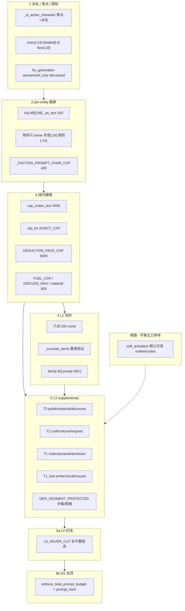
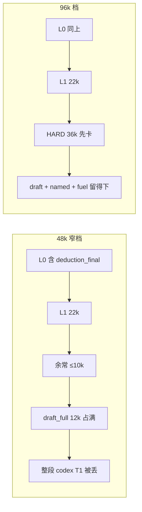
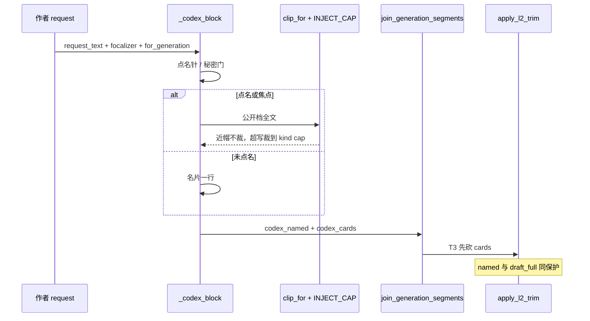

# 防洪水全爆炸半径：设定库与预算裁切的最优统一

| 项 | 值 |
|----|----|
| **日期** | 2026-08-14 |
| **产品** | 铜炉 / tonglu · `scribe3/` |
| **作者** | Grok Design |
| **状态** | Draft |
| **定位** | 「防洪水」整条逻辑的全爆炸半径：所有裁切 / 帽 / L2 / 半裁 / skip / 模板回退 / 预算洪水防护。找出全部问题，给最优改进。不是再加一层「字数当质量」。 |
| **不改** | 宣称公式、`GATE_SAVE_MODE=soft`、GATE-B 80、secret / chief_only 生成路径 fail-closed |
| **验证** | 只冒烟已部署 demo；禁止 Grok 机 `npm ci` / 本机 Surreal / 第二套库 |
| **相邻 SSOT** | 章冰山：仓库内 [`docs/plans/2026-08-14-iceberg-complete.md`](/home/admin/projects/scribe-writing-system/docs/plans/2026-08-14-iceberg-complete.md)（闸·链·章侧吃满；该文进度表仍写 I1–I3「待做」，**以本仓库代码为准**）。升窗：[`docs/plans/2026-08-13-budget-context-optimal.md`](/home/admin/projects/scribe-writing-system/docs/plans/2026-08-13-budget-context-optimal.md)（**代码默认仍 48k**；**demo 已部署 96k**，见 Open Questions Q1）。本方案**扩 `INJECT_CAP` / `clip_for` 到设定 kind**（包级帽另表），不另立第三套数字宗教。 |

---

## Overview

「防洪水」在铜炉里不是一层预算，而是 **六层主刀 + 旁路软激**：点名/焦点/限知、per-entity `[:N]`、域内硬帽、信封八块、L2 supplemental、L0 红线、O1 总顶；另加默认开启的 `soft_activation`（join 前可丢 `outline`/`codex`）。章侧闸 + 必须 LLM + `clip_for` **代码已交**（**final 也吃满 5000 演绎 + 10000 排演**，冰山效应改在输出纪律）。设定库仍停在 2026-07 的「圣经洪水」恐惧里：物件只留名、术语 `definition[:16]`、规则代价 `[:14]`、非焦点前史 `[:48]`、势力整段 400、整包 `cap_codex_text` 4500。

这比章侧更狠。作者在设定库写厚的公开档案，写路径只看见残肢；讨论路径 `assemble_discussion_system` 甚至 **不再挂 `_codex_block`**，只靠信封 `facts[:40]`。同时章冰山已把 `draft_full`≈12k + redline `deduction_final`≈6k 焊进 48k 窗，L2 在肥章上会按 T3→T2→**T1=`codex`** 把仅剩的 4500 设定整段丢掉。

最优解不是把 4500 改成 12000，也不是再发明一套「设定质量分」。延续章侧 `clip_for(field, text)`（**不加死参数 `purpose`**），把设定 kind 写进同一张 `INJECT_CAP`。谁在读由组装层决定（点名针 + `for_generation`），不进纯文本裁切函数。讨论吃满当前实体；写作焦点+点名吃满公开档；未点名名片；秘密 fail-closed。**点名吃满与拆段必须同一 PR**，禁止先喂肥再 `cap_codex_text(4500)` 尾截。不改代码默认 48k、不 recreate。**demo 主验收按已部署 96k**（Q1 已裁断）。

---

## Background & Motivation

### 用户刚走完的章冰山（必须当现状，勿当待办）

| 块 | 代码（本仓库） | demo 热更 | 数字 |
|----|----------------|-----------|------|
| 闸 persist + `/chat/write` 409 | **已交** | **未用现网探针核过**；冰山 SSOT 仍写未部署 | 空可存；非空：大纲 500 / 拍 500+合计 2000 / 演绎 5000 / 排演 10000 / 水面 5000 |
| StageSpec / `thicken_*` / 必须 LLM | **已交** | 同上，不写死「已 hot」 | 禁止切句 / 摘录 / 空白占位 / 见薄 skip |
| `clip_for` 章字段 | **已交**（`iceberg.py` 现网：近地板不裁；无 `purpose` 参数） | 同上 | 拍不再 200；draft/final 走 `clip_for` + `draft_full_block` |
| 设定库按吃满改 | **尚未** | — | 本方案对象 |

用户裁断（冰山完整方案 §5.1，2026-08-14）：**final 也吃满**。冰山效应改在输出纪律（限知横幅 + 勿复读），**不对模型藏材料**。同一裁断现在打到设定库：公开档案写厚了就必须进提示词；限知靠 `for_generation` + `secret_guard`，不靠 `[:16]`。

### 痛点（现网代码，不是假设）

1. **同一本书、两套设定可见性**。写路径 `_codex_block`（`write_assemble_blocks.py`）对公开字段做 16/14/48/96/160/400 截断；讨论路径 `assemble_discussion_system`（`write_assemble_discuss.py`）**根本不调 `_codex_block`**，信封 `facts_at[:40]` 代替圣经。作者问「这个术语什么意思」，速答通道可能零定义。
2. **schema 有字段，注入丢字段**。`ITEM_FIELDS` 有 `description` / `current_owner` / `special_properties`；注入只拼 `name`。`TERM_FIELDS.definition` 是 textarea，进模 16 字。`WORLD_RULE_FIELDS` 有 `cost`/`limitations`/`exceptions`/`capabilities`，进模只留代价 14 字。
3. **整包 4500 在吃满冰山之后已经是死帽**。`cap_codex_text` 在 L2 之前先砍；L2 又把 `codex` 放 T1。肥章上设定被砍两次。
4. **软激活默认可丢 outline/codex**。`soft_activation.py` 默认开，`SOFT_SEGMENT_NAMES` 含 `outline` 与 `codex`，join 前按检索词丢段——比 L2 更早、更不讲理。
5. **章侧残留刀仍在**。`DEDUCTION_FLOOR=5000` 是**整章合计闸**（`dsum`），`_floor_for("deduction")` 现为 **0**，`INJECT_CAP["deduction"]=4000`：单人写 5000 会被裁到 4000（`test_focal_prose_capped_at_inject_cap`）；三人各 1800 合计过闸则碰不到单人帽。`_apply_deduction_pack_cap` 仍会半裁焦点；`_OUTLINE_INJECT_BUDGET=800` 与 `_nonfocal_boundary_line` 是死代码。`thicken_*` **零调用** `_codex_block`，加厚链不吃设定圣经。

---

## Goals & Non-Goals

### Goals

1. 列出防洪水全部层级、职责、数字、调用点。
2. 给每处裁切贴标签：**故意（限知 / 真洪水 / 差集去重）** vs **误伤（公开档案 / 下一阶段燃料）**。
3. 扩现网 `INJECT_CAP` / `clip_for(field, text)` 到设定 kind（复用 2500/1200/6000/12000）；讨论 / 写作 / 名片 / 秘密四态由组装层 + `for_generation` 实现，**不**给 `clip_for` 加死参数 `purpose`。
4. 与章冰山对齐：刚过闸 / 作者写厚的公开档必须进提示词；帽只砍超写与未点名履历。`thicken_*` 若要吃设定，必须单独接线，改 `_codex_block` 不等于加厚链齐了。
5. 48k 窗风险写清（回滚档）；**demo 主验收 96k**。不为本方案 recreate 升窗。
6. 可合入的 PR 切片。

### Non-Goals

- 不改宣称、`GATE_SAVE_MODE`、GATE-B 80；字数不进 `may_claim_*`。
- 不把 secret / chief_only 改成 fail-open；生成路径知情证据不足就不注。
- 不把 80 人未点名履历、万字粘贴、素材正文当「也要吃满」。
- 不把 `NOVEL_PROMPT_HARD` 常量改成 96000；不 `compose recreate` 升窗。
- 不为验收再起平行 Surreal / 第二套栈。
- 不把讨论速答改成必须挂全套写作围栏。

---

## 1. 防洪水到底有几层

现网不是「一个 budget」。**六层主刀 + 旁路软激**，从早到晚：



### 1.1 L0 红线（永不整段丢）

真源：`context_budget.L0_NEVER_CUT`。

含：`identity` / `write_protocol` / `revision` / `anti_slop` / `continue_snapshot` / `secret_guard` / `request_position` / `tool_scope` / `craft_skills_index` / `focalizer` / `narrative_contract` / `event_drive` / `drama_contract` / `drama_vacuum` / `envelope`（层标记是 envelope，但 L0 集合也列了） / `revelation_discipline` / `sincerity` / `final_reminder` / **`deduction_final`** / `scene_truth_proj` / `prefix` / `structure_diversity`。

职责：**限知纪律、场面合同、身份协议**。不是防洪水。`deduction_final` 同时在 L0 与 `GEN_SEGMENT_PROTECTED`，且 assemble 以 `layer=redline` push——L2 victim 选不到它。

### 1.2 L1 信封（注意力分区，不是圣经）

真源：`BLOCK_BUDGETS_NOVEL` 合计 **22_000**（focus 1000 / global 1800 / canonical 9200 / recent 6000 / procedural 1400 / reference 1800 / uncertainty 800 / provenance 0）。

实现：`context_assembler._truncate_items` 按条贪心，超块预算整条进 `omitted`（reason=`token_budget`），**禁止对 joined 尾截**。

职责：记忆 / 正典命题 / 近章 / 工艺候选的分区。**不是**设定库公开档案的授权通道（`canonical` 明确剔除 faction 桥镜像，注释写「那是 `_codex_block` 的职责」）。

### 1.3 L2 supplemental（有序半裁 / 整段丢）

真源：`L2_DROP_TIER` + `apply_l2_trim`。

| 档 | 段 | 先丢顺序 |
|----|----|----------|
| T3 | `material_recall` `discourse_soft` `story_move` `storyline_polish` `reference_craft` `seed_words` `author_prefs` | 最先 |
| T2 | `craft` `phase_role` `avoid` `volume_intro` `request_constraint` | 次 |
| T1 | **`codex`** `purpose` `pressure_drive` | 再次 |
| T1_fuel | `story_recall` `story_causal` `story_ember` | 燃料最后 |
| 保护 | `outline` `brief_must` `voice_anchor` `draft_full` `deduction_final` | 仅当上面砍尽 |

帽：`effective_l2_cap = min(supplemental_hard, prompt_hard − L0 − L1)`。  
48k 档：soft 14k / hard 18k / prompt_hard 48k。  
96k 档：soft 28k / hard 36k / prompt_hard 96k。

半裁：`_half_cut_segment`。`draft_full` / `deduction_final` **拒绝缩小**；`outline` 在纲体 `cn≤800` 时拒砍，长纲才保拍砍纲；其余对半 + `…`。

### 1.4 O1 总顶

`enforce_total_prompt_budget`：默认跟 `get_prompt_hard(work=)`（48k 或 96k）。同样禁止 `rendered[:budget]` 尾截。victim 序同 L2；红线 / `layer==redline` 跳过。

`SCRIBE3_TOTAL_BUDGET>=900000` 视为关闭。

### 1.5 域内硬帽（L2 之前就砍）

| 帽 | 数字 | 函数 | 对象 |
|----|------|------|------|
| `DEFAULT_CODEX_INJECT_CAP` | **4500** | `cap_codex_text` | 整包设定圣经（含标题） |
| `INJECT_CAP.synopsis/beat/scene_truth/deduction/draft` | 2500 / 1200 / 2500 / 4000 / 12000 | `iceberg.clip_for` | 章字段 |
| `DEDUCTION_PACK_CAP` | **6000** | `_apply_deduction_pack_cap` | 演绎整包 |
| `FOCAL_DEDUCTION_PROSE_CAP` | 4000 | 名义上单人帽；**函数体已改走 `clip_for`，参数闲置** | 单人五层 |
| `FUEL_CAP_*` | 1500 / 4000 / 2500（宽档 2500 / 6000 / 4000） | `story_constraint_prompt._clip_fuel` | 余烬 / 召回 / 前因 |
| `material_recall` | **800** | `gate` + `render_material_block` | 参考素材 |
| `_VOLUME_INTRO_BUDGET` | 400（compact 后钩子 120） | `_clip_chars` / `compact_volume_intro` | 卷纲 |
| `DISCOURSE_SOFT_CAP` | 200 | `render_discourse_soft_text` | 话语提示 |
| `DISCUSS_MAX_*` | 12 条 / 每条 600 / 末助 2400 / 总计 8000 / summary 1600 | `_thread_history_for_prompt` | 讨论近窗 |
| `stage_craft_kernel` | 400 | `stage_generate` | assemble 短核 |

### 1.6 per-entity 截断（设定库主伤）

全部在 `_codex_block` / `_faction_prompt_block`：

| 实体 | 现网刀 | 作者库里有什么 |
|------|--------|----------------|
| 角色非焦点 | `bs[:48]` 或只 name；最多 14 人 | `CHARACTER_FIELDS` 全套 textarea |
| 角色焦点/点名 | 前史 `[:96]`；其余 `_as_text(..., 160)`；最多 4 人 | 同左，160 把性格/目标砍成一行 |
| 势力 | 注册表 `prompt_keys` 全拼后 **整段 400**；最多 10 个 | 28 字段，含 ideology/origin/structure |
| 物件 | **只 `name`**；最多 14 | `description` `current_owner` `special_properties`… |
| 术语 | `definition[:16]`；最多 14 | `definition` textarea |
| 世界规则 | `cost[:14]`；最多 10；**不注** limitations/exceptions/capabilities | 完整规则档案 |
| 母题·写作 | heat 调度（must_echo / avoid），否则只名字 | 可接受（工艺不是圣经） |
| 母题·讨论 | 只名字最多 10 | 讨论也看不见 theme/echoes |

### 1.7 点名 / 焦点 / 条数过滤

- `_is_active_character`：焦点者或 `request_text` 含子串（名 / id / alias）。
- `detailed_ids` 只取活跃角色 **前 4**。
- 全表 `chars[:14]` `facs[:10]` `items[:14]` `terms[:14]` `rules[:10]`。
- 信封：`facts[:40]`（`_editor_system` 全知仍是 `[:28]`）、承诺 `[:8]`/`[:6]`、事件 `[:6]`、工艺规则 `[:8]` 且正文 `[:80]`。

### 1.8 旁路刀（常被忘掉，杀伤不亚于 L2）

| 机制 | 默认 | 行为 | 误伤？ |
|------|------|------|--------|
| `apply_soft_activation` | **开**（`SCRIBE3_SOFT_ACTIVATION` 默认 1；模块头注释仍写「默认关」，以代码为准） | `SOFT_SEGMENT_NAMES` 含 `outline`/`codex`；检索词未命中则整段 omit | **是**（outline、整段 codex）。`draft_full` **不在** soft 集；`deduction_final` 已在 `REDLINE_SEGMENT_NAMES`，join 前本来不会因缺键丢掉 |
| `subtract_codex_canonical_echoes` | 开 | 去掉与 envelope 重复的整行 | 故意去重，保留 |
| `injection_compact` | 开 | volume 钩 120；phase_role 留 1 句；avoid 并入 anti_slop；pressure 差集 | 故意去重，保留 |
| `thicken_*` skip | 已达地板才 skip | **禁止**薄 skip / 模板 / 切句 | 已修，保留 |
| `_call_llm` | 无 llm_fn 直接抛 | 禁止模板回退 | 已修，保留 |

---

## 2. 爆炸半径清单

判定列：**故意** = 限知 / 真洪水 / 差集；**误伤** = 刚过闸或作者写厚的公开燃料被砍；**残留** = 章冰山已宣称吃满但仍有刀。

「刚过闸用上」按该字段地板或作者典型写厚估计。

### 2.1 设定库（本方案主战场）

| # | 文件 · 函数 | 数字 | 刚过闸 / 写厚时用上 | 判定 |
|---|-------------|------|---------------------|------|
| C1 | `write_assemble_blocks._codex_block` 物件 | 只 `name`；`items[:14]` | description 等 **0%** | **误伤** |
| C2 | 同函数 术语 | `definition[:16]`；`terms[:14]` | 一段释义只剩半句 | **误伤** |
| C3 | 同函数 世界规则 | `cost[:14]`；丢 limitations/exceptions/capabilities；`rules[:10]` | 规则档案 ≈0 | **误伤** |
| C4 | 同函数 非焦点角色 | `bs[:48]` 或只名；`chars[:14]` | 前史一篇剩名片 | **半故意**：未点名应名片；48 字前史是最差中间态（不够写、够泄密） |
| C5 | 同函数 焦点/点名角色 | 前史 `[:96]`；字段 `_as_text` **160**；活跃最多 **4** | 点名了仍砍性格/目标 | **误伤**（点名就该吃满公开档） |
| C6 | `_faction_prompt_block` + `app_impl._FACTION_PROMPT_CHAR_CAP` | **400** + `…(略)`；`facs[:10]` | 28 字段拼完必斩 | **误伤**（点名）。未点名改名片 ≤80，**禁止**再走 400。常量删除或仅留测试对照。`test_codex_block_truncates_faction_over_length_budget` 必须改 |
| C7 | `context_budget.cap_codex_text` | **4500** 整包尾截 | 角色+势力+物+术语一齐挤，后半种类常 0 | **过时洪水帽**，现已误伤 |
| C8 | `write_assemble_v1` 在 L2 前先 `cap_codex_text` | 同上 | 设定从未以完整形态见 L2 | **误伤** |
| C9 | L2 `codex` ∈ **T1** | 半裁再丢 | 肥章先丢设定、后碰 draft_full | **误伤**（与「先砍 polish」纪律相反） |
| C10 | `soft_activation` 可丢整段 `codex` | 默认开 | 检索词不在残肢圣经里 → 整包 0 | **误伤** |
| C11 | `assemble_discussion_system` **不调用** `_codex_block` | 0 圣经 | 讨论公开设定只剩信封命题 | **误伤（更狠）** |
| C12 | `_editor_system` 全知 `facts[:28]` / 信封 `facts[:40]` | 条数帽 | 命题不是档案；物件描述进不来 | 信封职责内；**不能当设定替代** |
| C13 | 母题讨论只名字；写作走 heat | 名字 / 调度行 | 写作可接受；讨论看不见 theme | 写作 **故意（工艺）**；讨论 **误伤轻** |
| C14 | 生成路径 `for_generation=True` 的 secret / chief_only | fail-closed | 0（正确） | **故意 · 限知 · 必须留** |
| C15 | `reveal=False` 且 `backstory_secret` → 前史清空 | 0 | 限知章正确 | **故意 · 限知 · 必须留** |

### 2.2 章冰山（已宣称吃满，残留刀）

| # | 文件 · 函数 | 数字 | 刚过闸用上 | 判定 |
|---|-------------|------|------------|------|
| I1 | `iceberg.clip_for` + `INJECT_CAP` | 纲 2500 / 拍 1200 / 真相 2500 / 演 4000 / 排 12000；近地板 ×1.2 不裁 | 纲/拍/排刚过闸 100% | **故意洪水帽**，模型对应保留 |
| I2 | `_floor_for("deduction")=0` + `INJECT_CAP.deduction=4000` | 单人 5000 → 裁到 4000 | **残留误伤**。`DEDUCTION_FLOOR=5000` 是**章合计**，不能拿去当单人 `_floor_for`：现网 `clip_for` 超近地板后 `keep=max(cap,floor)`，若 floor=5000 且 cap=4000，则 keep=5000，4000 帽变死数字 |
| I3 | `_apply_deduction_pack_cap` | 现网 **6000** 罩 header+真相+全部投影+footer；先扔非焦点 → 砍真相 → **焦点对半** | 刚过闸 5000+真相 2500 已 >6000 | **残留**：6000 尖端包装不下吃满。PR-B 提到 **8500**，删对半，多人满写才走溢出序 |
| I4 | `_nonfocal_boundary_line` 80+60 | 死函数 | 现网已改全层注入 | **死代码**，勿复活成 surface 尖 |
| I5 | `_OUTLINE_INJECT_BUDGET = 800` | 形参未用 | clip_for 已接管 | **死数字** |
| I6 | `draft_full_block` + L2 拒缩 | cap 12000 + 勿复读 | 10000 全进 | **已修** |
| I7 | `_half_cut_segment("outline")` | 纲≤800 不砍 | 刚过闸大纲保住 | **已修** |
| I8 | `SOFT_SEGMENT_NAMES` 含 `outline` | 软激可丢 | 刚过闸大纲 → 0 | **残留误伤** |
| I9 | `stage_generate.previous[:800]` | 重试上文 | 加厚重试可接受 | 故意 |

### 2.3 信封 / 燃料 / 讨论近窗 / 其它（多数该留）

| # | 文件 · 函数 | 数字 | 判定 |
|---|-------------|------|------|
| E1 | 信封八块 22k + `_truncate_items` | 整条省略可审计 | **留**（真注意力分区） |
| E2 | `prose[-400:]` / 上章 `[-240:]` | 续写锚，不是排演 | **留** |
| E3 | canonical `facts[:40]` | 命题条数 | **留**；禁止拿它冒充档案 |
| E4 | 承诺 `text[:40]` / `[:30]` | 备忘不是伏笔全文 | **留** |
| E5 | 工艺降级 `[:80]` | 完整工艺在独立 `craft` 段 | **留** |
| E6 | `FUEL_CAP` 1.5/4/2.5k（宽档加长） | 可后裁燃料 | **留** |
| E7 | `material_recall` 800 + excerpt 120 | 借鉴非事实 | **留**（真洪水：素材正文） |
| E8 | `DISCUSS_MAX` 12/600/2400/8000 | 防《印迹》级全案粘贴撑爆 | **留**（真洪水） |
| E9 | `DISCOURSE_SOFT_CAP` 200 | L3 提示 | **留** |
| E10 | `volume_intro` 400 / 钩 120 | 差集后够用 | **留** |
| E11 | `execution_contract.SOFT_LEN_FLOOR=2400` | 写后 soft，**不进注入** | **留**；勿与水面 5000 并表 |
| E12 | `thicken_*` 达地板 skip / 无 llm 抛 | 禁止模板回退 | **留** |
| E13 | `estimate_tokens = len(text)` | 字符当 token 上界 | **留**；中文真实 token ≥ 字符，96k 字符可能已超窗 |

---

## 3. 哪些留、哪些必须改

### 3.1 必须留（真洪水 / 限知 / 差集）

1. **secret / chief_only / `backstory_secret` 生成路径 fail-closed**。不是防洪水。
2. **未点名 80 人履历不上全文**。名片即可。
3. **万字粘贴 / 讨论近窗 / 素材 body**。`DISCUSS_MAX`、`material` 800、`clip_for` 超写帽。
4. **信封分区、差集 compact、L0 红线、禁止 joined 尾截**。
5. **L2 先砍 T3 polish / material / discourse**。工艺建议可丢，刚写厚的燃料不行。
6. **`thicken_*` 禁止模板 / 切句回退**。

### 3.2 必须改（公开档案误伤）

1. 术语 `[:16]`、规则 `[:14]`、物件无名、点名角色 `[:96]`/`[:160]`、点名势力 **400**。
2. 整包 `cap_codex_text(4500)` 作为**唯一**设定闸（应降为未点名残包的最后手段）。
3. L2 把整段 `codex` 当 T1 先于保护段砍——点名设定必须拆成可保护的 `codex_named`。
4. 讨论路径补回设定圣经（`for_generation=False`），点名/当前实体吃满。
5. 软激活不得丢 `outline` / 点名 `codex`。
6. 章侧残留：单人 `INJECT_CAP.deduction` 提到 **6000**（不复用章合计 `DEDUCTION_FLOOR`）；`_floor_for` **保持 0**。整包 `DEDUCTION_PACK_CAP` **8500**（6000 装不下 5000+2500）。多人满写才按 §4.6 溢出。

### 3.3 明确不改的数字宗教

- 不把 16→32、14→28、400→800 这种「翻倍安慰剂」当方案。
- 不把 `DEFAULT_CODEX_INJECT_CAP` 改成 12000 继续整包尾截。
- 不把字数写进 `may_claim_*`。

---

## 4. 最优统一模型

### 4.1 谁在读（组装层），不是 `clip_for` 的 `purpose`

现网**没有** `InjectSpec` 类型，只有 `INJECT_CAP` dict；`clip_for(field, text)` **没有** `purpose` 参数。章侧也从未按 purpose 分帽。设定 kind 的 floor 全是「无 persist 闸」，讨论/写作差异是 **点名针 + `for_generation`**，再给 `clip_for` 加 `purpose` 是死参数。**不扩签名。**

| 入口 | 谁 | 公开档 | 秘密 | 现网是否已挂圣经 |
|------|----|--------|------|------------------|
| `discuss` | `assemble_discussion_system` | **当前实体吃满**（仅 `request_text` 针；无章内提及）；其余名片 | 可见（`for_generation=False`，含 chief_only） | **否** |
| `write` | `_assemble_write_instructions_v1` | **焦点 + request 点名吃满公开档**；章内提及次之；未点名名片 | fail-closed（U-003 不动） | 挂了，但是残肢 |
| `thicken` | `stage_generate.thicken_*` | **目标同 write**（设定是水下世界） | 同 write | **否**。`build_stage_prompt(stage, ch, *, seq, extra, …)` 与 `thicken_*` **没有** `st`/`work`；`_codex_block` 要 store。见 §4.10 / PR-C2 |

### 4.2 点名针（单独写死）

沿用 `_is_active_character`：**完整** `name` / `id` / `aliases` 是否为 `request_text` 或 `focalizer` 的子串。

- **不**设 CJK 最短 2 字。现网 `_is_active_character` 无最短长度；`soft_activation._norm_keys` 明确「CJK 单字可用（如「龙」）」，拉丁才 ≥2。文档先前「CJK≥2 且与 soft_activation 一致」两头都不对。
- 单字真名（「七」「阿」）会误伤：本方案**保持现网子串**，不在此另裁。误伤靠点名包软顶淘汰，不靠禁单字。
- **按 kind 取针字段**（schema 没有的别读）：
  - character：`name` / `id` / `traits.aliases`
  - faction：`name` / `aliases`
  - term：`name` / `aliases`
  - item：只 `name`（`ITEM_FIELDS` 无 aliases）
  - world_rule：只 `name`（`category` 仅名片展示，**不**用于命中）

讨论路径**只有** `request_text` 针，没有「章内提及」。写路径额外：章 `synopsis`/`beats`/`scene_truth` 里出现的完整 name 算「章内提及」，优先级低于本轮 request。

### 4.3 帽表：实体 cap 复用 `INJECT_CAP`；包级/名片级单独分区

落点：`iceberg.py` 的 `INJECT_CAP` 加 kind；禁止 `_codex_block` 再手写 `[:16]`。`clip_for` 保持纯文本 + field。

**实体级（进 `INJECT_CAP`，复用 2500/1200/6000/12000）：**

| field | floor | cap | 未点名 |
|-------|-------|-----|--------|
| `synopsis` / `beat` / `scene_truth` / `draft` | 现网不动 | 2500 / 1200 / 2500 / 12000 | — |
| `deduction` | **保持 0**（不拿章合计 5000 当单人地板） | **6000**（从 4000 抬；与 `DEDUCTION_PACK_CAP` 同数） | 见 §4.6 |
| `character_public` | 0 | **2500**（= synopsis） | 名片，见包级 |
| `faction_public` | 0 | **2500** | 名片 |
| `item` | 0 | **1200**（= beat） | 只 name |
| `term` | 0 | **1200**（= beat，**不用 800**） | 只 name |
| `world_rule` | 0 | **1200** | 只 name + category |

刚过闸单人 5000 投影：`5000 ≤ 6000` 原样通过。超写（如 9000）裁到 6000。三人各 1800 合计过闸，单人碰不到帽。

**包级 / 名片级（不是 `INJECT_CAP` 行，承认是第二张小表）：**

| 帽 | 数字 | 作用 |
|----|------|------|
| 名片身份句 | **≤80** | 未点名角色/势力一行；**禁止**前史残肢、**禁止**再走 `_FACTION_PROMPT_CHAR_CAP=400` |
| 未点名名片整包 | **1500** | 替代「4500 打全体」；只罩 cards 段 |
| 点名包软顶 | 48k：**4500**；96k：**12000**（= draft cap） | **只罩 `codex_named`**。现网 `get_codex_inject_cap()` 只认 env / 默认 4500、**不分档**——分档必须走 `resolve_write_caps(work=)`，禁止再调无 `work` 的 getter |

`apply_l2_trim` 在未传入 `prompt_hard` 时走 `get_prompt_hard()` **不带 work**（`context_budget.py` 939 行）。写路径 join 必须继续传 `work`；点名包软顶在 assemble 里用同一组 `caps`，禁止 L2 内部另算 48k/96k。

母题：维持 heat 调度，不 dump 散文。不进上表。

### 4.4 点名扫描与软顶淘汰（可实现算法）

现网 `chars[:14]` / `facs[:10]` / `items[:14]` / `terms[:14]` / `rules[:10]` 是**存储序切片**。只宣布「点名不占 [:4]/[:10]」不够：第 15 个角色、第 11 个势力若被 request 点名，按现网循环根本进不了列表。

**算法（写路径）：**

1. **全表扫描**点名/焦点（不受 `[:N]`）。命中集合 = `codex_named` 候选。
2. 每个 named 实体：先按 **§4.5** 字段序拼公开档（秘密字段在拼接阶段按现网门丢掉），再对**拼好的全文**一次 `clip_for(kind)`。
3. 点名包软顶：`sum(len(named)) > cap` 时按优先级淘汰整实体（不尾截种类）：
   - 写：`request_text` 命中 > `focalizer` > 章内提及 > 存储序（后出现先丢）
   - 同档：保 **term / world_rule / item** 优于 **character / faction** 里非本轮 request 的；再同 kind 按存储序。
4. 未点名：名片，条数才 `[:14]/[:10]/[:14]/[:14]/[:10]`，再受名片整包 1500。
5. 输出两段：`codex_named`、`codex_cards`。

**讨论路径：** 只有步骤 1 的 `request_text` 针。无 focalizer、无章内提及。软顶同档只按存储序。

### 4.5 公开档序列化合同（拼完再 `clip_for`）

裁切对象 = **拼好的公开档全文一次** `clip_for`，不按字段各裁 160。秘密字段在拼接阶段丢掉，**不要**先拼再靠字数帽藏密。

| kind | 点名/焦点字段序（复用现网列表 / `codex_prompt_keys`） |
|------|------------------------------------------------------|
| character | 现网详细档序：别名、外观习惯、性格细节、性格标签、表层目标、深层需要、恐惧、内在冲突、能力、弱点、叙事重要性、首次登场；**公开**前史整段放在最前（计入 2500）。`backstory_secret` 且 `reveal=False` → 前史不拼 |
| faction | `codex_prompt_keys("faction")` 现网序（约 27 个 in_prompt 非 deprecated）。`chief_only` / 未证明知情的 `secret_capable` 在 `_faction_prompt_block` 现网门丢掉后再拼。点名后 **禁止** `_FACTION_PROMPT_CHAR_CAP`；未点名走名片 ≤80，**禁止** 400+`…(略)` |
| item | `name`、`category`、`description`、`symbolic_state`、`current_owner`（不是 owner）、`special_properties` |
| term | `name`、`category`、`definition`、`aliases` |
| world_rule | `name`、`category`、`source`、`cost`、`scope`、`limitations`、`exceptions`、`capabilities`、`note` |

目标形状：

```text
〔角色〕
- 灰七（前史:…；别名:…；…）     ← named，全文 ≤2500
- 冷锅婆（灶上管事）             ← 名片 ≤80，无前史
〔势力〕…  〔物件〕铜钥：description / current_owner / …  〔术语〕…  〔世界规则〕…
〔母题〕heat 调度
```

### 4.6 演绎单人帽与整包溢出

- 单人：`INJECT_CAP["deduction"]=6000`，`_floor_for` 保持 0。`FOCAL_DEDUCTION_PROSE_CAP` 与 `_focal_cap` 闲置，PR-B 删或改成 6000 并同步 rebind。刚过闸单人 5000 **只在这一刀**保证 100%（`5000 ≤ 6000`）。
- **现网 `DEDUCTION_PACK_CAP=6000` 装不下「刚过闸合计 5000 + `scene_truth` 2500 + header/footer」。** 6000 是旧「尖端包」数字，与吃满矛盾。PR-B 把整包帽提到 **8500**（5000 闸 + 2500 真相 + ≤1000 头尾）。这不是第三套宗教，是两行已有 cap 相加。
- 删除「焦点对半」。仍超帽（全员焦点 3×5000=15000）才走溢出序：request 命中 > `focalizer` > 章内提及 > 非焦点改名片 > 最低优先者的超写尾巴。
- **Goal 4 拆开写死，禁止实现以为 6000 包能同时留下 5000+真相：**
  - 单人 `clip_for`：刚过闸投影 100%。
  - 整包 8500：典型刚过闸章（合计 5000 + 真相 ≤2500）100%。
  - 多人各写满 5000：不保证人人全文；按溢出序挤最低优先者。
- `test_deduction_final_cap.py` 里 `len(text) <= DEFAULT_CODEX_INJECT_CAP`（4500）是旧宗教，PR-B 改绑新的 `DEDUCTION_PACK_CAP`（8500）。
- 窗账：`deduction_final` 是 **L0 redline**。帽从 6000→8500 使肥章 L0 上界约再加 2.5k。demo 96k 的 L2 HARD 36k 仍装得下；48k 回滚档 `over_budget` 更常见，不因此升窗。

### 4.7 讨论路径

`assemble_discussion_system` 在 envelope 之后追加 `_codex_block(..., for_generation=False, request_text=user_msg, focalizer="")`，产出 named+cards 两段（或过渡期两段拼接，但 **不得**再对 named 打 `cap_codex_text(4500)`）。

- 不注入写作围栏（现网断言保留）。
- `_editor_system` **不是**生产讨论入口（`chat_stream` / `chat_agentic_stream` 已改走 `assemble_discussion_system`）。仅保留给旧测 / `tools/enrich_all.py`。PR-D 必须改过期合同测：`test_discuss_path_consistency.py`、`test_codex_prompt.py`、`test_author_prefs.py`。

### 4.8 L2：拆段与点名吃满必须同一交付

```text
codex_named     supplemental, GEN_SEGMENT_PROTECTED；_half_cut 拒缩（与 draft_full 同）
codex_cards     supplemental, T3（与 material_recall 同丢）
```

物理序：`codex_named` **改名占用**原 `codex` 槽（`physical_order_markers` / `assert_physical_order_indices` / `SEGMENT_REGISTRY` / `GENERATION_SEGMENT_LAYERS` / `pipeline_trace_catalog["codex"]` 一律改名为 `codex_named`，断言仍 `env < cx < fr`）。`codex_cards` **不进** `physical_order_markers`，join 时作为未列名插在 `final_reminder` 前（现网 `ordered_generation_segments` 已有此行为）。

`cap_codex_text` **只**打 `codex_cards`（或不再调用；cards 已有 1500）。**禁止**在「点名吃满已合入、拆段未合入」的窗口对整段肥圣经尾截。

软激活（PR-E，可先于拆段）：`outline` 移出 `SOFT_SEGMENT_NAMES`；`codex` 整段豁免，直到拆段后只让 `codex_cards` 可丢、`codex_named` 永不进 soft 集。**不要**把已是红线的 `deduction_final`、本就不在 soft 集的 `draft_full` 写成「移出 soft」。

### 4.9 与章冰山的关系（一张表）

```text
iceberg.INJECT_CAP     章字段 + 设定 kind（2500/1200/6000/12000）
iceberg.clip_for       唯一实体裁切；签名不加 purpose
包级帽                 名片 80 / cards 1500 / named 软顶 4500|12000
演绎整包               DEDUCTION_PACK_CAP **8500**（5000+2500+头尾）
组装层                 点名针 + for_generation；thicken 见 §4.10
L2 保护                outline / draft_full / deduction_final / brief_must / voice_anchor / codex_named
L2 先砍                T3 cards / polish / material
限知                   不在帽表里用字数表达
```

禁止出现 `CODEX_QUALITY_FLOOR=80` 之类。

### 4.10 thicken 挂圣经：必须改签名并改调用点

现网纯函数**没有 store**：

```python
# stage_generate.py 现网
def build_stage_prompt(stage, ch, *, seq=None, extra="", strict=False, previous="") -> str: ...
def thicken_outline(ch, *, llm_fn, persist_fn=None, seq=None, extra="") -> dict: ...
# thicken_beats / thicken_deduce / thicken_draft / thicken_stage 同形
```

`_codex_block(st, …)` 与 `named_pack_soft_cap(work=)` 都要 store / work。PR-C2 **禁止**在 `build_stage_prompt` 里凭空调 `_codex_block`。

**签名（目标）：**

```python
def build_stage_prompt(..., *, bible: str = "") -> str:
    # bible 非空则追加；本函数不碰 store

def thicken_outline(
    ch, *, llm_fn, persist_fn=None, seq=None, extra="",
    st=None, work=None, focalizer="",
) -> dict: ...
# beats / deduce / draft / thicken_stage 同样透传 st/work/focalizer
```

`thicken_*` 内：仅当 `st is not None` 才调 `_codex_block(st, reveal=True, chapter=seq, for_generation=True, request_text=…, focalizer=focalizer)`，点名针 = `extra` + `ch["involved_characters"]` 人名；软顶走 `named_pack_soft_cap(work=work)`。把返回的 named（可带 cards）传入 `build_stage_prompt(..., bible=)`。

**`st is None`：** 不挂圣经，prompt 与现网字节兼容。单测若只喂章 dict，必须显式断言无「本书设定圣经」——**禁止**空串假装已接线。

**必须改的生产调用点（现网有 `st` 却没往下传）：**

| 入口 | 文件 | 现网 |
|------|------|------|
| REST `POST /generate-stage` | `api/routers/write.py` `generate_stage` | `st = _store_for(work)` → `thicken_stage(...)` 不传 st |
| MCP `s3_generate_stage` | `mcp/tools_write.py` | 同上 |
| pilot 大纲 | `api/services/pilot_actions/outline.py` `propose_outline(st, seq)` | `thicken_outline(ch0, …)` 不传 st |
| pilot 节拍 | `api/services/pilot_actions/beats.py` | `thicken_beats` 不传 st |
| pilot 排演 | `api/services/pilot_actions/draft.py` | `thicken_draft` 不传 st |

无独立 `propose_deduce`；演绎加厚只走 `thicken_stage`。`thicken_stage` 必须把 `st/work/focalizer` 传进四个 `thicken_*`。

---

## 5. 窗风险（48k 已经不够）

**记账钉死：** L0 上界含 redline 的 `deduction_final`（`write_assemble_v1` `_push(..., "redline")`），**不含** supplemental 的 `draft_full`。L0「10–16k」是估：身份+协议+secret_guard+场面+drama+reminder 未必到 10k；肥章加上演绎整包（现网 ≤6000，PR-B 后 ≤**8500**）才接近上界。

```text
effective_l2_cap = min(HARD, PH − L0 − L1)

48k 满配信封：PH=48k，L1=22k，L0 取上界 16k → 余 10k，HARD 18k → L2 cap=10k
draft_full ≈12k 已 > 10k
→ 现网肥章 L2 必砍 T3+T2+T1(codex)，再卡在 draft_full:no_shrink

96k：PH=96k −16 −22 = 58k，HARD 36k → L2 cap=36k（HARD 先卡住）
draft 12k + named 软顶 12k + fuel 留得下
```



### 本方案对窗的硬决定

1. **不**改 `NOVEL_PROMPT_HARD` 常量，**不** `compose recreate` 升窗（demo 已经是 96k）。
2. **demo 主验收 = 96k。** 已部署探针：`resolve_write_caps("main")` → `prompt_hard_profile=novel_96k`，`supplemental_hard=36000`（Q1）。点名术语/物件/规则全文须在 instructions；`codex_named` 不得被 L2 drop。
3. **48k 只是代码默认 / 回滚档**：`codex_named` 仍保护、先丢 cards/T3；若仍超，`over_budget=true` 可审计。**不是**本 demo 冒烟主路径，不要求肥章术语全文在 48k 上仍在。

---

## Proposed Design（落地形状）

### 数据流



### 关键接口（目标，非现网）

```python
# iceberg.py — 扩表，不新建模块；clip_for 签名不动
INJECT_CAP = {
    "synopsis": 2500, "beat": 1200, "scene_truth": 2500,
    "deduction": 6000, "draft": 12000,          # deduction 4000→6000
    "character_public": 2500, "faction_public": 2500,
    "item": 1200, "term": 1200, "world_rule": 1200,
}

def clip_for(field: str, text: str | None) -> str:
    """近地板不裁；否则裁到 INJECT_CAP。无 purpose。"""

def named_pack_soft_cap(*, work: str | None) -> int:
    """点名包软顶。走 resolve_write_caps(work)：48k→4500，96k→12000。
    禁止 get_codex_inject_cap() 无 work 分档。"""

# write_assemble_blocks.py
def _codex_block(...) -> tuple[str, str]:
    # 返回 (named_text, cards_text)；同一 PR 拆段 push
    # 秘密门在拼接阶段；clip_for 打拼好的公开档全文
```

`_floor_for("deduction")` **保持 0**。`_apply_deduction_pack_cap` 删除焦点对半，改走 §4.6 溢出序。

---

## API / Interface Changes

- **无 REST 合同变更**。设定库 schema / PATCH 不变。
- 写路径 / 讨论路径 / thicken 用户消息 prompt 字节变长（点名实体）。
- `budget_report` 增观测（非 KPI）：`codex_named_chars` / `codex_cards_chars` / `codex_entities_full` / `codex_entities_card` / `soft_activation_kept_named`。
- `SCRIBE3_CODEX_INJECT_CAP` 语义收缩为 **`codex_named` 软顶**（不是整本圣经尾截）：
  - 未设 env：48k 档 4500、96k 档 12000，由 `named_pack_soft_cap(work=)` ← `resolve_write_caps(work)` 决定。
  - 显式 env 正整数：覆盖两档（运维逃生），`max(500, int)`。
  - **落点**：assemble 在 push `codex_named` 之后按优先级淘汰整实体，使 `len(named)≤soft_cap`。`cap_codex_text` **不再**打 named，只可打 cards（或删除调用）。
  - 现网 `get_codex_inject_cap()` 不分档——实现时改它接收 `work` 或换新函数，禁止 join/L2 无 work 各算各的。

---

## Data Model Changes

无新表、无 migration。`codex_schema.py` 字段已够；本方案只改**谁把字段拼进 prompt**。

---

## Alternatives Considered

### A. 把 `DEFAULT_CODEX_INJECT_CAP` 从 4500 改成 12000

- 优点：一行。
- 缺点：仍整包尾截，术语/规则排在角色势力后面照样 0；48k 上 L2 仍整段丢 `codex`；未点名 80 人会把 12000 吃光。
- **否决**。

### B. 设定全部只走 MCP 工具，prompt 只留名字

- 优点：窗永远干净。
- 缺点：速答 `chat_stream` 不挂工具；生成路径不能每章先 list_terms；与「刚过闸必须进提示词」相反。
- **否决**作为主路径。工具仍是浏览/核对补充。

### C. final 继续藏设定、只给章尖

- 优点：48k 轻松。
- 缺点：用户已裁断 final 吃满章材料；设定比章更「水下世界」。藏公开档案 = 模型发明炉令。
- **否决**。

### D. 本方案（点名吃满 + 名片 + 拆段保护 + 复用 clip_for）

- 优点：与章冰山同一心智模型；限知不动；真洪水仍挡；48k 可降级。
- 代价：`_codex_block` 与 L2 段名要改；讨论路径要接回圣经。
- **采纳**。

---

## Security & Privacy Considerations

| 威胁 | 处理 |
|------|------|
| 生成路径泄 chief_only / 未证明知情的 secret | **不改门**。`_faction_prompt_block` 三档、`backstory_secret`、桥镜像不进 canonical，全部保留。 |
| 讨论路径看见秘密 | **故意**。主编对话 `for_generation=False`。 |
| 点名子串误伤（「七」点中所有含七） | 针用**完整** name / id / alias 子串（现网如此，无最短长度）。不另禁 CJK 单字（会伤真名「七」「阿」）。物件/规则只针 `name`。溢出靠软顶淘汰，不靠禁单字。 |
| 名片 48 字前史泄私密 | 名片禁止前史；secret 前史只走 reveal 门。 |
| budget_report / trace 记秘密正文 | 继续只记长度与 source_id，不记 value。 |

---

## Observability

- `budget_report`：上述 codex 拆分字段；`l2.dropped` 应能看到 `codex_cards:drop` 而不是先 `codex:tail_half`。
- `soft_activation.dropped` 不得含 `outline` / `codex_named`。
- 探针（**demo 主路径 96k**）：点名术语 definition / 物件 / 规则全文在 instructions；`codex_named` 不被 L2 drop。未点名术语仅 name。48k 回滚档只断言 named 不被 drop、`over_budget` 可审计，不作为本次冒烟主路径。
- 主指标仍是戏剧信号密度，**禁止** `tokens_saved` 当成功。

告警（软）：`over_budget=true` 且 `codex_named` 被 half/drop → 错误（保护失败）。

---

## Rollout Plan

1. 旗：无需新旗。行为是纠正误伤，默认开。回滚 = revert PR。
2. 先观测（A）与帽表/章残留（B）与软激（E）；**点名吃满与拆段同一 PR（C）**，禁止先喂肥再 4500 尾截；再讨论（D）与 thicken（C2）；最后 demo 冒烟。
3. 验收 = demo 已部署栈冒烟（见 PR-G），不在 Grok 机跑全量测。
4. 回滚：git revert；设定注入回到残肢，限知门不受影响。

---

## Risks

| 风险 | 严重度 | 缓解 |
|------|--------|------|
| 48k 肥章 `over_budget` 更常见 | 中 | 回滚档：named 拒缩 + draft_full 拒缩会更常超；report 打明。**demo 主验收走 96k**，不假装 48k 吃满 |
| 点名过多 | 中 | §4.4 软顶淘汰序：request > focalizer > 章内提及 > 存储序；讨论只有 request |
| 讨论吃满秘密后模型在回复里复述 | 低 | 现网 `guard_discuss_instructions` soft 扫描保留 |
| 拆段破坏 `env < codex < fr` | 中 | `codex_named` 改名占原槽；`physical_order_markers` / registry / catalog 同步改名；cards 不进该断言 |
| 单测钉死 4500 / 400 / [:16] / `_editor_system` 讨论入口 | 中 | PR-C/D/B 改断言与合同测 |

---

## Open Questions

能由第一性原理钉死的已钉（点名吃满、未点名名片、秘密 fail-closed、不升窗、不第三套宗教）。

1. **demo 现网到底是 48k 还是 96k？** — **已裁断：96k。**  
   证据：已部署栈 `resolve_write_caps("main")` = `prompt_hard_profile=novel_96k`，`supplemental_hard=36000`。  
   本方案不改代码默认 48k、不 recreate。**PR-G 主验收按 96k**：点名术语/物件/规则全文须在 instructions；`codex_named` 不得被 L2 drop。48k 仅作回滚档说明。

---

## Key Decisions

1. **防洪水是六层主刀 + 旁路软激，不是一个 4500。** 限知 / 真洪水 / 差集留下；per-entity 残肢与整包 4500 对公开档是误伤。
2. **扩现网 `INJECT_CAP` / `clip_for(field, text)`，不加 `purpose`。** 实体 cap 只复用 2500/1200/6000/12000。名片 80 / cards 1500 / named 软顶是**包级帽**，写在同一节的第二张表，不是假装只有 INJECT_CAP。
3. **谁在读由组装层决定。** 讨论吃满当前实体（仅 request 针，秘密可见）；写作焦点+request 点名吃满公开档；未点名名片；生成秘密 fail-closed。
4. **final 不藏公开设定。** 纪律在输出，材料在提示词。
5. **点名吃满与拆 `codex_named`/`codex_cards` 同一 PR。** 禁止先喂肥再 `cap_codex_text(4500)`。named 保护且拒半裁；cards 进 T3；`cap_codex_text` 只打 cards。
6. **讨论入口合同是 `assemble_discussion_system`，不是 `_editor_system`。** 过期单测必须一起改。
7. **`thicken_*` 另接线。** 现网无 `st`；要改签名并改 `write.py` / `tools_write.py` / `pilot_actions/{outline,beats,draft}.py`。`build_stage_prompt` 只收 `bible` 字符串。
8. **软激活只修真实误伤：** `outline` 移出 soft；`codex` 豁免至拆段后仅 cards 可丢。不把 `draft_full`/`deduction_final` 写成「移出 soft」。
9. **不升窗、不 recreate。** demo 已是 96k（Q1）；主验收按 96k 吃满。48k 只是代码默认 / 回滚档。
10. **章侧残留：** `INJECT_CAP.deduction=6000`、`_floor_for` 保持 0；`DEDUCTION_PACK_CAP=8500`（否则 5000+真相进不了同一包）；多人满写才溢出；改 `test_deduction_final_cap` 对 4500 的旧绑。
11. **点名全表扫描，不受存储序 `[:14]/[:10]`。** 软顶淘汰序写死。针：完整 name/id/alias 子串；物件/规则只 name。
12. **字数 ≠ 文学分。** 不进宣称。

---

## PR Plan

### PR-A · 观测：设定进模对账

- **影响文件**：`write_assemble_v1.py`、`context_budget.build_budget_report`、单测 report 键
- **依赖**：无
- **简述**：report 打出实体种类、点名/名片人数、`codex` 实际字符、L2 dropped 是否含 codex。不改注入字节。

### PR-B · `INJECT_CAP` 扩 kind + 章侧残留

- **影响文件**：`iceberg.py`、`write_assemble_context.py`、`api/services/write_assemble.py`（`WRITE_ASSEMBLE_REBIND_NAMES`）、`tests/test_iceberg_inject.py`、`tests/test_deduction_final_cap.py`（含 `len<=DEFAULT_CODEX_INJECT_CAP` 与 `FOCAL_DEDUCTION_PROSE_CAP==4000`）
- **依赖**：无（可与 A 并行）
- **简述**：表加 `character_public`/`faction_public`/`item`/`term`/`world_rule`（均为 2500 或 1200）；`INJECT_CAP.deduction` 4000→**6000**；`_floor_for("deduction")` **保持 0**；`DEDUCTION_PACK_CAP` **6000→8500**（5000+2500+头尾）；删焦点对半，多人满写才走 §4.6 溢出序；删死代码 `_OUTLINE_INJECT_BUDGET` / `_nonfocal_boundary_line`（同步 rebind 白名单）；`FOCAL_DEDUCTION_PROSE_CAP` 对齐 6000 或删除闲置形参。演绎长度断言改绑新 pack 8500，禁止再绑 4500。

### PR-C · 点名吃满 + 拆段（原 C+F，不可拆开默认切）

- **影响文件**：`write_assemble_blocks.py`、`write_assemble_v1.py`、`app_impl.py`（删除或停用 `_FACTION_PROMPT_CHAR_CAP`）、`context_budget.py`（`physical_order_markers` / `GEN_SEGMENT_PROTECTED` / `L2_DROP_TIER` / `GENERATION_SEGMENT_LAYERS` / `get_codex_inject_cap(work=)` 或 `named_pack_soft_cap`）、`injection_registry.py`、`pipeline_trace_catalog.py`、`tests/test_outline_keep_beats.py`、novel-first / `test_codex_block_truncates_faction_over_length_budget` / 术语 16 / 物件只名 等
- **依赖**：PR-B
- **简述**：同一提交内：（1）全表扫描点名，不受 `[:14]/[:10]`；（2）按 §4.5 字段序拼公开档，秘密门在拼接阶段；（3）点名 `clip_for` 全文，未点名名片 ≤80 且**禁止**再走 400+`…(略)`；（4）push `codex_named` + `codex_cards`；（5）named ∈ 保护集且 `_half_cut` 拒缩，cards ∈ T3；（6）`cap_codex_text` 不再打 named；（7）点名包软顶走 `resolve_write_caps(work)`。禁止「先合入喂肥、仍一段 + 4500 尾截」。

### PR-C2 · `thicken_*` 挂圣经（改签名 + 三个生产入口）

- **影响文件**：`stage_generate.py`（`build_stage_prompt` 只收可选 `bible: str`；`thicken_outline/beats/deduce/draft` 与 `thicken_stage` 增 `st=None, work=None, focalizer=""`）、`api/routers/write.py`（`generate_stage` 传入 `st, work`）、`mcp/tools_write.py`（`s3_generate_stage` 同上）、`api/services/pilot_actions/outline.py` / `beats.py` / `draft.py`、`tests/test_stage_generate.py`
- **依赖**：PR-C
- **简述**：按 §4.10。`build_stage_prompt` **不**调 `_codex_block`。有 `st` 才拼圣经（`for_generation=True`，`request_text=extra`+`involved`，软顶 `named_pack_soft_cap(work=)`）。无 `st` 的单测显式不挂圣经。不改 persist 闸。未做本切片不得声称三条入口已齐。

### PR-D · 讨论路径接回圣经

- **影响文件**：`write_assemble_discuss.py`、`tests/test_discuss_path_consistency.py`、`tests/test_codex_prompt.py`、`tests/test_author_prefs.py`、其它仍把 `_editor_system` 写成「真实作者对话入口」的测试
- **依赖**：PR-C
- **简述**：`for_generation=False` + `request_text=user_msg`；禁止写作围栏断言保留。合同改为 `assemble_discussion_system`。`_editor_system` 仅旧测/工具。速答点名术语须见 definition。

### PR-E · 软激活豁免真实误伤

- **影响文件**：`soft_activation.py`、软激单测
- **依赖**：无（可先于 C）
- **简述**：`outline` 移出 `SOFT_SEGMENT_NAMES`。C 之前整段 `codex` 豁免；C 之后只 `codex_cards` 可丢、`codex_named` 永不进 soft 集。**不要**把 `draft_full`/`deduction_final` 写成移出 soft（前者本不在集，后者已是红线）。可顺手改模块头「默认关」注释，与代码默认开对齐。

### PR-G · demo 冒烟（已部署栈 · **主路径 96k**）

- **影响文件**：无产品代码；可加 `scripts/smoke_codex_inject.sh`
- **依赖**：C+C2+D+E 热更
- **简述**：**主验收 = 已部署 96k**（`resolve_write_caps("main")` = `novel_96k` / `supplemental_hard=36000`）。点名术语/物件/规则全文在 instructions；未点名只名片；secret 生成路径仍不出现；`l2.dropped` 不含 `codex_named`。  
  **48k 仅回滚档说明**（关 wide / 代码默认）：named 不被 drop、`over_budget` 可审计；**不是**本次 demo 冒烟主路径。禁止本机 Surreal / npm ci。

建议顺序：A ∥ B ∥ E → **C（吃满+拆段）** → D ∥ C2 → G。

---

## References

- `scribe3/context_budget.py` — L0/L2/O1、`cap_codex_text`、`_half_cut_segment`
- `scribe3/iceberg.py` — 闸、`clip_for`、`INJECT_CAP`
- `scribe3/api/services/write_assemble_blocks.py` — `_codex_block` / `_faction_prompt_block`
- `scribe3/api/services/write_assemble_v1.py` — 写路径 join
- `scribe3/api/services/write_assemble_discuss.py` — 讨论无圣经
- `scribe3/api/services/write_assemble_context.py` — outline / 演绎 pack
- `scribe3/stage_generate.py` — 必须 LLM、`draft_full_block`
- `scribe3/codex_schema.py` — 字段真源
- `scribe3/soft_activation.py` — 默认可丢 outline/codex
- `scribe3/injection_compact.py` / `injection_registry.py`
- `scribe3/execution_contract.py` — 2400 soft ≠ 水面 5000
- `scribe3/material_recall.py` / `story_constraint_prompt.py` / `api/services/prompt_blocks.py`
- `docs/plans/2026-08-14-iceberg-complete.md`
- `docs/plans/2026-08-13-budget-context-optimal.md`
