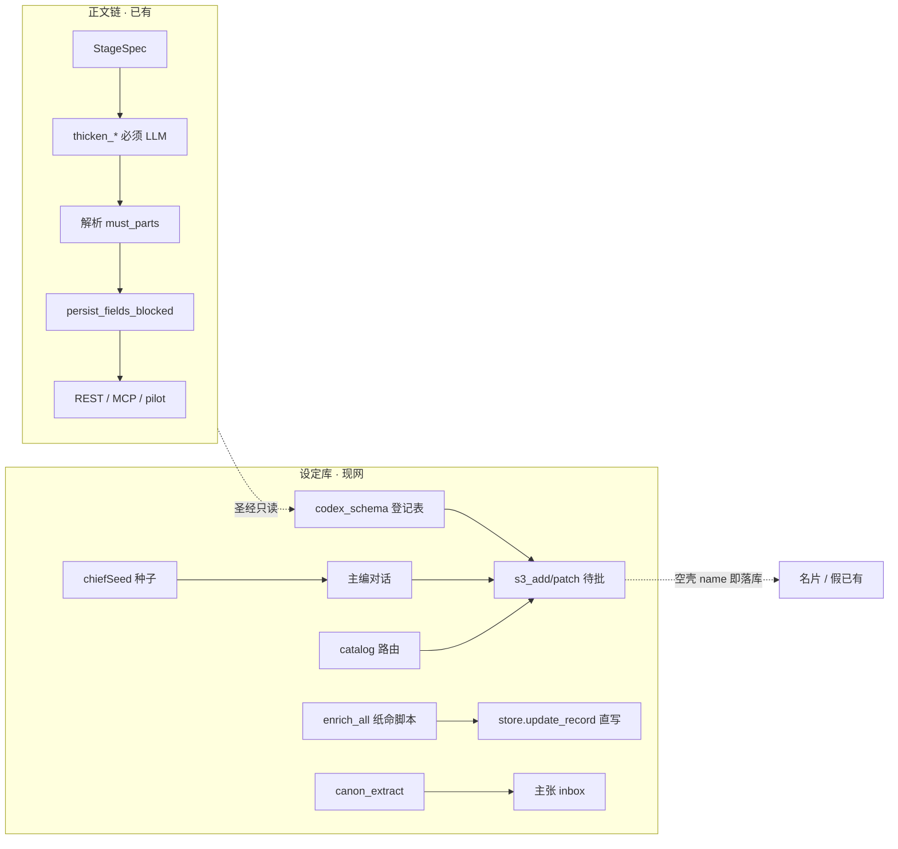
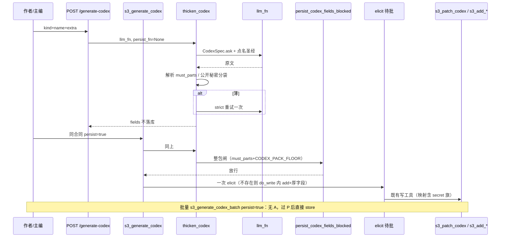

# 设定库生成链：按 kind 合同写厚（对齐正文冰山）

| 项 | 值 |
|----|----|
| **日期** | 2026-08-14 |
| **产品** | 铜炉 / tonglu · `scribe3/` |
| **作者** | Grok Design |
| **状态** | Draft（rev.4：批量写厚且无需批准） |
| **定位** | 给设定库**所有实体**补一条与正文链同构的生成链：必须 LLM、解析合同、persist 闸。生成结果必须**真正起到该 kind 该有的作用**，不是刷字数、不是空壳名字。 |
| **不改** | 宣称公式、`GATE_SAVE_MODE=soft`、GATE-B 80、secret / chief_only / `backstory_secret` 生成路径 fail-closed、代码默认 48k 窗、`NOVEL_PROMPT_HARD` 常量 |
| **验证** | 只冒烟已部署 demo（`tonglu.qing.blue` / `82.157.130.140`，`/opt/scribe3/app`）；禁止 Grok 机 `npm ci` / 本机 Surreal / 第二套库 |
| **法律写通道** | 单条手补 / `s3_generate_codex persist=true` 仍走 MCP 待批。**批量** `s3_generate_codex_batch persist=true` **无需批准**，过 L2 闸后直接落库。**禁止** REST 批量/单条直写。 |
| **相邻 SSOT** | 章冰山 [`2026-08-14-iceberg-complete.md`](./2026-08-14-iceberg-complete.md)；防洪水 [`2026-08-14-antiflood-blast-radius.md`](./2026-08-14-antiflood-blast-radius.md)（点名吃满 / `clip_for` / `codex_named` **已是现状**，本方案不重做注入） |

---

## Overview

正文已经有完整的「闸 · 链 · 吃满」：`StageSpec` → `thicken_outline/beats/deduce/draft` → 必须 `llm_fn` → 解析 `must_parts` → `persist_fields_blocked`（**只挡**本次提交的大纲 / 节拍 / 演绎：500 / 每拍 500+合计 2000 / 合计 5000）→ REST `POST /generate-stage` · MCP `s3_generate_stage` · pilot。排演 ≥10000 在 `s3_save_chapter_draft` 另闸；水面 5000 是 `evaluate_iceberg` / 开写，**不是** `persist_fields_blocked`。刚过闸材料经 `clip_for` + `INJECT_CAP` 进下一阶段；final 也吃满。

设定库**没有**对应的生产链。`codex_schema.py` 的字段是登记表，不是生成器。现网「补全」四条旁路——`chiefSeed.js` 往主编框塞「请补全并 `s3_patch_codex`」、编排 `catalog.py` 只声明 `write_tools`、一次性脚本 `tools/enrich_all.py` 写死《纸命》、`canon_extract.py` 从正文抽主张——**都不是**「按合同把设定卡写厚」。MCP `s3_add_character` / REST `POST /characters` 只交 `name` 就能落库，系统把空壳当成「已有角色」。防洪水刚修了「写厚了能进模」（点名公开档 2500/1200）；前半段「设定自己怎么被 LLM 写厚」整库空着。

本方案复用正文链心智模型，**不发明第三套宗教**：新建 `scribe3/codex_generate.py`（`CodexSpec` / `thicken_codex_*` / 解析 / 闸），地板数字与现网 `INJECT_CAP` 对齐（角色/势力公开包 **1200**、物件/术语/规则 **1200==帽**）。空壳名字可以占位；非空薄字段禁止落成「已有设定」。单条 persist 仍待批；**批量 persist 无需批准**（用户 2026-08-14 裁断）。secret / chief_only 生成路径 fail-closed 不动。

---

## Background & Motivation

### 正文链必须当现状（勿当待办）

代码真源：`scribe3/stage_generate.py` + `scribe3/iceberg.py`。

```text
StageSpec → thicken_outline / thicken_beats / thicken_deduce / thicken_draft
         → 必须 llm_fn（禁止模板/切句/摘录占位）
         → 解析合同（must_parts）
         → persist_fields_blocked：只挡本次提交的大纲/拍/演绎
           （500 / 每拍 500+合计 2000 / 合计 5000）
         → 排演 ≥10000 在 s3_save_chapter_draft 另闸；水面 5000 是开写/evaluate_iceberg
         → REST POST /generate-stage · MCP s3_generate_stage · pilot_actions
```

入口已接线：`api/routers/write.py` `generate_stage`、`mcp/tools_write.py` `s3_generate_stage`、`pilot_actions/{outline,beats,draft}.py`。`thicken_*` 有 `st` 才挂 `_codex_segments` 圣经（防洪水 PR-C2 已交）。`clip_for` 已扩设定 kind：`character_public`/`faction_public`=2500，`item`/`term`/`world_rule`=1200。

### 设定库现网（代码核实，非臆造）

**没有** `thicken_character` / `s3_generate_codex` / `POST /generate-codex`。全库 grep 零命中。

| 层 | 现状 | 职责 |
|----|------|------|
| schema | `codex_schema.py` `KINDS`：character / faction / item / term / world_rule | 字段登记、`prompt_keys`、`chief_only`、secret 旗标派生 |
| 注入 | `write_assemble_blocks._codex_segments` | 点名吃满公开档 + 未点名名片；母题走 heat；秘密门在拼接阶段 |
| 落库 | `mcp/tools_write.py` `s3_add_*` / `s3_patch_*` / `s3_patch_codex` | CRUD 待批，**不写厚、无地板** |
| REST | `api/routers/codex.py` `add_char`：`CharIn.name` 即可 `add_entity` | **直写**，无审批、无闸 |
| 种子 | `web/src/lib/chiefSeed.js` `seedChiefCodexWrite/Create` | 往主编框塞「请补全并 s3_patch_codex」，无 StageSpec |
| 编排 | `orchestration/catalog.py` `codex.character` 等 | `required_outcome=write_proposal`，路由不是生成器 |
| 一次性 | `tools/enrich_all.py` | 写死 `DB=book_c256380e`《纸命》，`_editor_system` + 正则抠 JSON |
| 抽取 | `canon_extract.py` | 正文 → `CanonClaim` inbox，方向相反 |

`persist_fields_blocked` **只认**章字段 `synopsis` / `beats` / `deductions`（`iceberg.py` 211–251 行）。`s3_add_character` 把可选 textarea 全当 `None` 照样 `commit_if_approved`。`store/characters.py` `add_entity` 不校验任何厚字段。

### 痛点（可验收，不是口号）

1. **空壳即「已有」**。作者建「灰七」只有名字，列表/名片/GATE 都当角色已立档。模型写正文时点名也只能吃到一行名片，只好发明性格与能力。
2. **16 字定义曾是进模上限，现在帽抬了、生成端仍会产出 16 字**。防洪水把 `term` 帽收到 1200；没有生成合同，主编种子仍说「补全」，模型继续写半句。
3. **世界规则缺代价/限制/例外 = 免费超能力**。`WORLD_RULE_FIELDS` 有 `cost`/`limitations`/`exceptions`/`capabilities`；`s3_add_world_rule` 全可选。
4. **势力只剩 slogan**。28 个 in_prompt 字段，add 只强制 `name`。组织行为无结构、无招募、无阶段目标。
5. **物件只剩名字**。叙事功能（谁持有、开什么门）在 schema 里，生成链不写。
6. **四条旁路互相不认合同**。种子、编排、enrich_all、抽取各写各的；章侧教训「只改种子不改生产函数」会原样重演。

用户原话：「设定库里所有信息有生成链吗?参考正文生成链」→ **没有**。本方案补这条链。

---

## Goals & Non-Goals

### Goals

1. 按 kind 写成**可验收合同**：`must_parts`、覆盖地板（字数=信息量）、解析形状、persist 闸、谁在读（点名吃满 vs 名片 vs heat vs 信封备忘）。
2. 复用正文链心智：Spec / `thicken_*` / 必须 LLM / 解析 / persist 闸 / 薄了重试一次 / 仍不够 422 不落库。
3. 「空允许、薄禁止」落到产品写通道，对齐 `persist_fields_blocked` 的**增量字段**语义（不是「一次 patch 必须整包 1200」）。
4. 生成地板与点名 `INJECT_CAP` 对齐：刚过闸公开档必须能 100% 进模。禁止 16→32 安慰剂。
5. 全表实体清单不漏：character / faction / item / term / world_rule / motif / promise / relation / voice / intent / fact。逐个裁定独立 thicken 还是抽取/名片。
6. 生产入口齐：REST 生成、MCP 生成、**Hermes `scribe3_write.include`**、按 kind 的 catalog（generate **和** 落库工具）、chiefSeed、UI 灯。禁止只改种子；禁止改 `run_stage_policy` 章 profile。
7. 与 `canon_extract` / `enrich_all` / `chiefSeed` 的去留写死。
8. secret 分袋：公开袋永不含 chief_only；讨论/主编可生成秘密袋。
9. 可独立合入的 PR 切片；**同一 kind 的 L1 挂钩 + thicken + 该域 catalog 必须同一 PR**。未实现 kind 不挂工具。

### Non-Goals

- 不改宣称、`GATE_SAVE_MODE`、GATE-B 80；字数不进 `may_claim_*`。
- 不 recreate 升窗，不把 `NOVEL_PROMPT_HARD` 改成 96000。
- 不把 secret / chief_only 改 fail-open。
- 不为验收再起平行 Surreal / 第二套栈。
- 不要求作者手打 1200 字：模型按合同生成 → 人点批。
- 不把母题写成圣经 dump（heat 调度保留）。
- 不让 LLM 擅自发明北极星（intent 仍是作者所有）。
- 不把命题/关系做成 1200 字档案（原子事实与边，不是卡）。
- 不重做防洪水注入（点名/名片/拆段已交）。

---

## 1. 现网对账（生成侧）



| 正文链零件 | 设定库现网 | 本方案 |
|------------|------------|--------|
| `StageSpec` | 无 | `CodexSpec` per kind |
| `thicken_*` | 无 | `thicken_codex(kind)` / `thicken_character` 等 |
| 必须 `llm_fn` | 种子指望主编「自己去调模型」 | 生产函数内 `_call_llm`，无 llm 抛 |
| `must_parts` | 无 | 按作用写死小标题 |
| `persist_fields_blocked`（只认 synopsis/beats/deductions） | 不认设定字段 | `persist_codex_fields_blocked`（增量只评本次非空子地板；包地板只打 thicken 整包） |
| `evaluate_iceberg` / skip | 有名字就 skip 补全 | `evaluate_codex_ready`，未齐禁止 skip |
| `POST /generate-stage` | 无 | `POST /generate-codex`（**只生成不落库**） |
| `s3_generate_stage` | 无 | `s3_generate_codex`（单条 persist 待批）；`s3_generate_codex_batch`（批量 persist **无需批准**） |
| pilot | 无 codex pilot | 首批不强制；若加必须调 `thicken_codex` |
| `clip_for` 吃满 | 已有（防洪水） | 生成地板对齐这些帽 |

章侧 REST `POST /generate-stage persist=true` 会 `update_chapter_meta` **绕过 MCP**。设定库**单条**不得抄这个 REST 口子。批量写厚是作者显式点的产品动作：走 MCP 工具但**跳过 elicit**，不是裸 HTTP 直写，也不是无人 cron。

---

## 2. 架构落点

### 2.1 为什么新建 `codex_generate.py`，不扩 `stage_generate.py`

| 维度 | 章链 `stage_generate.py` | 设定链 |
|------|--------------------------|--------|
| 对象 | 一章的线性阶段 | 一实体的一张卡 |
| 就绪 | `stage_ready` / `_NEED_PREV`（纲→拍→演→排） | 无阶段依赖；按 kind 合同 |
| 落库字段 | `synopsis` / `beats` / `deductions` / `draft` | schema `prompt_keys` 字典 |
| 审批 | REST persist 可直写 meta | 单条 persist **待批**；批量 persist **无需批准** |
| 秘密 | 章材料默认进提示词 | 公开袋 / 秘密袋 / chief_only 三档 |
| 消费者 | 下一阶段 thicken + final | `_codex_segments` 点名包 / 名片 / heat / voice_anchor |

把 `thicken_character` 塞进 `stage_generate.py` 会污染 `normalize_stage` / `_NEED_PREV` / `thicken_stage` 的章不变量，并诱使实现者抄 `persist=true` 直写。

**采纳：新模块 `scribe3/codex_generate.py`。** 闸与地板进 `iceberg.py`（与 `persist_fields_blocked` / `INJECT_CAP` 同一宗教）。`stage_generate.py` 只继续章链。

```text
iceberg.py                 地板常量 + persist_codex_fields_blocked + evaluate_codex_ready + pack_cn
codex_generate.py          CodexSpec / 解析 / thicken_codex_* / build_codex_prompt
mcp/tools_write.py         s3_generate_codex（WRITE_GATED）；s3_generate_codex_batch（不进 WRITE_GATED）
write_commit.py            DEFAULT_WRITE_GATED += s3_generate_codex（不加 batch）
deploy/hermes/mcp_servers.yaml  scribe3_write.include += 两工具
api/routers/write.py       POST /generate-codex 与 /generate-codex-batch（只返回厚稿；拒绝 include_secret）
orchestration/catalog      按 kind 接线：write_tools += generate + 该域落库工具
chiefSeed.js / CodexDetail 种子 + stub/薄/齐灯（随 kind PR，不提前全挂）
```

共享：`cn_len`、`clip_for`、`_call_llm` 形态（无 llm 抛）、薄了 `strict=True` 重试一次、达地板才 skip。禁止第三套 `CODEX_QUALITY_FLOOR=80`。

### 2.2 数据流



### 2.3 「该有的作用」总原则

字数是**信息覆盖地板**，用来挡住半句口号，不是文学分。每个 kind 的合同必须回答四句：

1. 模型拿着这张卡，**能做什么、被禁止做什么**。
2. 缺了哪一格，模型会**发明冲突含义 / 免费超能力 / 口号组织 / 无门物件**。
3. 刚过闸的公开包，点名时是否 **≤ `INJECT_CAP` 且 ≥ 地板**（100% 进模）。
4. 谁在读：`codex_named` / `codex_cards` / heat / `voice_anchor` / 信封备忘 / 只进主编。

---

## 3. 地板与帽（与点名吃满对齐）

现网 `iceberg.INJECT_CAP`（防洪水已交，本方案不改帽）：

| field | cap | 本方案**整包**地板（只打 thicken / `persist=true`） | 对齐理由 |
|-------|-----|---------------------|----------|
| `character_public` | 2500 | **1200**（公开包合计） | 帽是超写；地板是「能驱动场面」。1200 复用 term/item 档，不是 16→32 |
| `faction_public` | 2500 | **1200** | 同上：结构+意识形态+公开面目+行为约束 |
| `item` | 1200 | **1200**（包==帽） | 刚过闸 100% 进模 |
| `term` | 1200 | **1200**（`definition` 本体） | 禁止再生成 16 字定义 |
| `world_rule` | 1200 | **1200**（公开包） | 代价/限制/例外必须在包内 |

**两层闸（写死，禁止实现成「一次 patch 也要包 ≥1200」）：**

| 层 | 谁调用 | 评什么 | 不评什么 |
|----|--------|--------|----------|
| L1 增量 | 产品写通道 add/patch/REST/orch | **本次即将写入 store 的非空厚字段**的子地板 | 缺字段、空字段、公开包合计 |
| L2 整包 | `thicken_codex` 产出 / `s3_generate_codex persist=true` | `must_parts` + `CODEX_PACK_FLOOR` | 作者手补增量 |
| 灯 | `evaluate_codex_ready` | 合并后的整行：包+must_parts | **不挡**单字段 patch |

增量验收（必须单测）：`s3_patch_codex(character, {personality_detail: 250字})` 在 stub 上**放行**；同字段 3 字**挡**；`thicken` 公开包 800 → `llm_thin`，不 elicit。

`_floor_for` 现网对设定 kind 为 0（注入近地板不裁只服务章字段）。**保持 0。** 设定 persist 地板走独立表 `CODEX_PACK_FLOOR`，不要把 persist 地板写进 `_floor_for`——否则 `clip_for` 在 floor>cap 时会把帽顶死（章侧 `DEDUCTION_FLOOR` 不当单人 `_floor_for` 的同一教训）。

```python
# iceberg.py — 新增，不改 INJECT_CAP
CODEX_PACK_FLOOR = {
    "character": 1200,
    "faction": 1200,
    "item": 1200,
    "term": 1200,
    "world_rule": 1200,
}
```

包级帽（已有，不改）：名片 ≤80 / cards 1500 / named 软顶 48k→4500、96k→12000。

单卡 L2 地板 1200 进 named：`pack_cn` 不含标签，注入行会略长于地板（标签开销）。一章点名 1 人+1 势力+1 术语+1 物件+1 规则 ≈ 6000+标签，96k 档软顶 12000 装得下；48k 档 4500 会按现网淘汰序挤整实体——生成链离线写库，不占章窗。不要求 48k 塞满 5 张卡。

---

## 4. 全表实体合同

### 4.1 总表（不漏）

| kind | 独立 thicken？ | 合同性质 | 落库工具 | 谁在读 |
|------|----------------|----------|----------|--------|
| **character** | **是** | 场面驱动卡 | `s3_add_character` / `s3_patch_codex` | 点名 `character_public`≤2500；未点名名片 |
| **faction** | **是** | 组织行为约束卡 | `s3_add_faction` / `s3_patch_codex` | 点名 `faction_public`≤2500；秘密三档门 |
| **item** | **是** | 叙事功能卡 | `s3_add_item` / `s3_patch_item` / `s3_patch_codex` | 点名全文≤1200；未点名只 name |
| **term** | **是** | 释义边界卡 | `s3_add_term` / `s3_patch_term` / `s3_patch_codex` | 点名 `definition`≤1200 |
| **world_rule** | **是** | 代价/限制/例外卡 | `s3_add_world_rule` / `s3_patch_world_rule` / `s3_patch_codex` | 点名全文≤1200 |
| **motif** | **轻量是** | 工艺调度，不是圣经 | `s3_add_motif` / `s3_patch_motif` | heat：`must_echo` / `avoid_overuse` |
| **promise** | **否** | 情节装置；已有 resolution 闸 | `s3_plant_promise` 等 | 信封备忘 `[:30]`，**不要**写成 1200 档案 |
| **character relation** | **否** | 边 | `s3_add_character_relation` / `s3_evolve_relation` | 关系摘要；抽取或作者种 |
| **entity relation** | **否** | 边；`truth` 同级限知 | `s3_add_entity_relation` | 生成路径 `truth` fail-closed |
| **voice_profile** | **轻量是** | 声口指纹 | `s3_set_voice_profile` | `voice_anchor`（L2 保护） |
| **intent / 北极星** | **否** | 作者所有 | `s3_set_intent` | 身份/信封；禁止 LLM 当世界发明 |
| **fact / proposition** | **否** | 原子命题 | `s3_add_fact` / `s3_supersede_fact` | 信封 `facts[:40]`；由抽取或作者种 |
| **knowledge 边** | **否** | 知情记录 | `s3_record_knowledge` | `project_frame` |
| **character 卫星**（anchors / arc_beat / char_state） | **v1 不产出** | 另表、另工具；`thicken_character` 不吐 want/need/lie | 既有 `s3_set_char_anchors` 等 | 简报/弧光，不进 named 圣经 |

以下 4.2–4.12 是可验收合同。缺结构格 = warn；字数/必填格不够 = fail。

---

### 4.2 character（独立 thicken）

**作用**：点名后模型能用目标/恐惧/能力/弱点**选择场面**，而不是只剩外貌一句。

**must_parts**（小标题，解析认这些键 = `CHARACTER_FIELDS`）：

| 格 | schema key | 子地板 | 缺了会怎样 |
|----|------------|--------|------------|
| 性格 | `personality_detail` | ≥200 | 对白/选择崩成标签 |
| 表层目标 | `surface_goal` | ≥80 | 场面没有 Want |
| 深层需求 | `deep_need` | ≥80 | 只有情节没有人物 |
| 恐惧 | `fear` | ≥80 | 压力戏无处下手 |
| 内在冲突 | `internal_conflict` | ≥80 | 目标与需求不打架 |
| 能力 | `abilities` | ≥1 非空项 | 模型发明超能力 |
| 弱点 | `weaknesses` | ≥1 非空项 | 没有代价 |

可选计入公开包：`appearance`（若写 ≥40）、公开 `backstory`（若写 ≥200）、`aliases`、`personality_tags`、`importance`、`first_appearance`。

**公开包合计**（L2 / 就绪灯）`pack_cn("character", public_fields)` ≥ **1200**。字段序与现网 `_character_named_line` 相同（前史公开 → 别名 → 外观 → …），但 **`pack_cn` 只计字段正文，不含「- 名（别名:…）」标签，禁止先走 `_clip_named` / `clip_for`**。注入仍走 `_character_named_line` + `clip_for`。

**秘密袋**：`backstory` + `backstory_secret=true` **不计入**公开包地板。`include_secret=true` 仅 MCP / 主编 world_write；REST 拒绝该旗。生成路径 `for_generation=True` 且 `reveal=False` 时现网已清空秘密前史——**保持**。

**解析形状**：优先 JSON 对象（键=schema key）；否则认中文小标题（性格/表层目标/…）。禁止只回名字或一句「隐忍复仇」。

**persist 闸（两层）**：

- L1（`s3_add_character` / `s3_patch_character` / `s3_patch_codex` / orch `_add_char` `_patch_char` / emergency REST `edit_char`）：只评**即将写入 store 的非空键**子地板。仅 `name` = stub 放行。**不**要求本次提交包 ≥1200。
- L2（`thicken_character` / `s3_generate_codex persist=true`）：must_parts 齐且 `pack_cn` ≥1200，否则重试一次再 `llm_thin`。
- REST `POST /characters` `add_char` **实际只落** `backstory` / `backstory_secret` / `personality_tags` / `aliases`（`codex.py` 118–124）。闸按真实落库子集评，不要按 `CharIn` 全集。

**skip**：`evaluate_codex_ready("character", merged_row)` 真才 skip。有名字不算齐。就绪灯不挡增量 patch。

**max_tokens**：4096（对齐章 beats）。

**谁在读**：点名 `clip_for("character_public")`≤2500；未点名名片 ≤80（重要性，无前史）。

---

### 4.3 faction（独立 thicken）

**作用**：约束组织**会怎么行动**，不是一句口号。

**must_parts（公开袋）**：

| 格 | schema key | 子地板 | 缺了会怎样 |
|----|------------|--------|------------|
| 意识形态 | `ideology` | ≥200 | 只剩 motto |
| 公开面目 | `public_face` | ≥80 | 内外无差，无法演两面 |
| 行为约束 | `structure` **或** `recruitment` | ≥80 | 组织像一个人在喊 |
| 领袖 | `leader` | 非空 | 决策无主体 |
| 阶段目标 | `goals` | ≥1 条 `target` | 没有长线动作 |

公开包合计 ≥ **1200**。拼序 = `prompt_keys("faction")` 现网序，**先丢掉** `chief_only` 与未证明知情的 `secret_capable`（与 `_faction_prompt_block` 同一扇门）。

**秘密袋 / 主编袋**（仅 `include_secret=true`）：

| 档 | 字段 | 生成路径 |
|----|------|----------|
| `chief_only` | `secret_agenda` | **永不**进 `public_fields`；只进 `chief_only_fields` |
| `secret_capable` | `origin` / `artifact_operation` / `external_manipulation` / `acceleration_methods` | 进 `secret_fields` + 对应 `*_secret` 旗 |

解析必须**分袋**。单测：`public_fields` 不得含 `secret_agenda`。

**persist 闸（两层）**：L1 只评本次非空公开/秘密字段子地板（`structure`/`goals` 度量见 §6.6）。L2 thicken 整包 ≥1200 + must_parts。秘密袋若本次写入非空：`secret_agenda` ≥80；secret_capable 正文 ≥80。

**max_tokens**：4096。deprecated `private_operation`：**thicken 禁止生成**；L1 提交含该键 → 拒并提示拆到 `artifact_operation` / `external_manipulation` / `acceleration_methods`（`s3_add_faction` 现网仍收此参数，PR-3 必须挡）。

**谁在读**：点名 `faction_public`≤2500；未点名名片 name+status；`for_generation=True` 走三档门。

---

### 4.4 item（独立 thicken）

**作用**：有叙事功能——谁持有、能开哪扇门，不是只剩名字。

**must_parts**：

| 格 | schema key | 子地板 |
|----|------------|--------|
| 描述（外观+用途+**叙事功能**） | `description` | ≥400 |
| 持有者 | `current_owner` | 非空（角色名或 `role:…` 或「无人/遗失」） |
| 特殊属性或显式无 | `special_properties` | ≥1 项；显式无用 **`["无"]`**（闸认此枚举哨兵，**不做**中文短语子串魔法） |
| 状态 | `symbolic_state` | 枚举 `active/lost/destroyed/unknown` |

公开包合计 ≥ **1200**（描述撑满；`category` 计入）。帽 1200 → 刚过闸 100% 进模。

**解析**：JSON 或小标题 描述/持有者/特殊属性/状态。禁止只回 name。

**persist 闸（两层）**：L1 只评本次非空 `description`/`current_owner`/`special_properties`。L2 包 ≥1200 + must_parts。

**谁在读**：点名 `_item_named_line`；未点名只 name。

**max_tokens**：4096（对齐章 beats；1200 汉字+小标题+fence 在 2048 上易截成假 `llm_thin`）。

---

### 4.5 term（独立 thicken）

**作用**：模型在正文里**正确使用、不发明冲突含义**。

**must_parts**（全部写进 `definition` 一个 textarea，解析认小标题）：

1. **是什么** — 本书里这个词指称的对象  
2. **不是什么** — 相邻易混含义（禁止模型发明的边界）  
3. **本书用法** — 谁说、什么场合、语体  
4. **边界** — 不能引申成什么  

`definition` 去空白 ≥ **1200**。`aliases` 建议非空（减少点名针漏）。`category` 可选。

**禁止**：16 字、32 字、一句词典。这是本方案对「16→32 安慰剂」的直接否决点。

**persist 闸（两层）**：L1 本次非空 `definition` 低于 1200 → 挡（术语主载荷就是这一格；手补半句仍是病灶）。空 `definition` 不评（stub 放行）。L2 thicken 必须四格齐全且 `definition` ≥1200。

**谁在读**：点名 `clip_for("term")`；未点名只 name。

**max_tokens**：4096（理由同 item：四段小标题 + JSON fence，不要抄 outline 的 2048）。

---

### 4.6 world_rule（独立 thicken）

**作用**：有代价、限制、例外，否则模型当**免费超能力**。

**must_parts**：

| 格 | schema key | 子地板 | 缺了会怎样 |
|----|------------|--------|------------|
| 代价 | `cost` | ≥80 | 免费法术 |
| 限制 | `limitations` | ≥1 非空 | 无限使用 |
| 例外 | `exceptions` | ≥1 非空项；真无例外用哨兵 **`["无"]`**（与物件 `["无"]` 同形，闸不做「无例外」中文魔法） | 模型随口开金手指 |
| 赋予能力 | `capabilities` | ≥1 | 规则没有效果 |
| 作用域 | `scope` | 枚举 | 全球/地区/势力不清 |
| 源头 | `source` | 非空 | 规则从天上掉下来 |

公开包合计（L2）≥ **1200**。帽 1200 → 100% 进模。`note` 可补，不替代四格。

**persist 闸（两层）**：L1 只评本次非空 `cost`/`limitations`/`exceptions`/`capabilities`。L2 整包 + must_parts。

**谁在读**：点名 `_rule_named_line`（含代价/限制/例外/能力）；未点名 name+category。

**max_tokens**：4096。

---

### 4.7 motif（轻量 thicken，不是圣经）

**作用**：工艺调度。现网写作路径 `motif_schedule_directives` + `generation_motif_block`（`must_echo` / `avoid_overuse` / 可编织 ≤5）。讨论只列名字。

**不要**按 1200 散文写厚。heat 要的是：可调度的 `theme` + ≥3 个 ≥2 字的 `echo_terms` + 一句 `unfolding`。

**must_parts**：

| 格 | 地板 |
|----|------|
| `name` | 非空 |
| `theme` | ≥40 |
| `echo_terms` | ≥3 项，每项 ≥2（`motif_craft.parse_echo_terms`） |
| `unfolding` | ≥80 |
| `phase` / `tier` | 归一到现网枚举 |

**独立 thicken**：`thicken_motif` 轻量，`max_tokens` 1024。达工艺合同才 skip。

**persist 闸（L1 工艺，无 `CODEX_PACK_FLOOR`）**：本次非空 `theme` <40 挡；本次提交了 `echoes`/`echo_terms` 且解析后 <3 项挡。仅 name = stub，放行（与 `bible_motifs` 开书种子兼容）。L2 thicken 才要求 theme+≥3 echoes+unfolding 齐。

**谁在读**：heat，不进 `INJECT_CAP` 表。禁止把 unfolding 全文 dump 进 named。

---

### 4.8 promise（不独立 thicken）

**作用**：情节装置。读者侧是「别忘了这条线」，不是设定圣经。

现网已有：`s3_plant_promise` 对 `tier∈{book,arc}` 强制 `resolution`；章级短期豁免。注入是信封 `text[:30]` / `[:40]`（防洪水 E4，**故意**）。

**裁定**：不建 `thicken_promise`。写 1200 字伏笔正文会被 `[:30]` 砍光，属于白写。

**轻闸（可与本方案同批，不绑 thicken）**：`text` 非空且 `cn<20` → 挡（口号「会有报应」不算伏笔）。`resolution` 保持既有 book/arc 规则；若写则 ≥40。

线索仍走 `s3_add_clue`。enrich_all 的「给伏笔补线索」降为一次性，不产品化。

---

### 4.9 relation（不独立 thicken）

**character_relation**：受控词 + `since_chapter` + 可选 `note`。边的载荷是类型，不是 1200 字卡。`note` 若写 ≥20。

**entity_relation**：`ENTITY_RELATION_TYPES` 词表。`truth` 与 `secret_agenda` 同级——生成路径 fail-closed（现网 `_faction_prompt_block` 注释已对齐）。不 thicken `truth` 进公开袋。

**来源**：作者 CRUD，或 `canon_extract` 从正文抽。禁止 LLM 批量发明关系网当「写厚」。

---

### 4.10 voice_profile（轻量 thicken）

**作用**：约束叙述/对白声口。消费者是 `_voice_anchor_block`（焦点者全文锚 + 他人 `style_summary[:30]` 速记），L2 保护 `voice_anchor`。

现网已有演变折叠：`fold_voice_flags` + `parse_voice_profile_from_fold`（必须 `style_summary`）。那是**演变**，不是首张指纹。

**must_parts（首张）**：

| 格 | 地板 |
|----|------|
| `style_summary` | ≥80 |
| 另至少 2 项非空 | `catchphrases` / `tone_rules` / `internal_monologue_style` / `sentence_patterns` |

不按 1200 写传记。`max_tokens` 1024。

**落库缺口（现网）**：store `set_voice_profile` 已有 `internal_monologue_style` / `sentence_patterns` 列，但 MCP `s3_set_voice_profile` **只收** `style_summary` / `catchphrases` / `tone_rules` / `ooc_signals`（`tools_write.py` 618–630）。**PR-5 必须扩该工具签名**（及 orch 若透传 kwargs），否则 thicken 产出无法 persist。禁止把 must_parts 收到现网四键却仍让模型写死字段。

**persist 闸（L1 工艺）**：本次非空 `style_summary` <80 挡。无 `CODEX_PACK_FLOOR`。

**与角色 thicken 关系**：`thicken_character` **不**把声口写进公开档（那是另一张表）。可在角色合同末尾提示「声口请 `thicken_voice` / `s3_set_voice_profile`」。

---

### 4.11 intent / 北极星（不 thicken）

作者所有。`s3_set_intent` MERGE。LLM 发明「读者感受/红线」会污染宪法。

**裁定**：无 `thicken_intent`。主编讨论可建议，persist 仍人写 `s3_set_intent`。catalog `intent.northstar` 不挂 `s3_generate_codex`。

若字段非空过短：`reader_feeling` 非空且 <20 → 挡（可选轻闸，不阻塞本方案主路径）。

---

### 4.12 fact / proposition / knowledge（不 thicken）

原子三元组 `(entity, attribute, value, valid_from, secret)`。信封 `facts[:40]` 不是档案。`thicken_fact` 等于让模型发明世界真相——与抽取 inbox 人批相反。

**裁定**：保持 `canon_extract` → inbox → 人批 `s3_add_fact` / `s3_supersede_fact`。`value` 空不落库（现网已是）。知识边由事件/看见即知道产生，不生成。

---

## 5. 空允许、薄禁止

对齐 `persist_fields_blocked` 原话：「空串/空列表 = 尚未写厚，允许。非空但低于地板 = 挡，禁止口号落成已有大纲。」

| 动作 | 哪一层 | 结果 |
|------|--------|------|
| `s3_add_character(name="灰七")` 其余厚字段空 | L1 | **放行**（stub） |
| stub 上 `s3_patch_codex({personality_detail: 250字})` | L1 | **放行**（过子地板；不评包 1200） |
| 同字段 `"沉默"`（3 字） | L1 | **挡** `codex_thin_persist` |
| add/patch `definition` 16 字 | L1 | **挡**（术语子地板=1200） |
| add 世界规则只有 name+category，cost 空 | L1 | **放行 stub** |
| add 世界规则 cost="有代价"（3 字） | L1 | **挡** |
| `thicken_codex` 公开包 800 | L2 | 重试一次；仍不够 → `llm_thin`，**不 elicit** |
| `evaluate_codex_ready` 假 | 灯 | 详情显示 stub/薄；**不**挡手补 |
| 讨论加厚本实体 | — | 不挡对话 |

**病灶怎么治**：不是禁止 stub，是禁止把 stub 当成「已有圣经」。

- `evaluate_codex_ready` 假 → UI 灯 = stub/薄，补全按钮走 `seedChiefCodexWrite`；**不得**写「档案已完整」。没有 UI 灯切片，痛点 1 不算治完。灯优先由读接口附带 `codex_ready`（后端跑同一纯函数），前端不要另写一套 1200。
- `thicken_codex` 见 stub **必须**调 LLM，禁止因 `st.exists(oid)` skip。
- 点名 stub：注入仍是名片级——可接受；真正吃满要先 L2 过闸。

**闸落点**（产品通道，**不**进 `store.update_record` 本体——对齐章侧「`update_chapter_meta` 不加闸」）。每个 kind PR 必须列出**全部**能写该 kind 厚字段的函数，闸只评**即将写入 store 的键**：

| kind | 必须挂钩（该 kind PR 同一提交） |
|------|--------------------------------|
| character | `s3_add_character`、`s3_patch_character`、`s3_patch_codex(kind=character)`、orch `_add_char` / `_patch_char`、emergency REST `edit_char`；`add_char` 只评真实落库子集 |
| faction | `s3_add_faction`、`s3_patch_faction`、`s3_patch_codex(faction)`、orch 对应 executor、emergency REST |
| item / term / world_rule | 具名 add/patch、`s3_patch_codex`、orch `_add_term` 等、emergency REST |
| motif / voice | `s3_add/patch_motif`、`s3_set_voice_profile`（扩参后）、orch |
| L2 | `thicken_codex` / 单条 persist（elicit 前）/ 批量 persist（写 store 前） |

`tools/enrich_all.py` 的 `store.update_record` 直写**不**加闸（脚本降级，见 §8）。

**旗**：设定闸**不**复用 `SCRIBE3_ICEBERG_WRITE`。章闸关掉不得误关设定闸。用独立 `SCRIBE3_CODEX_THICKEN_GATE`（默认开；`0/false` 放行 L1/L2，回滚逃生）。`evaluate_codex_ready` 始终可算（灯不关）。

---

## 6. 生成合同实现形状

### 6.1 CodexSpec

```python
# scribe3/codex_generate.py（目标形状，非现网）
def codex_spec(kind: str) -> dict:
    """kind ∈ character|faction|item|term|world_rule|motif|voice"""
    # persist_tool / persist_field / floor / must_parts / max_tokens / ask / secret_mode
```

| kind | persist_tool | max_tokens |
|------|--------------|------------|
| character | `s3_patch_codex`（不存在：`persist=true` 一次 elicit，do_write 内 add 带厚字段） | 4096 |
| faction | 同上 / `s3_add_faction` | 4096 |
| item / term / world_rule | 对应 add/patch 或 `s3_patch_codex` | **4096** |
| motif | `s3_patch_motif` | 1024 |
| voice | `s3_set_voice_profile`（PR-5 扩参） | 1024 |

`kind` 不在表内 → `unknown_kind`。`kind` 在表内但本切片未实现 → **`kind_not_implemented`**（`ok:false`，禁止装成功、禁止 skip）。catalog 在实现前**不要**把 `s3_generate_codex` 放进该域 `write_tools`。

### 6.2 必须 LLM

与 `stage_generate._call_llm` 同纪律：`llm_fn is None` 抛 `ValueError`。禁止：

- 把 `name` 扩写成「名叫 X 的人」充数  
- 切 `extra` / 旧字段拼包  
- 空白 must_parts  
- enrich_all 式「没 JSON 就 skip」当成功  

薄了 `strict=True` 重试**一次**；仍不够 → `{ok:False, code:llm_thin}`，不 persist。

### 6.3 解析

1. 去 fence。  
2. 若全文是 JSON 对象且键落在 `all_storage_keys(kind)` → 用 JSON。  
3. 否则按中文小标题切（与 `parse_outline_payload` / `_extract_slot` 同族）。  
4. 分袋：`public_fields` / `secret_fields` / `chief_only_fields`。`chief_only` 键只进第三袋。  
5. `ok` = must_parts 齐且公开包 `cn ≥ CODEX_PACK_FLOOR[kind]`（motif/voice 用各自工艺地板）。

`warn_parts` 缺结构格不单独 fail（对齐大纲）。能力/弱点/限制等数组空 = fail。

### 6.4 提示词与圣经

```python
def build_codex_prompt(kind, row, *, extra="", strict=False, previous="", bible="") -> str:
    # 本函数不碰 store；bible 由调用方传入
```

`thicken_codex` 仅当 `st is not None` 才 `_codex_segments(..., for_generation=not include_secret, request_text=name+aliases+extra)`。无 `st`：不挂圣经，单测显式断言无「本书设定圣经」。

`include_secret=True`：**仅** MCP `s3_generate_codex` / 主编 world_write。此时 `for_generation=False`，主编可见秘密。默认 `False`：生成将注入正文的公开袋（`for_generation=True`）。REST **拒绝**该旗（400），且 REST 调用路径恒 `include_secret=False`。

上下文还可吃：同书已有术语/规则名片（防发明冲突定义）、角色 `involved` 名。L2 先砍 polish 的纪律与章链相同——圣经 named 受软顶。

### 6.5 skip 与覆盖

```python
def evaluate_codex_ready(kind: str, row: dict | None) -> dict:
    # 纯函数，看合并后的整行。stub → ok=False。
    # 达 must_parts + pack_cn≥CODEX_PACK_FLOOR（motif/voice 用工艺地板）→ ok=True
    # 只决定 thicken skip 与 UI 灯。绝不在 L1 patch 上挡。
```

已齐默认 skip（不覆盖作者点批过的厚卡）。`force=True` 才重写。薄卡禁止 skip。

### 6.6 闸函数签名与包长（可实现）

```python
# iceberg.py — 目标形状

CODEX_FIELD_FLOOR: dict[str, dict[str, int]] = {
    # 标量 textarea / text 的 cn_len 子地板；数组「≥1」用 CODEX_MIN_ITEMS
    "character": {
        "personality_detail": 200, "surface_goal": 80, "deep_need": 80,
        "fear": 80, "internal_conflict": 80, "appearance": 40, "backstory": 200,
    },
    "faction": {"ideology": 200, "public_face": 80, "recruitment": 80, "secret_agenda": 80},
    "item": {"description": 400},
    "term": {"definition": 1200},
    "world_rule": {"cost": 80, "source": 1},
    "motif": {"theme": 40, "unfolding": 80},
    "voice": {"style_summary": 80},
}

def field_cn(value) -> int:
    """只计正文。dict/list：json.dumps(ensure_ascii=False) 去空白后 cn_len。
    不走 _clip_named / clip_for / 注入标签。"""

def pack_cn(kind: str, public_fields: dict) -> int:
    """公开包长 = 各公开厚字段 field_cn 之和（不含 name、枚举、旗标、chief_only）。
    禁止复用 _character_named_line（那会先 clip 到 2500 且含标签）。"""

def persist_codex_fields_blocked(
    kind: str,
    submitted: dict | None,
    *,
    existing: dict | None = None,   # L1 不用来算包；留给实现对照「即将写入」
    mode: str = "incremental",      # "incremental" | "pack"
) -> dict | None:
    """None = 放行。关旗 SCRIBE3_CODEX_THICKEN_GATE 则 L1/L2 都放行。
    incremental: 只遍历 submitted 里即将写入且非空的厚键，低于子地板则挡。
    pack: 用 submitted 当整包（thicken 产出），must_parts + pack_cn≥CODEX_PACK_FLOOR。
    existing 不并进 pack 计算——L2 必须一次交齐，禁止「旧行凑包假装 thicken 齐」。
    """

def evaluate_codex_ready(kind: str, row: dict | None) -> dict:
    """合并后的整行。mode 语义上是 pack 检查，但不挡写。"""
```

**object / array 度量（写死）：**

| 字段 | L1 / must_parts |
|------|-----------------|
| `abilities` / `weaknesses` / `limitations` / `capabilities` / `special_properties` | 非空项数 ≥1；哨兵 `["无"]` 对 special_properties / exceptions 算 1 项合法 |
| `goals` | `array<object>`：至少 1 条，且该条 `target` 的 `field_cn≥1` |
| `structure` | object：`decision_mechanism` 或 `type` 至少一者 `field_cn≥80`；整段 JSON 去空白不另设 80 |
| `echo_terms` | `parse_echo_terms` 后 ≥3，每项 ≥2 |

**3 条验收（Issue 1）：**

1. stub 上 `persist_codex_fields_blocked("character", {"personality_detail": "…"*250}, mode="incremental")` → `None`  
2. 同函数 `{"personality_detail": "沉默"}` → `codex_thin_persist`  
3. `mode="pack"` 且 `pack_cn=800` → 挡；`thicken` 路径不 elicit  

---


## 7. 入口（必须接线生产函数）

章侧教训：只改 `chiefSeed`、`thicken_*` 无 `st`，圣经仍不进加厚链。本方案入口表是验收项。

| 入口 | 做什么 | 落库？ |
|------|--------|--------|
| `POST /generate-codex` | 调 `thicken_codex`；**拒绝** `include_secret=true`（400） | **永不**。无 persist 参数 |
| `s3_generate_codex` | 同合同；`persist=true` 时 L2 闸 + **一次** elicit + do_write | 待批后是 |
| `s3_generate_codex_batch` | 扫本书 stub/thin，逐条调同一 `thicken_codex`；`persist=true` **过 L2 即写 store，无需 elicit** | 是（无审批）。**不进** `WRITE_GATED` |
| `POST /generate-codex-batch` | 同上，只预览 | **永不**落库 |
| `scribe3/deploy/hermes/mcp_servers.yaml` `scribe3_write.include` | **静态名单**才是主编真边界；必须 `+= s3_generate_codex` **和** `s3_generate_codex_batch`（与 `s3_generate_stage` 并列） | 热更后跑 Hermes provision / overlay |
| catalog **已实现**的 `codex.*` / `motif.manage` / `voice.manage` | `write_tools` **同时**含 `s3_generate_codex` **和** 该 kind 落库工具（`s3_patch_codex` 或 `s3_set_voice_profile` / `s3_patch_motif`）。未实现 kind **不挂** generate | 仍 `write_proposal` |
| `chiefSeed.js` | 仅已实现 kind 的种子点名 generate + 合同短核，再 patch | 种子不是生成器 |
| 主编 `/chat` world_write | 走 `scribe3_write` profile + catalog `write_tools`。**不要**把设定生成塞进 `run_stage_policy` 的 outline/beats/deduce/draft/final | 待批 |
| `CodexDetail` / 列表 | stub/薄/齐灯；补全走升级种子 | 不直写 |
| pilot | 首批**不**加 `pilot_actions/codex.py`。若加，必须调 `thicken_codex` | — |

`s3_generate_codex` 参数（不得发明与现网工具冲突的名字）：

```text
kind: character|faction|item|term|world_rule|motif|voice
name: 定位名（voice 则 character_id）
persist: bool = false
extra: str = ""
include_secret: bool = false   # REST 无此参数；MCP 默认 false
force: bool = false
work: str | None = None
```

**不存在实体 + `persist=true`：一次 elicit。** 审批文案写「生成并落库 {kind}:{name}」。`do_write` 内：有则 patch；无则 `add_*` **一次带上厚字段**（或 add stub 紧接着 patch，仍在同一个 `commit_if_approved`）。禁止默认两次审批。禁止 REST `add_char` 当生成落库。指纹是 `s3_generate_codex` 自己的 args（含 kind/name/persist），不是拆成两个工具。

待批集合只加 **`s3_generate_codex`**（单条）：`mcp/_common.py` `WRITE_GATED` **和** `write_commit.py` `DEFAULT_WRITE_GATED`（现网后者已漏 `s3_generate_stage` / `s3_save_chapter_draft`；PR-1 顺手对齐，可另 commit 不阻塞）。

**`s3_generate_codex_batch` 禁止进入 `WRITE_GATED` / `DEFAULT_WRITE_GATED`。** 进了就会被 Hermes 当成待批工具，与「批量无需批准」相反。它仍必须进 `scribe3_write.include`，否则主编调不到。`do_write` 直接调 store add/patch（与单条 persist 的 store 路径相同），**不要**再套一层 `s3_add_*` 待批。每条写审计：`work/kind/name/cn/source=codex_batch`。

前端：设定详情「让主编补全」走升级后的 `seedChiefCodexWrite`；设定库顶栏「写厚本书空壳」走 `seedChiefCodexBatch`（点名 `s3_generate_codex_batch`）。新建表单仍禁止直写 REST 当主路径（`seedChiefCodexCreate` 已有此纪律）。

**catalog `instruction_duty`（已实现 kind）** 句式：

```text
先 s3_generate_codex(kind=…, persist=true) 一次待批；
或 persist=false 拿到厚稿后再 s3_patch_codex / s3_add_*。
禁止只口头补全。intent.northstar 不挂 generate。
```

现网裂缝：全库 catalog **零命中** `s3_patch_codex`，但 `chiefSeed` 已命令模型调它 → `empty_talk_no_write`。接线时必须把 `s3_patch_codex` 写进该域 `write_tools`（`orchestration/resolve.py` 只认 package 内调用）。

### 7.1 批量写厚（v1 裁断，不是开放问题）

**裁断（rev.4）**：v1 就要「对本书所有空壳逐条生成」，且 **`persist=true` 无需批准**。禁止 `enrich_all.py` 复活、禁止一次 JSON dump、禁止 REST 直写。生成仍按实体走同一 `thicken_codex` + L2 闸；薄的不落库。

**扫描**（`list_codex_thicken_targets(st, *, kinds=None, force=False)`，纯函数可单测）：

1. `kinds` 默认 = 本切片**已实现** thicken 的 kind（PR-1b 只有 `term`；角色等随 kind PR 自动进入扫描，因 `thicken_codex` 对未实现返回 `kind_not_implemented`，扫描侧直接跳过）。  
2. 对每个已实现 kind 列全表（`characters` / `list_terms` / …）。  
3. `evaluate_codex_ready` 为 stub 或 thin（`ok=False`）才入队。`force=False` 时 ready 跳过。  
4. 不创建新实体、不扫 promise/relation/intent/fact。  
5. 单次调用硬顶 `max_items=50`（可调，上限 100），按存储序；返回 `next_offset`。全书 200 个空壳 = 调用方带 offset 继续，不是静默丢。

**生成**：对每个 target 调**同一** `thicken_codex(kind, name, …)`（合同、圣经、L2 闸、重试一次与单条完全相同）。禁止批量子路径另写 JSON 模板。

**persist**：

| 入口 | persist | 审批 |
|------|---------|------|
| `POST /generate-codex-batch` | 无此参数 | 只预览。`include_secret` 拒 400。响应无秘密袋 |
| `s3_generate_codex_batch persist=false` | 否 | 返回 per-item 厚稿 |
| `s3_generate_codex_batch persist=true` | 是 | **无需 `_ask` / `commit_if_approved`。** 该条 L2 过了就 `do_write`。禁止再套一层待批工具 |

**失败不中断**：一条 `llm_thin` / `kind_not_implemented` / L2 闸 / store 写失败 → 记入该行，**继续下一条**。整批 MCP 顶层 `status=ok` 只要扫完（部分失败用 `items[].status`）。没有「用户拒批」这一行——批量路径不 elicit。

**返回形状**：

```text
{
  status, scanned, queued, next_offset,
  items: [
    {kind, name, status: ok|skipped_ready|llm_thin|write_failed|kind_not_implemented,
     cn, persist: written|preview|none, error?}
  ]
}
```

**参数**：`kinds: list[str] | None`、`persist: bool=false`、`force: bool=false`、`extra: str=""`、`include_secret: bool=false`（REST 无）、`offset: int=0`、`max_items: int=50`、`work`。

**禁止**：import / 调用 `tools/enrich_all.py`；批处理把 `chief_only` 打进 REST；把 batch 放进 `WRITE_GATED`；无人触发的 cron 调 batch。作者/主编点一次工具 = 授权本次扫描窗口（`max_items`）内的直接落库。

---

## 8. 与三条旁路的关系

| 现网 | 去留 | 语义 |
|------|------|------|
| `canon_extract.py` | **留下** | 方向相反：正文→主张 inbox。抽取通过后若落成 stub，UI 应接着种子 `s3_generate_codex`，不要把抽取当写厚 |
| `tools/enrich_all.py` | **降级** | 文件头改为「考古 / 《纸命》一次性；禁止当产品入口」。**批量写厚不得 import 本脚本**。不从 API/MCP/catalog 调用。不删文件（避免静默断人） |
| `chiefSeed.js` | **升级** | 补全/新建种子必须含生成工具名、地板、must_parts。禁止只写「请补全」 |
| `_editor_system` | **不**当生成器 | 防洪水已裁断：讨论入口是 `assemble_discussion_system`。enrich_all 对它的依赖随脚本降级 |
| catalog | **按 kind 接线** | 该 kind thicken PR 才把 generate + `s3_patch_codex`（或具名落库工具）写入 `write_tools`；duty 对标 `chapter.outline`。禁止工具名先挂、合同后补 |

禁止第三条「静默 enrich cron」在无人点工具时 `update_record`。用户显式调用 `s3_generate_codex_batch persist=true` 不是 cron，是产品入口。

---

## 9. Secret / 限知

现网门必须原样保留：

- `chief_only`（`secret_agenda`）：`for_generation=True` 永不注入（`_faction_prompt_block`）。
- `secret_capable` + `{key}_secret`：生成路径正证 `known_ids`，无证据不注。
- `backstory_secret` + `reveal=False`：前史不拼。
- 桥镜像不进 canonical（`is_faction_bridge_mirror`）。
- `entity_relation.truth` 同级。

生成链加三条纪律：

1. 默认 `include_secret=False`，prompt 明确「不要写隐秘议程/秘密前史；那些走主编袋」。  
2. 解析后若公开袋误含 `chief_only_keys` → 移出并 `warn`，**不得**写进将注入正文的 persist 字段。  
3. `include_secret=True` **只允许 MCP / 主编 world_write**。REST `/generate-codex` **400** 拒绝该旗；REST 路径恒 `for_generation=True`，prompt 不含 `secret_agenda`。MCP 工具说明写死。单测分两条：REST 拼袋看不到 `secret_agenda`；MCP `include_secret=true` 才进 `chief_only_fields`。

### 9.1 persist 字段映射（`persist=true`）

`public_fields` 先剥离 `chief_only_keys(kind)` 再送 patch。三袋合并进一次 `s3_patch_codex` / add 的 `fields`：

| 袋 | 键 | 额外旗 |
|----|----|--------|
| `public_fields` | 该 kind `prompt_keys` 减 chief_only | 无 |
| `secret_fields` | `backstory` / `origin` / `artifact_operation` / `external_manipulation` / `acceleration_methods` 等 `secret_capable` | 对应 `{key}_secret=true`（`secret_flag_key`） |
| `chief_only_fields` | `secret_agenda` | `secret_agenda_secret` 若 schema 有则一并写；**永不**拷回 `public_fields` |

角色：`backstory` 在 secret 袋 ⇒ 写 `backstory` + `backstory_secret=true`。公开袋若也有 `backstory` → 冲突，以 secret 袋为准并 warn。

提交含 `private_operation`（任何袋）→ 拒：`deprecated_field`，提示拆三字段。

不把秘密「藏」在 1200 字帽里——帽不是限知。

---

## 10. 窗

| 事实 | 含义 |
|------|------|
| 生成链离线写库 | 不占章 `prompt_hard` |
| 结果进 `codex_named` | 受 `named_pack_soft_cap`（48k→4500，96k→12000） |
| 单卡地板 1200 | 低于两档软顶 |
| 代码默认仍 48k | 本方案不改 `NOVEL_PROMPT_HARD`，不 recreate |
| demo 已部署 96k | 冒烟主路径按 96k：点名刚过闸 definition/规则/物件全文在 instructions |

48k 回滚档：点名过多按防洪水淘汰序挤整实体；`over_budget` 可审计。不要求肥章在 48k 上仍塞下 5 张 1200 卡。

---

## API / Interface Changes

### 新增

```http
POST /generate-codex?work=main
{ "kind": "term", "name": "炉令", "extra": "", "force": false }
```

成功：`{ ok, kind, name, public_fields, cn, parts, source }`。REST **不返回** `secret_fields` / `chief_only_fields`（空或不出现）。薄：422 `{ code: llm_thin, got, need }`。未知 kind：400。`include_secret=true`：**400** `{ code: include_secret_forbidden }`。未实现 kind：422 `{ code: kind_not_implemented }`。

**无 persist 字段。** 不得抄 `/generate-stage` 的 REST 直写。

```text
s3_generate_codex(kind, name, persist=false, extra="", include_secret=false, force=false, work=None)
```

`persist=false`：返回厚稿（MCP 可含分袋）。`persist=true`（**仅单条**）：`persist_codex_fields_blocked(..., mode="pack")` → **一次** elicit → do_write 按 §9.1 映射。

```text
s3_generate_codex_batch(kinds=None, persist=false, force=false, extra="",
                        include_secret=false, offset=0, max_items=50, work=None)
POST /generate-codex-batch   # 无 persist；拒 include_secret；只预览
```

`s3_generate_codex_batch persist=true`：每条 L2 过了就 store，**不 elicit**。

接线：

- 单条进 `WRITE_GATED` + `DEFAULT_WRITE_GATED` + yaml include
- 批量 **只**进 yaml include，**不进**两处 GATED
- **`scribe3/deploy/hermes/mcp_servers.yaml` `scribe3_write.tools.include`**（主编真边界；漏了则热更后端仍调不到）

**不要**把设定生成塞进 `run_stage_policy` 的章 profile。

### 既有工具行为变更（按 kind 随 PR 落地）

L1：对该 kind **全部**写通道（具名 `s3_patch_*`、`s3_patch_codex`、orch executor、emergency REST）跑 `persist_codex_fields_blocked(..., mode="incremental")`，只评即将写入 store 的非空键。stub add 仍成功。

`s3_patch_character` **能写** `personality_detail` / `surface_goal` / `deep_need` / `fear` / `appearance`——PR-2 **必须挂钩**，否则三字「沉默」仍可待批落库。

### 前端

`seedChiefCodexWrite` / `seedChiefCodexCreate`：仅已实现 kind 插入生成合同短核。`seedChiefCodexBatch`：点名 `s3_generate_codex_batch`（「写厚本书空壳」）。`shouldUseHermesRun` 须能命中这两个工具名。`CodexDetail` / 列表：`evaluate_codex_ready` 三态灯。

### 不改

- `GET /codex-schema/{kind}`  
- schema 字段键  
- 点名注入算法（防洪水已交）  
- 宣称 / GATE-B / `GATE_SAVE_MODE`

---

## Data Model Changes

无新表、无 migration。字段已在 `CHARACTER_FIELDS` / `FACTION_FIELDS` / `ITEM_FIELDS` / `TERM_FIELDS` / `WORLD_RULE_FIELDS` 与 motif/voice/promise/intent 既有列。

本方案只改：**谁把字段写厚、多厚才准把非空值当成已有设定。**

`evaluate_codex_ready` 是纯函数，不落库「就绪」列（避免双源）。UI 需要灯时现场算。

---

## Alternatives Considered

### A. 扩 `stage_generate.py`，假装 character 是一个 stage

- 优点：少一个模块。  
- 缺点：`stage_ready` / 线性阶段被污染；REST persist 直写会被抄过来；秘密分袋与章材料混在一个解析器。  
- **否决。**

### B. 只升级 `chiefSeed` + catalog 文案，不写 `thicken_*`

- 优点：零后端。  
- 缺点：章侧已证明「只改种子」不等于生产链。无解析、无闸、无重试、主编可交 16 字 definition 过审批。  
- **否决**作为主路径。种子仍要升级，但是第三位。

### C. 产品化 `enrich_all.py`（JSON + `update_record`）

- 优点：已有脚本。  
- 缺点：写死《纸命》、绕过审批、正则抠 JSON、旧 `private_operation` 键、无地板。与法律写通道相反。  
- **否决。** 脚本降级为考古。

### D. 本方案（`codex_generate.py` + iceberg 闸 + 单条待批 / 批量免批 + 地板对齐 1200/2500）

- 优点：与章链同一心智；注入帽已存在，生成端补齐；secret 分袋；入口可验收。  
- 代价：多一个模块；每个 kind 的闸与 thicken 必须同 PR。  
- **采纳。**

### E. 所有 kind 都上 2500 地板

- 优点：数字更少。  
- 缺点：物件/术语帽是 1200，生成 2500 必被 `clip_for` 砍；母题/伏笔/声口会被写成假圣经。  
- **否决。** 角色/势力地板 1200、帽 2500；item/term/rule 地板=帽=1200。

---

## Security & Privacy Considerations

| 威胁 | 处理 |
|------|------|
| 生成把 `secret_agenda` 写进公开袋，随后点名注入正文 | 解析分袋 + persist 前剥离 `chief_only_keys`；单测 |
| `include_secret=True` 被写作路径 / 裸 HTTP 误用 | REST **拒绝**该旗；MCP 默认 False；`thicken` 挂圣经时 `for_generation=not include_secret` |
| REST `/generate-codex` 被加成 persist 直写 | 合同禁止；评审检查项 |
| 点名子串误伤 | 不在本方案改针；沿用防洪水完整 name/id/alias |
| budget_report / trace 记秘密正文 | 继续只记长度与 source_id |
| LLM 把秘密写进 `definition` 这种公开 textarea | 合同写「定义是公开用法」；抽检靠主编审批，不靠帽 |

---

## Observability

`budget_report` 已有 `codex_named_chars` / `codex_entities_full`（防洪水）。本方案加生成侧（非 KPI）：

- `codex_generate.kind` / `cn` / `ready` / `skipped` / `llm_thin`  
- `codex_persist.blocked` 计数（按 kind）  
- 探针：刚过闸术语 `definition` 长度 ≥1200 且点名后 instructions 含该定义（demo 96k）

主指标仍是戏剧信号密度。禁止 `tokens_saved` 或「生成了多少字」当成功。字数只证明覆盖，不进宣称。

告警（软）：`s3_add_term` 一周内 `codex_thin_persist` 占比高 → 种子/合同没进模型视野。

---

## Rollout Plan

1. 设定闸独立旗 `SCRIBE3_CODEX_THICKEN_GATE`（默认开）。**不**复用 `SCRIBE3_ICEBERG_WRITE`。回滚 = 关旗或 revert 该 kind PR。  
2. 顺序见 PR Plan：**按 kind 接线**。闸函数+单测（PR-0）不挂写工具；每个 kind 的 L1 挂钩 + thicken + catalog/seed/yaml（若该 PR 是首个 MCP 入口）同一提交。  
3. **term 打头**。再 character（含最小 UI 灯），再 faction，再 item+world_rule，再 motif/voice。禁止 PR-1 后把 generate 挂进未实现域。  
4. 验收 = demo 已部署栈冒烟（含主编对话点名工具，不只 curl REST）。不在 Grok 机全量测。  
5. 旧空壳：v1 **批量写厚且无需批准**（`s3_generate_codex_batch persist=true` 直接落库）。禁止无人触发的 cron / `enrich_all` 复活。

---

## Risks

| 风险 | 严重度 | 缓解 |
|------|--------|------|
| 闸先合入、thicken 未合入 → 作者手补被 422 卡死 | **高** | 同一 kind L1+thicken 不可拆；L1 不评包 1200 |
| 包地板误挂增量 patch | **高** | 两层闸写死；3 条验收单测 |
| 漏 Hermes include → 主编调不到工具 | **高** | PR-1 改 `mcp_servers.yaml` + provision |
| REST 生成被抄成 persist 直写 | 高 | 无 persist 参数 |
| REST `include_secret` 泄密 | 高 | 400 拒绝；响应无秘密袋 |
| catalog 提前全挂未实现 kind | 高 | 按 kind 接线；`kind_not_implemented` |
| 角色 1200 仍不够「驱动场面」 | 中 | must_parts 子地板；不够再加子格 |
| 点名 5 张 1200 卡挤爆 48k named 4500 | 中 | pack 用不含标签的 `pack_cn`；注入淘汰序已有；demo 96k |
| 模型把秘密写进公开 definition | 中 | 分袋+审批 |
| enrich_all 仍被当操作手册 | 低 | 文件头降级；批量入口禁止 import |
| 批量无需批准把幻觉整本写入 | **高** | 仍走 L2 闸；薄不落库；per-item 结果表；审计每条；`max_items=50`；不进 WRITE_GATED 但必须登录/work 作用域 |

---

## Open Questions

能由第一性原理钉死的已钉（见 Key Decisions）。开放问题均已裁完：

1. **旧空壳要不要一键「全书写厚」？** — **已裁：v1 做批量写厚，且无需批准。** 入口 `s3_generate_codex_batch`；REST 只预览。对本书已实现 kind 的 stub/thin 逐条 `thicken_codex`。`persist=true` 过 L2 即写 store，不 elicit。一条失败不中断其余。禁止 `enrich_all` 复活、禁止 REST 直写、禁止 batch 进 `WRITE_GATED`。见 §7.1。  
2. **character 卫星锚（want/need/lie）** — **已裁：v1 不并。** `thicken_character` 不吐 anchors。另表、另工具 `s3_set_char_anchors`。v2 另开。  
3. **REST `/generate-codex` 鉴权** — 跟随现网 `/generate-stage` 的 work 作用域；**另外已裁：REST 禁止 `include_secret`**（批量 REST 同样禁止）。

---

## Key Decisions

1. **新建 `scribe3/codex_generate.py`，不扩 `stage_generate.py`。** 章链是线性阶段+可 REST 直写 meta；设定链是按实体合同+单条 MCP 待批+批量免批+秘密分袋。闸与地板进 `iceberg.py`，与 `persist_fields_blocked` / `INJECT_CAP` 同一宗教。  
2. **字数 = 覆盖地板，不是文学分，不进宣称。** 复用 1200/2500，禁止 16→32。角色/势力公开包地板 1200、帽 2500；物件/术语/规则地板=帽=1200（刚过闸 100% 进模）。`_floor_for` 对设定 kind 保持 0。  
3. **两层闸。** L1 产品写通道只评本次非空厚字段子地板（stub 上手补 250 字性格放行）。L2 thicken / `persist=true` 才评 must_parts+包 1200。`evaluate_codex_ready` 只决定 skip 与 UI 灯，不挡增量 patch。  
4. **单条法律落库走 MCP 待批；批量 persist 免批。** `POST /generate-codex` 与 `POST /generate-codex-batch` 只返回公开厚稿，**不**抄 `/generate-stage persist=true` 的 REST 直写。单条 `s3_generate_codex persist=true` 一次 elicit。批量 `s3_generate_codex_batch persist=true` 不 elicit、不进 `WRITE_GATED`，过 L2 后直接 store。  
5. **每个 kind 的 L1 挂钩（含具名 patch / orch / REST）与 thicken 同一 PR。** catalog / chiefSeed **按 kind** 接线，禁止工具名先挂合同后补。  
6. **独立 thicken：character / faction / item / term / world_rule。** 轻量：motif、voice。**不** thicken：promise、relation、intent、fact/knowledge。**v1 角色卫星不产出。**  
7. **母题保持 heat，不 dump 散文。** 伏笔保持信封备忘，不写 1200 字白给 `[:30]` 砍。  
8. **intent 作者所有，LLM 不得当世界发明北极星。**  
9. **secret 分袋。** REST **拒绝** `include_secret`；MCP 默认关；公开 persist 剥离 `chief_only_keys`。生成路径 fail-closed 不改。  
10. **canon_extract 留下（反向）；enrich_all 降级考古；chiefSeed 升级接线。**  
11. **生产入口必须改函数，不只改种子：** REST 生成（单条+批量预览）、MCP 单条（进 GATED）与 `s3_generate_codex_batch`（**不进** GATED）、**Hermes `scribe3_write.include` 两工具都加**、按 kind 的 catalog `write_tools`（generate **和** `s3_patch_codex`）、`codex.lifecycle` 挂 batch、chiefSeed / `seedChiefCodexBatch`、UI 灯。无 st 不挂圣经。**不要**改 `run_stage_policy` 章 profile。  
12. **不升窗、不 recreate。** 生成离线；`pack_cn` 不含注入标签。demo 冒烟按已部署 96k。  
13. **不改宣称 / `GATE_SAVE_MODE` / GATE-B 80。**  
14. **term/item/world_rule `max_tokens=4096`。** 不抄 outline 2048。  
15. **设定闸独立旗** `SCRIBE3_CODEX_THICKEN_GATE`，不复用 `SCRIBE3_ICEBERG_WRITE`。  
16. **v1 批量写厚且无需批准。** `s3_generate_codex_batch` 扫本书 stub/thin（已实现 kind），逐条同一 `thicken_codex`；`persist=true` 过 L2 即落库。REST 只预览。禁止 `enrich_all`、禁止 batch 进 `WRITE_GATED`、禁止无人 cron。单次 `max_items=50`，用 `next_offset` 续扫。

---

## References

- `scribe3/stage_generate.py` — StageSpec、必须 LLM、解析、`thicken_*`、`build_stage_prompt(bible=)`  
- `scribe3/iceberg.py` — `persist_fields_blocked`、`INJECT_CAP`、`clip_for`、`named_pack_soft_cap`  
- `scribe3/codex_schema.py` — `KINDS` / `prompt_keys` / `chief_only_keys` / `secret_flag_key`  
- `scribe3/api/services/write_assemble_blocks.py` — `_codex_segments` / `_faction_prompt_block` / 母题 heat  
- `scribe3/mcp/tools_write.py` — `s3_add_*` / `s3_patch_codex` / `s3_generate_stage` / `s3_plant_promise` / `s3_set_voice_profile`  
- `scribe3/mcp/_common.py` — `WRITE_GATED`  
- `scribe3/write_commit.py` — `DEFAULT_WRITE_GATED`（与上者已漂移）  
- `scribe3/deploy/hermes/mcp_servers.yaml` — `scribe3_write.include`（主编真边界）  
- `scribe3/api/routers/director.py` — orch `_add_char` / `_patch_char` / `_add_term` 无闸  
- `scribe3/web/src/lib/chiefSeed.js` — `seedChiefCodexWrite` / `seedChiefCodexCreate`  
- `scribe3/web/src/CodexDetail.jsx` — 详情页「有行=已有档案」  
- `scribe3/orchestration/catalog.py` — `codex.*` 零命中 `s3_patch_codex`；`chapter.outline` duty 对照  
- `scribe3/orchestration/resolve.py` — `write_proposal` 只认 package `write_tools`  
- `scribe3/run_stage_policy.py` — 仅章阶段 profile，**不要**塞设定生成  
- `scribe3/tools/enrich_all.py` — 一次性《纸命》直写  
- `scribe3/canon_extract.py` — 正文→主张  
- `scribe3/motif_craft.py` — heat / `generation_motif_block`  
- `scribe3/api/services/write_assemble_context.py` — `_voice_anchor_block`  
- `scribe3/api/routers/codex.py` — REST `add_char` name-only  
- `scribe3/store/characters.py` — `add_entity` 无厚字段校验  
- `docs/plans/2026-08-14-iceberg-complete.md`  
- `docs/plans/2026-08-14-antiflood-blast-radius.md`

---

## PR Plan

纪律：

1. **同一 kind 的 L1 挂钩（全部写通道）+ thicken + 该域 catalog/chiefSeed，不可拆开默认切。**  
2. **按 kind 接线。** 禁止 PR-1 后把 `s3_generate_codex` 写进未实现的 `codex.character` 等域。未实现 kind 返回 `kind_not_implemented`。  
3. L1 **不**评包 1200；包地板只打 L2。

### PR-0 · 闸纯函数 + 地板表（不挂钩写工具）

- **标题**：`codex: add persist floors and evaluate_codex_ready`  
- **影响**：`scribe3/iceberg.py`（`CODEX_PACK_FLOOR`、`CODEX_FIELD_FLOOR`、`pack_cn`、`persist_codex_fields_blocked(kind, submitted, *, mode=)`、`evaluate_codex_ready`、旗 `SCRIBE3_CODEX_THICKEN_GATE`）；`scribe3/tests/test_codex_persist_gate.py`  
- **依赖**：无  
- **简述**：实现两层语义。3 条验收：stub+250 字性格放行；3 字挡；pack 800 挡。`pack_cn` 不含标签、不 `clip_for`。不改 `s3_add_*`。

### PR-1 · 术语生成链（打头验收 + 公共骨架）

- **标题**：`codex: thicken_term + s3_generate_codex(term)`  
- **影响**：`codex_generate.py`（term + 未实现 kind → `kind_not_implemented`）；`mcp/tools_write.py` `s3_generate_codex`；`mcp/_common.WRITE_GATED`；`write_commit.DEFAULT_WRITE_GATED`（顺手对齐 `s3_generate_stage`）；**`deploy/hermes/mcp_servers.yaml` `scribe3_write.include`**；`api/routers/write.py` `POST /generate-codex`（拒 `include_secret`）；L1：`s3_add_term` / `s3_patch_term` / `s3_patch_codex(term)` / orch `_add_term` / emergency REST；**仅** `catalog.py` `codex.term`：`write_tools` += `s3_generate_codex` **和** `s3_patch_codex`；`chiefSeed` 仅 term 短核；demo 热更后 Hermes provision  
- **依赖**：PR-0  
- **简述**：`definition` 四格、地板 1200==帽、`max_tokens=4096`。REST 只返回公开袋。MCP persist 一次 elicit。不挂 character/faction 域。

### PR-1b · 批量写厚骨架（term 先；可独立合入）

- **标题**：`codex: s3_generate_codex_batch writes without approval`  
- **影响**：`codex_generate.py` `list_codex_thicken_targets` / `thicken_codex_batch`；`mcp/tools_write.py` `s3_generate_codex_batch`（**不**进 `WRITE_GATED` / `DEFAULT_WRITE_GATED`）；`mcp_servers.yaml` `scribe3_write.include`；`POST /generate-codex-batch`（只预览）；`catalog.py` `codex.lifecycle` `write_tools` += `s3_generate_codex_batch`（match「全书写厚/空壳写厚」）；`chiefSeed.js` `seedChiefCodexBatch`（文案写明将直接落库、无需再批）；单测：两 stub persist **零次** `_ask`/`commit_if_approved` 且两条都 written、一条 `llm_thin` 不中断、ready 默认 skip、未实现 kind 不入队、batch 名不在 `WRITE_GATED`、**禁止**引用 `enrich_all`  
- **依赖**：PR-1（单条 `thicken_codex` + term 已实现）  
- **简述**：v1 产品入口。扫描本书 stub/thin 的已实现 kind（此时只有 term）。逐条同一 thicken。`persist=true` 过 L2 直接 store。`max_items=50` + `next_offset`。REST 无 persist。后续 kind PR **不必改**本工具签名——扫描随 `thicken_codex` 已实现集合自动扩。

### PR-2 · 角色生成链 + 最小 UI 灯

- **标题**：`codex: thicken_character public pack`  
- **影响**：`codex_generate.py` character；L1：**`s3_add_character` / `s3_patch_character` / `s3_patch_codex(character)` / orch `_add_char` `_patch_char` / REST `edit_char`**（`add_char` 按真实落库子集）；`catalog` `codex.character` 接线 generate+`s3_patch_codex`；`chiefSeed` 角色短核；`CodexDetail.jsx` / 列表：stub/薄/齐灯（纯函数，无新表）；单测秘密前史不进公开包  
- **依赖**：PR-1  
- **简述**：must_parts + L2 包 1200。不产出 anchors。没有 UI 灯不得声称痛点 1 已治。

### PR-3 · 势力生成链 + 秘密分袋

- **标题**：`codex: thicken_faction with chief_only split`  
- **影响**：`codex_generate.py` faction；L1：`s3_add_faction` / `s3_patch_faction` / `s3_patch_codex(faction)` / orch / REST；提交 `private_operation` 拒；catalog `codex.faction` 接线；§9.1 映射；单测 `public_fields` 无 `secret_agenda`  
- **依赖**：PR-1  
- **简述**：公开组织行为卡；MCP `include_secret` 才写主编袋。生成路径门不改。

### PR-4 · 物件 + 世界规则

- **标题**：`codex: thicken_item and thicken_world_rule`  
- **影响**：`codex_generate.py` 两合同；对应 add/patch/`s3_patch_codex`/orch/REST L1；`special_properties=["无"]` / `exceptions=["无"]`；catalog `codex.item` / `codex.world_rule` 接线；`max_tokens=4096`  
- **依赖**：PR-1  
- **简述**：物件持有者+叙事功能；规则代价/限制/例外/能力。包=帽=1200。可与 PR-2/3 并行。

### PR-5 · 母题轻量 + 声口轻量

- **标题**：`codex: light thicken_motif and thicken_voice`  
- **影响**：`codex_generate.py`；`s3_add/patch_motif` L1；**扩 `s3_set_voice_profile` 参数**（`internal_monologue_style` / `sentence_patterns` 等 store 已有列）；catalog `motif.manage` / `voice.manage` 接线  
- **依赖**：PR-1  
- **简述**：motif 工艺合同，不写 1200 圣经。voice 至少 `style_summary`+两节且能落库。

### PR-6 · 入口收口（公共文案 / 测，不提前全挂）

- **标题**：`codex: catalog and chiefSeed wrap-up`  
- **影响**：核对各**已实现**域 duty 句式；`chiefSeed.test.js`；**禁止**改 `run_stage_policy` 章 profile  
- **依赖**：PR-1 起各 kind PR 已接线；本 PR 只收口遗漏测与文案  
- **简述**：不是「一次挂全部 kind」。未实现域仍不出现 generate。

### PR-7 · 旁路降级 + 伏笔/关系轻闸（无 thicken）

- **标题**：`codex: deprecate enrich_all; light promise/relation persist`  
- **影响**：`tools/enrich_all.py` 文件头；可选 `s3_plant_promise` text&lt;20 挡；relation `note` 非空过短挡  
- **依赖**：无  
- **简述**：抽取留下。不产品化 enrich。不建 `thicken_promise`。

### PR-8 · demo 冒烟（已部署 96k）

- **标题**：`codex: demo smoke for generate-codex`  
- **影响**：无产品代码；可加 `scribe3/scripts/smoke_codex_generate.sh`  
- **依赖**：PR-1 热更 + Hermes provision；完整验收随已热更 kind  
- **简述**：curl REST term → `definition`≥1200；REST `include_secret` → 400；主编对话能点名 `s3_generate_codex` 与 `s3_generate_codex_batch`（yaml include）；MCP 单条 persist 薄定义被拒；stub 上 patch 250 字性格放行；点名术语全文在 instructions；`secret_agenda` 不在 `for_generation` 圣经。**批量**：`persist=false` 对两个 term stub dry-run 返回两行 preview；`persist=true` 对两个 stub **零次审批**且两条落库（或一条 thin 不中断另一条）。禁止本机 Surreal / npm ci。

**建议顺序**：PR-0 → PR-1（term + yaml + 单条骨架）→ **PR-1b（批量）** → PR-2 ∥ PR-3 ∥ PR-4 ∥ PR-5（各带本域 catalog/seed；扫描自动纳入）→ PR-6 收口 → PR-8。PR-7 随时。

未做完某 kind 的 L1+thicken+该域 catalog，不得声称该实体已有生成链。未做完 PR-2 UI 灯，不得声称痛点 1（空壳即已有）已治。未做完 PR-1b，不得声称「全书空壳能写厚」。
