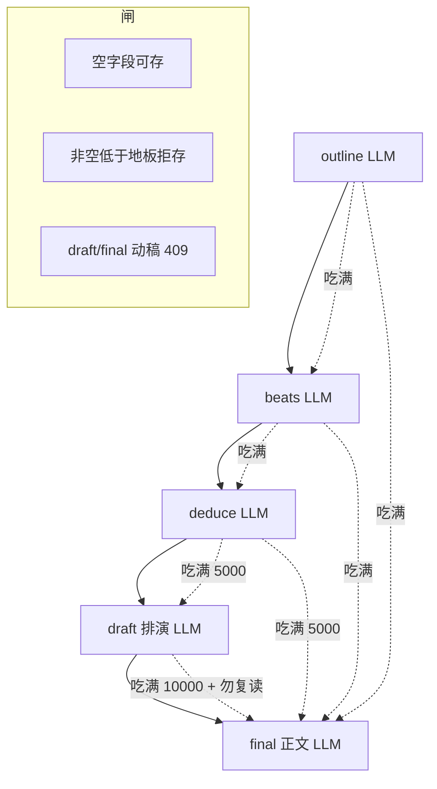

# 冰山完整方案：闸 · 生成链 · 注入对齐

> **本文是 2026-08-14 冰山改造的唯一 SSOT。**  
> 合并并取代：  
> - [`2026-08-14-iceberg-substrate.md`](./2026-08-14-iceberg-substrate.md)（闸）  
> - [`2026-08-14-iceberg-generation-chain.md`](./2026-08-14-iceberg-generation-chain.md)（怎么生成、必须 LLM）  
> - [`2026-08-14-iceberg-inject-align.md`](./2026-08-14-iceberg-inject-align.md)（写厚必须被下一阶段用上）  
>
> 冲突时以本文为准。旧文只作考古指针。

| 项 | 值 |
|----|----|
| **日期** | 2026-08-14 |
| **产品** | 铜炉 / tonglu · `scribe3/` |
| **目标** | 前置写厚 → 正文冰山效应。字数 = 信息覆盖，**不是**文学分、**不进**宣称 |
| **不改** | 宣称公式、`GATE_SAVE_MODE=soft`、GATE-B 80/3「有没有字」、final **限知尖** |
| **验证** | 只冒烟已部署 demo；禁止 Grok 机 `npm ci` / 本机 Surreal / 第二套库 |
| **旗** | `SCRIBE3_ICEBERG_WRITE` 默认开。关 = 回到 80 字壳也能开写 |

### 不并进本文（相邻、独立）

| 文档 | 为什么分开 |
|------|------------|
| [`2026-08-14-pipeline-runtime-analysis.md`](./2026-08-14-pipeline-runtime-analysis.md) | 飞行记录仪 / 142 工件血缘，观测不是生成 |
| [`2026-08-14-book79-newch-remediation.md`](./2026-08-14-book79-newch-remediation.md) | 第 6–10 章 N1–N5 质控字节（漏词/FFFD/假绿），已 shipped |

---

## 0. 一句话

```text
闸：空可以存，非空必须够厚；薄了不许开写读者正文。
链：outline → beats → deduce → draft → final，每步自己的 LLM 合同，禁止切句/摘录/空白占位。
用：写厚给「下一阶段」吃满；尖端裁切只属于「读者正文」。
```

口号拍（15 字）进模型，正文只能复读口号。500 字场面纸、5000 字演绎不是刷分，是水下质量：限知、怎知、进出场、不能说的话。

**禁止**「贴 80 字口号 + `skip_finalize` 当验收」。

---

## 1. 现网进度（诚实）

| 块 | 状态 | 说明 |
|----|------|------|
| 闸 persist + `/chat/write` 409 | **已交代码** | `persist_fields_blocked`、`evaluate_iceberg`；产品通道挡薄稿 |
| StageSpec + `thicken_*` + 必须 LLM | **已交代码，未部署** | `stage_generate.py`；G1–G5；禁 skip 薄拍、禁切句充数 |
| `s3_generate_stage` / `s3_save_chapter_draft` | **已交代码，未部署** | 独立 LLM 入口 |
| 注入吃满（I1–I3） | **代码已改，未部署** | final 也吃满；`clip_for`；拍不再 200 |
| demo 空章走完 ①–⑤ | **未做** | 需 push + 热更 + 真 LLM |
| 飞行记录仪 142 | **不做在本方案** | 见独立设计 |

代码在工作区，**未默认 push**。

---

## 2. 架构

```text
① outline  LLM 因果大纲 ≥500          → persist 闸 → chapter.synopsis
② beats    LLM 场面纸 每拍≥500 合计≥2000 → persist 闸 → chapter.beats
③ deduce   LLM 真相+五层 合计≥5000     → persist 闸 → scene_truth + deductions
④ draft    LLM 排演 ≥10000             → save_chapter_draft → chapter.draft ≠ prose
⑤ final    冰山齐才开写；水面 ≥5000     → chapter.prose
```



**通道**

| 入口 | 干什么 |
|------|--------|
| `POST /generate-stage` / `s3_generate_stage` | 独立 LLM 写厚（合同在用户消息） |
| 主编 `phase=outline\|beats\|deduce\|draft\|final` | 同一 `/chat/write`，阶段角色 + 组装 |
| 点批 | `s3_patch_chapter_plan` / `s3_save_chapter_draft` / `s3_save_chapter` |
| pilot | 共用 `thicken_*`，薄不 skip |

没有单独 Hermes skill 当生成器。`craft_skills/` 是技法索引。完整合同走该阶段自己的生成请求，assemble 只留 ≤400 字短核（R8：draft/final 不灌写法圣经）。

---

## 3. 闸（substrate）

字数 ≠ 文学分，不进 `may_claim_*`。

| 动作 | 闸 |
|------|----|
| 存空大纲/空节拍（还没写） | **不挡** |
| 把 80 字口号存成大纲/薄拍/薄演绎 | **挡** `iceberg_thin_persist`（MCP plan / REST patch / orch apply） |
| 讨论；`phase=outline/beats/deduce` 加厚本阶段 | **不挡** |
| `/chat/write` 动稿且 phase=draft/final，冰山未齐 | **409** `iceberg_thin` |
| 进下一阶段但上一层未齐 | **409** `stage_not_ready` |
| `danger_draft` / `skip_iceberg` | 旁路，文案必须写「会写成口号戏」 |
| 宣称可读 | **仍不看这些字数** |

`update_chapter_meta` 不加这道闸（夹具/旧测写短大纲）；产品通道必须加。

`stage_ready`：

| 要进 | 必须已经齐 |
|------|------------|
| beats | synopsis ≥500 |
| deduce | 节拍地板（每拍 500 + 合计 2000） |
| draft | PRE_DRAFT：大纲+节拍+演绎 |
| final | PRE_DRAFT + `chapter.draft` ≥10000 |

---

## 4. 生成合同（必须 LLM）

禁止：大纲切句充数、逐字摘录当投影、空白五栏、「见薄就 skip」。  
薄了只许再调一次模型；仍不够 → park / 422，不落库。

### 4.1 outline

**目的**：今天这场戏的因果，不是一句剧情简介。

必须有小标题：日子 / 必须发生 / 因→果 / 不能说 / 章末未决。  
`cn ≥ 500`。`max_tokens ≥ 2048`。落 `synopsis`。缺结构格 warn，字数不够 fail。

### 4.2 beats

**目的**：每拍一场能看见的戏。

| 格 | 写什么 |
|----|--------|
| 进场 | 谁在哪，空气里有什么 |
| 事件 | 必须发生的那一下 |
| 翻转 | 相对上拍升级（全章至少一拍翻转） |
| 出场 | 物件 / 把柄 / 没说完的话 |
| 水下 | **不进正文**、作者必须知道的一句 |

≥3 拍；每拍 `text ≥ 500`；合计 ≥2000。GCD 只能当附注。`max_tokens ≥ 4096`。  
已有薄拍必须覆盖加厚；只有地板齐才 skip。

### 4.3 deduce

**目的**：谁知道什么、怎么知道、不知道什么。

1. `scene_truth`：全知冷叙（建议能撑投影；不把 500 强加给真相句）  
2. `deductions[]`：每人五层——看到/听到、知道、以为、做了/说了、没察觉的  

投影合计 ≥5000。缺人 fail。`max_tokens ≥ 8192`。  
**5000 的消费者是排演**，不是 final。

### 4.4 draft（排演 ≠ 读者正文）

按节拍走一遍场面，糙可改。≥10000。只落 `chapter.draft`。`max_tokens ≥ 16384`。  
禁止写入 `prose`。不新开表。

### 4.5 final（水面）

冰山齐才开写。可见字 ≥5000 是水面 steer，不进宣称。`max_tokens ≥ 16384`。  
删「宁短勿凑字」。`skip_finalize` 不得当验收。

---

## 5. 注入（写了必须用上）

### 5.1 原则

**2026-08-14 裁断：final 也吃满。** 冰山效应改在输出纪律（限知横幅 + 勿复读），不对模型藏 5000/10000。

刚过闸必须 100% 可见（thicken / rehearse / **surface 同档**）：

```text
if cn_len(text) <= floor * 1.2:  原文全给
else:                            裁到 inject_cap，且 inject_cap >= floor
```

`clip_for(field, text)` 是唯一裁切函数。禁止 `_ctx_bits` / `_outline_block` / 演绎 / 排演各写一套 `[:200]`。

### 5.2 InjectSpec

| 字段 | floor | 所有生成阶段（含 final） |
|------|-------|--------------------------|
| synopsis | 500 | 全文；上限 2500 |
| beat each | 500 | 全文；上限 1200；**换行编号** |
| scene_truth | — | 全文；上限 2500 |
| deduction 每人 | 计入 5000 | 五层全文；单人上限 4000 |
| deduction 整包 | 5000 | **≥6000**（禁止 4500 尖端包） |
| draft | 10000 | **全文进 final**；上限 12000 +「禁止复读排演句」 |
| 密≥250 / 疏≈40 | — | **删出发路径** |

作者可见 steer 只留 `BASE_LENGTH_STEER` 水面 5000。`DEFAULT_SOFT_LEN_FLOOR=2400` 不要写进提示词。

### 5.3 各阶段读什么

```text
outline   吃：设定/协议/意图 + 旧大纲全文
beats     吃：大纲全文（禁止拍 200 残片、禁止 250/40）
deduce    吃：大纲全文 + 每拍场面纸全文
draft     吃：大纲全文 + 每拍全文 + 每人五层全文
final     吃：同上 + 排演全文；另钉「另写读者正文、勿复读、限知」
```

L2：先砍 `material_recall` / `reference_craft` / `storyline_polish`。  
**禁止先砍** outline / 节拍 / 演绎 / `draft_full`。  
`cn(synopsis)≤800` 时 **禁止保拍砍纲**。  
`draft_full` 登记进物理序，列入 `GEN_SEGMENT_PROTECTED`。

---

## 6. 现网对账（未改注入前的洞）

| 洞 | 现网 | 本文要求 |
|----|------|----------|
| `_ctx_bits` 每拍 200 | 下一阶段只见 40% | thicken 吃满 |
| 节拍空格拼接 | 三拍糊成一行 | 换行编号 |
| plan 密≥250 / 疏≈40 | 与 500 场面纸对打 | 删出发路径 |
| draft 也走演绎 1800+4500 | 5000 白写 | rehearse 吃满 |
| `draft_tip = raw[:2400]` | 后半场拍消失 | 按拍抽骨架 |
| `draft_tip` 未登记 | L2 可整段丢 | 保护 |
| L2 保拍砍纲 | 刚 500 字大纲先被砍 | 短大纲不砍 |
| 切句 / 摘录 / 空白五栏 | 已在 G3 代码里禁 | 保持 |

800/700 对 500 地板本身够用。GATE-B 80 不是注入帽。

---

## 7. 实现落点

| 模块 | 职责 |
|------|------|
| `scribe3/iceberg.py` | 地板、persist 闸、`evaluate_iceberg`、**InjectSpec + `clip_for`** |
| `scribe3/stage_generate.py` | StageSpec、解析、`stage_ready`、`thicken_*`（必须 `llm_fn`）、按拍 `draft_tip` |
| `stage_craft_prompt.py` | 只暴露短核 ≤400 |
| `_phase_role_block` / `chiefSeed.js` | 地板 + 结构格 + 正确工具 |
| `pilot_actions/*` | 调 `thicken_*`；薄不 skip；禁非 LLM 回退 |
| `write.py` / loop | `stage_ready` + 分阶 `max_tokens` |
| `mcp/tools_write.py` | `s3_generate_stage`、`s3_save_chapter_draft` |
| `_outline_block` / `_deduction_context_segments` | 按 purpose 调 `clip_for` |
| `write_assemble_v1` | draft=rehearse，final=surface |
| `context_budget.py` | 登记并保护 `draft_tip`；短大纲不砍纲 |
| `execution_contract.py` | 作者可见去掉 2400 口吻 |

---

## 8. Key Decisions

1. 字数 = 覆盖地板，不是质量分，不进宣称。  
2. 空可以；非空必须厚；薄了不许当「已有大纲」。  
3. 每阶段独立 LLM 合同；方法论不灌进 final assemble。  
4. **没有**非 LLM 成功路径。  
5. `chapter.draft` 已有，不新表。  
6. **所有生成阶段吃满刚过闸材料**（含 final 的 5000 演绎与 10000 排演）。限知靠横幅/secret_guard，不靠藏材料。  
7. 刚过闸 100% 进提示词；帽只砍超写。  
8. 排演进 final 是全文 +「禁止复读」；禁止截前 2400 当主燃料。  
9. 6.3.4「一次 final + skip」不是合法验收。

---

## 9. 明确不做

- 不把 500/2000/5000/10000 写进 `may_claim_readable` / 人盲分。  
- 不重开宣称，不改 `GATE_SAVE_MODE`。  
- 不为排演再起 Surreal 表。  
- 不实现 142 飞行记录仪（另案）。  
- 不重写 book79 第 6–10 章文学稿。  
- 不在 Grok 机全量测 / 本机 Surreal。  
- 不要求作者手打 5000 字：模型按合同生成 → 人点批。

---

## 10. 统一 PR 计划

| PR | 标题 | 状态 | 内容 |
|----|------|------|------|
| S | 闸 | 代码已有 | persist + write 409 + 旗 |
| G1–G5 | 生成链 + 必须 LLM | 代码已有，未部署 | StageSpec、thicken、种子、draft 通道、stage_ready、token |
| I1 | InjectSpec + 拍不再 200 | **待做** | `clip_for`；换行；删 250/40 |
| I2 | 演绎/排演全文 | **待做** | draft **与** final 都吃满 |
| I3 | L2 保护冰山段 | **待做** | draft_full 登记；短大纲不砍纲 |
| D | 部署 | **待你点头** | push + demo 热更 |
| G6 | demo 空章真链 | 依赖 D + I1–I3 | ①–⑤ + 注入对账；禁止 skip 当绿 |

建议顺序：先 I1–I3（否则部署了仍白写），再 D，再 G6。

---

## 11. 验收（链完整 + 没用白写）

空壳一章（或先清空口号）：

1. outline → 库里 ≥500，含必须发生 + 不能说。  
2. beats → 3 拍每拍 ≥500、合计 ≥2000；**生成请求里大纲全文在**，不是 200 字残片。  
3. deduce → 合计 ≥5000，在场都有五层；**每拍场面纸全文在**。  
4. draft → `chapter.draft` ≥10000，`prose` 未变；**演绎合计 ≥5000 进了排演提示词**。  
5. final → 可见字 ≥5000；**提示词含演绎≥5000 且排演≥10000**，另有勿复读/限知句。  
6. 80 字口号 apply → 拒存。  
7. L2 超窗：先丢 polish；520 字大纲与冰山段不被先砍。

1–4 做不到，就是生成链不完整。  
2 / 4 / 5 的「提示词里看得到」做不到，就是写了没用上。
