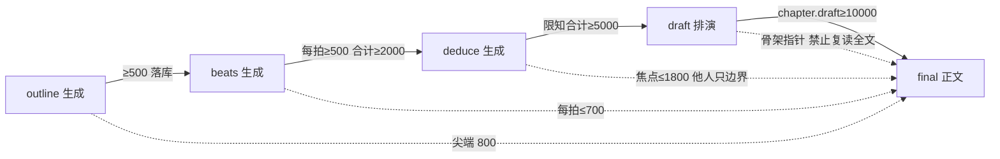

# 冰山生成链：阶段方法论 + 写厚器 + 落库 + 尖端注入

> **本文是「完善生成链」SSOT。**  
> 闸（薄了不让存、薄了不让开写）见 [`2026-08-14-iceberg-substrate.md`](./2026-08-14-iceberg-substrate.md)。  
> 闸已经有了；**链还没有。** 本文补的是：每个阶段**怎么生成**、生成物长什么样、怎么验收、怎么进下一阶段、正文怎么只吃冰山尖。

| 项 | 值 |
|----|----|
| **日期** | 2026-08-14 |
| **产品** | 铜炉 / tonglu · `scribe3/` |
| **状态** | Draft（方案；待按 PR 落地） |
| **取代** | 不取代 R8 W10 的「draft/final 不灌写法圣经」；**扩写并替换**现网 `stage_craft_prompt.py` 三句口号 |
| **不改** | 宣称公式、`GATE_SAVE_MODE`、GATE-B 的 80 字「有没有字」口径（空壳仍可当草稿占位；**非空必须够厚**） |
| **验证** | 只冒烟已部署 demo；禁止 Grok 机 `npm ci` / 本机 Surreal |

---

## 0. 你上次要的，和实际交了什么

你要的是：**前置写厚 → 正文冰山效应**。阶段方法论必须能**产出**厚材料，不是提醒模型「写清楚一点」。

现网交出去的是：

| 零件 | 现网 | 够不够当「链」 |
|------|------|----------------|
| W10 `stage_craft_prompt.py` | 三句 ≤200 字「不要凑字数」 | **不是生成器** |
| `_phase_role_block` | 「用 s3_patch_chapter_plan 写 synopsis；建议≥3 条」 | 只点工具，不规定覆盖 |
| `chiefSeed.js` | 「请更新大纲/节拍」 | 不规定 500/2000/5000 |
| `expand_beats` | **pilot 专用**；`beats` 已有（哪怕 15 字）就 **skip** | 把链掐断 |
| `save_chapter_draft` | 库里已有 `chapter.draft` | **没有任何阶段往里写** |
| 冰山闸 | persist + `/chat/write` draft/final | 只拒收，不生产 |

所以：方法论缺规格、展开器见薄也当齐、草稿字段闲置、6.3.4 直接 `phase=final`。  
**完善链 = 生成合同 + 写厚器 + 落库通道 + 尖端注入 + 阶段推进。** 闸已经就位，不再加第三套「字数当质量」。

字数在本方案里只表示：**这块材料的信息覆盖够不够撑下一阶段**。不是文学分，不进 `may_claim_*`。

---

## 1. 一句话架构

```text
① outline  生成因果大纲 ≥500     → persist 闸 → chapter.synopsis
② beats    每拍场面纸 ≥500、合计≥2000 → persist 闸 → chapter.beats
③ deduce   场景真相 + 在场限知合计≥5000 → persist 闸 → scene_truth + deductions
④ draft    排演 ≥10000            → save_chapter_draft → chapter.draft（≠ prose）
⑤ final    冰山齐才开写；水面 ≥5000 → chapter.prose
              提示词只注入冰山尖（不是把水下整包倒进去）
```

通道仍是 SPA 三通道：主编 `phase=outline|beats|deduce|draft|final` 的 `/chat/write`（或讨论里提案）→ 点批 `s3_patch_chapter_plan` / `save_chapter_draft` / `save-chapter`。  
**禁止**再走「贴 80 字口号 + skip_finalize 当验收」。



---

## 2. 各阶段生成合同（方法论本体）

每阶段一份 **StageSpec**：问什么、必须写出什么结构、覆盖地板、落哪、下一阶段入口。  
实现落在 `scribe3/stage_generate.py`（新，纯函数：拼 prompt + 解析 + 覆盖验收）。`stage_craft_block(phase)` 改为调用 StageSpec 的短核（仍 ≤400 字进 assemble），**完整合同走该阶段自己的生成请求**，避免把 2000 字方法论灌进 final。

### 2.1 outline（规划 · 水下底座）

**目的**：写出**今天这场戏的因果**，不是一句话剧情简介。

必须包含（可用小标题，禁止只交一句）：

1. **日子**：村里/场上正在过什么（具体，能看见）  
2. **必须发生**：那一下（动作，不是主题词）  
3. **因 → 果**：为什么非发生不可（上章余烬或人物把柄）  
4. **不能说**：本章禁令（炉契全文、侧门开法、未到点的揭示）  
5. **章末未决**：留给下一章的动作或把柄  

**覆盖**：`cn_len(synopsis) ≥ 500`。  
**禁止**：完成灯口吻、「材料够了」、口号句当全文。  
**落库**：`s3_patch_chapter_plan(synopsis=…)`。空可以；**非空 <500 拒**（已有 `persist_fields_blocked`）。  
**生成入口**：`phase=outline` 的 `/chat/write`（讨论意图也可，但提案必须是大纲正文）。`max_tokens ≥ 2048`。

验收纯函数：`parse_outline_payload(text) → {synopsis, parts, cn}`；缺 1/2/4 节只 **warn**（结构可后补），`cn<500` **fail** 不得 apply。

### 2.2 beats（场面纸 · 每拍一场戏）

**目的**：每拍是能看见的一场，不是「清册官摊册。」

每拍必须能拆出：

| 格 | 写什么 |
|----|--------|
| 进场 | 谁在哪，空气里有什么 |
| 事件 | 必须发生的那一下（对手戏） |
| 翻转 | 本拍相对上拍升级或反转（至少全章有一拍翻转） |
| 出场 | 留下什么物件/把柄/未说完的话 |
| 水下 | 本拍**不写进正文**、但作者必须知道的一句（供演绎用） |

**覆盖**：≥3 拍；**每拍 text ≥500**；合计 ≥2000。GCD 短字段（goal/conflict/turn）可作机读附注，**不能代替 text**。  
**落库**：`s3_patch_chapter_plan(beats=[{text, goal?, …}])`。  
**生成入口**：`phase=beats`。`max_tokens ≥ 4096`。

**改 `expand_beats`（硬）**：

```text
现：if ch.get("beats"): skip
改：if evaluate_iceberg(ch).beats 已达地板: skip
    else: 视为未齐，必须展开/加厚，允许覆盖薄拍
```

pilot 与 SPA 共用同一 `thicken_beats(st, seq)`，禁止两套。

### 2.3 deduce（认知地图 · 冰山主体）

**目的**：把「谁知道什么、怎么知道、不知道什么」写厚。正文只露焦点者能感知的角。

两块都要：

1. **`scene_truth`**：场上客观发生（仍建议 ≥80，宜写到能支撑投影；不把 500 强加给真相句，以免把真相写成小说）。  
2. **`deductions[]`**：每个 `involved` 一篇。沿用五层标题（已有 `DEDUCTION_HEADINGS`）：

   - 看到/听到  
   - 知道  
   - 以为(误读)  
   - 做了/说了  
   - 没察觉的  

**覆盖**：全部投影 `prose` 合计 `cn_len ≥ 5000`。单人过短（<400）warn；缺人 fail（与现 GATE-B B5 同向，但厚薄由冰山闸管）。  
**落库**：`s3_patch_chapter_plan(scene_truth, involved_characters, deductions)`。  
**生成入口**：`phase=deduce`。`max_tokens ≥ 8192`。  
**水下用法**：5000 字**主要留在库里**。final 注入见 §4。

### 2.4 draft（排演 · 不是读者正文）

**目的**：按节拍把场面走一遍，糙、越界可改，用来发现节拍漏洞。

**覆盖**：`chapter.draft` ≥ 10000（已有 `save_chapter_draft`，**不要**新表）。  
**落库**：**只**走 `save_chapter_draft` / 新 MCP `s3_save_chapter_draft`。禁止把排演写进 `prose`。  
**生成入口**：`phase=draft` 且冰山 PRE_DRAFT 已齐（大纲+节拍+演绎地板）。`max_tokens ≥ 16384`。  
**注入到 final**：只取「场面骨架 + 对白意向」摘要（另函 `draft_tip(draft, cap=2400)`），**禁止** 1 万字排演整包进 final prompt（否则定稿变复读）。

现网 `iceberg.evaluate_iceberg(..., for_phase=final)` 已认 `draft` 字段，与 store 对齐，无需 `draft_prose` 新列。

### 2.5 final（水面）

**目的**：读者正文。冰山齐才能开写（已有 409）。  
**覆盖**：可见字 ≥5000 是**水面**，提示已改；存稿可 warn，不把 5000 写进宣称。  
**`max_tokens ≥ 16384`**（R8 B12 已写，loop 现 8192 须抬）。  
**删除**「宁短勿凑字」（已删）。  
**skip_finalize 不得当验收。**

---

## 3. 阶段推进（什么叫「可以进下一阶段」）

纯函数 `stage_ready(ch, stage) -> {ok, missing}`：

| 要进 | 必须已经齐 |
|------|------------|
| beats 生成 | synopsis ≥500 |
| deduce 生成 | 节拍地板齐（每拍 500 + 合计 2000） |
| draft 生成 | PRE_DRAFT（大纲+节拍+演绎） |
| final 生成 | PRE_DRAFT + `draft` ≥10000 |

未齐：该阶段 `/chat/write` 若是「生成下一阶段」意图 → 409，detail 指出缺哪一块（与 `iceberg_thin` 同形，`code=stage_not_ready`）。  
**加厚本阶段**（phase=outline 而大纲已有但薄）→ 放行，让模型重写厚。  
`skip_iceberg` / `danger_draft` 仍可旁路，文案必须带「会写成口号戏」。

主编种子（改 `chiefSeed.js`）每阶段钉死：

- 覆盖地板数字  
- 必写结构格  
- 点名工具（plan vs `save_chapter_draft` vs `save-chapter`）  
- 禁止「建议≥3 条非空」这种短门槛口吻  

---

## 4. 尖端注入（冰山效应的技术定义）

水下厚，提示词仍要瘦，否则限知章被 5000 字全知灌爆。

| 库里的质量 | final 提示词 |
|------------|----------------|
| 大纲 ≥500 | `_outline_block` 大纲栏 ≤800（已改） |
| 每拍 ≥500 | **每拍单独** ≤700，三段都在（已改，禁止再拼成一句 clip 1200） |
| 演绎 ≥5000 | 焦点者 ≤1800；非焦点只「可见/已做」一行；「没察觉的」进 secret_guard，不进焦点正文 |
| draft ≥10000 | `draft_tip` ≤2400 骨架；显式「禁止复读排演句」 |
| 正文 | `BASE_LENGTH_STEER` 水面 5000（已改） |

L2 裁剪：**禁止**先砍 outline / 节拍 / 焦点演绎。先砍 polish / discourse / 排演尖。

---

## 5. 现网改动清单（按文件）

| 文件 | 改什么 |
|------|--------|
| **新建** `scribe3/stage_generate.py` | StageSpec、拼 prompt、解析、`stage_ready`、`thicken_beats`/`thicken_outline`/`thicken_deduce` 的纯函数核 |
| `stage_craft_prompt.py` | 改为 StageSpec 短核；删「不要凑字数」三句 |
| `misc_helpers._phase_role_block` | 换成覆盖地板 + 结构格 + 正确落库工具；draft 指向 `draft` 不是 prose |
| `web/src/lib/chiefSeed.js` | 同上，数字与结构写进种子 |
| `pilot_actions/beats.py` `expand_beats` | 薄拍不 skip；调用 `thicken_beats` |
| `write.py` / `iceberg.py` | `stage_ready` 接入；phase=draft 只验 PRE_DRAFT；final 验 draft |
| `mcp/tools_write.py` | 新增 `s3_save_chapter_draft`；plan 工具已有 persist 闸 |
| `write_stream` / `chapters.py` loop | draft/final `max_tokens` 16384；outline 2048；beats 4096；deduce 8192 |
| `write_assemble_v1` | final 注入 `draft_tip`（有 draft 才 push，layer supplemental） |
| 测试 | 各 StageSpec 夹具：薄稿 parse fail；厚稿 ok；expand 薄拍不 skip；draft 不进 prose |

---

## 6. Key Decisions

1. **方法论是生成合同，不是 assemble 里再灌一篇写法圣经。** draft/final 仍不灌 W10 长文（R8 对）。outline/beats/deduce 的完整合同走**该阶段自己的生成请求**。  
2. **覆盖地板只挡「把薄的存成正式材料」和「空壳开写」。** 空字段仍可存。不进宣称。  
3. **`chapter.draft` 已存在，不新开表。** 排演与读者正文物理分离。  
4. **已有薄拍必须能被加厚覆盖。** `expand_beats` 见 15 字就 skip 是链上的虫。  
5. **演绎厚在库、瘦在提示词。** 这才是冰山；把 5000 字全进 final = 灌设定。  
6. **6.3.4 那种「一次 final + skip」不再是合法验收路径。**

---

## 7. 明确不做

- 不把 500/2000/5000/10000 写进 `may_claim_readable` / 人盲分。  
- 不重开宣称公式，不改 `GATE_SAVE_MODE=soft`。  
- 不为排演再起 Surreal 表。  
- 不在 Grok 机跑全量测 / 本机 Surreal。  
- 不要求作者手打 5000 字；链必须是 **模型按 StageSpec 生成 → 人点批**。  
- 不把 Langfuse 当主账。

---

## 8. PR Plan

| PR | 标题 | 依赖 | 内容 |
|----|------|------|------|
| G1 | StageSpec 纯函数 + 单测 | 无 | `stage_generate.py`；改 `stage_craft_prompt`；解析/覆盖验收 |
| G2 | 种子与 phase_role | G1 | chiefSeed + `_phase_role_block` 数字与结构 |
| G3 | 写厚器 | G1 | `thicken_*`；`expand_beats` 薄不 skip；pilot/SPA 共用 |
| G4 | 草稿通道 | 无 | `s3_save_chapter_draft`；draft 阶段落 `chapter.draft`；final 注入 `draft_tip` |
| G5 | 阶段推进 + token | G1 G4 | `stage_ready` 接 write/loop；分阶段 max_tokens |
| G6 | demo 一章真链冒烟 | G2–G5 | 新壳或空章走 ①–⑤；禁止 skip 当绿；证据写各阶段字数 |

---

## 9. 验收一章（定义「链完整」）

拿一章空壳（不要用现成 80 字口号当起点，或先清空 synopsis/beats）：

1. outline 生成 → 库里 synopsis ≥500，且含「必须发生 + 不能说」  
2. beats 生成 → 3 拍每拍 ≥500、合计 ≥2000  
3. deduce 生成 → deductions 合计 ≥5000，在场角色都有五层  
4. draft → `chapter.draft` ≥10000，`prose` 仍空或未变  
5. final → 可见字 ≥5000；提示词日志里节拍按段可见、演绎不是 5000 整包  
6. 任何一步用 80 字口号 apply → 拒存  

做不到以上六条，就还不能说「生成链完整」。

---

## 10. 与已交闸的关系

| 已交 | 本文补 |
|------|--------|
| `persist_fields_blocked` | 生成器必须能产出过闸的厚稿 |
| `/chat/write` iceberg 409 | 生成器按阶段推进，减少误伤「正在写厚」 |
| 节拍按段注入 | 生成器保证每段真有 500+ 可注入 |
| 删「宁短勿凑字」 | final 才吃这个水面 |

先落地 G1–G3，链就开始转；G4–G5 才算闭环。
