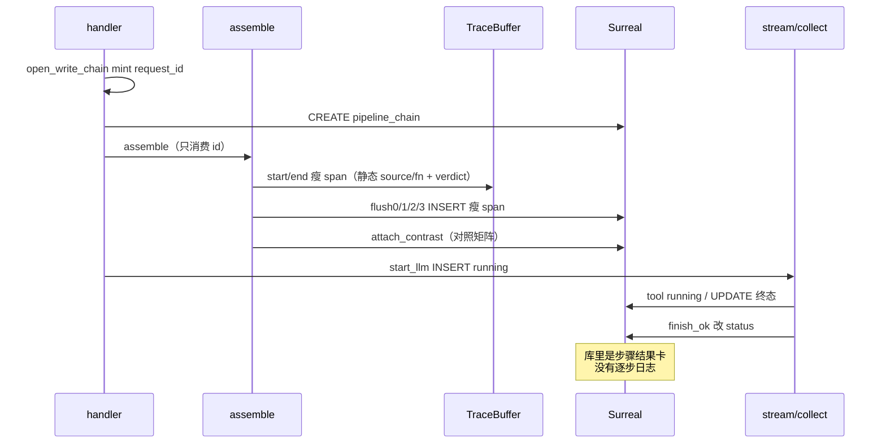
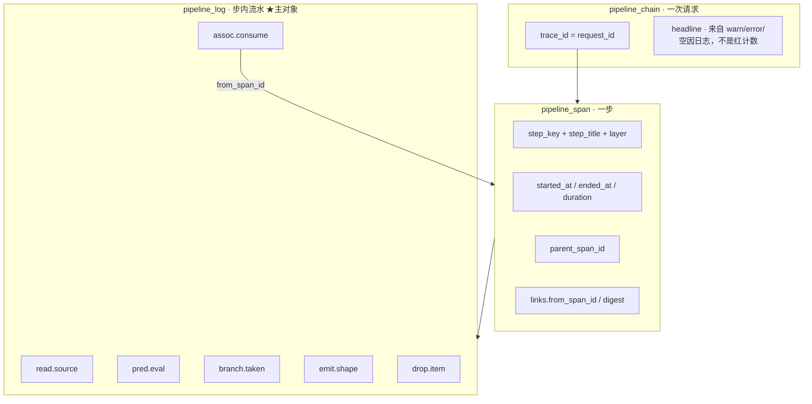
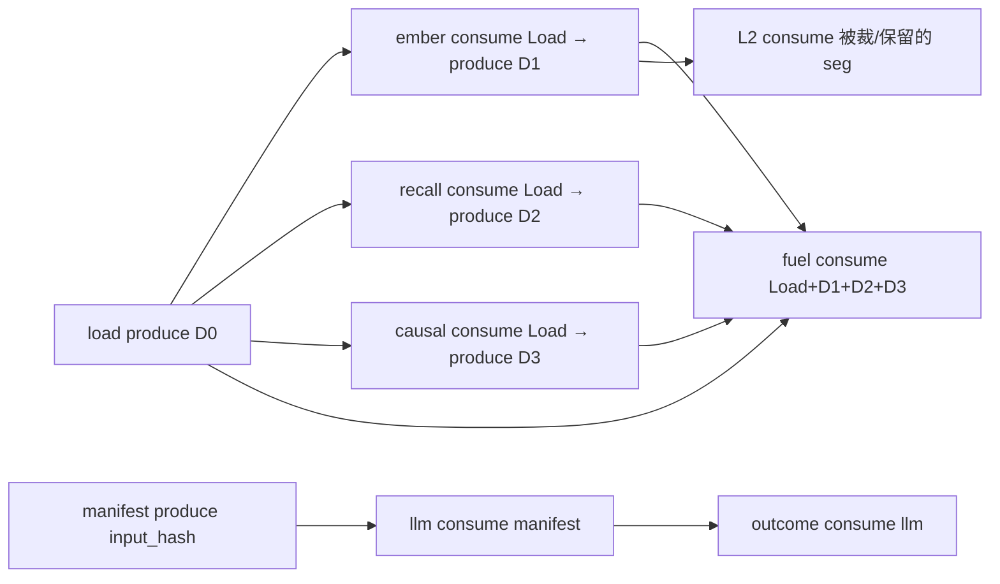

# 铜炉 Pipeline Analysis Log：逐步运行分析账本

> **已被取代（2026-08-14）**  
> 本文不再是「系统运行分析」SSOT。按本文落地的 141 `pipeline_log` + 闭集 `append_log` + 240 字模板已上 demo，用户第三次判定为「只有运行结果」。  
> **现行设计**：[2026-08-14-pipeline-runtime-analysis.md](2026-08-14-pipeline-runtime-analysis.md)（飞行记录仪：真实工件 + 完整事件）。本文保留作考古，勿再当实现合同。
>
> ~~本文取代 [`docs/plans/2026-08-14-pipeline-trace.md`](2026-08-14-pipeline-trace.md)，成为「系统运行分析账本」的 **SSOT**。~~

| 项 | 值 |
|----|----|
| **文档标题** | 写 / 存 / 宣称 / 工具跳：一次一条链，每步一条 span，步内是可检索的全部信息日志 |
| **作者** | Grok Design |
| **日期** | 2026-08-14 |
| **状态** | Draft（rev.2 评审修订） |
| **产品** | 铜炉 / tonglu · 代码 `scribe3/` |
| **仓库** | `/home/admin/projects/scribe-writing-system` |
| **入库路径** | `docs/plans/2026-08-14-pipeline-analysis-log.md` |
| **取代** | `docs/plans/2026-08-14-pipeline-trace.md`（不再是分析账 SSOT）；更早的 `docs/plans/2026-08-13-run-observability.md` 仍是 Run 卡考古 |
| **验证** | **仅已部署 demo**（`tonglu.example.com` / `203.0.113.10` / `/opt/scribe3/app`）。禁止 Grok 运行机 `npm ci` / 全量 pytest / 本机 Surreal / 第二套库 |
| **运维 env SSOT** | **`/opt/scribe3/app/deploy/prod/.env`**。不要改 `/opt/scribe3/app/.env`，也不要改 `app/.env.production.local` |
| **schema** | 140 已存在（`pipeline_chain` / `pipeline_span`）。本设计 **141**：新表 `pipeline_log` + 兼容加列。禁止另起 Surreal |
| **关联** | 现网实现 `scribe3/pipeline_trace*.py`、`store/pipeline_trace_ops.py`、`migrations/140_pipeline_trace.surql`、`web/src/admin/RunLogsPage.jsx`；装段 `write_assemble_v1.py`；流 `write_stream.py`；目录 `pipeline_trace_catalog.py` / `injection_registry.py`；L1 `docs/L1-AUTH-ISOLATION.md` |

> **读法（工程师）**  
> 1. 先读「对照用户合同」与 Key Decisions。  
> 2. Proposed Design §1–§8 是实现合同；§5 是每步必须 emit 的日志清单。  
> 3. PR Plan：git 可独立合，**demo 默认 UI 必须接线≥换皮**。观测 emit 不得阻断写路径。  
> 4. 能由第一性原理钉死的不进 Open Questions。

---

## 对照用户合同

用户原话（2026-08-14，再次）：

> 不行啊,我要的是包含每个步骤的全部信息日志,且能够很清晰的看出来是哪个步骤的,能够方便的查询整条链路的关联产生,可以存一个星期.我要的是能够用于系统运行分析的,不是这种只有运行结果的.再次设计最优方案

| # | 合同 | 已上线 pipeline-trace（2026-08-14 代码） | 本设计 |
|---|------|------------------------------------------|--------|
| 1 | **每步全部信息日志** | **未满足。** 每步一条瘦 span：`input.source`（目录静态串）+ `compute.fn`（目录静态串）+ `output.chars/digest` + `expected/actual/verdict`。`events[]` 几乎只给 L2 `op/tag`。没有可读 `logs[]`，分析员**不能**不重跑就还原「读了什么字段、判了哪条谓词、走了哪条分支、丢了谁」。见下方诊断。 | 全目录每步都有 `required_logs`。主对象是闭集 `append_log(code, **typed)` 渲出的中文行。**禁止**从 `note_push` / `classify_actual` / `meta.source` 合成 `read.source` / `pred.eval`。 |
| 2 | **步骤身份一眼可辨** | 半满足。后端目录有 `step_title` / `step_key` / `layer`；UI 列表仍把 `statusChip`（空/红/绿）和「该跑/实际」放第一眼。 | 日志行强制带中文 `step_title` + 稳定 `step_key` + `layer`；UI 按步分组，组头是人话名，行前缀 `[assemble.seg.story_ember]`。芯片不是主视觉。 |
| 3 | **整条链路可关联查询** | **未满足。** 只有 `parent_span_id`（目录写死的树）和读时算的 `prev/next_trace_id`。`from_span_id` **从未写入**。没有「本步产出 digest 被谁消费」的边。查询是链列表 / 按 `step_key` 列 span，**不能**「本周所有余烬空的日志行」或「这条输出怎么变成下一步输入」。 | **唯一** produce/consume 矩阵（§8）。边 SSOT = `assoc.*` 日志。`GET /debug/pipeline-logs?step_key=&code=&empty=true&since=` **P0** 可计数。`got=true` 无 hex 则不落 consume 且单测红。 |
| 4 | **保留一周** | 半满足。TTL 7 + `_store_for` 上 `maybe_purge`（6h 节流）已挂。但清的是瘦 span；没有日志表可清。`created_at` READONLY，不能靠回填测 TTL。 | 继承 7 天 + 同钩；**先 DELETE `pipeline_log` 再 span 再 chain**（随 PR2，P0）。旧 140 行无日志也可活到 TTL。手工 purge 下限 1 天。 |
| 5 | **用途 = 系统运行分析** | **未满足。** 钩子用 `classify_actual` / `row_verdict` 收尾；headline 优先红因，空则「对照齐全」；UI 默认 inspector 是该跑×实际；对照 tab 仍在。这是 Run 卡换皮。 | 回答：跑了什么、为何存在、收了什么、算了什么、发出什么、丢/跳/失败了什么、多久、卡在哪、**后步如何用前步产出**。红绿是派生 overlay，非默认 UI，非主记录。headline **永不**「对照齐全」。 |
| 6 | **再次设计最优方案** | 上一份设计自称已满足同一段用户原话，却把「全部信息」定义成「不要真实日志」。 | **重画主对象**。复用已工作的 id mint / catalog / fail-soft store / 7d 钩 / 管理页位置。**替换**字段合同与 UI。 |

**禁止再做成「span 元数据 + 对照 tab」。** 那正是现网已经交货、已被否的东西。

**禁止把瘦 verdict 拆成中文 log 交差。** `append_log` 不是 `f"{actual_reason}"` 的包装。`read.source` / `pred.eval` 必须来自数据源函数里的运行时值。单测钉死：章 `end_hook=""` vs 章有 hook 但 `_push("")`，两条链的 `read.source.attrs.empty` **必须不同**。

---

## Overview

铜炉写路径一次请求真实发生 40–80 个可辨步骤（装段、信封八块、L2/O1、guard、模型流、0–N 工具跳、Outcome、存/宣门）。分析员要的不是「这场对照几红几绿」，而是一份 **不重跑也能读懂的运行流水**：

```text
12:01:03.012  INFO  [上章余烬 · assemble.seg.story_ember]
        读取 chapter[n-1].narrative_drive.end_hook：字段空
12:01:03.013  INFO  [上章余烬 · assemble.seg.story_ember]
        谓词 prev_end_hook=false → 本段 empty（empty_story_ember）
12:01:03.014  INFO  [上章余烬 · assemble.seg.story_ember]
        产出 fuel_block chars=0 digest=∅
12:01:03.015  INFO  [收集三燃料 · assemble.collect_fuel]  code=assoc.consume
        消费 assemble.seg.story_ember（from_span=…, digest=∅, got=false）
```

`assoc.consume` 是 **code**，不是 level。schema `level` 只有 `debug|info|warn|error`。

本设计交付 **一书一库** 的分析账本：

```text
一次请求     = 一条 pipeline_chain（trace_id = request_id）
一个步骤     = 一条 pipeline_span（身份 + 墙钟 + 父子 + 摘要）
步内发生了什么 = 若干条 pipeline_log（append-only，这才是「全部信息日志」）
步骤如何相连 = 显式关联：parent / from_span_id / assoc.produce|consume / 同章前后次
期望×实际    = chain.contrast_summary（派生，永不做默认 UI）
```

复用已经工作、且用户没有否定的骨架：handler 一次 mint、`manifest_trace["request_id"]`、catalog、fail-soft store、flush 阶段、7 天 `_store_for` purge、管理台独立页、L1 `?work=`。  
**替换** 的是：字段合同、钩子 emit 形状、查询面、UI 主对象。

「全部信息」**不是** 96k prompt、不是破绽词、不是工具参数值。白名单见 KD-2 / §6。

---

## Background & Motivation

### 分析员要回答的八句（产品合同）

| # | 问题 | 现网 pipeline-trace 能否答 | 本设计 |
|---|------|---------------------------|--------|
| 1 | 这一步叫什么？哪一层？ | 能（catalog） | 保持 |
| 2 | 何时开始/结束？卡在哪？ | 半能。llm/tool 已修 running 不假 stamp `ended_at`；多数装段仍是 `_push` 瞬间 end | 计时仍锚计算函数；running 步只写 start 日志 |
| 3 | **为什么存在这一步？** | 半能。`expected_reason` 是对照码，不是叙事 | `pred.eval` / `skip.reason` 中文日志 |
| 4 | **收到了什么？从哪一步来？** | **不能。** `input.source` 是目录静态串（如 `"chapter[n-1].narrative_drive.end_hook"`），无字段集合、无 `from_span_id`、无空/有的运行值 | `read.source` 日志：字段名集合、计数、hash、`from_span_id` |
| 5 | **算了什么？走了哪条分支？** | **不能。** `compute.fn` 也是目录静态串 | `branch.taken` / `pred.eval` / `keep.item` / `drop.item` |
| 6 | **发出了什么？谁消费了？** | 半能。只有 `chars` + `digest`；无人记录「被谁当输入」 | `emit.shape` + `assoc.produce` / `assoc.consume` |
| 7 | 丢/跳/失败了什么？多久？ | L2 仅 `events[].tag`；无逐步半裁叙事 | 每次半裁/整段丢一行日志 |
| 8 | 本周这个步空过几次？ | **不能。** `GET /debug/pipeline-spans?step_key=` 返回的是 span 摘要，不是日志行 | **P0** `GET /debug/pipeline-logs?step_key=&code=read.source&empty=true&since=` 直接计数 |

### 现网为何仍是「只有运行结果」（代码诊断，2026-08-14）

不是「没做完 PR」，而是 **主对象选错了**。上一份设计 KD-5 把「全部信息」定义成瘦结构化事实，并写明「不需要 end_hook 原文」——实现忠实地没存日志。用户要的是 **可读运行流水 + 关联产生过程**，不是再多两列摘要。

#### A. 字段合同就是一张对照卡

`SpanRec`（`scribe3/pipeline_trace.py` L145–166）一等字段是 `expected` / `actual` / `verdict` / `status`，外加四个字典。没有 `logs`。

`start_span`（同文件 L289–290）把目录里的**静态**串填进 input/compute：

```289:290:scribe3/pipeline_trace.py
            compute={"fn": meta.compute_fn} if meta.compute_fn else {},
            input={"source": meta.source} if meta.source else {},
```

分析员看到的「输入 / 计算」与这次运行无关，只是 catalog 复读。

`public_span` 白名单（L19–25）允许 `events`，但 **没有** 日志行类型。`headline_from_spans`（L427–450）优先拼红步 `actual_reason`，否则落「对照齐全」——人话仍是对照尺。

#### B. 钩子按 Run 卡 DNA emit

`note_push`（`pipeline_trace_hooks.py` L127–160）是装段主出口：调用 `classify_actual` + `expected_for` + `row_verdict`，然后 `end_span`。写入的只有 `actual` / `verdict` / `output.chars` / `digest` / `compute.fn`。**零行中文日志。**

`timed_call`（L96–110）只记 `status=ok|empty|failed`。

`after_join`（L176–203）把 L2 `dropped[]` 压成 `events[{op,tag}]`，一次 end。半裁序列不可读。

`load_chapter_story_inputs` 接线（`write_assemble_v1.py` L318–321）`end_named(status=ok)`，**不记** `contract` / `evidence_must_show` / `prior_consequences` 等字段名集合。

`collect_fuel`（同文件 L367–386）只记 `present if _fuel_got else empty`，不记三个 name 各自 got/empty，也不把 fuel 子 span 标成消费了 load span。

`after_guard`（hooks L227–243）只 `hit_count`。

`start_llm` / `end_tool` / `finish_ok` 只改 status / outcome 三字段。无 chunk 计数、无 tool **键名**、无 usage 数字日志。

`emit_gate_spans`（hooks L318–354）直接遍历旧卡 `rows[]`。

assemble 末尾仍 `emit_write_run_card`（`write_assemble_v1.py` L1357）并 `attach_contrast`。对照摘要还在被当一等产物写进 chain。

#### C. UI 默认仍是结果卡

`RunLogsPage.jsx`：

- L48–59 `statusChip`：`verdict===red` 或 `empty` 上红，否则绿。
- L270 列表次行：`N 对照红`。
- L301–305 默认 tab 虽是「时间线」，并列「对照摘要」。
- L340–351 inspector **第一行就是「该跑 / 实际」**，然后静态 source / fn / chars。没有日志流。
- 前端测 `runLogsPage.test.jsx` 断言的是 span 列表里能看见函数名，**不断言任何日志行**。

#### D. 查询面没有「日志」

`GET /debug/pipeline-traces*` / `GET /debug/pipeline-spans`（`misc_routes.py` L1312–1450）列 chain 或 span。`api.js` 无 logs 客户端。按 `step_key` 检索返回的是瘦 span + 所属链，不是「本周该步全部信息行」。

`events[]` 在 Surreal 是 `option<array>` + `object FLEXIBLE`（`140_pipeline_trace.surql` L62–63），**没有** `(work, step_key, code)` 索引，本来就不能当分析主面。

#### E. 热路径已经在用「逐步 CREATE」

`PipelineTraceOpsMixin.insert_pipeline_spans`（`store/pipeline_trace_ops.py` L38–48）是 Python `for` 逐条 `CREATE ONLY`。本设计若把 300 条日志再逐条 CREATE，会把写路径拖死。141 必须真批量（见 §7）。

### 一次写的真实时间线（今日，观测层）



---

## Goals & Non-Goals

### Goals

| 优先级 | 目标 | 验收口径 |
|--------|------|----------|
| **P0** | 闭集 `append_log(code, **typed)` + 全目录 `required_logs` + 表 141 + 批量写 + purge 含 log | 纯函数：余烬 `read/pred/emit` 不能由 `note_push` 合成；缺行 `obs.incomplete`；`log_count` 打穿 publicize |
| **P0** | assemble **必改数据源**：`load_chapter_story_inputs` / `collect_story_fuel_segments` / `apply_l2_trim` 的 `dropped`；§8 矩阵边；`from_span_id` 空则单测红 | demo 写一次 → 余烬 `read.source.empty` 反映章字段，不是 `_push` 长度 |
| **P0** | `GET /debug/pipeline-logs?step_key=&code=&empty=&value=&since=` 跨请求可计数 | 「本周余烬空几次」= 该查询的 `count`，不必解析中文 |
| **P1** | llm / tool / persist / save / claim 逐步日志（usage 数字、chunk 计数、tool **键名**、真实 duration） | 成功链含 `llm.generate` 的 start/usage/end；loop 不留 `in_progress` |
| **P2** | 管理台「运行分析账本」默认按步日志流；**接线（PR4）先于或同于改 UI**；对照进「更多」 | 默认 DOM 第一行是 log `message`；无「对照齐全」「对照红」 |

### Non-Goals

| # | 非目标 | 理由 |
|---|--------|------|
| NG1 | 存 96k prompt / 破绽词 / secret / 工具参数**值** / leak_markers | 泄密 + 体积。「全部信息」≠ 全部字节 |
| NG2 | 把 span.events[] 撑成主账交差 | 无索引、撞 4KB 帽、查询要拆数组。正是上一方案的死法 |
| NG3 | 合规审计、收编 `auth_audit` / `audit_event` | 答错问题 |
| NG4 | 作者写作台展示账本 / SSE 推日志墙 | 只在管理台 |
| NG5 | Langfuse / Phoenix / hermes-otel / Hermes Dashboard 当主账 | 看不见期望谓词；默认收 prompt；不在书库 |
| NG6 | 升格 `pipeline_journal.py` | 文件系统崩溃续跑（ingest **和** loop/select/pilot），不是分析账 |
| NG7 | 扩 `context_outcome_trace` / `ai_run_trace` / 章 `density_trace` | Outcome fail-loud + READONLY；074 含 instructions；density 只 last+prev |
| NG8 | 给现网 span 再加两列、或把对照 tab 画大 | 用户已否「只有运行结果」 |
| NG9 | 重开宣称公式、改 `GATE_SAVE_MODE=soft`、改法律写通道 | 硬约束 |
| NG10 | Grok 机 `npm ci` / 全量 pytest / 本机 Surreal / 第二套库 / 清空 demo | 资源与验证纪律 |
| NG11 | 第四张 `pipeline_assoc` 热表（P0） | 关联用 typed log + span.links 即可；见 Alternatives |

---

## Proposed Design

### 1. 一句话架构

```text
Handler 入口 mint 恰好一次 request_id（= trace_id）
  → 先写入 manifest_trace["request_id"] 再 start_chain / assemble
  → 每步 start_span（身份/墙钟/父）
  → 步内 append_log(code, **typed)（模块渲 message）——这是主账
  → end_span 只写摘要（status / 计数 / digest），不再当「全部信息」
  → 阶段 flush：已 end 的 span + 已缓冲的 log 批量 INSERT
  → 关联：parent_span_id + assoc.produce/consume 日志 + span.links.from_span_id
  → 7 天：每次 _store_for 前 maybe_purge（先 log 再 span 再 chain）
```

旧 140 的 chain/span **保留为骨架**。旧行没有 log：UI 标明「旧账·仅摘要」。  
`contrast_summary` 可继续派生，但 **不再驱动默认 UI，不再写进 headline**。

### 2. 三对象模型



**否决「只加宽 span 列」**：再往 `input/compute/output` 塞字段，分析员看到的仍是一张结果卡；按「本周余烬空」检索仍要扫全部 span 再拆 JSON。用户要的是 **日志行**。

**否决「扔掉 span 只留 log」**：没有 span 就没有 running 游标、真实 duration、父子树、阶段 flush 的身份。span 是目录项，log 是内容。

### 3. 闭集 `append_log`（「全部信息」如何发出）

调用方 **不得** 传自由 `message` 或任意 `attrs` dict。唯一入口：

```python
# scribe3/pipeline_trace.py — 零 I/O
# 禁止：append_log(span, "read.source", message="…", attrs={...})
# 禁止：append_log(..., code="read.source") 由 note_push / classify_actual / meta.source 代填

def append_log(self, span_id: str, code: str, **kw) -> str:
    """只接受 CODE_SPEC[code] 登记过的 typed kwargs。message 由模板渲染。"""
```

`CODE_SPEC` 闭集（未列 code → 改写成 `other`，`attrs.missing` 记下原 code；**没有** log.`notes` 字段）：

| code | 默认 level | 必填 kwargs（类型） | 可选 | message 模板（模块内，调用方不可覆盖） |
|------|------------|---------------------|------|----------------------------------------|
| `step.start` | info | — | — | 开始 {step_title} |
| `step.end` | info | `status`: enum32 | `duration_ms`: float | 结束 {status} {duration_ms}ms |
| `read.source` | info | `source`: enum64, `empty`: bool, `chars_in`: int | `field_set`: list_name, `digest_in`: hex64, `from_span_id`: hex16 | 读取 {source}：{空\|N 字} |
| `pred.eval` | info | `pred`: enum32, `value`: bool\|enum32, `reason`: enum32 | — | 谓词 {pred}={value}（{reason}） |
| `branch.taken` | info | `fn`: enum64, `branch`: enum32 | — | 走 {fn}:{branch} |
| `keep.item` | info | `name`: enum32 | `chars`: int, `tokens_est`: int | 保留 {name} |
| `drop.item` | warn | `name`: enum32, `op`: drop\|half_cut\|keep_beats | `reason`: enum32, `chars_before`: int, `tag`: enum64 | {op} {name} |
| `skip.reason` | info | `reason`: enum32 | — | 整步跳过：{reason} |
| `emit.shape` | info | `shape`: enum32, `chars`: int | `tokens_est`: int, `digest`: hex64, `keys`: list_name, `counts`: object-int, `hit_count`: int, `kinds`: list_name, `outcome_id`: enum64, `status`: enum32 | 产出 {shape} {chars} 字 |
| `assoc.produce` | info | `digest`: hex64\|empty, `chars`: int | `shape`: enum32 | 产出可供下游消费 |
| `assoc.consume` | info | `from_step_key`: enum64, `got`: bool | `from_span_id`: hex16, `digest`: hex64\|empty | 消费 {from_step_key} |
| `error.raised` | error | `class`: enum64, `summary`: str240_redacted | — | 失败 {class} |
| `usage.model` | info | `provider`: enum32, `chunk_count`: int | `model`: enum64, `input_tokens`: int, `output_tokens`: int | 模型 {provider} in={input_tokens} out={output_tokens} chunks={chunk_count} |
| `budget.cap` | info | `cap`: int, `used`: int | `remaining`: int | 帽 {cap} · 已用 {used} |
| `flag.eval` | info | `flag`: enum64, `value`: bool | — | 旗 {flag}={value} |
| `obs.incomplete` | warn | `missing`: list_name | — | 本步未发齐日志：{missing} |
| `other` | warn | — | `missing`: list_name | 未登记 code |

类型钉死：

- `enum32` / `enum64`：`^[a-z0-9_.:-]+$`，超长截断到 32/64，**不是**自由中文。
- `list_name`：元素同 enum32，最多 32 个。
- `hex16` / `hex64`：只 hex。
- `str240_redacted`：仅 `error.raised.summary`；过现网红线擦除后再截 240。
- `bool` / `int` / `float`：类型不对则丢该 kw。
- **没有**自由长串槽给 `reason` / `source` / `message`。`source` 必须属于下面 `SOURCE_TAGS`，不是 end_hook 原文。

**`SOURCE_TAGS`（PR1 `frozenset`，未登记 → `append_log` 把 `source` 改成 `other`）：**

```
chapter_prev_end_hook, chapter_story_io, chapter_recall, chapter_causal,
compile_manifest, internal, flag, chapter_field, request_extra,
identity_block, protocol_block, prefix_block, secret_guard_block,
focalizer_banner, fuel_block, envelope_block, tool_arg_keys, llm_input
```

各 `assemble.seg.{name}` 的默认 `source` = catalog 里该段的稳定 id（与 `SEG_SOURCE` 键同名、蛇形），也必须列入此集。未登记段用 `other`。

`emit.shape` 的可选 kwargs **必须**覆盖步骤合同点名的键：`hit_count`/`kinds`（guard）、`outcome_id`/`status`（persist）。PR1 单测：`append_log(..., "emit.shape", shape="outcome", chars=0, outcome_id="a"*16, status="succeeded")` 之后 `attrs.outcome_id` / `attrs.status` 仍在。禁止靠「§6 白名单有、CODE_SPEC 没有 → 丢弃」把这些键吃掉。

**`assoc.consume` 唯一规则（与 §5.3 / §5.7 / §8 同一句，禁止第三种写法）：**

| 情况 | 是否写 `assoc.consume` | `from_span_id` |
|------|------------------------|----------------|
| `got=true` | 写 | **必须** 16 hex。非 hex → **不落该行**，单测红 |
| `got=false` 且源 span 已 `start_span`（函数抛错但 span 在） | 写 | 该 span 的 hex，`got=false` |
| `got=false` 且源 span **从未创建** | **禁止写** | 只发 `obs.incomplete`（`missing` 含 `assoc.consume:{from_step_key}`） |

`from_span_id` 对 `got=true` 是必填；对 `got=false` 仅当源 span 已 mint 才出现。CODE_SPEC 把它放在**可选**列，完整性由上表执行，不靠「缺 hex 仍 CONTENT 进库」。

`ts` 在 buffer 里是 `datetime`（UTC，与 `start_chain.started_at` 同型）。`public_log` 给 API 时可格式化 ISO；**`public_log_row_for_store()` 传 datetime，禁止 ISO 字符串写入 `TYPE datetime` 列。**

`level` 规则：读写/决策 = `info`；该有却空、整段丢、泄漏、`obs.incomplete` = `warn`；抛错 = `error`。`debug` 默认不落库。`assoc.*` **不是** level。

**硬禁（单测锁，PR1）：**

```python
NOTE_PUSH_FORBIDDEN_CODES = frozenset({
    "read.source", "pred.eval", "assoc.produce", "assoc.consume",
    "drop.item", "budget.cap", "usage.model",
})
# note_push 只允许 emit.shape / skip.reason / step.end
# classify_actual / row_verdict / meta.source / meta.compute_fn
# 不得作为 read.source.empty 或 pred.eval.value 的来源
```

余烬对照夹具（PR1 **必须**经零 I/O 函数，禁止测试里直接构造已填好的 `empty`）：

```python
def ember_read_kwargs(end_hook: str, pushed_chars: int) -> dict:
    """chars_in / empty 只看章字段 end_hook，不看 _push 长度。"""
    n = len((end_hook or "").strip())
    return {"source": "chapter_prev_end_hook", "chars_in": n, "empty": n == 0}

def pred_value_from_named(fn_value, *, chars_in: int | None = None) -> bool:
    """§4.1 第四列命名函数的返回值。禁止 pred.value = not empty / chars_in>0。"""
    return bool(fn_value)
```

| 夹具 | 输入 | 期望 |
|------|------|------|
| A | `ember_read_kwargs("", 0)` | `empty=true`, `chars_in=0` |
| B | `ember_read_kwargs("有钩子字", 0)` | `empty=false`, `chars_in>0`（即使 pushed_chars=0） |
| C | `pred_value_from_named(True)` 且 `ember_read_kwargs` 非本夹具：`structure_diversity` 旗开 + 块空 | `pred.value=true` **且** `read.source.empty=true` |

夹具 B 证明：空产出 ≠ 没读到。夹具 C 证明：旗/相位谓词 **不得**从 `chars_in`/`empty` 推导。§4.1 第四列的命名函数（如 `structure_diversity_inject_enabled()`、`is_revision_request(...)`、`has_reread_ack`）是该步 `pred.eval.value` 的**唯一**来源。`read.source.empty` 只描述输入/产出块空否。PR4 断言真实 `load_chapter_story_inputs` 走 `ember_read_kwargs`（或同一实现）。

#### 3.1 落库 / 读面形状

`public_log`（API）与 `public_log_row_for_store`（141 列闭集）键：

`log_id, trace_id, span_id, seq, ts, level, step_key, step_title, layer, code, message, attrs, work, chapter, kind, schema_ver`

禁止进 store 行：`created_at`、`id` 以外的附加键、`line`、`flushed`、`text`、`prompt`。`truncated=true` 只活在 `attrs`。

列表项 **必须** 提升机读字段（P0，否则「本周余烬空」要解析中文）：

```json
{
  "log_id": "…", "ts": "…Z", "level": "info",
  "step_key": "assemble.seg.story_ember", "step_title": "上章余烬",
  "layer": "assemble", "code": "read.source",
  "message": "读取 chapter_prev_end_hook：空",
  "empty": true, "value": null, "from_span_id": null,
  "trace_id": "…", "span_id": "…", "chapter": 16, "kind": "write"
}
```

`empty` / `value` / `from_span_id` 从 `attrs` 提升。HTTP 过滤 **只接受** `empty=true` / `empty=false`（与现网其它旗一致；`1`/`0` 不收）。在 Surreal 侧滤 `attrs.empty` / `attrs.value`，禁止先拉 20 再 Python 滤。

### 4. 全目录完整性规则（不是静态 `tuple[str]` 交差）

`pipeline_trace_catalog.py` 已有稳定 `step_key` + 中文 `step_title` + `layer` + `parent_of`。**不改名已入库的 key。**

静态 `required_logs: tuple[str, ...]` **表达不了** L2「有 drop 才必发」、fuel「三路 XOR」、revision「可 skip」。PR1 落地的类型是可执行规则：

```python
@dataclass(frozen=True)
class LogReq:
    always: tuple[str, ...]           # 每步必现的 code
    # 条件规则名；实现见 completeness_check()，禁止只在表格散文里写 * / 或 / ×
    rules: tuple[str, ...] = ()       # "l2_drops" | "fuel_xor" | "optional_skip" | "handler_409"

def completeness_check(step_key: str, logs: list[LogRec], *, ctx: dict) -> list[str]:
    """返回 missing 列表。空 = 齐。PR1 纯函数。"""
```

`ctx` 只含观测已有的计数，不含 prompt：`dropped_tags: list[str]`、`fuel_got: set[str]`、`child_spans_started: set[str]`、`gate_raised: bool`。

| `rules` 名 | 语义（可执行） |
|------------|----------------|
| `l2_drops` | `dropped_tags` **为空** ⇒ 不得要求 `drop.item`/`assoc.consume`，也 **不得** 因此 `obs.incomplete`。非空 ⇒ **每个 tag** 恰好 ≥1 条 `drop.item`（`attrs.tag` 或 `name` 对得上）且 ≥1 条 `assoc.consume`（`from_step_key=assemble.seg.{name}`）。少一条 ⇒ missing 含该 tag |
| `fuel_xor` | `{story_ember, story_recall, story_causal}` 每个 name 恰好一条 `keep.item` **或** 一条 `skip.reason`（互斥）。`assoc.consume` 条数 = `1 + len(child_spans_started)`（1=load；子 span 已 `start` 才计）。load 从未 start ⇒ 不写 consume(load)，missing 含 `assoc.consume:assemble.load_story_inputs` |
| `optional_skip` | `skip.reason` 可选；有或无都不 incomplete。`BASE` 仍必齐 |
| `handler_409` | 仅当 `gate_raised` 才要求 `error.raised` |

未发齐：自动补 **一条** `obs.incomplete`（`level=warn`, `missing=[…]`）。**禁止**占用 `skip.reason`。

PR1 纯函数锁：`dropped_tags=[]` 的 L2 **不得** incomplete；`dropped_tags` 两条而只有一条 `drop.item` ⇒ 必须 incomplete。

父子树保持现网 `parent_of`。

#### 4.1 全表（P0 覆盖；pred 名对齐 `run_card.expected_for`）

公共骨架 `BASE = LogReq(always=(step.start, read.source, pred.eval, emit.shape, step.end))`。下表「required」列写 `always` + `rules`，不是散文星号。

| step_key | required（always + rules） | pred / reason（true 臂 / false 臂） | `pred.eval.value` 唯一来源（禁止从 empty/chars 推导旗/相位） |
|----------|---------------------------|-------------------------------------|--------------------------------------------------------------|
| `assemble.seg.identity` | BASE | `always_l0` / `always_l0` | 恒 `true`（`always_l0`）；`read.chars_in` 才看 `_editor_identity_block()` 长度 |
| `assemble.seg.write_protocol` | BASE | `always_l0` | 恒 `true`；长度只进 `read`/`emit` |
| `assemble.seg.prefix` | BASE | `always_l0` | 恒 `true` |
| `assemble.seg.revision` | BASE + `optional_skip` | `is_revision` / `not_revision` | **`is_revision_request(...)`**，不是块空否 |
| `assemble.seg.structure_diversity` | BASE | `flag_on` / `flag_off` | **`structure_diversity_inject_enabled()`**（旗开块空 = 夹具 C） |
| `assemble.seg.continue_snapshot` | BASE | `reread_ok` / `reread_ack_required` | **`has_reread_ack`**；snapshot 空只进 `read.empty` |
| `assemble.seg.secret_guard` | BASE | `secret_guard_nonempty` / `secret_guard_empty` | **`bool(strip(_secret_guard_block(...)))`** 在计算函数返回时取样；只记 nonempty/reveal_only，无 marker |
| `assemble.seg.focalizer` | BASE | `always_l0` | 恒 `true`；banner 长度只进 `read`/`emit` |
| `assemble.seg.narrative_contract` | BASE + consume load（源 span 已 start 才写） | `has_scene_fields` / `no_scene_fields` | **`contract_has_scene_fields(contract)`**；键空只进 `read` |
| `assemble.seg.story_ember` | BASE + consume load + produce | `prev_end_hook` / `no_end_hook` | **`bool(prior_consequences.strip())`**，经 `ember_read_kwargs`；不是 `_push` 长度 |
| `assemble.seg.story_recall` | 同上 | `write_always_recall` | 恒 `true`；`recall_context` 长度只进 `read`/`emit` |
| `assemble.seg.story_causal` | 同上 | `has_prev_chapter` / `first_chapter` | **`chapter > 1`**（`has_prev_chapter`），不是 causal 文本空否 |
| `assemble.seg.event_drive` | BASE | `engine_no_scene` / `scene_uses_hook_or_engine_off` | **`narrative_engine and not contract_has_scene`** |
| `assemble.seg.event_drive_hook` | BASE | `engine_scene_hook` / `no_hook` | **`narrative_engine and contract_has_scene`** |
| `assemble.seg.drama_contract` | BASE | `always_l0` | 恒 `true`；长度只进 `read`/`emit` |
| `assemble.seg.drama_vacuum` | BASE | `no_goal_and_conflict` / `has_gcd_or_flag_off` | **`should_inject_drama_vacuum`** |
| `assemble.seg.outline` | BASE | `has_outline_src` / `empty_outline_src` | **`has_synopsis or has_beats`** |
| `assemble.seg.envelope` | BASE | `always_l1` | 与 `compile.envelope` 分工：段只记 `_push` 后 chars；八块 token 在 compile 步 |
| `assemble.seg.codex` | BASE | `envelope_v2` / `v1` | **`envelope_v2_enabled()`**；长度只进 `emit` |
| `assemble.seg.seed_words` | BASE | `seeds_present` / `no_seeds` | **`bool(chapter.seed_words)`** |
| `assemble.seg.craft` | BASE | `has_craft_rules` / `no_craft_rules` | **`bool(list_craft_rules())`** |
| `assemble.seg.phase_role` | BASE | `phase_set` / `no_phase` | **`bool(phase)`** |
| `assemble.seg.avoid` | BASE + `optional_skip` | `default_omit` / `default_omit` | 恒 `false` |
| `assemble.seg.revelation_discipline` | BASE | `has_focalizer` / `no_focalizer` | **`bool(focalizer)`** |
| `assemble.seg.sincerity` | BASE + `optional_skip` | `merged_into_prefix` | 恒 `false` |
| `assemble.seg.purpose` | BASE | `has_purpose` / `no_purpose` | **`bool(chapter.purpose)`** |
| `assemble.seg.volume_intro` | BASE | `vol_intro` / `no_vol_intro` | **`volume_intro_flag and has_volume_intro`** |
| `assemble.seg.brief_must` | BASE | `has_brief` / `no_brief` | **`bool(chapter.brief_must)`** |
| `assemble.seg.pressure_drive` | BASE | `has_pd` / `no_pd` | **`bool(chapter.pressure)`** |
| `assemble.seg.author_prefs` | BASE | `has_prefs` / `no_prefs` | **`bool(chapter.prefs)`** |
| `assemble.seg.voice_anchor` | BASE | `has_voice` / `no_voice` | **`bool(voice or chapter.voice)`** |
| `assemble.seg.reference_craft` | BASE | `ref_briefs` / `no_ref_or_wrong_phase` | **`draft_final and has_reference_briefs`** |
| `assemble.seg.storyline_polish` | BASE | `sl_meta` / `sl_off_or_empty` | **`storyline_inject and has_storyline_meta`** |
| `assemble.seg.discourse_soft` | BASE | `discourse_on` / `discourse_off` | **`discourse_advisory and has_discourse`** |
| `assemble.seg.story_move` | BASE | `move_approved` / `flag_off_or_plan_missing` | **`move_library and move_plan_approved`** |
| `assemble.seg.deduction_final` | BASE | `draft_final_deduction` / `wrong_phase_or_no_deduction` | **`draft_final and has_deduction`** |
| `assemble.seg.material_recall` | BASE | `draft_final_materials` / `wrong_phase_or_no_materials` | **`draft_final and has_materials`** |
| `assemble.seg.final_reminder` | BASE | `always_l0` | 恒 `true`；长度只进 `emit` |
| `assemble.seg.scene_truth_proj` | BASE | `phase_deduce` / `not_deduce` | **`phase == "deduce"`** |
| `assemble.seg.request_constraint` | BASE | `has_extra` / `no_extra` | **`bool(strip(extra_instructions))`**，无正文 |
| `assemble.seg.tool_scope` | BASE | `with_tools` / `no_tools` | **`bool(with_tools)`** |
| `assemble.seg.craft_skills_index` | BASE | `with_tools` / `no_tools` | **`bool(with_tools)`** |
| `assemble.seg.benchmark_advisory` | BASE | `bench_on` / `bench_off_or_wrong_phase` | **`draft_final and benchmark_inject`** |
| 未登记 `assemble.seg.{name}` | BASE | `unregistered` | `expected=false` |

非段：

| step_key | required（always + rules） | 运行时来源 |
|----------|---------------------------|------------|
| `handler.reread_gate` | always=(start, pred.eval, step.end) + `handler_409` | `check_generate_reread_gate` |
| `handler.context_enforce` | 同上 | `ContextService.enforce` |
| `assemble.precompute` | always=(start, step.end) | 子 span 已各自记账 |
| `assemble.load_story_inputs` | always=(start, read.source, emit.shape, assoc.produce, step.end) | **必改** `load_chapter_story_inputs` |
| `assemble.collect_fuel` | always=(start, step.end) + **`fuel_xor`** | **必改** `collect_story_fuel_segments` |
| `assemble.freeze_expected` | always=(start, pred.eval, step.end) | `collect_expected_facts` 成败 → `pred.value` |
| `budget.l2` | always=(start, budget.cap, step.end) + **`l2_drops`** | **必改** `apply_l2_trim.dropped` |
| `budget.o1` | 同形 + `l2_drops`（ctx 用 `total_enforce.dropped`） | 同上 |
| `compile.envelope` | start, emit.shape（八块 token + selected/rejected **计数与 names 列表**）, step.end | `after_compile` 读 envelope；**不要**一人名一行 keep |
| `compile.manifest` | start, emit.shape, assoc.produce, step.end | `manifest_hash` / `actual_input_hash` |
| `compile.engine` | start, step.end | 包 `compile()` |
| `guard.epistemic` | start, pred.eval(`has_focalizer`), emit.shape(`hit_count`,`kinds`), step.end | `guard_write_instructions` |
| `llm.generate` | start, read.source, assoc.consume(manifest), usage.model, emit.shape(`digest`=output_hash), step.end | stream/collect；digest 用 Outcome `output_hash`，**不要**另造 `output_hash` 键 |
| `tool.{safe}` | start, read.source(`keys`=参数键名), emit.shape, assoc.consume(llm), step.end | `tool.started` / `output` |
| `persist.outcome` | start, assoc.consume(llm), emit.shape(`outcome_id`,`status`), step.end | persist |
| `persist.turn_bind` / `persist.chapter` | start, emit.shape, step.end | 成败 + 字数 |
| `save.loop_busy` 等五门 | always=(start, pred.eval, step.end) + `optional_skip` | 现网 `_rc_rows` **翻译成 pred**，禁止只抄 `actual` |
| `claim.reader_claim` / `claim.scaffold_gate_b` | 同上 | 仅现网两扇门 |

### 5. 高价值步的数据源（必改函数，删除「必要时」）

**禁止**只在 `_push` / `note_push` / `after_compile`「旁边」猜。下列函数 **P0 必改**（可只加观测旁路，不改返回字节）：

| 函数 | 文件 | 必须发出 |
|------|------|----------|
| `load_chapter_story_inputs` | `write_assemble_context.py` L1175–1223 | `field_set` 实际非空键；`prior_consequences` = `chapter[n-1].narrative_drive.end_hook` **长度与 digest**（L1216）。这是余烬 `read.source` 的唯一合法来源 |
| `collect_story_fuel_segments` | 同文件 L1153–1172 | 三个 name 各自 got / empty |
| `apply_l2_trim` 的 `dropped` | `context_budget.py` L892+ | `after_join` **逐 tag** `drop.item` + `assoc.consume`；**每一条 drop 都必须在**（PR4/PR8 硬验收） |

#### 5.1 `assemble.load_story_inputs`

- `read.source`：`source=chapter_story_io`，`field_set` = 非空键名（`contract`, `evidence_must_show`, `voice`, `prior_consequences`, `recall_context`, `causal_graph`）。禁止值。
- `emit.shape`：`keys` 同上；`counts.evidence_must_show=N`。
- `assoc.produce`：digest = sha256(排序键 + 各字段**长度**)，不是正文。
- `buf.mark_produced("assemble.load_story_inputs")`。

#### 5.2 余烬 / 召回 / 前因（consume load → produce 自己）

```text
load.produce(D0)
  → ember.consume(load, D0) + ember.read.source(chars_in=len(prior_consequences), empty=chars_in==0)
  → ember.pred.eval(pred=prev_end_hook, value=chars_in>0, reason=prev_end_hook|no_end_hook)
  → ember.emit.shape(fuel_block, chars=formatter 后长度)
  → ember.produce(D1)
```

`story_recall` / `story_causal` 同形（pred 见 §4.1）。

#### 5.3 `assemble.collect_fuel`

**唯一矩阵（不要再写「三条 consume 都指向 load」）：**

- 完整性走 **`fuel_xor`**（§4）：三 name 各一条 keep **或** skip；consume 条数 = 1+已 start 的子 span。
- consume load / ember / recall / causal：**遵循 §3 consume 唯一规则**。load 已 start 但函数失败 → `got=false` + 该 hex。load **从未** start → 不写 consume(load)，只 `obs.incomplete`。
- 子段 `got` = 该 name 是否有文本。
- `links.from_span_id`（单值）= **load**（仅当 load span 已 mint）；`links.from_span_ids` = 已 mint 的 load + 子 span。

#### 5.4 `budget.l2` / `o1`

- `budget.cap`：`effective_l2_cap` / `used=l2_est` / `remaining`。
- `dropped` **每一个** tag → 一行 `drop.item`（`name`, `op`, `tag`）+ 一行 `assoc.consume`（from `assemble.seg.{name}`）。
- 帽策略见 §7：L2 预留配额，**先保 drop.item / assoc.consume**。
- span.events 可镜像前 16 条 tag，非 SSOT。

#### 5.5 `compile.envelope`

- **不要** selected/rejected 一人名一行（会先撞帽）。
- 一条 `emit.shape`：`counts` = 八块 `tokens_est`（`focus/global/canonical/recent/procedural/reference/uncertainty/provenance`）+ `selected_n` / `rejected_n`；`names` = rejected 的 source_id/名字列表（≤32）。
- 数字可在 `after_compile` 从 envelope / `usage_digest` 读（`write_assemble_v1.py` L1288–1293），**不改** assembler 算法。

#### 5.6 其余

- `guard.epistemic`：`pred=has_focalizer`；`hit_count` / `kinds`（种类名，非 marker）；泄漏先 `error.raised` 再 raise。
- `llm.generate`：start 与 running INSERT **同一次 batch**；`assoc.consume` ← `compile.manifest`；`digest` = `output_hash`；`chunk_count` 内存累加，delta 不落行。
- `tool.*`：`keys` = 参数**键名**排序。现网 `start_tool` 只 `input.name`（hooks L280）必须扩。
- `persist.outcome`：consume llm；`status` ∈ `OUTCOME_STATUSES`。
- save/claim：`pred.eval` + end/skip，中文模板，不抄 `actual=present`。

#### 5.7 钩子改法

| 现网函数 | 改后 |
|----------|------|
| `timed_call` | start + `step.start`；成功不可单独当 read；异常 `error.raised` |
| `note_push` | **只** `emit.shape` / `skip.reason` / `end`。触碰 `NOTE_PUSH_FORBIDDEN_CODES` 则忽略并 debug 一次 |
| `after_join` | 逐 tag drop + cap + consume；仍 flush |
| `after_compile` | envelope 一条 emit + manifest produce |
| `after_guard` | 见 5.6 |
| `mark_facts` | freeze 步一条 `pred.eval(facts_ok)` |
| `start_llm` / `end_tool` / `finish_ok` | 日志并进同批；`finish_chain` 后 **驱逐** `_BUFFERS[tid]` |
| `emit_gate_spans` | pred+end，不是抄对照 row |

**计时锚点保持**：`start_span` 包计算函数，`_push` 只补 output。

**Buffer API（PR1 就必须有，禁止只在 PR4 口头约定）：**

```python
class TraceBuffer:
    def mark_produced(self, step_key: str) -> None: ...
    def consume(self, dest_span_id: str, from_step_key: str, *, got: bool) -> dict | None:
        """查 _produced[from_step_key]。按 §3 唯一规则：
        got=true 且无 hex → 不写行，返回 None（单测红）；
        got=false 且源 span 已 mint → 写 consume(got=false, from_span_id=hex)；
        源 span 从未创建 → 不写 consume，由 completeness_check 记 missing。
        成功则写入 dest.links.from_span_ids。主 from_span_id 按 §8。"""
```

`got=true` 却无 hex 的 `assoc.consume` → **不落库**，PR1 纯函数单测失败。不得只靠 demo 点一下。

### 6. 白名单：全部信息包含什么、不包含什么

`pipeline_trace.py` 现有 `FORBIDDEN_KEYS`（`text/instructions/markers/prompt/arguments/secret/leak_markers/input_text`）继续有效，并扩到 **log.attrs 的键集合**。

**attrs 允许键（闭集，未列即丢）。与 §3 CODE_SPEC 对齐：**

```
source, field_set, keys, name, names,
chars, chars_in, chars_before, tokens_est,
digest, digest_in, empty, got,
from_span_id, from_step_key, to_span_id, to_step_key,
fn, branch, pred, value, reason, op, tag,
flag, cap, used, remaining, status, duration_ms,
shape, counts, hit_count, kinds, chunk_count,
provider, model, input_tokens, output_tokens,
outcome_id, manifest_id, missing,
class, summary, truncated
```

`output_hash` **并入** `digest`，不要第二键。`value` 只允许 bool / int / float / enum32。`class`/`summary` 仅 `error.raised`。`truncated` 仅截断标记。

每个 code 只许写 CODE_SPEC 里的 kwargs；多传的键在 `append_log` 丢弃，进不了 FLEXIBLE 对象。SCHEMAFULL 不执行 attrs 闭集，所以 **应用层闭集是唯一闸**。

**禁止出现在 message 与 attrs 的内容：**

- 任何提示词正文、instructions、破绽词 / leak_markers 明文
- `end_hook` / 合同四义 / 召回段落的原文
- 工具 arguments **值**（只留键名）
- secret value、API key、Cookie
- 模型输出散文

`strip_forbidden` 必须递归打 log.attrs。单测锁：构造含 `prompt`/`markers` 的 attrs → `public_log` 后键不在、message 不含原文。

`SCRIBE3_PIPELINE_TRACE_PREVIEW` 保持默认 0，**本设计不把它当主通道**。分析不靠 240 字预览。

### 7. 缓冲、刷盘、帽

热路径禁止每条日志同步 CREATE。现网 span 已经在 `for` 里逐条 CREATE（`pipeline_trace_ops.py` L38–48）——必须改成一次 round-trip 的批量。

**`public_log_row_for_store(rec) -> dict`**：只输出 141 已 DEFINE 的列。禁止 `created_at`（READONLY `time::now()`，显式写入会拒）。禁止 `id` 以外附加键。`ts` = `datetime` UTC，不是 ISO 字符串。`level` 必须是四值之一。不要把 `LogRec.__dict__` / `SpanRec.__dict__` 塞进 `CONTENT`。

**批量三级，同一 fixture 行在试写书上逐级冒烟（PR2）：**

1. **优先** `INSERT IGNORE INTO pipeline_log $rows RETURN NONE`（单参数、单 round-trip；本仓库外部文档 `docs/external/surrealdb-docs/.../insert.md` 的一等语法）。  
2. 失败再 `FOR $r IN $rows { CREATE ONLY type::record('pipeline_log', $r.log_id) CONTENT $r; }`。  
3. 再失败：一条 `_execute_write` 里 `;` 串最多 32 条 `CREATE ONLY … SET`，bind 互不撞名（`$r0_log_id` … `$r31_log_id`）。`ONLY` 冲突：丢本包 + `notes=flush_failed`，可接受。  

三种都要用 **同一完整 fixture 行** 断言写入成功；再用 **故意多键** 的一行断言 SCHEMAFULL 拒绝且 fail-soft（写路径仍绿、零行进库）。**禁止**把「缺字段 CREATE」当成冒烟成功。

span 同期改批量：继续 **显式 SET 列** 或同一 payload 白名单，不要 `CONTENT $span_dict`。

`insert_running_span`：llm `step.start` 日志必须与 running span **同一 batch**，禁止额外往返。

刷盘沿用 flush0 / after_join / after_compile / after_guard / llm running / tool / finish。每次：`drain_ready` + `drain_logs` + UPDATE chain（`log_count`,`cursor`）。chunk 内存计数，delta 不落行。

**阶段行数（中位，不是一次 300）：**

| 阶段 | span | log（估） | 另 |
|------|------|-----------|----|
| flush0（compile 前） | ~12 | ~60 | 1× chain UPDATE |
| after_join | ~35 | ~150–200 | 1× UPDATE |
| after_compile | 2–4 | ~8–20 | 1× UPDATE |
| after_guard | 1 | ~6 | 1× UPDATE |
| llm running | 1 | 1–2（同批） | 1× INSERT running |
| 每个 tool | 1 | 3–5 | start 同批 / end UPDATE |
| finish | persist 1–2 | ~8 | `finish_chain` 后 **evict** `_BUFFERS[tid]`（仅终态；`in_progress` 保留） |

现网 `_BUFFERS` 只加不删（`pipeline_trace_store.py` `remember_buffer`）。本设计 **必须** 在 `finish_chain` 成功写终态后 `pop`。否则每链 300 条 `LogRec` 常驻。

延迟：**不写死 p95&lt;40ms**（demo 3.2.4 + 6 个二级索引未经证）。PR2 试写书记墙钟；flush 若明显拖写路径 → `PIPELINE_LOG=0` 回滚。失败丢包 + `notes=flush_failed`，不重试打爆。

| 帽 | 值 | 超了 |
|----|-----|------|
| 单 log message | 240 字 | 截断 + `attrs.truncated=true` |
| 单 log attrs JSON | 1.5 KB | 丢最长 list |
| 单 span 默认 | **48** | 停 append；`chain.notes` 加 `log_cap`；补 `obs.incomplete` |
| `budget.l2` / `budget.o1` / `compile.envelope` | **96** | 配额：先 `drop.item` + `assoc.consume` + `budget.cap`，再 start/end。**禁止**先砍 drop 序列 |
| 单链日志 | 2048 | 同上 |
| 单链 span | 128（已有） | 保持 |
| 单 span JSON（摘要） | 4 KB | 日志不进这个 JSON |
| 批量每包 | 64 | 多包顺序 flush |

信封用计数 + `names` 列表，避免一人名一行把 96 帽打满。L2「每一条 drop 都在」是 PR4/PR8 硬验收。

### 8. 唯一 produce / consume 矩阵（SSOT）

上一份把 `from_span_id` 写进 span.links 却零写入。本表是 **唯一** 接线合同。`assoc.*` 日志是边的 SSOT；`span.links` 只是 UI 快路径。两者冲突时 **信 log**。`GET .../assocs` **只**投影 `code in (assoc.produce, assoc.consume)`，不扫 `links`。



| # | producer `mark_produced` | digest 含义 | consumer `consume(from)` | 消费者 `links.from_span_id`（单值主输入） |
|---|--------------------------|-------------|--------------------------|------------------------------------------|
| 1 | `assemble.load_story_inputs` | 键排序 + 各字段长度 | `assemble.seg.story_ember` | **load** |
| 2 | 同上 | 同上 | `assemble.seg.story_recall` | **load** |
| 3 | 同上 | 同上 | `assemble.seg.story_causal` | **load** |
| 4 | 同上 | 同上 | `assemble.seg.narrative_contract` | **load** |
| 5 | 同上 | 同上 | `assemble.collect_fuel` | **load**（主） |
| 6 | `assemble.seg.story_ember` | fuel_block 长度 hash | `assemble.collect_fuel` | 进入 `from_span_ids` |
| 7 | `assemble.seg.story_recall` | 同上 | `assemble.collect_fuel` | 进入 `from_span_ids` |
| 8 | `assemble.seg.story_causal` | 同上 | `assemble.collect_fuel` | 进入 `from_span_ids` |
| 9 | `assemble.seg.{name}`（有产出） | block digest | `budget.l2`（该 name 出现在 dropped 或 kept） | L2 主输入 = `compile.engine` 或不设单值；`from_span_ids` = 各 seg |
| 10 | `compile.manifest` | `actual_input_hash` | `llm.generate` | **manifest** |
| 11 | `llm.generate` | `output_hash` → `digest` | `persist.outcome` | **llm** |
| 12 | `llm.generate` | — | `tool.*` | **llm** |

`collect_fuel` **不是**「三条 consume 都指向 load」。它吃 load **以及** 三个子 span。余烬 digest 必须出现在 fuel 的 `assoc.consume`（Goals P0 / Overview）。

查询：

```text
GET /debug/pipeline-traces/{trace_id}/logs?work=          # 单链；UI 用详情自带 logs，不要再打这个
GET /debug/pipeline-logs?work=&step_key=&code=&empty=true&since=   # P0 跨请求计数
GET /debug/pipeline-traces/{trace_id}/assocs?work=
GET /debug/pipeline-traces?work=&q={log_id|span_id|trace_id|outcome_id}
```

`q=log_id`：`SELECT trace_id FROM pipeline_log WHERE log_id=$id LIMIT 1`，返回前 `public_log`。  
`since`/`until` 走 **`created_at`**（TTL 同源）。UI「时间」筛选必须标「按入库时间」，不要按 `ts` 却查 `created_at`。

### 9. 管理页（主对象 = 日志流）

重写 `RunLogsPage.jsx`。标题改为 **「运行分析账本」**。`planes.js` ops `run-logs` 标签、`AdminConsole.jsx` tab 同步。写作台零引用（现网 `test_write_layout_has_no_run_card_ui` 继续锁）。

```text
┌ 运行分析账本 · 逐步日志 · 不展示提示词 ─────────────────────┐
│ 书 ▾  章  类型  步骤键  日志码  级别  时间  刷新              │
│ 搜索 trace / span / log / outcome                          │
├──────────────┬────────────────────────────────────────────┤
│ 请求列表      │ 默认：步骤日志                               │
│ 16:02 第16章  │ 头条：余烬 end_hook 空 · L2 丢 material_recall│
│ 余烬空·L2丢…  │ 12.8s · 47 步 · 312 行日志                   │
│              │ [步骤日志] [关联]   更多 ▾ 派生对照           │
│              │                                              │
│              │ ▼ 上章余烬  assemble.seg.story_ember  装段/L2 │
│              │   12:01:03.012 INFO 读取 end_hook：字段空     │
│              │   12:01:03.013 INFO 谓词 prev_end_hook=false  │
│              │   12:01:03.014 INFO 产出 fuel_block 0 字      │
│              │ ▼ L2 补充裁剪  budget.l2                      │
│              │   12:01:03.040 INFO 帽 2400 · 已用 3100       │
│              │   12:01:03.041 WARN 整段丢 material_recall    │
│              │   12:01:03.042 INFO [assoc.consume] 消费余烬  │
└──────────────┴────────────────────────────────────────────┘
```

顶栏只有 **步骤日志** 与 **关联** 两个主控件。对照在「更多」里，**禁止**做成第三并列 tab（现网 L301–305 的失败形态）。`assoc.consume` 画成 code 徽章，level 仍是 INFO。

交互钉死：

1. **默认视图 = 按 `started_at` 分组的日志流**，不是 span 状态条，不是对照表。  
2. 组头：中文名 + `step_key` + layer + 耗时。点组头展开/收起，默认关键步（warn/error/空）展开。  
3. 点一行：右侧只读 attrs（白名单）。点 `from_span_id` 滚到源步。  
4. 「关联」页：produce/consume 边列表 + 同章上下。  
5. 「派生对照」**不是**顶栏并列主 tab，放在「更多」或三级。现网 `contrast` 按钮降级。  
6. 列表主列用 **日志生成的 headline**（第一条 warn，否则第一条空因，否则 llm usage）。**禁止**「对照齐全」「N 对照红」做主文案。`red_count` 可留 API 字段，UI 默认不展示。  
7. `statusChip` 不得再把 `empty` 一律涂红当主色；空因用日志 `warn` 左边一条竖线即可。  
8. 进行中：组头显示「进行中 Ns」，来自 `cursor_step_key`（现有 live headline 逻辑改读 cursor + 最新 log）。  
9. 顶部步骤键 + 日志码 + **empty** 过滤走 `GET /debug/pipeline-logs`，结果按请求聚合，点进去用详情自带 `logs[]`（`include=logs` 默认开），**禁止**详情页再打一遍 `/logs`。  
10. 旧链 `log_count==0`：横幅「旧账·仅有步骤摘要」。`log_count` 必须出现在列表 JSON（缺省 0）。  
11. **本 UI 不得在 PR4 接线前作为 demo 默认页上线**（PR3 可合 API，不切默认页）。

### 10. 与 140 / 旧卡 / 瘦 span 的关系

| 阶段 | 行为 |
|------|------|
| 现网 | `SCRIBE3_PIPELINE_TRACE=1` 写瘦 span；`SCRIBE3_RUN_CARD_PERSIST=0` 已停旧表 CREATE；`SCRIBE3_RUN_CARD=1` 仍派生 `contrast_summary` |
| 本设计落地后 | 同一旗写下 **span + log**。span 摘要字段保留（兼容旧 GET）。新 UI 读 log |
| 旧 140 行 | `log_count` 缺省 / 0 → UI 横幅「旧账·仅有步骤摘要」。不迁移补日志（无法回放） |
| 对照 | `build_run_card` 可继续挂 chain；**headline 不再读 verdict** |
| 回滚写日志 | `SCRIBE3_PIPELINE_LOG=0`（新旗，默认 1）→ 只写 span，行为回到现网。不 DROP 表 |

**旗（只准这些，禁止第四个同义主旗）：**

| 旗 | 默认 | 含义 |
|----|------|------|
| `SCRIBE3_PIPELINE_TRACE` | `1` | 开链 / 写 span。0 = 整条观测零 I/O（蕴含不写 log） |
| `SCRIBE3_PIPELINE_LOG` | `1` | 写 `pipeline_log`。0 = 骨架仍在、无流水 |
| `SCRIBE3_RUN_CARD` | `1` | 是否派生对照摘要 |
| `SCRIBE3_RUN_CARD_PERSIST` | `0` | 保持现网：不 CREATE `write_run_card` |
| `SCRIBE3_PIPELINE_TRACE_PREVIEW` | `0` | 保持关 |
| `SCRIBE3_PIPELINE_TRACE_TTL_DAYS` | `7` | **三表** chain/span/log 同一 TTL |

PR2 精确登记（`feature_flags.py`）：

```python
Flag("SCRIBE3_PIPELINE_LOG", "1",
     "写 pipeline_log 流水；0=只写 chain/span 骨架不挡写", "observability", "safe")
# 改现网 TTL 描述：
Flag("SCRIBE3_PIPELINE_TRACE_TTL_DAYS", "7",
     "pipeline_chain/span/log TTL 天", "observability", "safe")
```

`log_count` 必须打穿现网三处，否则旧账横幅是空话（PR1/PR2）：

- `PUBLIC_CHAIN_KEYS` 加入 `log_count`（现网 L26–33 没有）
- `snapshot_chain_patch()` 写 `log_count = 已缓冲 log 条数`
- `publicize_chain_list_item()` 返回 `log_count: int`（缺省 **0**）
- CREATE chain 时 `log_count=0`

`TRACE=0` ⇒ 日志也不写。`LOG=0` 不得挡写。

id 合同 **一字不改**：handler 恰好一次 mint；assemble 禁止 `uuid4()`；缺 id = 观测 no-op（`resolve_assemble_request_id` 已有）。

### 11. Handler / 生成路径（保持，只补日志）

现网接线已齐，本设计不重开：

| 路径 | 文件 | 保持 |
|------|------|------|
| `POST/GET /chat/write` | `write.py` | `open_write_chain` + `write_chain_guard` |
| loop / select / select_light | `chapters.py` | 每次 generate 一条链 |
| `_pilot_llm_gen` | `misc_helpers.py` | 同上 |
| `_stream_write` / `_collect_write` | `write_stream.py` | `start_llm` / tool / `finish_ok` / `finish_failed` |
| `save_chapter` / `reader_claim_ep` | `misc_routes.py` / `write.py` | `emit_gate_spans` 改为带日志 |

前闸 409（reread / context）：现网 `chat_write_post` L89 / L105 直接 `finish_failed`，**没有** handler span 日志。P1 补 `handler.reread_gate` / `handler.context_enforce` 的 pred + error 日志再关链。

---

## API / Interface Changes

鉴权与现网 `/debug/pipeline-traces` 同权：登录；`?work=` 经 middleware `assert_user_may_access_work`（`/debug/*` **不**在 `_GLOBAL_PREFIXES`）；admin 可跨书。响应永不含 prompt。OpenAPI：新 handler **必须带 annotations** 再 rebind。

### 新

```text
GET  /debug/pipeline-logs
     ?work=&trace_id=&span_id=&step_key=&code=&level=
     &empty=&value=&chapter=&kind=&since=&until=&limit=100
GET  /debug/pipeline-traces/{trace_id}/logs?work=&step_key=&code=
GET  /debug/pipeline-traces/{trace_id}/assocs?work=
POST /debug/pipeline-traces/purge   # 已有；先删 log；days 下限 1（现网 max(1,int)）
```

| 参数 | 作用 |
|------|------|
| `trace_id` / `span_id` | 精确 |
| `step_key` / `code` / `level` / `kind` | 精确（`kind` 与 HTTP 对齐，mixin 必须有） |
| `empty` | **只** `true`/`false` → `attrs.empty`（P0）。不收 `1`/`0` |
| `value` | 精确匹配 `attrs.value` |
| `since` / `until` | **`created_at`**。禁止先拉再滤 |

列表项见 §3.1（含 `empty`/`value`/`from_span_id`）。详情才给完整 `attrs`。

单链 `GET /debug/pipeline-traces/{id}`：`include=logs` **默认开**，响应带 `logs[]`。管理台详情 **只吃这个数组**，不要再请求 `/logs`（避免 300 行双拉）。旧 UI 在 PR6 前不要切默认页到「分析账本」。

`/assocs` 只从 produce/consume 日志投影（含没有对应 consume 的 produce 孤边）：

```json
{
  "edges": [
    {
      "kind": "consume",
      "from_span_id": "…",
      "from_step_key": "assemble.seg.story_ember",
      "to_span_id": "…",
      "to_step_key": "assemble.collect_fuel",
      "digest": null,
      "log_id": "…"
    }
  ]
}
```

### 旧 API

| 路由 | 变化 |
|------|------|
| `GET /debug/pipeline-traces` | 列表项 **必有** `log_count: int`（缺省 0）；`q` 增加 `log_id` |
| `GET /debug/pipeline-traces/{id}` | `logs[]` 默认开；`spans[]` 仍给；`contrast_summary` 保留但不做 UI 默认 |
| `GET /debug/pipeline-spans` | 保持；用于「按步找链」 |
| `GET /debug/run-cards*` | 保持现网兼容矩阵，本设计不重开 |

`web/src/api.js` 增 `pipelineLogs` / `pipelineTraceLogs` / `pipelineAssocs`。

作者面 `POST /chat/write` 仍不推日志。SSE `done.trace_id` 仍是 Open Question。

---

## Data Model Changes

### 为何第三表 `pipeline_log`，而不是把 `events[]` 撑满

| 方案 | 体积 / 查询 / 热路径 | 结论 |
|------|----------------------|------|
| 只加宽 span 列 | 「本周余烬空」= 扫 span + 拆 JSON；4KB 帽会先砍掉日志 | 否决（现网已是此形态） |
| `span.logs[]` / 扩 `events[]` | SCHEMAFULL 数组无 `(step_key, code)` 索引；每追加一次要 UPDATE 整数组；和 4KB 帽冲突 | 否决作 SSOT |
| 仅 `pipeline_log`、删 span | 失去 running / duration / 树 / flush 身份 | 否决 |
| **骨架 span + 一等 log 表** | 索引直接打在日志行；flush 批量 INSERT；span 仍 4KB | **选用** |

旧 140 行无需回填。141 只 `DEFINE … IF NOT EXISTS`。

### 迁移 `141_pipeline_log.surql`

一书一库。`apply_schema` 按 `f.stem` 去重。STYLE 对齐 140。迁移失败挡开书（`SCHEMA_SOFT=0`）。先对试写书 `_store_for`。

```surql
-- 141_pipeline_log.surql · 写路径逐步分析日志（系统运行分析主载荷）
-- 不含提示词正文 / secret value / leak_markers / 工具参数值。

DEFINE FIELD IF NOT EXISTS log_count ON pipeline_chain TYPE option<int>;
DEFINE FIELD IF NOT EXISTS log_count ON pipeline_span TYPE option<int>;

DEFINE TABLE IF NOT EXISTS pipeline_log SCHEMAFULL;
DEFINE FIELD IF NOT EXISTS log_id ON pipeline_log TYPE string;
DEFINE FIELD IF NOT EXISTS trace_id ON pipeline_log TYPE string;
DEFINE FIELD IF NOT EXISTS span_id ON pipeline_log TYPE string;
DEFINE FIELD IF NOT EXISTS seq ON pipeline_log TYPE int;
DEFINE FIELD IF NOT EXISTS ts ON pipeline_log TYPE datetime;
DEFINE FIELD IF NOT EXISTS level ON pipeline_log TYPE string
  ASSERT $value IN ['debug', 'info', 'warn', 'error'];
DEFINE FIELD IF NOT EXISTS step_key ON pipeline_log TYPE string;
DEFINE FIELD IF NOT EXISTS step_title ON pipeline_log TYPE string;
DEFINE FIELD IF NOT EXISTS layer ON pipeline_log TYPE string;
DEFINE FIELD IF NOT EXISTS code ON pipeline_log TYPE string;
DEFINE FIELD IF NOT EXISTS message ON pipeline_log TYPE string;
DEFINE FIELD IF NOT EXISTS attrs ON pipeline_log TYPE option<object> FLEXIBLE;
DEFINE FIELD IF NOT EXISTS work ON pipeline_log TYPE string;
DEFINE FIELD IF NOT EXISTS chapter ON pipeline_log TYPE int;
DEFINE FIELD IF NOT EXISTS kind ON pipeline_log TYPE string;
DEFINE FIELD IF NOT EXISTS schema_ver ON pipeline_log TYPE string;
DEFINE FIELD IF NOT EXISTS created_at ON pipeline_log TYPE datetime VALUE time::now() READONLY;

DEFINE INDEX IF NOT EXISTS pipeline_log_id_idx ON pipeline_log FIELDS log_id UNIQUE;
DEFINE INDEX IF NOT EXISTS pipeline_log_trace_idx ON pipeline_log FIELDS trace_id, ts, seq;
DEFINE INDEX IF NOT EXISTS pipeline_log_span_idx ON pipeline_log FIELDS span_id, seq;
DEFINE INDEX IF NOT EXISTS pipeline_log_step_idx ON pipeline_log FIELDS work, step_key, created_at;
DEFINE INDEX IF NOT EXISTS pipeline_log_code_idx ON pipeline_log FIELDS work, code, created_at;
DEFINE INDEX IF NOT EXISTS pipeline_log_created_idx ON pipeline_log FIELDS created_at;
```

主键纪律与 140 相同：纯 hex，`CREATE ONLY type::record('pipeline_log', $log_id)`。禁止冒号进 record id。

`ts` 是应用层墙钟（分析用，datetime）。TTL **只看** `created_at`（READONLY `time::now()`）——**禁止**回填 `created_at`。现网 `POST .../purge` 已是 `max(1, int(days))`（`misc_routes.py` L1460），**没有** `days=0` 清空口。验收：单测锁 DELETE 顺序（log → span → chain）；试写书插入后 **不**调用 purge。手工 purge 下限 1 天。purge 含 log 是 **P0 / PR2**，不是 P3。

**可变字段：** log 行 CREATE 后不 UPDATE（真 append-only）。span 仍仅 llm/tool 允许 running→终态。chain 增 `log_count`。

### Store mixin 增补

```python
class PipelineTraceOpsMixin:
    def insert_pipeline_logs(self, rows: list[dict]) -> None: ...
    def list_pipeline_logs(
        self, *, trace_id=None, span_id=None, step_key=None,
        code=None, level=None, kind=None, chapter=None,
        empty=None, value=None, since=None, until=None, limit=100,
    ) -> list[dict]: ...
    def get_pipeline_log(self, log_id: str) -> dict | None: ...
    # work 在连接上（一书一库），但行上必填 work（索引用）。
    # purge_pipeline_traces_older_than: 先 DELETE log，再 span，再 chain
```

`get_pipeline_log` / `q=log_id` 返回前必须 `public_log`。HTTP 与 mixin 参数表逐列对齐（含 `kind`/`empty`/`value`）。

`insert_pipeline_spans` 同期改为同一批量合同，避免 50 次 CREATE。

### TTL = 7 天

保持：`maybe_purge_pipeline_traces` 挂在每次 `_store_for` 返回前（`app_impl.py` L379–381），6h 节流。扩展 DELETE 顺序：

```surql
DELETE pipeline_log WHERE created_at < time::now() - $d d;
DELETE pipeline_span WHERE created_at < time::now() - $d d;
DELETE pipeline_chain WHERE created_at < time::now() - $d d;
```

`start_chain` 里已有的一次 `maybe_purge` 保持。

### 体积估算

| 假设 | 值 |
|------|-----|
| demo 活跃书每天写 | 20–80 assemble（含试写）+ save/claim 10–20 + loop/select 少量 → **取 50 次/天** 做中位 |
| 每写 span | 50–80（现网量级） |
| 每步日志 | 模板 5–7 行；L2/envelope/llm 8–15；**中位 6** |
| 每写日志行 | ≈ 50 × 6 = **300**（+ assoc 20 ≈ 320） |
| 每行 | message+attrs 白名单 ≈ **250–400 B** |
| 每写 logs | ≈ **80–130 KB** |
| 每写 span+chain | 现网 35–80 KB（摘要不涨） |
| 50 次/天 | ≈ **6–10 MB/天/书** |
| **7 天** | ≈ **40–70 MB/书**（活跃）；冷书近 0 |
| 80 次/天上限 | ≈ **15 MB/天 → 周 100 MB** |

对比：一章散文 10–40 KB；本账周量约等于数天正文，可接受。风险在 **批量 INSERT 尾延迟**，不在磁盘。

纯函数 `append_log` p99 < 0.1ms。批量墙钟以试写书实测为准，失败则 `LOG=0`；丢包 + `notes=flush_failed`，不重试打爆。

---

## Alternatives Considered

### A. 只加宽现网 span（`logs[]` 塞进 span / 扩 events）

实现最快，140 不用新表。  
**否决：** (1) 现网已经是「加宽的结果卡」，用户已否；(2) `events[]` 无索引，本周按 `code` 检索要扫全表拆数组；(3) 4KB 帽会先砍掉「全部信息」；(4) 每追加一次 UPDATE 整数组，热路径更差。

### B. 第三方 APM（Langfuse / Phoenix / hermes-otel）

Hermes 能记 turn / generation / tool。  
**否决（维持两次裁断）：** 看不见 `SEGMENT_REGISTRY` / `expected_for` / `end_hook` 空因；默认轨迹想收 instructions；账在书库外，L1 归属与 7 天 TTL 对不齐；回答不了「余烬空是没装还是 L2 裁」。P3+ 最多用 `trace_id` 做外链，不反写。

### C. 升格 `pipeline_journal.py`

Journal 是 JSON + `os.replace`，为 **DB 不可用时** 续跑 ingest **以及** `loop_chapter` / `select_*` / `_pilot_journal`。  
**否决：** 无期望谓词、无跨请求索引、无管理页、无 7 天查询；回答「从哪一阶段重跑」，不回答「这场余烬空是谁裁的」。把它塞进 Surreal 背叛其存在理由。

### D. 只要 append-only 日志表、去掉 span

日志行自带 `step_key`，看似够。  
**否决：** running 游标、真实 duration、父子高亮、阶段 flush、128 span 帽都要重做；llm 进行中 41s 会变成一堆无母体的 start 行。分析员仍需要「一步」这个聚合。

### E. 第四表 `pipeline_assoc`（P0）

边查询更干净。  
**P0 不做：** 每写 20–40 条边，typed log 已能 `WHERE code=assoc.consume`；再多一表就多一轮 INSERT 与 purge。若 P2 关联页证明 log 扫描不够，再拆表（字段已含 from/to，迁移便宜）。

### F. 选用：骨架 span + 一等 `pipeline_log` + 关联日志（本设计）

复用 140 已落地的链/树/flush/TTL/管理页位置；把用户要的「全部信息日志」做成可索引行；关联用 typed log + `links.from_span_id`。热路径批量、fail-soft、白名单。这是能同时满足六条合同、又不另起观测栈的最小充分集。

---

## Security & Privacy Considerations

| 威胁 | 严重度 | 缓解 |
|------|--------|------|
| 日志 message 抄进 prompt / end_hook 原文 | **高** | **闭集** `append_log(code, **typed)`；message 仅模板；`reason`/`source` 是 enum 不是长串；单测夹具 B |
| 工具参数值进 attrs | **高** | 只存键名；`arguments` 在 FORBIDDEN |
| 跨书读日志 | **高** | L1 `?work=` + owner；与现网 debug 相同 |
| `log_id` 枚举 | 低 | 16 hex 随机；无归属仍 403 |
| error.summary 回流 secret | 中 | 240 字 + `strip_forbidden` + 红线擦除 |
| 日志表被当合规举证 | 低 | 威胁模型不包括此项；文案写明「不是审计」 |
| 300 条 INSERT 拖垮写路径 | 中 | 批量 + 帽 + fail-soft + `PIPELINE_LOG=0` |

观测 fail-soft，**不得**挡写。Outcome `save_outcome` 仍 fail-loud；`finish_failed` 仍在 except 内先于 raise。T0 `facts_at` 仍只属于 `_secret_guard_block`，观测禁止第二下。

---

## Observability

本账就是观测。另外：

| 信号 | 方式 |
|------|------|
| `pipeline_log_flush_ms` / `flush_ok` / `rows` | 结构化日志 |
| `log_cap` / `flush_failed` | `chain.notes` |
| 进行中超时 | 管理页标「卡在 {step_title}」；不接 pager |
| demo 冒烟 | PR4：余烬 read/pred + L2 每条 drop；`?empty=true` 可计数；PR6：默认 DOM 无对照齐全/对照红 |

禁止把落库成功数当 KPI。

---

## Rollout Plan

1. 代码默认 `SCRIBE3_PIPELINE_LOG=1`（随 TRACE）。回滚：在 **`/opt/scribe3/app/deploy/prod/.env`** 设 `SCRIBE3_PIPELINE_LOG=0` 或 `SCRIBE3_PIPELINE_TRACE=0`，再 **compose recreate**（`deploy_demo.sh hot` **不**重读 env_file）。  
2. 迁移 141 随该书首次 `_store_for` → `apply_schema`。失败不标 `_migration`，demo `SCHEMA_SOFT=0` 会让整书写路径不可用。**先试写书，再热更活书。**  
3. 旧 140 瘦 span 继续可读；新 UI 对 `log_count=0` 显示旧账横幅。  
4. 验收 = **已部署 demo 冒烟**，禁止清空库、禁止第二套 Surreal、禁止 Grok 机全量测。  
5. 回滚旗即停**写日志**；表与旧行不 DROP，靠 7 天 purge。

---

## 风险（显式）

| 风险 | 严重度 | 缓解 |
|------|--------|------|
| 141 INSERT/FOR/串 CREATE 整包被 SCHEMAFULL 拒 | **高** | payload 白名单；三级退路；试写书同 fixture；多键必须失败且 fail-soft |
| 钩子用 `note_push`+`classify_actual` 合成中文行 | **高** | `NOTE_PUSH_FORBIDDEN_CODES`；夹具 A/B；`required_logs` 缺行 `obs.incomplete` |
| `from_span_id` 再次设计有、实现空 | **高** | §8 唯一矩阵；`consume()` 在 PR1；空则单测红 |
| UI 先于接线改名上 demo | **高** | PR6 依赖 PR4；PR3 不合为默认页 |
| 有人「帮忙」把 end_hook 原文写进 message | **高** | 无自由正文槽 |
| L2 drop 被 48 帽砍掉 | 中 | L2 帽 96 + 配额先保 drop |
| `_BUFFERS` 泄漏 300 LogRec/链 | 中 | `finish_chain` evict |
| 旧链无日志被当成「系统没跑」 | 低 | `log_count` 打穿 publicize + 横幅 |
| headline 仍走红绿 | 中 | PR1 即 `headline_from_logs`；回落「尚无分析日志」；**永不**「对照齐全」 |

---

## Open Questions

1. **SSE `done` 是否带 `trace_id` 给作者客户端？**  
   默认仍不在作者表面展示。若以后要「从某次生成一键打开该账本」（仍进管理台），需要产品点头。

2. **P2 是否把 `pipeline_assoc` 拆成第四表？**  
   默认不。仅当关联页在 7 天全量 consume 日志上证明不够再拆。

---

## Key Decisions

1. **主对象是 `pipeline_log` 行，不是 span 列，也不是对照矩阵。**  
   理由：用户要「每个步骤的全部信息**日志**」做运行分析。现网 span 已证明「结构化摘要 + 红绿」会被读成运行结果。span 降为身份/时序/父子骨架。

2. **「全部信息」= 可检索的运行时流水，不是 span 列的中文投影。** 身份 + 墙钟 + 谓词运行值 + 字段名/计数/hash + 分支 + 产出结构 + 丢/跳/失败 + 中文模板行 + 显式关联。排除 prompt / 破绽词 / secret / 工具参数值。  
   **否决**：从 `classify_actual` / `meta.source` / `_push` 长度生成 `read.source` / `pred.eval`。  
   理由：上一份 KD-5「结构化事实闭环」交货成了对照卡。差别必须写成运行时值 + 闭集 log + 消费边，不是换表名。

3. **第三表 `pipeline_log`，不把数组塞进 span。**  
   理由：要「本周该步全部日志」必须有 `(work, step_key, created_at)` / `(work, code, created_at)` 索引。`events[]` 做不到；4KB 帽会先砍日志。

4. **关联 = typed log（`assoc.produce|consume`）+ `span.links.from_span_id` + 已有父子树 + 读时邻接。P0 不建第四表。**  
   理由：边量小；查询走同一日志 API；少一轮热路径 INSERT。

5. **从 140 兼容演进：141 只加表加列，不回放旧 span 为日志。**  
   理由：瘦 span 没有足以重建流水的信息。UI 标旧账。禁止第二套库、禁止清 demo。

6. **TTL 7 天，先删 log 再 span 再 chain；挂钩保持每次 `_store_for` + 6h 节流。不靠回填 `created_at` 测 TTL。**  
   理由：`created_at` READONLY `time::now()`。旧设计 PR7a 的「改 created_at」验收是错的。

7. **双写策略：TRACE 管骨架，LOG 管流水（默认都开）；旧卡 PERSIST 保持 0；对照可派生但退出默认 UI 与 headline。**  
   理由：回滚面小；现网已停 `write_run_card` CREATE。

8. **完整性用 `LogReq(always, rules)` + `completeness_check`，覆盖全目录。** `l2_drops` / `fuel_xor` / `optional_skip` 可执行；`dropped=[]` 不得 incomplete。缺行 `obs.incomplete`，禁止占用 `skip.reason`。  
   理由：静态元组无法表达条件必发，会误报或漏检。

9. **热路径真批量：INSERT IGNORE → FOR-IN → 分号串 CREATE；payload 白名单；llm start 与 running 同批；finish 后 evict buffer。delta 不落行。**  
   理由：现网 span 已在逐条 CREATE；仓库从未验证 FOR-IN。

10. **UI 默认按步分组的中文日志流；对照降为派生。管理台更名「运行分析账本」。不回写作台。**  
    理由：用户已否定结果墙。身份靠组头的中文名+key+layer。

11. **不把 Langfuse / journal / Outcome / ai_run_trace 当主账。**  
    理由：见 Alternatives。

12. **观测 fail-soft；Outcome 仍 fail-loud；法律写通道与宣称公式不重开。**  
    理由：硬约束。id mint 合同保持。

13. **验证 = 只冒烟已部署 demo；env 只动 `deploy/prod/.env`。**  
    理由：全局资源纪律。

14. **不做采样。**  
    理由：每天几十次全量才能回答「那一次」。

15. **`append_log(code, **typed)` 是唯一 emit API。message 由模块模板渲染。调用方不能传自由正文。**  
    理由：自由 `message`+`attrs` 同时打穿泄密和「四字段换皮」。见 §3。

16. **关联边 SSOT = `assoc.produce|consume` 日志；`links.from_span_id` 按 §8 矩阵填主输入；空则单测红。**  
    理由：上次字段写在合同里、接线没人写。

---

## References

- 被取代的 SSOT：`docs/plans/2026-08-14-pipeline-trace.md`
- Run 卡考古：`docs/plans/2026-08-13-run-observability.md`
- 现网实现：`scribe3/pipeline_trace.py`（`SpanRec`, `start_span` L289–290, `headline_from_spans` L450「对照齐全」）
- 钩子：`scribe3/pipeline_trace_hooks.py`（`note_push` L127–160, `timed_call` L96–110, `after_join` L176–203, `after_guard` L227–243, `start_llm` L256, `emit_gate_spans` L318）
- 目录：`scribe3/pipeline_trace_catalog.py`
- Store：`scribe3/pipeline_trace_store.py`；mixin `scribe3/store/pipeline_trace_ops.py`（逐条 CREATE L38–48；purge L170–180 尚未删 log）
- 迁移：`scribe3/migrations/140_pipeline_trace.surql`
- 装段：`scribe3/api/services/write_assemble_v1.py`（`_push`/`note_push` L281–288；load L318–321；fuel L367–386；`after_join` L971；id L1103；flush0 L1124–1126；guard L1328–1355；`emit_write_run_card` L1357）
- 燃料 IO：`scribe3/api/services/write_assemble_context.py` `load_chapter_story_inputs` L1175 / `collect_story_fuel_segments` L1153
- L2：`scribe3/context_budget.py` `apply_l2_trim` L892（`dropped` tag）
- 信封八块：`scribe3/context_models.py` `ContextBlock.name` L188–190
- 流：`scribe3/api/services/write_stream.py` `start_llm` L87；`tool.started` L244；`finish_ok` L727
- 读面：`scribe3/web/src/admin/RunLogsPage.jsx`；`system/planes.js`；`AdminConsole.jsx`
- API：`scribe3/api/routers/misc_routes.py` L1312–1467
- 旗：`scribe3/feature_flags.py` `SCRIBE3_RUN_CARD`…`SCRIBE3_PIPELINE_TRACE_TTL_DAYS`（约 L111–115）
- 对照函数：`scribe3/run_card.py` `classify_actual` / `expected_for`（pred 名 SSOT）/ `row_verdict`
- 读 API 至 `misc_routes.py` `post_debug_pipeline_traces_purge`（约 L1453–1467）；`days` 下限 1
- Store publicize：`pipeline_trace.py` `PUBLIC_CHAIN_KEYS`；`pipeline_trace_store.py` `snapshot_chain_patch` / `publicize_chain_list_item`（今日无 `log_count`）
- Outcome：`scribe3/context_outcome.py`（fail-loud, READONLY）
- Journal（不升格）：`scribe3/pipeline_journal.py`
- 鉴权：`docs/L1-AUTH-ISOLATION.md`；`scribe3/auth/middleware.py` `_GLOBAL_PREFIXES`
- 开书：`scribe3/api/app_impl.py` `_store_for` L364–388

---

## Revision Summary

- 2026-08-14：因用户再次否定已上线 pipeline-trace「只有运行结果」，重画 SSOT。主对象从瘦 span / 对照卡改为 append-only `pipeline_log`；140 骨架保留；141 新表；UI 改为逐步中文日志流。旧设计文降级，不删除。
- 2026-08-14 rev.2（评审）：闭集 `append_log`；禁止 note_push 合成 read/pred；全目录 `required_logs` + `obs.incomplete`；唯一 produce/consume 矩阵；`from_span_id` 单测红；141 payload 白名单 + INSERT/FOR/分号三级；`log_count` 打穿 publicize；列表 `empty`/`value` 过滤升 P0；L2 帽 96 先保 drop；PR 捆绑接线≥UI；headline 永不「对照齐全」；finish evict buffer；TTL 随 PR2、禁 days=0。
- 2026-08-14 rev.3（复审）：`emit.shape` 补齐 persist/guard kwargs；`LogReq`+`completeness_check` 取代静态元组；consume 三分支唯一规则；PR1 落地 `ember_read_kwargs`/夹具 C；`SOURCE_TAGS` 闭集；HTTP `empty` 只 `true`/`false`；`headline_from_spans` 就地去掉「对照齐全」。

---

## PR Plan

每个 PR 可独立审、独立合进 **git**。观测异常不得阻断写/存/宣称。验证 = 纯函数单测（无 Surreal）或 **已部署 demo 冒烟**。禁止 Grok 机 `npm ci` / 全量 pytest / 本机 Surreal。

**「可独立合」≠「可以单独上 demo 默认 UI」。** 用户可见面必须捆绑：接线（PR4）**先于或同于** 改名换页（PR6）。PR3 可合 API，**不**把管理台切成空日志流。

### PR1 — 闭集 log 模型 + 全目录 required_logs + headline 永不对照齐全

- **标题**：`feat(obs): closed-set analysis log records`
- **影响**：`scribe3/pipeline_trace.py`、`scribe3/pipeline_trace_catalog.py`、`scribe3/tests/test_pipeline_trace.py`（`PUBLIC_CHAIN_KEYS` 加 `log_count`；`headline_from_logs`）
- **依赖**：无
- **说明**：`LogRec` + `append_log(code, **typed)` + `CODE_SPEC`（`emit.shape` 含 `outcome_id`/`status`/`hit_count`/`kinds`）+ `SOURCE_TAGS` + `ember_read_kwargs` / `pred_value_from_named` + `LogReq`/`completeness_check` + `mark_produced`/`consume`（§3 唯一规则）。夹具 A/B/C 只调用这些纯函数，禁止手填 `empty`。`headline_from_spans` **就地**改成调用 `headline_from_logs` 或删除「对照齐全」回落——这样未改 `finish_chain` 调用点也不会再写出对照尺。源码与测试禁止用户可见「对照齐全」。不接线 assemble，不写库。

### PR2 — 迁移 141 + 批量 + purge 含 log + 旗

- **标题**：`feat(obs): pipeline_log schema and batched store`
- **影响**：`141_pipeline_log.surql`、`store/pipeline_trace_ops.py`、`pipeline_trace_store.py`（`snapshot_chain_patch`/`publicize_*`/`finish_chain` evict、`insert_pipeline_spans` 去 for）、`feature_flags.py`
- **依赖**：PR1
- **说明**：`public_log_row_for_store` 白名单；`ts` datetime；省略 `created_at`。批量：INSERT IGNORE → FOR-IN → 分号 SET。试写书两步：(1) `_store_for` 见 141 进 `_migration`；(2) 插入完整 fixture 成功 + 多键行失败且 fail-soft。**禁止**「缺字段 CREATE」当成功。`purge` 先 log。Flag 精确构造见 §10。`LOG=0` no-op。不改 UI。

### PR3 — 读 API（可合，不切默认 UI）

- **标题**：`feat(obs): GET /debug/pipeline-logs`
- **影响**：`misc_routes.py`（annotations + rebind）、`web/src/api.js`
- **依赖**：PR2
- **说明**：`step_key`/`code`/`empty`/`value`/`kind`/`since` 服务端过滤。列表项带 `empty`/`value`/`from_span_id`。链列表 `log_count: int`。`q=log_id` 经 `public_log`。`include=logs` 默认开。assocs 只投影 assoc.*。**本 PR 不上线为管理台默认页。**

### PR4 — assemble 数据源函数发真实日志 + 矩阵边

- **标题**：`feat(obs): emit per-step analysis logs on assemble`
- **影响**：`write_assemble_context.py`（**必改** load / collect_fuel）、`pipeline_trace_hooks.py`、`write_assemble_v1.py`（接线，**不改** join/渲染字节）、`context_budget.py` 只读 `dropped`（算法不改）
- **依赖**：PR2
- **说明**：按 §5 / §8。`from_span_id` 空则单测红。L2 每个 drop 一行。缺 id 仍 no-op。demo：GET 单链含余烬 `read.source`+`pred.eval`；有 L2 drop 则 `drop.item` 条数 = tag 数。

### PR5 — llm / tool / persist / save / claim 日志

- **标题**：`feat(obs): analysis logs on stream, collect, save, claim`
- **影响**：`write_stream.py`、`pipeline_trace_hooks.py`、`write.py`、`chapters.py`、`misc_routes.save_chapter`
- **依赖**：PR4
- **说明**：usage、chunk_count、tool 键名、真实 duration。start 日志与 running INSERT 同批。delta 不落行。前闸 409 补 handler 日志。demo：成功链含 `usage.model`。

### PR6 — 管理台改为日志账本（必须 ≥ PR4）

- **标题**：`feat(obs): admin analysis logbook replaces span result card`
- **影响**：`RunLogsPage.jsx`、`AdminConsole.jsx`、`planes.js`、`runLogsPage.test.jsx`、`pipeline_trace_store.live_headline` / 列表 DOM（原 PR7 的 UI 部分）
- **依赖**：**PR4** + PR3（有真实日志才许切默认页）
- **说明**：标题「运行分析账本」。默认按步日志流；关联主控件；对照进「更多」。验收钉死：默认 tab 名不是「对照」；列表不含「对照红」「对照齐全」；inspector **第一行**是 log `message`；`red_count` 退出默认 DOM。写作台零引用。Grok 机不跑 Playwright / `npm ci`。

### PR7 — （已并入 PR1 + PR6，不再单独合）

headline / 「对照齐全」在 PR1；列表文案在 PR6。禁止再留一个「中间态对照尺」发布。

### PR8 — demo 冒烟（不必单独合代码）

- PR4：写一章 → 详情 `logs` 含 `assemble.seg.story_ember` 的 `read.source` + `pred.eval`；`budget.l2` 若有 drop，则 `drop.item` 条数等于 `dropped` tag 数。
- `GET /debug/pipeline-logs?step_key=assemble.seg.story_ember&code=read.source&empty=true` 返回跨请求行且 `count` 可用。
- 默认 UI（PR6 后）：DOM 无「对照齐全」「对照红」；第一屏是中文 log message。
- PR5：再断言 `usage.model`；loop 链有终态。
- 关 `PIPELINE_LOG=0` + recreate → 正文仍出；关 `PIPELINE_TRACE=0` 同。
- 他人书 403。响应无 `instructions` / 破绽词。
