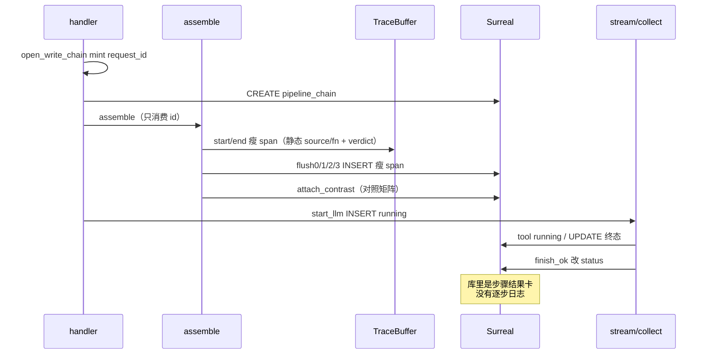
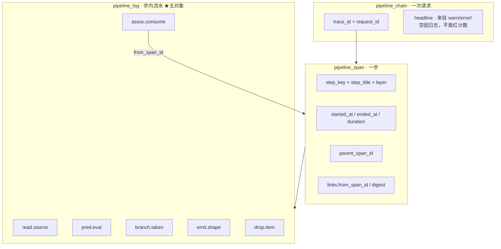
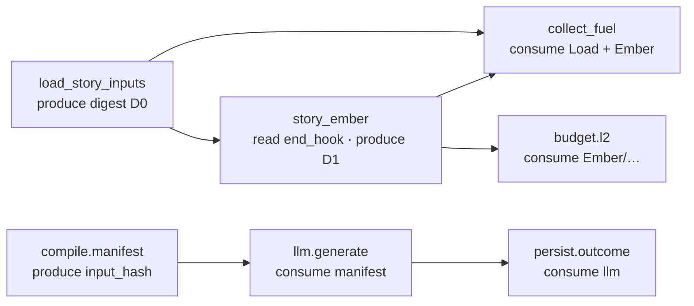

# 铜炉 Pipeline Analysis Log：逐步运行分析账本

> **本文取代** [`docs/plans/2026-08-14-pipeline-trace.md`](2026-08-14-pipeline-trace.md)，成为「系统运行分析账本」的 **SSOT**。  
> 旧文保留作考古：它把「每步全部信息」定义成瘦 span 列（`input.source` / `compute.fn` / `output.chars` / `verdict`），并**明确拒绝**持久化可读日志流。现网实现按该合同落地后，用户再次判定为「只有运行结果」。  
> **不要**把旧文当增量补丁的底稿；本设计重画主对象：分析员读的是 **逐步日志行**，不是对照行、也不是 span 字段卡。

| 项 | 值 |
|----|----|
| **文档标题** | 写 / 存 / 宣称 / 工具跳：一次一条链，每步一条 span，步内是可检索的全部信息日志 |
| **作者** | Grok Design |
| **日期** | 2026-08-14 |
| **状态** | Draft |
| **产品** | 铜炉 / tonglu · 代码 `scribe3/` |
| **仓库** | `/home/admin/projects/scribe-writing-system` |
| **入库路径** | `docs/plans/2026-08-14-pipeline-analysis-log.md` |
| **取代** | `docs/plans/2026-08-14-pipeline-trace.md`（不再是分析账 SSOT）；更早的 `docs/plans/2026-08-13-run-observability.md` 仍是 Run 卡考古 |
| **验证** | **仅已部署 demo**（`tonglu.qing.blue` / `82.157.130.140` / `/opt/scribe3/app`）。禁止 Grok 运行机 `npm ci` / 全量 pytest / 本机 Surreal / 第二套库 |
| **运维 env SSOT** | **`/opt/scribe3/app/deploy/prod/.env`**。不要改 `/opt/scribe3/app/.env`，也不要改 `app/.env.production.local` |
| **schema** | 140 已存在（`pipeline_chain` / `pipeline_span`）。本设计 **141**：新表 `pipeline_log` + 兼容加列。禁止另起 Surreal |
| **关联** | 现网实现 `scribe3/pipeline_trace*.py`、`store/pipeline_trace_ops.py`、`migrations/140_pipeline_trace.surql`、`web/src/admin/RunLogsPage.jsx`；装段 `write_assemble_v1.py`；流 `write_stream.py`；目录 `pipeline_trace_catalog.py` / `injection_registry.py`；L1 `docs/L1-AUTH-ISOLATION.md` |

> **读法（工程师）**  
> 1. 先读「对照用户合同」与 Key Decisions。  
> 2. Proposed Design §1–§8 是实现合同；§5 是每步必须 emit 的日志清单。  
> 3. PR Plan 按序独立合；观测 emit 不得阻断写路径。  
> 4. 能由第一性原理钉死的不进 Open Questions。

---

## 对照用户合同

用户原话（2026-08-14，再次）：

> 不行啊,我要的是包含每个步骤的全部信息日志,且能够很清晰的看出来是哪个步骤的,能够方便的查询整条链路的关联产生,可以存一个星期.我要的是能够用于系统运行分析的,不是这种只有运行结果的.再次设计最优方案

| # | 合同 | 已上线 pipeline-trace（2026-08-14 代码） | 本设计 |
|---|------|------------------------------------------|--------|
| 1 | **每步全部信息日志** | **未满足。** 每步一条瘦 span：`input.source`（目录静态串）+ `compute.fn`（目录静态串）+ `output.chars/digest` + `expected/actual/verdict`。`events[]` 几乎只给 L2 `op/tag`。没有可读 `logs[]`，分析员**不能**不重跑就还原「读了什么字段、判了哪条谓词、走了哪条分支、丢了谁」。见下方诊断。 | 每步一条 span（身份/时序/父子）+ **若干条 append-only `pipeline_log` 行**。一行 = 墙钟 + level + step_key + 中文 message + 白名单 attrs。主对象是日志行。 |
| 2 | **步骤身份一眼可辨** | 半满足。后端目录有 `step_title` / `step_key` / `layer`；UI 列表仍把 `statusChip`（空/红/绿）和「该跑/实际」放第一眼。 | 日志行强制带中文 `step_title` + 稳定 `step_key` + `layer`；UI 按步分组，组头是人话名，行前缀 `[assemble.seg.story_ember]`。芯片不是主视觉。 |
| 3 | **整条链路可关联查询** | **未满足。** 只有 `parent_span_id`（目录写死的树）和读时算的 `prev/next_trace_id`。`from_span_id` **从未写入**。没有「本步产出 digest 被谁消费」的边。查询是链列表 / 按 `step_key` 列 span，**不能**「本周所有余烬空的日志行」或「这条输出怎么变成下一步输入」。 | 三类边显式落库：树（`parent_span_id`）、消费（`assoc.consume` 日志 + `from_span_id`）、跨次（读时邻接）。`GET /debug/pipeline-logs` 按 step/code/时间检索；单链详情可从任意日志跳全链。 |
| 4 | **保留一周** | 半满足。TTL 7 + `_store_for` 上 `maybe_purge`（6h 节流）已挂。但清的是瘦 span；没有日志表可清。`created_at` READONLY，不能靠回填测 TTL。 | 继承 7 天 + 同钩；**先 DELETE `pipeline_log` 再 span 再 chain**。旧 140 行无日志也可活到 TTL。 |
| 5 | **用途 = 系统运行分析** | **未满足。** 钩子用 `classify_actual` / `row_verdict` 收尾；headline 优先红因，空则「对照齐全」；UI 默认 inspector 是该跑×实际；对照 tab 仍在。这是 Run 卡换皮。 | 回答：跑了什么、为何存在、收了什么、算了什么、发出什么、丢/跳/失败了什么、多久、卡在哪、**后步如何用前步产出**。红绿是派生 overlay，非默认 UI，非主记录。 |
| 6 | **再次设计最优方案** | 上一份设计自称已满足同一段用户原话，却把「全部信息」定义成「不要真实日志」。 | **重画主对象**。复用已工作的 id mint / catalog / fail-soft store / 7d 钩 / 管理页位置。**替换**字段合同与 UI。 |

**禁止再做成「span 元数据 + 对照 tab」。** 那正是现网已经交货、已被否的东西。

---

## Overview

铜炉写路径一次请求真实发生 40–80 个可辨步骤（装段、信封八块、L2/O1、guard、模型流、0–N 工具跳、Outcome、存/宣门）。分析员要的不是「这场对照几红几绿」，而是一份 **不重跑也能读懂的运行流水**：

```text
12:01:03.012  INFO  [上章余烬 · assemble.seg.story_ember]
        读取 chapter[n-1].narrative_drive.end_hook：字段空
12:01:03.013  INFO  [上章余烬 · assemble.seg.story_ember]
        谓词 prev_end_hook=false → 本段 empty（empty_story_ember）
12:01:03.014  INFO  [上章余烬 · assemble.seg.story_ember]
        产出 fuel_block chars=0 digest=∅
12:01:03.015  ASSOC [收集三燃料 · assemble.collect_fuel]
        消费 assemble.seg.story_ember（from_span=…, digest=∅, got=false）
```

本设计交付 **一书一库** 的分析账本：

```text
一次请求     = 一条 pipeline_chain（trace_id = request_id）
一个步骤     = 一条 pipeline_span（身份 + 墙钟 + 父子 + 摘要）
步内发生了什么 = 若干条 pipeline_log（append-only，这才是「全部信息日志」）
步骤如何相连 = 显式关联：parent / from_span_id / assoc.produce|consume / 同章前后次
期望×实际    = chain.contrast_summary（派生，永不做默认 UI）
```

复用已经工作、且用户没有否定的骨架：handler 一次 mint、`manifest_trace["request_id"]`、catalog、fail-soft store、flush 阶段、7 天 `_store_for` purge、管理台独立页、L1 `?work=`。  
**替换** 的是：字段合同、钩子 emit 形状、查询面、UI 主对象。

「全部信息」**不是** 96k prompt、不是破绽词、不是工具参数值。白名单见 KD-2 / §6。

---

## Background & Motivation

### 分析员要回答的八句（产品合同）

| # | 问题 | 现网 pipeline-trace 能否答 | 本设计 |
|---|------|---------------------------|--------|
| 1 | 这一步叫什么？哪一层？ | 能（catalog） | 保持 |
| 2 | 何时开始/结束？卡在哪？ | 半能。llm/tool 已修 running 不假 stamp `ended_at`；多数装段仍是 `_push` 瞬间 end | 计时仍锚计算函数；running 步只写 start 日志 |
| 3 | **为什么存在这一步？** | 半能。`expected_reason` 是对照码，不是叙事 | `pred.eval` / `skip.reason` 中文日志 |
| 4 | **收到了什么？从哪一步来？** | **不能。** `input.source` 是目录静态串（如 `"chapter[n-1].narrative_drive.end_hook"`），无字段集合、无 `from_span_id`、无空/有的运行值 | `read.source` 日志：字段名集合、计数、hash、`from_span_id` |
| 5 | **算了什么？走了哪条分支？** | **不能。** `compute.fn` 也是目录静态串 | `branch.taken` / `pred.eval` / `keep.item` / `drop.item` |
| 6 | **发出了什么？谁消费了？** | 半能。只有 `chars` + `digest`；无人记录「被谁当输入」 | `emit.shape` + `assoc.produce` / `assoc.consume` |
| 7 | 丢/跳/失败了什么？多久？ | L2 仅 `events[].tag`；无逐步半裁叙事 | 每次半裁/整段丢一行日志 |
| 8 | 本周这个步空过几次？ | **不能。** `GET /debug/pipeline-spans?step_key=` 返回的是 span 摘要，不是日志行 | `GET /debug/pipeline-logs?step_key=&code=` |

### 现网为何仍是「只有运行结果」（代码诊断，2026-08-14）

不是「没做完 PR」，而是 **主对象选错了**。上一份设计 KD-5 把「全部信息」定义成瘦结构化事实，并写明「不需要 end_hook 原文」——实现忠实地没存日志。用户要的是 **可读运行流水 + 关联产生过程**，不是再多两列摘要。

#### A. 字段合同就是一张对照卡

`SpanRec`（`scribe3/pipeline_trace.py` L145–166）一等字段是 `expected` / `actual` / `verdict` / `status`，外加四个字典。没有 `logs`。

`start_span`（同文件 L289–290）把目录里的**静态**串填进 input/compute：

```289:290:scribe3/pipeline_trace.py
            compute={"fn": meta.compute_fn} if meta.compute_fn else {},
            input={"source": meta.source} if meta.source else {},
```

分析员看到的「输入 / 计算」与这次运行无关，只是 catalog 复读。

`public_span` 白名单（L19–25）允许 `events`，但 **没有** 日志行类型。`headline_from_spans`（L427–450）优先拼红步 `actual_reason`，否则落「对照齐全」——人话仍是对照尺。

#### B. 钩子按 Run 卡 DNA emit

`note_push`（`pipeline_trace_hooks.py` L127–160）是装段主出口：调用 `classify_actual` + `expected_for` + `row_verdict`，然后 `end_span`。写入的只有 `actual` / `verdict` / `output.chars` / `digest` / `compute.fn`。**零行中文日志。**

`timed_call`（L96–110）只记 `status=ok|empty|failed`。

`after_join`（L176–203）把 L2 `dropped[]` 压成 `events[{op,tag}]`，一次 end。半裁序列不可读。

`load_chapter_story_inputs` 接线（`write_assemble_v1.py` L318–321）`end_named(status=ok)`，**不记** `contract` / `evidence_must_show` / `prior_consequences` 等字段名集合。

`collect_fuel`（同文件 L367–386）只记 `present if _fuel_got else empty`，不记三个 name 各自 got/empty，也不把 fuel 子 span 标成消费了 load span。

`after_guard`（hooks L227–243）只 `hit_count`。

`start_llm` / `end_tool` / `finish_ok` 只改 status / outcome 三字段。无 chunk 计数、无 tool **键名**、无 usage 数字日志。

`emit_gate_spans`（hooks L318–354）直接遍历旧卡 `rows[]`。

assemble 末尾仍 `emit_write_run_card`（`write_assemble_v1.py` L1357）并 `attach_contrast`。对照摘要还在被当一等产物写进 chain。

#### C. UI 默认仍是结果卡

`RunLogsPage.jsx`：

- L48–59 `statusChip`：`verdict===red` 或 `empty` 上红，否则绿。
- L270 列表次行：`N 对照红`。
- L301–305 默认 tab 虽是「时间线」，并列「对照摘要」。
- L340–351 inspector **第一行就是「该跑 / 实际」**，然后静态 source / fn / chars。没有日志流。
- 前端测 `runLogsPage.test.jsx` 断言的是 span 列表里能看见函数名，**不断言任何日志行**。

#### D. 查询面没有「日志」

`GET /debug/pipeline-traces*` / `GET /debug/pipeline-spans`（`misc_routes.py` L1312–1450）列 chain 或 span。`api.js` 无 logs 客户端。按 `step_key` 检索返回的是瘦 span + 所属链，不是「本周该步全部信息行」。

`events[]` 在 Surreal 是 `option<array>` + `object FLEXIBLE`（`140_pipeline_trace.surql` L62–63），**没有** `(work, step_key, code)` 索引，本来就不能当分析主面。

#### E. 热路径已经在用「逐步 CREATE」

`PipelineTraceOpsMixin.insert_pipeline_spans`（`store/pipeline_trace_ops.py` L38–48）是 Python `for` 逐条 `CREATE ONLY`。本设计若把 300 条日志再逐条 CREATE，会把写路径拖死。141 必须真批量（见 §7）。

### 一次写的真实时间线（今日，观测层）



---

## Goals & Non-Goals

### Goals

| 优先级 | 目标 | 验收口径 |
|--------|------|----------|
| **P0** | `pipeline_log` 表 + buffer `append_log` + 白名单；assemble 关键步（load / fuel / ember / L2 / guard）按 §5 **必发**日志；`GET /debug/pipeline-logs` 能按 `trace_id` 与 `step_key` 取回中文行 | demo 写一次 → 单链详情默认看到余烬/L2 的中文日志；行上带 `step_key`；响应无 prompt |
| **P0** | 关联可跳：余烬 `emit` 的 digest 出现在 `collect_fuel` / `budget.l2` 的 `assoc.consume`；`from_span_id` 非空 | 点一条 consume 日志能打开源 span |
| **P1** | llm / tool / persist / save / claim 逐步日志（usage 数字、chunk 计数、tool **键名**、真实 duration） | 成功链含 `llm.generate` 的 start/usage/end；loop 不留 `in_progress` |
| **P2** | 管理台改名为「运行分析账本」；默认 **按步分组的日志流**；对照降到「派生」且非并列主 tab | 分析员第一眼不是红绿芯片 |
| **P3** | 7 天 purge 含 log；`GET logs?step_key=&code=&since=` 能答「本周余烬空几次」 | 不重启；手工 `POST purge` 仍可用 |

### Non-Goals

| # | 非目标 | 理由 |
|---|--------|------|
| NG1 | 存 96k prompt / 破绽词 / secret / 工具参数**值** / leak_markers | 泄密 + 体积。「全部信息」≠ 全部字节 |
| NG2 | 把 span.events[] 撑成主账交差 | 无索引、撞 4KB 帽、查询要拆数组。正是上一方案的死法 |
| NG3 | 合规审计、收编 `auth_audit` / `audit_event` | 答错问题 |
| NG4 | 作者写作台展示账本 / SSE 推日志墙 | 只在管理台 |
| NG5 | Langfuse / Phoenix / hermes-otel / Hermes Dashboard 当主账 | 看不见期望谓词；默认收 prompt；不在书库 |
| NG6 | 升格 `pipeline_journal.py` | 文件系统崩溃续跑（ingest **和** loop/select/pilot），不是分析账 |
| NG7 | 扩 `context_outcome_trace` / `ai_run_trace` / 章 `density_trace` | Outcome fail-loud + READONLY；074 含 instructions；density 只 last+prev |
| NG8 | 给现网 span 再加两列、或把对照 tab 画大 | 用户已否「只有运行结果」 |
| NG9 | 重开宣称公式、改 `GATE_SAVE_MODE=soft`、改法律写通道 | 硬约束 |
| NG10 | Grok 机 `npm ci` / 全量 pytest / 本机 Surreal / 第二套库 / 清空 demo | 资源与验证纪律 |
| NG11 | 第四张 `pipeline_assoc` 热表（P0） | 关联用 typed log + span.links 即可；见 Alternatives |

---

## Proposed Design

### 1. 一句话架构

```text
Handler 入口 mint 恰好一次 request_id（= trace_id）
  → 先写入 manifest_trace["request_id"] 再 start_chain / assemble
  → 每步 start_span（身份/墙钟/父）
  → 步内 append_log（中文叙事 + 白名单 attrs）——这是主账
  → end_span 只写摘要（status / 计数 / digest），不再当「全部信息」
  → 阶段 flush：已 end 的 span + 已缓冲的 log 批量 INSERT
  → 关联：parent_span_id + assoc.produce/consume 日志 + span.links.from_span_id
  → 7 天：每次 _store_for 前 maybe_purge（先 log 再 span 再 chain）
```

旧 140 的 chain/span **保留为骨架**。旧行没有 log：UI 标明「旧账·仅摘要」。  
`contrast_summary` 可继续派生，但 **不再驱动默认 UI，不再写进 headline**。

### 2. 三对象模型



**否决「只加宽 span 列」**：再往 `input/compute/output` 塞字段，分析员看到的仍是一张结果卡；按「本周余烬空」检索仍要扫全部 span 再拆 JSON。用户要的是 **日志行**。

**否决「扔掉 span 只留 log」**：没有 span 就没有 running 游标、真实 duration、父子树、阶段 flush 的身份。span 是目录项，log 是内容。

### 3. 日志行合同（「全部信息」的精确定义）

默认落库 / 默认 API **只允许**这些键（`public_log` 白名单）：

```python
{
  "log_id": "c0ffee12ab34cd56",      # 16 hex
  "trace_id": "…",                   # = request_id
  "span_id": "a1b2c3d4e5f67890",
  "seq": 3,                          # 该 span 内从 1 递增
  "ts": "2026-08-14T12:01:03.012Z",  # 墙钟，应用层写入（不是 created_at）
  "level": "info",                   # debug|info|warn|error
  "step_key": "assemble.seg.story_ember",
  "step_title": "上章余烬",
  "layer": "assemble",
  "code": "read.source",             # 稳定机器码，供过滤
  "message": "读取上章 end_hook：字段空",
  "attrs": {                         # 只允许 §6 白名单键
    "source": "chapter[n-1].narrative_drive.end_hook",
    "field_set": ["end_hook"],
    "empty": True,
    "chars_in": 0
  },
  "work": "shu_xxx",
  "chapter": 16,
  "kind": "write",
  "schema_ver": "pipeline_log.v1"
}
```

人话渲染（UI 一行，API 也可预拼 `line` 只读字段，不落库）：

```text
12:01:03.012  INFO  [上章余烬 · assemble.seg.story_ember]  读取上章 end_hook：字段空
```

**稳定 `code`（禁止自由发挥；未登记 code 落库前改成 `other` 并 `notes` 记一次）：**

| code | 何时 | 典型 attrs |
|------|------|------------|
| `step.start` | `start_span` | — |
| `step.end` | `end_span` | `status`, `duration_ms` |
| `read.source` | 读到/没读到输入 | `source`, `field_set`, `chars_in`, `digest_in`, `empty`, `from_span_id` |
| `pred.eval` | 期望/门闩谓词 | `pred`, `value`（bool/enum）, `reason` |
| `branch.taken` | 走了哪条实现分支 | `branch`, `fn` |
| `keep.item` | 保留一个命名物 | `name`, `chars`, `tokens_est` |
| `drop.item` | 丢掉/半裁 | `name`, `op`(`drop`/`half_cut`/`keep_beats`), `reason`, `chars_before` |
| `skip.reason` | 整步跳过 | `reason` |
| `emit.shape` | 产出结构 | `shape`, `chars`, `tokens_est`, `digest`, `keys` |
| `assoc.produce` | 声明「本步产出可被消费」 | `digest`, `shape`, `chars` |
| `assoc.consume` | 声明「本步消费了谁」 | `from_span_id`, `from_step_key`, `digest`, `got` |
| `error.raised` | 失败 | `class`, `summary`（≤240，过红线擦除） |
| `usage.model` | 模型用量 | `provider`, `model`, `input_tokens`, `output_tokens`, `chunk_count` |
| `budget.cap` | 预算数字 | `cap`, `used`, `remaining` |
| `flag.eval` | 运行时旗 | `flag`, `value`（bool） |

`level` 规则：决策/读写 = `info`；半裁/跳过/空但预期可空 = `info`；该有却空、整段丢、泄漏命中 = `warn`；抛错 = `error`。`debug` 只给开发旗，默认不落库。

### 4. 步骤身份与骨架（复用 catalog，补 required_logs）

`pipeline_trace_catalog.py` 已有稳定 `step_key` + 中文 `step_title` + `layer` + `parent_of`。**不改名已入库的 key。**

给 `StepDef` 增加：

```python
required_logs: tuple[str, ...]  # 该步 P0 必须出现的 code
# 例：story_ember → ("read.source", "pred.eval", "emit.shape")
```

未发齐 `required_logs` 的步：flush 时自动补一条 `warn` / `code=skip.reason` / `message=本步未发齐日志` / `attrs.missing=[...]`。这是观测完整度，不是写路径错误。

父子树 **保持** 现网 `parent_of`（`assemble.seg.story_ember` → `assemble.collect_fuel` 等）。UI 高亮祖先/子孙仍用这棵树。

### 5. 每步必发日志（P0 清单；这是产品条）

「全部信息」按步定义。**禁止**只 `end_span(actual=empty)` 交差。

#### 5.1 通用模板（所有 `assemble.seg.*`）

| 序 | code | 中文 message 模板 | attrs |
|----|------|-------------------|-------|
| 1 | `step.start` | 开始 {step_title} | |
| 2 | `read.source` | 读取 {source}：{空\|N 字} | `source`, `field_set`, `chars_in`, `digest_in?`, `from_span_id?` |
| 3 | `pred.eval` | 谓词 {pred}={value}（{reason}） | `pred`, `value`, `reason` |
| 4 | `branch.taken` 或 `skip.reason` | 走 {branch} / 跳过：{reason} | `fn`, `branch` / `reason` |
| 5 | `emit.shape` | 产出 {shape} {N} 字 | `shape`, `chars`, `digest` |
| 6 | `assoc.produce` | 产出可供下游消费 digest={短} | `digest`, `chars` |
| 7 | `step.end` | 结束 {status} {duration_ms}ms | `status`, `duration_ms` |

`source` / `fn` 仍可从 catalog 取**默认标签**，但 `chars_in` / `empty` / `value` / `branch` 必须是**这次运行**的值。

#### 5.2 高价值步（必须比模板更细）

**`assemble.load_story_inputs`**

- `read.source`：`field_set` = 实际非空键名（`contract`, `evidence_must_show`, `voice`, `prior_consequences`, `recall_context`, `causal_graph`）。禁止值。
- `emit.shape`：`keys` = 同上；`counts` = `{evidence_must_show: N}`。
- `assoc.produce`：digest = 对「键名排序 + 各字段长度」做 sha256，不是正文。

**`assemble.collect_fuel`**

- 对 `story_ember` / `story_recall` / `story_causal` 各一条 `keep.item` 或 `skip.reason`（`empty_*`）。
- 三条 `assoc.consume`：`from_step_key=assemble.load_story_inputs`，`from_span_id` 必填（load 失败则 `got=false`）。
- 子 span（余烬等）的 `from_span_id` = load 或 collect 的 span，**禁止再只写目录静态 source**。

**`assemble.seg.story_ember`**（用户点名场景）

```text
INFO  读取 chapter[n-1].narrative_drive.end_hook：字段空
INFO  谓词 prev_end_hook=false → 本段 empty（empty_story_ember）
INFO  产出 fuel_block 0 字
```

有 hook 时：`chars_in` / `digest_in`（hash **原文但不存原文**）+ `emit.shape` 的 chars。

**`compile.envelope`**

- `emit.shape`：八块名 `focus/global/canonical/recent/procedural/reference/uncertainty/provenance` 的 `tokens_est`（`context_models.ContextBlock.name`）。
- `keep.item` / `skip.reason`：selected / rejected **名字或 source_id**，不要正文。计数必有。
- 现网 assemble 在 compile 返回后已能从 envelope / `usage_digest` 取数字（`write_assemble_v1.py` L1288–1293）——P0 在 `after_compile` 补发，不必改 assembler 算法。

**`budget.l2` / `budget.o1`**

- 一条 `budget.cap`：`effective_l2_cap` / `l2_est` / `remaining`。
- `dropped` 里 **每一**个 tag 一行 `drop.item`（`name`, `op=drop|half_cut|keep_beats`, `tag`）。
- 对每个被裁 name 一条 `assoc.consume`（from 对应 `assemble.seg.{name}`）。
- 现网 `l2_events_from_dropped` 只产 `{op,tag}` 且一次塞进 `events[]`——**改成逐条 log**；span.events 可继续镜像前 16 条以便旧 UI，但不再是 SSOT。

**`guard.epistemic`**

- `pred.eval`：`has_focalizer`。
- `emit.shape`：`hit_count`, `kinds`（种类名，不是 marker 明文）。
- 泄漏：`error.raised` 后 `step.end failed`；仍先记再 raise。

**`llm.generate`**

- `step.start` 在 INSERT running 时就发（与现网 `start_llm` 同时）。
- `read.source`：`from_span_id=compile.manifest`，`digest_in=actual_input_hash`（已有，不存 instructions）。
- `usage.model`：`provider`, `model`, `input_tokens`, `output_tokens`, `chunk_count`（stream 里 `text.delta` 计数，**不存 delta**）。
- `emit.shape`：`output_hash`（Outcome 已有）。
- `ended_at` / `duration_ms` 仍必须真实（已修的合同保持）。

**`tool.{safe_name}`**

- `read.source`：`keys` = 工具参数**键名**排序列表。禁止值。
- `emit.shape`：`chars` / digest of output，无正文。
- 现网 `start_tool` 只 `input.name`（hooks L280）——必须扩成键名。

**`persist.outcome`**

- `assoc.consume` ← `llm.generate`。
- `emit.shape`：`outcome_id`, `status`（`succeeded|failed|incomplete_stream|cancelled`，与 `context_outcome.OUTCOME_STATUSES` 一致）。

**save.* / claim.***

- 每扇门：`pred.eval` + `skip.reason` 或 `step.end`。可从现网 `_rc_rows` 翻译，但 **message 必须中文叙事**，不能只抄 `actual=present`。

#### 5.3 钩子改法（相对现网）

| 现网函数 | 改后 |
|----------|------|
| `timed_call` | start + `step.start`；成功 `emit.shape`（有/无）+ end；异常 `error.raised` |
| `note_push` | **不再是唯一出口**。只补 `emit.shape` / `skip.reason` 并 end。read/pred 必须在计算函数里 `append_log` |
| `after_join` | 逐 tag `drop.item` + cap + consume；仍 flush |
| `after_compile` | envelope 八块 token + manifest hash + produce |
| `after_guard` | 见上 |
| `mark_facts` | 每条用到的 expected 谓词可在 freeze 步记 `pred.eval`（name+bool+reason），不要再只 `status=ok` |
| `start_llm` / `end_tool` / `finish_ok` | 补日志；finish 时把缓冲的 llm/tool 日志随 span UPDATE/INSERT 刷出 |
| `emit_gate_spans` | 每行门变成 pred+end 日志，不是抄对照 row |

**计时锚点保持旧合同**：`start_span` 包计算函数，`_push` 只补 output。禁止把 duration 锚回 `_push`。

### 6. 白名单：全部信息包含什么、不包含什么

`pipeline_trace.py` 现有 `FORBIDDEN_KEYS`（`text/instructions/markers/prompt/arguments/secret/leak_markers/input_text`）继续有效，并扩到 **log.attrs 的键集合**。

**attrs 允许键（闭集，未列即丢）：**

```
source, source_kind, field_set, keys, name, names,
chars, chars_in, chars_before, tokens_est, bytes,
digest, digest_in, hash, empty, got, nonempty, title_only, reveal_only,
from_span_id, from_step_key, to_span_id, to_step_key,
fn, branch, pred, value, reason, op, tag,
flag, cap, used, remaining, status, duration_ms,
shape, counts, hit_count, kinds, chunk_count,
provider, model, input_tokens, output_tokens,
outcome_id, manifest_id, missing
```

`value` **只允许** bool / int / float / 短 enum（≤32 字、匹配 `^[a-z0-9_.:-]+$`）。其它类型丢弃并 `warn` 一次。

**禁止出现在 message 与 attrs 的内容：**

- 任何提示词正文、instructions、破绽词 / leak_markers 明文
- `end_hook` / 合同四义 / 召回段落的原文
- 工具 arguments **值**（只留键名）
- secret value、API key、Cookie
- 模型输出散文

`strip_forbidden` 必须递归打 log.attrs。单测锁：构造含 `prompt`/`markers` 的 attrs → `public_log` 后键不在、message 不含原文。

`SCRIBE3_PIPELINE_TRACE_PREVIEW` 保持默认 0，**本设计不把它当主通道**。分析不靠 240 字预览。

### 7. 缓冲、刷盘、帽

热路径禁止每条日志同步 CREATE。现网 span 已经在 `for` 里逐条 CREATE（`pipeline_trace_ops.py` L38–48）——141 **必须**改成一次 round-trip 的批量，日志更要走批量。

```text
FOR $r IN $rows {
  CREATE ONLY type::record('pipeline_log', $r.log_id) CONTENT $r;
};
```

PR2 在 demo **试写书**上冒烟该语句。若 3.2.4 拒 FOR-IN：退回「一条 `_execute_write` 里用 `;` 串最多 32 条 CREATE」，禁止 Python 300 次往返。span INSERT 同期改掉。

刷盘时机 **沿用** 现网 flush0 / after_join / after_compile / after_guard / llm running / tool / finish（`pipeline_trace_hooks.py` + `write_assemble_v1.py` L1124–1126, L971, L1357 一带）。每次 flush：

1. `drain_ready()` 已 end span  
2. `drain_logs()` 已缓冲、尚未 flushed 的 log（含仍 running 的 llm 已产生的 start/chunk 计数——chunk 用内存计数，**不要每 delta 一条 log**）  
3. 一批 INSERT logs + 一批 INSERT spans + UPDATE chain（`log_count`, `cursor`）

| 帽 | 值 | 超了 |
|----|-----|------|
| 单 log message | 240 字 | 截断 + `attrs.truncated=true`（`truncated` 加入允许键） |
| 单 log attrs JSON | 1.5 KB | 丢最长的 list（`names`/`field_set`） |
| 单 span 日志条数 | 48 | 停 append；`notes` 加 `log_cap`；补一条 warn |
| 单链日志条数 | 2048 | 同上，`chain.notes` 加 `log_cap` |
| 单链 span | 128（已有） | 保持 |
| 单 span JSON（摘要） | 4 KB（已有） | 保持；**日志不进这个 JSON** |
| 批量每包 | 64 行 | 多包顺序 flush，失败丢本包 |

`chunk_count`：内存 `+=1`，只在 llm `step.end` / `usage.model` 写一次数字。

### 8. 关联如何产生、如何查



落库形态（P0 **不**建第四表）：

1. **树**：现有 `parent_span_id`（catalog）。  
2. **产出/消费**：`pipeline_log.code in (assoc.produce, assoc.consume)`。  
3. **摘要**：`span.links` 增补  

```python
links = {
  "from_span_id": "…",          # 主输入来源（一个）
  "from_span_ids": ["…"],       # 多输入
  "produce_digest": "hex|null",
  "manifest_id": "…",
  "outcome_id": "…",
}
```

4. **同章前后次**：仍读时 `neighbor_traces`（已有），不存。  
5. **Buffer 索引**：`TraceBuffer._produced[step_key] = {span_id, digest}`，消费方 `consume(step_key)` 自动填 `from_span_id`。

查询：

```text
# 这一次的全部信息日志（默认墙钟）
GET /debug/pipeline-traces/{trace_id}/logs?work=

# 本周余烬空
GET /debug/pipeline-logs?work=&step_key=assemble.seg.story_ember&code=pred.eval&since=

# 谁吃了这个 span 的产出
GET /debug/pipeline-traces/{trace_id}/assocs?work=

# 从任意 log_id / span_id 跳链（现有 q= 扩展）
GET /debug/pipeline-traces?work=&q={log_id|span_id|trace_id|outcome_id}
```

`q=log_id`：`SELECT trace_id FROM pipeline_log WHERE log_id=$id LIMIT 1`。

### 9. 管理页（主对象 = 日志流）

重写 `RunLogsPage.jsx`。标题改为 **「运行分析账本」**。`planes.js` ops `run-logs` 标签、`AdminConsole.jsx` tab 同步。写作台零引用（现网 `test_write_layout_has_no_run_card_ui` 继续锁）。

```text
┌ 运行分析账本 · 逐步日志 · 不展示提示词 ─────────────────────┐
│ 书 ▾  章  类型  步骤键  日志码  级别  时间  刷新              │
│ 搜索 trace / span / log / outcome                          │
├──────────────┬────────────────────────────────────────────┤
│ 请求列表      │ 默认：步骤日志                               │
│ 16:02 第16章  │ 头条：余烬 end_hook 空 · L2 丢 material_recall│
│ 余烬空·L2丢…  │ 12.8s · 47 步 · 312 行日志                   │
│              │ [步骤日志] [关联] [派生对照]                  │
│              │                                              │
│              │ ▼ 上章余烬  assemble.seg.story_ember  装段/L2 │
│              │   12:01:03.012 INFO 读取 end_hook：字段空     │
│              │   12:01:03.013 INFO 谓词 prev_end_hook=false  │
│              │   12:01:03.014 INFO 产出 fuel_block 0 字      │
│              │ ▼ L2 补充裁剪  budget.l2                      │
│              │   12:01:03.040 INFO 帽 2400 · 已用 3100       │
│              │   12:01:03.041 WARN 整段丢 material_recall    │
│              │   12:01:03.042 ASSOC 消费 story_ember digest=∅│
└──────────────┴────────────────────────────────────────────┘
```

交互钉死：

1. **默认视图 = 按 `started_at` 分组的日志流**，不是 span 状态条，不是对照表。  
2. 组头：中文名 + `step_key` + layer + 耗时。点组头展开/收起，默认关键步（warn/error/空）展开。  
3. 点一行：右侧只读 attrs（白名单）。点 `from_span_id` 滚到源步。  
4. 「关联」页：produce/consume 边列表 + 同章上下。  
5. 「派生对照」**不是**顶栏并列主 tab，放在「更多」或三级。现网 `contrast` 按钮降级。  
6. 列表主列用 **日志生成的 headline**（第一条 warn，否则第一条空因，否则 llm usage）。**禁止**「对照齐全」「N 对照红」做主文案。`red_count` 可留 API 字段，UI 默认不展示。  
7. `statusChip` 不得再把 `empty` 一律涂红当主色；空因用日志 `warn` 左边一条竖线即可。  
8. 进行中：组头显示「进行中 Ns」，来自 `cursor_step_key`（现有 live headline 逻辑改读 cursor + 最新 log）。  
9. 顶部步骤键 + 日志码过滤走 `GET /debug/pipeline-logs`，结果仍按请求聚合，点进去是全链日志。

### 10. 与 140 / 旧卡 / 瘦 span 的关系

| 阶段 | 行为 |
|------|------|
| 现网 | `SCRIBE3_PIPELINE_TRACE=1` 写瘦 span；`SCRIBE3_RUN_CARD_PERSIST=0` 已停旧表 CREATE；`SCRIBE3_RUN_CARD=1` 仍派生 `contrast_summary` |
| 本设计落地后 | 同一旗写下 **span + log**。span 摘要字段保留（兼容旧 GET）。新 UI 读 log |
| 旧 140 行 | `log_count` 缺省 / 0 → UI 横幅「旧账·仅有步骤摘要」。不迁移补日志（无法回放） |
| 对照 | `build_run_card` 可继续挂 chain；**headline 不再读 verdict** |
| 回滚写日志 | `SCRIBE3_PIPELINE_LOG=0`（新旗，默认 1）→ 只写 span，行为回到现网。不 DROP 表 |

**旗（只准这些，禁止第四个同义主旗）：**

| 旗 | 默认 | 含义 |
|----|------|------|
| `SCRIBE3_PIPELINE_TRACE` | `1` | 开链 / 写 span。0 = 整条观测零 I/O |
| `SCRIBE3_PIPELINE_LOG` | `1` | 写 `pipeline_log`。0 = 骨架仍在、无流水 |
| `SCRIBE3_RUN_CARD` | `1` | 是否派生对照摘要 |
| `SCRIBE3_RUN_CARD_PERSIST` | `0` | 保持现网：不 CREATE `write_run_card` |
| `SCRIBE3_PIPELINE_TRACE_PREVIEW` | `0` | 保持关 |
| `SCRIBE3_PIPELINE_TRACE_TTL_DAYS` | `7` | 三表同一 TTL |

`TRACE=0` ⇒ 日志也不写。`LOG=0` 不得挡写。

id 合同 **一字不改**：handler 恰好一次 mint；assemble 禁止 `uuid4()`；缺 id = 观测 no-op（`resolve_assemble_request_id` 已有）。

### 11. Handler / 生成路径（保持，只补日志）

现网接线已齐，本设计不重开：

| 路径 | 文件 | 保持 |
|------|------|------|
| `POST/GET /chat/write` | `write.py` | `open_write_chain` + `write_chain_guard` |
| loop / select / select_light | `chapters.py` | 每次 generate 一条链 |
| `_pilot_llm_gen` | `misc_helpers.py` | 同上 |
| `_stream_write` / `_collect_write` | `write_stream.py` | `start_llm` / tool / `finish_ok` / `finish_failed` |
| `save_chapter` / `reader_claim_ep` | `misc_routes.py` / `write.py` | `emit_gate_spans` 改为带日志 |

前闸 409（reread / context）：现网 `chat_write_post` L89 / L105 直接 `finish_failed`，**没有** handler span 日志。P1 补 `handler.reread_gate` / `handler.context_enforce` 的 pred + error 日志再关链。

---

## API / Interface Changes

鉴权与现网 `/debug/pipeline-traces` 同权：登录；`?work=` 经 middleware `assert_user_may_access_work`（`/debug/*` **不**在 `_GLOBAL_PREFIXES`）；admin 可跨书。响应永不含 prompt。OpenAPI：新 handler **必须带 annotations** 再 rebind。

### 新

```text
GET  /debug/pipeline-logs
     ?work=&trace_id=&span_id=&step_key=&code=&level=
     &chapter=&kind=&since=&until=&limit=100
GET  /debug/pipeline-traces/{trace_id}/logs?work=&step_key=&code=
GET  /debug/pipeline-traces/{trace_id}/assocs?work=
POST /debug/pipeline-traces/purge   # 已有；实现改为先删 log
```

| 参数 | 作用 |
|------|------|
| `trace_id` / `span_id` | 精确 |
| `step_key` | 精确匹配（用 `pipeline_log_step_idx`） |
| `code` | 精确；可用 `code_prefix=pred.` 走 `string::starts_with`（若 Surreal 版本不便，P0 只做精确） |
| `level` | 精确 |
| `since` / `until` | `created_at`（TTL 同源）。列表过滤禁止「先拉 20 再 Python 滤」 |

列表项（无 attrs 大包；详情再给 attrs）：

```json
{
  "log_id": "…",
  "ts": "…Z",
  "level": "info",
  "step_key": "assemble.seg.story_ember",
  "step_title": "上章余烬",
  "layer": "assemble",
  "code": "read.source",
  "message": "读取上章 end_hook：字段空",
  "trace_id": "…",
  "span_id": "…",
  "chapter": 16
}
```

单链 `/logs` 返回按 `ts, seq` 排序的全量行（硬顶 2048）。`/assocs`：

```json
{
  "edges": [
    {
      "kind": "consume",
      "from_span_id": "…",
      "from_step_key": "assemble.seg.story_ember",
      "to_span_id": "…",
      "to_step_key": "budget.l2",
      "digest": null,
      "log_id": "…"
    }
  ]
}
```

### 旧 API

| 路由 | 变化 |
|------|------|
| `GET /debug/pipeline-traces` | 列表项加 `log_count`；`q` 增加 `log_id` |
| `GET /debug/pipeline-traces/{id}` | 加 `logs[]`（可 `?include=logs` 默认 **开**——这是主载荷）。`spans[]` 仍给。`contrast_summary` 保留但不做 UI 默认 |
| `GET /debug/pipeline-spans` | 保持；用于「按步找链」 |
| `GET /debug/run-cards*` | 保持现网兼容矩阵，本设计不重开 |

`web/src/api.js` 增 `pipelineLogs` / `pipelineTraceLogs` / `pipelineAssocs`。

作者面 `POST /chat/write` 仍不推日志。SSE `done.trace_id` 仍是 Open Question。

---

## Data Model Changes

### 为何第三表 `pipeline_log`，而不是把 `events[]` 撑满

| 方案 | 体积 / 查询 / 热路径 | 结论 |
|------|----------------------|------|
| 只加宽 span 列 | 「本周余烬空」= 扫 span + 拆 JSON；4KB 帽会先砍掉日志 | 否决（现网已是此形态） |
| `span.logs[]` / 扩 `events[]` | SCHEMAFULL 数组无 `(step_key, code)` 索引；每追加一次要 UPDATE 整数组；和 4KB 帽冲突 | 否决作 SSOT |
| 仅 `pipeline_log`、删 span | 失去 running / duration / 树 / flush 身份 | 否决 |
| **骨架 span + 一等 log 表** | 索引直接打在日志行；flush 批量 INSERT；span 仍 4KB | **选用** |

旧 140 行无需回填。141 只 `DEFINE … IF NOT EXISTS`。

### 迁移 `141_pipeline_log.surql`

一书一库。`apply_schema` 按 `f.stem` 去重。STYLE 对齐 140。迁移失败挡开书（`SCHEMA_SOFT=0`）。先对试写书 `_store_for`。

```surql
-- 141_pipeline_log.surql · 写路径逐步分析日志（系统运行分析主载荷）
-- 不含提示词正文 / secret value / leak_markers / 工具参数值。

DEFINE FIELD IF NOT EXISTS log_count ON pipeline_chain TYPE option<int>;
DEFINE FIELD IF NOT EXISTS log_count ON pipeline_span TYPE option<int>;

DEFINE TABLE IF NOT EXISTS pipeline_log SCHEMAFULL;
DEFINE FIELD IF NOT EXISTS log_id ON pipeline_log TYPE string;
DEFINE FIELD IF NOT EXISTS trace_id ON pipeline_log TYPE string;
DEFINE FIELD IF NOT EXISTS span_id ON pipeline_log TYPE string;
DEFINE FIELD IF NOT EXISTS seq ON pipeline_log TYPE int;
DEFINE FIELD IF NOT EXISTS ts ON pipeline_log TYPE datetime;
DEFINE FIELD IF NOT EXISTS level ON pipeline_log TYPE string
  ASSERT $value IN ['debug', 'info', 'warn', 'error'];
DEFINE FIELD IF NOT EXISTS step_key ON pipeline_log TYPE string;
DEFINE FIELD IF NOT EXISTS step_title ON pipeline_log TYPE string;
DEFINE FIELD IF NOT EXISTS layer ON pipeline_log TYPE string;
DEFINE FIELD IF NOT EXISTS code ON pipeline_log TYPE string;
DEFINE FIELD IF NOT EXISTS message ON pipeline_log TYPE string;
DEFINE FIELD IF NOT EXISTS attrs ON pipeline_log TYPE option<object> FLEXIBLE;
DEFINE FIELD IF NOT EXISTS work ON pipeline_log TYPE string;
DEFINE FIELD IF NOT EXISTS chapter ON pipeline_log TYPE int;
DEFINE FIELD IF NOT EXISTS kind ON pipeline_log TYPE string;
DEFINE FIELD IF NOT EXISTS schema_ver ON pipeline_log TYPE string;
DEFINE FIELD IF NOT EXISTS created_at ON pipeline_log TYPE datetime VALUE time::now() READONLY;

DEFINE INDEX IF NOT EXISTS pipeline_log_id_idx ON pipeline_log FIELDS log_id UNIQUE;
DEFINE INDEX IF NOT EXISTS pipeline_log_trace_idx ON pipeline_log FIELDS trace_id, ts, seq;
DEFINE INDEX IF NOT EXISTS pipeline_log_span_idx ON pipeline_log FIELDS span_id, seq;
DEFINE INDEX IF NOT EXISTS pipeline_log_step_idx ON pipeline_log FIELDS work, step_key, created_at;
DEFINE INDEX IF NOT EXISTS pipeline_log_code_idx ON pipeline_log FIELDS work, code, created_at;
DEFINE INDEX IF NOT EXISTS pipeline_log_created_idx ON pipeline_log FIELDS created_at;
```

主键纪律与 140 相同：纯 hex，`CREATE ONLY type::record('pipeline_log', $log_id)`。禁止冒号进 record id。

`ts` 是应用层墙钟（分析用）。TTL **只看** `created_at`（READONLY `time::now()`）——**禁止**用回填 `created_at` 测 TTL。验收：手工 `POST /debug/pipeline-traces/purge?days=7` + 单测只锁 SQL 顺序；若要看删行，在试写书 INSERT 后立刻 `days=0` **禁止**（以免误删）。TTL 正确性靠「purge 函数对 `created_at < now()-Nd` 发 DELETE」的契约测试，不靠改历史行。

**可变字段：** log 行 CREATE 后不 UPDATE（真 append-only）。span 仍仅 llm/tool 允许 running→终态。chain 增 `log_count`。

### Store mixin 增补

```python
class PipelineTraceOpsMixin:
    def insert_pipeline_logs(self, rows: list[dict]) -> None: ...
    def list_pipeline_logs(self, *, trace_id=None, span_id=None, step_key=None,
                           code=None, level=None, chapter=None,
                           since=None, until=None, limit=100) -> list[dict]: ...
    def get_pipeline_log(self, log_id: str) -> dict | None: ...
    # purge_pipeline_traces_older_than: 先 DELETE log，再 span，再 chain
```

`insert_pipeline_spans` 同期改为同一批量合同，避免 50 次 CREATE。

### TTL = 7 天

保持：`maybe_purge_pipeline_traces` 挂在每次 `_store_for` 返回前（`app_impl.py` L379–381），6h 节流。扩展 DELETE 顺序：

```surql
DELETE pipeline_log WHERE created_at < time::now() - $d d;
DELETE pipeline_span WHERE created_at < time::now() - $d d;
DELETE pipeline_chain WHERE created_at < time::now() - $d d;
```

`start_chain` 里已有的一次 `maybe_purge` 保持。

### 体积估算

| 假设 | 值 |
|------|-----|
| demo 活跃书每天写 | 20–80 assemble（含试写）+ save/claim 10–20 + loop/select 少量 → **取 50 次/天** 做中位 |
| 每写 span | 50–80（现网量级） |
| 每步日志 | 模板 5–7 行；L2/envelope/llm 8–15；**中位 6** |
| 每写日志行 | ≈ 50 × 6 = **300**（+ assoc 20 ≈ 320） |
| 每行 | message+attrs 白名单 ≈ **250–400 B** |
| 每写 logs | ≈ **80–130 KB** |
| 每写 span+chain | 现网 35–80 KB（摘要不涨） |
| 50 次/天 | ≈ **6–10 MB/天/书** |
| **7 天** | ≈ **40–70 MB/书**（活跃）；冷书近 0 |
| 80 次/天上限 | ≈ **15 MB/天 → 周 100 MB** |

对比：一章散文 10–40 KB；本账周量约等于数天正文，可接受。风险在 **批量 INSERT 尾延迟**，不在磁盘。

纯函数 `append_log` p99 < 0.1ms。一批 64 行 INSERT p95 目标 < 40ms；失败丢包 + `notes=flush_failed`，不重试打爆。

---

## Alternatives Considered

### A. 只加宽现网 span（`logs[]` 塞进 span / 扩 events）

实现最快，140 不用新表。  
**否决：** (1) 现网已经是「加宽的结果卡」，用户已否；(2) `events[]` 无索引，本周按 `code` 检索要扫全表拆数组；(3) 4KB 帽会先砍掉「全部信息」；(4) 每追加一次 UPDATE 整数组，热路径更差。

### B. 第三方 APM（Langfuse / Phoenix / hermes-otel）

Hermes 能记 turn / generation / tool。  
**否决（维持两次裁断）：** 看不见 `SEGMENT_REGISTRY` / `expected_for` / `end_hook` 空因；默认轨迹想收 instructions；账在书库外，L1 归属与 7 天 TTL 对不齐；回答不了「余烬空是没装还是 L2 裁」。P3+ 最多用 `trace_id` 做外链，不反写。

### C. 升格 `pipeline_journal.py`

Journal 是 JSON + `os.replace`，为 **DB 不可用时** 续跑 ingest **以及** `loop_chapter` / `select_*` / `_pilot_journal`。  
**否决：** 无期望谓词、无跨请求索引、无管理页、无 7 天查询；回答「从哪一阶段重跑」，不回答「这场余烬空是谁裁的」。把它塞进 Surreal 背叛其存在理由。

### D. 只要 append-only 日志表、去掉 span

日志行自带 `step_key`，看似够。  
**否决：** running 游标、真实 duration、父子高亮、阶段 flush、128 span 帽都要重做；llm 进行中 41s 会变成一堆无母体的 start 行。分析员仍需要「一步」这个聚合。

### E. 第四表 `pipeline_assoc`（P0）

边查询更干净。  
**P0 不做：** 每写 20–40 条边，typed log 已能 `WHERE code=assoc.consume`；再多一表就多一轮 INSERT 与 purge。若 P2 关联页证明 log 扫描不够，再拆表（字段已含 from/to，迁移便宜）。

### F. 选用：骨架 span + 一等 `pipeline_log` + 关联日志（本设计）

复用 140 已落地的链/树/flush/TTL/管理页位置；把用户要的「全部信息日志」做成可索引行；关联用 typed log + `links.from_span_id`。热路径批量、fail-soft、白名单。这是能同时满足六条合同、又不另起观测栈的最小充分集。

---

## Security & Privacy Considerations

| 威胁 | 严重度 | 缓解 |
|------|--------|------|
| 日志 message 抄进 prompt / end_hook 原文 | **高** | emit API 不接收任意字符串当 attrs；message 由钩子格式化；单测禁键 + 禁长文 |
| 工具参数值进 attrs | **高** | 只存键名；`arguments` 在 FORBIDDEN |
| 跨书读日志 | **高** | L1 `?work=` + owner；与现网 debug 相同 |
| `log_id` 枚举 | 低 | 16 hex 随机；无归属仍 403 |
| error.summary 回流 secret | 中 | 240 字 + `strip_forbidden` + 红线擦除 |
| 日志表被当合规举证 | 低 | 威胁模型不包括此项；文案写明「不是审计」 |
| 300 条 INSERT 拖垮写路径 | 中 | 批量 + 帽 + fail-soft + `PIPELINE_LOG=0` |

观测 fail-soft，**不得**挡写。Outcome `save_outcome` 仍 fail-loud；`finish_failed` 仍在 except 内先于 raise。T0 `facts_at` 仍只属于 `_secret_guard_block`，观测禁止第二下。

---

## Observability

本账就是观测。另外：

| 信号 | 方式 |
|------|------|
| `pipeline_log_flush_ms` / `flush_ok` / `rows` | 结构化日志 |
| `log_cap` / `flush_failed` | `chain.notes` |
| 进行中超时 | 管理页标「卡在 {step_title}」；不接 pager |
| demo 冒烟 | PR4 后：写一章 → GET logs 含余烬中文行 + L2 drop 行；PR5 后再含 llm usage |

禁止把落库成功数当 KPI。

---

## Rollout Plan

1. 代码默认 `SCRIBE3_PIPELINE_LOG=1`（随 TRACE）。回滚：在 **`/opt/scribe3/app/deploy/prod/.env`** 设 `SCRIBE3_PIPELINE_LOG=0` 或 `SCRIBE3_PIPELINE_TRACE=0`，再 **compose recreate**（`deploy_demo.sh hot` **不**重读 env_file）。  
2. 迁移 141 随该书首次 `_store_for` → `apply_schema`。失败不标 `_migration`，demo `SCHEMA_SOFT=0` 会让整书写路径不可用。**先试写书，再热更活书。**  
3. 旧 140 瘦 span 继续可读；新 UI 对 `log_count=0` 显示旧账横幅。  
4. 验收 = **已部署 demo 冒烟**，禁止清空库、禁止第二套 Surreal、禁止 Grok 机全量测。  
5. 回滚旗即停**写日志**；表与旧行不 DROP，靠 7 天 purge。

---

## 风险（显式）

| 风险 | 严重度 | 缓解 |
|------|--------|------|
| 141 FOR-IN 在 demo 3.2.4 不可用 | **高** | PR2 先试写书冒烟；失败改单 round-trip 多 CREATE |
| 钩子仍只 `end_span(actual=…)` 忘了 append_log | **高** | catalog `required_logs` + 缺行自动 warn；单测锁余烬三条 code |
| 有人「帮忙」把 end_hook 原文写进 message | **高** | emit 函数不接收自由正文；单测 |
| UI 改完仍把芯片放第一眼 | 中 | PR6 验收钉：默认 DOM 含日志 `message`，对照表不在默认 tab |
| 批量 300 行拖尾 | 中 | 64 分包；失败丢弃；LOG=0 回滚 |
| 旧链无日志被当成「系统没跑」 | 低 | 旧账横幅 |
| headline 仍走红绿 | 中 | 改 `headline_from_spans` → `headline_from_logs`，删「对照齐全」 |

---

## Open Questions

1. **SSE `done` 是否带 `trace_id` 给作者客户端？**  
   默认仍不在作者表面展示。若以后要「从某次生成一键打开该账本」（仍进管理台），需要产品点头。

2. **P2 是否把 `pipeline_assoc` 拆成第四表？**  
   默认不。仅当关联页在 7 天全量 consume 日志上证明不够再拆。

---

## Key Decisions

1. **主对象是 `pipeline_log` 行，不是 span 列，也不是对照矩阵。**  
   理由：用户要「每个步骤的全部信息**日志**」做运行分析。现网 span 已证明「结构化摘要 + 红绿」会被读成运行结果。span 降为身份/时序/父子骨架。

2. **「全部信息」= 身份 + 墙钟 + 原因谓词 + 输入出处/字段名/计数/hash + 分支 + 产出结构 + 丢/跳/失败 + 中文流水 + 显式关联。排除 prompt / 破绽词 / secret / 工具参数值。**  
   理由：不重跑也能回答「余烬空是没读到 hook 还是 L2 裁光」。存原文既泄密也无增量信息。

3. **第三表 `pipeline_log`，不把数组塞进 span。**  
   理由：要「本周该步全部日志」必须有 `(work, step_key, created_at)` / `(work, code, created_at)` 索引。`events[]` 做不到；4KB 帽会先砍日志。

4. **关联 = typed log（`assoc.produce|consume`）+ `span.links.from_span_id` + 已有父子树 + 读时邻接。P0 不建第四表。**  
   理由：边量小；查询走同一日志 API；少一轮热路径 INSERT。

5. **从 140 兼容演进：141 只加表加列，不回放旧 span 为日志。**  
   理由：瘦 span 没有足以重建流水的信息。UI 标旧账。禁止第二套库、禁止清 demo。

6. **TTL 7 天，先删 log 再 span 再 chain；挂钩保持每次 `_store_for` + 6h 节流。不靠回填 `created_at` 测 TTL。**  
   理由：`created_at` READONLY `time::now()`。旧设计 PR7a 的「改 created_at」验收是错的。

7. **双写策略：TRACE 管骨架，LOG 管流水（默认都开）；旧卡 PERSIST 保持 0；对照可派生但退出默认 UI 与 headline。**  
   理由：回滚面小；现网已停 `write_run_card` CREATE。

8. **必发清单写进 catalog `required_logs`；缺行 flush 时补 warn。**  
   理由：否则钩子会再次退化成 `actual=empty`。

9. **热路径真批量 INSERT（FOR-IN 或单 round-trip 多 CREATE），禁止 300 次往返。llm delta 不落行。**  
   理由：现网 span 已在逐条 CREATE，再加日志会不可接受。

10. **UI 默认按步分组的中文日志流；对照降为派生。管理台更名「运行分析账本」。不回写作台。**  
    理由：用户已否定结果墙。身份靠组头的中文名+key+layer。

11. **不把 Langfuse / journal / Outcome / ai_run_trace 当主账。**  
    理由：见 Alternatives。

12. **观测 fail-soft；Outcome 仍 fail-loud；法律写通道与宣称公式不重开。**  
    理由：硬约束。id mint 合同保持。

13. **验证 = 只冒烟已部署 demo；env 只动 `deploy/prod/.env`。**  
    理由：全局资源纪律。

14. **不做采样。**  
    理由：每天几十次全量才能回答「那一次」。

---

## References

- 被取代的 SSOT：`docs/plans/2026-08-14-pipeline-trace.md`
- Run 卡考古：`docs/plans/2026-08-13-run-observability.md`
- 现网实现：`scribe3/pipeline_trace.py`（`SpanRec`, `start_span` L289–290, `headline_from_spans` L450「对照齐全」）
- 钩子：`scribe3/pipeline_trace_hooks.py`（`note_push` L127–160, `timed_call` L96–110, `after_join` L176–203, `after_guard` L227–243, `start_llm` L256, `emit_gate_spans` L318）
- 目录：`scribe3/pipeline_trace_catalog.py`
- Store：`scribe3/pipeline_trace_store.py`；mixin `scribe3/store/pipeline_trace_ops.py`（逐条 CREATE L38–48；purge L170–180 尚未删 log）
- 迁移：`scribe3/migrations/140_pipeline_trace.surql`
- 装段：`scribe3/api/services/write_assemble_v1.py`（`_push`/`note_push` L281–288；load L318–321；fuel L367–386；`after_join` L971；id L1103；flush0 L1124–1126；guard L1328–1355；`emit_write_run_card` L1357）
- 燃料 IO：`scribe3/api/services/write_assemble_context.py` `load_chapter_story_inputs` L1175 / `collect_story_fuel_segments` L1153
- L2：`scribe3/context_budget.py` `apply_l2_trim` L892（`dropped` tag）
- 信封八块：`scribe3/context_models.py` `ContextBlock.name` L188–190
- 流：`scribe3/api/services/write_stream.py` `start_llm` L87；`tool.started` L244；`finish_ok` L727
- 读面：`scribe3/web/src/admin/RunLogsPage.jsx`；`system/planes.js`；`AdminConsole.jsx`
- API：`scribe3/api/routers/misc_routes.py` L1312–1467
- 旗：`scribe3/feature_flags.py` L111–115
- 对照函数：`scribe3/run_card.py` `classify_actual` / `expected_for` / `row_verdict`
- Outcome：`scribe3/context_outcome.py`（fail-loud, READONLY）
- Journal（不升格）：`scribe3/pipeline_journal.py`
- 鉴权：`docs/L1-AUTH-ISOLATION.md`；`scribe3/auth/middleware.py` `_GLOBAL_PREFIXES`
- 开书：`scribe3/api/app_impl.py` `_store_for` L364–388

---

## Revision Summary

- 2026-08-14：因用户再次否定已上线 pipeline-trace「只有运行结果」，重画 SSOT。主对象从瘦 span / 对照卡改为 append-only `pipeline_log`；140 骨架保留；141 新表；UI 改为逐步中文日志流。旧设计文降级，不删除。

---

## PR Plan

每个 PR 可独立审、独立合。观测异常不得阻断写/存/宣称。验证 = 纯函数单测（无 Surreal）或 **已部署 demo 冒烟**。禁止 Grok 机 `npm ci` / 全量 pytest / 本机 Surreal。

### PR1 — 日志行模型 + catalog required_logs + 禁键单测

- **标题**：`feat(obs): analysis log records in TraceBuffer`
- **影响**：`scribe3/pipeline_trace.py`、`scribe3/pipeline_trace_catalog.py`、`scribe3/tests/test_pipeline_trace.py`
- **依赖**：无
- **说明**：`LogRec` + `append_log` + `public_log` + `headline_from_logs`（删除「对照齐全」作为主路径）。catalog 给高价值步填 `required_logs`。`strip_forbidden` 打 attrs。不接线 assemble，不写库。锁：余烬三条 code 的纯函数形状；禁 `prompt`/`markers`。

### PR2 — 迁移 141 + 批量 INSERT + purge 含 log

- **标题**：`feat(obs): pipeline_log schema and batched store`
- **影响**：`scribe3/migrations/141_pipeline_log.surql`、`store/pipeline_trace_ops.py`、`pipeline_trace_store.py`、`feature_flags.py`（`SCRIBE3_PIPELINE_LOG`）
- **依赖**：PR1
- **说明**：FOR-IN 或单 round-trip 多 CREATE；span INSERT 同期去 for 循环。`purge` 先 log。试写书 `_store_for` 冒烟缺字段 CREATE。`LOG=0` store no-op。不改 UI。

### PR3 — 读 API（可先于接线合）

- **标题**：`feat(obs): GET /debug/pipeline-logs`
- **影响**：`misc_routes.py`（annotations + rebind）、`web/src/api.js`
- **依赖**：PR2
- **说明**：按 trace/span/step_key/code/since 过滤。`q=log_id` 跳链。永不回禁键。单链详情 `include=logs` 默认开。

### PR4 — assemble / budget / guard 发真实日志 + 关联

- **标题**：`feat(obs): emit per-step analysis logs on assemble`
- **影响**：`pipeline_trace_hooks.py`、`write_assemble_v1.py`（计算函数旁 `append_log`；**不改** join/渲染字节）、必要时 `write_assemble_context.py` 只读字段名集合
- **依赖**：PR2
- **说明**：§5.2 load/fuel/ember/L2/guard/envelope 必发。`from_span_id` 经 buffer `_produced`。缺 `request_id` 仍 no-op。demo：GET 单链 logs 含「end_hook」字样的中文行（有或空都要有 read.source）。

### PR5 — llm / tool / persist / save / claim 日志

- **标题**：`feat(obs): analysis logs on stream, collect, save, claim`
- **影响**：`write_stream.py`、`pipeline_trace_hooks.py`、`write.py`、`chapters.py`、`misc_routes.save_chapter`
- **依赖**：PR4
- **说明**：usage 数字、chunk_count、tool 键名、真实 duration（保持现网 running 合同）。delta 不落行。前闸 409 补 handler 日志。demo：成功链含 `usage.model`。

### PR6 — 管理台改为日志账本

- **标题**：`feat(obs): admin analysis logbook replaces span result card`
- **影响**：`RunLogsPage.jsx`、`AdminConsole.jsx`、`planes.js`、`runLogsPage.test.jsx`（Grok 机不跑 Playwright / `npm ci`；测文件改好即可）
- **依赖**：PR3；有 PR4 数据才好看
- **说明**：默认按步日志流；关联页；对照降级。标题「运行分析账本」。写作台零引用。

### PR7 — headline 改走日志；列表去掉对照红主文案

- **标题**：`feat(obs): headline from logs not contrast`
- **影响**：`pipeline_trace.py` `headline_from_logs`、`pipeline_trace_store.live_headline` / `publicize_chain_list_item`、`RunLogsPage.jsx` 列表
- **依赖**：PR4、PR6
- **说明**：删除用户可见「对照齐全」。`red_count` 退出默认 DOM。

### PR8 — demo 冒烟（不必单独合代码）

- PR4：写一章 → `GET /debug/pipeline-traces/{id}/logs` 含 `assemble.seg.story_ember` 的 `read.source` + `pred.eval`；`budget.l2` 若有 drop 则有 `drop.item`。
- PR5：再断言 `llm.generate` 的 `usage.model`；loop 链有终态。
- `GET /debug/pipeline-logs?step_key=assemble.seg.story_ember` 返回跨请求行。
- 关 `PIPELINE_LOG=0` + recreate → 正文仍出；关 `PIPELINE_TRACE=0` 同。
- 他人书 403。响应无 `instructions` / 破绽词。
