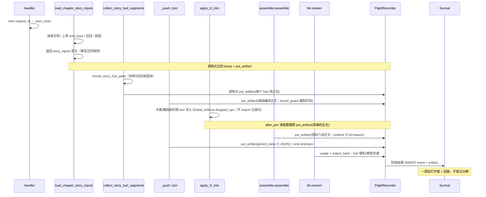
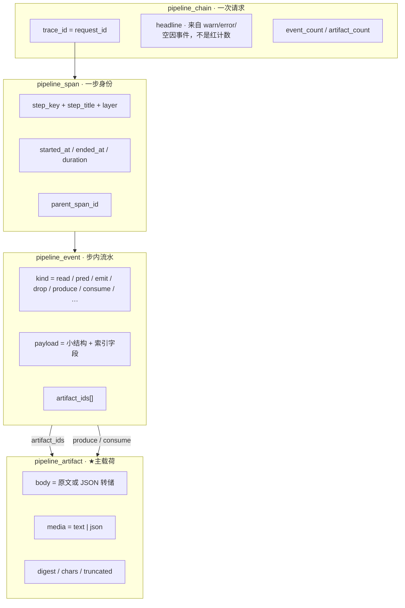
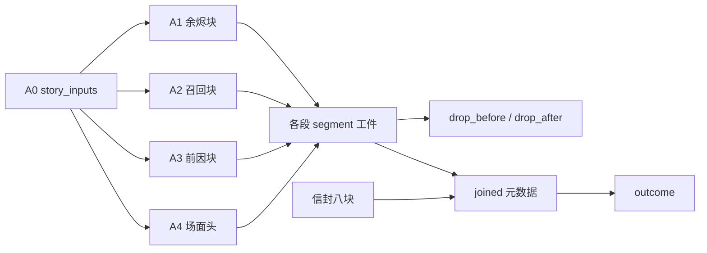

# 铜炉 Pipeline Runtime Analysis：飞行记录仪（逐步全部信息 + 工件血缘）

> **本文取代** [`docs/plans/2026-08-14-pipeline-analysis-log.md`](2026-08-14-pipeline-analysis-log.md)，成为「系统运行分析」的 **SSOT**。  
> 旧三份（Run 卡 / pipeline-trace / analysis-log）一律降为考古。**不要**把 141 的闭集 `append_log` + 240 字模板再当增量底稿。  
> 用户三次判定「只有运行结果」。根因不是缺一张表，而是把「全部信息」定义成了枚举 / 计数 / 哈希 / 模板句。本设计重画主载荷：**真实中间工件 + 带血缘的完整事件**。

| 项 | 值 |
|----|----|
| **文档标题** | 写 / 存 / 宣称 / 工具跳：一次一条链，每步一份卷宗（身份 + 完整事件流 + 真实工件），7 天可回放 |
| **作者** | Grok Design |
| **日期** | 2026-08-14 |
| **状态** | Draft |
| **产品** | 铜炉 / tonglu · 代码 `scribe3/` |
| **仓库** | `/home/admin/projects/scribe-writing-system` |
| **入库路径** | `docs/plans/2026-08-14-pipeline-runtime-analysis.md`（**新文件**；取代 `2026-08-14-pipeline-analysis-log.md`） |
| **取代** | `docs/plans/2026-08-14-pipeline-analysis-log.md`（第三份，已上 demo 仍被否）；更早 `2026-08-14-pipeline-trace.md`、`2026-08-13-run-observability.md` |
| **验证** | **仅已部署 demo**（`tonglu.qing.blue` / `82.157.130.140` / `/opt/scribe3/app`）。禁止 Grok 运行机 `npm ci` / 全量 pytest / 本机 Surreal / 第二套库 |
| **运维 env SSOT** | **`/opt/scribe3/app/deploy/prod/.env`**。不要改 `/opt/scribe3/app/.env`，也不要提交密钥 |
| **schema** | 140（`pipeline_chain` / `pipeline_span`）与 141（`pipeline_log`）已部署。本设计 **142**：`pipeline_event` + `pipeline_artifact`。禁止另起 Surreal |
| **关联** | 现网 `scribe3/pipeline_trace*.py`、`store/pipeline_trace_ops.py`、`migrations/140_*.surql` / `141_*.surql`、`web/src/admin/RunLogsPage.jsx`；数据源 `write_assemble_context.py` / `write_assemble_v1.py` / `context_budget.py` / `write_stream.py`；L1 `docs/L1-AUTH-ISOLATION.md` |

> **读法（工程师）**  
> 1. 先读「对照用户合同」与 **Key Decisions**。  
> 2. **§5 完整性合同**是「全部信息」的可执行定义——实现时不得再问余烬/L2/信封存什么。  
> 3. PR Plan：git 可独立合；**demo 默认 UI 必须接线 ≥ 换皮**。观测 fail-soft，不得挡写。  
> 4. 能由第一性原理钉死的不进 Open Questions。

---

## 对照用户合同

用户原话（2026-08-14，第三次）：

> 不行啊,我要的是包含每个步骤的全部信息日志,且能够很清晰的看出来是哪个步骤的,能够方便的查询整条链路的关联产生,可以存一个星期.我要的是能够用于系统运行分析的,不是这种只有运行结果的.再次设计最优方案

| # | 合同条款 | Run 卡 `2026-08-13` | pipeline-trace `2026-08-14` | analysis-log `2026-08-14`（已上 demo） | **本设计** |
|---|---------|---------------------|------------------------------|----------------------------------------|-----------|
| 1 | **每步全部信息日志** | `expected × actual × verdict` | 瘦 span：`input.source` 静态目录串、`compute.fn` 静态、`output.chars/digest` | 第三表 `pipeline_log` + 闭集 `append_log` + 240 字模板。`render_log` **能**渲 `read.source`，但热路径 **从未 emit**（只有 start/end/`emit.shape`）。默认 tab 更像「开始… / 产出 block N 字」 | **主载荷 = 真实工件**。余烬必须能打开 `end_hook` **原文**；L2 必须能打开被丢掉的**那段正文**；合同必须能看见 desire/obstacle/turn/cost **字段值**；进模型的编译段必须能按段打开正文。枚举/计数/哈希只是索引，不是正文 |
| 2 | **步骤身份一眼可辨** | 英文 slug + 红绿芯片 | 目录有 `step_title`，UI 仍是芯片 | 行前缀有中文名，但仍是一行模板 | 默认视图 = **按步分组的卷宗**。组头：中文名 + `step_key` + 层 + 耗时。组内是该步完整事件流 + 可展开工件。芯片不是主视觉 |
| 3 | **整条链路关联可查** | 扁平卡，无边 | `parent_span_id` 目录写死；`from_span_id` **从未写入** | 规定了 `assoc.produce/consume`，边仍是 digest/got 布尔，**没有工件 id**，无法问「这份余烬正文被谁吃了」 | **血缘 SSOT = `artifact_id`**。`produce`/`consume` 必须写入 `artifact_id` + `from_span_id`。查询：打开工件 → 生产者 + 全部消费者；同章 prev/next 写；写 → 存 → 宣称 |
| 4 | **存一个星期** | 无自动 purge | 7d + `_store_for` 钩，只清瘦 span | 7d，先 log 再 span 再 chain | **四类对象同一 7 天 TTL**：artifact → event → log → span → chain（先子后父）。旧 140/141 行活到 TTL，不回放 |
| 5 | **用途 = 系统运行分析** | 验收记分牌 | 对照尺换皮 | 模板流水账，仍无法回放「读了什么、谓词看见什么、发出什么」 | **不重跑即可回放一次实跑**：读了哪些字段**值**、为何存在、发出了哪份工件、谁消费、丢掉的**是哪段文字**、卡在哪、耗时 |
| 6 | **再次设计最优方案** | 第一份 | 自称重设计，仍禁持久化可读正文 | 自称重画主对象，把「全部信息」再次收成 enum | **重画主对象**。复用已工作的 id mint / catalog / fail-soft / flush / 7d / 管理台位置 / `?work=`。**替换**字段合同、emit API、查询面、UI 主对象。**禁止**把瘦 span 或 141 模板行改个名字交差 |

**硬教训（写进实现纪律）：**  
「全部信息 ≠ 全部字节」被连续三次用来**几乎什么都不存**。本设计允许**窄**红名单（API key / Cookie / secret **值** / `leak_markers` 明文）。**禁止**用这张名单再砍：`end_hook`、合同四义、大纲/节拍、燃料块、场面真相、戏剧合同、L2 丢掉的段正文、信封**选入八块的帽内正文**、拒绝项的 **id + reason + token/digest**（拒绝项**不**存正文，与 `envelope_trace_manifest` 安全合同一致）、模型 usage、工具参数 **键名 + JSON 类型 + 长度**、进模型的编译段正文。这些就是分析载荷。

---

## Overview

铜炉一次写请求真实发生 40–80 个可辨步骤。分析员一周后打开一条链，要的不是「这场对照几红几绿」，也不是「读取 chapter_prev_end_hook：空」，而是一份 **飞行记录仪**：

```text
12:01:03.012  [上章余烬 · assemble.seg.story_ember]  read
              源 chapter[15].narrative_drive.end_hook
              值：「他回头看了一眼铜炉，没说话。」
12:01:03.013  [上章余烬 · assemble.seg.story_ember]  pred
              prev_end_hook=true  （chars=16, empty=false）
12:01:03.014  [上章余烬 · assemble.seg.story_ember]  emit
              工件 art_a1f3…  【上章余烬】\n他回头看了一眼铜炉，没说话。
12:01:03.015  [收集三燃料 · assemble.collect_fuel]  consume
              吃 art_a1f3… ← 上章余烬
12:01:03.041  [L2 补充裁剪 · budget.l2]  drop
              material_recall :drop  丢掉的正文 ↓
              「【素材】……（完整段，不是 tag）」
```

本设计交付 **一书一库** 的飞行记录仪：

```text
一次请求           = 一条 pipeline_chain     （trace_id = request_id）      [140]
一个目录步骤       = 一条 pipeline_span      （身份 + 墙钟 + 父 + 游标）   [140]
步内发生了什么     = 若干条 pipeline_event   （完整事件，可检索）          [142 ★]
事件的真实中间物   = 若干条 pipeline_artifact（正文 / 结构转储）           [142 ★★ 主载荷]
步骤如何相连       = artifact 的 produce / consume（artifact_id 必填）
141 pipeline_log   = 旧账。默认继续写；RECORDER=1 且本链已有真实工件后才停写瘦模板行
期望×实际          = chain.contrast_summary（派生，永不做默认 UI）
```

复用用户没有否定的骨架：handler 一次 mint `request_id`、`manifest_trace["request_id"]`、catalog `step_key`/`step_title`/`layer`、fail-soft store、阶段 flush、7 天 `_store_for` purge、管理台独立页、L1 `?work=`。  
**替换**的是：字段合同、emit 形状、查询面、UI 主对象。

96k 拼接总 prompt **不**整包落库。进模型的 **每一段编译正文** 按段落工件（单件帽内全文）；拼接顺序 + 总 token + 总 digest 落一条 **小 JSON 工件**（`kind=joined_meta`，`media=json`，**禁止** 96k 整包）+ `kind=join` 事件。分析员按序打开段即可回放结构，且能指出是哪一段。

---

## Background & Motivation

### 分析员一周后必须能答的八句

| # | 问题 | 现网（140+141 已上 demo） | 本设计 |
|---|------|---------------------------|--------|
| 1 | 这一步叫什么？哪一层？ | 能（catalog） | 保持 |
| 2 | 何时开始/结束？卡在哪？ | 半能。llm/tool 有 running；多数装段是 `_push` 瞬间 end | 计时仍锚计算函数；卷宗组头显示进行中 |
| 3 | **为什么存在这一步？谓词看见了什么输入？** | 不能。141 **规范**能渲 `pred.eval`，**热路径从未 emit**（见下） | `pred` 事件带 **实际输入快照**（hook 原文或 `""`、旗值、章号） |
| 4 | **实际读了什么？** | 不能。`render_log` 能渲「读取 …：空」，但生产 `append_log` **从不发** `read.source`。默认 tab 第一眼更像「开始… / 产出 block N 字」 | `read` 事件 + `story_inputs` 工件：合同四义原文、`end_hook` 原文、召回/前因原文 |
| 5 | **实际发出了什么？** | 半能。`note_push` 只写 `emit.shape` = `产出 block N 字` + digest | `emit` 挂工件：formatter 后的 `【上章余烬】…` 全文 |
| 6 | **谁消费了这份工件？做了什么？** | 不能。`assoc.*` 只出现在单测，生产零写入 | `consume` 必带 `artifact_id`；反向查询该工件全部消费者 |
| 7 | **丢掉/跳过/失败的「那个东西」是什么？** | 不能。L2 只有 `material_recall:drop` tag | 每次半裁/整段丢：`text_before` 工件（丢掉的正文）+ 若半裁则 `text_after` 工件 |
| 8 | 本周这个步「余烬字段空」几次？进模型的余烬段平均多长？ | 半能。`?empty=true` 能数模板行，数的是布尔 | `GET /debug/pipeline-events?step_key=…&kind=read&empty=true` 计数；点进去是原文 |

### 现网为何仍是「只有运行结果」（2026-08-14 代码）

不是「没做完 PR」，是 **主对象选错了三次**。

1. **Run 卡**：`write_run_card` 行 = 期望×实际×裁决。用户当面否。  
2. **pipeline-trace**：`SpanRec` 一等字段仍是 `expected/actual/verdict`；`start_span` 把 catalog **静态** `source`/`compute_fn` 填进 input/compute（`pipeline_trace.py`）。`note_push` 只写 `chars`+`digest`（`pipeline_trace_hooks.py`）。  
3. **analysis-log**：上了 141 + `GET /debug/pipeline-logs` + RunLogsPage「分析日志」tab。`render_log` / `ember_read_kwargs` / 模板「读取 {source}：{空|N 字}」**代码里都有**，但生产 `append_log` 只来自 `start_span`/`end_span`（`step.start`/`step.end`）、`note_push`（`skip.reason` / `emit.shape`）、`finish_failed`（`error.raised`）。`read.source` / `pred.eval` / `assoc.*` **只出现在测试**，热路径没 emit。默认 tab 第一眼更可能是「开始 上章余烬 / 产出 block N 字」，不是文档曾写的 `chapter_prev_end_hook：空`。根因仍是主对象 = 模板/计数；且 **141 本身没接完**——PR4 必须改数据源，不能指望「旧 `append_log` 加两个 kwargs」。

`load_chapter_story_inputs`（`write_assemble_context.py` L1177–1225）手里有 `contract` / `evidence_must_show` / `voice` / `prior_consequences`（= `chapter[n-1].narrative_drive.end_hook`）/ `recall_context` / `causal_graph`。现网接线（`write_assemble_v1.py` L318–321）只 `end_named(status=ok)`。  
`apply_l2_trim`（`context_budget.py` L892–1001）每次半裁/丢段时手里有 `text`，却只把 `f"{name}:{tag}"` 推进 `dropped[]`。`after_join` 再压成 `events[{op,tag}]`。  
这不是差两列，是 **数据在函数里被故意扔掉了**。

### 一次写的真实数据流（今日 vs 本设计）



---

## Goals & Non-Goals

### Goals

| 优先级 | 目标 | 验收口径 |
|--------|------|----------|
| **P0** | 飞行记录仪模型：`put_artifact` / `emit` / `produce` / `consume`；表 142；批量写；purge 含子表 | 纯函数：余烬工件 `body` 含 hook 原文或显式 `""`；不得由 `note_push`/`chars` 合成 |
| **P0** | 数据源 **必接**（见 §4）：load 返回值在**调用点** dump；`after_join` 读 **`l2.dropped_ops` / `total_enforce.dropped_ops`** 落丢段正文；`_push` 挂段工件 | demo 写一次 → 能展开余烬原文、合同四义；有 L2 drop 则能打开 `kind=drop_before` body |
| **P0** | 血缘：`got=true` 的 consume **必须**先有 `put_artifact`；缺 `artifact_id` **不落行**，单测红 | `GET …/lineage?artifact_id=` 给出产者 + 消费者；PR1 夹具含 joined_meta→llm |
| **P0** | 跨请求 `?step_key=&kind=read&empty=true&since=` 返回未截断 **`total`/`count`** | 「本周余烬字段空」= `total`，不是 `items.length` |
| **P1** | 信封选入八块正文 + omitted id/reason/token；进模型编译段按段全文（帽内）；`joined_meta` 小工件；llm usage；tool 键名/类型/长度 | 成功链能按段打开进模型正文；能指出 L2 丢掉的是哪一段 |
| **P1** | persist / save / claim / 同章 prev-next / 写→存→宣称跳转 | 管理台卷宗底栏可跳 |
| **P2** | 管理台标题 **「运行分析」**；默认 = 按步卷宗。对照埋进「更多」 | 默认 DOM 第一屏是事件+可展开正文。**换皮依赖 PR5**（或缺 `kind=join` / 段工件的链固定「本链记录不完整」，不得当验收通过） |

### Non-Goals

| # | 非目标 | 理由 |
|---|--------|------|
| NG1 | 把 96k **拼接总串**整包存一周 | 段级工件已能回放，且能定位「哪一段」。整包是重复 + 打满 Surreal 行 |
| NG2 | 存 API key / Cookie / secret **命题值** / `leak_markers` 明文 | 窄红名单。secret_guard 段存打码正文 + 原文字数 + digest |
| NG3 | 把 141 `CODE_SPEC` 模板加两个 kwargs 当「全文」 | 第三次失败模式 |
| NG4 | 扩 `span.events[]` / `span.input` 当主账 | 无索引、4KB 帽、现网已否 |
| NG5 | 合规审计、收编 `auth_audit` | 答错问题 |
| NG6 | 作者写作台 / SSE 推日志墙 | 只在管理台 / 系统平面 `run-logs` |
| NG7 | Langfuse / Phoenix / hermes-otel 当主账 | 看不见装段谓词；默认收 prompt；不在书库 |
| NG8 | 升格 `pipeline_journal.py` | 文件系统崩溃续跑，不是分析账 |
| NG9 | 扩 `context_outcome_trace` / `ai_run_trace`(074 含 `instructions`) / 章 `density_trace` | 各有合同；074 禁止当运行分析主账 |
| NG10 | 重开宣称公式、改 `GATE_SAVE_MODE=soft`、改法律写通道 | 硬约束 |
| NG11 | Grok 机 `npm ci` / 全量 pytest / 本机 Surreal / 第二套库 / 清空 demo | 资源与验证纪律 |
| NG12 | 第四热表 `pipeline_assoc` | 边 = produce/consume 事件，键是 `artifact_id` |
| NG13 | 采样 | 每天几十次全量才能回答「那一次」 |

---

## Key Decisions

1. **主载荷是 `pipeline_artifact`（真实中间物），主时间线是 `pipeline_event`（完整事件）。span/chain 只做身份与墙钟。**  
   理由：用户要的是回放，不是记分牌。三次失败都把「日志」做成了摘要卡。

2. **「全部信息」= 该步实际读到的字段值 + 谓词实际输入 + 实际发出的工件 + 实际丢掉的正文 + 血缘。**  
   可截断（单件帽），不可改写成 enum。哈希/计数是索引。  
   理由：第三次设计用「≠ 全部字节」把正文砍光，demo 上仍是结果卡。

3. **新表 142（`pipeline_event` + `pipeline_artifact`）。`RECORDER=1` 且本链已有真实工件后，才停写 141。代码默认 `RECORDER=0`，直到 PR4 在试写书冒烟。**  
   理由：141 模板已被产品否决，但 PR2 单独热更活书并默认停 141，会把 demo 弄得比现在更空（骨架 + 零事件）。发布顺序见 KD15。

4. **emit API 是 `put_artifact` / `emit` / `produce` / `consume`，不是 `append_log(code, **typed)`。必须在握着原文的瞬间调用（数据源返回值的**调用点**，或 `_push` / `after_join`）。**  
   理由：`note_push` 只有 formatter 后的长度。禁止只在 `_push` 旁用 chars 猜 read。**不**强制改 `load_chapter_story_inputs` 的「零写」签名。

5. **血缘键是 `artifact_id`（16 hex），不是 digest，也不是 span id。每条 `got=true` 的边必须先 `put_artifact`。缺 id 不落库，PR1 单测红。**  
   理由：上一份 `from_span_id` 写在合同里、实现零写入。digest 会碰撞空串。`compile.joined` 必须落小 JSON 工件，llm/persist/tool consume **这个 id**。

6. **进模型的编译段按段存全文（帽内）；96k 拼接总串不整包存。信封选入八块存正文；拒绝项只存 id+reason+token/digest。**  
   理由：运行分析要的是「哪一段进了模型 / 哪一段被裁」。拒绝项正文与 assembler 安全合同冲突（可能含 secret）。

7. **红名单极窄。end_hook / 合同 / 大纲 / 燃料 / 戏剧 / L2 丢段 / 信封块 / 编译段 全部允许存。**  
   理由：用户点名这些就是分析载荷。

8. **TTL 7 天，purge 先 artifact → event → log → span → chain。挂钩保持每次 `_store_for` + 6h 节流。**  
   理由：一书一库；`created_at` READONLY，禁止回填测 TTL。

9. **观测 fail-soft；法律写通道与宣称公式不重开；id mint 合同一字不改。**  
   理由：硬约束。

10. **UI 默认按步卷宗；对照降为「更多」。管理台 / 系统平面标题改为「运行分析」。不回写作台。**  
    理由：现网默认仍是芯片 + 一行模板 + 对照 tab。

11. **双旗：`SCRIBE3_PIPELINE_TRACE` 管骨架；`SCRIBE3_PIPELINE_RECORDER` 管事件+工件。代码与 `feature_flags.py` 默认 `RECORDER=0`。**  
    回滚只关 RECORDER。PR4 试写书冒烟通过后，才在 **`/opt/scribe3/app/deploy/prod/.env`** 把 RECORDER 设 1，并 **compose recreate**。

12. **不做采样；热路径真批量；单件 16Ki 字帽；单链工件 256、事件 2048。**  
    理由：体积可接受（见 §3.4）；风险在 INSERT 尾延迟，用批量 + fail-soft + 关旗缓解。

13. **验证 = 只冒烟已部署 demo；env 只动 `deploy/prod/.env`。**  
    理由：全局资源纪律。

14. **写 / 存 / 宣称仍是三条链（各自 mint）。关联用同章 + 时间邻接 + 可选 `links.write_trace_id`，不伪造同一 `request_id`。**  
    理由：现网 `save_chapter` / `reader_claim_ep` 各自 `uuid4()`。改成同一 id 会打乱 Outcome 绑定。

15. **发布闸：禁止「PR2 单独热更活书且默认停 141」。141 闸按链、在落库处，不在 `append_log` 入口。**  
    `RECORDER=0`：现网 `append_log` → `drain_logs` → `insert_pipeline_logs` 一字不改。  
    `RECORDER=1`：**禁止**在 `start_span` / `append_log` 入口做全局 `if recorder: return`。`append_log` 仍进内存缓冲。闸只在 **`drain_logs` / `insert_pipeline_logs` 按链判断**：该链已有 `story_inputs|fuel_block|drop_before|segment|joined_meta` 之一，才跳过本批 141 插入；否则双写 141。判定用 buffer 里已 `put_artifact` 的 kind 集合，不是靠「第一次 flush 的 artifact_count 猜测」。

16. **详情读上限 = 单链帽，禁止默默截断。**  
    按 `trace_id` 拉卷宗：事件 `limit` 默认 **2048**，工件 **256**（等于帽）。跨请求列表/过滤默认 200。响应必带 `truncated` / `next_seq` / `total`。UI 数字用 `total`。

17. **多工件索引：`_produced_by_key[step_key] = [ids…]`，`_produced_by_name[name] = id`（L2 半裁覆盖 name）。**  
    `consume` 无显式 `artifact_id` 时，只允许 **恰好一件** 的 step_key；多件必须传 id。禁止单槽覆盖导致「三段 `_push` 只剩最后一段」。

---

## Proposed Design

### 1. 一句话架构

```text
Handler 入口 mint 恰好一次 request_id（= trace_id）
  → 写入 manifest_trace["request_id"] 再 start_chain
  → 每步 start_span（身份 / 墙钟 / 父 / 游标）
  → 数据源函数 put_artifact(真实正文或结构转储)
  → 步内 emit(kind, payload, artifact_ids) —— 完整事件
  → produce / consume 用 artifact_id 把上下游钉死
  → 阶段 flush：已 end 的 span + 已缓冲的 event + artifact 批量 INSERT
  → 7 天：_store_for 前 maybe_purge（artifact → event → log → span → chain）
```

旧 140 骨架保留。旧 141 行：UI「旧账·模板日志」。  
`contrast_summary` 可继续派生，**不再驱动默认 UI，不再写进 headline**。

### 2. 四对象模型



| 对象 | 职责 | 不是什么 |
|------|------|----------|
| chain | 一次请求的目录项、游标、headline、计数 | 不是对照卡 |
| span | 一步的身份与墙钟 | 不是「全部信息」 |
| event | 可检索的「发生了什么」 | 不是 240 字模板 |
| artifact | 分析员点开看到的东西 | 不是 digest 卡片 |

**否决「只加宽 141 attrs」**：attrs 再大，UI 与查询仍围着 `code`+`message` 转，第三次失败会原样重演。  
**否决「扔掉 span」**：running 游标、真实 duration、父子树、阶段 flush 需要「一步」这个聚合。

### 3. 存储模型（142）与体积

#### 3.1 为何两张新表，而不是加宽 141

| 方案 | 体积 / 查询 / 产品观感 | 结论 |
|------|------------------------|------|
| 加宽 141 `attrs` 塞原文 | 「本周余烬空」要扫大 JSON；UI 仍先渲 `message`；闭集 CODE_SPEC 会再次把正文挡在门外 | **否决作主账** |
| 只加 `pipeline_artifact`，事件继续 141 模板 | 正文在、叙事仍是「读取 …：空」 | 否决 |
| 扩 `span.input/output` | 4KB 帽；无 `(step_key, kind)` 索引 | 否决 |
| **`pipeline_event` + `pipeline_artifact`** | 事件小、可索引；工件按需拉；列表不拖 16Ki 正文 | **选用** |

141 表保留，**不 DROP**。何时停写见 KD15（默认继续写；RECORDER=1 且本链已有真实工件后才停）。

#### 3.2 `142_pipeline_recorder.surql`（一书一库）

`apply_schema` 按 `f.stem` 去重。STYLE 对齐 140/141。失败挡开书（demo `SCHEMA_SOFT=0`）。

**试写书（必须点名）：** 142 首次 `_store_for` **只**对 demo 上非作者主线书。优先已有试写 / qe / scratch slug（实施时在管理台确认）；若无则新建 `obs-scratch`。**禁止**先对作者正在连载的活书跑 142。热更后先对该试写书 `_store_for` + 写一章，确认 `_migration` 含 `142_pipeline_recorder` 且该书 API 仍 200，再动活书。

```surql
-- 142_pipeline_recorder.surql
-- 飞行记录仪：完整事件 + 真实工件。不含 API key / Cookie / secret 值 / leak_markers 明文。

DEFINE FIELD IF NOT EXISTS event_count ON pipeline_chain TYPE option<int>;
DEFINE FIELD IF NOT EXISTS artifact_count ON pipeline_chain TYPE option<int>;
DEFINE FIELD IF NOT EXISTS log_count ON pipeline_chain TYPE option<int>;

DEFINE TABLE IF NOT EXISTS pipeline_artifact SCHEMAFULL;
DEFINE FIELD IF NOT EXISTS artifact_id ON pipeline_artifact TYPE string;
DEFINE FIELD IF NOT EXISTS trace_id ON pipeline_artifact TYPE string;
DEFINE FIELD IF NOT EXISTS span_id ON pipeline_artifact TYPE option<string>;
DEFINE FIELD IF NOT EXISTS kind ON pipeline_artifact TYPE string;
DEFINE FIELD IF NOT EXISTS name ON pipeline_artifact TYPE option<string>;
DEFINE FIELD IF NOT EXISTS media ON pipeline_artifact TYPE string
  ASSERT $value IN ['text', 'json'];
DEFINE FIELD IF NOT EXISTS body ON pipeline_artifact TYPE string;
DEFINE FIELD IF NOT EXISTS digest ON pipeline_artifact TYPE option<string>;
DEFINE FIELD IF NOT EXISTS chars ON pipeline_artifact TYPE int;
DEFINE FIELD IF NOT EXISTS chars_full ON pipeline_artifact TYPE option<int>;
DEFINE FIELD IF NOT EXISTS tokens_est ON pipeline_artifact TYPE option<int>;
DEFINE FIELD IF NOT EXISTS truncated ON pipeline_artifact TYPE bool;
DEFINE FIELD IF NOT EXISTS redacted ON pipeline_artifact TYPE bool;
DEFINE FIELD IF NOT EXISTS work ON pipeline_artifact TYPE string;
DEFINE FIELD IF NOT EXISTS chapter ON pipeline_artifact TYPE int;
DEFINE FIELD IF NOT EXISTS schema_ver ON pipeline_artifact TYPE string;
DEFINE FIELD IF NOT EXISTS created_at ON pipeline_artifact TYPE datetime VALUE time::now() READONLY;

DEFINE INDEX IF NOT EXISTS pipeline_artifact_id_idx ON pipeline_artifact FIELDS artifact_id UNIQUE;
DEFINE INDEX IF NOT EXISTS pipeline_artifact_trace_idx ON pipeline_artifact FIELDS trace_id, created_at;
DEFINE INDEX IF NOT EXISTS pipeline_artifact_kind_idx ON pipeline_artifact FIELDS work, kind, name, created_at;
DEFINE INDEX IF NOT EXISTS pipeline_artifact_created_idx ON pipeline_artifact FIELDS created_at;

DEFINE TABLE IF NOT EXISTS pipeline_event SCHEMAFULL;
DEFINE FIELD IF NOT EXISTS event_id ON pipeline_event TYPE string;
DEFINE FIELD IF NOT EXISTS trace_id ON pipeline_event TYPE string;
DEFINE FIELD IF NOT EXISTS span_id ON pipeline_event TYPE option<string>;
DEFINE FIELD IF NOT EXISTS seq ON pipeline_event TYPE int;
DEFINE FIELD IF NOT EXISTS ts ON pipeline_event TYPE datetime;
DEFINE FIELD IF NOT EXISTS level ON pipeline_event TYPE string
  ASSERT $value IN ['debug', 'info', 'warn', 'error'];
DEFINE FIELD IF NOT EXISTS step_key ON pipeline_event TYPE string;
DEFINE FIELD IF NOT EXISTS step_title ON pipeline_event TYPE option<string>;
DEFINE FIELD IF NOT EXISTS layer ON pipeline_event TYPE option<string>;
DEFINE FIELD IF NOT EXISTS kind ON pipeline_event TYPE string;
DEFINE FIELD IF NOT EXISTS summary ON pipeline_event TYPE option<string>;
DEFINE FIELD IF NOT EXISTS empty ON pipeline_event TYPE option<bool>;
DEFINE FIELD IF NOT EXISTS pred ON pipeline_event TYPE option<string>;
DEFINE FIELD IF NOT EXISTS pred_value ON pipeline_event TYPE option<bool>;
DEFINE FIELD IF NOT EXISTS artifact_ids ON pipeline_event TYPE option<array>;
DEFINE FIELD IF NOT EXISTS artifact_ids.* ON pipeline_event TYPE string;
DEFINE FIELD IF NOT EXISTS from_span_id ON pipeline_event TYPE option<string>;
DEFINE FIELD IF NOT EXISTS from_step_key ON pipeline_event TYPE option<string>;
DEFINE FIELD IF NOT EXISTS from_artifact_id ON pipeline_event TYPE option<string>;
DEFINE FIELD IF NOT EXISTS payload ON pipeline_event TYPE option<object> FLEXIBLE;
DEFINE FIELD IF NOT EXISTS work ON pipeline_event TYPE string;
DEFINE FIELD IF NOT EXISTS chapter ON pipeline_event TYPE int;
DEFINE FIELD IF NOT EXISTS chain_kind ON pipeline_event TYPE string;
DEFINE FIELD IF NOT EXISTS schema_ver ON pipeline_event TYPE string;
DEFINE FIELD IF NOT EXISTS created_at ON pipeline_event TYPE datetime VALUE time::now() READONLY;

DEFINE INDEX IF NOT EXISTS pipeline_event_id_idx ON pipeline_event FIELDS event_id UNIQUE;
DEFINE INDEX IF NOT EXISTS pipeline_event_trace_idx ON pipeline_event FIELDS trace_id, seq;
DEFINE INDEX IF NOT EXISTS pipeline_event_step_idx ON pipeline_event FIELDS work, step_key, kind, created_at;
DEFINE INDEX IF NOT EXISTS pipeline_event_kind_idx ON pipeline_event FIELDS work, kind, created_at;
DEFINE INDEX IF NOT EXISTS pipeline_event_empty_idx ON pipeline_event FIELDS work, step_key, empty, created_at;
DEFINE INDEX IF NOT EXISTS pipeline_event_art_idx ON pipeline_event FIELDS from_artifact_id;
DEFINE INDEX IF NOT EXISTS pipeline_event_created_idx ON pipeline_event FIELDS created_at;
```

主键纪律与 140 相同：纯 hex，禁止冒号进 record id。  
**`INSERT IGNORE` 只忽略重复 record id。** 每行必须显式带 `id = event_id` / `id = artifact_id`（与字段同值的 16 hex）。只有 `event_id` 字段、没有 `id`，冲突会打在 UNIQUE 索引上，整包失败，然后「丢本包」会株连最多 32 条事件 / 8 条工件。  
`ts` = 应用层墙钟（datetime UTC）。TTL **只看** `created_at`。  
event / artifact **CREATE 后不 UPDATE**（真 append-only）。span 仍仅 llm/tool 允许 running→终态。

`summary` 是给人扫一眼的短句（≤240 字），**不是**主载荷。主载荷在 `payload` + `artifact.body`。  
`empty` / `pred` / `pred_value` / `from_artifact_id` 提升为列，供「本周余烬空」直接过滤，禁止先拉 20 再 Python 滤。

#### 3.3 批量写入（Surreal 3.2.4）

现网 `insert_pipeline_logs` / `insert_pipeline_spans` 仍是 Python `for` 逐条 CREATE（`store/pipeline_trace_ops.py`）。**142 的 event/artifact 禁止再走这条热路径。** span 的 for-CREATE **本设计不在 PR2 改**（running span 是 CREATE 再 UPDATE；与 142 SCHEMAFULL 问题必须能剥离）。

三级，同一完整 fixture 在试写书逐级冒烟：

1. **优先** `INSERT IGNORE INTO pipeline_event $rows RETURN NONE`（及 artifact 同形）。**每行含 `id` = 纯 hex。**  
2. 失败再 `FOR $r IN $rows { CREATE ONLY type::record('pipeline_event', $r.id) CONTENT $r; }`（`$r.id` 与 `$r.event_id` 同值）。  
3. 再失败：一条 `_execute_write` 里 `;` 串最多 16 条（工件行更大）`CREATE ONLY … SET`，bind 互不撞名。

试写书三级冒烟 **必须**覆盖：

- 完整 fixture 写入成功  
- 重复 `id` → IGNORE，不报错、不挡写  
- 故意多键 / 缺字段 → SCHEMAFULL 失败且 fail-soft  
- 单行坏 **不株连** 已成功的前一包  

按 **字节** 分包：单包目标 ≤ 256 KiB 序列化，或 32 行事件 / 8 行工件，先到先切。  
payload / body 白名单。`CONTENT $r` **不得**带 `_flushed` / `_store` / 其它私货。省略 `created_at`。  
`ONLY` 冲突：丢**本包** + `chain.notes=flush_failed`，不重试打爆。然后仍 evict buffer（§9）。

#### 3.4 体积估算（中位）

| 假设 | 值 |
|------|-----|
| demo 活跃书每天写 | 20–80 assemble + save/claim 10–20 → **中位 50 次/天** |
| 每写 span | 50–80（现网量级） |
| 每写事件 | 读/谓词/发出/血缘/L2 ≈ **180–350** |
| 每写工件 | 1× story_inputs + ~30–45 段 + 0–8 丢段残余 + 8 信封块 + 少量 gate ≈ **40–70** |
| 单事件行 | payload 小结构 ≈ **400–900 B** |
| 单工件 | 段均 400–2000 字；story_inputs 2–8 KB；信封块 0.5–8 KB |
| 每写事件合计 | ≈ **80–250 KB** |
| 每写工件合计 | ≈ **40–180 KB**（段级全文；**不含** 96k 整包） |
| 每写骨架 | 现网 span+chain ≈ 35–80 KB |
| 50 次/天 | ≈ **8–25 MB/天/书** |
| **7 天** | ≈ **55–175 MB/书**（活跃）；冷书近 0 |
| 若误存 96k 整包 | 再 +60–150 KB/次 → 周 +20–50 MB，且无法按段跳 → **禁止** |

对比：一章散文 10–40 KB。本账周量约等于数天到两周正文，可接受。风险在 **批量 INSERT 尾延迟**，不在磁盘。  
关旗：`SCRIBE3_PIPELINE_RECORDER=0`（骨架 + 旧 141 仍在）或 `SCRIBE3_PIPELINE_TRACE=0`（全关）。

### 4. Emit API（握着原文的瞬间，不是 `_push` 合成 read）

新模块 `scribe3/pipeline_recorder.py`（零 I/O 纯函数 + buffer；store 仍走 `pipeline_trace_store.py`）。  
`pipeline_trace.py` 保留 span/chain/旧 log 渲染，供回滚。

**挂载：** `TraceBuffer.recorder: FlightRecorder`。`start_chain` 时创建。`event.seq` 由 recorder 自增（与旧 `_log_seq` 独立）。`bind_trace_buffer` 之后 `current_recorder()` 读 `buf.recorder`。TRACE 关或 RECORDER 关且不走双写安全网 → recorder 全部 no-op。

```python
# scribe3/pipeline_recorder.py

SCHEMA_VER = "pipeline_recorder.v1"

# 禁止把 recorder 行丢进 pipeline_trace.strip_forbidden。
# 全局 FORBIDDEN_KEYS 仍含 text（140 span 单测锁 input.text 必须消失）。
RECORDER_FORBIDDEN_KEYS = frozenset({
    "instructions", "markers", "prompt", "arguments",
    "secret", "leak_markers", "input_text",
})  # 注意：没有 text

def strip_recorder_forbidden(obj: Any) -> Any:
    """只打 API key / Cookie / secret 值 / leak_markers / 整包 arguments / instructions。
    不过滤键名 text。对字符串再跑 redact_secrets_inplace。"""

class FlightRecorder:
    """挂在 TraceBuffer 上。"""

    def put_artifact(
        self,
        *,
        kind: str,            # story_inputs | segment | drop_before | drop_after
                              # | envelope_block | fuel_block | joined_meta
                              # | gate_input | outcome_meta
        name: str,            # story_ember | focus | material_recall | compile_joined | …
        body: str,            # ★ 一律字符串。json 则 json.dumps；禁止传入 dict
        media: str = "text",  # text | json
        span_id: str = "",
        tokens_est: int | None = None,
        redact: str | None = None,   # None | "secret_guard" | "secrets"
    ) -> str:
        """截断、打码、digest。返回 artifact_id（16 hex）。失败返回 ""。
        name == "secret_guard" 且 redact != "secret_guard" → 拒收，返回 ""。
        media=json 的 body 不得再包一层 {"text": ...} 当唯一正文。"""

    def emit(
        self,
        span_id: str,
        kind: str,            # 见 EVENT_KINDS
        *,
        summary: str = "",
        empty: bool | None = None,
        pred: str | None = None,
        pred_value: bool | None = None,
        artifact_ids: list[str] | None = None,
        from_span_id: str | None = None,
        from_step_key: str | None = None,
        from_artifact_id: str | None = None,
        payload: dict | None = None,
        level: str | None = None,
    ) -> str:
        """完整事件。payload 顶层走闭集（§6.3）。大正文必须先 put_artifact。
        payload 只经 strip_recorder_forbidden，禁止 strip_forbidden。"""

    def produce(self, span_id: str, artifact_id: str, *, name: str = "") -> None:
        """_produced_by_key[step_key].append(id)
        若 name：_produced_by_name[name] = id（半裁覆盖）
        并 emit kind=produce。"""

    def consume(
        self,
        dest_span_id: str,
        *,
        from_step_key: str | None = None,
        artifact_id: str | None = None,
        name: str | None = None,
        role: str = "input",
        got: bool = True,
    ) -> str | None:
        """解析 artifact_id：
        1) 显式 artifact_id；
        2) name → _produced_by_name[name]；
        3) from_step_key 且该 key 恰好 1 件 → 用它；
        4) from_step_key 多件且无 id → 不写行，返回 None（单测红）。
        got=true 最终无 16 hex → 不写行，返回 None（单测红）。
        禁止用 digest 或 span_id 冒充 from_artifact_id。"""
```

`EVENT_KINDS`（闭集；未登记 → `kind=other` + `payload.missing`）：

```
read, pred, branch, emit, keep, drop, skip, produce, consume,
budget, usage, error, flag, join, gate, obs_incomplete
```

`kind=join` 对应 §5.5 的 joined 事件。**禁止**再发明 `kind=compile.joined`。

**Buffer 必须在 PR1 就有 `produce`/`consume` 与两级索引。禁止只在 PR4 口头约定。**

PR1 夹具另加：

- 三 name 各 `_push` 一次（例如 `identity` → `prefix` → `story_ember`）后：`_produced_by_name["identity"] ==` 第一段 id，且 `_produced_by_key` 上对应父/各 seg 的列表长度合计为 3（**不是**「查 `story_ember` 不是最后一段」——它若正好最后 `_push` 会空断言）  
- 半裁覆盖**另测**：`produce(..., name="material_recall")` 再 `produce(drop_after_id, name="material_recall")` → `_produced_by_name["material_recall"] == drop_after_id`，且 `_produced_by_key` 仍保留两件  
- `put_artifact(joined_meta)` → `consume(llm_span, artifact_id=J)` 写出边  
- `put_artifact(name="secret_guard", redact=None)` 返回 `""`  
- 超帽正文：`truncated=true` + `chars_full` + 截断前 digest，body 仍非空

#### 4.1 必须改动的函数（删除「必要时」）

| 函数 | 文件 | 必须发出 |
|------|------|----------|
| `load_chapter_story_inputs` 的**调用点** | `write_assemble_v1.py` L318–321（函数本身保持「零写」） | 返回值立刻 `dump_story_inputs` → `put_artifact` + `read`/`emit`/`produce`（§5.1）。**不**改 load 签名、不让 load 看见 `span_id` |
| `collect_story_fuel_segments` 的**调用点** | 同文件 L367+ | 三个 name 各自：raw 字段值、formatter 后块正文工件、空则 `skip`+空工件 |
| `format_story_fuel_parts` | `story_constraint_prompt.py` L135 | 可选旁路：`raw_chars` / `clipped_chars` / cap（不改返回字节） |
| `apply_l2_trim` | `context_budget.py` L892 | **只**新增 `dropped_ops`（含 `text_before` / `text_after` **字符串** + 数字）。继续填旧 `dropped[]`。**禁止** `import pipeline_recorder` |
| `enforce_total_prompt_budget` | 同文件 L206 | 同形，`op` ∈ `total_half` / `total_drop`。同样只填 `dropped_ops`，零记录仪依赖 |
| `_push` | `write_assemble_v1.py` L281 | `put_artifact(kind=segment, name, body=str(text), media="text")` 并 `produce(..., name=name)`。`name=="secret_guard"` **必须** `redact="secret_guard"`。**禁止**再当 read 的唯一来源 |
| `note_push` | `pipeline_trace_hooks.py` L127 | 只给 span 补 `output.chars`。141 是否写由 KD15 闸，不在 hooks 里手关 |
| `after_join` | hooks L189 | **只读现网嵌套键**（与今日 `after_join` 同形，**禁止**改 `build_budget_report` 再拷一份顶层）：`l2_ops = (bud_rep.get("l2") or {}).get("dropped_ops") or []`，`o1_ops = (bud_rep.get("total_enforce") or {}).get("dropped_ops") or []`。在此 `put_artifact(drop_before/after)` + `drop` 事件。禁止读 `bud_rep["dropped_ops"]`（恒缺省）。禁止只从旧 `dropped[]` tag 合成正文。漏一条 → `obs_incomplete` |
| `after_compile` | hooks L219 | 信封八块 `media=text` 工件 + omitted 元数据 + **`put_artifact(kind=joined_meta)`** + `emit(kind="join")`。`joined_meta.body` **不含** 守卫后哈希。随后 `flush_spans` 仍按现网发生 → join 行此后 **禁止 UPDATE** |
| `ContextAssembler.assemble` 或 `after_compile` 读 `envelope.blocks` | `context_assembler.py` / hooks | 每块正文进 `artifact.body`（字符串）；`token_estimate` / `source_ids` / `masked_source_ids` 进事件 payload |
| `after_guard` | hooks L240 | **只**在 `guard.epistemic` 上 **新建** `kind=gate` 事件：`hit_count`、`kinds`（**不是** marker）、`scrubbed`、`pre_guard_digest`、`post_guard_digest`。**禁止** UPDATE 已 flush 的 `join` 事件或 `joined_meta` 工件。卷宗把 join 工件与这条 guard 事件并排展示 |
| `start_llm` / stream / `finish_ok` | `write_stream.py` + hooks | `usage`；`output_hash`；**consume `joined_meta` 的 artifact_id** |
| `start_tool` / `end_tool` | hooks + `write_stream.py` L244 | 参数 **键名 + JSON 类型 + 长度**；输出 chars/digest/type；**禁止值**；consume 同一 `joined_meta` id |
| `emit_gate_spans` | hooks L376 | 每扇门 `pred` + 实际输入快照（忙锁名、gate 码），不是抄 `actual=present` |
| `_outline_block` / `_drama_block` | 调用点即可 | synopsis/beats/GCD/章钩 **原文** 打进 read payload 或小 JSON 工件（`json.dumps` 成字符串） |
| `format_story_contract_head` 的调用点 | `write_assemble_v1.py` L325 | 合同四义原文已在 `story_inputs`；本步 emit 挂 formatter 后的场面头正文 |

**禁止**只在 `_push` / `note_push` / `after_compile`「旁边」用 chars 猜 read。  
**允许**「数据源返回值 + 调用点立刻 put/emit」——这不算旁路猜测。  
**计时锚点保持**：`start_span` 包计算函数；`_push` 只补段工件。

`apply_l2_trim` 把 `dropped_ops` 写进 **自己的** `report`（即日后的 `bud_rep["l2"]`）。`enforce_total_prompt_budget` 同理写进 **自己的** `report`（即日后的 `bud_rep["total_enforce"]`）。继续填各自旧 `dropped[]`。**不要**往 `join_generation_segments` 的顶层 `rep` 再拷一份 `dropped_ops`（保持 `build_budget_report` 嵌套：`"l2": dict(l2_report)`）。每条 op：

```python
{
  "name": "material_recall",
  "op": "drop",              # drop | tail_half | keep_beats | prompt_hard_drop
  "tag": "material_recall:drop",
  "chars_before": 1820,
  "chars_after": 0,
  "tokens_before": 610,
  "tokens_after": 0,
  "priority": 90,
  "text_before": "【素材】……",   # 操作前全文；after_join 再 put_artifact
  "text_after": None,            # 半裁残余；整段丢为 None
}
```

半裁：`text_after` = 裁后残余正文（这才是后来进模型的那段）。`after_join` 为其 `put_artifact` 后 `produce(..., name=name)` 覆盖 `_produced_by_name`。

### 5. 完整性合同（「全部信息」的可执行定义）

`completeness_check(step_key, events, artifacts, *, ctx) -> list[str]` 是 PR1 纯函数。**分档，禁止对 40–80 步一刀切刷屏 `obs_incomplete`：**

| 档 | 范围 | 缺了怎么办 |
|----|------|------------|
| **硬钉** | §5.1–§5.6 且该步实际 `start_span` 了 | 缺合同事件/工件 → `obs_incomplete`（level=warn）+ 验收红 |
| **已开步** | catalog 里其它步，仅当实际 `start_span` | 只要求有结束或失败痕迹（span end / error）。**不**因缺 `read` 刷 incomplete |
| **未开步** | 目录有、从未 `start_span`（如现网 `persist.chapter` / `persist.turn_bind`） | **不**检查、不发 incomplete |

`skip` 只允许「整步跳过」这一种：有 `kind=skip` 则本步两侧都算齐。禁止用 skip 同时冒充 read 和 emit。

下面六步是用户点名的验收钉。实现者 **不得**再问「全部信息是什么」。

#### 5.1 `assemble.load_story_inputs` ← `load_chapter_story_inputs`

在 **调用点**（`write_assemble_v1.py` L318–321 成功返回后）`put_artifact(kind="story_inputs", name="chapter_story_io", media="json", body=json.dumps(dump, ensure_ascii=False))`。  
`body` 是 JSON **字符串**。dump 对象的键是 `prior_consequences` / `contract` 等，**不要**包一层 `{"text": ...}`。load 函数保持零写。

`dump` 闭集（键必须齐，值为实际运行时值；空用 `""` / `[]` / `{}`，禁止省略键）：

```json
{
  "chapter": 16,
  "prev_chapter": 15,
  "contract": {
    "desire": "要夺回铜印",
    "obstacle": "师兄先到了库房",
    "turn": "发现印匣是空的",
    "cost": "把妹妹的行踪暴露给对家",
    "other_keys": ["bindings"],
    "bindings_keys": ["scene_voice", "evidence_must_show"]
  },
  "evidence_must_show": ["袖口那粒铜渣"],
  "voice": {"register": "冷短", "label": "冷短"},
  "prior_consequences": "他回头看了一眼铜炉，没说话。",
  "recall_context": "- 铜炉.守夜人：还在东厢\n- 对家.眼线：🔒 私密",
  "causal_graph": "- 第15章 印匣被调包",
  "presence": {
    "contract": true, "desire": true, "obstacle": true, "turn": true, "cost": true,
    "evidence_must_show": true, "voice": true,
    "prior_consequences": true, "recall_context": true, "causal_graph": true
  },
  "chars": {
    "desire": 6, "obstacle": 8, "turn": 8, "cost": 12,
    "evidence_must_show": 7, "prior_consequences": 16,
    "recall_context": 40, "causal_graph": 12
  }
}
```

规则：

- `prior_consequences` = `chapter[n-1].narrative_drive.end_hook` **原文**（L1216–1220）。章无此字段 → `""`，`presence.prior_consequences=false`。  
- `recall_context` = `_hybrid_recall_for_write` 已经掩码后的文本（secret 值已是 `🔒 私密`）。存这个，不再二次取 secret 值。  
- `causal_graph` = `_causal_chain_for_write` 原文。  
- `contract.*` 四义 = 作者原文，不是「有/无」。  
- 禁止只存 `field_set=["desire","obstacle"]`。

事件：

| kind | payload / 列 | 工件 |
|------|----------------|------|
| `read` | `source=chapter_story_io`，`empty=全部关键字段空` | `story_inputs` |
| `emit` | `shape=story_inputs`，`keys`=非空键 | 同上 |
| `produce` | `from_artifact_id`=该 id | 同上 |

`buf.produce(load_span, artifact_id)`。

#### 5.2 `assemble.seg.story_ember`（及 recall / causal 同形）

**读**必须来自 `story_inputs.prior_consequences`（或函数里同一变量 `hook`），**禁止**用 `_push` 长度当「读到了什么」。

| kind | 必须留下的实际信息 |
|------|-------------------|
| `read` | `source=chapter_prev_end_hook`；短 hook（≤512）可进 `payload.preview_80` 或 `payload.text`（只经 `strip_recorder_forbidden`）；全文在 `story_inputs` 工件的 `prior_consequences`；`empty = len(strip(hook))==0`；`from_artifact_id` = story_inputs |
| `pred` | `pred=prev_end_hook`，`pred_value=bool(strip(hook))`，`payload.inputs={chars, empty, prev_chapter}`。**禁止** `pred_value = pushed_chars>0` |
| `emit` | formatter 后全文：`【上章余烬】\n{clipped}` 或空；挂 `fuel_block` 工件；`payload.raw_chars` / `clipped_chars` / `cap` |
| `produce` | 该 fuel 工件 |
| `consume` | story_inputs 工件 |

夹具（PR1 纯函数，禁止测试手填 `empty`）：

| 夹具 | 输入 | 工件 `prior_consequences` | `read.empty` | `pred_value` | emit 工件 |
|------|------|---------------------------|--------------|--------------|-----------|
| A | 章 hook=`""`，`_push` 0 字 | `""` | true | false | 空 fuel |
| B | 章 hook=`"有钩子字"`，`_push` 0 字 | `"有钩子字"` | **false** | **true** | 空 fuel（证明空产出 ≠ 没读到） |
| C | 旗开 + 块空（`structure_diversity`） | 与余烬无关 | read 描述块空 | pred 来自 `structure_diversity_inject_enabled()` | 空块 |

`story_recall`：`read.text` = `recall_context` 原文；pred = 恒 true（write 总试图召回）；secret 已掩码。  
`story_causal`：`read.text` = `causal_graph` 原文；pred = `chapter > 1`。

`assemble.collect_fuel`：

- 三 name 各一条 `keep` **或** `skip`（互斥）。  
- `consume`：story_inputs + 已产生的三个 fuel 工件（未 start 的子 span 不写 consume）。  
- 主 `from_artifact_id` = story_inputs。

#### 5.3 `budget.l2` ← `apply_l2_trim`

**「丢掉的那个东西」= 操作前的段正文。** 只记 tag 视为本设计未完成。

每个 `dropped_ops[i]`：

| 字段 | 含义 |
|------|------|
| `name` / `op` / `tag` / `priority` | 谁、怎么裁、旧 tag、L2_DROP_PRIORITY |
| `chars_before` / `chars_after` / `tokens_*` | 数字 |
| `text_before` → `after_join` 做成 `kind=drop_before` 工件 | **操作前全文**。整段丢时这就是被扔掉的段 |
| `text_after` → `kind=drop_after` 工件 | 半裁后残余（也是后续进模型的版本） |

另：**一条** `budget` 事件。顶层键用闭集名：`cap`（= `effective_l2_cap`）、`l0_est` / `l1_est` / `l2_est` / `prompt_hard` / `soft_exceeded` / `remaining`。  
一条 `keep` 附属：`segment_names`（裁后仍在的名字）+ 各 `tokens_est`。L2 步 **不要**发 `kind=join`（那是 §5.5 专用）。

`dropped_tags=[]` ⇒ **不得**要求 drop 事件，也不得 `obs_incomplete`。  
`dropped_ops` 两条而只有一条 `drop` 事件 ⇒ incomplete。  
L2 配额：先保证每条 drop 都落工件，再写 start/end。禁止先砍 drop 序列。

`budget.o1` 同形：`after_join` 读 **`bud_rep["total_enforce"]["dropped_ops"]`**（不是顶层）。旧 `total_enforce.dropped` tag 列表仍可镜像进 span.events，**不是**正文 SSOT。

PR4 硬验收：试写书一次带 L2 实裁的写 → 详情能打开至少一条 `kind=drop_before` 的 `artifact.body`（丢掉的段正文），且条数 = `l2.dropped_ops` 长度（半裁另有 `drop_after`）。

#### 5.4 `compile.envelope` ← `after_compile` 读 `envelope.blocks`

八块固定名：`focus / global / canonical / recent / procedural / reference / uncertainty / provenance`（`context_models.py` `ContextBlock.name`）。

每块一个工件 `kind=envelope_block`，`media=text`，`body` = 块正文**字符串**（帽内全文）。元数据只进事件，避免 `{"text": ...}` 再被旧 `strip_forbidden` 洗掉：

```json
{
  "name": "focus",
  "tokens": 420,
  "source_ids": ["outline:ch16", "beat:3"],
  "masked_source_ids": [],
  "artifact_id": "…",
  "chars": 1200
}
```

一条 `emit` 事件：

- `payload.blocks`: `[{name, tokens, source_n, masked_n, artifact_id, chars}]`  
- `payload.omitted`: `[{source_id, reason, block, tokens, digest}]` — **只** id + reason + token/digest，**不是**省略项全文（与 `envelope_trace_manifest` 一致，防 secret value）  
- `payload.total_token_estimate` / `envelope_hash` / `selected_n` / `rejected_n`

**不要**一人名一行 `keep`（会先撞帽）。

#### 5.5 `kind=join` + `joined_meta` 工件 + `llm.generate`

`join_generation_segments` 之后、`guard_write_instructions` 之后，才是「进模型的编译段」。

**必须先 `put_artifact`：**

```python
put_artifact(
    kind="joined_meta", name="compile_joined", media="json",
    body=json.dumps({
        "order": ["identity", "prefix", "narrative_contract", "story_ember"],
        "artifact_ids": ["…", "…"],
        "chars_total": 18240,
        "tokens_est": 6100,
        "digest": "<sha256 of joined string>",
        "guard_hits": 0,
        "guard_scrubbed": false,
    }, ensure_ascii=False),
)
# 返回 J —— 这就是 llm / persist / tool 的 consume 目标
emit(span_id, "join", artifact_ids=[J], payload={...同上顶层键...})
```

- 事件 `kind` **必须是 `join`**，禁止 `kind=compile.joined`。  
- 每段正文 = `_push` 时的 `segment` 工件；若 L2 半裁，以 `drop_after` **覆盖** `_produced_by_name[name]`。  
- **禁止**再存一份 96k `joined` 大字符串。回放 = 按 `order` 取各段 `body` 拼接。  
- 超帽被截断的段：`truncated=true` + `chars_full` + `digest`（截断前）。UI 必须标红「已截断 / 原 N 字」。

`llm.generate`：

| kind | 内容 |
|------|------|
| `consume` | `from_artifact_id = J`（`joined_meta`）。**禁止**用 digest 或 llm span 冒充工件 id |
| `usage` | `provider`, `model`, `input_tokens`, `output_tokens`, `chunk_count`。chunk **内存累加**，delta 不落行 |
| `emit` | `output_hash`、`output_chars`。**不**存模型散文 |
| `error` | 失败 class + 打码 summary |

`start_llm` 的 `step.start` 与 running span **同一 batch**。

**限知守卫与「进模型」的关系（必须按此实现，禁止存预擦除总串）：**

`write_assemble_v1.py` L1327–1336：`compiled.rendered_input` 经 `guard_write_instructions(..., scrub=True)` 后才交给模型。`_push` 时的段工件是 **守卫前** 的装段产物。

| 存什么 | 不存什么 |
|--------|----------|
| 各段工件 = 装段/L2 后、守卫前的段正文（secret_guard 段已打码） | 守卫前的 96k `rendered` 整包 |
| **`guard.epistemic` 上一条新 `kind=gate` 事件**：`hit_count`、`kinds`（非 marker）、`scrubbed`、`pre_guard_digest`、`post_guard_digest` | `hits[].marker` 明文；对 `join` / `joined_meta` 做任何 UPDATE |
| `joined_meta` = 守卫**前**段序 + digest + tokens（`after_compile` 已落库，此后只读） | 把守卫后哈希补丁回 join 行 |

分析员回放「模型看见的结构」= `joined_meta.order` 各段 body **并排**看 `guard.epistemic` 的 `kind=gate` 事件。若 `scrubbed=true`，标明「出口守卫擦除了 N 处，模型实见哈希 = post_guard_digest」，**不要**用段拼接冒充擦除后字节，也**不要**回写 join。

#### 5.6 `tool.*`

`write_stream.py` 现网把 `arguments` 整段推进 `trace["tool_calls"]`。记录仪 **只**抽结构：

```python
def tool_arg_shapes(raw) -> list[dict]:
    # raw 可能是 JSON 字符串或 dict
    # 返回 [{"key": "chapter", "json_type": "int", "length": 2},
    #        {"key": "query", "json_type": "str", "length": 48},
    #        {"key": "filters", "json_type": "object", "length": 3}]
```

| kind | 内容 |
|------|------|
| `read` | `source=tool_arg_keys`，`payload.keys` / `shapes`。**无值** |
| `emit` | 输出 `json_type` + `chars` + `digest`；不存 output 正文（可能含 secret） |
| `consume` | `from_artifact_id = J`（同一 `joined_meta`） |
| `error` | 工具失败 |

`arguments` 键名继续在 FORBIDDEN 里，防止有人把整包 args 塞进 payload。

#### 5.7 其余高价值步（缩写，仍可执行）

| step_key | 全部信息 = |
|----------|-----------|
| `assemble.seg.narrative_contract` | consume `story_inputs`；`read` 四义原文（可引用同一 JSON 工件）；`emit` = `format_story_contract_head` 场面头**全文** |
| `assemble.seg.outline` | `read`：`synopsis` 原文 + `beats[].text` 列表（实际字符串）；`emit` = `_outline_block` 全文 |
| `assemble.seg.drama_contract` | `read`：beats / `resolve_chapter_hook` 原文；`emit` = `_drama_block` 全文 |
| `assemble.seg.drama_vacuum` | `pred` = `should_inject_drama_vacuum(beats)`；inputs 含 beats 里 goal/conflict 是否空 |
| `assemble.seg.scene_truth_proj` | `pred` = `phase==deduce`；emit 场面真相正文 |
| `assemble.seg.secret_guard` | `_push` **必须** `redact="secret_guard"`；`put_artifact` 缺 redact 则拒收该 name。body 里每个 leak_marker 换成 `⟨m:i:len=N⟩`；`payload.marker_count` / `marker_lens`；`digest` = **打码前**全文；`redacted=true`。PR1/PR4 单测用真实 `_secret_guard_block` 夹具：`body` 与 API 响应不得出现 fixture markers 明文。`public_artifact` 再扫一遍 |
| `assemble.seg.identity` / `write_protocol` / `prefix` / `focalizer` | emit 段全文（通常 1–4KB，属进模型编译段） |
| `guard.epistemic` | `pred=has_focalizer`；`hit_count`；`kinds`（如 `off_frame_secret`）；**禁止** `hits[].marker` 明文 |
| `persist.outcome` | consume `J`（`joined_meta`）；另可 `put_artifact(kind=outcome_meta)` 记录 `outcome_id`/`status`/`output_hash`。`status` ∈ `OUTCOME_STATUSES` |
| `persist.chapter` / `turn_bind` | 成败 + 字数 + id |
| `save.*` / `claim.*` | `pred` + 实际原因码 + 输入快照（例如 loop 忙的 lock 名）。禁止只抄 `actual=present` |
| 未登记 `assemble.seg.{name}` | 仍按 `_push` 存段全文；`pred=unregistered` |

### 6. 帽、打码、payload 闭集

#### 6.1 帽

| 帽 | 默认 | 超了 |
|----|------|------|
| 单工件 `body`（text） | **16384** Unicode 字（`SCRIBE3_PIPELINE_ARTIFACT_CAP`） | 截断 + `truncated=true` + `chars_full` + `digest`（截断前） |
| 单工件 JSON 序列化 | 同上 | 先截最长的 string 字段，**保留全部键** |
| event.`summary` | 240 字 | 截断 |
| event.`payload` JSON | **4096** 字 | 必须升格为工件，禁止把段正文放 payload |
| 单 span 事件 | 64 | 停 emit；`notes+=event_cap`；补 `obs_incomplete` |
| `budget.l2` / `o1` | 96 | 配额先保 drop 事件+工件 |
| 单链事件 | 2048 | 同上 |
| 单链工件 | 256 | 同上 |
| 单链 span | 128（已有） | 保持 |
| 批量 | 256 KiB 或 32 event / 8 artifact | 切包顺序 flush |

短正文（`chars ≤ 512`）允许 **同时** 出现在 `payload.text`（方便列表预览；只经 `strip_recorder_forbidden`）和工件（SSOT）。长正文只活在工件。  
UI 组内 **固定**展示 `truncated` + `chars_full`；截断未标红视为验收失败。P0 夹具：>16384 字的 `recall_context` / 丢段，body 非空且 `truncated=true`。**不要**把帽降到 512。

#### 6.2 窄红名单（只这些）

记录仪路径 **只**走 `strip_recorder_forbidden` + `redact_body`。  
**禁止**对 event.payload / artifact.body 调用现网 `strip_forbidden`（它会删掉键名 `text`）。  
**禁止**把 `text` 从全局 `FORBIDDEN_KEYS` 拿掉（140 `test_public_span_strips_forbidden_keys` 仍锁 `input.text` 必须消失）。

`redact_body(text, mode)` / `strip_recorder_forbidden` 递归打 payload：

| 禁止出现在 body / payload / summary | 处理 |
|-------------------------------------|------|
| 匹配 `sk-` / `Bearer ` / `api_key` / `Authorization:` 的串 | 换成 `⟨redacted:secret⟩` |
| Cookie 头 | 同上 |
| secret 命题 **value**（若某条路径误传入未掩码 recall） | 换成 `🔒 私密` |
| `leak_markers` 明文 | secret_guard 专用打码；其它路径直接丢该键 |
| 工具 `arguments` 整包 / 参数值 | 只留 shapes |

**明确允许（分析载荷）：**  
`end_hook`、合同四义、`evidence_must_show`、大纲 synopsis/beats、燃料三块、戏剧合同/真空、场面真相、L2 丢掉的段正文、信封**选入**八块正文、进模型编译段、identity/protocol/prefix/focalizer、模型 usage 数字、工具键名+类型+长度、召回里已是 `🔒 私密` 的行。信封**拒绝项**只允许 id+reason+token/digest。

`SCRIBE3_PIPELINE_TRACE_PREVIEW` 保持默认 0，不当主通道。

#### 6.3 event.payload 允许键（顶层未列即丢）

闭集 **只过滤顶层**。嵌套 `inputs` / `blocks[]` / `omitted[]` / `shapes[]` / `contract` 走各自子 schema，不把内层键拿到顶层对照。

```
source, text, preview_80, chars, chars_in, chars_before, chars_after,
chars_total, tokens_est, tokens_before, tokens_after, digest, empty, got,
artifact_id, artifact_ids, from_artifact_id, from_span_id, from_step_key,
name, names, keys, shapes, json_type, length,
pred, pred_value, reason, inputs, fn, branch, op, tag, priority,
flag, cap, used, remaining, l0_est, l1_est, l2_est, prompt_hard, soft_exceeded,
shape, status, duration_ms, hit_count, kinds, chunk_count,
provider, model, input_tokens, output_tokens,
outcome_id, manifest_id, joined_digest, pre_guard_digest, post_guard_digest, order,
raw_chars, clipped_chars, marker_count, marker_lens,
class, summary, missing, truncated, role, blocks, omitted,
selected_n, rejected_n, total_token_estimate, envelope_hash,
segment_names, segment_artifact_ids,
guard_hits, guard_scrubbed, output_hash, output_chars, scrubbed
```

别名（正文统一用左列，实现可映射）：`cap` = `effective_l2_cap`；`hit_count` 与 `guard_hits` 并存（守卫事件用后者）。  
`payload.text` 仅短预览或 ≤512 字原文。SCHEMAFULL 不执行闭集，**应用层是唯一闸**。  
PR1 用 §5.1 dump 样例 + §5.5 joined JSON 跑一遍 `emit`/`put_artifact`，断言键还在、`text` 键不被删。

### 7. 血缘（produce / consume）——唯一矩阵

上一份把 `from_span_id` 写进 `span.links` 却零写入。本表是 **唯一** 接线合同。  
SSOT = `kind ∈ {produce, consume}` 的事件。`span.links` 只是 UI 快路径。冲突时 **信事件**。



| # | producer | 工件 | consumer | 消费者主 `from_artifact_id` |
|---|----------|------|----------|------------------------------|
| 1 | `assemble.load_story_inputs` | A0 `story_inputs` | `assemble.seg.story_ember` | A0 |
| 2 | 同上 | A0 | `assemble.seg.story_recall` | A0 |
| 3 | 同上 | A0 | `assemble.seg.story_causal` | A0 |
| 4 | 同上 | A0 | `assemble.seg.narrative_contract` | A0 |
| 5 | 同上 | A0 | `assemble.collect_fuel` | A0 |
| 6 | `assemble.seg.story_ember` | A1 fuel | `assemble.collect_fuel` | 进入 `artifact_ids` |
| 7–8 | recall / causal | A2 / A3 | `assemble.collect_fuel` | 同上 |
| 9 | `_push` 各段 | segment | `budget.l2`（该 name 被裁或保留） | 各段 id |
| 10 | L2 半裁 | `drop_after` 覆盖 `_produced_by_name[name]` | `kind=join` / `joined_meta` | 裁后段 id 进 `artifact_ids` 列表 |
| 11 | `compile.envelope` | 八块 | `joined_meta` | 进入列表 |
| 12 | `after_compile` | **J** `joined_meta` 小 JSON | `llm.generate` | **J** |
| 13 | 同上 J | J | `persist.outcome` | **J** |
| 14 | 同上 J | J | `tool.*` | **J** |

`consume` 规则（与实现同一句，禁止第三种写法）：

| 情况 | 是否写 `consume` | `from_artifact_id` |
|------|------------------|-------------------|
| `got=true` | 写 | **必须** 16 hex 工件 id（先 `put_artifact`）。缺 → **不落行**，单测红。**禁止** digest / span_id 冒充 |
| `got=false` 且源 span 已 mint | 写 | 源 span hex 可记在 `from_span_id`；工件 id 可空 |
| 源 span **从未创建** | **禁止写** | 只 `obs_incomplete` |
| `from_step_key` 多件且无显式 id | **禁止写** | 返回 None，单测红 |

查询：

```text
GET /debug/pipeline-traces/{id}                         # 默认只要 chain+spans（与现网同）
GET /debug/pipeline-traces/{id}?include=events,artifacts  # PR6 客户端显式要；卷宗只吃这个
GET /debug/pipeline-events?work=&step_key=&kind=&empty=&since=&limit=
GET /debug/pipeline-events?…&count_only=true            # 或同一过滤带 total
GET /debug/pipeline-artifacts/{artifact_id}?work=
GET /debug/pipeline-traces/{id}/lineage?work=&artifact_id=
GET /debug/pipeline-traces?work=&q={event_id|artifact_id|span_id|trace_id|outcome_id}
```

`lineage` 投影：

```json
{
  "artifact": { "artifact_id": "…", "kind": "fuel_block", "name": "story_ember", "chars": 42 },
  "produced_by": { "span_id": "…", "step_key": "assemble.seg.story_ember", "event_id": "…" },
  "consumed_by": [
    { "span_id": "…", "step_key": "assemble.collect_fuel", "event_id": "…" }
  ]
}
```

同章邻接：沿用 `neighbor_traces`（同 `kind`）。  
写→存→宣称：详情附加 `related: { save_trace_id, claim_trace_id }` = 同章、`kind=save|claim`、`created_at` ≥ 本写、最近一条。save 若请求带 `request_id` 则写入 `links.write_trace_id`（没有就不编）。

### 8. 管理页（主对象 = 按步卷宗）

重写 `RunLogsPage.jsx`。标题 **「运行分析」**。`planes.js` ops `run-logs` 标签、`AdminConsole.jsx` tab 同步。写作台零引用（现网 `test_write_layout_has_no_run_card_ui` 继续锁）。

```text
┌ 运行分析 · 逐步完整日志 · 7 天可回放 ─────────────────────────┐
│ 书 ▾  章  类型  步骤键  事件种  empty  时间  刷新              │
│ 搜索 trace / span / event / artifact / outcome               │
├──────────────┬──────────────────────────────────────────────┤
│ 请求列表      │ ▼ 上章余烬  assemble.seg.story_ember  12ms    │
│ 16:02 第16章  │   12:01:03.012 read  源 end_hook             │
│ 余烬有钩·L2丢 │        「他回头看了一眼铜炉，没说话。」        │
│ 素材          │   12:01:03.013 pred  prev_end_hook=true      │
│              │   12:01:03.014 emit  【上章余烬】…  [打开工件] │
│              │ ▼ L2 补充裁剪  budget.l2                      │
│              │   帽 2400 · 已用 3100                         │
│              │   drop material_recall 丢掉的正文：            │
│              │        「【素材】……」                         │
│              │   consume ← 上章余烬 art_a1f3  [跳转]         │
└──────────────┴──────────────────────────────────────────────┘
```

交互钉死：

1. **默认视图 = 按 span `started_at` 分组的完整事件流**，组内可展开工件正文。不是芯片墙，不是对照表，不是一行模板。  
2. 组头：中文名 + `step_key` + layer + 耗时。warn/error/空 默认展开。  
3. 点 `artifact_id` / `from_artifact_id`：右侧抽屉拉 `GET …/artifacts/{id}` 全文 + 血缘。`truncated` 时组内红标「已截断，原 {chars_full} 字」。  
4. 「血缘」主控件：产销列表；同章上下；写→存→宣称。  
5. 对照进「更多」，**禁止**第三并列主 tab。  
6. 列表 headline：第一条 warn/空因的 **summary**（可含 80 字预览），禁止「对照齐全」「N 对照红」。  
7. `statusChip` 不得把 `empty` 一律涂红当主色；空因用 warn 竖线。  
8. 进行中：组头「进行中 Ns」，读 `cursor_step_key`。  
9. 顶栏过滤走 `GET /debug/pipeline-events`（数字用响应 `total`）；点进详情显式 `include=events,artifacts`，**禁止**再打一遍列表 API。若 `truncated=true` 必须跟 `next_seq` 拉完。  
10. 横幅（读路径回填，见 §9）：`event_count>0` 正常卷宗；`event_count==0 && log_count>0`「旧账·模板日志」；两者都 0「旧账·仅步骤摘要」。缺 `kind=join` 或段工件的新链：「本链记录不完整」，**不得**当 PR7 验收通过。join 组与 `guard.epistemic` 的 `kind=gate` 事件**并排**（守卫哈希只在后者）。  
11. **本 UI 不得在 PR5 接线前作为 demo 默认页上线。** 缺编译段/信封/usage 的换皮 = 第三次失败重演。

### 9. 与 140 / 141 / 旧卡的关系

| 阶段 | 行为 |
|------|------|
| 现网 | `TRACE=1` 写瘦 span + 141 模板 log；`RUN_CARD_PERSIST=0`；`RUN_CARD=1` 派生对照 |
| PR2 合入后（代码默认） | `RECORDER=0`：骨架 + **继续 141** + 142 表已在（空）。活书观感与现网相同 |
| PR4 试写书冒烟后 | 该书 env 可先 `RECORDER=1`；有真实工件的链停 141；无工件的链仍双写 141 |
| 活书打开 RECORDER | 仅当试写书冒烟通过，且 **compose recreate**。禁止 PR2 单独热更 + 默认停 141 |
| 回滚 | `RECORDER=0` + recreate → 回到现网瘦 span+141 |
| 旧 140/141 行 | 横幅旧账；不回放；7 天 purge |
| 对照 | `build_run_card` 可继续挂 chain；headline 不读 verdict |

**旗（只准这些）：**

| 旗 | 默认 | 含义 |
|----|------|------|
| `SCRIBE3_PIPELINE_TRACE` | `1` | 开链 / 写 span。0 = 整条观测零 I/O |
| `SCRIBE3_PIPELINE_RECORDER` | **`0`** | 写 event+artifact。0 = 骨架 + 旧 141。PR4 冒烟后再在 env 开 |
| `SCRIBE3_PIPELINE_ARTIFACT_CAP` | `16384` | 单工件字帽 |
| `SCRIBE3_RUN_CARD` | `1` | 是否派生对照 |
| `SCRIBE3_RUN_CARD_PERSIST` | `0` | 保持现网 |
| `SCRIBE3_PIPELINE_TRACE_PREVIEW` | `0` | 保持关 |
| `SCRIBE3_PIPELINE_TRACE_TTL_DAYS` | `7` | **chain/span/log/event/artifact** 同一 TTL |

`feature_flags.py` 精确登记 RECORDER（默认 **0**）+ ARTIFACT_CAP；TTL 描述改为含 event/artifact。  
**不**再引入 `SCRIBE3_PIPELINE_LOG` 第四个同义主旗。

`RECORDER` 闸（PR2 清单）打在 **`drain_logs` / `insert_pipeline_logs` 按链判断**，**不是** `append_log` / `start_span` 入口。否则双写安全网没有 141 行可写。伪码：

```python
REAL_KINDS = frozenset({"story_inputs", "fuel_block", "drop_before", "segment", "joined_meta"})

def chain_has_real_artifact(buf) -> bool:
    return any(a.kind in REAL_KINDS for a in buf.artifacts)

def drain_logs(self):
    rows = ...  # 照常从内存拿出未 flush 的 141 行
    if pipeline_recorder_enabled() and chain_has_real_artifact(self):
        for rec in self.logs:
            rec["_flushed"] = True   # 不再 INSERT 141
        return []
    return rows
```

`append_log` 在 `RECORDER=1` 时仍缓冲 `step.start`/`step.end`（`start_span` 行为不变），直到该链已有真实工件才在 drain 时丢弃未写库的 141 行。

`event_count` / `artifact_count` / `log_count` 写路径打穿：`PUBLIC_CHAIN_KEYS`、`snapshot_chain_patch`、CREATE chain 时写 0。`RECORDER=0` 仍递增 `log_count`。

**读路径回填（旧链横幅）：** `publicize_chain_list_item` / 详情若 `event_count`/`log_count` 为 0 或缺省，则 `SELECT count() FROM pipeline_log WHERE trace_id=$id`（及 event 表）。不要只靠新列——现网 141 链其实有 start/end/emit，横幅写成「仅步骤摘要」是骗分析员。

id 合同 **一字不改**：handler 恰好一次 mint；assemble 禁止 `uuid4()`；缺 id = 观测 no-op（`resolve_assemble_request_id` 已有）。

**驱逐 `_BUFFERS`：** 任意终态（`ok` / `failed` / `abandoned`）以及 `flush_failed` **之后都** `pop`。另加硬帽：内存最多 **32** 个 buf，LRU 丢最旧（丢前尽量 flush）。PR2 单测：`finish_chain` 后 `buffer_for(tid) is None`；`finish_failed` 同。

### 10. Handler / 生成路径（保持，只补记录）

| 路径 | 文件 | 保持 |
|------|------|------|
| `POST/GET /chat/write` | `write.py` | `open_write_chain` + `write_chain_guard` |
| loop / select / select_light | `chapters.py` | 每次 generate 一条链 |
| `_pilot_llm_gen` | `misc_helpers.py` | 同上 |
| `_stream_write` / `_collect_write` | `write_stream.py` | `start_llm` / tool / `finish_ok` / `finish_failed` |
| `save_chapter` / `reader_claim_ep` | `misc_routes.py` / `write.py` | 各自 mint；`emit_gate_spans` 改为带 pred 输入 |

前闸 409（reread / context）：P1 补 `handler.reread_gate` / `handler.context_enforce` 的 pred 输入再关链。

---

## API / Interface Changes

鉴权与现网 `/debug/pipeline-traces` 同权：登录；`?work=` 经 `assert_user_may_access_work`；admin 可跨书。响应永不含 leak_markers 明文 / secret 值 / API key。新 handler **必须带 annotations** 再 rebind。

### 新 / 改

```text
GET  /debug/pipeline-events
     ?work=&trace_id=&span_id=&step_key=&kind=&level=
     &empty=&pred=&pred_value=&chapter=&chain_kind=
     &since=&until=&limit=&count_only=
GET  /debug/pipeline-artifacts/{artifact_id}?work=
GET  /debug/pipeline-traces/{trace_id}/lineage?work=&artifact_id=
GET  /debug/pipeline-traces/{trace_id}            # 默认 chain+spans，与现网同
GET  /debug/pipeline-traces/{trace_id}?include=events,artifacts
POST /debug/pipeline-traces/purge                 # 先 artifact → event → log → span → chain
```

| 参数 | 作用 |
|------|------|
| `empty` | **只** `true`/`false` → 列 `empty` |
| `kind` | event.kind 精确（joined 用 `join`） |
| `pred` / `pred_value` | 精确 |
| `since` / `until` | **`created_at`**。UI 标注「按入库时间」 |
| `limit` | **无 `trace_id`**：默认 200，max 500。**有 `trace_id`（详情卷宗）**：默认 **2048**（事件）/ **256**（工件，走 artifacts 列表时），max = 单链帽 |
| `count_only` | `true` → 不返 items，只返 `total`（`SELECT count() …`，走 `pipeline_event_empty_idx`） |

**任何** list 响应必带：`total`（未截断计数）、`truncated`（bool）、`next_seq`（还有下一页则给）。禁止默默截。UI 数字用 `total` 不是 `items.length`。

列表项提升：`event_id, ts, level, step_key, step_title, layer, kind, summary, empty, pred, pred_value, from_artifact_id, artifact_ids, trace_id, span_id, chapter`。  
`payload.text` 仅当 ≤512 才进列表；否则只给 `preview_80`。全文走 artifact GET。

旧：

| 路由 | 变化 |
|------|------|
| `GET /debug/pipeline-traces` | 列表项必有 `event_count`/`artifact_count`/`log_count`（缺省经读路径回填）；`q` 增 event_id / artifact_id |
| `GET /debug/pipeline-traces/{id}` | **默认与现网相同**（chain+spans）。`include=events,artifacts` **显式**才带。工件 inline body 仅当显式 include 且总字节 < 256KiB |
| `GET /debug/pipeline-logs` | 保留读旧 141；新 UI 默认不打 |
| `GET /debug/pipeline-spans` | 保持（仍 limit=200 仅用于「按步找链」，不是卷宗） |
| `GET /debug/run-cards*` | 不重开 |

`web/src/api.js` 增 `pipelineEvents` / `pipelineArtifact` / `pipelineLineage`。作者面 `POST /chat/write` 仍不推记录。SSE `done.trace_id` 默认仍不暴露（见 Open Questions 已决：否）。

---

## Data Model Changes

见 §3.2。Store mixin 增补：

```python
class PipelineTraceOpsMixin:
    def insert_pipeline_events(self, rows: list[dict]) -> None: ...
    def insert_pipeline_artifacts(self, rows: list[dict]) -> None: ...
    def list_pipeline_events(self, *, trace_id=None, step_key=None, kind=None,
        empty=None, pred=None, since=None, until=None, limit=None,
        after_seq=None) -> list[dict]: ...
    def count_pipeline_events(self, **same_filters) -> int: ...
    def get_pipeline_artifact(self, artifact_id: str) -> dict | None: ...
    def list_pipeline_artifacts(self, *, trace_id=None, limit=256) -> list[dict]: ...
    def list_artifact_lineage(self, artifact_id: str) -> dict: ...
    def count_pipeline_logs(self, *, trace_id: str) -> int: ...
    # purge_pipeline_traces_older_than:
    #   DELETE artifact; DELETE event; DELETE log; DELETE span; DELETE chain
    # 注意：insert_pipeline_spans 保持现网 for-CREATE，PR2 不动。
```

HTTP 与 mixin 参数表逐列对齐。`get_pipeline_artifact` 返回前走 `public_artifact`（`strip_recorder_forbidden` 再扫红名单，**不是** `strip_forbidden`）。  
`limit` 默认：无 `trace_id` → 200；有 `trace_id` → 2048。`after_seq` 用于卷宗分页。

TTL：

```surql
DELETE pipeline_artifact WHERE created_at < time::now() - $d d;
DELETE pipeline_event    WHERE created_at < time::now() - $d d;
DELETE pipeline_log      WHERE created_at < time::now() - $d d;
DELETE pipeline_span     WHERE created_at < time::now() - $d d;
DELETE pipeline_chain    WHERE created_at < time::now() - $d d;
```

手工 purge 下限 1 天。验收：单测锁 DELETE 顺序；试写书插入后 **不**调用 purge。

`schema_ver`：新行写 `pipeline_recorder.v1`。旧 span 仍是 `pipeline_trace.v1`。

---

## Alternatives Considered

### A. 把 141 `attrs` 加宽，塞进 end_hook / 丢段正文

实现最快。  
**否决：** (1) 产品已经看见 141 的一行模板并判定失败；(2) `CODE_SPEC` 会再次把正文挡成 enum；(3) 列表查询拖大 JSON；(4) UI 主对象不变，换皮必现。

### B. 只加 `pipeline_artifact`，事件继续 `append_log`

正文有了，时间线仍是「读取 …：空」。  
**否决：** 分析员第一眼还是结果句。事件必须能内联短原文、并挂工件 id。

### C. 第三方 APM（Langfuse / Phoenix / hermes-otel）

Hermes 能记 turn / generation / tool。  
**否决（维持三次裁断）：** 看不见 `SEGMENT_REGISTRY` / `end_hook` / L2 丢段；默认想收 instructions；账在书库外，L1 与 7 天对不齐。最多 P3+ 外链 `trace_id`，不反写。

### D. 升格 `pipeline_journal.py`

Journal 是 JSON + `os.replace`，为 DB 不可用时续跑。  
**否决：** 无跨请求索引、无管理页、回答「从哪一阶段重跑」。

### E. 把 96k 拼接总串整包当「进模型全文」

看似最忠实。  
**否决作主存：** 与段级工件重复；无法按步跳；单行过大；泄密面（secret_guard 破绽词）更大。段级全文 + joined digest 更优。

### F. 第四表 `pipeline_assoc`

边查询更干净。  
**P0 不做：** produce/consume 事件已含 `artifact_id`。少一轮热路径 INSERT。

### G. 选用：骨架 span + 一等 event + 一等 artifact（本设计）

同时满足六条合同：真实中间物、步骤身份、工件血缘、7 天、运行回放、最优重画。不另起观测栈。

---

## Security & Privacy Considerations

| 威胁 | 严重度 | 缓解 |
|------|--------|------|
| 工件含 leak_markers / secret 值 | **高** | `_push(secret_guard)` 强制 `redact=`；缺则 `put_artifact` 拒收；真实 `_secret_guard_block` 夹具；`public_artifact` 再扫 |
| 工具参数值进 payload | **高** | 只 shapes；`arguments` FORBIDDEN |
| API key / Cookie 进 error.summary | 中 | 红名单 + 240 字 |
| 跨书读工件 | **高** | L1 `?work=` + owner；与现网 debug 相同 |
| `artifact_id` 枚举 | 低 | 16 hex 随机；无归属仍 403 |
| 管理台把正文当作者提示词墙 | 中 | 只在管理台 / 系统平面；文案写明「运行分析，不是提示词浏览器」 |
| 日志被当合规举证 | 低 | 威胁模型不包括此项 |
| 300+ 行 INSERT 拖垮写路径 | 中 | 批量 + 字节分包 + 帽 + fail-soft + `RECORDER=0` |

观测 fail-soft，**不得**挡写。Outcome `save_outcome` 仍 fail-loud。T0 `facts_at` 仍只属于 `_secret_guard_block`，记录仪禁止第二下取 secret 值。

---

## Observability

本账就是观测。另外：

| 信号 | 方式 |
|------|------|
| `pipeline_recorder_flush_ms` / `flush_ok` / `event_rows` / `artifact_rows` | 结构化日志 |
| `event_cap` / `artifact_cap` / `flush_failed` | `chain.notes` |
| 进行中超时 | 管理页「卡在 {step_title}」；不接 pager |
| demo 冒烟 | PR4 试写书：余烬原文 + L2 丢段正文 + `total`；PR5：joined/段/usage；PR6：`./scripts/deploy_demo.sh frontend` 后强刷，默认 DOM 是卷宗 |

禁止把落库成功数当 KPI。

---

## Rollout Plan

1. 代码与旗登记默认 `SCRIBE3_PIPELINE_RECORDER=0`。回滚保持 0，或 `TRACE=0`。改旗必须写 **`/opt/scribe3/app/deploy/prod/.env`** 再 **compose recreate**（`deploy_demo.sh hot` **不**重读 env_file）。  
2. 迁移 142：先对试写书 / `obs-scratch`（§3.2）`_store_for`。失败不标 `_migration`，demo `SCHEMA_SOFT=0` 会让**下一本被打开的书**写路径不可用。确认该书 API 200 后再让活书 worker 吃到迁移。  
3. **禁止** PR2 单独热更活书并默认停 141。PR4 试写书冒烟通过后，才对该书开 `RECORDER=1`；再考虑活书。  
4. 旧 140/141 继续可读；新 UI 对无 event 的链显示旧账横幅（读路径回填 `log_count`）。  
5. 验收 = **已部署 demo 冒烟**。后端 `hot`；**SPA 必须 `./scripts/deploy_demo.sh frontend`**（在 demo 机 `npm ci`+build，禁止 Grok 机）。禁止清空库、禁止第二套 Surreal。  
6. 回滚旗即停 **写事件/工件**（141 恢复）；表与旧行不 DROP，靠 7 天 purge。

---

## 风险（显式）

| 风险 | 严重度 | 缓解 |
|------|--------|------|
| 钩子再次从 `note_push`/`classify_actual` 合成「读」 | **高** | 数据源必改名单；夹具 A/B/C；completeness 缺 `story_inputs.body.prior_consequences` 键则红 |
| `consume` 再次设计有、实现空 | **高** | PR1 就落地 `produce`/`consume`；缺 artifact_id 单测红 |
| 有人「帮忙」把 96k 整包当工件 | **高** | 禁止 `kind=joined_blob`；只允许 `joined_meta` 小 JSON；单测锁 body 不含完整 joined |
| UI 先于接线改名上 demo | **高** | PR6 依赖 **PR5**；缺 join/段工件横幅「不完整」不得验收；PR3 不改详情默认 |
| L2 drop 被帽砍掉，又变成只有 tag | **高** | L2 帽 96 + 配额先保 drop 工件；PR4/PR7 硬验收「丢掉的正文在」 |
| secret_guard 打码失败漏 marker | **高** | `_push` 强制 redact；缺则拒收；真实 fixture 扫 body 与 API |
| 142 INSERT 被 SCHEMAFULL 拒 / 无 `id` 株连整包 | **高** | 每行 `id=`hex；三级退路；试写书同 fixture；坏行不株连已成功包 |
| PR2 单独热更停 141 | **高** | 默认 RECORDER=0；KD15 双写安全网 |
| 详情 limit=200 截断卷宗 | **高** | 单链默认 2048/256；`truncated`/`next_seq`/`total` |
| `_BUFFERS` 泄漏工件正文 | **高** | 任意终态 + flush_failed 后 evict；最多 32 个 LRU |
| `text` 被全局 strip_forbidden 吃掉 | **高** | 独立 `strip_recorder_forbidden`；body 用字符串 |
| 周体积超估（热书 80 次/天） | 低 | 175MB 量级仍小于一章素材库；可降帽到 8Ki，**不要**降到 512 |
| 旧链被当成「系统没跑」 | 低 | 读路径 count 回填 `log_count` + 横幅 |

---

## Open Questions

能由第一性原理钉死的已在正文裁决，不进本表。

1. **SSE `done` 是否带 `trace_id` 给作者客户端？**  
   **本设计默认否。** 分析只在管理台。若以后要「从某次生成一键打开该账本」（仍进管理台），再单开产品决策。

（P2 是否拆 `pipeline_assoc`：默认不。不列为问用户的问题。）

---

## References

- 被取代的 SSOT：`docs/plans/2026-08-14-pipeline-analysis-log.md`
- 更早被否：`docs/plans/2026-08-14-pipeline-trace.md`、`docs/plans/2026-08-13-run-observability.md`
- 现网：`scribe3/pipeline_trace.py`（`render_log` / `ember_read_kwargs` / `SpanRec`）、`pipeline_trace_hooks.py`（`note_push` / `after_join` / `after_compile` / `start_llm` / `emit_gate_spans`）、`pipeline_trace_store.py`、`pipeline_trace_catalog.py`
- Store：`scribe3/store/pipeline_trace_ops.py`（逐条 CREATE；purge 已含 log）
- 迁移：`140_pipeline_trace.surql`、`141_pipeline_log.surql`
- 装段：`write_assemble_v1.py`（`_push` L281、load L318、fuel L367、`after_join` L971、id L1103、guard L1328、`emit_write_run_card` L1357）
- 燃料 IO：`write_assemble_context.py` `load_chapter_story_inputs` L1177 / `collect_story_fuel_segments` L1155 / `_hybrid_recall_for_write` L1071 / `_outline_block` L156 / `_drama_block` L317
- 燃料格式：`story_constraint_prompt.py` `format_story_fuel_parts` / `format_story_contract_head`
- L2：`context_budget.py` `apply_l2_trim` L892、`enforce_total_prompt_budget` L206、`join_generation_segments` L512、`_half_cut_segment` L856
- 信封：`context_models.py` `ContextBlock`；`context_assembler.py` `envelope_trace_manifest` / `render_envelope_text`
- 流：`write_stream.py` `start_llm` L87；`tool.started` L244；`finish_ok` L727
- 限知：`scribe3/epistemic_guard.py` `guard_write_instructions`；`scribe3/api/services/prompt_blocks.py` `_secret_guard_block`  
- 前端部署：`scripts/deploy_demo.sh` — `hot` 只 `docker cp` Python；SPA 在 `prod-frontend-1`，须 `./scripts/deploy_demo.sh frontend`（demo 机 `npm ci`+build）  
- 锁文案：`scribe3/tests/test_run_card.py` `test_admin_has_standalone_run_logs_page` 断言「运行链路」；`web/src/__tests__/runLogsPage.test.jsx` 仍点「步骤树」inspector 的 `compute.fn`
- Outcome：`context_outcome.py`（fail-loud, 不含散文）
- Journal（不升格）：`pipeline_journal.py`
- 074（不扩）：`migrations/074_ai_run_trace.surql`（含 `instructions`）
- UI：`web/src/admin/RunLogsPage.jsx`；`system/planes.js`；`AdminConsole.jsx`
- API：`misc_routes.py` `get_debug_pipeline_*`
- 旗：`feature_flags.py` L111–115
- 鉴权：`docs/L1-AUTH-ISOLATION.md`
- 开书：`api/app_impl.py` `_store_for`

---

## PR Plan

每个 PR 可独立审、独立合进 **git**。观测异常不得阻断写/存/宣称。验证 = 纯函数单测（无 Surreal）或 **已部署 demo 冒烟**。禁止 Grok 机 `npm ci` / 全量 pytest / 本机 Surreal。

**「可独立合」≠「可以单独上 demo 默认 UI」。** 用户可见面必须捆绑：PR4+PR5 接线 **先于** 改名换页（PR6）。

### PR1 — 飞行记录仪纯函数：工件 + 事件 + produce/consume

- **标题**：`feat(obs): flight-recorder artifacts and events (no I/O)`
- **影响**：新建 `scribe3/pipeline_recorder.py`；`pipeline_trace.py`（`PUBLIC_CHAIN_KEYS` 加计数；headline 永不「对照齐全」；**不**从 `FORBIDDEN_KEYS` 删除 `text`）；`tests/test_pipeline_recorder.py`
- **依赖**：无
- **说明**：`FlightRecorder.put_artifact/emit/produce/consume`；两级 `_produced_*`；`strip_recorder_forbidden`；截断；`name==secret_guard` 无 redact 拒收；真实 `_secret_guard_block` 夹具；`dump_story_inputs`（JSON 字符串 body）；ember 夹具 A/B/C；`consume` 缺 artifact_id 返回 None；joined_meta→llm 边；超帽夹具；`completeness_check` 分档。不接线 assemble，不写库。

### PR2 — 迁移 142 + 批量 store + purge + 旗（默认 RECORDER=0）

- **标题**：`feat(obs): pipeline_event/artifact schema and batched store`
- **影响**：`migrations/142_pipeline_recorder.surql`、`store/pipeline_trace_ops.py`（**只**加 event/artifact 批量 + count；**不**改 `insert_pipeline_spans`）、`pipeline_trace_store.py`（flush event+artifact、任意终态 evict、LRU 32、**按链**闸 `drain_logs`/`insert_pipeline_logs`）、`feature_flags.py`（RECORDER 默认 **0**）
- **依赖**：PR1
- **说明**：每行 `id`=hex；`ts` datetime；省略 `created_at`；`CONTENT` 无私货。批量三级。试写书 / `obs-scratch`：(1) `_store_for` 见 142；(2) 完整 fixture 成功 + 重复 id IGNORE + 多键失败 fail-soft + 坏行不株连。purge 五表顺序。`RECORDER=0` 走旧 141。`RECORDER=1` 时 `append_log` 仍缓冲；仅当本链已有真实工件才跳过 141 INSERT。不改 UI。**禁止本 PR 热更后把活书 RECORDER 设 1。**

### PR3 — 读 API（可合，不切默认 UI，不改详情默认载荷）

- **标题**：`feat(obs): GET pipeline events, artifacts, lineage`
- **影响**：`misc_routes.py`（annotations + rebind）、`web/src/api.js`
- **依赖**：PR2
- **说明**：events 过滤 + `count`/`total`/`truncated`/`next_seq`。详情 **默认仍只要 chain+spans**。`include=events,artifacts` 显式才带；有 `trace_id` 时 limit 默认 2048/256。`q` 增 artifact_id/event_id。列表 `log_count` 读路径回填。**本 PR 不上线为管理台默认页。**

### PR4 — 数据源发出真实工件（余烬 / 合同 / L2）

- **标题**：`feat(obs): record real story inputs, fuel blocks, and L2 drop text`
- **影响**：`write_assemble_v1.py`（load/fuel **调用点** dump；`_push` 挂段工件，`secret_guard` 强制 redact）、`context_budget.py`（**只**加 `dropped_ops` 字符串，**不** import recorder）、`pipeline_trace_hooks.py`（`after_join` 落丢段工件）、`write_assemble_context.py` 仅当调用点不够才改（保持 load 零写）
- **依赖**：PR2
- **说明**：按 §5.1–§5.3。`after_join` **只**读 `bud_rep["l2"]["dropped_ops"]` 与 `bud_rep["total_enforce"]["dropped_ops"]`。试写书冒烟：GET 单链能展开 `prior_consequences` 原文；**有 L2 drop 的写必须能打开 `kind=drop_before` 的 body**，条数 = `l2.dropped_ops`。通过后才允许该书 `RECORDER=1`。

### PR5 — 信封 / joined_meta / llm / tool / persist / save / claim

- **标题**：`feat(obs): record envelope blocks, compiled segments, usage, tools, gates`
- **影响**：`pipeline_trace_hooks.py`（`after_compile` / `after_guard` / `start_llm` / `end_tool` / `emit_gate_spans`）、`write_stream.py`、`write.py`、`chapters.py`、`misc_routes.save_chapter`
- **依赖**：PR4
- **说明**：§5.4–§5.6。八块 `media=text`；`put_artifact(joined_meta)` + `kind=join`（守卫前元数据，此后不 UPDATE）；`after_guard` **新** `kind=gate` 事件带 `pre_guard_digest`/`post_guard_digest`/`scrubbed`；llm/persist/tool consume **J**；usage；tool shapes。start 与 running 同批。demo：成功链能按段打开进模型正文；含 `usage`；join 工件与 guard 事件并排。

### PR6 — 管理台改为运行分析卷宗（必须 ≥ PR5）

- **标题**：`feat(obs): admin runtime-analysis dossier replaces result cards`
- **影响**：`RunLogsPage.jsx`、`AdminConsole.jsx`、`planes.js`、`runLogsPage.test.jsx`、`tests/test_run_card.py`（「运行链路」→「运行分析」）
- **依赖**：**PR5** + PR3
- **说明**：标题「运行分析」。客户端显式 `include=events,artifacts`。默认按步卷宗；血缘主控件；对照进「更多」；截断红标。缺 `kind=join` / 段工件 →「本链记录不完整」，不得当验收通过。验收：默认 tab 不是「对照」；inspector 第一块是事件正文。写作台零引用。**部署：`./scripts/deploy_demo.sh frontend` + 强刷。** Grok 机不跑 Playwright / `npm ci`。

### PR7 — demo 冒烟（不必单独合代码）

- **先试写书 / `obs-scratch`，再活书。**  
- PR4：写一章 → 显式 include 的详情含余烬 `read`（原文或显式空串）；**有 L2 drop 则必须能打开 `kind=drop_before` 的 body**（不是顶层 `dropped_ops`、不是只 tag）。  
- `GET /debug/pipeline-events?step_key=assemble.seg.story_ember&kind=read&empty=true` 的 **`total`** 跨请求可计数。  
- PR5：按 `joined_meta.order` 能取到各段 `body`；存在 `usage`；consume 边的 `from_artifact_id` 是 J。  
- PR6 后：先 `frontend` 部署再验收。默认 UI 第一屏是事件+正文，无「对照齐全」「对照红」。  
- 关 `RECORDER=0` + recreate → 正文仍出；关 `TRACE=0` 同。  
- 他人书 403。响应无 `leak_markers` 明文 / `instructions` 整包。

---

## Revision Summary

- 2026-08-14：因用户第三次否定「只有运行结果」（141 模板日志已上 demo 仍失败），重画 SSOT 为飞行记录仪：`pipeline_event` + `pipeline_artifact`。主载荷改为真实中间工件与编译段正文。141 降为旧账。UI 主对象改为按步卷宗。
- 2026-08-14 rev.2（评审）：`RECORDER` 默认 0 + KD15 双写安全网，禁止 PR2 单独停 141；详情 limit=帽 + `total`/`truncated`/`next_seq`；独立 `strip_recorder_forbidden`（保留全局 `text` 禁令）；`joined_meta` 小工件统一 consume；`secret_guard` 强制 redact；PR6 依赖 PR5；PR3 详情默认不带工件；两级 produce 索引；L2 只出 `dropped_ops`；RECORDER 闸按链；INSERT 必须带 record `id`；count 查询；读路径回填 `log_count`；SPA 须 `frontend` 部署；信封拒绝项不存正文；更正 141 热路径从未 emit `read.source`；完整性分档；payload 闭集与 §5 对齐；任意终态 evict + LRU 32。
- 2026-08-14 rev.3（复审）：`after_join` 只读 `bud_rep["l2"]["dropped_ops"]` 与 `total_enforce.dropped_ops`（保持 `build_budget_report` 嵌套，禁止顶层键）；PR1 夹具改为第一 name 仍是第一 id；`after_guard` 只新建 `kind=gate`，禁止回写 join/`joined_meta`；141 闸在 `drain_logs`/`insert_pipeline_logs` 按链判断，`append_log` 在 RECORDER=1 仍缓冲。
