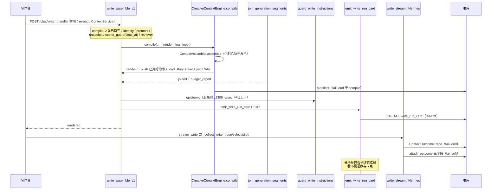
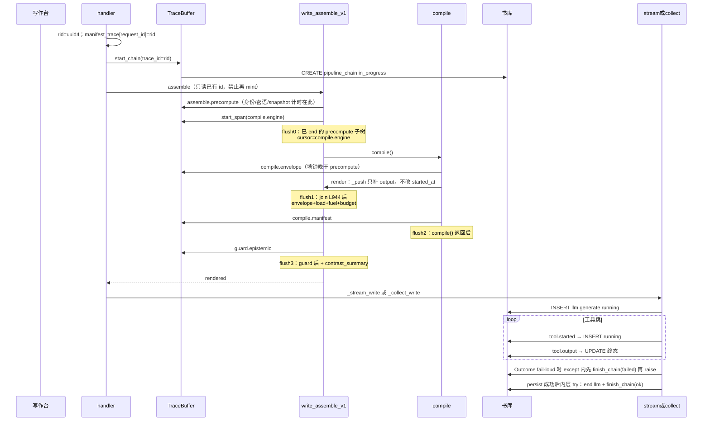
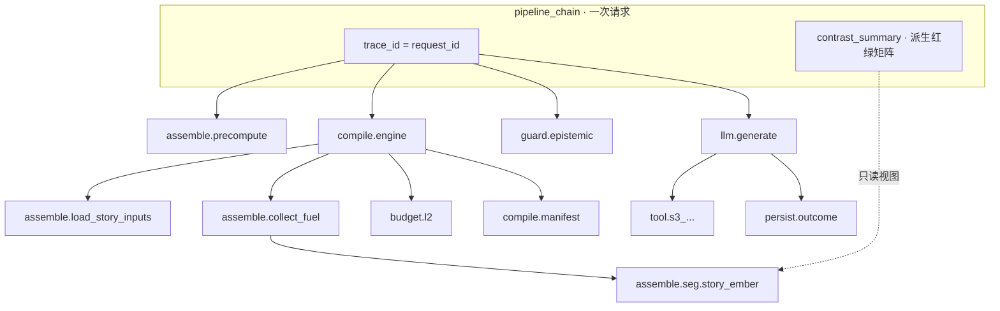

# 铜炉 Pipeline Trace：步骤全量账本 + 可查询链路

> **已被取代（2026-08-14）**  
> 本文不再是「系统运行分析账本」SSOT。按本文落地的 chain+span 仍被判定为「只有运行结果」。  
> **现行设计**：[2026-08-14-pipeline-runtime-analysis.md](2026-08-14-pipeline-runtime-analysis.md)。中间方案 `2026-08-14-pipeline-analysis-log.md` 亦已降级。本文保留作考古，勿再当实现合同。

| 项 | 值 |
|----|----|
| **文档标题** | 写 / 存 / 宣称 / 工具跳：一次一条链，每步一条 span（系统运行分析主账） |
| **作者** | Grok Design |
| **日期** | 2026-08-14 |
| **状态** | Draft |
| **产品** | 铜炉 / tonglu · 代码 `scribe3/` |
| **仓库** | `/home/admin/projects/scribe-writing-system` |
| **入库路径** | `docs/plans/2026-08-14-pipeline-trace.md` |
| **取代** | `docs/plans/2026-08-13-run-observability.md` **不再是 SSOT**（见 §与旧 Run 卡的关系） |
| **验证** | **仅已部署 demo**（`tonglu.example.com` / `203.0.113.10` / `/opt/scribe3/app`）。禁止 Grok 运行机 `npm ci` / 全量 pytest / 本机 Surreal / 第二套库 |
| **运维 env SSOT** | **`/opt/scribe3/app/deploy/prod/.env`**。不要改 `/opt/scribe3/app/.env`，也不要改 `app/.env.production.local` |
| **关联** | 旧卡 `docs/plans/2026-08-13-run-observability.md`；注册表 `scribe3/injection_registry.py`；出卡点 `write_assemble_v1.py` / `write_stream.py` / `misc_routes.save_chapter` / `write.reader_claim_ep`；L1 `docs/L1-AUTH-ISOLATION.md` |

> **读法（工程师）**  
> 1. 先读「对照用户合同」与 Key Decisions。  
> 2. Proposed Design §1–§7 是实现合同。  
> 3. PR Plan 按序独立合；观测 emit 不得阻断写路径。  
> 4. 能由第一性原理钉死的不进 Open Questions。

---

## 对照用户合同（本设计必须满足）

现网管理页「写路径日志」是一张 Run 卡：列表列「章 / 类型 / 对照芯片 / 红/绿计数」，详情标题「第 N 章 · 写」+ 对照芯片，默认 `onlyRed=true`（只看红行）。用户 2026-08-14 当面否定：

> 不行啊，我要的是包含每个步骤的全部信息日志，且能够很清晰的看出来是哪个步骤的，能够方便的查询整条链路的关联产生，可以存一个星期。我要的是能够用于系统运行分析的，不是这种只有运行结果的。再次设计最优方案。

| # | 合同 | 现网 `write_run_card` | 本设计 |
|---|------|----------------------|--------|
| 1 | **每步全量分析信息**，不是只给运行结果 | 每行只有 `expected × actual × verdict × quality` 旗 | 每步一条 span：人话名、为何该/不该跑、输入出处、算了什么、产出结构、耗时、被谁裁/跳/失败、父子与同链 id |
| 2 | **步骤身份一眼可辨** | 英文 slug + 前端硬编码中文；默认「只看红行」把绿步藏掉 | 稳定 `step_key` + 中文 `step_title` + `layer`（assemble / compile / guard / llm / persist / claim / tool / budget）；时间线默认**全步** |
| 3 | **整条链路可查询、可关联** | 一张扁平卡；与 Outcome 事后补丁；无法从任意步跳同请求 / 同模型调用 / 同章前后次 / 父子 | `trace_id`（= `request_id`）钉整链；`span_id` / `parent_span_id`；`outcome_id`；同章前后 `prev/next_trace_id`；按 step_key / 红因 / 时间检索 |
| 4 | **保留一周** | 表在、默认 TTL 写 21、**无自动 purge**；分析员体感仍是「最近一次」 | TTL = **7 天**；**每次** `_store_for` 返回前机会清理（6h 节流）+ 手动 purge；不是进程内存 last-one |
| 5 | **用途 = 系统运行分析** | 红绿对照尺，UI 已在管理台，但交互是「验收墙」 | 回答：该跑 / 跑没跑 / 跑得好不好 / **卡在哪** / **关联怎么产生**。不是合规审计，不是作者工程墙 |
| 6 | **重新设计，不是给卡加两列** | 卡是主账 | 卡降为链上 `contrast_summary`（对照摘要）。主账是 **chain + span** |

**禁止再做成「一张卡只给红绿结论」。** 红绿仍算，但是派生视图。

---

## Overview

写路径今天有两套「看起来像观测、其实答不了分析员问题」的东西：

1. **碎探针**：进程内 `budget_report`、`/debug/injection-trace` last-one、`ContextOutcomeTrace`（模型成/败/用量/hash）、`ContextTurnView`（信封八块）、章上 `density_trace` last+prev、`pipeline_journal`（JSON 文件崩溃续跑：批量 ingest **以及** `loop_chapter` / `select_*` / `_pilot_journal`；不是逐步分析账）。
2. **刚落地的 Run 卡**（`write_run_card` + `RunLogsPage.jsx`）：一次写/存/宣称一张卡，行是期望×实际×红绿。用户判定这是「只有运行结果」，不够做系统运行分析。

本设计交付 **一书一库、按次落 Surreal 的 Pipeline Trace**：

```text
一次写 / 存 / 宣称 / 工具跳会话  =  一条 pipeline_chain（trace_id = request_id）
每一个可辨步骤                 =  一条 pipeline_span
步骤内部的裁剪序列等           =  span.events[]（不上第三张热表）
期望×实际红绿矩阵             =  chain.contrast_summary（派生，不再当主账）
```

分析员打开管理台「运行链路」页，看到的是 **时间线 + 点一步看全字段 + 祖先/子孙高亮**，而不是默认只看红行的对照表。问「这场空是因为余烬没装、L2 裁光、还是模型没写？」时，顺着 `assemble.seg.story_ember` → `budget.l2` → `llm.generate` 就能答。

提示词正文、破绽词表、secret value **默认不进库、不进 API**。「每步全部信息」= 结构化事实，不是把 96k prompt 存一周。见 KD-5。

---

## Background & Motivation

### 分析员真正要回答的五句

旧方案只承诺三句（该跑 / 跑没跑 / 跑得好不好）。用户要的是**运行分析**，还要「卡在哪」和「关联怎么产生」。

| # | 问题 | 今日能否回答 | 本设计 |
|---|------|--------------|--------|
| 1 | 该跑什么？为何该/不该？ | 半能。卡上有 `expected` + 原因码，但没有「输入从哪来」 | span.`expected` + `input.source` |
| 2 | 跑没跑？算了什么？产出什么结构？ | 不能。只有 `present/empty` + `chars` | span.`compute` + `output.shape` + 长度/hash |
| 3 | 跑得好不好？被谁裁/跳/失败？ | 半能。质量旗 + L2 dropped 堆在卡顶 | 裁在 `budget.l2` span；跳/失败在该步 span；耗时在 `timing` |
| 4 | **卡在哪？** | 不能。卡在 assemble **结束**才 emit；崩在模型中途没有「进行中」 | chain 开请求即建；`cursor_step_key`；`status=in_progress` |
| 5 | **整条链怎么连？** 同请求 / 同模型调用 / 同章前后次 / 父子 | 不能。`request_id` 只钉卡顶；无 span 树 | `trace_id` + `parent_span_id` + 同章前后查询 |

这 **不是** 合规审计（谁删用户、谁登录）。`auth_audit` / `setting_audit` / `audit_event` / `approval_audit` 继续各过各的。

### 现网已落地、用户判定不够的东西（2026-08-14 代码复核）

| 探针 | 锚点 | 缺什么 |
|------|------|--------|
| **`write_run_card`** | 迁移 `139_write_run_card.surql`；`run_card.py` / `run_card_collect.py` / `run_card_store.py` / `store/run_card_ops.py` | **主缺陷**：一次一卡、行是对照结果。没有逐步时序、没有父子、没有耗时、没有「输入出处 / 算了什么 / 产出结构」。`emit_write_run_card` 在 `write_assemble_v1.py` **L1315**（guard 之后）。今日 `EpistemicLeakError`（L1306）**先 raise，根本不出卡**——本设计要在 raise 前记 guard span |
| 出卡点 | assemble：`compile()` + `guard` 之后；claim：`write.py` L1231；save：`misc_routes.save_chapter` `_rc_emit`；Outcome：`write_stream._WriteOutcomeBinding.persist` 内层 try | 只补 `outcome_status` 三个字段，不记 LLM/工具跳过程。`_collect_write`（loop/select/pilot）同样走 Outcome，但现网也无逐步账 |
| 读面 | `GET /debug/run-cards`、`/{run_id}`；管理台 `RunLogsPage.jsx`（AdminConsole tab + SystemHub ops，均 admin） | 列表列「章 / 类型 / 对照芯片 / 红/绿」；详情默认 `onlyRed=true` |
| 旗 | `SCRIBE3_RUN_CARD` 默认 1 | 关旗零 I/O。本设计新旗独立，便于回滚新账而不立刻拆旧卡 |
| `budget_report` | `_LAST_WRITE_BUDGET_REPORT` | 进程内存；无期望；重启丢 |
| `ContextOutcomeTrace` | `context_outcome.py`；091/092 READONLY；落库失败 **终止生成** | 模型窄合同；不管 assemble；无存稿路径 |
| `ContextTurnView` | `context_turn_view.py`；迁移 111 | 信封八块 + selected/rejected；不是段期望，不是逐步账 |
| `density_trace` | `density_trace_store.py` | 章上 last+prev；一次章多次写互相覆盖 |
| `SEGMENT_REGISTRY` | `injection_registry.py` **36** 条 + extra（`identity` / `write_protocol` / `revision` / `continue_snapshot` / `tool_scope` / `craft_skills_index` / `benchmark_advisory`） | 目录在；从未变成逐步流水 |
| `pipeline_journal.py` | JSON + `os.replace`：批量 ingest **以及** `loop_chapter` / `select_*` / `_pilot_journal` 的阶段续跑 | **不是**逐步分析账；升格会答错问题（见 Alternatives C） |
| `audit_event` | 迁移 124；几乎只 hook `pilot_state` / `memory_item.status` | 合规向状态变更，无期望谓词 |
| `ai_run_trace` | 迁移 074 | 含 `instructions` / `input_text` 字段；禁止混写本账 |
| Hermes otel / Langfuse / Phoenix | Hermes 插件记 turn / generation / tool | **看不见** `SEGMENT_REGISTRY` 期望谓词与章事实；默认想收提示词；账在书库外 |

### 一次写的真实时间线（今日）



### 痛点量化

- 一次写真实发生 **40+ 个装段尝试** + join/L2/O1 + compile + guard + 1 次模型流 + 0–N 工具跳 + Outcome。现网压成 **1 张卡 × ~43 行对照**。
- 卡上禁止存 `text`/`instructions`/`markers`/`prompt`（正确），但同时也没存 **输入出处、函数名、产出 shape、duration_ms、parent_span_id**。分析员看见「余烬 · 该跑 · 空」却不知道是 `collect_story_fuel_segments` 没产出、上章无 `end_hook`、还是 L2 `story_ember:drop`。
- `emit` 在 assemble **返回前**；模型 30s 超时或工具跳失败时，卡已经是「assemble_ok=true / outcome_status=null」。无法表达「卡在 llm.generate」。
- `SCRIBE3_RUN_CARD_TTL_DAYS` 默认 21 且 **只保证手动** `POST /debug/run-cards/purge`。用户要的是「可以存一个星期」的可查历史，不是 21 天堆着也不自动清、也不是进程 last-one。

---

## Goals & Non-Goals

### Goals

| 优先级 | 目标 | 验收口径 |
|--------|------|----------|
| **P0** | chain + span 主账；handler 开链并写入 `manifest_trace`；assemble/budget/compile/guard 逐步记（计算函数上计时）；失败也记；**读 API 可按 `trace_id` 取回时间线**；落该书 Surreal | demo 写一次 → `GET /debug/pipeline-traces/{trace_id}` 200 且 spans 含装段/budget/guard（llm 属 P1）；重启后仍在；崩在 `compile()` 里仍有 flush0 的 precompute 步 |
| **P1** | **所有** `_assemble_write_instructions` +（`_stream_write` **或** `_collect_write`）路径：LLM span + tool hop（含进行中）+ `finish_chain`；Outcome 同钉；save/claim 逐步记门闩 | loop / select / pilot 不得留下永远 `in_progress` 的链；save 409 也有链 |
| **P2** | 管理台改为时间线 + 点一步看全字段 + 祖先/子孙高亮 + 同章前后次；旧卡降为「对照摘要」tab | 分析员不再把红绿表当主界面；人话步骤名来自后端目录 |
| **P3a** | 7 天自动 purge（每次 `_store_for` + 6h 节流） | 不重启进程、第二次请求后过期行消失 |
| **P3b** | 停 `CREATE write_run_card`；旧 GET / injection-trace 字段级兼容读 `contrast_summary` | 旧 API 不 500；三旗语义不打架 |

### Non-Goals

| # | 非目标 | 理由 |
|---|--------|------|
| NG1 | 把 96k 提示词 / 破绽词明文 / secret value 存一周 | 已裁；泄密 + 体积。见 KD-5 |
| NG2 | 合规审计 / 收编 `auth_audit` / `audit_event` / `approval_audit` | 答错问题 |
| NG3 | 作者写作台工程墙；SSE 弹 span 表 | UI 只在管理台独立页 |
| NG4 | Langfuse / Phoenix / SigNoz / hermes-otel / Hermes Dashboard 当主账 | 看不见期望谓词；默认收 prompt；不在书库事务 |
| NG5 | 扩 `context_outcome_trace` / `ai_run_trace` / 章 `density_trace` 当主账 | Outcome fail-loud + READONLY；074 含 instructions；density 只 last+prev |
| NG6 | 把 `pipeline_journal.py` 升格为主账 | 它是文件系统阶段续跑（ingest **和** loop/select/pilot），故意不进 DB |
| NG7 | 给现网 Run 卡加两列交差 | 用户已否 |
| NG8 | 52 段文学分 / 书评 / 把观测当 GATE 挡写 | 质量仍是分析尺；emit fail-soft |
| NG9 | 重开宣称公式、改 `GATE_SAVE_MODE=soft`、改法律写通道 | 硬约束 |
| NG10 | Grok 机 `npm ci` / 全量 pytest / 本机 Surreal / 第二套库 | 资源纪律 |
| NG11 | 为验收清空 demo 库或另起平行 Surreal | 验证 = 打已部署栈 |

---

## Proposed Design

### 1. 一句话架构

```text
**Handler 入口** mint 恰好一次 request_id（= trace_id），
  先写入 manifest_trace["request_id"] 再 start_chain / assemble
  → 前闸 409 也先记 span 再 finish_chain(failed)
  → assemble **只消费**已有 id；**删除一切**二次 uuid4；缺 id=观测 no-op
  → 每步 start/end 包在**计算函数**上（不是只包 _push）
  → 按 §7.1 **多次**阶段 flush（含 compile() 前 flush0）
  → 所有 _stream_write **与** _collect_write 入口开 llm.generate；
     assemble 上抛 / Outcome fail-loud / persist 成功 皆 finish_chain（仅 in_progress）
  → TTL 7 天；每次 _store_for 返回前 maybe_purge（6h 节流）
```

旧 `write_run_card`：**过渡期双写**，读面以降级。主账不再是它。

**刷盘合同以 §7.1 为准。** 本节与 §2 不得再写「assemble+budget+compile 一次 INSERT」。

### 1.1 真实调用图 → hook 点（接线 SSOT）

现网墙钟序（`write_assemble_v1.py` + `context_engine.py` L99–137）：

```text
handler 前闸（chat_write_post：reread L72 / ContextService L90 / thread L95）
  → _WriteOutcomeBinding()
  → _assemble_write_instructions
       ① compile **之前**算完：identity / protocol / prefix / revision /
          structure_diversity / continue_snapshot / secret_guard(facts_at L155) /
          focalizer / tool_scope / snapshot / retriever（L89–263）
       ② 今日 L1078 `ContextRequest(request_id=uuid4())`  ← 本设计删除此次 mint
       ③ compile()：
            先 ContextAssembler.assemble（信封八块）
            再 render=_render_final_input：
                 _push 已算好的串（identity 在 L280，envelope 在 ~L480）
                 load_chapter_story_inputs / freeze facts / collect_story_fuel
                 join_generation_segments **L944**（不是 ~L1055）
            再 save_manifest
       ④ guard_write_instructions；EpistemicLeakError L1306 先 raise（今日无卡）
       ⑤ emit_write_run_card L1315
  → _stream_write（GET/POST /chat/write）
    或 _collect_write（loop_chapter / select_chapter / select_light / _pilot_llm_gen）
       同事件源；on_terminal = outcome_binding.persist
```

所有走 assemble 的路径 **同一句**（禁止 POST/GET 漏写、loop 才写）：

```text
rid = uuid.uuid4().hex
outcome_binding.manifest_trace["request_id"] = rid   # 必须在 assemble 之前
start_chain(trace_id=rid, ...)
instructions = _assemble_write_instructions(..., envelope_trace=outcome_binding.manifest_trace)
```

| 路径 | 文件 | 开链（上列四步，一字不差） | 关链 |
|------|------|---------------------------|------|
| `POST /chat/write` | `write.py` `chat_write_post` | 是。现网 `manifest_trace = {}`（L104–114），**必须先写入 rid** 再 assemble | assemble+生成外包一层：异常且 `in_progress` → `finish_chain(failed)`；成功走 `persist()` |
| `GET /chat/write` | `write.py` `chat_write` | 同上 | 同上 |
| `loop_chapter._generate` | `chapters.py` ~L94–111 | 每次 attempt 新 rid（一轮一链） | 同上（`_collect_write`） |
| `select_chapter` / `select_light` | `chapters.py` ~L654 / ~L887 | 每个候选一条链 | 同上 |
| `_pilot_llm_gen` | `misc_helpers.py` L308–318 | 函数入口同一句 | 同上 |
| `save_chapter` | `misc_routes.py` | handler `_rc_id` 当 `trace_id`（无 compile） | `_rc_emit` 旁 `finish_chain` |
| `reader_claim_ep` | `write.py` L1193 | handler mint | 出卡钩旁 `finish_chain` |

**不可违反：**

1. 全书写路径 **恰好一次** `uuid.uuid4().hex` 作为本次 `request_id` / `trace_id`。**assemble 禁止任何 `uuid4()` / 二次 mint / 写回 `envelope_trace`。** L1078 改为：

   ```python
   # 禁止再 mint。id 只来自 handler 已写入的 envelope_trace，或已开链的 TraceBuffer。
   _rid = str((envelope_trace or {}).get("request_id") or "").strip()
   if not _rid:
       buf = current_trace_buffer()  # contextvar；handler 已 start_chain 时有值
       _rid = str(getattr(buf, "trace_id", "") or "").strip()
   if not _rid:
       # 观测整请求 no-op：不 start_chain、不 flush、不补丁。
       # 测试夹具要链必须自己传入 envelope_trace={"request_id": ...}。
       # ContextRequest 仍要非空 id（091 Manifest 合同）：用 work|chapter|clock_ns 的
       # sha256 hex，**不得**写回 envelope_trace，**不得**当作 pipeline trace_id。
       disable_pipeline_trace()
       _rid = hashlib.sha256(
           f"obs-noop\0{work}\0{chapter}\0{time.time_ns()}".encode()
       ).hexdigest()
   context_request = ContextRequest(request_id=_rid, ...)
   ```

2. PR3 验收钉必须走 **与现网相同的空 `manifest_trace={}` handler 路径**（`chat_write_post` 或同形测试替身），断言 `compiled.request.request_id == chain.trace_id == manifest_trace["request_id"]`。**禁止**只测「预填了 envelope_trace 的直调 assemble」。Manifest / Outcome / 旧卡 / 可选 SSE `done.trace_id` 同值。

3. assemble 只消费 id，**不** `start_chain`。handler 前闸失败：已开链则记门 span 后 `finish_chain(failed)` 再 raise。

4. 跨 SSE / 线程池边界的真钉是 `manifest_trace["request_id"]`，不是 contextvar。`_stream_write` 与 `_collect_write` **同一套** llm/tool/finish 钩子。contextvar 仅辅助 assemble 热路径。

### 2. 目标时间线（墙钟序；刷盘 = §7.1 多次 flush）



默认时间线按 **墙钟 `timing.started_at`**。真序是：

```text
handler 门 → assemble.precompute（身份 / 密语守卫 / snapshot）
  → compile.engine → compile.envelope → render（load / fuel / 其余段）
  → join → compile.manifest → guard → llm
```

**禁止写「信封先于身份」。** `_push("identity")` 发生在信封 assemble **之后**，只补 `output.chars`，**不改** `started_at`（计时仍锚在 compile 前的 `_editor_identity_block`）。UI 可另提供「按 layer 的分析序」，**不得**为迁就示意把 identity 的 start 挪回 `_push`。

### 3. 模块落点

| 新/改 | 路径 | 职责 |
|-------|------|------|
| **新** | `scribe3/pipeline_trace.py` | **零 I/O**：`StepDef` 目录、`TraceBuffer`、`start/end_span`、红线擦除、`public_span` / `public_chain` 白名单。禁止 import store / `facts_at` |
| **新** | `scribe3/pipeline_trace_catalog.py` | 稳定 `step_key` + 中文 `step_title` + `layer` + `parent_of` 规则 + 人话 `does` + **计算函数锚点**。UI/API 只读这里 |
| **新** | `scribe3/pipeline_trace_store.py` | fail-soft：`start_chain` / `insert_spans` / `patch_chain` / `finish_chain` / 列表 / 单链 / 按 step_key 查 / `maybe_purge` |
| **新** | `scribe3/store/pipeline_trace_ops.py` | mixin：CREATE chain、INSERT spans、SELECT、UPDATE cursor/outcome/summary、DELETE TTL |
| **新** | `scribe3/migrations/140_pipeline_trace.surql` | 一书一库 SCHEMAFULL。现网最新 **139**；实现前再 `ls` |
| **改** | `scribe3/store/surreal.py` | mixin 挂入，紧挨 `RunCardOpsMixin` |
| **改** | `scribe3/api/app_impl.py` `_store_for` | **每次**返回 store 前 `maybe_purge_*`（fail-soft + 6h 节流）。禁止只挂 `apply_schema` |
| **改** | `scribe3/feature_flags.py` | 三旗见 §8：`PIPELINE_TRACE` / `RUN_CARD` / `RUN_CARD_PERSIST`；另 `PIPELINE_TRACE_PREVIEW` 默认 0、`PIPELINE_TRACE_TTL_DAYS` 默认 7 |
| **改** | `scribe3/api/routers/write.py` | POST/GET：`rid` → **写入** `manifest_trace["request_id"]` → `start_chain` → assemble；claim：两扇现网门 |
| **改** | `scribe3/api/routers/chapters.py` | loop / select / select_light：每次 generate mint + 开链 |
| **改** | `scribe3/api/services/misc_helpers.py` | `_pilot_llm_gen` 入口开链 |
| **改** | `scribe3/api/services/write_assemble_v1.py` | **只消费** id；**删除一切 uuid4**；缺 id=观测 no-op；计算函数上 start/end；flush0+§7.1 |
| **改** | `scribe3/api/services/write_stream.py` | `_stream_write` **与** `_collect_write` 共用 llm/tool/finish；`persist()` 内层 try |
| **改** | `scribe3/api/routers/misc_routes.py` | save 同形；`GET /debug/pipeline-traces*`；旧 run-cards 保留 |
| **改** | `scribe3/run_card.py` / `run_card_store.py` | 保留纯函数。P3b 前双写；`RUN_CARD` 只管是否派生对照 |
| **改 P2** | `scribe3/web/src/admin/RunLogsPage.jsx` | 时间线主界面 + 对照摘要 tab。写作台无卡钉继续有效 |

**不改**：`join_generation_segments` 裁剪算法、信封预算、`SEGMENT_REGISTRY` 物理序、Outcome 不可变合同、法律写通道、宣称公式、`GATE_SAVE_MODE`。

**不升格**：`pipeline_journal.py`（文件系统阶段续跑，含 loop/select/pilot）。

### 4. 主模型：chain + span（不是加宽 Run 卡）



**否决「加宽 rows[]」**：再往 `RunCardRow` 塞 `input/compute/output/timing/parent` 会得到一张 40×宽列的结果表，仍然没有「进行中」、没有工具跳子树、没有同链跳转。用户要的是流水账 + 链路图。

**唯一父子树（禁止 `assemble.batch` 等未登记键）：**

```text
(无 parent) handler.reread_gate / handler.context_enforce
(无 parent) assemble.precompute
             └ assemble.seg.{identity,write_protocol,prefix,revision,
               structure_diversity,continue_snapshot,secret_guard,
               focalizer,tool_scope,craft_skills_index}
(无 parent) compile.engine          ← 必须在 compile() 调用前 start_span
             ├ compile.envelope
             ├ assemble.load_story_inputs
             │    └ assemble.seg.narrative_contract
             ├ assemble.collect_fuel
             │    └ story_ember / story_recall / story_causal
             ├ assemble.seg.*（render 里其余 _push）
             ├ assemble.freeze_expected
             ├ budget.l2
             ├ budget.o1
             └ compile.manifest
(无 parent) guard.epistemic
(无 parent) llm.generate
             ├ tool.{safe_name}
             └ persist.outcome
(无 parent) persist.turn_bind / persist.chapter
(无 parent) save.* / claim.*
```

点一步时 UI 高亮的是 **祖先 + 子孙路径**，不是「同 `trace_id`」（单链详情里那是同义反复）。

### 5. 步骤目录（稳定 `step_key` + 中文 `step_title` + `layer`）

`step_key` 一旦写入库 **不得改名**；展示文案只改 `step_title`。未登记却出现的段：`assemble.seg.{name}`，`step_title=未登记·{name}`，`expected=false`，`expected_reason=unregistered`（与现网卡一致，present → 对照红）。

#### 5.1 层（layer）

| layer | 中文 | 何时出现 |
|-------|------|----------|
| `assemble` | 装段 | 计算函数 + `_push` 补 output；含 `assemble.precompute` |
| `budget` | 预算裁剪 | `apply_l2_trim` / `enforce_total_prompt_budget`（O1） |
| `compile` | 编译 | `CreativeContextEngine.compile`：信封 assemble + Manifest |
| `guard` | 门闩 | `guard_write_instructions`；handler 前闸（reread/context） |
| `llm` | 模型 | `_stream_write` **与** `_collect_write` |
| `tool` | 工具跳 | `tool.started` 立即 running；`tool.output` 终态 |
| `persist` | 落库 | Outcome / `save_chapter` |
| `save` | 存稿门 | 与现网 `_rc_rows` 一一对应 |
| `claim` | 宣称门 | **P1 仅**现网两行：`reader_claim` / `scaffold_gate_b` |

用户点名的层都在。`budget` / `save` 是分析必需的细分：L2 不是「又一个装段」，存稿门不是 assemble。

#### 5.2 装段（36 + extra）

`step_key = assemble.seg.{name}`。`step_title` 与现网 `RunLogsPage.NAME_LABEL` 对齐并收归后端。`tier`/`zone` 来自 `SEGMENT_REGISTRY`；extra 的 `tier=extra`。

| name | step_title | 输入出处（`input.source`） | 算了什么（`compute.fn`） | 产出结构 |
|------|------------|---------------------------|--------------------------|----------|
| `identity` | 身份 | `_editor_identity_block()` | 恒拼编辑身份 | 身份短块 |
| `write_protocol` | 写协议 | `_protocol_raw` − 与 `final_reminder` 回声 | `subtract_codex_canonical_echoes` | 短核协议 |
| `prefix` | 身份前缀 | anti_slop + 章号 | 恒拼 | L0 前缀 |
| `revision` | 改稿 | 改稿判定 + 原文 | `is_revision_request` | 改稿约束 |
| `structure_diversity` | 结构多样性 | 旗 | `structure_diversity_inject_enabled` | 结构提示 |
| `continue_snapshot` | 续写快照 | 重读 ack / 章快照 | `has_reread_ack` | 续写块 |
| `secret_guard` | 密语守卫 | `_secret_guard_block`（**现网唯一 T0 `facts_at`**） | `prompt_blocks._secret_guard_block` | 揭示或破绽词硬约束（**只记 nonempty / reveal_only，不记 marker 明文**） |
| `focalizer` | 限知视角 | 请求 `focalizer` | `writing_limited_banner` / `writing_omniscient_author_banner` | 限知/全知条幅 |
| `narrative_contract` | 场面合同 | `load_chapter_story_inputs.contract` + `evidence_must_show` | `format_story_contract_head` | 场面头 |
| `story_ember` | 上章余烬 | 上章 `narrative_drive.end_hook` | `collect_story_fuel_segments` | 燃料块 |
| `story_recall` | 世界此刻 | 限知投影后的世界 | 同上 | 燃料块 |
| `story_causal` | 前因后果 | 上章存在性 | 同上 | 燃料块 |
| `event_drive` | 事件驱动 | 叙事引擎 + 无场面 | `_event_drive_block` | 冲突时钟 |
| `event_drive_hook` | 事件钩 | 叙事引擎 + 有场面 | 同上 hook 模式 | 续势钩 |
| `drama_contract` | 戏剧合同 | 章 beats | 戏剧合同块 | 戏剧头 |
| `drama_vacuum` | 戏剧真空 | `should_inject_drama_vacuum` | 无 goal 且无 conflict 才注入 | 真空警告 |
| `outline` | 大纲 | synopsis / beats | outline 块 | 大纲 |
| `envelope` | 信封 | `ContextAssembler.assemble` 八块 | compile 内 assemble | 信封渲染 |
| `codex` | 正典 | `_codex_block(..., for_generation=True)` | `cap_codex_text` | 设定圣经（**不存正文**） |
| `seed_words` | 种子词 | 章 `seed_words` | 有则 push | 种子 |
| `craft` | 工艺 | `list_craft_rules` | 有规则才期望 | 工艺条 |
| `phase_role` | 阶段角色 | `phase` | 相位块 | 角色 |
| `avoid` | 避忌 | 现网默认 omit | 期望恒假 | 通常 absent=绿 |
| `revelation_discipline` | 揭示纪律 | 焦点者 | `_revelation_discipline_block` | 纪律 |
| `sincerity` | 诚意 | 已并入 prefix | 期望恒假 | 不独立 push |
| `purpose` | 本章目的 | 章 purpose | 有则 push | 目的 |
| `volume_intro` | 卷首 | 旗 + 章 volume | compact | 卷首 |
| `brief_must` | 必须发生 | 章 brief | 有则 push | 必须 |
| `pressure_drive` | 压力驱动 | 章 pressure | 有则 push | 压力 |
| `author_prefs` | 作者偏好 | 章 prefs | 有则 push | 偏好 |
| `voice_anchor` | 声口锚 | voice / 章锚 | 有则 push | 声口 |
| `reference_craft` | 参考工艺 | draft/final + briefs | 相位门 | 参考 |
| `storyline_polish` | 故事线打磨 | 旗 + storyline meta | polish | 打磨 |
| `discourse_soft` | 话语讲法 | 旗 + discourse | 软建议 | 话语 |
| `story_move` | 招式 | 旗 + approved plan | `validate_story_move_plan` | 招式 |
| `deduction_final` | 终稿推演 | draft/final + deduction | 相位门 | 推演 |
| `material_recall` | 素材召回 | draft/final + materials | 相位门 | 素材 |
| `final_reminder` | 收束提醒 | 恒有 | 收束 | 提醒 |
| `scene_truth_proj` | 场面真相 | `phase==deduce` | 仅 deduce | 投影 |
| `request_constraint` | 本轮约束 | `extra_instructions` | 有则 push | 约束 |
| `tool_scope` | 工具范围 | `with_tools` | `_s3_work_scope_block` | 范围 |
| `craft_skills_index` | 技法索引 | `with_tools` | `skills_index_block` | 索引 |
| `benchmark_advisory` | 标杆提示 | draft/final + 旗 | `benchmark_inject_enabled` | 标杆 |

期望谓词 **复用** `run_card.expected_for` / `collect_expected_facts`，禁止第二套。冻结点仍是：`load_chapter_story_inputs` 已返回、燃料 `_push` 之前。

**计时锚点（Issue 4，不可违反）：** `start_span` / `end_span` 包在 **计算函数** 上，`_push` 只补 `output.chars` / `digest` / `actual`。`_push` 本身接近 0ms，包它会让「哪步慢 / 卡在哪」变成假账。

| step | start/end 锚在 | `_push` 只做 |
|------|----------------|--------------|
| `assemble.seg.secret_guard` | `_secret_guard_block(...)`（含唯一 T0 `facts_at`） | 补 nonempty / reveal_only |
| `assemble.seg.identity` | `_editor_identity_block()` | 补 chars |
| `assemble.seg.write_protocol` | `_write_protocol_block` + echo 差集 | 补 chars |
| `assemble.seg.continue_snapshot` | `build_continue_snapshot` / `continue_block_text` | 补 skip 原因 |
| `assemble.seg.structure_diversity` | `structure_diversity_block` | 补 chars |
| `assemble.seg.focalizer` | `writing_*_banner` | 补 chars |
| `assemble.load_story_inputs` | `load_chapter_story_inputs` | — |
| `assemble.seg.narrative_contract` | `format_story_contract_head` | 补 chars |
| `assemble.collect_fuel` | `collect_story_fuel_segments` 整段 | 三个子段 `_push` 补 output |
| `assemble.seg.story_*` | 不单独包循环外计算；耗时归 `collect_fuel`；本 span 记产出 | 补 chars / title_only |
| `compile.envelope` | `ContextAssembler.assemble` | 之后 `_push("envelope")` 补 output |
| 其余 render 内段 | 该段生成函数（`_event_drive_block` 等） | `_push` 补 output |
| 预计算失败 | 仍 `end_span(failed)` | 无 output |

#### 5.3 非段步骤（必须有，否则答不了「卡在哪」）

| step_key | step_title | layer | parent | 记什么 |
|----------|------------|-------|--------|--------|
| `handler.reread_gate` | 续写重读门 | guard | 无 | `check_generate_reread_gate`；409 也记 |
| `handler.context_enforce` | 上下文绑定门 | guard | 无 | `ContextService.enforce` |
| `assemble.precompute` | 编译前预计算 | assemble | 无 | 身份/协议/snapshot/secret_guard 的父 |
| `assemble.load_story_inputs` | 加载章故事输入 | assemble | `compile.engine` | `load_chapter_story_inputs` 成败；字段名集合（无四义原文）；`trace_count` |
| `assemble.collect_fuel` | 收集三燃料 | assemble | `compile.engine` | 三个 name 是否 got；空原因；**耗时在此** |
| `assemble.freeze_expected` | 冻结期望事实 | assemble | `compile.engine` | `facts_collect_failed` 与否 |
| `budget.l2` | L2 补充裁剪 | budget | `compile.engine` | `dropped[]`、帽、`events[]` 半裁/整段丢 |
| `budget.o1` | O1 全域硬顶 | budget | `compile.engine` | `total_enforce.dropped` |
| `compile.envelope` | 组装信封 | compile | `compile.engine` | 八块 `block_tokens`、selected/rejected **计数** |
| `compile.manifest` | 落 Manifest | compile | `compile.engine` | `manifest_id`、`actual_input_hash`、`actual_input_bytes` |
| `compile.engine` | 编译引擎 | compile | 无 | 先于 `compile()` start；总耗时 |
| `guard.epistemic` | 限知出口守卫 | guard | 无 | hit/kinds/scrub；泄漏 failed。**今日无卡，本设计补上** |
| `llm.generate` | 模型生成 | llm | 无 | provider/model/status/usage/`output_hash` |
| `tool.{safe_name}` | 工具 · {人话名} | tool | `llm.generate` | `started` 即 running；只存键名 |
| `persist.outcome` | 落 Outcome | persist | `llm.generate` | `outcome_id` / status |
| `persist.turn_bind` | 落 TurnBind | persist | 无 | 成败 |
| `save.loop_busy` | loop 互斥 | save | 无 | 对齐 `_rc_rows` |
| `save.pilot_busy` | pilot 互斥 | save | 无 | 同上 |
| `save.craft_gate` | 工艺门 | save | 无 | 同上 |
| `save.finalize_gate` | 定稿门 | save | 无 | 同上 |
| `save.strict_scene` | 严格戏格 | save | 无 | 旗关 → expected 假 |
| `persist.chapter` | 落章正文 | persist | 无 | 字数；不存正文 |
| `claim.reader_claim` | 宣称可读 | claim | 无 | **P1 仅此 + scaffold**，对齐 `write.py` L1217–1229 |
| `claim.scaffold_gate_b` | 脚手架 GATE-B | claim | 无 | 查询失败记 empty，不挡宣称主链 |

**宣称拆分纪律：** `reader_ack` / `anti_meta` **不**在 P1 独立成 span。它们活在 `assert_reader_claim` → `build_reader_ready` 内部，成功 `code=ok`、失败一个 `code`。乱拆会假红。若以后要拆：只读 `reader_ready.lamps` / `human_acked`，**禁止重写宣称公式**。

工具 `step_key`：`tool.` + 只保留 `[a-zA-Z0-9_.:-]` 的截断名（≤64）。未知工具进 `tool.unknown`。禁止未登记的 `assemble.batch`。

### 6. 关联键

| 键 | 定义 | 用途 |
|----|------|------|
| **`trace_id`** | **= `request_id`**。Handler 入口 mint 恰好一次，**先写入** `manifest_trace["request_id"]` 再 assemble。assemble **零**二次 mint。存/宣：handler 入口 mint | 整条链主键；与 Manifest / Outcome / 旧卡同一枚钉子 |
| **`span_id`** | 16 hex（`token_hex(8)`） | 单步 |
| **`parent_span_id`** | 唯一树见 §4。无「assemble.batch」。`compile.engine` 必须先 `start_span` 再进 `compile()` | 祖先/子孙高亮 |
| **`outcome_id`** | 既有 sha256 身份；模型结束后补丁到 chain + llm span | 跳到模型窄留痕 |
| **`run_id`** | 旧卡 24 hex，写入 `chain.contrast_run_id` | 过渡期旧 API |
| **`manifest_id`** | `compiled.manifest.manifest_hash` | 与实际进模型字节对拍 |
| **`work` / `chapter` / `kind` / `phase`** | 与现网卡同 | 按书按章按类 |
| **`prev_trace_id` / `next_trace_id`** | **读时计算**，不存（同 work+chapter+kind，`created_at` 邻接） | 同章前后次 |

**不要**再发明第三枚「chain_id ≠ request_id」。分析员脑子里只有「这一次请求」。

### 7. 逐步 emit（失败也记；禁止只在 assemble 结束出一张）

#### 7.1 缓冲 + 阶段刷盘

热路径禁止每步同步 CREATE（40+ 次会把生成拖死）。合同：

刷盘 **以本表为准**（多次 flush）。§2 序列图必须与此一致，禁止「一次 INSERT 三阶段」。

| # | 时机 | 写什么 | I/O |
|---|------|--------|-----|
| 0 | **Handler 入口** | 先 `manifest_trace["request_id"]=rid`；CREATE `pipeline_chain`；`cursor=handler.reread_gate` 或 `assemble.precompute` | 1 CREATE |
| 1 | compile **之前**的计算函数 | `assemble.precompute` 及子 span **先只进缓冲** | 0 |
| 2 | `start_span(compile.engine)` 之后、`compile()` **之前** | **flush0**：只刷已 end 的 precompute 子树；`cursor=compile.engine` | 1 batch INSERT + 1 UPDATE cursor |
| 3 | `join_generation_segments` **L944 返回后** | L2/O1 进缓冲；**flush1**：envelope + load/fuel + 其余 render 段 + budget | 1 batch INSERT ≤64 |
| 4 | `compile()` **返回后** | end `compile.engine` / `compile.manifest`；**flush2**；`cursor=guard.epistemic` | 1 INSERT + 1 UPDATE |
| 5 | guard 结束 | guard span；派生 `contrast_summary`（**含写入 `contrast_run_id`**，即使不 CREATE 旧表）；**flush3**；`cursor=llm.generate` | 1 INSERT + 1 UPDATE |
| 6 | `_stream_write` **或** `_collect_write` **入口** | INSERT `llm.generate` `running`（用 `manifest_trace["request_id"]` 钉链） | 1 INSERT |
| 7 | `tool.started` | INSERT `tool.*` `running`；`cursor=tool.{safe_name}` | 1 INSERT |
| 8 | `tool.output` | UPDATE 该 tool span 终态 | 1 UPDATE |
| 9 | `persist()`：`save_outcome` **成功**后内层 try | end llm + persist.outcome + `finish_chain(ok)`（仅 `status==in_progress`） | fail-soft |
| 10 | `persist()`：`save_outcome` **失败**（fail-loud） | **except 内先** `finish_chain(failed)`（仅 `in_progress`）**再 raise** | 观测 fail-soft；生成仍终止 |
| 11 | assemble / compile / guard **上抛**（到不了 stream） | handler（含 `loop._generate`）外包：异常且 `in_progress` → `finish_chain(failed)` | fail-soft |
| 12 | 前闸 409 | 对应 handler span + `finish_chain(failed)` 再 raise | fail-soft |

`finish_chain` **只在 `chain.status == in_progress` 时落终态**。禁止 handler `except` 与 `persist()` 双关把已 `ok` 打成 `failed`。

`EpistemicLeakError` 保持现网上抛；在 raise 之前 fail-soft 记 guard span + `finish_chain(failed)`。今日泄漏 **无卡**，这是改进点。**禁止为出链再打 `facts_at`。**

关旗 `SCRIBE3_PIPELINE_TRACE=0`：`start_chain` 第一行 return，**零 I/O**（含不 CREATE chain）。

#### 7.2 TraceBuffer（进程内，可单测）

```python
# scribe3/pipeline_trace.py — 零 I/O
SCHEMA_VER = "pipeline_trace.v1"

@dataclass
class SpanRec:
    span_id: str
    parent_span_id: str | None
    trace_id: str
    step_key: str
    step_title: str
    layer: str
    status: str          # running|ok|skipped|empty|dropped|failed
    expected: bool | None
    expected_reason: str | None
    actual: str | None   # 复用 ActualKind + running
    actual_reason: str | None
    verdict: str | None  # 对照尺，可空（llm/tool 无 expected）
    input: dict
    compute: dict
    output: dict
    timing: dict         # started_ns, ended_ns, duration_ms
    events: list[dict]   # 如 L2 每次半裁/丢段
    quality: dict
    error: dict | None   # {class, summary[:240]} 无栈里的 secret
    links: dict

class TraceBuffer:
    def start_chain(self, *, work, chapter, kind, phase, trace_id) -> None: ...
    def start_span(self, step_key: str, *, parent: str | None = None) -> str: ...
    def end_span(self, span_id: str, **fields) -> None: ...
    def drain_ready(self) -> list[dict]: ...   # 已 end 且未 flush
    def snapshot_chain_patch(self) -> dict: ...
```

`write_assemble_v1` 用 `_run_card_ctx` holder 挂 `TraceBuffer`。`_stream_write` / `_collect_write` **不要只靠 contextvar**（SSE 生成器可能进线程池）：用 `manifest_trace["request_id"]` 回查 / 打开缓冲。contextvar 未设置且没有 `request_id` 时 emit no-op。

#### 7.3 单步字段合同（「全部信息」的精确定义）

默认落库 / 默认 API **只允许**这些键（`public_span` 白名单）。这就是用户要的「每步全部信息」：

```python
{
  "span_id": "a1b2c3d4e5f67890",
  "parent_span_id": "…",
  "trace_id": "…",              # = request_id
  "work": "shu_xxx",
  "chapter": 16,
  "kind": "write",              # write|save|claim
  "step_key": "assemble.seg.story_ember",
  "step_title": "上章余烬",
  "layer": "assemble",
  "tier": "L2",
  "zone": "head",
  "status": "empty",
  "expected": True,
  "expected_reason": "prev_end_hook",
  "actual": "empty",
  "actual_reason": "empty_story_ember",
  "verdict": "red",
  "input": {
    "source": "chapter[n-1].narrative_drive.end_hook",
    "source_kind": "chapter_meta",
    "chars_in": 0,
    "digest_in": None,
    "from_span_id": None
  },
  "compute": {
    "fn": "collect_story_fuel_segments",
    "predicates": ["prev_end_hook"],
    "flags": []
  },
  "output": {
    "shape": "fuel_block",
    "chars": 0,
    "tokens_est": 0,
    "digest": None,
    "title_only": False
  },
  "timing": {"started_at": "…Z", "ended_at": "…Z", "duration_ms": 1.8},
  "events": [],
  "quality": {"title_only": False, "trimmed": False},
  "error": None,
  "links": {
    "manifest_id": "…",
    "outcome_id": None,
    "contrast_run_id": "…"
  }
}
```

**禁止键**（与现网卡同一红线，单测锁）：`text` / `instructions` / `markers` / `prompt` / `arguments` 原文 / `output` 原文 / secret value / leak_markers。

可选预览（**单独旗，默认关**）见 §Security。

#### 7.4 `headline`：列表用人话一句，不是红/绿计数

`finish_chain` 从 spans 生成 ≤80 字中文，写入 `chain.headline`。例如：`余烬空（无正文）· L2 整段丢 material_recall · 模型 succeeded`。

**进行中的链还没 `finish_chain`：** GET 时用 `cursor_step_key` + `now - started_at` **现算** headline（「卡在 模型生成（进行中 41s）」），**不写库**。

规则：优先报红步的 `step_title+actual_reason`，再报 L2 dropped，再报 llm status。列表主列用 `headline`，红绿计数缩到次要。

### 8. 与现网 `write_run_card` 的关系

| 阶段 | 行为 |
|------|------|
| **P0–P2（双写窗）** | `SCRIBE3_RUN_CARD_PERSIST=1`：仍 `CREATE write_run_card`。同时写 chain+span。`build_run_card` 拷进 `chain.contrast_summary`（须含 `summary` / `verdict` / `rows` 的 public 形状） |
| **P3a** | 只加 sweeper；**不停**旧表写入 |
| **P3b** | `RUN_CARD_PERSIST` 默认 0：停 `CREATE write_run_card`。**只要 `RUN_CARD=1`，仍调用 `build_run_card` 并把 `run_id` 写入 `chain.contrast_run_id`**（只是不 CREATE 旧表）。旧 GET / injection-trace 按下面矩阵读 chain |
| **永久保留** | `run_card.py` 纯函数。`SCRIBE3_RUN_CARD=1` 只表示「还要派生 `contrast_summary`」，不再表示「对照是主账」 |

**三旗（全部写入 `feature_flags.py`，禁止再发明第四个同义旗）：**

| 旗 | 默认 | 含义 |
|----|------|------|
| `SCRIBE3_PIPELINE_TRACE` | `"1"` | 主账 I/O。0 = 不 CREATE chain/span，**不挡写** |
| `SCRIBE3_RUN_CARD` | `"1"` | 是否调用 `build_run_card` 派生对照摘要（挂 chain）。0 = 不算对照；**不等于**关主账 |
| `SCRIBE3_RUN_CARD_PERSIST` | `"1"`（P3b 改 `"0"`） | 是否 `CREATE write_run_card`。关它不得关掉 `contrast_summary` 计算 |
| `SCRIBE3_PIPELINE_TRACE_PREVIEW` | `"0"` | 片段预览；与上独立 |
| `SCRIBE3_PIPELINE_TRACE_TTL_DAYS` | `"7"` | 主账 TTL |

关 `PIPELINE_TRACE` 不得挡写。关 `RUN_CARD` 不再是「零 I/O 整条观测」（那是旧合同）；旧语义拆到上表。P3b 前保持 `RUN_CARD_PERSIST=1`，现网「关 `SCRIBE3_RUN_CARD` = 旧卡零 I/O」仍可用：实现上 `RUN_CARD=0` ⇒ 不 persist 旧卡且不派生摘要。

**P3b 旧 API 兼容矩阵（字段级，必须单测）：**

| 旧字段 | 新来源 |
|--------|--------|
| `run_id` | **必须** `chain.contrast_run_id`（P3b 仍写入，见上）。禁止把「现场 `trace_id[:24]`」当主查找策略 |
| `request_id` | `chain.trace_id` |
| `verdict` | `contrast_summary.verdict` |
| `summary` | `contrast_summary.summary`（`{green,red,missing_required,...}`） |
| `rows`（详情） | `contrast_summary.rows` |
| `assemble_ok` / `outcome_*` / `quality_flags` / `chapter` / `kind` / `phase` | chain 顶栏同名或 `contrast_summary` |
| 无 `contrast_summary` 的链 | 详情仍 200，`rows=[]`，`verdict` 缺省 `green`，`notes` 含 `no_contrast` |

- 迁移补 `DEFINE INDEX IF NOT EXISTS pipeline_chain_contrast_idx ON pipeline_chain FIELDS contrast_run_id;`
- `GET /debug/run-cards/{run_id}`：按 `contrast_run_id` 索引查 chain。仅当 `RUN_CARD=0`（根本没派生对照）时才允许回落 `trace_id` 精确匹配；**不要**用 `trace_id[:24]` 前缀扫库。
- `get_injection_trace`：P3b 改 `latest_pipeline_chain(st)`，`run_card` 字段填 `contrast_summary`；`run_card_source=chain`
- P3b 实现钉：`contrast_run_id = build_run_card(...).run_id`（沿用现网 24 hex），写入 chain；`RUN_CARD_PERSIST=0` 只跳过 `CREATE write_run_card`。

旧设计文首 **已有** Superseded 横幅。PR1 只核对，不再加一条。

**保留的旧 KD（仍然有效）**：期望事先算、红绿是对照尺、出卡 fail-soft、禁止 `facts_at` 第二下、永不回传 prompt、L1 `?work=`、Outcome 补丁禁止写进 fail-loud `persist()`。

**作废的旧 KD**：主真相 = Run 卡；P0 只在 assemble 结束唯一一次 emit；TTL 21 且不自动清；作者栏一行红绿（本设计连作者栏都不做）。

### 9. 查询与管理页

#### 9.1 API

鉴权与现网 `/debug/run-cards` **同权**：登录；`?work=` + `assert_user_may_access_work`；admin 跨书；省略 work 回落默认书 **仍做归属**。`/debug/*` 不在 `_GLOBAL_PREFIXES`（`auth/middleware.py` L42–51）。响应永不含 prompt。UI 只挂管理台（`planes.js` ops `adminOnly` + `AdminConsole` tab）。

```text
GET  /debug/pipeline-traces?work=&chapter=&kind=&status=&since=&until=&q=&limit=20
GET  /debug/pipeline-traces/{trace_id}?work=
GET  /debug/pipeline-traces/{trace_id}/spans?work=&layer=
GET  /debug/pipeline-spans?work=&step_key=&status=&chapter=&limit=50
POST /debug/pipeline-traces/purge?work=&days=
```

过滤语义（P0 钉死，禁止「拉链再 Python 滤 + limit=20」造成空窗）：

| 参数 | 作用在 | 含义 |
|------|--------|------|
| `status` | **chain** 列表 | 只滤 `pipeline_chain.status`（`in_progress\|ok\|failed\|abandoned`） |
| `chapter` / `kind` / `since` / `until` | chain | chain 字段 |
| `q` | 见下 | 精确 hex，不是全文 |
| `step_key` | **禁止**出现在链列表 | 走 `GET /debug/pipeline-spans?step_key=`（用 `pipeline_span_step_idx`），再按返回的 `trace_id` **批量**取 chain |
| span 列表 `status` | span | `running\|ok\|empty\|dropped\|failed\|skipped` |

`q`：

- `trace_id` / `request_id`（同值）→ 直接取 chain
- `outcome_id` → `WHERE outcome_id=$q`
- `span_id` → `SELECT trace_id FROM pipeline_span WHERE span_id=$id LIMIT 1` 再取 chain
- 未命中 404，不要静默空列表冒充「没有这类步」

**不做**未定义的 `flag=` 查询参数。质量旗若要滤：后续用 `quality_flags` **精确匹配** chain 上 `contrast_summary.quality.flags`（P2+），P0 不加。

**链列表项**（无 span 数组，**无** prev/next）：

```json
{
  "trace_id": "e3b0…",
  "kind": "write",
  "chapter": 16,
  "phase": "draft",
  "status": "ok",
  "cursor_step_key": null,
  "headline": "余烬空 · L2 丢 material_recall · 模型 succeeded",
  "started_at": "…",
  "duration_ms": 12840,
  "span_count": 47,
  "red_count": 2,
  "outcome_status": "succeeded"
}
```

`in_progress` 的 `headline` / `duration_ms` 由 GET **现算**（cursor + `now-started_at`），不写库。

**单链详情**：上表 + `spans[]`（默认墙钟 `started_at`）+ `contrast_summary` + `tree` + **`prev_trace_id` / `next_trace_id`**（只在详情算，列表不算，避免 20×邻接查询）。

`limit` 默认 20，硬顶 100。进行中超过 10 分钟：列表标「可能卡在 {step_title}」。

#### 9.2 管理页长什么样

重写 `RunLogsPage.jsx`（不要再做一张「结果卡」）：

```text
┌ 运行链路（系统分析）· 不是审计 · 不展示提示词 ─────────────┐
│ 书 ▾  章 __  类型 写/存/宣  步骤 ▾  状态 ▾  红因 ▾  时间  刷新 │
│ 搜索 trace / request / outcome ……………………………………… │
├──────────────────┬──────────────────────────────────────┤
│ 时间线列表        │ 链详情                                │
│ 16:02 第16章 写   │ 头条：余烬空 · L2 丢素材 · 模型成功     │
│ 余烬空·L2丢素材   │ 耗时 12.8s · 47 步 · 2 对照红          │
│ 12.8s · 进行完    │ [时间线] [对照摘要] [同章前后]          │
│                  │                                      │
│ 15:40 第16章 写   │ ● 密语守卫      12ms  ok  （含 facts_at，墙钟最早）│
│ 卡在模型生成 41s  │ ● 身份          1ms   ok              │
│                  │ ● 编译引擎     90ms  running→ok       │
│                  │ ● 组装信封      40ms  ok              │
│                  │ ● 加载章故事输入  3ms  ok              │
│                  │ ● 收集三燃料     8ms  余烬空            │
│                  │    └ 上章余烬    —    空  该跑          │
│                  │ ● L2 补充裁剪   4ms  丢 material_recall│
│                  │ ● 限知出口守卫  5ms  0 hit             │
│                  │ ● 模型生成    11.2s  succeeded  2.1k   │
│                  │    └ 工具 · s3_search   400ms  ok      │
│                  │ ● 落 Outcome    6ms  ok                │
└──────────────────┴──────────────────────────────────────┘
点「上章余烬」右侧 inspector：

  步骤  上章余烬    assemble.seg.story_ember    L2 / head
  该跑  要有（prev_end_hook）
  实际  空 / empty_story_ember
  输入  chapter[n-1].narrative_drive.end_hook · 0 字
  计算  collect_story_fuel_segments · predicates=[prev_end_hook]
  产出  fuel_block · 0 字 · 非 title_only
  耗时  归 collect_fuel（本段 _push ≈0ms）
  关联  父=assemble.collect_fuel · 高亮祖先/子孙 · 上一写=15:40
```

交互钉死：

1. 默认 **全步时间线**（墙钟 `started_at`），不是「只看红行」。红步用色标；可另开「只看异常」；可选「按 layer 分析序」。
2. 点一步：右侧 inspector 展示 §7.3 **全部白名单字段**，人话标签。
3. 点一步：**高亮祖先 + 子孙路径**（不是「同 trace_id」）。
4. 「对照摘要」tab 渲染旧卡矩阵（派生），**不是默认 tab**。
5. 「同章前后」只在详情左右翻 `prev_trace_id` / `next_trace_id`。
6. 进行中的链置顶或标橙；headline GET 现算。
7. **不回** `WriteLayout.jsx`（现网 `test_write_layout_has_no_run_card_ui` 继续锁）。

页面标题由「写路径日志」改为「运行链路」。`planes.js` / `AdminConsole` 文案同步。

### 10. 热路径成本

| 约束 | 数字 |
|------|------|
| 纯函数记一步 | p99 &lt; 0.2ms（内存 dict） |
| 阶段 batch INSERT | p95 &lt; 40ms；超时/失败丢本批，**不重试循环** |
| 入口 CREATE chain | p95 &lt; 20ms；失败则整链降级为「只 remember 进程内」，生成继续 |
| llm/tool 单条 INSERT | p95 &lt; 15ms；失败只 warning |
| 单 span JSON | 硬顶 4 KB；超了砍 `events[]` 尾 |
| 单链 span 数 | 硬顶 128；超出则 `notes` **追加字符串** `"span_cap"` 并停止新 span |
| 预览扫描 | 关旗 0 字节；开旗硬顶 240 字且只对 **显式允许的 step_key**（默认仅 fuel 三段） |

禁止在 `_push` 循环里 `json.dumps` 大对象、禁止同步扫 96k 正文（现网召回扫描 4000 字只服务于对照摘要的 `secret_hit_count`，保持，且关 `SCRIBE3_RUN_CARD` 时不跑）。

---

## API / Interface Changes

### 写路径对外

`POST /chat/write` **不**把 span 表推给作者。P2 可选在 SSE `done` 只加：

```json
{"trace_id": "…"}
```

缺省管理页不依赖这条（按 work+chapter 刷即可）。作者主表面零展示。

### 旧 API

| 路由 | P0–P2（`RUN_CARD_PERSIST=1`） | P3b（`PERSIST=0`） |
|------|------------------------------|---------------------|
| `GET /debug/run-cards` | 仍读 `write_run_card` 表 | 按 §8 兼容矩阵读 chain；JSON 字段级兼容 |
| `GET /debug/run-cards/{run_id}` | 旧表 | `contrast_run_id` 索引 → chain（P3b 仍写入该字段） |
| `GET /debug/injection-trace` | 并列旧卡 + `trace_id` | `latest_pipeline_chain`；`run_card` = `contrast_summary` |

OpenAPI：新 handler **必须带 annotations** 再 rebind（现网 injection-trace 已踩过坑）。

---

## Data Model Changes

### 为何两张新表

| 方案 | 否决 |
|------|------|
| 加宽 `write_run_card.rows` | 仍是结果矩阵；无进行中；无工具子树 |
| 扩 `context_outcome_trace` | 091/092 READONLY；fail-loud；assemble 在模型前；存稿无 Outcome |
| 章上 JSON | last+prev，丢历史 |
| `audit_event` | SCHEMALESS hook；语义是状态审计 |
| `ai_run_trace` | 074 含 instructions |
| 只内存环形缓冲 | 重启丢，违反「存一周」 |

### 迁移 `140_pipeline_trace.surql`

一书一库。`apply_schema` 按 `f.stem` 去重。STYLE 对齐 139 / 111：SCHEMAFULL、IF NOT EXISTS、无正文。迁移失败挡开书（`SCHEMA_SOFT=0`）——**不是** emit fail-soft。先对一本非主线试写书 `_store_for`。

```surql
-- 140_pipeline_trace.surql · 写路径步骤全量账（系统分析）
-- 不含提示词正文 / secret value / leak_markers / 工具参数原文。

DEFINE TABLE IF NOT EXISTS pipeline_chain SCHEMAFULL;
DEFINE FIELD IF NOT EXISTS trace_id ON pipeline_chain TYPE string;
DEFINE FIELD IF NOT EXISTS work ON pipeline_chain TYPE string;
DEFINE FIELD IF NOT EXISTS chapter ON pipeline_chain TYPE int;
DEFINE FIELD IF NOT EXISTS kind ON pipeline_chain TYPE string
  ASSERT $value IN ['write', 'save', 'claim'];
DEFINE FIELD IF NOT EXISTS phase ON pipeline_chain TYPE option<string>;
DEFINE FIELD IF NOT EXISTS status ON pipeline_chain TYPE string
  ASSERT $value IN ['in_progress', 'ok', 'failed', 'abandoned'];
DEFINE FIELD IF NOT EXISTS cursor_step_key ON pipeline_chain TYPE option<string>;
DEFINE FIELD IF NOT EXISTS headline ON pipeline_chain TYPE option<string>;
DEFINE FIELD IF NOT EXISTS started_at ON pipeline_chain TYPE datetime;
DEFINE FIELD IF NOT EXISTS ended_at ON pipeline_chain TYPE option<datetime>;
DEFINE FIELD IF NOT EXISTS duration_ms ON pipeline_chain TYPE option<float>;
DEFINE FIELD IF NOT EXISTS span_count ON pipeline_chain TYPE int;
DEFINE FIELD IF NOT EXISTS red_count ON pipeline_chain TYPE int;
DEFINE FIELD IF NOT EXISTS manifest_id ON pipeline_chain TYPE option<string>;
DEFINE FIELD IF NOT EXISTS actual_input_hash ON pipeline_chain TYPE option<string>;
DEFINE FIELD IF NOT EXISTS outcome_id ON pipeline_chain TYPE option<string>;
DEFINE FIELD IF NOT EXISTS outcome_status ON pipeline_chain TYPE option<string>;
DEFINE FIELD IF NOT EXISTS outcome_usage ON pipeline_chain TYPE option<object> FLEXIBLE;
DEFINE FIELD IF NOT EXISTS contrast_run_id ON pipeline_chain TYPE option<string>;
DEFINE FIELD IF NOT EXISTS contrast_summary ON pipeline_chain TYPE option<object> FLEXIBLE;
DEFINE FIELD IF NOT EXISTS notes ON pipeline_chain TYPE option<array>;
DEFINE FIELD IF NOT EXISTS notes.* ON pipeline_chain TYPE string;
DEFINE FIELD IF NOT EXISTS schema_ver ON pipeline_chain TYPE string;
DEFINE FIELD IF NOT EXISTS created_at ON pipeline_chain TYPE datetime VALUE time::now() READONLY;

DEFINE INDEX IF NOT EXISTS pipeline_chain_id_idx ON pipeline_chain FIELDS trace_id UNIQUE;
DEFINE INDEX IF NOT EXISTS pipeline_chain_work_ch_idx ON pipeline_chain FIELDS work, chapter, created_at;
DEFINE INDEX IF NOT EXISTS pipeline_chain_kind_idx ON pipeline_chain FIELDS kind, created_at;
DEFINE INDEX IF NOT EXISTS pipeline_chain_status_idx ON pipeline_chain FIELDS status, created_at;
DEFINE INDEX IF NOT EXISTS pipeline_chain_outcome_idx ON pipeline_chain FIELDS outcome_id;
DEFINE INDEX IF NOT EXISTS pipeline_chain_contrast_idx ON pipeline_chain FIELDS contrast_run_id;
DEFINE INDEX IF NOT EXISTS pipeline_chain_created_idx ON pipeline_chain FIELDS created_at;

DEFINE TABLE IF NOT EXISTS pipeline_span SCHEMAFULL;
DEFINE FIELD IF NOT EXISTS span_id ON pipeline_span TYPE string;
DEFINE FIELD IF NOT EXISTS parent_span_id ON pipeline_span TYPE option<string>;
DEFINE FIELD IF NOT EXISTS trace_id ON pipeline_span TYPE string;
DEFINE FIELD IF NOT EXISTS work ON pipeline_span TYPE string;
DEFINE FIELD IF NOT EXISTS chapter ON pipeline_span TYPE int;
DEFINE FIELD IF NOT EXISTS kind ON pipeline_span TYPE string;
DEFINE FIELD IF NOT EXISTS step_key ON pipeline_span TYPE string;
DEFINE FIELD IF NOT EXISTS step_title ON pipeline_span TYPE string;
DEFINE FIELD IF NOT EXISTS layer ON pipeline_span TYPE string;
DEFINE FIELD IF NOT EXISTS tier ON pipeline_span TYPE option<string>;
DEFINE FIELD IF NOT EXISTS zone ON pipeline_span TYPE option<string>;
DEFINE FIELD IF NOT EXISTS status ON pipeline_span TYPE string;
DEFINE FIELD IF NOT EXISTS expected ON pipeline_span TYPE option<bool>;
DEFINE FIELD IF NOT EXISTS expected_reason ON pipeline_span TYPE option<string>;
DEFINE FIELD IF NOT EXISTS actual ON pipeline_span TYPE option<string>;
DEFINE FIELD IF NOT EXISTS actual_reason ON pipeline_span TYPE option<string>;
DEFINE FIELD IF NOT EXISTS verdict ON pipeline_span TYPE option<string>;
DEFINE FIELD IF NOT EXISTS input ON pipeline_span TYPE option<object> FLEXIBLE;
DEFINE FIELD IF NOT EXISTS compute ON pipeline_span TYPE option<object> FLEXIBLE;
DEFINE FIELD IF NOT EXISTS output ON pipeline_span TYPE option<object> FLEXIBLE;
DEFINE FIELD IF NOT EXISTS timing ON pipeline_span TYPE option<object> FLEXIBLE;
DEFINE FIELD IF NOT EXISTS events ON pipeline_span TYPE option<array>;
DEFINE FIELD IF NOT EXISTS events.* ON pipeline_span TYPE object FLEXIBLE;
DEFINE FIELD IF NOT EXISTS quality ON pipeline_span TYPE option<object> FLEXIBLE;
DEFINE FIELD IF NOT EXISTS error ON pipeline_span TYPE option<object> FLEXIBLE;
DEFINE FIELD IF NOT EXISTS links ON pipeline_span TYPE option<object> FLEXIBLE;
DEFINE FIELD IF NOT EXISTS schema_ver ON pipeline_span TYPE string;
DEFINE FIELD IF NOT EXISTS created_at ON pipeline_span TYPE datetime VALUE time::now() READONLY;

DEFINE INDEX IF NOT EXISTS pipeline_span_id_idx ON pipeline_span FIELDS span_id UNIQUE;
DEFINE INDEX IF NOT EXISTS pipeline_span_trace_idx ON pipeline_span FIELDS trace_id, created_at;
DEFINE INDEX IF NOT EXISTS pipeline_span_step_idx ON pipeline_span FIELDS work, step_key, created_at;
DEFINE INDEX IF NOT EXISTS pipeline_span_status_idx ON pipeline_span FIELDS status, created_at;
DEFINE INDEX IF NOT EXISTS pipeline_span_created_idx ON pipeline_span FIELDS created_at;
```

主键用 **纯 hex**（与 139 同一纪律）：`CREATE ONLY type::record('pipeline_chain', $trace_id)`。`trace_id` 已是 uuid4 hex。`span_id` 16 hex。禁止 `pt:` 冒号进 record id。

**`notes` 合同：** `option<array>` + `notes.* TYPE string`。一律 `notes=["span_cap"]` / `notes=["flush_failed"]`，禁止把裸字符串写入 array 字段。

**`start_chain` CREATE 必填默认（漏了 SCHEMAFULL 会炸；必须包 try，且 mixin 自己填齐）：**

| 字段 | CREATE 默认 |
|------|-------------|
| `trace_id` / `work` / `chapter` / `kind` | 调用方必给 |
| `status` | `"in_progress"` |
| `span_count` | `0` |
| `red_count` | `0` |
| `started_at` | `time::now()`（应用层也传 UTC datetime，双保险） |
| `schema_ver` | `"pipeline_trace.v1"` |
| `notes` | `[]` |
| `headline` / `ended_at` / `duration_ms` / 各 id | `None` |

PR2 在试写书上跑一次「只传 trace/work/chapter/kind」的 CREATE，确认 140 不因缺字段失败。

**可变字段**（仅这些允许 UPDATE）：

- chain：`status` / `cursor_step_key` / `headline` / `ended_at` / `duration_ms` / `span_count` / `red_count` / `manifest_id` / `actual_input_hash` / `outcome_*` / `contrast_*` / `notes`
- span：`llm.generate` 与 `tool.*` 允许 `running` → 终态（同 `span_id` UPDATE）。其它 span CREATE 后不改。

### Store mixin

```python
# store/pipeline_trace_ops.py
class PipelineTraceOpsMixin:
    def create_only_pipeline_chain(self, trace_id: str, fields: dict) -> None: ...
    def insert_pipeline_spans(self, rows: list[dict]) -> None: ...
    def update_pipeline_chain(self, trace_id: str, fields: dict) -> None: ...
    def update_pipeline_span(self, span_id: str, fields: dict) -> None: ...
    def get_pipeline_chain(self, trace_id: str) -> dict | None: ...
    def list_pipeline_chains(self, *, chapter=None, kind=None, status=None,
                             since=None, until=None, limit=20) -> list[dict]: ...
    def list_pipeline_spans(self, *, trace_id=None, step_key=None,
                            status=None, chapter=None, limit=50) -> list[dict]: ...
    def neighbor_traces(self, *, work, chapter, kind, created_at) -> dict: ...
    def purge_pipeline_traces_older_than(self, days: int) -> dict: ...
```

`purge` 必须 **先 DELETE span 再 DELETE chain**（按 `created_at`）。不要依赖 Surreal 企业 TTL 模块。

`step_key` **不**出现在 `list_pipeline_chains`。按步检索见 §9.1：先 `list_pipeline_spans(step_key=...)` 再批量取 chain。

### TTL = 7 天（自动清）

| 项 | 值 |
|----|----|
| 默认 | `SCRIBE3_PIPELINE_TRACE_TTL_DAYS=7` |
| 双写窗内旧卡 | `SCRIBE3_RUN_CARD_TTL_DAYS` **改为默认 7** |
| **自动（不可违反）** | `_store_for` **每一次**返回 store **之前**调用 `maybe_purge_pipeline_traces(st)`（以及双写期 `maybe_purge_run_cards`）。fail-soft。模块级 `{work: last_ts}`：**每进程每书 6 小时最多一次真 DELETE**。**禁止**只挂在 `apply_schema()` 成功后——现网 `_store_for`（`app_impl.py` L364–378）仅 cache miss 才 `apply_schema`，worker 可连跑很多天，挂那里等于一辈子清一次 |
| 也可 | `start_chain` 再调一次同一 `maybe_purge`（写越多清得越勤；仍受 6h 节流） |
| 手动 | `POST /debug/pipeline-traces/purge` + 旧 `POST /debug/run-cards/purge` |
| 不挂 | `agent_crons.run_audit_cleanup` 是供人/cron **调用**的函数，不是夜间转盘。KD 不把它当清表器 |

PR7a 验收：不重启进程；把一行 `created_at` 改到 8 天前；第二次 `_store_for`（或任意读/写打到该书）后该行消失。

进行中超过 24h 的 chain：purge 时标 `abandoned` 或直接按 `created_at` 删（更简单：只按时间删，分析员看到「可能卡在」只对 10min–24h 窗口）。

### 体积估算

| 假设 | 值 |
|------|-----|
| 活跃书每天写 | 20–80 次 assemble（含试写）；save+claim 10–20；工具跳中位 0–2 |
| 每写 span 数 | 装段 ~43 + load/fuel/freeze 3 + L2/O1 2 + compile 2 + guard 1 + llm 1 + persist 1–2 ≈ **53**；+工具 |
| 每 span | 白名单标量 ≈ **0.6–1.2 KB**（无正文） |
| 每 chain 头 | ≈ 2–8 KB（含 contrast_summary；若摘要带 rows ≈ 12 KB） |
| 一次写 | **35–80 KB** |
| 80 写/天 | ≈ 3–6 MB/天/书 |
| **7 天** | ≈ **20–45 MB/书** 上限（活跃）；冷书近 0 |
| 双写旧卡 | 再加 ~12–16 KB/次 ≈ +9 MB/周；P3 停 CREATE 后消失 |
| 对比 | 一章散文 10–40 KB；本账周量与几天正文同量级 |

风险不在磁盘，在 **阶段 INSERT 尾延迟**。控制：批量、失败丢弃、单 span 4 KB 帽、128 span 帽。

**若误把 prompt 预览默认打开**：一次 240 字 × 43 段 ≈ 10 KB 额外，可接受；但泄密不可接受。故默认关，且默认 API 不回预览字段。

---

## 失败纪律

| 场景 | 行为 |
|------|------|
| `TraceBuffer` / catalog 抛错 | 吞掉、warning、生成继续 |
| CREATE chain 失败 | 后续 span 只留内存；不重试打爆 Surreal |
| batch INSERT 失败 | 丢本批；`notes.append("flush_failed")`（字符串元素，不是把 notes 改成裸字符串） |
| 关旗 `SCRIBE3_PIPELINE_TRACE=0` | 零 I/O |
| `_secret_guard_block` / `facts_at` 失败 | **保持 T0 上抛**。观测禁止第二下 `facts_at` |
| `collect_expected_facts` 失败 | 段 span 仍记实际；`expected=null`；`assemble.freeze_expected` failed |
| `EpistemicLeakError` | 先 fail-soft 记 span + finish_chain(failed)，再上抛 |
| Outcome `save_outcome` 失败 | **保持 fail-loud 终止生成**；`except` 里 **先** `finish_chain(failed)`（仅 `in_progress`）再 raise |
| assemble / `compile()` / `save_manifest` 上抛 | 到不了 stream。handler（含 loop._generate）外包 `except`：`in_progress` → `finish_chain(failed)` |
| Outcome **观测补丁**失败 | 只 warning，不 raise（写在 `save_outcome` **成功之后**的内层 try） |
| `finish_chain` 被调用两次 | 第二次发现非 `in_progress` 则 no-op |
| 迁移 140 失败 | 挡开书。关旗救不了坏 schema |
| 读 API 非 owner / 不存在 | 403 / 404 |
| span JSON 混入禁键 | `public_span` 丢弃；单测锁 |

`GATE_SAVE_MODE=soft`、法律写通道、宣称公式：**本设计碰都不碰**。save/claim 只在现有 `raise` 之前的 fail-soft 钩子里记 span。

---

## Security & Privacy Considerations

| 威胁 | 严重度 | 缓解 |
|------|--------|------|
| 库/API 泄漏 96k 提示词或破绽词 | **高** | schema 无 text；白名单；单测禁键；预览默认关 |
| 工具参数带出章文/密钥 | **高** | tool span 只存参数 **键名** + output 长度/hash |
| 跨书读链 | **高** | L1 `?work=` + owner；admin 例外已有 |
| 未登录扫 debug | 中 | AUTH 开则 401 |
| `trace_id` 枚举 | 低 | uuid4 hex；无归属仍 403 |
| Outcome error 原文回流 | 中 | 只抄 status + 数值 usage；error 最多 `class` + 240 字摘要且过红线擦除 |
| 预览旗被生产误开 | **高** | 默认 0；开时截断 240 + 擦除；**默认 GET 仍不回 `preview` 除非 `?preview=1` 且旗开** |
| 出链拖慢被 DoS | 低 | fail-soft + 批量 + 帽 |

威胁模型 **不包括**「用本账做合规举证」。

### 为何「不存 prompt」仍满足「每步全部信息」（钉死）

分析员要判断的是 **系统行为**：

- 余烬空？看 `input.source` + `actual_reason=empty_story_ember` + `output.chars=0`，不需要 end_hook 原文。
- L2 裁光？看 `budget.l2.events` 里的 `story_ember:drop`，不需要被裁段落正文。
- 模型没写？看 `llm.generate.status` + `output_hash` + `usage.output_tokens`，不需要 96k instructions。

「全部信息」= 每步的结构化事实闭环（身份、期望、输入出处、计算、产出结构、时序、关联、错误摘要）。**不是**全部字节。若某次排障必须看片段：开 `SCRIBE3_PIPELINE_TRACE_PREVIEW=1`（**须 compose recreate 才进进程**，`deploy_demo.sh hot` 不重读 env），只对白名单 step 存 ≤240 字，过现网 epistemic/红线擦除，默认 API 不吐。这是例外通道，不是主账。

---

## Observability

本账就是观测。另外：

| 信号 | 方式 |
|------|------|
| `pipeline_trace_flush_ms` / `flush_ok` | 结构化日志；失败 warning |
| `pipeline_trace_chain_open_ms` | info |
| 进行中超时 | 管理页标橙；不接 pager |
| 红步率 | 调试过滤，不进作者 KPI |
| demo 冒烟 | 按 PR 拆：PR3 后 spans 含 assemble/budget/guard；PR4 后再含 `llm.generate` |

禁止把「落库成功数」当成本 KPI。

---

## Rollout Plan

1. **代码默认开** `SCRIBE3_PIPELINE_TRACE=1`。回滚：在 **`/opt/scribe3/app/deploy/prod/.env`** 设 `=0`，再 **compose recreate**（`deploy_demo.sh hot` = `docker cp` + `restart`，**不重读 env_file**）。不要改 `/opt/scribe3/app/.env`。
2. 迁移 140 随该书首次 `_store_for` → `apply_schema`。失败不标 `_migration`，demo `SCRIBE3_SCHEMA_SOFT=0` 会让整书写路径不可用。先试写书，再热更活书 worker。
3. 双写窗内旧卡继续写，旧页暂可看对照。P2 上新时间线后，对照降为 tab。
4. 验收 = **已部署 demo 冒烟**，禁止为验收清空库、禁止第二套 Surreal、禁止 Grok 机全量测。
5. 回滚旗即停**写链**；旧数据不自动消失，靠 7 天 purge。不必 DROP TABLE。
6. P3a（sweeper）与 P3b（停旧表）分开合。P3b 回滚：`SCRIBE3_RUN_CARD_PERSIST=1` + recreate。

---

## 风险（显式）

| 风险 | 严重度 | 缓解 |
|------|--------|------|
| 阶段 INSERT 拖慢写路径 | 中 | 关旗零 I/O；p95 预算；失败丢弃 |
| 140 语法错误挡开书 | **高** | 先试写书 apply_schema；禁止 OVERWRITE |
| 误把「不该跑」标红 | **高** | 期望复用 `expected_for`；PR1 锁旧 `test_run_card.py` 样例 |
| 双写让分析员仍盯旧页 | 中 | P2 必须改默认 UI；headline 替代红/绿计数 |
| 预览/禁键泄漏 | **高** | 白名单 + 单测；预览默认关 |
| llm span 在 SSE 前未插入 | 中 | SSE 开始立即 INSERT running |
| 工具输出当 span 正文 | **高** | 只 hash/长度 |
| 与 Outcome fail-loud 认知混淆 | 中 | chain 上 `outcome_status` 与 span `llm.generate.status` 分开列 |
| 一周体积超估 | 低 | 4 KB/128 帽；7 天自动删 |
| contextvar 在 rebind/线程丢失 | 中 | 跨边界真钉是 `manifest_trace["request_id"]`；contextvar 仅辅助 |

---

## Alternatives Considered

### A. 给 Run 卡加列（input/duration/parent）

实现最快，旧页能「看起来丰富一点」。  
**否决**：用户已否定「只有运行结果」和「加两列交差」。扁平 rows 仍无进行中、无工具子树、无「卡在哪」、无同链图。

### B. Langfuse / Phoenix / hermes-otel 当主账

Hermes 官方 `observability/langfuse` 能记 turn / generation / tool（`docs/external/hermes-agent-docs/**/built-in-plugins`）。OTel span 适合网关跳。  
**复核结论（2026-08-14，维持上次裁断）**：

1. 它们 **看不到** `SEGMENT_REGISTRY` 与 `expected_for`（四义是否口号、招式旗、`end_hook`、`should_inject_drama_vacuum`）。
2. 默认轨迹想收 `instructions` / messages，与 KD-5 冲突。
3. 账在书库外，一书一 Surreal 的 L1 归属、7 天 TTL、管理页都对不齐。
4. 铜炉要回答的是「这场空是余烬没装还是 L2 裁光」，不是 token 账单。

**保留**：P3+ 可用 `trace_id` 做「打开网关跳」的次优链接，**永不**反写主账。本设计不引入 SDK。

### C. 把 `pipeline_journal.py` 升格

Journal 是 **JSON 文件** + `os.replace`，为了在 **DB 不可用** 时仍能续跑。调用方不只批量 ingest（`ingest_import.py`），**还有** `loop_chapter` / `select_*` / `_pilot_journal` 的阶段续跑。  
**否决理由仍成立**：journal 没有期望谓词、没有跨请求查询、没有管理页、没有 7 天历史索引；它回答「从哪一阶段重跑」，不回答「这场余烬空是谁裁的」。loop/select/pilot 的 journal 仍是文件系统续跑，**不能**替代 span。把它塞进 Surreal 会背叛它存在的理由。

### D. 只扩 `/debug/injection-trace` 内存环形缓冲

**否决**：违反「存一周」；多 worker 各看各的。

### E. 第三张 `pipeline_event` 热表

L2 每次半裁一条 event 行。  
**次优**：查询要三表 JOIN；热路径更多 INSERT。本设计把低频内部序列放 `span.events[]`（L2 丢段通常 &lt; 10 条）。若以后要按 event 名检索再拆表。

---

## Key Decisions

1. **主账 = `pipeline_chain` + `pipeline_span`，不是加宽 Run 卡。**  
   理由：用户要逐步全量事实 + 链路关联 + 「卡在哪」。结果矩阵做不到。红绿对照降为 `contrast_summary`。

2. **`trace_id` = `request_id`，由 handler 入口 mint 恰好一次，且必须先 `manifest_trace["request_id"]=rid` 再 assemble。assemble **删除一切**二次 `uuid4()`（含「测试逃生」）。缺 id = 观测 no-op。**  
   理由：现网 POST `manifest_trace = {}`；只 `start_chain` 不写 dict，assemble 若再 mint，chain 与 Outcome 会断钉。测试夹具要链必须自己传 `envelope_trace`。PR3 必须经空 `manifest_trace` 的 handler 路径断言三 id 相等。

3. **刷盘以 §7.1 多次 flush 为准；`start_span` 包计算函数；llm/tool `started` 立即 INSERT running。**  
   理由：§2 与 §7.1 不得互斥。`_push` 耗时 ≈0，包它「卡在哪」是假账。长工具跳若等 output 才落库，cursor 会假停在模型。

4. **过渡期双写旧卡。P3 **拆成** 7a sweeper / 7b 停旧表。三旗：`PIPELINE_TRACE` / `RUN_CARD` / `RUN_CARD_PERSIST`。7b 必须带 §8 字段级兼容矩阵。**  
   理由：旧 GET 吃 `run_id/summary/verdict`；injection-trace 今日读旧表。绑在一个 PR 回滚面过大。

5. **提示词正文不得进默认落库 / 默认 API。「全部信息」= 结构化事实闭环。预览单独旗 + 截断 240 + 红线擦除，默认关。**  
   理由：96k × 7 天 × 多书是泄密面，不是分析面。余烬空 / L2 裁 / 模型没写都能用出处、原因码、长度、hash、dropped 标签、outcome status 回答。见 §Security 专段。

6. **步骤身份以后端 `pipeline_trace_catalog` 为 SSOT：`step_key` + 中文 `step_title` + `layer`。**  
   理由：现网中文墙在 `RunLogsPage.jsx`，API 只吐英文 slug。分析员要一眼可辨，且前后端不能各写各的。

7. **TTL = 7 天；`maybe_purge` 挂在 `_store_for` 每一次返回前（6h 节流），禁止只挂 `apply_schema`。**  
   理由：现网 `_store_for` 仅 cache miss 才迁移。挂 apply_schema = 每进程每书一辈子清一次。`agent_crons.run_audit_cleanup` 不是转盘。

8. **所有 `_assemble_write_instructions` +（`_stream_write` 或 `_collect_write`）路径必须 `finish_chain`。assemble 上抛与 Outcome fail-loud 也关链。只在 `status==in_progress` 时关。跨边界真钉是 `manifest_trace["request_id"]`。**  
   理由：loop / select / pilot 是真生成。`compile()` 失败到不了 stream；`save_outcome` 失败走不到成功后的内层 try。双关会把 ok 打成 failed。

9. **宣称 P1 只拆现网两行（`reader_claim` / `scaffold_gate_b`）。ack/anti_meta 不独立成 span，除非只读 `reader_ready`。**  
   理由：乱拆会假红。不重开宣称公式。

10. **父子树唯一，见 §4。禁止未登记 `assemble.batch`。时间线默认墙钟序。**  
    理由：信封在 identity `_push` 之前发生是真序。UI 可另提供 layer 分析序，不得为示意改 hook。

11. **不把 Langfuse / Phoenix / hermes-otel / `pipeline_journal` / Outcome / audit_event 当主账。**  
    理由：见 Alternatives。复核后维持：外部 otel 看不见期望谓词。

12. **观测 fail-soft；Outcome 落库仍 fail-loud；T0 `facts_at` 仍只属于 `_secret_guard_block`。**  
    理由：与旧 KD-8 相同，且用户硬约束。attach 观测禁止写进会 re-raise 的 try。

13. **UI 只在管理台独立页；默认时间线不是红绿表；不回写作台。对照摘要可见但非默认。**  
    理由：用户已否定结果墙。OQ 不再问默认 tab。

14. **验证 = 只冒烟已部署 demo；运维 env 只动 `/opt/scribe3/app/deploy/prod/.env`。**  
    理由：全局资源纪律。`hot` 不重读 env。

15. **法律写通道、`GATE_SAVE_MODE=soft`、宣称公式本设计不重开。**  
    理由：硬约束。save/claim 只加 fail-soft span。

16. **一书一 Surreal；读 API 走 L1；admin 可跨书。**  
    理由：与现网 debug 卡、`docs/L1-AUTH-ISOLATION.md` 一致。不把 `/debug/pipeline-traces` 放进 `_GLOBAL_PREFIXES`。

17. **不做采样。**  
    理由：写/存/宣每天几十次量级，全量才能回答「那一次」。采样会让「存一周」变成随机洞。

---

## PR Plan

每个 PR 可独立审、独立合。观测异常不得阻断写/存/宣称。验证一律 demo 冒烟或 **纯函数** 单测（无 Surreal）；禁止 Grok 机 `npm ci` / 全量 pytest / 本机 Surreal。

### PR1 — 目录 + 零 I/O 缓冲 + 禁键单测

- **标题**：`feat(obs): pipeline trace catalog and in-memory buffer`
- **影响**：`scribe3/pipeline_trace.py`、`scribe3/pipeline_trace_catalog.py`、`scribe3/tests/test_pipeline_trace.py`
- **依赖**：无
- **说明**：`StepDef` 覆盖 36+extra+非段步骤+handler 前闸；父子树规则；计算函数锚点。`TraceBuffer` start/end/drain；`public_span` 丢禁键；headline 纯函数。不接线 assemble。核对旧设计 **已有** Superseded 横幅（不再加一条）。锁：余烬无 hook 时期望假；L2 drop 进 events；禁 `text`/`prompt`。

### PR2 — 迁移 140 + mixin + 读写 purge API

- **标题**：`feat(obs): pipeline_chain/span schema and store mixin`
- **影响**：`140_pipeline_trace.surql`、`store/pipeline_trace_ops.py`、`store/surreal.py`、`pipeline_trace_store.py`、`feature_flags.py`（登记三旗 + preview + ttl）
- **依赖**：PR1
- **说明**：`notes` + `notes.* TYPE string`；`contrast_run_id` 索引；CREATE 必填默认。试写书上跑缺字段 CREATE。关 `PIPELINE_TRACE` store no-op。**本 PR 还不改 `_store_for` 挂 sweeper**（那是 PR7a）。

### PR5 — 读 API（**P0 必需**，可先于 PR3 合）

- **标题**：`feat(obs): GET /debug/pipeline-traces`
- **影响**：`misc_routes.py`（rebind + annotations）、`web/src/api.js`
- **依赖**：PR2
- **说明**：链列表只滤 chain 字段；按 `step_key` 走 spans API 再批量取链；`q=span_id` 先查 span。空列表合法。永不回传 preview 除非旗+query。

### PR3 — handler 开链 + assemble/compile/guard 接线

- **标题**：`feat(obs): emit pipeline spans on write assemble`
- **影响**：`write.py`（GET/POST：`rid` → **写入** `manifest_trace["request_id"]` → `start_chain` → assemble）、`write_assemble_v1.py`（**删除 L1078 及一切二次 uuid4**；计算函数 start/end；§7.1 **flush0**+flush1–3）
- **依赖**：PR2
- **说明**：assemble **只消费** id；缺 id 则观测 no-op。PR3 单测必须走 **空 `manifest_trace={}` 的 handler 同形路径**，断言 `compiled.request.request_id == chain.trace_id`。禁止只测预填 dict 的直调 assemble。直调且无 `envelope_trace` 的夹具不得 CREATE chain。不改 join / 渲染字节。demo 冒烟：**只**断言 assemble/budget/guard span（此时还没有 llm）。崩在 `compile()` 内时库里至少有 flush0 的 precompute 步。

### PR4 — 所有生成路径的 llm/tool/finish；save/claim

- **标题**：`feat(obs): llm, tool, save, claim spans on stream and collect`
- **影响**：`write_stream.py`（`_stream_write` **与** `_collect_write` 共用钩子）、`write.py`、`chapters.py`（loop/select）、`misc_helpers._pilot_llm_gen`、`misc_routes.save_chapter`
- **依赖**：PR3（save/claim 可与 PR3 并行，需 PR2）
- **说明**：入口 INSERT `llm.generate` running；`tool.started` running / `tool.output` UPDATE。`persist()` 内层 try `finish_chain`。宣称只两扇门。人为 UPDATE 失败 SSE 仍 `done`。demo 冒烟：成功链含 `llm.generate`；loop 一次不得留下 in_progress。

### PR6 — 管理台时间线 UI

- **标题**：`feat(obs): admin pipeline timeline replaces run-card wall`
- **影响**：`RunLogsPage.jsx`、`AdminConsole.jsx`、`planes.js`、`SystemHub.jsx`、前端测、`test_run_card.py` 文案
- **依赖**：PR5；有 PR3 数据才好看
- **说明**：默认时间线（墙钟）+ inspector + 祖先/子孙高亮 + 对照摘要 **非默认** tab。写作台零引用。不要在 Grok 机跑 Playwright / `npm ci`。

### PR7a — 7 天 sweeper（不停旧表）

- **标题**：`feat(obs): purge pipeline traces on every _store_for`
- **影响**：`app_impl._store_for`、`pipeline_trace_store.maybe_purge`；旧卡 TTL 默认改 7
- **依赖**：PR2
- **说明**：每次返回 store 前调用；6h 节流。验收：不重启、改旧 `created_at`、第二次请求后行消失。

### PR7b — 停 `CREATE write_run_card` + 旧 API 兼容

- **标题**：`feat(obs): demote write_run_card persist to contrast_summary`
- **影响**：`run_card_store.py`、`misc_routes.get_debug_run_cards*`、`get_injection_trace`；`RUN_CARD_PERSIST` 默认 0
- **依赖**：PR6 已上线且 demo 以时间线为主
- **说明**：按 §8 字段级兼容矩阵单测。旧 GET 不得 500。injection-trace 改读最新 chain。**即使 `PERSIST=0`，`RUN_CARD=1` 仍写入 `contrast_run_id`**（`build_run_card().run_id`），只跳过 CREATE 旧表。

### PR8 — demo 冒烟（按 PR 拆，不必单独合代码）

- PR3：写一章 → GET 单链含 `assemble.seg.story_recall`、`budget.l2`、`guard.epistemic`（或无焦点者时 skip）。
- PR4：再断言 `llm.generate`；loop/pilot 链有终态。
- 关 `PIPELINE_TRACE=0` + recreate → 正文仍出。
- 他人书 403。响应无 `instructions` / 破绽词。

---

## Open Questions

只留真正要用户拍板的产品选择。默认时间线已由用户合同 + KD-10 钉死，不再开放。

1. **SSE `done` 是否带 `trace_id` 给作者客户端？**  
   本设计默认 **不** 在作者表面展示，只允许管理页按书章刷。若你希望以后从某次生成「一键打开该链」（仍进管理台），需要 `done` 帧带 id——这是产品选择，不是架构。

---

## References

- 旧 SSOT（降级）：`docs/plans/2026-08-13-run-observability.md`
- 实现（将被降级为主账）：`scribe3/run_card.py`、`run_card_collect.py`、`run_card_store.py`、`store/run_card_ops.py`、`migrations/139_write_run_card.surql`
- 出卡/装段：`scribe3/api/services/write_assemble_v1.py`（`_secret_guard_block` ~L155；`_push` ~L273；冻 facts ~L333；`join_generation_segments` **L944**；`ContextRequest` **L1078**（本设计删除第二次 mint）；`EpistemicLeakError` L1306；`emit_write_run_card` **L1315**）
- 编译序：`scribe3/context_engine.py` `compile` L99–137（先 `ContextAssembler.assemble` 再 `render`）
- 流与收集：`write_stream.py` `_stream_write`；`_collect_write` L685；`_WriteOutcomeBinding.persist` L652–681；`tool.started` L229
- 其它生成：`chapters.py` `loop_chapter` L94–111、`select_*` L654/L887；`misc_helpers._pilot_llm_gen` L308–318
- 存/宣：`misc_routes.save_chapter`；`write.reader_claim_ep` L1217–1229（仅两行 gate）
- 开书：`app_impl._store_for` L364–378（仅 cache miss 才 `apply_schema`）
- 读面：`scribe3/web/src/admin/RunLogsPage.jsx`；`system/planes.js` `run-logs`
- 目录：`scribe3/injection_registry.py` `SEGMENT_REGISTRY`；`context_budget.py` `join_generation_segments` / `apply_l2_trim`
- 窄探针：`scribe3/context_outcome.py`、`context_turn_view.py`、`density_trace_store.py`、`pipeline_journal.py`
- 鉴权：`docs/L1-AUTH-ISOLATION.md`；`scribe3/auth/middleware.py` `_GLOBAL_PREFIXES`
- 旗：`scribe3/feature_flags.py` `SCRIBE3_RUN_CARD`
- 升窗背景：`docs/plans/2026-08-13-budget-context-optimal.md`

---

## Revision Summary

- 2026-08-14：初稿。因用户否定现网 Run 卡「只有运行结果」，将主账从 `write_run_card` 改为 chain+span，TTL 7 天，管理页改为时间线。旧卡降为 `contrast_summary`。
- 2026-08-14 rev.2（评审）：接线 SSOT 改为 handler 开链 + assemble 只消费 id + 删除 L1078 二次 mint；§7.1 多次 flush 为唯一刷盘合同；计时锚在计算函数；父子树唯一；`_collect_write`/loop/select/pilot 必须 finish_chain；`maybe_purge` 挂每次 `_store_for`；三旗 + P3a/P3b 兼容矩阵；`notes.*` + CREATE 默认；tool.started running；读 API 过滤语义；删 OQ1；宣称 P1 仅两扇门；journal 补 loop/select/pilot。
- 2026-08-14 rev.3（评审）：POST/GET 与 loop 同一句先写 `manifest_trace["request_id"]`；assemble **删除逃生 uuid4**，缺 id=观测 no-op；PR3 必须经空 dict handler 路径测三 id；删「信封先于身份」，墙钟序=precompute→envelope；加 flush0；assemble 上抛与 Outcome fail-loud 关链且防双关；P3b 仍写 `contrast_run_id`。
