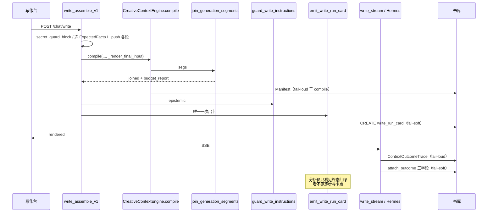
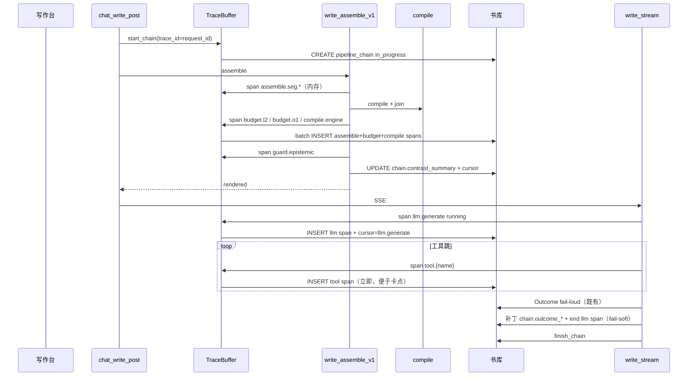
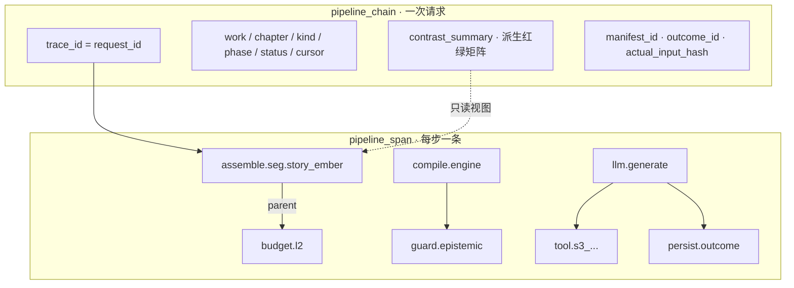

# 铜炉 Pipeline Trace：步骤全量账本 + 可查询链路

| 项 | 值 |
|----|----|
| **文档标题** | 写 / 存 / 宣称 / 工具跳：一次一条链，每步一条 span（系统运行分析主账） |
| **作者** | Grok Design |
| **日期** | 2026-08-14 |
| **状态** | Draft |
| **产品** | 铜炉 / tonglu · 代码 `scribe3/` |
| **仓库** | `/home/admin/projects/scribe-writing-system` |
| **入库路径** | `docs/plans/2026-08-14-pipeline-trace.md` |
| **取代** | `docs/plans/2026-08-13-run-observability.md` **不再是 SSOT**（见 §与旧 Run 卡的关系） |
| **验证** | **仅已部署 demo**（`tonglu.qing.blue` / `82.157.130.140` / `/opt/scribe3/app`）。禁止 Grok 运行机 `npm ci` / 全量 pytest / 本机 Surreal / 第二套库 |
| **运维 env SSOT** | **`/opt/scribe3/app/deploy/prod/.env`**。不要改 `/opt/scribe3/app/.env`，也不要改 `app/.env.production.local` |
| **关联** | 旧卡 `docs/plans/2026-08-13-run-observability.md`；注册表 `scribe3/injection_registry.py`；出卡点 `write_assemble_v1.py` / `write_stream.py` / `misc_routes.save_chapter` / `write.reader_claim_ep`；L1 `docs/L1-AUTH-ISOLATION.md` |

> **读法（工程师）**  
> 1. 先读「对照用户合同」与 Key Decisions。  
> 2. Proposed Design §1–§7 是实现合同。  
> 3. PR Plan 按序独立合；观测 emit 不得阻断写路径。  
> 4. 能由第一性原理钉死的不进 Open Questions。

---

## 对照用户合同（本设计必须满足）

现网管理页「写路径日志」是一张 Run 卡：标题「第 N 章 · 写 · 该进未进 · 2 红 / 10 绿」+ 步骤红绿表。用户 2026-08-14 当面否定：

> 不行啊，我要的是包含每个步骤的全部信息日志，且能够很清晰的看出来是哪个步骤的，能够方便的查询整条链路的关联产生，可以存一个星期。我要的是能够用于系统运行分析的，不是这种只有运行结果的。再次设计最优方案。

| # | 合同 | 现网 `write_run_card` | 本设计 |
|---|------|----------------------|--------|
| 1 | **每步全量分析信息**，不是只给运行结果 | 每行只有 `expected × actual × verdict × quality` 旗 | 每步一条 span：人话名、为何该/不该跑、输入出处、算了什么、产出结构、耗时、被谁裁/跳/失败、父子与同链 id |
| 2 | **步骤身份一眼可辨** | 英文 slug + 前端硬编码中文；默认「只看红行」把绿步藏掉 | 稳定 `step_key` + 中文 `step_title` + `layer`（assemble / compile / guard / llm / persist / claim / tool / budget）；时间线默认**全步** |
| 3 | **整条链路可查询、可关联** | 一张扁平卡；与 Outcome 事后补丁；无法从任意步跳同请求 / 同模型调用 / 同章前后次 / 父子 | `trace_id`（= `request_id`）钉整链；`span_id` / `parent_span_id`；`outcome_id`；同章前后 `prev/next_trace_id`；按 step_key / 红因 / 时间检索 |
| 4 | **保留一周** | 表在、默认 TTL 写 21、**无自动 purge**；分析员体感仍是「最近一次」 | TTL = **7 天**；开书机会清理 + 手动 purge；不是进程内存 last-one |
| 5 | **用途 = 系统运行分析** | 红绿对照尺，UI 已在管理台，但交互是「验收墙」 | 回答：该跑 / 跑没跑 / 跑得好不好 / **卡在哪** / **关联怎么产生**。不是合规审计，不是作者工程墙 |
| 6 | **重新设计，不是给卡加两列** | 卡是主账 | 卡降为链上 `contrast_summary`（对照摘要）。主账是 **chain + span** |

**禁止再做成「一张卡只给红绿结论」。** 红绿仍算，但是派生视图。

---

## Overview

写路径今天有两套「看起来像观测、其实答不了分析员问题」的东西：

1. **碎探针**：进程内 `budget_report`、`/debug/injection-trace` last-one、`ContextOutcomeTrace`（模型成/败/用量/hash）、`ContextTurnView`（信封八块）、章上 `density_trace` last+prev、`pipeline_journal`（批量 ingest 崩溃续跑，与写路径无关）。
2. **刚落地的 Run 卡**（`write_run_card` + `RunLogsPage.jsx`）：一次写/存/宣称一张卡，行是期望×实际×红绿。用户判定这是「只有运行结果」，不够做系统运行分析。

本设计交付 **一书一库、按次落 Surreal 的 Pipeline Trace**：

```text
一次写 / 存 / 宣称 / 工具跳会话  =  一条 pipeline_chain（trace_id = request_id）
每一个可辨步骤                 =  一条 pipeline_span
步骤内部的裁剪序列等           =  span.events[]（不上第三张热表）
期望×实际红绿矩阵             =  chain.contrast_summary（派生，不再当主账）
```

分析员打开管理台「运行链路」页，看到的是 **时间线 + 点一步看全字段 + 同链高亮**，而不是「2 红 / 10 绿」。问「这场空是因为余烬没装、L2 裁光、还是模型没写？」时，顺着 `assemble.seg.story_ember` → `budget.l2` → `llm.generate` 就能答。

提示词正文、破绽词表、secret value **默认不进库、不进 API**。「每步全部信息」= 结构化事实，不是把 96k prompt 存一周。见 KD-5。

---

## Background & Motivation

### 分析员真正要回答的五句

旧方案只承诺三句（该跑 / 跑没跑 / 跑得好不好）。用户要的是**运行分析**，还要「卡在哪」和「关联怎么产生」。

| # | 问题 | 今日能否回答 | 本设计 |
|---|------|--------------|--------|
| 1 | 该跑什么？为何该/不该？ | 半能。卡上有 `expected` + 原因码，但没有「输入从哪来」 | span.`expected` + `input.source` |
| 2 | 跑没跑？算了什么？产出什么结构？ | 不能。只有 `present/empty` + `chars` | span.`compute` + `output.shape` + 长度/hash |
| 3 | 跑得好不好？被谁裁/跳/失败？ | 半能。质量旗 + L2 dropped 堆在卡顶 | 裁在 `budget.l2` span；跳/失败在该步 span；耗时在 `timing` |
| 4 | **卡在哪？** | 不能。卡在 assemble **结束**才 emit；崩在模型中途没有「进行中」 | chain 开请求即建；`cursor_step_key`；`status=in_progress` |
| 5 | **整条链怎么连？** 同请求 / 同模型调用 / 同章前后次 / 父子 | 不能。`request_id` 只钉卡顶；无 span 树 | `trace_id` + `parent_span_id` + 同章前后查询 |

这 **不是** 合规审计（谁删用户、谁登录）。`auth_audit` / `setting_audit` / `audit_event` / `approval_audit` 继续各过各的。

### 现网已落地、用户判定不够的东西（2026-08-14 代码复核）

| 探针 | 锚点 | 缺什么 |
|------|------|--------|
| **`write_run_card`** | 迁移 `139_write_run_card.surql`；`run_card.py` / `run_card_collect.py` / `run_card_store.py` / `store/run_card_ops.py` | **主缺陷**：一次一卡、行是对照结果。没有逐步时序、没有父子、没有耗时、没有「输入出处 / 算了什么 / 产出结构」。assemble 结束才 `emit_write_run_card`（`write_assemble_v1.py` ~L1314），崩在模型里看不到链 |
| 出卡点 | assemble：`compile()` + `guard_write_instructions` 之后；claim：`write.py` ~L1231；save：`misc_routes.save_chapter` `_rc_emit`；Outcome：`write_stream._WriteOutcomeBinding.persist` 内层 try | 只补 `outcome_status` 三个字段，不记 LLM/工具跳过程 |
| 读面 | `GET /debug/run-cards`、`/{run_id}`；管理台 `RunLogsPage.jsx`（AdminConsole tab + SystemHub ops，均 admin） | 列表是「第 N 章 · 写 · 该进未进 · 2 红 / 10 绿」；详情默认「只看红行」 |
| 旗 | `SCRIBE3_RUN_CARD` 默认 1 | 关旗零 I/O。本设计新旗独立，便于回滚新账而不立刻拆旧卡 |
| `budget_report` | `_LAST_WRITE_BUDGET_REPORT` | 进程内存；无期望；重启丢 |
| `ContextOutcomeTrace` | `context_outcome.py`；091/092 READONLY；落库失败 **终止生成** | 模型窄合同；不管 assemble；无存稿路径 |
| `ContextTurnView` | `context_turn_view.py`；迁移 111 | 信封八块 + selected/rejected；不是段期望，不是逐步账 |
| `density_trace` | `density_trace_store.py` | 章上 last+prev；一次章多次写互相覆盖 |
| `SEGMENT_REGISTRY` | `injection_registry.py` **36** 条 + extra（`identity` / `write_protocol` / `revision` / `continue_snapshot` / `tool_scope` / `craft_skills_index` / `benchmark_advisory`） | 目录在；从未变成逐步流水 |
| `pipeline_journal.py` | 批量 ingest/analyze **JSON 文件** 崩溃续跑 | **不是**写路径账本；升格会答错问题（见 Alternatives） |
| `audit_event` | 迁移 124；几乎只 hook `pilot_state` / `memory_item.status` | 合规向状态变更，无期望谓词 |
| `ai_run_trace` | 迁移 074 | 含 `instructions` / `input_text` 字段；禁止混写本账 |
| Hermes otel / Langfuse / Phoenix | Hermes 插件记 turn / generation / tool | **看不见** `SEGMENT_REGISTRY` 期望谓词与章事实；默认想收提示词；账在书库外 |

### 一次写的真实时间线（今日）



### 痛点量化

- 一次写真实发生 **40+ 个装段尝试** + join/L2/O1 + compile + guard + 1 次模型流 + 0–N 工具跳 + Outcome。现网压成 **1 张卡 × ~43 行对照**。
- 卡上禁止存 `text`/`instructions`/`markers`/`prompt`（正确），但同时也没存 **输入出处、函数名、产出 shape、duration_ms、parent_span_id**。分析员看见「余烬 · 该跑 · 空」却不知道是 `collect_story_fuel_segments` 没产出、上章无 `end_hook`、还是 L2 `story_ember:drop`。
- `emit` 在 assemble **返回前**；模型 30s 超时或工具跳失败时，卡已经是「assemble_ok=true / outcome_status=null」。无法表达「卡在 llm.generate」。
- `SCRIBE3_RUN_CARD_TTL_DAYS` 默认 21 且 **只保证手动** `POST /debug/run-cards/purge`。用户要的是「可以存一个星期」的可查历史，不是 21 天堆着也不自动清、也不是进程 last-one。

---

## Goals & Non-Goals

### Goals

| 优先级 | 目标 | 验收口径 |
|--------|------|----------|
| **P0** | chain + span 主账；写路径逐步记（装段/L2/compile/guard）；失败也记；落该书 Surreal；7 天可查 | demo 写一次 → 按 `trace_id` 读回 **时间线**（不是只一张红绿卡）；重启后仍在；崩在 guard 之前仍有 chain + 已完成步 |
| **P1** | LLM span + 每个 tool hop 一条子 span；Outcome 钉到同一 `trace_id`；存稿/宣称逐步记门闩 | 问「模型没写还是工具跳失败」能从链上答；save 409 也有链 |
| **P2** | 管理台改为时间线 + 点一步看全字段 + 同链高亮 + 同章前后次；旧卡降为「对照摘要」tab | 分析员不再把红绿表当主界面；人话步骤名来自后端目录，不是前端墙 |
| **P3** | 7 天自动 purge；双写窗口结束；旧 `GET /debug/run-cards` 改为读 `contrast_summary` | 关 `SCRIBE3_RUN_CARD` 不再丢分析账；旧 API 不炸 |

### Non-Goals

| # | 非目标 | 理由 |
|---|--------|------|
| NG1 | 把 96k 提示词 / 破绽词明文 / secret value 存一周 | 已裁；泄密 + 体积。见 KD-5 |
| NG2 | 合规审计 / 收编 `auth_audit` / `audit_event` / `approval_audit` | 答错问题 |
| NG3 | 作者写作台工程墙；SSE 弹 span 表 | UI 只在管理台独立页 |
| NG4 | Langfuse / Phoenix / SigNoz / hermes-otel / Hermes Dashboard 当主账 | 看不见期望谓词；默认收 prompt；不在书库事务 |
| NG5 | 扩 `context_outcome_trace` / `ai_run_trace` / 章 `density_trace` 当主账 | Outcome fail-loud + READONLY；074 含 instructions；density 只 last+prev |
| NG6 | 把 `pipeline_journal.py` 升格为主账 | 它是批量 ingest 的 JSON 崩溃续跑，故意不进 DB |
| NG7 | 给现网 Run 卡加两列交差 | 用户已否 |
| NG8 | 52 段文学分 / 书评 / 把观测当 GATE 挡写 | 质量仍是分析尺；emit fail-soft |
| NG9 | 重开宣称公式、改 `GATE_SAVE_MODE=soft`、改法律写通道 | 硬约束 |
| NG10 | Grok 机 `npm ci` / 全量 pytest / 本机 Surreal / 第二套库 | 资源纪律 |
| NG11 | 为验收清空 demo 库或另起平行 Surreal | 验证 = 打已部署栈 |

---

## Proposed Design

### 1. 一句话架构

```text
请求入口 mint request_id（= trace_id）并 CREATE pipeline_chain（status=in_progress）
  → 每步 start/end 写入进程内 TraceBuffer（零同步大 JSON）
  → 阶段边界 batch INSERT pipeline_span（assemble 装段+L2、compile、guard、llm、tool、persist）
  → 失败步也 end_span(status=failed|empty|dropped)
  → 阶段开始 UPDATE chain.cursor_step_key（用于「卡在哪」）
  → assemble 结束后用现有 build_run_card 派生 contrast_summary 挂到 chain
  → 模型终态把 outcome_id / usage 钉到 chain + llm span
  → finish_chain(ok|failed)；TTL 7 天
```

旧 `write_run_card`：**过渡期双写**，读面以降级。主账不再是它。

### 2. 目标时间线



存稿 / 宣称同形：入口 `start_chain`，每个门一条 span，409 也 `finish_chain(failed)`。

### 3. 模块落点

| 新/改 | 路径 | 职责 |
|-------|------|------|
| **新** | `scribe3/pipeline_trace.py` | **零 I/O**：`StepDef` 目录、`TraceBuffer`、`start/end_span`、红线擦除、`public_span` / `public_chain` 白名单。禁止 import store / `facts_at` |
| **新** | `scribe3/pipeline_trace_catalog.py` | 稳定 `step_key` + 中文 `step_title` + `layer` + 人话 `does`（这一步算什么）。SEGMENT 36 + extra + 非段步骤。UI/API 只读这里，禁止前端再维护第二份墙 |
| **新** | `scribe3/pipeline_trace_store.py` | fail-soft：`start_chain` / `insert_spans` / `patch_chain` / `finish_chain` / 列表 / 单链 / 按 step_key 查 / purge。对标 `run_card_store.py` |
| **新** | `scribe3/store/pipeline_trace_ops.py` | mixin：`CREATE ONLY pipeline_chain`、`INSERT pipeline_span` 批量、SELECT、UPDATE cursor/outcome/summary、DELETE TTL |
| **新** | `scribe3/migrations/140_pipeline_trace.surql` | 一书一库 SCHEMAFULL。现网最新已落地 **139**；实现前再 `ls scribe3/migrations \| tail`，若已有 140 则顺延 |
| **改** | `scribe3/store/surreal.py` | mixin 挂入 `SurrealStore`，紧挨 `RunCardOpsMixin` |
| **改** | `scribe3/feature_flags.py` | `SCRIBE3_PIPELINE_TRACE` 默认 `"1"`；`SCRIBE3_PIPELINE_TRACE_PREVIEW` 默认 `"0"`；`SCRIBE3_PIPELINE_TRACE_TTL_DAYS` 默认 `"7"` |
| **改** | `scribe3/api/services/write_assemble_v1.py` | 入口 mint `request_id` 并 `start_chain`；`_push` 记 span（内存）；join 后记 L2/O1；compile/guard 后 flush；派生 `contrast_summary` |
| **改** | `scribe3/api/services/write_stream.py` | `llm.generate` + `tool.*` span；Outcome 成功后补丁 chain（**内层 try，禁止 raise**） |
| **改** | `scribe3/api/routers/write.py` | claim：每门一条 span，不再只 `build_gate_run_card` |
| **改** | `scribe3/api/routers/misc_routes.py` | save 同形；新 `GET /debug/pipeline-traces*`；旧 run-cards 保留 |
| **改** | `scribe3/run_card.py` / `run_card_store.py` | **保留**纯函数与双写。`build_run_card` 的产出写入 `chain.contrast_summary`。P3 起默认不再 `CREATE write_run_card` |
| **改 P2** | `scribe3/web/src/admin/RunLogsPage.jsx` | 重做成时间线主界面 + 对照摘要 tab。不回写作台。`test_run_card.py` 里「写作台无卡」钉继续有效 |
| **改 P3** | `scribe3/audit_maintenance.py` 旁或 `pipeline_trace_store.maybe_purge` | 开书机会清理（每进程每书 ≥6h 一次） |

**不改**：`join_generation_segments` 裁剪算法、信封预算、`SEGMENT_REGISTRY` 物理序、Outcome 不可变合同、法律写通道、宣称公式、`GATE_SAVE_MODE`。

**不升格**：`pipeline_journal.py`（批量 ingest JSON 续跑，家在文件系统是故意的）。

### 4. 主模型：chain + span（不是加宽 Run 卡）



**否决「加宽 rows[]」**：再往 `RunCardRow` 塞 `input/compute/output/timing/parent` 会得到一张 40×宽列的结果表，仍然没有「进行中」、没有工具跳子树、没有同链跳转。用户要的是流水账 + 链路图。

### 5. 步骤目录（稳定 `step_key` + 中文 `step_title` + `layer`）

`step_key` 一旦写入库 **不得改名**；展示文案只改 `step_title`。未登记却出现的段：`assemble.seg.{name}`，`step_title=未登记·{name}`，`expected=false`，`expected_reason=unregistered`（与现网卡一致，present → 对照红）。

#### 5.1 层（layer）

| layer | 中文 | 何时出现 |
|-------|------|----------|
| `assemble` | 装段 | `_push` / 燃料收集 / 故事输入加载 |
| `budget` | 预算裁剪 | `apply_l2_trim` / `enforce_total_prompt_budget`（O1） |
| `compile` | 编译 | `CreativeContextEngine.compile`：信封 assemble + Manifest |
| `guard` | 门闩 | `guard_write_instructions`；save/claim 的门见各自 layer |
| `llm` | 模型 | `_stream_write` 整段生成 |
| `tool` | 工具跳 | `HermesEventAdapter` `tool.started` / `tool.output` |
| `persist` | 落库 | Outcome / `save_chapter` |
| `save` | 存稿门 | `loop_busy` / `pilot_busy` / `craft_gate` / `finalize_gate` / `strict_scene` |
| `claim` | 宣称门 | `reader_claim` / `reader_ack` / `anti_meta` / `scaffold_gate_b` |

用户点名的层都在。`budget` / `save` 是分析必需的细分：L2 不是「又一个装段」，存稿门不是 assemble。

#### 5.2 装段（36 + extra）

`step_key = assemble.seg.{name}`。`step_title` 与现网 `RunLogsPage.NAME_LABEL` 对齐并收归后端。`tier`/`zone` 来自 `SEGMENT_REGISTRY`；extra 的 `tier=extra`。

| name | step_title | 输入出处（`input.source`） | 算了什么（`compute.fn`） | 产出结构 |
|------|------------|---------------------------|--------------------------|----------|
| `identity` | 身份 | `_editor_identity_block()` | 恒拼编辑身份 | 身份短块 |
| `write_protocol` | 写协议 | `_protocol_raw` − 与 `final_reminder` 回声 | `subtract_codex_canonical_echoes` | 短核协议 |
| `prefix` | 身份前缀 | anti_slop + 章号 | 恒拼 | L0 前缀 |
| `revision` | 改稿 | 改稿判定 + 原文 | `is_revision_request` | 改稿约束 |
| `structure_diversity` | 结构多样性 | 旗 | `structure_diversity_inject_enabled` | 结构提示 |
| `continue_snapshot` | 续写快照 | 重读 ack / 章快照 | `has_reread_ack` | 续写块 |
| `secret_guard` | 密语守卫 | `_secret_guard_block`（**现网唯一 T0 `facts_at`**） | `prompt_blocks._secret_guard_block` | 揭示或破绽词硬约束（**只记 nonempty / reveal_only，不记 marker 明文**） |
| `focalizer` | 限知视角 | 请求 `focalizer` | `writing_limited_banner` / `writing_omniscient_author_banner` | 限知/全知条幅 |
| `narrative_contract` | 场面合同 | `load_chapter_story_inputs.contract` + `evidence_must_show` | `format_story_contract_head` | 场面头 |
| `story_ember` | 上章余烬 | 上章 `narrative_drive.end_hook` | `collect_story_fuel_segments` | 燃料块 |
| `story_recall` | 世界此刻 | 限知投影后的世界 | 同上 | 燃料块 |
| `story_causal` | 前因后果 | 上章存在性 | 同上 | 燃料块 |
| `event_drive` | 事件驱动 | 叙事引擎 + 无场面 | `_event_drive_block` | 冲突时钟 |
| `event_drive_hook` | 事件钩 | 叙事引擎 + 有场面 | 同上 hook 模式 | 续势钩 |
| `drama_contract` | 戏剧合同 | 章 beats | 戏剧合同块 | 戏剧头 |
| `drama_vacuum` | 戏剧真空 | `should_inject_drama_vacuum` | 无 goal 且无 conflict 才注入 | 真空警告 |
| `outline` | 大纲 | synopsis / beats | outline 块 | 大纲 |
| `envelope` | 信封 | `ContextAssembler.assemble` 八块 | compile 内 assemble | 信封渲染 |
| `codex` | 正典 | `_codex_block(..., for_generation=True)` | `cap_codex_text` | 设定圣经（**不存正文**） |
| `seed_words` | 种子词 | 章 `seed_words` | 有则 push | 种子 |
| `craft` | 工艺 | `list_craft_rules` | 有规则才期望 | 工艺条 |
| `phase_role` | 阶段角色 | `phase` | 相位块 | 角色 |
| `avoid` | 避忌 | 现网默认 omit | 期望恒假 | 通常 absent=绿 |
| `revelation_discipline` | 揭示纪律 | 焦点者 | `_revelation_discipline_block` | 纪律 |
| `sincerity` | 诚意 | 已并入 prefix | 期望恒假 | 不独立 push |
| `purpose` | 本章目的 | 章 purpose | 有则 push | 目的 |
| `volume_intro` | 卷首 | 旗 + 章 volume | compact | 卷首 |
| `brief_must` | 必须发生 | 章 brief | 有则 push | 必须 |
| `pressure_drive` | 压力驱动 | 章 pressure | 有则 push | 压力 |
| `author_prefs` | 作者偏好 | 章 prefs | 有则 push | 偏好 |
| `voice_anchor` | 声口锚 | voice / 章锚 | 有则 push | 声口 |
| `reference_craft` | 参考工艺 | draft/final + briefs | 相位门 | 参考 |
| `storyline_polish` | 故事线打磨 | 旗 + storyline meta | polish | 打磨 |
| `discourse_soft` | 话语讲法 | 旗 + discourse | 软建议 | 话语 |
| `story_move` | 招式 | 旗 + approved plan | `validate_story_move_plan` | 招式 |
| `deduction_final` | 终稿推演 | draft/final + deduction | 相位门 | 推演 |
| `material_recall` | 素材召回 | draft/final + materials | 相位门 | 素材 |
| `final_reminder` | 收束提醒 | 恒有 | 收束 | 提醒 |
| `scene_truth_proj` | 场面真相 | `phase==deduce` | 仅 deduce | 投影 |
| `request_constraint` | 本轮约束 | `extra_instructions` | 有则 push | 约束 |
| `tool_scope` | 工具范围 | `with_tools` | `_s3_work_scope_block` | 范围 |
| `craft_skills_index` | 技法索引 | `with_tools` | `skills_index_block` | 索引 |
| `benchmark_advisory` | 标杆提示 | draft/final + 旗 | `benchmark_inject_enabled` | 标杆 |

期望谓词 **复用** `run_card.expected_for` / `collect_expected_facts`，禁止第二套。冻结点仍是：`load_chapter_story_inputs` 已返回、燃料 `_push` 之前。

#### 5.3 非段步骤（必须有，否则答不了「卡在哪」）

| step_key | step_title | layer | 记什么 |
|----------|------------|-------|--------|
| `assemble.load_story_inputs` | 加载章故事输入 | assemble | `load_chapter_story_inputs` 成败；合同字段名集合（**无四义原文**）；`trace_count` |
| `assemble.collect_fuel` | 收集三燃料 | assemble | 三个 name 是否 got；空原因 |
| `assemble.freeze_expected` | 冻结期望事实 | assemble | `facts_collect_failed` 与否；布尔计数 |
| `budget.l2` | L2 补充裁剪 | budget | `dropped[]`、`effective_l2_cap`、`l2_est`、`soft_exceeded`、半裁/整段丢序列（`events[]`） |
| `budget.o1` | O1 全域硬顶 | budget | `total_enforce.dropped`、`prompt_hard` |
| `compile.envelope` | 组装信封 | compile | 八块 `block_tokens`、selected/rejected **计数**、`envelope_hash` |
| `compile.manifest` | 落 Manifest | compile | `manifest_id`、`actual_input_hash`、`actual_input_bytes` |
| `compile.engine` | 编译引擎 | compile | 总耗时；子步可挂 parent |
| `guard.epistemic` | 限知出口守卫 | guard | `hit_count`、`kinds`、是否 scrub；`EpistemicLeakError` → failed |
| `llm.generate` | 模型生成 | llm | provider/model、status、usage 标量、`output_hash`、`first_token_ms`、`response_id` |
| `tool.{safe_name}` | 工具 · {人话名} | tool | `call_id`、参数 **键名**（不要值）、`output_chars`、`output_hash`、耗时 |
| `persist.outcome` | 落 Outcome | persist | `outcome_id` / status（fail-loud 仍属主链；观测补丁 fail-soft） |
| `persist.turn_bind` | 落 TurnBind | persist | 成败；无块正文 |
| `save.loop_busy` 等 | 见现网 gate 行 | save | 与 `build_gate_run_card` 同行，但每门独立 span + 耗时 |
| `claim.reader_claim` 等 | 宣称门 | claim | 同上 |
| `persist.chapter` | 落章正文 | persist | 字数；**不存正文** |

工具 `step_key`：`tool.` + 只保留 `[a-zA-Z0-9_.:-]` 的截断名（≤64）。未知工具进 `tool.unknown`。

### 6. 关联键

| 键 | 定义 | 用途 |
|----|------|------|
| **`trace_id`** | **= `request_id`**。写路径：在 `assemble` **入口** mint `uuid4().hex`，稍后交给 `ContextRequest.request_id`（今日在 `write_assemble_v1.py` ~L1078 才 mint，**前移**）。存/宣：handler 入口 mint | 整条链主键；与 Manifest / Outcome / 旧卡同一枚钉子 |
| **`span_id`** | 16 hex（`token_hex(8)`） | 单步 |
| **`parent_span_id`** | 装段 parent=`assemble.load_story_inputs` 或隐式 `assemble.batch`；tool parent=`llm.generate`；L2 parent=`compile.engine` | 树 / 同链高亮 |
| **`outcome_id`** | 既有 sha256 身份；模型结束后补丁到 chain + llm span | 跳到模型窄留痕 |
| **`run_id`** | 旧卡 24 hex，写入 `chain.contrast_run_id` | 过渡期旧 API |
| **`manifest_id`** | `compiled.manifest.manifest_hash` | 与实际进模型字节对拍 |
| **`work` / `chapter` / `kind` / `phase`** | 与现网卡同 | 按书按章按类 |
| **`prev_trace_id` / `next_trace_id`** | **读时计算**，不存（同 work+chapter+kind，`created_at` 邻接） | 同章前后次 |

**不要**再发明第三枚「chain_id ≠ request_id」。分析员脑子里只有「这一次请求」。

### 7. 逐步 emit（失败也记；禁止只在 assemble 结束出一张）

#### 7.1 缓冲 + 阶段刷盘

热路径禁止每步同步 CREATE（40+ 次会把生成拖死）。合同：

| 时机 | 写什么 | I/O |
|------|--------|-----|
| 请求入口 | `pipeline_chain` `status=in_progress`，`cursor=assemble.load_story_inputs` | 1 次 CREATE |
| `_push` / 燃料 / 冻期望 | span 只进 `TraceBuffer` | **0** |
| `join_generation_segments` 返回后 | L2 / O1 span 进缓冲；**flush assemble+budget** | 1 次 batch INSERT（≤64 行） |
| `compile()` 返回 | compile spans；flush；`cursor=guard.epistemic` | 1 次 INSERT + 1 次 UPDATE cursor |
| guard 结束 | guard span；派生 `contrast_summary`；`cursor=llm.generate` | 1 INSERT + 1 UPDATE |
| SSE 开始 | llm span `status=running` | 1 INSERT（立即，否则崩在模型时链上没有 llm） |
| 每个 tool hop **结束** | tool span | 1 INSERT（工具少、耗时长，立即记才能看卡点） |
| Outcome 成功后 | 补丁 chain + end llm + persist.outcome | 内层 try |
| 任何未捕获失败 | `end_span(failed)` + `finish_chain(failed)` | fail-soft |
| 正常结束 | `finish_chain(ok)` + `headline` | 1 UPDATE |

`EpistemicLeakError` 保持现网上抛；在 raise 之前 fail-soft 记 guard span + `finish_chain(failed)`。**禁止为出链再打 `facts_at`。**

关旗 `SCRIBE3_PIPELINE_TRACE=0`：`start_chain` 第一行 return，**零 I/O**（含不 CREATE chain）。

#### 7.2 TraceBuffer（进程内，可单测）

```python
# scribe3/pipeline_trace.py — 零 I/O
SCHEMA_VER = "pipeline_trace.v1"

@dataclass
class SpanRec:
    span_id: str
    parent_span_id: str | None
    trace_id: str
    step_key: str
    step_title: str
    layer: str
    status: str          # running|ok|skipped|empty|dropped|failed
    expected: bool | None
    expected_reason: str | None
    actual: str | None   # 复用 ActualKind + running
    actual_reason: str | None
    verdict: str | None  # 对照尺，可空（llm/tool 无 expected）
    input: dict
    compute: dict
    output: dict
    timing: dict         # started_ns, ended_ns, duration_ms
    events: list[dict]   # 如 L2 每次半裁/丢段
    quality: dict
    error: dict | None   # {class, summary[:240]} 无栈里的 secret
    links: dict

class TraceBuffer:
    def start_chain(self, *, work, chapter, kind, phase, trace_id) -> None: ...
    def start_span(self, step_key: str, *, parent: str | None = None) -> str: ...
    def end_span(self, span_id: str, **fields) -> None: ...
    def drain_ready(self) -> list[dict]: ...   # 已 end 且未 flush
    def snapshot_chain_patch(self) -> dict: ...
```

`write_assemble_v1` 已有 `_run_card_ctx` holder；**同时**用 `contextvar` 挂 `TraceBuffer`，让 `write_stream` / save / claim 不必把 holder 传进 Hermes 循环。contextvar 未设置时所有 emit no-op。

#### 7.3 单步字段合同（「全部信息」的精确定义）

默认落库 / 默认 API **只允许**这些键（`public_span` 白名单）。这就是用户要的「每步全部信息」：

```python
{
  "span_id": "a1b2c3d4e5f67890",
  "parent_span_id": "…",
  "trace_id": "…",              # = request_id
  "work": "shu_xxx",
  "chapter": 16,
  "kind": "write",              # write|save|claim
  "step_key": "assemble.seg.story_ember",
  "step_title": "上章余烬",
  "layer": "assemble",
  "tier": "L2",
  "zone": "head",
  "status": "empty",
  "expected": True,
  "expected_reason": "prev_end_hook",
  "actual": "empty",
  "actual_reason": "empty_story_ember",
  "verdict": "red",
  "input": {
    "source": "chapter[n-1].narrative_drive.end_hook",
    "source_kind": "chapter_meta",
    "chars_in": 0,
    "digest_in": None,
    "from_span_id": None
  },
  "compute": {
    "fn": "collect_story_fuel_segments",
    "predicates": ["prev_end_hook"],
    "flags": []
  },
  "output": {
    "shape": "fuel_block",
    "chars": 0,
    "tokens_est": 0,
    "digest": None,
    "title_only": False
  },
  "timing": {"started_at": "…Z", "ended_at": "…Z", "duration_ms": 1.8},
  "events": [],
  "quality": {"title_only": False, "trimmed": False},
  "error": None,
  "links": {
    "manifest_id": "…",
    "outcome_id": None,
    "contrast_run_id": "…"
  }
}
```

**禁止键**（与现网卡同一红线，单测锁）：`text` / `instructions` / `markers` / `prompt` / `arguments` 原文 / `output` 原文 / secret value / leak_markers。

可选预览（**单独旗，默认关**）见 §Security。

#### 7.4 `headline`：列表用人话一句，不是「2 红 / 10 绿」

`finish_chain` 从 spans 生成 ≤80 字中文，例如：

```text
余烬空（无正文）· L2 整段丢 material_recall · 模型 succeeded 出 2104 hash
```

```text
卡在 模型生成（进行中 41s）· 已装 38 段 · 余烬有 420 字
```

规则：优先报红步的 `step_title+actual_reason`，再报 L2 dropped，再报 llm status。列表主列用 `headline`，红绿计数缩到次要。

### 8. 与现网 `write_run_card` 的关系

| 阶段 | 行为 |
|------|------|
| **P0–P2（双写窗）** | 仍 `emit_write_run_card`（旧 UI / 旧 API 不炸）。同时写 chain+span。`build_run_card` 结果 **拷进** `chain.contrast_summary`（可去 `rows` 里的重复大字段，或整卡 public 形状） |
| **P3** | 默认 **停止** `CREATE write_run_card`。`GET /debug/run-cards` 改为：按 `contrast_run_id` / `request_id` 读 chain，返回 `contrast_summary`。旗 `SCRIBE3_RUN_CARD=1` 只表示「还要派生对照摘要」，不再表示「对照是主账」 |
| **永久保留** | `run_card.py` 纯函数（期望谓词 + 红绿）。它们是对照摘要的计算器，不是账本 |

旧设计 `docs/plans/2026-08-13-run-observability.md`：实现 PR1 在文首加横幅「已被 `2026-08-14-pipeline-trace.md` 取代；卡降为 contrast_summary」。

**保留的旧 KD（仍然有效）**：期望事先算、红绿是对照尺、出卡 fail-soft、禁止 `facts_at` 第二下、永不回传 prompt、L1 `?work=`、Outcome 补丁禁止写进 fail-loud `persist()`。

**作废的旧 KD**：主真相 = Run 卡；P0 只在 assemble 结束唯一一次 emit；TTL 21 且不自动清；作者栏一行红绿（本设计连作者栏都不做）。

### 9. 查询与管理页

#### 9.1 API

鉴权与现网 `/debug/run-cards` **同权**：登录；`?work=` + `assert_user_may_access_work`；admin 跨书；省略 work 回落默认书 **仍做归属**。`/debug/*` 不在 `_GLOBAL_PREFIXES`（`auth/middleware.py` L42–51）。响应永不含 prompt。UI 只挂管理台（`planes.js` ops `adminOnly` + `AdminConsole` tab）。

```text
GET  /debug/pipeline-traces?work=&chapter=&kind=&step_key=&status=&flag=&since=&until=&q=&limit=20
GET  /debug/pipeline-traces/{trace_id}?work=
GET  /debug/pipeline-traces/{trace_id}/spans?work=&layer=
GET  /debug/pipeline-spans?work=&step_key=&status=&chapter=&limit=50
POST /debug/pipeline-traces/purge?work=&days=
```

`q`：精确 `trace_id` / `request_id` / `outcome_id` / `span_id`（hex），不是全文检索正文。

**列表项**（无 span 数组）：

```json
{
  "trace_id": "e3b0…",
  "kind": "write",
  "chapter": 16,
  "phase": "draft",
  "status": "ok",
  "cursor_step_key": null,
  "headline": "余烬空 · L2 丢 material_recall · 模型 succeeded",
  "started_at": "…",
  "duration_ms": 12840,
  "span_count": 47,
  "red_count": 2,
  "outcome_status": "succeeded",
  "prev_trace_id": "…",
  "next_trace_id": null
}
```

**单链**：上表 + `spans[]`（时间序）+ `contrast_summary`（旧卡 public 形状，可折叠）+ `tree`（`span_id → children[]`，前端画缩进，不必二次请求）。

`limit` 默认 20，硬顶 100。进行中超过 10 分钟的链：`status` 仍 `in_progress`，列表标「可能卡在 {step_title}」。

#### 9.2 管理页长什么样

重写 `RunLogsPage.jsx`（不要再做一张「结果卡」）：

```text
┌ 运行链路（系统分析）· 不是审计 · 不展示提示词 ─────────────┐
│ 书 ▾  章 __  类型 写/存/宣  步骤 ▾  状态 ▾  红因 ▾  时间  刷新 │
│ 搜索 trace / request / outcome ……………………………………… │
├──────────────────┬──────────────────────────────────────┤
│ 时间线列表        │ 链详情                                │
│ 16:02 第16章 写   │ 头条：余烬空 · L2 丢素材 · 模型成功     │
│ 余烬空·L2丢素材   │ 耗时 12.8s · 47 步 · 2 对照红          │
│ 12.8s · 进行完    │ [时间线] [对照摘要] [同章前后]          │
│                  │                                      │
│ 15:40 第16章 写   │ ● 加载章故事输入  3ms  ok              │
│ 卡在模型生成 41s  │ ● 上章余烬      2ms  空  该跑          │
│                  │ ● 世界此刻      8ms  有  1840字        │
│                  │ ● L2 补充裁剪   4ms  丢 material_recall│
│                  │ ● 编译引擎     90ms  ok  manifest=…    │
│                  │ ● 限知出口守卫  5ms  0 hit             │
│                  │ ● 模型生成    11.2s  succeeded  2.1k   │
│                  │    └ 工具 · s3_search   400ms  ok      │
│                  │ ● 落 Outcome    6ms  ok                │
└──────────────────┴──────────────────────────────────────┘
点「上章余烬」右侧 inspector：

  步骤  上章余烬    assemble.seg.story_ember    L2 / head
  该跑  要有（prev_end_hook）
  实际  空 / empty_story_ember
  输入  chapter[n-1].narrative_drive.end_hook · 0 字
  计算  collect_story_fuel_segments · predicates=[prev_end_hook]
  产出  fuel_block · 0 字 · 非 title_only
  耗时  2ms
  关联  父=assemble.collect_fuel · 同链高亮 · 上一写=15:40
```

交互钉死：

1. 默认 **全步时间线**（按 `started_at`），不是「只看红行」。红步用色标，可另开「只看异常」。
2. 点一步：右侧 inspector 展示 §7.3 **全部白名单字段**，人话标签。
3. 同链高亮：点一步，时间线上同 `trace_id` 的边与父子缩进加亮。
4. 「对照摘要」tab 渲染旧卡矩阵（派生），标题写明「对照尺，不是流水账」。
5. 「同章前后」左右翻 `prev_trace_id` / `next_trace_id`。
6. 进行中的链置顶或标橙。
7. **不回** `WriteLayout.jsx`（现网 `test_write_layout_has_no_run_card_ui` 继续锁）。

页面标题由「写路径日志」改为「运行链路」。`planes.js` / `AdminConsole` 文案同步。

### 10. 热路径成本

| 约束 | 数字 |
|------|------|
| 纯函数记一步 | p99 &lt; 0.2ms（内存 dict） |
| 阶段 batch INSERT | p95 &lt; 40ms；超时/失败丢本批，**不重试循环** |
| 入口 CREATE chain | p95 &lt; 20ms；失败则整链降级为「只 remember 进程内」，生成继续 |
| llm/tool 单条 INSERT | p95 &lt; 15ms；失败只 warning |
| 单 span JSON | 硬顶 4 KB；超了砍 `events[]` 尾 |
| 单链 span 数 | 硬顶 128；超出记 `chain.notes=span_cap` 并停止新 span |
| 预览扫描 | 关旗 0 字节；开旗硬顶 240 字且只对 **显式允许的 step_key**（默认仅 fuel 三段） |

禁止在 `_push` 循环里 `json.dumps` 大对象、禁止同步扫 96k 正文（现网召回扫描 4000 字只服务于对照摘要的 `secret_hit_count`，保持，且关 `SCRIBE3_RUN_CARD` 时不跑）。

---

## API / Interface Changes

### 写路径对外

`POST /chat/write` **不**把 span 表推给作者。P2 可选在 SSE `done` 只加：

```json
{"trace_id": "…"}
```

缺省管理页不依赖这条（按 work+chapter 刷即可）。作者主表面零展示。

### 旧 API

| 路由 | P0–P2 | P3 |
|------|-------|----|
| `GET /debug/run-cards` | 仍读 `write_run_card` 表 | 读 `pipeline_chain.contrast_summary` |
| `GET /debug/injection-trace` | 并列 `run_card` + 若有则 `trace_id` | 以最新 chain 为主，卡为摘要 |

OpenAPI：新 handler **必须带 annotations** 再 rebind（现网 injection-trace 已踩过坑）。

---

## Data Model Changes

### 为何两张新表

| 方案 | 否决 |
|------|------|
| 加宽 `write_run_card.rows` | 仍是结果矩阵；无进行中；无工具子树 |
| 扩 `context_outcome_trace` | 091/092 READONLY；fail-loud；assemble 在模型前；存稿无 Outcome |
| 章上 JSON | last+prev，丢历史 |
| `audit_event` | SCHEMALESS hook；语义是状态审计 |
| `ai_run_trace` | 074 含 instructions |
| 只内存环形缓冲 | 重启丢，违反「存一周」 |

### 迁移 `140_pipeline_trace.surql`

一书一库。`apply_schema` 按 `f.stem` 去重。STYLE 对齐 139 / 111：SCHEMAFULL、IF NOT EXISTS、无正文。迁移失败挡开书（`SCHEMA_SOFT=0`）——**不是** emit fail-soft。先对一本非主线试写书 `_store_for`。

```surql
-- 140_pipeline_trace.surql · 写路径步骤全量账（系统分析）
-- 不含提示词正文 / secret value / leak_markers / 工具参数原文。

DEFINE TABLE IF NOT EXISTS pipeline_chain SCHEMAFULL;
DEFINE FIELD IF NOT EXISTS trace_id ON pipeline_chain TYPE string;
DEFINE FIELD IF NOT EXISTS work ON pipeline_chain TYPE string;
DEFINE FIELD IF NOT EXISTS chapter ON pipeline_chain TYPE int;
DEFINE FIELD IF NOT EXISTS kind ON pipeline_chain TYPE string
  ASSERT $value IN ['write', 'save', 'claim'];
DEFINE FIELD IF NOT EXISTS phase ON pipeline_chain TYPE option<string>;
DEFINE FIELD IF NOT EXISTS status ON pipeline_chain TYPE string
  ASSERT $value IN ['in_progress', 'ok', 'failed', 'abandoned'];
DEFINE FIELD IF NOT EXISTS cursor_step_key ON pipeline_chain TYPE option<string>;
DEFINE FIELD IF NOT EXISTS headline ON pipeline_chain TYPE option<string>;
DEFINE FIELD IF NOT EXISTS started_at ON pipeline_chain TYPE datetime;
DEFINE FIELD IF NOT EXISTS ended_at ON pipeline_chain TYPE option<datetime>;
DEFINE FIELD IF NOT EXISTS duration_ms ON pipeline_chain TYPE option<float>;
DEFINE FIELD IF NOT EXISTS span_count ON pipeline_chain TYPE int;
DEFINE FIELD IF NOT EXISTS red_count ON pipeline_chain TYPE int;
DEFINE FIELD IF NOT EXISTS manifest_id ON pipeline_chain TYPE option<string>;
DEFINE FIELD IF NOT EXISTS actual_input_hash ON pipeline_chain TYPE option<string>;
DEFINE FIELD IF NOT EXISTS outcome_id ON pipeline_chain TYPE option<string>;
DEFINE FIELD IF NOT EXISTS outcome_status ON pipeline_chain TYPE option<string>;
DEFINE FIELD IF NOT EXISTS outcome_usage ON pipeline_chain TYPE option<object> FLEXIBLE;
DEFINE FIELD IF NOT EXISTS contrast_run_id ON pipeline_chain TYPE option<string>;
DEFINE FIELD IF NOT EXISTS contrast_summary ON pipeline_chain TYPE option<object> FLEXIBLE;
DEFINE FIELD IF NOT EXISTS notes ON pipeline_chain TYPE option<array>;
DEFINE FIELD IF NOT EXISTS schema_ver ON pipeline_chain TYPE string;
DEFINE FIELD IF NOT EXISTS created_at ON pipeline_chain TYPE datetime VALUE time::now() READONLY;

DEFINE INDEX IF NOT EXISTS pipeline_chain_id_idx ON pipeline_chain FIELDS trace_id UNIQUE;
DEFINE INDEX IF NOT EXISTS pipeline_chain_work_ch_idx ON pipeline_chain FIELDS work, chapter, created_at;
DEFINE INDEX IF NOT EXISTS pipeline_chain_kind_idx ON pipeline_chain FIELDS kind, created_at;
DEFINE INDEX IF NOT EXISTS pipeline_chain_status_idx ON pipeline_chain FIELDS status, created_at;
DEFINE INDEX IF NOT EXISTS pipeline_chain_outcome_idx ON pipeline_chain FIELDS outcome_id;
DEFINE INDEX IF NOT EXISTS pipeline_chain_created_idx ON pipeline_chain FIELDS created_at;

DEFINE TABLE IF NOT EXISTS pipeline_span SCHEMAFULL;
DEFINE FIELD IF NOT EXISTS span_id ON pipeline_span TYPE string;
DEFINE FIELD IF NOT EXISTS parent_span_id ON pipeline_span TYPE option<string>;
DEFINE FIELD IF NOT EXISTS trace_id ON pipeline_span TYPE string;
DEFINE FIELD IF NOT EXISTS work ON pipeline_span TYPE string;
DEFINE FIELD IF NOT EXISTS chapter ON pipeline_span TYPE int;
DEFINE FIELD IF NOT EXISTS kind ON pipeline_span TYPE string;
DEFINE FIELD IF NOT EXISTS step_key ON pipeline_span TYPE string;
DEFINE FIELD IF NOT EXISTS step_title ON pipeline_span TYPE string;
DEFINE FIELD IF NOT EXISTS layer ON pipeline_span TYPE string;
DEFINE FIELD IF NOT EXISTS tier ON pipeline_span TYPE option<string>;
DEFINE FIELD IF NOT EXISTS zone ON pipeline_span TYPE option<string>;
DEFINE FIELD IF NOT EXISTS status ON pipeline_span TYPE string;
DEFINE FIELD IF NOT EXISTS expected ON pipeline_span TYPE option<bool>;
DEFINE FIELD IF NOT EXISTS expected_reason ON pipeline_span TYPE option<string>;
DEFINE FIELD IF NOT EXISTS actual ON pipeline_span TYPE option<string>;
DEFINE FIELD IF NOT EXISTS actual_reason ON pipeline_span TYPE option<string>;
DEFINE FIELD IF NOT EXISTS verdict ON pipeline_span TYPE option<string>;
DEFINE FIELD IF NOT EXISTS input ON pipeline_span TYPE option<object> FLEXIBLE;
DEFINE FIELD IF NOT EXISTS compute ON pipeline_span TYPE option<object> FLEXIBLE;
DEFINE FIELD IF NOT EXISTS output ON pipeline_span TYPE option<object> FLEXIBLE;
DEFINE FIELD IF NOT EXISTS timing ON pipeline_span TYPE option<object> FLEXIBLE;
DEFINE FIELD IF NOT EXISTS events ON pipeline_span TYPE option<array>;
DEFINE FIELD IF NOT EXISTS events.* ON pipeline_span TYPE object FLEXIBLE;
DEFINE FIELD IF NOT EXISTS quality ON pipeline_span TYPE option<object> FLEXIBLE;
DEFINE FIELD IF NOT EXISTS error ON pipeline_span TYPE option<object> FLEXIBLE;
DEFINE FIELD IF NOT EXISTS links ON pipeline_span TYPE option<object> FLEXIBLE;
DEFINE FIELD IF NOT EXISTS schema_ver ON pipeline_span TYPE string;
DEFINE FIELD IF NOT EXISTS created_at ON pipeline_span TYPE datetime VALUE time::now() READONLY;

DEFINE INDEX IF NOT EXISTS pipeline_span_id_idx ON pipeline_span FIELDS span_id UNIQUE;
DEFINE INDEX IF NOT EXISTS pipeline_span_trace_idx ON pipeline_span FIELDS trace_id, created_at;
DEFINE INDEX IF NOT EXISTS pipeline_span_step_idx ON pipeline_span FIELDS work, step_key, created_at;
DEFINE INDEX IF NOT EXISTS pipeline_span_status_idx ON pipeline_span FIELDS status, created_at;
DEFINE INDEX IF NOT EXISTS pipeline_span_created_idx ON pipeline_span FIELDS created_at;
```

主键用 **纯 hex**（与 139 同一纪律）：`CREATE ONLY type::record('pipeline_chain', $trace_id)`。`trace_id` 已是 uuid4 hex。`span_id` 16 hex。禁止 `pt:` 冒号进 record id。

**可变字段**（仅这些允许 UPDATE）：

- chain：`status` / `cursor_step_key` / `headline` / `ended_at` / `duration_ms` / `span_count` / `red_count` / `manifest_id` / `actual_input_hash` / `outcome_*` / `contrast_*` / `notes`
- span：原则上 CREATE 后不改；仅 `llm.generate` 允许把 `running` → 终态（同 `span_id` UPDATE）。工具 span 结束才 INSERT。

### Store mixin

```python
# store/pipeline_trace_ops.py
class PipelineTraceOpsMixin:
    def create_only_pipeline_chain(self, trace_id: str, fields: dict) -> None: ...
    def insert_pipeline_spans(self, rows: list[dict]) -> None: ...
    def update_pipeline_chain(self, trace_id: str, fields: dict) -> None: ...
    def update_pipeline_span(self, span_id: str, fields: dict) -> None: ...
    def get_pipeline_chain(self, trace_id: str) -> dict | None: ...
    def list_pipeline_chains(self, *, chapter=None, kind=None, status=None,
                             step_key=None, since=None, until=None,
                             limit=20) -> list[dict]: ...
    def list_pipeline_spans(self, *, trace_id=None, step_key=None,
                            status=None, chapter=None, limit=50) -> list[dict]: ...
    def neighbor_traces(self, *, work, chapter, kind, created_at) -> dict: ...
    def purge_pipeline_traces_older_than(self, days: int) -> dict: ...
```

`purge` 必须 **先 DELETE span 再 DELETE chain**（按 `created_at`）。不要依赖 Surreal 企业 TTL 模块。

`step_key` 过滤：列表链时用 `WHERE trace_id IN (SELECT trace_id FROM pipeline_span WHERE step_key=$k AND status IN …)`，注意 limit。若 Surreal 子查询别扭，P0 可先拉链再在 Python 滤，P1 再补专用索引查询。

### TTL = 7 天（自动清）

| 项 | 值 |
|----|----|
| 默认 | `SCRIBE3_PIPELINE_TRACE_TTL_DAYS=7` |
| 双写窗内旧卡 | `SCRIBE3_RUN_CARD_TTL_DAYS` **改为默认 7**（与用户合同对齐；旧文档 21 作废） |
| 自动 | `_store_for` 成功 `apply_schema` 之后 `maybe_purge_pipeline_traces(st)`：每 **进程每书 6 小时** 最多一次（模块级 `{work: last_ts}`）。fail-soft |
| 手动 | `POST /debug/pipeline-traces/purge` + 旧 `POST /debug/run-cards/purge` |
| 不挂 | `agent_crons.py` 只是 Hermes cron **目录**，不是清表转盘。禁止假装有现成 nightly |

进行中超过 24h 的 chain：purge 时标 `abandoned` 或直接按 `created_at` 删（更简单：只按时间删，分析员看到「可能卡在」只对 10min–24h 窗口）。

### 体积估算

| 假设 | 值 |
|------|-----|
| 活跃书每天写 | 20–80 次 assemble（含试写）；save+claim 10–20；工具跳中位 0–2 |
| 每写 span 数 | 装段 ~43 + load/fuel/freeze 3 + L2/O1 2 + compile 2 + guard 1 + llm 1 + persist 1–2 ≈ **53**；+工具 |
| 每 span | 白名单标量 ≈ **0.6–1.2 KB**（无正文） |
| 每 chain 头 | ≈ 2–8 KB（含 contrast_summary；若摘要带 rows ≈ 12 KB） |
| 一次写 | **35–80 KB** |
| 80 写/天 | ≈ 3–6 MB/天/书 |
| **7 天** | ≈ **20–45 MB/书** 上限（活跃）；冷书近 0 |
| 双写旧卡 | 再加 ~12–16 KB/次 ≈ +9 MB/周；P3 停 CREATE 后消失 |
| 对比 | 一章散文 10–40 KB；本账周量与几天正文同量级 |

风险不在磁盘，在 **阶段 INSERT 尾延迟**。控制：批量、失败丢弃、单 span 4 KB 帽、128 span 帽。

**若误把 prompt 预览默认打开**：一次 240 字 × 43 段 ≈ 10 KB 额外，可接受；但泄密不可接受。故默认关，且默认 API 不回预览字段。

---

## 失败纪律

| 场景 | 行为 |
|------|------|
| `TraceBuffer` / catalog 抛错 | 吞掉、warning、生成继续 |
| CREATE chain 失败 | 后续 span 只留内存；不重试打爆 Surreal |
| batch INSERT 失败 | 丢本批；chain.notes 记 `flush_failed` |
| 关旗 `SCRIBE3_PIPELINE_TRACE=0` | 零 I/O |
| `_secret_guard_block` / `facts_at` 失败 | **保持 T0 上抛**。观测禁止第二下 `facts_at` |
| `collect_expected_facts` 失败 | 段 span 仍记实际；`expected=null`；`assemble.freeze_expected` failed |
| `EpistemicLeakError` | 先 fail-soft 记 span + finish_chain(failed)，再上抛 |
| Outcome `save_outcome` 失败 | **保持 fail-loud 终止生成** |
| Outcome **观测补丁**失败 | 只 warning，不 raise（写在 `persist()` 成功之后的内层 try，对齐现网 `attach_outcome_to_run_card`） |
| 迁移 140 失败 | 挡开书。关旗救不了坏 schema |
| 读 API 非 owner / 不存在 | 403 / 404 |
| span JSON 混入禁键 | `public_span` 丢弃；单测锁 |

`GATE_SAVE_MODE=soft`、法律写通道、宣称公式：**本设计碰都不碰**。save/claim 只在现有 `raise` 之前的 fail-soft 钩子里记 span。

---

## Security & Privacy Considerations

| 威胁 | 严重度 | 缓解 |
|------|--------|------|
| 库/API 泄漏 96k 提示词或破绽词 | **高** | schema 无 text；白名单；单测禁键；预览默认关 |
| 工具参数带出章文/密钥 | **高** | tool span 只存参数 **键名** + output 长度/hash |
| 跨书读链 | **高** | L1 `?work=` + owner；admin 例外已有 |
| 未登录扫 debug | 中 | AUTH 开则 401 |
| `trace_id` 枚举 | 低 | uuid4 hex；无归属仍 403 |
| Outcome error 原文回流 | 中 | 只抄 status + 数值 usage；error 最多 `class` + 240 字摘要且过红线擦除 |
| 预览旗被生产误开 | **高** | 默认 0；开时截断 240 + 擦除；**默认 GET 仍不回 `preview` 除非 `?preview=1` 且旗开** |
| 出链拖慢被 DoS | 低 | fail-soft + 批量 + 帽 |

威胁模型 **不包括**「用本账做合规举证」。

### 为何「不存 prompt」仍满足「每步全部信息」（钉死）

分析员要判断的是 **系统行为**：

- 余烬空？看 `input.source` + `actual_reason=empty_story_ember` + `output.chars=0`，不需要 end_hook 原文。
- L2 裁光？看 `budget.l2.events` 里的 `story_ember:drop`，不需要被裁段落正文。
- 模型没写？看 `llm.generate.status` + `output_hash` + `usage.output_tokens`，不需要 96k instructions。

「全部信息」= 每步的结构化事实闭环（身份、期望、输入出处、计算、产出结构、时序、关联、错误摘要）。**不是**全部字节。若某次排障必须看片段：开 `SCRIBE3_PIPELINE_TRACE_PREVIEW=1`（**须 compose recreate 才进进程**，`deploy_demo.sh hot` 不重读 env），只对白名单 step 存 ≤240 字，过现网 epistemic/红线擦除，默认 API 不吐。这是例外通道，不是主账。

---

## Observability

本账就是观测。另外：

| 信号 | 方式 |
|------|------|
| `pipeline_trace_flush_ms` / `flush_ok` | 结构化日志；失败 warning |
| `pipeline_trace_chain_open_ms` | info |
| 进行中超时 | 管理页标橙；不接 pager |
| 红步率 | 调试过滤，不进作者 KPI |
| demo 冒烟 | 写一章 → GET 单链 200 且 `spans.length ≥ 10` 且含 `assemble.seg.story_recall` 与 `llm.generate`（或失败链含 cursor） |

禁止把「落库成功数」当成本 KPI。

---

## Rollout Plan

1. **代码默认开** `SCRIBE3_PIPELINE_TRACE=1`。回滚：在 **`/opt/scribe3/app/deploy/prod/.env`** 设 `=0`，再 **compose recreate**（`deploy_demo.sh hot` = `docker cp` + `restart`，**不重读 env_file**）。不要改 `/opt/scribe3/app/.env`。
2. 迁移 140 随该书首次 `_store_for` → `apply_schema`。失败不标 `_migration`，demo `SCRIBE3_SCHEMA_SOFT=0` 会让整书写路径不可用。先试写书，再热更活书 worker。
3. 双写窗内旧卡继续写，旧页暂可看对照。P2 上新时间线后，对照降为 tab。
4. 验收 = **已部署 demo 冒烟**，禁止为验收清空库、禁止第二套 Surreal、禁止 Grok 机全量测。
5. 回滚旗即停**写链**；旧数据不自动消失，靠 7 天 purge。不必 DROP TABLE。
6. P3 停 `CREATE write_run_card` 可单独回滚（再开 `SCRIBE3_RUN_CARD_PERSIST=1` 一类窄旗，若需要）。

---

## 风险（显式）

| 风险 | 严重度 | 缓解 |
|------|--------|------|
| 阶段 INSERT 拖慢写路径 | 中 | 关旗零 I/O；p95 预算；失败丢弃 |
| 140 语法错误挡开书 | **高** | 先试写书 apply_schema；禁止 OVERWRITE |
| 误把「不该跑」标红 | **高** | 期望复用 `expected_for`；PR1 锁旧 `test_run_card.py` 样例 |
| 双写让分析员仍盯旧页 | 中 | P2 必须改默认 UI；headline 替代「2 红/10 绿」 |
| 预览/禁键泄漏 | **高** | 白名单 + 单测；预览默认关 |
| llm span 在 SSE 前未插入 | 中 | SSE 开始立即 INSERT running |
| 工具输出当 span 正文 | **高** | 只 hash/长度 |
| 与 Outcome fail-loud 认知混淆 | 中 | chain 上 `outcome_status` 与 span `llm.generate.status` 分开列 |
| 一周体积超估 | 低 | 4 KB/128 帽；7 天自动删 |
| contextvar 在 rebind/线程丢失 | 中 | assemble 同时持有 holder；stream 在开 SSE 前 bind |

---

## Alternatives Considered

### A. 给 Run 卡加列（input/duration/parent）

实现最快，旧页能「看起来丰富一点」。  
**否决**：用户已否定「只有运行结果」和「加两列交差」。扁平 rows 仍无进行中、无工具子树、无「卡在哪」、无同链图。

### B. Langfuse / Phoenix / hermes-otel 当主账

Hermes 官方 `observability/langfuse` 能记 turn / generation / tool（`docs/external/hermes-agent-docs/**/built-in-plugins`）。OTel span 适合网关跳。  
**复核结论（2026-08-14，维持上次裁断）**：

1. 它们 **看不到** `SEGMENT_REGISTRY` 与 `expected_for`（四义是否口号、招式旗、`end_hook`、`should_inject_drama_vacuum`）。
2. 默认轨迹想收 `instructions` / messages，与 KD-5 冲突。
3. 账在书库外，一书一 Surreal 的 L1 归属、7 天 TTL、管理页都对不齐。
4. 铜炉要回答的是「这场空是余烬没装还是 L2 裁光」，不是 token 账单。

**保留**：P3+ 可用 `trace_id` 做「打开网关跳」的次优链接，**永不**反写主账。本设计不引入 SDK。

### C. 把 `pipeline_journal.py` 升格

Journal 是 **JSON 文件** + `os.replace`，为了在 **DB 不可用** 时仍能续跑批量 ingest。  
**否决**：写路径 DB 可用是前提；journal 没有期望谓词、没有跨请求查询、没有管理页、没有 7 天历史索引。把它塞进 Surreal 会背叛它存在的理由。

### D. 只扩 `/debug/injection-trace` 内存环形缓冲

**否决**：违反「存一周」；多 worker 各看各的。

### E. 第三张 `pipeline_event` 热表

L2 每次半裁一条 event 行。  
**次优**：查询要三表 JOIN；热路径更多 INSERT。本设计把低频内部序列放 `span.events[]`（L2 丢段通常 &lt; 10 条）。若以后要按 event 名检索再拆表。

---

## Key Decisions

1. **主账 = `pipeline_chain` + `pipeline_span`，不是加宽 Run 卡。**  
   理由：用户要逐步全量事实 + 链路关联 + 「卡在哪」。结果矩阵做不到。红绿对照降为 `contrast_summary`。

2. **`trace_id` = `request_id`，在 assemble/save/claim 入口 mint，写路径前移到 `ContextRequest` 之前。**  
   理由：分析员只有「这一次请求」；与 Manifest/Outcome 同一钉。今日 request_id 在 compile 前才创建（`write_assemble_v1.py` ~L1078），崩在装段时没有钉——必须前移。

3. **逐步记 + 阶段批量落库；失败也记；llm/tool 立即记。**  
   理由：用户要链路分析与卡点。每步同步 CREATE 会打热路径；只在 assemble 结束出一张又回到旧方案。折中是缓冲 + 阶段 flush。

4. **过渡期双写旧卡，P3 停 `CREATE write_run_card`；对照函数永久留下。**  
   理由：旧页与旧 API 不能一夜炸。但主账必须换，否则团队继续往卡上堆列。`expected_for` 已锁一批防假红样例，禁止重写第二套谓词。

5. **提示词正文不得进默认落库 / 默认 API。「全部信息」= 结构化事实闭环。预览单独旗 + 截断 240 + 红线擦除，默认关。**  
   理由：96k × 7 天 × 多书是泄密面，不是分析面。余烬空 / L2 裁 / 模型没写都能用出处、原因码、长度、hash、dropped 标签、outcome status 回答。见 §Security 专段。

6. **步骤身份以后端 `pipeline_trace_catalog` 为 SSOT：`step_key` + 中文 `step_title` + `layer`。**  
   理由：现网中文墙在 `RunLogsPage.jsx`，API 只吐英文 slug。分析员要一眼可辨，且前后端不能各写各的。

7. **TTL = 7 天，且必须自动 purge（开书机会 + 手动）。旧卡默认 TTL 一并改为 7。**  
   理由：用户合同「可以存一个星期」。旧方案 21 天且不自动清，既不满足「一周」也不满足「可查历史会过期」。不使用 Surreal 企业审计 TTL。

8. **不把 Langfuse / Phoenix / hermes-otel / `pipeline_journal` / Outcome / audit_event 当主账。**  
   理由：见 Alternatives。复核后维持：外部 otel 看不见期望谓词。

9. **观测 fail-soft；Outcome 落库仍 fail-loud；T0 `facts_at` 仍只属于 `_secret_guard_block`。**  
   理由：与旧 KD-8 相同，且用户硬约束。attach 观测禁止写进会 re-raise 的 try。

10. **UI 只在管理台独立页；默认时间线不是红绿表；不回写作台。**  
    理由：用途是系统运行分析。现网页已经在 admin，但交互仍是验收墙，必须改默认视图。

11. **验证 = 只冒烟已部署 demo；运维 env 只动 `/opt/scribe3/app/deploy/prod/.env`。**  
    理由：全局资源纪律。`hot` 不重读 env。

12. **法律写通道、`GATE_SAVE_MODE=soft`、宣称公式本设计不重开。**  
    理由：硬约束。save/claim 只加 fail-soft span。

13. **一书一 Surreal；读 API 走 L1；admin 可跨书。**  
    理由：与现网 debug 卡、`docs/L1-AUTH-ISOLATION.md` 一致。不把 `/debug/pipeline-traces` 放进 `_GLOBAL_PREFIXES`。

14. **不做采样。**  
    理由：写/存/宣每天几十次量级，全量才能回答「那一次」。采样会让「存一周」变成随机洞。

---

## PR Plan

每个 PR 可独立审、独立合。观测异常不得阻断写/存/宣称。验证一律 demo 冒烟或 **纯函数** 单测（无 Surreal）；禁止 Grok 机 `npm ci` / 全量 pytest / 本机 Surreal。

### PR1 — 目录 + 零 I/O 缓冲 + 禁键单测

- **标题**：`feat(obs): pipeline trace catalog and in-memory buffer`
- **影响**：`scribe3/pipeline_trace.py`、`scribe3/pipeline_trace_catalog.py`、`scribe3/tests/test_pipeline_trace.py`；旧设计文首加「已被取代」横幅
- **依赖**：无
- **说明**：`StepDef` 覆盖 36+extra+非段步骤；`TraceBuffer` start/end/drain；`public_span` 丢禁键；headline 纯函数。不接线 assemble。锁：余烬无 hook 时期望假；L2 drop 进 events；禁 `text`/`prompt`。可与现网 `test_run_card.py` 并行绿。

### PR2 — 迁移 140 + mixin + 读写 purge

- **标题**：`feat(obs): pipeline_chain/span schema and store mixin`
- **影响**：`scribe3/migrations/140_pipeline_trace.surql`、`scribe3/store/pipeline_trace_ops.py`、`scribe3/store/surreal.py`、`scribe3/pipeline_trace_store.py`、`scribe3/feature_flags.py`
- **依赖**：PR1
- **说明**：SCHEMAFULL IF NOT EXISTS；纯 hex record id；`purge` 先 span 后 chain。关旗 store API no-op。先在 demo **试写书** `_store_for` 确认 `_migration` 含 140，再碰活书。

### PR3 — 写路径 assemble/compile/guard 接线

- **标题**：`feat(obs): emit pipeline spans on write assemble`
- **影响**：`scribe3/api/services/write_assemble_v1.py`；`request_id` 前移
- **依赖**：PR2
- **说明**：入口 `start_chain`；`_push` 内存 span；join 后 flush；compile/guard 后 flush + `contrast_summary`。全部包 try。**不改** join 算法 / 渲染字节。关旗与未接线前字节等价。双写旧卡仍走现网 `emit_write_run_card`。

### PR4 — LLM / 工具跳 / Outcome 补丁；save / claim 逐步 span

- **标题**：`feat(obs): llm, tool, save, claim spans`
- **影响**：`scribe3/api/services/write_stream.py`、`scribe3/api/routers/write.py`、`scribe3/api/routers/misc_routes.py`（save 钩子）
- **依赖**：PR3（save/claim 可与 PR3 并行，但需 PR2）
- **说明**：SSE 开始 INSERT `llm.generate` running；tool 结束插入子 span（无参数原文）；Outcome 成功后内层 try 补丁。save/claim 在现有 `_rc_emit` 旁按门 `end_span`。人为让 UPDATE 失败，SSE 仍 `done`。不改宣称公式、不改 GATE_SAVE_MODE。

### PR5 — 读 API

- **标题**：`feat(obs): GET /debug/pipeline-traces`
- **影响**：`scribe3/api/routers/misc_routes.py`（rebind + annotations）、`scribe3/web/src/api.js`
- **依赖**：PR2（可先于 PR3 合，空列表合法）
- **说明**：列表 / 单链 / spans / purge。L1 `?work=`。永不回传 preview 除非旗+query。injection-trace 并列 `trace_id`。

### PR6 — 管理台时间线 UI

- **标题**：`feat(obs): admin pipeline timeline replaces run-card wall`
- **影响**：`scribe3/web/src/admin/RunLogsPage.jsx`、`AdminConsole.jsx`、`system/planes.js`、`system/SystemHub.jsx`、`scribe3/web/src/__tests__/runLogsPage.test.jsx`、`scribe3/tests/test_run_card.py`（文案/testid）
- **依赖**：PR5；有 PR3 数据才好看
- **说明**：默认时间线 + inspector + 同链高亮 + 对照摘要 tab。写作台零引用（旧钉继续）。**不要**在 Grok 机跑 Playwright / `npm ci`；纯组件测可在 demo 机过滤跑，或只做静态断言。demo 冒烟：管理员打开页能看见刚写的那条 headline。

### PR7 — 7 天自动 purge + 停旧卡主写

- **标题**：`feat(obs): 7d ttl sweeper and demote write_run_card persist`
- **影响**：`pipeline_trace_store.maybe_purge` 挂 `_store_for`；`run_card_store.ttl_days` 默认 7；`SCRIBE3_RUN_CARD_PERSIST`（或复用 `SCRIBE3_RUN_CARD` 语义收窄）停 `CREATE write_run_card`；旧 GET 改读 contrast_summary
- **依赖**：PR6 上线且 demo 以时间线为主
- **说明**：机会清理 6h/书；手动 purge 仍在。停旧表写入后旧 GET 不得 500。

### PR8 — demo 冒烟清单（可附在 PR3/4/6 的验收节，不必单独合代码）

- 对 **已部署** `/opt/scribe3/app` 热更后：写一章 → `GET /debug/pipeline-traces?work=&chapter=` 200 → 单链 `spans` 含装段与（成功时）`llm.generate`。
- 人为关 `SCRIBE3_PIPELINE_TRACE=0` + recreate → 再写仍出正文，GET 空或无新链。
- 他人书 `?work=` → 403。
- 响应 JSON 不含 `instructions` / 破绽词明文。

---

## Open Questions

只留真正要用户拍板的产品选择。实现细节已在 KD 钉死。

1. **管理页默认 tab：时间线（推荐）还是对照摘要？**  
   本设计按合同默认时间线。若你希望上线第一周默认仍停在对照摘要（降低操作习惯冲击），说一声即可，实现只是默认 tab 一位。

2. **SSE `done` 是否带 `trace_id` 给作者客户端？**  
   本设计默认 **不** 在作者表面展示，只允许管理页按书章刷。若你希望以后从某次生成「一键打开该链」（仍进管理台），需要 `done` 帧带 id——这是产品选择，不是架构。

---

## References

- 旧 SSOT（降级）：`docs/plans/2026-08-13-run-observability.md`
- 实现（将被降级为主账）：`scribe3/run_card.py`、`run_card_collect.py`、`run_card_store.py`、`store/run_card_ops.py`、`migrations/139_write_run_card.surql`
- 出卡/装段：`scribe3/api/services/write_assemble_v1.py`（`_push`、冻 facts ~L333、join ~L1055、emit ~L1314、`ContextRequest` ~L1078）
- 流与 Outcome：`scribe3/api/services/write_stream.py`（`_WriteOutcomeBinding.persist` ~L652；`tool.started` ~L229）
- 存/宣：`scribe3/api/routers/misc_routes.py` `save_chapter`；`scribe3/api/routers/write.py` `reader_claim_ep`
- 读面：`scribe3/web/src/admin/RunLogsPage.jsx`；`system/planes.js` `run-logs`
- 目录：`scribe3/injection_registry.py` `SEGMENT_REGISTRY`；`context_budget.py` `join_generation_segments` / `apply_l2_trim`
- 窄探针：`scribe3/context_outcome.py`、`context_turn_view.py`、`density_trace_store.py`、`pipeline_journal.py`
- 鉴权：`docs/L1-AUTH-ISOLATION.md`；`scribe3/auth/middleware.py` `_GLOBAL_PREFIXES`
- 旗：`scribe3/feature_flags.py` `SCRIBE3_RUN_CARD`
- 升窗背景：`docs/plans/2026-08-13-budget-context-optimal.md`

---

## Revision Summary

- 2026-08-14：初稿。因用户否定现网 Run 卡「只有运行结果」，将主账从 `write_run_card` 改为 chain+span，TTL 7 天，管理页改为时间线。旧卡降为 `contrast_summary`。
