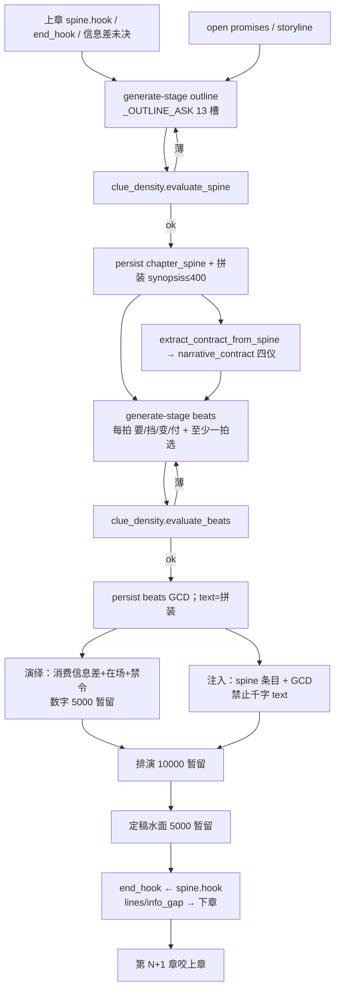
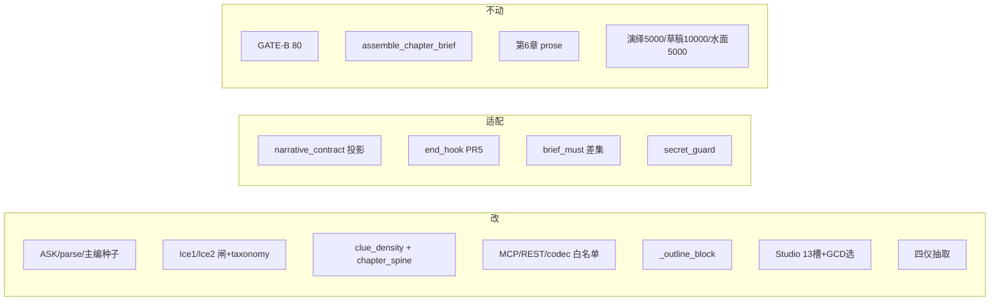

# 章纲 13 槽 + 场面台阶 + 线索密度闸：缺口盘点与全闭环改造

| 项 | 值 |
|----|-----|
| **日期** | 2026-08-15 |
| **作者** | Grok Design |
| **状态** | Draft · rev.4（用户终裁 lines 绑 id / ch6 overlay / 旗进设置 UI） |
| **产品** | 铜炉 / tonglu · 代码 `scribe3/` |
| **权威方案** | `docs/plans/2026-08-15-outline-beats-craft-reform.md`（13 槽，禁止缩回五槽） |
| **前序** | `2026-08-15-clue-density-replace-word-floors.md`；`2026-08-15-outline-beats-spine-density.md` |
| **验收协议** | `docs/e2e-director-journey-v634-true-chat-full-capability.md` **rev.6** |
| **验收宇宙** | 《万界概率战争》V7.0 · `docs/worlds/wanjie-probability-war-v7.md`（炉灰记 / `book_c14585d8` / `book_bdfdcdc4` 退役） |
| **验收书** | **本次新建 slug** · 入口 `tonglu.example.com` · **只打已部署栈** |
| **不改** | 宣称公式、GATE-B（`synopsis_min_chars=80`）、`GATE_SAVE_MODE`、WCG；第 6 章定稿整章重写 |

---

## Overview

现网把「章纲」做成五道描写题（日子 / 必须发生 / 因→果 / 不能说 / 章末未决），把「节拍」做成五栏场面纸（进场 / 事件 / 翻转 / 出场 / 水下），再用 Ice1/Ice2 字数闸（`synopsis≥500`、每拍≥500、合计≥2000）逼模型用烟/锅/巷注水。产品里其实已有 GCD 短字段、四仪合同、余烬、承诺、限知五层，但 **生成 ASK 不问它们，闸不验它们，注入整段灌肥散文**。主编对话通道（`chiefSeed` / `ChiefDock` / `_phase_role_block`）同样钉死五槽+500。结果：第 6 章本该写进章纲的选择 / 价值翻转 / 信息差 / 动线，被挤成气氛；下游定稿只能复写巡礼。

本设计回答两件事：

1. **A. 系统还缺哪些基础信息**——对照 13 槽 + 场面台阶，在真实代码里标：已有 / 半有 / 完全没有 / 有但喂错层。
2. **B. 全闭环 / 全爆炸半径改造**——章纲生成 → 密度闸 → 落库 → 四仪 / 注入 / UI / 记录仪一致消费 → 节拍按章纲台阶生成 → 演绎 / 排演 / 定稿吃干章纲不吃肥散文 → 余烬 / 线 / 信息差进入下一章。所有仍按旧五槽或字数闸决策的模块必须列入改造或明确 N/A。

**一句话方案：** 新增章级一等公民 **`chapter.chapter_spine`**（schema `chapter_spine.v1`，13 短槽 JSON）。**禁止**占用现网 `assemble_chapter_brief` / `GET /chapter-brief` / 字段名 `chapter_brief`。节拍升 GCD+选择为主合同，`beats[].text` 降为拼装；Ice1/Ice2 废除字数通过条件，改验线索原子（阈值先金样标定，不假装 0.55 已验证）；注入按槽裁。`narrative_contract` 四仪保持投影。第 6 章定稿用唯一谓词锁定；overlay 走 `brief_only`。第 7 章起走新合同。

---

## Background & Motivation

### 现网真实合同（不是文档里的理想）

系统里叠了多套 **与本章戏相邻** 的结构，**没有一套是 13 槽章纲**。它们不全是「被拆碎的答题纸」：体验六元组、压力岔路、演绎五层本来就不是章纲合同。真正的病灶是：**章纲生成/闸/注入三处仍认五槽+字数**，而选择/信息差/动线活在别的层，章纲读不到。

| # | 落点 | 实际形状 | 谁在写 | 谁在读 | 与章纲关系 |
|---|------|----------|--------|--------|------------|
| 1 | `chapter.synopsis` | Markdown 五槽散文 | `_OUTLINE_ASK` + `thicken_outline` | Ice1 字数闸、GATE-B≥80、WCG≥40、`_outline_block` 整段注入 | **现网章纲 SSOT（错形状）** |
| 2 | `chapter.narrative_contract` | `desire/obstacle/turn/cost` 四仪 | `extract_contract_from_iceberg` 从肥散文抽；作者可锁 | L0 注入 `format_story_contract_head` | 应是 13 槽投影，现是肥散文渣 |
| 3 | `chapter.narrative_drive` | want/opposition/turn/cost/`end_hook` | `ensure_narrative_drive`；定稿回填 `extract_end_hook_from_prose` | `story_ember`、`_event_drive_block` | 钩的跨章燃料，不是开写前第 3 条 |
| 4 | `chapter.beats[].text` | 五栏场面纸长文 | `_BEATS_ASK`；`short_kernel` 明文「GCD 不能代替 text」 | Ice2 字数闸、`_outline_block` 每拍 `clip_for('beat')`≤1200 | 台阶被写成小正文 |
| 5 | `chapter.beats[].goal/conflict/turn/cost/hook` | GCD 短字段 | 解析器顺手抽；UI 可手补 | `format_drama_block`（有则走 GCD，无则倒 text） | **半有**，ASK 当附注 |
| 6 | `beats_schema.GCD_KEYS` 里的 `dilemma/decision` | schema 允许 | **生成不问、UI 不展示** | 几乎无人读 | 不是章内 A vs B |
| 7 | `pressure_drive.fork.choice` | 另一套岔路 | `pressure_drive.py` | L2 `pressure_drive` 段 | **不是章纲**；可种子，不合并 |
| 8 | `experience/scene_grid.py` | Scene–Sequel 六元组 | 体验面板 | 诊断，不进章纲闸 | **不是章纲** |
| 9 | `brief_must` / `assemble_chapter_brief` | 章前 briefing | `brief.py` · `GET /chapter-brief` | L2 注入，再和大纲做差集 | **另一套 brief**，禁止撞名 |
| 10 | `promise` / `storyline` | 书级线 | 设定库 | `promise_touch_soft`、`storyline_polish` | 章纲无「本章动哪条」声明 |
| 11 | `scene_truth` + `deductions` 五层 | 全知 + 限知投影 | `_DEDUCE_ASK`，合计≥5000 | 演绎注入 | **不是章纲**；应消费第 11 条 |
| 12 | 主编种子 / 阶段角色 | 五槽+≥500 明文 | `chiefSeed.js`、`ChiefDock.jsx`、`_phase_role_block`、`author_method/panels.py::OUTLINE_STEPS` | chat_write / 主编对话 | **与 ASK 同级的五槽合同源**（盘点 rev.1 漏列） |

选择在 `pressure_drive` 和闲置的 `dilemma` 里，不在章纲；信息差在演绎五层里，不在章纲；动线在书级 promise/storyline 里，不在章纲；四仪靠扫进场散文启发式抽取。

### 痛点（第 6 章实证，方案已钉）

- 大纲 2375 字。「日子」是灰狸磨铜巡礼；「必须发生」是整场拨铜。
- 节拍 3 拍、每拍 1100–1400。进场常 300–670 字烟与巷。
- `_outline_block` 把 synopsis + 每拍 `text` 整段注入（`INJECT_CAP.synopsis=2500` / `beat=1200`）。`clip_for` 对「刚过地板」的材料 **不裁**（`NEAR_FLOOR_RATIO=1.2`），所以 500–600 字肥稿整段进模型。
- `extract_contract_from_iceberg` 从这些肥段落抽四仪：欲望空、挡=呼吸、付被截断。
- ASK **以及** 主编种子 / `_phase_role_block` 明文要「能看见」+「全文≥500」。只改 `stage_generate._OUTLINE_ASK` 不够。

### 为什么不能「只把五槽写干」

权威稿已取代窄方案：五槽本身没有 **选择 / 决断 / 信息差 / 动哪条线 / 触发 / 升级** 的专位。没有专位，密度闸验的仍是「日子里有没有冲突词」，模型继续往日子灌烟。必须先换槽，再验密度。

---

## Goals & Non-Goals

### Goals

1. 章纲成为 **13 条目短句 JSON**（每条 ≤40 字，禁止场面预演）。人读 30 秒能说出：他要什么、选了什么、付了什么、哪条线动了。
2. 场面台阶（现「节拍」）每拍填 **要 / 挡 / 变 / 付**；全章至少一拍有 **选**；`beats[].text` 由这些字段拼装，禁止再生成千字 `text`。
3. Ice1/Ice2 **废除** `≥500` / 每拍 `≥500` / 合计 `≥2000` 作为通过条件，改验线索原子（选择、代价、信息、线）。空大纲仍不能落库、不能 skip 加厚。**阈值先金样标定，不在设计里锁死未验证的 0.55。**
4. 四仪只读章纲 4/5/7/10，不再扫进场散文。
5. 注入只灌章纲条目 + 每拍 GCD，不灌千字 `text`。飞行记录仪不再出现 600 字进场。
6. 全爆炸半径：所有仍按旧五槽或字数闸决策的模块（**含主编种子 / 阶段角色**），改 / 适配 / 只读兼容 / 不动，禁止漏网。
7. 第 7 章起走新合同；第 6 章定稿用 **唯一谓词** 锁定。
8. 落库白名单一次写全：MCP/REST/codec/leak/闸验物一致，禁止新字段写不进。

### Non-Goals（冻结）

- 不改宣称公式、`may_claim_*`、GATE-B（`CraftGateThresholds.synopsis_min_chars=80`）、`GATE_SAVE_MODE`、WCG（`scripts/v4_world_complete_gate.py`，含 `synopsis.ge40chars.ge10`）。
- 不重写第 6 章定稿。需要当下游燃料时，只允许 `brief_only` overlay 干章纲，演绎/草稿/定稿不动。
- 本轮不改演绎 ≥5000、排演 ≥10000、水面 ≥5000 的数字（必须画清谁还在读）。
- 不把 STC 15 大节拍塞进每一章；不把 McKee 场内微 beat 当成工作台栏。
- 不靠再加「空气 / 触感」槽提高密度。
- 不把 `narrative_contract.v1` 扩成 13 槽（它继续当 L0 四仪投影）。
- 不把 `pressure_drive.fork` 与章纲选择合并成一张表。
- **不占用** `chapter_brief` 字段名、`scribe3/brief.py::assemble_chapter_brief`、`GET /chapter-brief`、`canon_loop` 任务名 `"chapter_brief"`。

---

## A. 系统还缺哪些「基础信息」

状态约定：

| 状态 | 含义 |
|------|------|
| **已有** | 字段存在，且生成/闸/注入至少有一层把它当合同 |
| **半有** | 字段或近义存在，但生成不问、闸不验、或只当附注 |
| **完全没有** | 代码里没有对应一等字段 |
| **喂错层** | 有，但活在错误层次（书级 / 演绎 / 体验面板 / 启发式抽取），章纲读不到 |

### A.1 章纲 13 槽对照

| # | 13 槽 | 现落点 | 状态 | 13 槽映射 | 缺失后果 |
|---|-------|--------|------|-----------|----------|
| 1 | 时空 | `synopsis`「日子」段；`parse_chapter_meta` 不抽时空；`scenePaperView.day` **误用章标题** | **半有 / 喂错层** | 日子被 ASK 问成「村里/场上正在过什么（具体，能看见）」 | 模型写巡礼；UI 把「第 6 章」当成日子 |
| 2 | 在场 | `chapter.involved_characters`（演绎后才齐）；`_ctx_bits` 只在生成提示里列一次 | **半有 / 喂错层** | 不在 `_OUTLINE_ASK`；大纲生成时常常还是空列表 | 章纲不知道焦点/对手/见证；演绎再猜在场 |
| 3 | 咬上章 | `narrative_drive.end_hook`（**上章定稿后**从 prose 尾巴抽）；`story_ember` 注入；`assemble_scene_briefing.prev.end_hook` | **半有 / 喂错层** | 余烬是写路径燃料，不是本章纲第 3 条 | 新章大纲不问「接哪一口」；模型另起炉灶或复写烟 |
| 4 | 本章要 | `synopsis`「必须发生」；`narrative_contract.desire`；`brief_must` | **半有** | 三处各写各的；desire 从事件/进场启发式抽（`_pick_want` 含 `enter`） | 四仪欲望被进场空气污染；brief_must 再复述一遍 |
| 5 | 挡 | `narrative_contract.obstacle`；`beats[].conflict` | **半有** | 无章纲专位；obstacle 从事件/必须发生扫 `_OBSTACLE_LEX` | 挡经常抽成「呼吸」「递」；高压章 stakes 另走正则 |
| 6 | 触发 | **无** | **完全没有** | 无字段、无 ASK、无闸 | 打破平衡的一下被埋进「必须发生」长段，闸无法单验 |
| 7 | 升级 | `beats[].turn` / text「翻转」；`narrative_contract.turn` | **半有 / 喂错层** | 升级在拍级，不在章纲；四仪 turn 优先扫翻转长句 | 章纲说不清「原策略怎么失败」 |
| 8 | **选择** | `pressure_drive.fork.choice`；`beats_schema` 的 `dilemma`；`experience/scene_grid.dilemma`；选择环是 **定稿策略多样** 不是章内二选一 | **喂错层** | 三套选择，零套在章纲 | 第 6 章「接假铜 vs 拨开」没有结构中心；场面变一串阻碍 |
| 9 | **决断** | `beats_schema.decision`；`scene_grid.decision` | **半有 / 喂错层** | UI `GCD_FIELDS` **不含** dilemma/decision；ASK 不问 | 决断无法落库为章纲第 9 条 |
| 10 | **代价/结果** | `narrative_contract.cost`；`beats[].cost`；`parse_chapter_meta` 的 stakes | **半有** | cost 从出场/章末未决截 40 字；常被引号截断 | 世界怎么变说不清；闸不验「两边都有损失」 |
| 11 | **信息差** | 演绎五层 `DEDUCTION_HEADINGS`（看到/知道/以为/做了/没察觉）；`secret_guard` 破绽词 | **喂错层** | 信息差在演绎层才写，章纲无「谁新知道/仍不知」 | 演绎只能从肥大纲猜；或发明新信息差 |
| 12 | **动哪条线** | `promise` + `promise_touch`；`storyline` + `storyline_polish`；`brief_must` 伏笔指令 | **喂错层** | 书级线存在，章纲不声明「本章动哪 1–2 条」。**终裁：声明必须带已有 id** | 无绑定则 Ice1 `lines_unbound` |
| 13 | 钩 / 禁令 | `synopsis`「章末未决」+「不能说」；`beats[].hook`；`beats_meta.chapter_hook`；`chapter_hooks.resolve_chapter_hook`；`secret_guard` 破绽词 | **半有** | 权威稿一条、实现拆 `hook`+`forbid`；见 Proposed · 槽 13 合同 | 钩可能是 400 字收束散文；禁令与 secret_guard 各写各的 |

### A.2 指定盘点项（任务清单）

#### `narrative_contract`（desire/obstacle/turn/cost）vs 章纲 13 槽

- **已有字段：** `scribe3/narrative_contract.py` · `SCHEMA = "narrative_contract.v1"` · `_FIELD_KEYS = ("desire", "obstacle", "turn", "cost")`。校验 `CONTRACT_MIN_FIELD_CHARS=8`。作者 `locked` 不覆盖。
- **映射：** 要=4 desire，挡=5 obstacle，翻=7 或 9 turn，付=10 cost。权威稿要求四仪 **只读章纲这些槽**。
- **现状：** `extract_contract_from_iceberg`（385–442 行）从 `split_outline_parts(synopsis)` 的「必须发生/因」+ 节拍 `**进场/事件/翻转/出场/水下**` 启发式抽。`_pick_want` 明确把 **进场** 列入候选；`turn` 可回退到水下。`CONTRACT_FIELD_CAP=40` 是截断，不是生成合同。
- **缺口：** 没有 choice / info_gap / lines / trigger。把 13 槽塞进 `narrative_contract` 会污染 L0 注入头（`format_story_contract_head` 只认四行）和 `contract_content_fp`。
- **判定：** 四仪 **半有且喂错源**。保留为投影，不升主合同。

#### `beats` text 五栏 vs GCD 短字段

- **已有 GCD：** `beats_schema.GCD_KEYS` = goal/conflict/disaster/turn/reaction/dilemma/decision/cost/hook/text/done/beat_type/id/uid。
- **UI 只展示 5 个：** `ChapterStudio.jsx` `GCD_FIELDS` = goal/conflict/turn/cost/hook。`dilemma/decision` 不展示。
- **生成：** `_BEATS_ASK` 要进场/事件/翻转/出场/水下 + 每拍≥500。明文「GCD 短句只能当附注」。`stage_spec.beats.short_kernel`：「GCD 短字段不能代替 text」。
- **解析：** `parse_beats_payload` 把 **整块 chunk 塞进 `text`**；若有「事件」则 `goal=事件[:80]`；若有「目标/冲突/结果/代价/钩子」中文标题才填 GCD。不抽「选」。
- **闸：** `_beat_lens` **只量 `text` 字数**。GCD 填满、text 短 → Ice2 仍判薄。
- **REST：** `chapter_gcd_rest.py` 闸外入口 **锁定 text**。`validate_beats_payload` 对未知键 `beat_{i}_unknown_keys`。现网 **无** `choice`/`underwater` → 新键不进 `GCD_KEYS` 会 422。
- **判定：** GCD **半有**；主合同仍是千字 `text`。`choice` **完全没有**（dilemma 闲置 ≠ 章内 A vs B）。

#### `narrative_drive.end_hook` / `story_ember`

- **已有：** `extract_end_hook_from_prose` 从定稿尾巴抽 ≤180 字；`merge_end_hook`；`store/chapters.py` 存稿时回填。下章 `collect_story_fuel_segments` → `【上章余烬】`（`FUEL_CAP_EMBER=1500`）。
- **SSOT 钩：** `chapter_hooks.resolve_chapter_hook` = `beats_meta.chapter_hook` → 末拍 hook → synopsis meta.hook → 上章 end_hook。
- **判定：** 半有。闭环要求：新章纲第 3 条 **必须引用** 上章第 13 条 / `end_hook`；新章第 13 条 **回写** `beats_meta.chapter_hook` + 下章 ember 源。此闭环在 **PR5** 才接上。

#### promises / brief_must / 动哪条线 / **命名冲突**

- **已有另一套 brief（禁止撞名）：**
  - `scribe3/brief.py::assemble_chapter_brief`（连 store 的章 briefing 单源）
  - `GET /chapter-brief`（`api/routers/chapters.py::chapter_brief`）
  - 注入段 `brief_must`、`_brief_must_sections_write_block`
  - `canon_loop` 任务名 `"chapter_brief"`
- **已有线：** `store/promises.py`；`promise_touch`；`storyline` + `storyline_inject_polish.py`。
- **缺口：** 章纲没有 `lines: [{kind, id, delta}]`。
- **判定：** 旧 briefing **保留语义不动**。新 SSOT **必须换名**（见 Proposed · 命名）。

#### 限知 / secret_guard / 信息差

- **已有：** `_secret_guard_block` 从 `facts_at` 抽 secret 的 `leak_markers`；无 secret 时仍注入侧门/炉契操作禁令。`iceberg_leak.py` persist 扫「锁眼/匙孔/门芯」。演绎五层是限知投影，不是章纲信息差表。
- **判定：** 限知基础设施已有；章纲信息差 **完全没有**。演绎应 **消费** 第 11 条。`forbid` 不能替代 fact 级 `leak_markers`。

#### 演绎五层、`scene_truth`

- **已有：** `scene_truth` + `scene_truth_revision`；`DEDUCTION_HEADINGS` 五层；合计 ≥5000。`stage_ready(deduce)` 要求上一层 Ice1/Ice2 齐。
- **判定：** 层本身已有；输入喂错（`_ctx_bits` 灌肥大纲）。本轮 **保留 5000 字闸**。

#### generate-stage ASK（`_OUTLINE_ASK` / `_BEATS_ASK`）

现网原文（`stage_generate.py` 445–463 行）：日子「能看见」；全文≥500；进场「空气里有什么」；每拍≥500、合计≥2000；GCD 只能当附注。

- `parse_outline_payload.ok = cn >= 500`（**parts 缺失只 warn，不挡 ok**）
- `build_stage_prompt` 加厚句：「还差约 N 字才到覆盖地板。从已有结尾接着写新场面」
- **另有同级五槽源（rev.1 漏列，见 Issue 4）：** `_phase_role_block`、`chiefSeed.js`、`ChiefDock.jsx` suggests、`author_method/panels.py::OUTLINE_STEPS`。

#### `evaluate_iceberg` / `persist_fields_blocked` / `iceberg_ok_for`

全部在 `scribe3/iceberg.py` + `stage_generate.iceberg_ok_for`。现网 missing id：`synopsis` / `beat_count` / `beat_each` / `beat_sum` / `deduction` / `draft`。`stage_ready` 靠 `_NEED_PREV` + `_missing_bucket`（只把 `beat_count|beat_each|beat_sum` → `beats`）。**改密度后必须重映射，否则假绿进节拍或假红卡短拼装。** 见 Proposed · missing taxonomy。

#### 注入

| 段名 | 层 | 现行为 | 爆炸 |
|------|----|--------|------|
| `outline` | L1 | `_outline_block`：`clip_for("synopsis", 全文)` + 每拍 `clip_for("beat", text)`。帽 2500/1200；近地板不裁 | **必须改** 为按槽拼接。与 `_floor_for` 归零 **同一 PR**（PR3） |
| `narrative_contract` | L0 | 四仪短行。标题「【本章必须发生的场面】」是四仪头，**不是**五槽回潮 | **适配** 源改为 spine 4/5/7/10 |
| `drama_contract` | L0 | 有 GCD 走拍级走法 ≤400；无则可能带进场 | **适配** |
| `story_ember` | L2 | 上章 `end_hook` | **适配**（PR5）优先 spine.hook |
| `brief_must` | L2 | 与大纲差集 | **适配** 差集对 13 槽短句 |
| `secret_guard` | L0 | 破绽词 | **适配** 并入 forbid，不改词表宗教 |

`test_iceberg.py::test_outline_inject_keeps_each_beat` **钉死**「三段 600 字都要进注入」。此测试必须改写成「三拍 GCD 都在、进场不得超 1 句」。

#### UI / 飞行记录仪 / 四仪 / `clue_density.py`

- OutlineTab 只读整块 synopsis；BeatsTab 无「选」；ScenePaper 日子=标题；`chapterContractGate.js` `ICEBERG_SYNOPSIS=500`。
- `headline_from_spans` 已禁「对照齐全」，不必为 13 槽改公式；要改的是 **artifact body**。
- `density_trace_store.py` 是 **注入段 token 密度**，**不是** 线索原子。禁止复用此模块名。
- `extract_contract_from_iceberg` 见上。
- **`scribe3/clue_density.py` 完全没有。**

---

## B. 全闭环 / 全爆炸半径改造

### B.1 目标闭环（应然）



「闭环」失败的现网断点：

1. ASK 不问 13 槽 → 生成层断（**主编种子 / `_phase_role_block` 同断**）。
2. 闸验字数 → 落库层断。
3. MCP persist 白名单无新字段 → **写丢**（Issue 2）。
4. 四仪扫进场 → 消费层断。
5. `_outline_block` 灌 `text` → 注入层断。
6. 演绎读肥大纲 → 下游层断。
7. 钩只从 prose 尾巴抽、线只事后 touch → 跨章层断（**PR5 才修**）。

### B.2 爆炸半径总表

图例：**改** = 必须改行为；**适配** = 改读源；**只读兼容** = 旧数据双读；**不动** = N/A 或冻结。

#### 生成 / 解析 / 闸 / 主编合同

| 模块 | 路径 | 处置 | 说明 |
|------|------|------|------|
| `_OUTLINE_ASK` / `_BEATS_ASK` | `stage_generate.py` | **改** | 附录原文；PR2b |
| `OUTLINE_PARTS` / `BEAT_SLOTS` | 同上 | **改** | 13 键 / 要挡变选付+水下 |
| `parse_outline_payload` / `parse_beats_payload` | 同上 | **改（分旗）** | **shadow/PR2a：`ok` 仍走旧五槽/字数**（否则旧 ASK 输出会被 `llm_thin` 整段红）；密度只进 `density` 报告。**on/PR2b：`ok` 才绑 `evaluate_spine`/`evaluate_beats`。** 见「parse.ok 与 thicken」 |
| `build_stage_prompt` 加厚句 | 同上 | **改** | 「情节薄：缺原子…」，禁止「还差 N 字写新场面」 |
| `stage_spec.short_kernel` | 同上 | **改** | 与 ASK 同步 |
| `stage_ready` / `_NEED_PREV` / `_missing_bucket` | 同上 | **改** | 见 missing taxonomy；与闸同一 PR（PR2a） |
| `thicken_outline/beats` skip 文案 | 同上 | **改** | 「线索密度已过」 |
| `evaluate_iceberg` Ice1/Ice2 | `iceberg.py` | **改** | 删 synopsis/beat_each/beat_sum **字数** missing；**拍数下限冻结为 3** |
| `persist_fields_blocked` | 同上 | **改** | 验物优先 `chapter_spine`；见 persist 优先级 |
| `iceberg_ok_for` | `stage_generate.py` | **改** | `"synopsis"` 别名 `"spine"` |
| `_floor_for` / `clip_for` | `iceberg.py` | **适配** | synopsis/beat 地板归零与 `_outline_block` **同 PR3** |
| `INJECT_CAP.synopsis/beat` | 同上 | **只读兼容** | 数字可留；真正裁切按槽 |
| `DEDUCTION_FLOOR/DRAFT_FLOOR/PROSE_SURFACE` | 同上 | **不动** | 本轮数字冻结 |
| `clue_density.py` | **新文件** | **改** | 纯函数；金样锁定，阈值后锁 |
| `chapter_spine.py` | **新文件** | **改** | schema / validate / 拼装 / v1 适配器 |
| `iceberg_leak.py` | 已有 | **适配** | blob 须含 spine 各槽 + GCD，不只 `text` |
| `orchestration/catalog.py` | chapter.outline/beats duty | **改** | 删「≥500 / 每拍≥500」 |
| `_phase_role_block` | `api/services/misc_helpers.py` 253–256 | **改** | chat_write 阶段角色；与 catalog **同级** |
| `chiefSeed.js` | `scaffoldToolContract` / `seedChapterOutline` / `seedChapterBeats` | **改** | `gateHint` 钉死 ≥500 / 五槽 |
| `ChiefDock.jsx` | 大纲/节拍 `suggests` | **改** | 「写成 ≥500 字因果大纲」 |
| `author_method/panels.py` | `OUTLINE_STEPS` | **改** | 「今天村里过什么日子 / 必须发生的一下」 |
| `pilot_actions/beats.py` | 文档字符串 | **改** | 「每拍≥500」 |
| MCP `s3_generate_stage` persist 白名单 | `mcp/tools_write.py` ~1305 | **改** | 现只拷 synopsis/beats/scene_truth/deductions，**会丢掉 spine** |
| MCP `s3_patch_chapter_plan` | `mcp/tools_write.py` 1108–1118 | **改** | 签名无新字段 |
| REST `ChapterMetaReq` | `api/models.py` | **改** | 无新字段 |
| REST `GenerateStageReq` | `api/routers/write.py` | **改** | 加 `brief_only` |
| `CHAPTER_JSON_META_KEYS` / `CHAPTER_META_ALLOWED` | `chapter_meta_codec.py` | **改** | 否则 `update_chapter_meta` 丢列 |
| `get_chapter` SELECT | `store/chapters.py` | **改** | 否则读不出 |
| director persist | `api/routers/director.py` | **适配** | 与 MCP 同一 `persist_fields_blocked` |
| pilot `outline.py` / `beats.py` | `pilot_actions/` | **适配** | `iceberg_ok_for` 语义变 |

#### 合同 / 抽取 / 跨章 / 注入 / UI / 记录仪

（与 rev.1 表相同的行保留；字段名改为 `chapter_spine`。跨章咬合标 **PR5**。）

| 模块 | 处置 | 说明 |
|------|------|------|
| `narrative_contract.v1` | **只读兼容** | 不扩 13 槽 |
| `extract_contract_from_iceberg` | **改** | 优先 spine 4/5/7/10；旧路径禁止读进场 |
| `split_outline_parts` | **只读兼容** | 旧五槽阅读器 |
| `narrative_drive` / `chapter_hooks` | **适配 PR5** | hook 优先 spine.hook |
| `assemble_chapter_brief` / `GET /chapter-brief` | **不动** | 旧 briefing；禁止改名占用 |
| `format_story_contract_head` | **不动** | 仍四行；标题「【本章必须发生的场面】」验收时 **不要** 当成五槽回潮 |
| `_outline_block` | **改 PR3** | 只拼 13 槽 + GCD；有 spine 则 **完全不读** 肥 synopsis/text |
| `_ctx_bits` | **改 PR3** | 实码在 `stage_generate.py` ~422，**不**在 `write_assemble_context.py` |
| `_drama_block` / `format_drama_block` | **适配** | 删 slogan-text 灌进场回退 |
| `OutlineTab` / `BeatsTab` / `ScenePaper` / `chapterContractGate.js` | **改 PR4** | 删前端 500 吓人 |
| `headline_from_spans` | **不动** | |
| `density_trace_store.py` | **不动** | 禁止当 clue_density |
| e2e Ice1/Ice2 定义 | **改 PR2a 唯一处** | 不在 PR1/PR6 重复改 |
| GATE-B / WCG / 宣称 / 第 6 章 prose / 设定库闸 / critique 字数启发式 | **不动** | |



### B.3 仍读旧字数闸的模块（必须画清）

| 层 | 常量 | 读者 | 本轮 |
|----|------|------|------|
| 大纲 Ice1 | `SYNOPSIS_FLOOR=500` | evaluate / persist / parse / iceberg_ok_for / ASK / catalog / `_phase_role_block` / chiefSeed / ChiefDock / chapterContractGate / e2e Ice1 | **废除作为通过条件** |
| 节拍 Ice2 | 500 / 2000 | 同上 + `_beat_lens` | **废除字数通过条件**；**拍数 ≥3 保留** |
| 演绎 / 排演 / 水面 | 5000 / 10000 / 5000 | 见上 | **暂留** |
| GATE-B | 80 / min_beats=3 | `gate_b` | **冻结** |
| WCG | ≥40 | `v4_world_complete_gate.py` | **冻结** |
| 注入近地板 | `NEAR_FLOOR_RATIO=1.2` | `clip_for` | 地板归零 + 按槽裁，**同 PR3** |

---

## Proposed Design

### 命名（避开现网 brief）

| 用途 | 名称 | 禁止 |
|------|------|------|
| 章字段 | `chapter.chapter_spine`（JSON 串，同 `narrative_contract`） | `chapter_brief` |
| schema | `chapter_spine.v1` | `chapter_brief.v2` |
| 模块 | `scribe3/chapter_spine.py` | `scribe3/chapter_brief.py` |
| Ice1 bucket | `spine`（`iceberg_ok_for("synopsis")` 作别名） | 与 `GET /chapter-brief` 混淆 |
| 旧 briefing | `assemble_chapter_brief` / `GET /chapter-brief` / `brief_must` **原样不动** | 改旧路由名 |

`brief_only` 是 **generate-stage 的 persist 模式名**（历史用词「干章纲 overlay」），写的是 `chapter_spine`，不是旧 brief。

### 层次

```text
书级节拍 / 弧光 / 承诺     → 不动
    ↓
chapter_spine.v1 13 槽     → 新 SSOT（章工作台「大纲」）
    ↓ 投影
narrative_contract 四仪    → L0 注入头
    ↓
beats GCD+choice           → 场面台阶；拍数硬下限 3
    ↓
scene_truth + 五层         → 消费 spine.info_gap；数字暂留
    ↓
draft / prose              → 数字暂留
    ↓
end_hook + 未决 + 线       → 下一章 spine.bite（PR5）
```

### 数据模型：`chapter_spine.v1`

```python
# scribe3/chapter_spine.py（新）
SCHEMA = "chapter_spine.v1"

# 对外 13 槽。机检字段 14 个，槽 13 拆 hook+forbid。
SPINE_SLOTS: tuple[str, ...] = (
    "setting",      # 1 时空
    "cast",         # 2 在场
    "bite",         # 3 咬上章
    "goal",         # 4 本章要
    "obstacle",     # 5 挡
    "inciting",     # 6 触发
    "escalation",   # 7 升级
    "choice",       # 8 选择
    "decision",     # 9 决断
    "cost",         # 10 代价/结果
    "info_gap",     # 11 信息差
    "lines",        # 12 动哪条线
    "hook",         # 13 钩
    "forbid",       # 13 禁令（同分槽展示；机检可空）
)

SLOT_MAX_CN = 40
REQUIRED_CORE = ("goal", "obstacle", "inciting", "escalation",
                 "choice", "decision", "cost")          # 4–10
REQUIRED_TAIL = ("info_gap", "lines", "hook")           # 11–13 钩
# forbid 可空：空则注入回退 _secret_guard_block 词表，不挡 Ice1。
# 1–3 可短；seq>1 时 bite 空 → warning，不硬挡（二期可硬）。
ASSEMBLED_SYNOPSIS_CAP = 400  # 拼装 Markdown 硬帽，含标题
```

**槽 13 合同（对外 13 / 机检 hook 必填、forbid 可空）：** UI 一张卡「钩 / 禁令」，两行。`secret_guard` 仍是 fact 级 leak_markers 权威；spine.forbid 是作者声明的本章禁令短句。注入：先 secret_guard 词表，再追加 forbid 短句（去重）。forbid **不能**替代或削弱 leak_markers。

`lines`（**用户终裁**）：必须绑本书 **已有** `promise` 或 `storyline` 的 id。`kind` ∈ `{promise, storyline}` 且 `id` 非空且能在该书 `list_promises` / `list_storylines` 对上。无 id、只写「香债勾笔」、或 id 不在书内 → Ice1 missing **`lines_unbound`**，密度闸不过。**禁止**把无 id 短句算原子凑过闸。motif 单独不够。

```python
{"kind": "promise"|"storyline", "id": str, "delta": str}
# 至少 1 条合法绑定；建议 1–2 条
```

### 节拍主合同

```python
{
  "id": "b1",
  "goal": "…",       # 要
  "conflict": "…",   # 挡
  "turn": "…",       # 变
  "choice": "",      # 选；全章 ≥1 条能过 parse_choice_ab（「无」不算）
  "cost": "…",       # 付
  "underwater": "…", # 水下一句
  "text": "要：…\n挡：…\n变：…\n付：…",  # 只读拼装
}
```

- **拍数硬下限 = 3**（与 GATE-B `min_beats=3`、现网 `evaluate_iceberg` 对齐）。2 拍只作二期，本轮不留 OQ。
- 删必填长栏进场/出场。
- `GCD_KEYS` / `GCD_FIELD_KEYS` **增加** `choice`、`underwater`。`dilemma` **读时别名**到 `choice`（写路径只写 `choice`）。**文件：`scribe3/beats_schema.py`、`scribe3/chapter_gcd_rest.py`，与第一次 persist `choice` 同 PR（PR2a）。**
- **gcd-fields PATCH 不重写 `text`。** 生成 / thicken 才覆盖为拼装。单测：带 `choice`/`underwater` 能过 `validate_beats_payload` 与 `apply_gcd_beats_patch`，且不改 `text`。
- `parse_beats_payload` 把 `选：无` / placeholder（沿用 `narrative_contract._PLACEHOLDERS`，含「无」「暂无」「待补」「-」）**归一成 `choice=""`**。`evaluate_beats` 用 `parse_choice_ab`，**禁止** `any(cn_strip(choice))`。
- PR3 之前注入若仍读 text，手改 choice 会与肥 text 不一致 → **PR3 注入不读 text**，窗口期以 GCD 为准。

### 写入合同总表（漏一行就丢字段）

| 通道 | 今日 | 必须加上 |
|------|------|----------|
| Surreal | 无列 | `DEFINE FIELD IF NOT EXISTS chapter_spine ON chapter TYPE option<string>`；`DEFINE FIELD IF NOT EXISTS prose_lock ON chapter TYPE option<bool>` |
| `CHAPTER_JSON_META_KEYS` | pressure_drive / beats_meta / narrative_drive / narrative_contract / stage_state | **+ `chapter_spine`**（JSON 串） |
| `CHAPTER_META_ALLOWED` | 上表 ∪ synopsis/beats/… | 随 JSON keys 自动含入 spine；**另加标量 `prose_lock`**（bool，**不要**进 JSON keys） |
| `get_chapter` SELECT | 无 | **+ `chapter_spine`** + coerce；**+ `prose_lock`** |
| `ChapterMetaReq` | 无 | `chapter_spine: dict \| None`；`prose_lock: bool \| None` |
| REST PATCH `/chapters/{seq}` | 走 ChapterMetaReq | 同上（点锁走此入口，否则 `update_chapter_meta` 静默丢） |
| MCP `s3_patch_chapter_meta` | 身份字段 | **允许 `prose_lock`**（标量）；spine 走 `s3_patch_chapter_plan` |
| `s3_patch_chapter_plan` 形参 | synopsis/beats/scene_truth/deductions/involved/story_move_plan/narrative_contract/reveal_secret_ids | **+ `chapter_spine: dict \| None`** |
| `s3_generate_stage` persist 拷贝 | `("synopsis", "beats", "scene_truth", "deductions")` ~1305 | **+ `chapter_spine`**；`brief_only` 时 **只**拷 `chapter_spine`（+ 可选 `narrative_contract`），禁止 synopsis/beats/prose |
| `GenerateStageReq` | seq/stage/persist/extra/focalizer | **+ `brief_only: bool = False`** |
| MCP `s3_generate_stage` | persist: bool | **+ `brief_only: bool = False`** |
| `persist_fields_blocked` | 只看 synopsis/beats/deductions **字数** | 优先验 `chapter_spine` 密度；见下节 |
| `scan_persist_fields_for_leaks` | synopsis / beats.text / scene_truth / deductions / draft | **+ spine 各槽字符串 + beats GCD 各栏** |
| `update_chapter_meta` | 只写 ALLOWED | 随 codec |

Director persist 与 MCP **必须调用同一** `persist_fields_blocked`。

### persist 闸优先级（双字段窗口）

写入时按下列顺序，**Director / MCP / REST / generate-stage 同一函数**：

```
1. 本次 fields 含 chapter_spine（非空 dict）
     → 只验 clue_density.evaluate_spine(spine, known_line_ids=该书 promise/storyline)
     → `lines_unbound`：旗 on 则 422；shadow 只进报告
     → 同时提交的 synopsis 不再走 Ice1 字数
     → 同时提交的 synopsis 不再走 Ice1 字数
     → assemble_synopsis_from_spine 写回 synopsis **仅当** source=llm_13slot
       （本次 LLM 输出被 parse 成 13 标签新稿，PR2b 起）
     → source=adapt_v1（从已有五槽肥稿只读抽出）**禁止**覆盖已有 synopsis
2. 本次无 spine，但章上已有 chapter_spine.v1 且本次只改 beats/其它
     → Ice1 视为已有 spine（skip Ice1）；Ice2 验本次 beats
3. 本次直写 synopsis 且无 spine（旧路径 / 主编仍 PATCH synopsis）
     → 旗 on：走 adapt_v1_five_slot 密度（禁止读进场）；不要求 ≥500；口号仍 422
     → 旗 shadow：不 422；可把适配 spine 附进报告，**不写回、不覆盖 synopsis**
     → warning: please_use_chapter_spine
     → GATE-B 80 仍由 gate_b 另验，不在本函数
4. 本次写 beats
     → 旗 on：evaluate_beats（拍数≥3、要挡变付、全章≥1 条 parse_choice_ab）
     → 旗 shadow：不因密度 422；parse.ok 仍走旧字数（见旗表）
     → 不验 text 字数作为密度通过条件
5. 空串/空列表 = 尚未写，放行（与现网一致）
```

**禁止：** 有 spine 仍用量 synopsis 字数决定 422。  
**禁止：** 用 `adapt_v1_five_slot(已有肥 synopsis)` 拼装 ≤400 再写回——会冲掉炉灰记 1–5 等未锁定章的肥大纲。适配器 = GET/报告只读。

### missing taxonomy（`stage_ready` / `iceberg_ok_for` / 前端）

`evaluate_iceberg.missing[].id` 新合同（旗 `on` 或 `shadow` 都产出；`off` 保持旧 id）：

| id | bucket | 层 |
|----|--------|-----|
| `spine_slots` | `spine` | Ice1 必填槽空 |
| `spine_choice` | `spine` | 选择不能拆 A/B |
| `spine_atoms` | `spine` | 原子过少 |
| `spine_density` | `spine` | 密度低于工作阈值 |
| `spine_padding` | `spine` | 注水句过多 |
| `lines_unbound` | `spine` | `lines` 无已有 promise/storyline id（或 id 不在本书） |
| `beat_count` | `beats` | **&lt;3**（本轮保留） |
| `beat_gcd` | `beats` | 某拍要/挡/变/付空，或不是拍级原子（`is_atom_field`） |
| `beat_choice` | `beats` | 全章无一拍过 `parse_choice_ab`（`选：无` 不算） |
| `beat_atoms` | `beats` | 拍级原子合计不足（与 beat_gcd 同时记时可合并展示） |
| `beat_turn_missing` | `beats` | 无变 / 与事件同子串 |
| `beat_enter_pad` | `beats` | 拼装/`text` 里进场类句子 &gt;1 |
| `beat_leak` | `beats` | 破绽词 |
| `deduction` / `draft` | 原样 | **字数暂留** |

**删除作为通过条件：** `synopsis`（字数）、`beat_each`、`beat_sum`。

```python
def _missing_bucket(mid: str) -> str:
    if mid.startswith("spine_") or mid in ("synopsis", "lines_unbound"):
        return "spine"
    if mid.startswith("beat_") or mid in ("beat_count", "beat_each", "beat_sum"):
        return "beats"
    return mid

_NEED_PREV = {
    "outline": (),
    "beats": ("spine",),           # 原 ("synopsis",)
    "deduce": ("spine", "beats"),
    "draft": ("spine", "beats", "deduction"),
    "final": ("spine", "beats", "deduction", "draft"),
}

def iceberg_ok_for(ch, field: str) -> bool:
    # field in {"synopsis", "spine"} → Ice1 无 spine_* missing + leak 净
    # field == "beats" → 无 beat_* missing + leak 净
    ...
```

| 读者 | 读哪些 id |
|------|-----------|
| `stage_ready("beats")` | bucket=`spine` 的 missing |
| `stage_ready("deduce")` | spine + beats |
| `iceberg_ok_for("synopsis"\|"spine")` | `spine_*` |
| `persist_fields_blocked` | 按 persist 优先级，不看字数 need:500 |
| 前端 `evaluateChapterContract` | 有报告则展示 `spine_*` / `beat_*` 人话；**删除** `ICEBERG_SYNOPSIS=500` 作为 icebergThin 条件。`synopsisOk` 仍可对齐 GATE-B 80 |

旗 `off` 时：missing 回到旧 `synopsis`/`beat_each`/`beat_sum`，`_NEED_PREV["beats"]=("synopsis",)` 走兼容枝（见回滚矩阵）。

### 定稿锁谓词（唯一）

仓库 **没有** 现成 `prose_lock` / `FINALIZED_CHAPTERS`。本轮只承认下面这一条，**禁止**「有 prose 就不覆盖」。`prose_lock` 必须能经 REST/MCP 写入（见写入合同总表），否则「其它书可点锁」是空话：

```python
FROZEN_PROSE_CHAPTERS: frozenset[tuple[str, int]] = frozenset({
    ("book_c14585d8", 6),
})

def is_prose_locked(work: str, seq: int, ch: dict | None) -> bool:
    if (str(work or ""), int(seq)) in FROZEN_PROSE_CHAPTERS:
        return True
    return bool((ch or {}).get("prose_lock"))  # 缺省 false；其它书可点锁
```

| 操作 | 锁定章（ch6） | 未锁定章 |
|------|----------------|----------|
| `generate-stage persist=true` 且 `brief_only=false` | **拒绝改** synopsis/beats/prose；422 `prose_locked`（可提示改 `brief_only`） | 正常 thicken |
| `generate-stage brief_only=true` | **只写** `chapter_spine` + 可选四仪投影；禁止碰 synopsis/beats/prose | 允许（新章一般不需要） |
| 密度失败自动再 thicken | **不跑** 覆盖 | 跑 |
| 直写 PATCH synopsis | 锁定章拒绝（或仅 author unlock） | 旧路径 + warning |

炉灰记 1–5 即使已有 prose，**不**因本谓词锁大纲。第 7 章写完正文后再改大纲 **不会**被「有 prose」误锁。

### 密度闸（`clue_density.py`）

纯函数，零 I/O。阈值是 **工作草稿**，PR1 用金样标定后再写进常量；**设计不假装 0.55 / 25% / ≥6 已验证。**

#### 词表

```python
# 并集：narrative_contract.CONFLICT_LEX
#      ∪ narrative_drive._CONFLICT_LEX
#      ∪ drama_beats.TURN_COST_LEX
#      ∪ 扩充：拨、交、勾、咳、还、塞、推、揭、挡、讨
# 去重后按长度降序匹配（先「拦下」再「拦」）。
#
# 单字「还」「咳」：
#   仅当前后邻接对象/后果词（铜、焦、账、门、角、声、爹）才计动作。
#   「还账日」单独出现 → 不算原子（避免把时空句打成动作）。
ACTION_LEX = union_sorted(...)
COST_CONSEQ_LEX = ("暴露", "未兑", "更死", "更险", "亏", "伤", "代价",
                   "没开", "锁死", "被迫", "两难", "空过", "收不回")
SENSORY_PAD = ("烟", "青苔", "檐口", "指腹", "空气里", "温凉", "巷口风",
               "锅沿", "灰星", "气味")
```

#### 切句

与 `narrative_contract._sents` 对齐：`re.split(r"[。！？\n；;]")`，去空。  
**40 字槽内**无句号时整槽算 **1 句**（顿号/逗号不切）。禁止把一条槽切成多句来刷分母。

#### 「谁」

**章纲 `evaluate_spine`（整条短句）：**

1. 命中本书 `involved_characters` 裸名 / 灰七/婆子/灰狸 等别名；或
2. 代词「他/她」且本槽或前一槽已有角色名；或
3. 槽 2 `cast` 里出现过的名。  
不要求必须先有 `involved_characters` 落库。无主语且无角色名 → 该句无「谁」，不加原子。

**拍级 `evaluate_beats`（`is_atom_field`）：承章纲 `cast`，允许省略「谁」。**  
一场台阶的主语已在 spine.cast / 章 `involved_characters` 钉死；GCD 短栏「把假铜挡在眼皮外」不算缺主语。  
`is_atom_field(text)` = `ACTION_LEX` 命中 **且**（对象名词或 `COST_CONSEQ_LEX`）。不要求字段内再现角色名。无 cast、字段内也无「谁」时，仍不挡拍级原子（避免大纲未齐时节拍假红）；章纲层继续验谁。

#### 原子

- **章纲句：** 谁 + `ACTION_LEX` +（对象名词 **或** `COST_CONSEQ_LEX` / 明确宾语）。
- **拍级栏：** `is_atom_field`（动作 + 对象/后果），谁由 cast 继承。  
另计（单独 +1，不要求三件套）：因果「因 A 所以必须 B」；限知/禁令句；未决把柄。

**不算：** 纯 `SENSORY_PAD` 且无动作；纯走位（走/站/看）且无冲突词；槽名本身；与已计原子 **去空白后互为子串** 的换词重说。

#### 选择

```
能拆出 A/B（分隔：vs / 对 / 要么…要么 / 或）
且 至少一侧命中 COST_CONSEQ_LEX 或 ACTION_LEX
# 权威稿「硬还焦黑 vs 只把纸角塞回门缝」：
#   「还」「塞」命中扩充词 + 焦黑/门缝为对象 → 过。
# 不要求两侧都有「损失」字面。
```

#### 伪代码

```python
def evaluate_spine(
    spine: dict,
    *,
    known_line_ids: set[tuple[str, str]] | None = None,
) -> DensityReport:
    """known_line_ids = {(kind, id)} 来自该书 promise/storyline。
    单测传入夹具；persist / evaluate_iceberg 从 store 装。"""
    errs = []
    for k in REQUIRED_CORE + REQUIRED_TAIL:
        if not cn_strip(spine.get(k)):
            errs.append(f"spine_slots:{k}")
        elif cn_len(slot_text(spine[k])) > SLOT_MAX_CN:
            errs.append(f"spine_slots_long:{k}")
    if not parse_choice_ab(spine.get("choice")):
        errs.append("spine_choice")
    bound = normalize_bound_lines(spine.get("lines"))
    if not bound:
        errs.append("lines_unbound")
    elif known_line_ids is not None:
        if any((it["kind"], it["id"]) not in known_line_ids for it in bound):
            errs.append("lines_unbound")
    blob = "\n".join(slot_text(spine[k]) for k in SPINE_SLOTS)
    sents = split_sents_slotwise(spine)
    atoms = collect_atoms(sents, who_names=names_from_cast(spine))
    pad = [s for s in sents if not has_atom(s, atoms) and has_sensory(s)]
    density = len(atoms) / max(len(sents), 1)
    padding = len(pad) / max(len(sents), 1)
    # WORKING_* 先用金样校准后再锁定
    if len(atoms) < WORKING_MIN_ATOMS:          # 草案 6
        errs.append("spine_atoms")
    if density < WORKING_MIN_DENSITY:           # 草案 0.55
        errs.append("spine_density")
    if padding > WORKING_MAX_PADDING:           # 草案 0.25
        errs.append("spine_padding")
    if not project_four_ok(spine):              # 4/5/7|9/10 非空短句
        errs.append("spine_slots:four")
    return DensityReport(ok=not errs, errors=errs, atoms=len(atoms),
                         sentences=len(sents), density=density, padding=padding)

def normalize_choice(raw) -> str:
    t = cn_strip(raw)
    if t in _PLACEHOLDERS or t in ("无", "没有", "无选择"):
        return ""
    return str(raw or "").strip()

def evaluate_beats(beats: list, *, spine: dict | None = None) -> DensityReport:
    errs = []
    if len(beats) < 3:
        errs.append("beat_count")
    if not any(parse_choice_ab(normalize_choice(b.get("choice") or b.get("dilemma")))
               for b in beats):
        errs.append("beat_choice")
    for i, b in enumerate(beats, 1):
        for k in ("goal", "conflict", "turn", "cost"):
            # 承 spine.cast；不要求栏内再现角色名
            if not is_atom_field(b.get(k), cast=names_from_cast(spine or {})):
                errs.append(f"beat_gcd:{i}:{k}")
        if share_substr(b.get("goal"), b.get("turn")):
            errs.append(f"beat_turn_missing:{i}")
        if enter_sentences(b.get("text")) > 1:
            errs.append(f"beat_enter_pad:{i}")
        if leak_words(b):
            errs.append("beat_leak")
    ...
```

#### 金样例（PR1 单测钉死；过/不过各半+）

| # | 输入摘要 | 期望 |
|---|----------|------|
| G1 | 权威稿第 6 章 13 槽干例（选择「硬还焦黑 vs 纸角塞回门缝」，代价「账清、门更死、咳像爹」，线 `promise:xiang-debt` + `storyline:side-gate`，信息差「灰狸不知匙」）；`known_line_ids` 含这两条 | **过** |
| G2 | 同上但删 choice | **不过** `spine_choice` |
| G3 | 口号「查明真相」填满 4–13 | **不过** `spine_atoms` / 槽过短 |
| G4 | 2000 字烟巡礼当 synopsis 适配器输入（无动作对象） | **不过** 密度/padding |
| G5 | 干线索约 13 条短句、无烟、有 A vs B、lines 已绑夹具 id（不必凑满 350 字） | **过**（字数不是门槛） |
| G6 | 「还账日」单独当 goal，无对象动作 | **不过**（单字「还」不刷原子） |
| G7 | 三拍 GCD 齐（「要：把假铜挡在眼皮外」无角色名）、第 2 拍 `选：A vs B`、无进场长段；章纲 cast 有灰七 | **过**（拍级承 cast，省略「谁」） |
| G8 | 三拍有事件无翻转（turn 与 goal 同子串） | **不过** `beat_turn_missing` |
| G9 | 两拍齐全有选 | **不过** `beat_count`（本轮钉 3） |
| G10 | 三拍齐但 `choice` 全空 | **不过** `beat_choice` |
| G11 | 三拍齐、每拍 `选：无`（或「暂无」） | **不过** `beat_choice`（归一后仍无 `parse_choice_ab`） |
| G12 | 同 G1 但 `动哪条线：香债勾笔；侧门未开`（无 kind/id） | **不过** `lines_unbound` |
| G13 | 同 G1 但 `promise:not-in-book 香债勾笔`（id 不在 `known_line_ids`） | **不过** `lines_unbound` |

工作阈值在 G1/G5 过、G3/G4 不过之后写入 `WORKING_*` 常量。若 0.55 误杀 G1，**下调密度门槛**，不上调字数。

### 生成 ASK 与解析（钉死格式）

模型输出 **中文标签行**（不要纯 JSON 围栏当唯一格式；解析器同时认 `## 选择` 与 `选择：`）。完整原文见 **附录 A**。要点：

- 每行 `标签：短句`，禁止场面/对白/气味。
- `选择：` 必须含 `vs` 或 `要么`。
- `动哪条线：` **必须**写成 `promise:<已有id> 短句` 或 `storyline:<已有id> 短句`；禁止无 id 短句。
- 节拍用中文键 **要/挡/变/付/选/水下**，解析写入 `goal/conflict/turn/cost/choice/underwater`，再拼装 `text`。

### 四仪

```python
def extract_contract_from_spine(spine: dict) -> dict[str, str]:
    return {
        "desire": clip(spine.get("goal"), 40),
        "obstacle": clip(spine.get("obstacle"), 40),
        "turn": clip(spine.get("escalation") or spine.get("decision"), 40),
        "cost": clip(spine.get("cost"), 40),
    }
```

旧章无 spine：`extract_contract_from_iceberg` 只吃「必须发生 / 事件 / 翻转」，**删除** `_pick_want` 的进场分支。

### 注入

`_outline_block`：有 `chapter_spine.v1` 则只拼条目 + 每拍 GCD，**完全不读** synopsis 正文与 `beats[].text`。`_floor_for("synopsis"|"beat")` 归零与此 **同一 PR**。

记录仪验收：工件中「进场」≤1 句；禁止 600 字进场。`format_story_contract_head` 的「【本章必须发生的场面】」是四仪头，不是五槽回潮。

### UI

- 大纲页：13 张只读短卡（钩/禁同一张两行）。
- 节拍页：要挡变选付+水下；拼装摘要折叠。
- 场面纸：日子=`setting`。
- 删除 `ICEBERG_SYNOPSIS=500` warn。

### 跨章（PR5）

`resolve_chapter_hook` 优先级插入 `spine.hook`（建议仅次于 `beats_meta.chapter_hook` 或最高）。`merge_end_hook` 优先 spine.hook。第 6 章 overlay（PR2b 部署后立刻 `brief_only`）之后，第 7 章 bite 可读 ch6 `spine.hook`。PR5 再把存稿回填与预填收成闭环。

---

## API / Interface Changes

### `POST /generate-stage`

```python
class GenerateStageReq(BaseModel):
    seq: int
    stage: Literal["outline", "beats", "deduce", "draft"]
    persist: bool = False
    extra: str = ""
    focalizer: str = ""
    brief_only: bool = False  # 只 persist chapter_spine + 可选四仪；禁止 synopsis/beats/prose
```

MCP `s3_generate_stage(..., persist: bool = False, brief_only: bool = False)`。

| persist | brief_only | 锁定章 | 行为 |
|---------|------------|--------|------|
| false | * | * | 只返回生成物 + density 报告 |
| true | false | 否 | 写 spine + 拼装 synopsis + beats（按 stage） |
| true | false | 是 | **422 prose_locked** |
| true | true | 是/否 | 只写 `chapter_spine`（+ 空四仪才投影）；禁止 synopsis/beats/prose |

点名：**`persist=true` 且无 `brief_only` 时禁止改 ch6 synopsis。**

### 章 PATCH / MCP

- `s3_patch_chapter_plan(..., chapter_spine: dict | None = None)`
- `ChapterMetaReq.chapter_spine`
- 写入走 `validate_chapter_spine` + `persist_fields_blocked`
- 新章 thicken 可同时 `assemble_synopsis_from_spine`（≤400，一字前缀标题：`时/场/咬/要/挡/触/升/选/决/付/差/线/钩/禁`），供 GATE-B / WCG / 旧 Outliner
- 作者 UI 仍禁止直写 synopsis；MCP/REST 仍能直写 → persist 优先级第 3 枝 + warning

### 向后兼容读

```python
def load_chapter_spine(ch: dict) -> dict:
    raw = ch.get("chapter_spine")
    if is_v1(raw):
        return raw
    return adapt_v1_five_slot(ch)  # 只读；GET 不静默回写
```

---

## Data Model Changes

```surql
DEFINE FIELD IF NOT EXISTS chapter_spine ON chapter TYPE option<string>;
-- 可选：作者锁
DEFINE FIELD IF NOT EXISTS prose_lock ON chapter TYPE option<bool>;
```

`get_chapter` SELECT + coerce。**PR1 含 migration：demo 必须 `apply_schema`，不是零风险 no-op。**

| 章 | 策略 |
|----|------|
| 新章 | 生成 spine → 拼装 synopsis ≤400 |
| 第 6 章 | **不改** 已落库肥 synopsis / 定稿。`brief_only` overlay spine |
| 更早章 | 只读适配；不批量回写 |

不迁移 `narrative_contract` / `promise` / `storyline` 表。不改 `assemble_chapter_brief`。

---

## Alternatives Considered

### 方案 1：扩 `narrative_contract` 为 13 槽（不采纳）

污染 L0 四行头与 `contract_content_fp` / 作者锁。

### 方案 2：只改 ASK、不换槽、不改闸（权威稿已否）

五槽无选择/线/信息差；500 仍逼注水。

### 方案 3：synopsis Markdown 13 标题当唯一 SSOT（不采纳）

闸/四仪/注入仍易吃整篇。JSON 才能机检 A vs B、lines id。Markdown 只作兼容投影。

### 方案 4：先砍演绎 5000 / 草稿 10000（本轮不采纳）

源头先干；一次拆三层会空窗。

### 方案 5：字段仍叫 `chapter_brief`（不采纳）

与 `assemble_chapter_brief` / `GET /chapter-brief` / canon_loop `"chapter_brief"` 撞名，MCP/测试/grep 缠死。

---

## Security & Privacy Considerations

- `chapter_spine` 与 synopsis 同属章正典，走 `s3_patch_chapter_plan` 审批。
- `secret_guard` 与 `iceberg_leak` 继续挡破绽词；forbid 不能替代 leak_markers。
- spine.info_gap 是作者全知答题纸，注入须带现有「作者视角」免责。
- 不把 spine 写入 git；不批量清空 demo 库。

---

## Observability

- `evaluate_iceberg` 增加 `density: {atoms, sentences, padding, ok, missing[]}`。`measures.synopsis` 字数可作诊断，**不进 ok**。
- 飞行记录仪 outline artifact 应变短。
- `run_card` 可增非宣称行 `clue_density`。不进 `may_claim_*`。
- `iceberg_http_detail.hint` 改为「补情节原子（选择/代价/线），禁止烟/锅/巷凑句」；**禁止**再写「写厚」。
- 禁止把 `density_trace_store` 与线索密度混名。

---

## 旗与旁路（决策表）

`SCRIBE3_CLUE_DENSITY`：`off` | `shadow` | `on`（非法值当 `off`）。

**进设置 UI（用户终裁，作者可改）：**

| 项 | 落点 |
|----|------|
| 注册 | `scribe3/feature_flags.py` `FLAG_REGISTRY`：`Flag("SCRIBE3_CLUE_DENSITY", "shadow"→PR2b 后改 `"on"`, "章纲/节拍密度闸 off\|shadow\|on", "iceberg", "caution")` |
| 设置页 | 既有 **设置 → 灰度开关**（`SettingsView.jsx` `SECTIONS.flags`，`/settings` 元数据驱动）。enum 三选一，与 `SCRIBE3_INJECTION_REGISTRY` 同类字符串旗 |
| System Hub | `system/planes.js`「灰度与紧急开关」走同一 settings 数据源，不另做第二套控件 |
| 文案（必写在控件旁） | **off = 回到 Ice1/Ice2 字数闸**。已落库的短拼装 synopsis（250–400）在 off 下会 **422 / 不能 skip**。shadow = 只出报告不 422。on = 密度硬闸。详见回滚矩阵。 |
| 写通道 | 与现网其它旗一样：`putSetting` → settings DB；env 仍可覆盖。作者改完立即生效，无需发版 |

PR2a 注册旗（默认 shadow）即可出现在灰度列表；PR2b 把默认改为 on，UI 选项不变。

`thicken_outline` / `thicken_beats` 在 persist **之前**用 `parsed["ok"]` 决定重试 / 返回 `llm_thin`（`stage_generate.py` 603–618），**不走** `persist_fields_blocked`。旗表必须覆盖这条链，否则 PR2a 默认 shadow、ASK 仍五槽时，parse.ok 若已绑 13 槽必填，模型五槽输出会整段 `llm_thin`，shadow 也落不了库。

| ICEBERG_WRITE | CLUE_DENSITY | skip_iceberg / danger_draft | persist Ice1/Ice2 | `parse.ok` / thicken `llm_thin` | skip thicken | 开写 stage_ready |
|---------------|--------------|-----------------------------|-------------------|----------------------------------|--------------|------------------|
| 0 | * | * | **整段放行** | 现网（字数） | 现网逻辑 | 现网 |
| 1 | off | 0 | 旧字数闸 500/2000 | 旧：`cn>=500` / 每拍 500+合计 2000 | 旧 `iceberg_ok_for` | 旧 missing id |
| 1 | shadow | 0 | **不 422**；报告仍出 `spine_*` | **仍旧口径**（五槽能抽出 synopsis / 旧字数）。密度只进 `parsed["density"]`，**不**把 `evaluate_spine` 绑上 `ok` | 仍按旧字数决定 skip | 仍按旧 bucket `synopsis` 字数 |
| 1 | on | 0 | 密度 422 | **`ok` = evaluate_spine / evaluate_beats**；失败 `llm_thin` 文案改「情节薄」 | 密度 ok 才 skip | 新 taxonomy |
| 1 | on | 1 | persist **仍验密度**（空允许、口号仍挡）；skip 只旁路开写 | 同 on | — | 旁路 |
| 1 | shadow | 1 | 不 422 | 同 shadow（旧 parse.ok） | 旧 skip | 旁路 |

### parse.ok 与 thicken（PR2a vs PR2b）

| | shadow / PR2a（ASK 仍五槽） | on / PR2b（ASK 已 13 槽） |
|--|------------------------------|---------------------------|
| `parse_outline_payload.ok` | 五槽标题能抽出 **或** 旧 `cn>=500` | `evaluate_spine(parsed.chapter_spine).ok` |
| `parse_beats_payload.ok` | ≥3 拍且旧每拍/合计字数 | `evaluate_beats(...).ok` |
| `parsed["density"]` | 始终计算（五槽走适配器，只读） | 与 `ok` 同源 |
| `parsed["chapter_spine"]` | 若模型吐了 13 标签则用之；否则 `adapt_v1_five_slot` **只进报告/可选 overlay 字段** | 必须 13 标签 |
| `assemble_synopsis_from_spine` 写回 | **禁止**覆盖已有非空 synopsis | **仅当** `source=llm_13slot` |
| thicken `llm_thin` | 只因旧字数/抽不出 synopsis | 因密度 / 缺槽 / 无 A vs B |

- **shadow = missing 进报告、不 422、parse.ok 不绑密度。** 不是只打日志。
- PR2a 默认 **shadow**；PR2b 切默认 **on**（同时换 ASK，才绑 `ok`）。
- `ICEBERG_WRITE=0` 时密度 **不 422**，parse.ok 保持旧口径。

### 回滚矩阵（旗 × 稿）

| 章状态 | 旗 on | 旗 shadow | 旗 off |
|--------|-------|-----------|--------|
| 旧肥 synopsis，无 spine | 适配器密度；肥而稀 → 再 thicken（未锁定章） | 不 422；skip 仍看 ≥500（肥稿会 skip，与今日同） | 字数闸；肥稿 skip |
| 新干 spine + 拼装 250–400 synopsis | 验 spine，过则落库 | 不 422；skip 看字数 → 短 synopsis **不会** skip → 可能重复生成（可接受，shadow 期 persist=false 为主） | **短 synopsis 会被 500 闸 422**。故：**关旗前不得把新章只留短 synopsis 当唯一大纲**；关旗回滚应保留肥 synopsis 或先不要 persist 短投影 |
| ch6 肥稿 + overlay spine | brief_only 只写 spine；prose 不动 | 同左（写入仍 brief_only） | spine 留库无害；闸回字数，ch6 肥稿仍 skip |
| 锁定章 persist=true 无 brief_only | 422 prose_locked | 同左（锁与旗正交） | 同左 |

**回滚不对称：** 旗 off **不能**让已经只剩 250 字拼装的新章再过 500 闸。回滚步骤：置 `off` → 未锁定新章若需再写，用旧 ASK 加厚 synopsis，或接受 overlay spine 仅作只读。PR2a 默认 shadow 就是为了避免「默认开 → 新章已短 → 关旗全红」。

---

## Rollout Plan

### 阶段 0 / PR1

纯函数 + schema。demo `apply_schema`。无 ASK/闸切换。

### 阶段 1 / PR2a

闸 + parse **双轨**（`ok` 仍旧口径，密度只进报告）+ taxonomy + 白名单 + GCD 加键 + 锁谓词 + 旗默认 **shadow**。e2e Ice1/Ice2 **只在此处**改定义（注明原 500/2000 是失败代理）。第 7 章 `persist=false` 看 density 报告。**禁止**适配器覆盖已有 synopsis。

### 阶段 2 / PR2b

ASK + catalog + 主编种子 / ChiefDock / `_phase_role_block` / panels。旗默认改 **on**。设置 UI 三档可改。

**部署后立即（用户终裁，不等等 PR5/PR6）：** 对 demo `book_c14585d8` **seq=6** 跑一次：

```text
POST /generate-stage { seq: 6, stage: "outline", persist: true, brief_only: true }
POST /generate-stage { seq: 6, stage: "beats",  persist: true, brief_only: true }
```

只写 `chapter_spine`（+ 空四仪才投影），**禁止**碰 prose / synopsis / 已有 beats text。ASK 上下文必须带上本书已有 promise/storyline id 列表，否则 `lines_unbound`。若书内无线可绑，先在设定库补 1–2 条再 overlay，不得放宽闸。

### 阶段 3 / PR3

`_outline_block` 按槽 + `_floor_for` 归零 + 四仪改读 spine。

### 阶段 4 / PR4

Studio UI + 前端删 500。

### 阶段 5 / PR5

跨章咬合。

### 阶段 6 / PR6

demo 第 7 章冒烟（**不再改** Ice1/Ice2 定义）。

---

## Key Decisions

1. **13 槽落在 `chapter.chapter_spine`（`chapter_spine.v1`），不扩 `narrative_contract.v1`，不占用 `chapter_brief` / `/chapter-brief`。**
2. **节拍主合同升 GCD+`choice`，`text` 降为拼装。** gcd-fields 不重写 text；生成才拼装。
3. **Ice1/Ice2 字数通过条件删除，改 `clue_density`。** 阈值金样后锁。演绎/草稿/水面数字不拆。
4. **注入主开关是 `_outline_block` 按槽裁 + `_floor_for` 归零，同一 PR。**
5. **第 6 章定稿锁 = `FROZEN_PROSE_CHAPTERS{(book_c14585d8,6)}` ∪ `prose_lock`。禁止「有 prose 就不覆盖」。overlay = `brief_only`。**
6. **e2e Ice1/Ice2 定义只在 PR2a 改。**
7. **选择不与选择环、不与 `pressure_drive.fork` 合并。**
8. **GATE-B 80 / WCG 40 / 宣称冻结。** 拼装 synopsis 硬帽 ≤400。
9. **前端 `ICEBERG_*=500` 必须改。**
10. **`density_trace_store` 不复用。**
11. **拍数下限本轮冻结为 3。**
12. **槽 13 对外一条；机检 hook 必填、forbid 可空并回退 secret_guard。**
13. **旗默认先 shadow（PR2a），PR2b 再默认 on。** PR2a 的 `parse.ok` / `llm_thin` **不绑密度**；关 `ICEBERG_WRITE` 则密度不 422。适配器禁止覆盖已有 synopsis。
14. **主编种子 / `_phase_role_block` / ChiefDock / OUTLINE_STEPS 与 ASK 同级必改。**
15. **`选：无` 与 placeholder 归一成空选择；拍级原子承 cast，不要求栏内「谁」。**
16. **`prose_lock` 走 `ChapterMetaReq` + `CHAPTER_META_ALLOWED` 标量，与 spine 同 PR 打通写入。**
17. **`lines` 必须绑已有 promise/storyline id；无 id / id 不在书内 → `lines_unbound`，不过闸。**
18. **PR2b 部署后立刻对 `book_c14585d8` seq=6 跑 `brief_only` overlay（outline+beats），不碰 prose/synopsis。**
19. **`SCRIBE3_CLUE_DENSITY` 进设置「灰度开关」+ System Hub 同源；作者可选 shadow/on/off；off 文案必须写明回滚到字数闸的后果。**

---

## Open Questions

### 已由用户终裁（2026-08-15，不得再议）

1. **`lines` 必须绑已有 promise/storyline id。** 无 id 或 id 不在本书 → missing `lines_unbound`，密度闸不过。不是「短句仍算原子」。
2. **第 6 章在 PR2b 上线后马上跑 `brief_only` overlay**（outline+beats，只写 `chapter_spine`，不碰 prose/synopsis）。
3. **`SCRIBE3_CLUE_DENSITY` 进设置 UI**，作者可改 shadow / on / off。落点：设置「灰度开关」+ System Hub「灰度与紧急开关」同源。off 必须标注回滚矩阵后果。

### 仍开

- **演绎 5000 / 草稿 10000 / 水面 5000 下一刀的时间点。** 本文不决定。

宣称 / GATE-B / `GATE_SAVE_MODE` / WCG **仍不在本文决定。**

---

## Risks

| 风险 | 严重度 | 缓解 |
|------|--------|------|
| 漏改 `_outline_block` / 前端 500 / 主编种子 | **高** | 爆炸半径 + PR2b/PR3 探针：Chief / `_phase_role_block` 不得再出现 `≥500` / `能看见` / `空气里有什么` |
| MCP persist 白名单漏 `chapter_spine` | **高** | 写入合同表 + PR2a 文件列表 |
| 关旗后短拼装 422 | **高** | 默认先 shadow；回滚矩阵 |
| 「有 prose 就锁」误伤 1–5 / 第 7 章 | **高** | 唯一谓词 |
| 作者把旗拨到 off | **中** | 设置控件旁写回滚矩阵；短拼装会 422 |
| 0.55 误杀干章纲 | **中** | 金样后锁阈值 |
| 无 id 短句 / 书内无线 | **高** | `lines_unbound` 硬挡；ASK 必须列出已有 id；overlay 前先补 1–2 条线 |
| 作者把旗拨到 off | **中** | 设置控件旁写回滚矩阵；短拼装会 422 |
| PR5 前跨章 bite 空 | **低** | PR2b 已 overlay ch6 spine；bite 可读 hook |
| 本机误跑全量 pytest | **运维** | 只打 demo |

---

## References

- `docs/plans/2026-08-15-outline-beats-craft-reform.md`
- `docs/plans/2026-08-15-clue-density-replace-word-floors.md`
- `docs/plans/2026-08-15-outline-beats-spine-density.md`
- `docs/e2e-director-journey-v634-true-chat-full-capability.md` rev.4
- `scribe3/iceberg.py` · `stage_generate.py` · `narrative_contract.py`
- `scribe3/brief.py::assemble_chapter_brief` · `GET /chapter-brief`
- `scribe3/mcp/tools_write.py` `s3_patch_chapter_plan` / `s3_generate_stage`
- `scribe3/chapter_meta_codec.py` `CHAPTER_JSON_META_KEYS`
- `scribe3/api/services/misc_helpers.py::_phase_role_block`
- `scribe3/web/src/lib/chiefSeed.js` · `ChiefDock.jsx`
- `scribe3/author_method/panels.py::OUTLINE_STEPS`
- `scribe3/verify_craft_compliance.py` GATE-B 80（冻结）

---

## PR Plan

每 PR 可独立审查合入。验证默认打已部署 demo。**e2e Ice1/Ice2 口径只改一次（PR2a）。**

### PR1 — `chapter_spine` + `clue_density` 纯函数

- **标题：** `feat(spine): 章纲 13 槽 schema 与线索密度纯函数`
- **文件：** 新 `scribe3/chapter_spine.py`、`scribe3/clue_density.py`；`scribe3/tests/test_chapter_spine.py`、`test_clue_density.py`（金样 G1–G13，含 `lines_unbound`）；migration `DEFINE FIELD chapter_spine` + `prose_lock`；`chapter_meta_codec.py`（ALLOWED 含 `prose_lock` 标量）；`store/chapters.py` SELECT/coerce
- **依赖：** 无
- **内容：** 校验、拼装 ≤400、v1 适配器只读、原子/density。**无 ASK/闸切换。** 注明：含 Surreal 列，demo 需 **apply_schema**，不是行为零风险。
- **验收：** 单测金样（可在已有轻量 venv；禁止本机 Surreal 集成套件）。

### PR2a — 闸 + parse + 白名单 + 锁 + 旗 shadow

- **标题：** `feat(iceberg): Ice1/Ice2 改密度报告（默认 shadow）并打通 spine 落库`
- **文件：** `iceberg.py`、`stage_generate.py`（parse **双轨** / `stage_ready` / `_missing_bucket` 含 `lines_unbound` / `_NEED_PREV` / `iceberg_ok_for` / persist 优先级；**本 PR 不换 ASK 正文，`parse.ok` 不绑密度**）、`scribe3/beats_schema.py`、`scribe3/chapter_gcd_rest.py`（`GCD_KEYS` / `GCD_FIELD_KEYS` +`choice`+`underwater`；gcd-fields 仍不改 text）、`mcp/tools_write.py`、`api/models.py`（`chapter_spine` + `prose_lock`）、`api/routers/write.py`（`brief_only`）、`iceberg_leak.py`、锁谓词、`scribe3/feature_flags.py`（注册 `SCRIBE3_CLUE_DENSITY`，默认 shadow）、`tests/test_iceberg.py`（shadow 不 422；五槽 LLM 输出 `ok=true` 且带 density 报告）、`tests/test_beats_schema.py` 或等价（choice 键不 422）、`docs/e2e-director-journey-v634-true-chat-full-capability.md` **Ice1/Ice2 行（唯一改协议处）**
- **依赖：** PR1
- **内容：** 旗默认 **shadow**。拍数 ≥3 保留。锁定谓词单测。GATE-B 不动。适配器产物不得覆盖已有 synopsis。
- **验收（档 A）：** demo `persist=false` 第 7 章 outline 在旧 ASK 下仍能 parse.ok；响应含 `density`；shadow 不因短/五槽 `llm_thin`；带 `choice` 的 beats 能过 schema。

### PR2b — ASK + 主编合同 + 旗默认 on

- **标题：** `feat(ask): 大纲/节拍 ASK 与主编种子改为 13 槽/GCD`
- **文件：** `stage_generate.py`（`_OUTLINE_ASK` / `_BEATS_ASK` / short_kernel / 加厚句；`_ctx_bits`/`thicken` 附带本书 open promise/storyline **id+短标**）、`orchestration/catalog.py`、`api/services/misc_helpers.py::_phase_role_block`、`web/src/lib/chiefSeed.js`、`web/src/ChiefDock.jsx`、`author_method/panels.py`、`api/services/pilot_actions/beats.py`（docstring）、相关前端测 `chiefSeed.test.js`；`feature_flags.py` 默认改为 `on`；设置元数据/控件旁回滚说明（`SettingsView` 灰度开关）
- **依赖：** PR2a
- **内容：** 附录 A 原文落地。**此时才把 `parse.ok` 绑到 `evaluate_spine`/`evaluate_beats`。** 探针：这些文件不得再出现 `≥500` / `能看见` / `空气里有什么`（演绎/排演/水面数字除外）。无 id 短句 → `lines_unbound`。
- **部署后立刻：** `book_c14585d8` seq=6 `generate-stage` outline+beats、`persist=true`、`brief_only=true`。只写 `chapter_spine`，禁止碰 prose/synopsis。
- **验收（档 A+）：** 生成物能 parse 成 spine；无选择 / 三拍「选：无」/ 无绑定 lines 不过闸；设置页能改 shadow/on/off。

### PR3 — 注入按槽裁 + 四仪改读 spine

- **标题：** `feat(inject): 大纲注入只灌 13 槽与 GCD，四仪停止扫进场`
- **文件：** `write_assemble_context.py`（`_outline_block`）、`stage_generate.py`（`_ctx_bits`，**不是** write_assemble_context）、`narrative_contract.py`、`drama_beats.py`、`iceberg.py`（`_floor_for` 归零）、`tests/test_iceberg.py::test_outline_inject_keeps_each_beat`（改断言）、`test_iceberg_inject.py`
- **依赖：** PR2a（有 spine 可读）；最好 PR2b 已上（新稿才干）
- **内容：** 有 spine 则注入不读肥 synopsis/text。
- **验收（档 B）：** 记录仪 outline 工件无 600 字进场；三拍 GCD 都在。

### PR4 — UI 13 槽卡 + 节拍「选」+ 删前端字数吓人

- **标题：** `feat(ui): 章工作台展示 13 槽与台阶选择`
- **文件：** `ChapterStudio.jsx`、`ScenePaper.jsx`、`lib/scenePaper.js`、`lib/chapterContractGate.js` 及 `__tests__`
- **依赖：** PR2a（读 spine）。**硬依赖 PR3** 才宣称「记录仪无 600 字进场」——UI 先上时注入仍可能肥，验收不得提前用档 B。主编种子已在 PR2b，不在本 PR 重复。
- **验收（档 C）：** 日子=setting；无 500 warn。

### PR5 — 跨章咬合

- **标题：** `feat(spine): 咬上章/钩/动线与余烬闭环`
- **文件：** thicken 预填、`narrative_drive.merge_end_hook`、`chapter_hooks.py`、`collect_story_fuel_segments`、`promise_touch_soft`、`storyline_inject_polish`、`store/chapters.py` 存稿回填优先 spine.hook、`run_card.py`
- **依赖：** PR2a、PR3
- **验收（档 D）：** 第 7 章 bite 点名第 6 章 hook（PR2b overlay 后应有 `spine.hook`）；定稿回写 hook。新章 `lines` 引用的 id 必须在书内（闸已在 PR2b 硬挡；本 PR 验收预填列表与触碰 advisory）。

### PR6 — demo 冒烟（不改 Ice 定义）

- **标题：** `docs(session): 第 7 章密度口径冒烟记录`
- **文件：** `docs/SESSION.md`；可选 evidence 卷宗。**不改** e2e Ice1/Ice2 正文（已在 PR2a）。
- **依赖：** PR2b 已部署且 **ch6 brief_only overlay 已跑完**；档 B 需 PR3
- **验收：** `tonglu.example.com` / `book_c14585d8`：seq=6 有 `chapter_spine`、prose/synopsis **未变**；第 7 章 outline+beats 冒烟（lines 绑已有 id）。不重写第 6 章正文。

**合入顺序：** PR1 → PR2a → PR2b → PR3 为关键路径。PR4 在 PR2a 后可写 UI，档 B 验收等 PR3。PR5 在 PR3 后。PR6 跟部署走。

### 验收分档（不要一张表覆盖未交付 PR）

| 档 | 何时 | 过线 |
|----|------|------|
| A | PR2a | 旧 ASK 下 thicken 不因密度 `llm_thin`；响应有 density 报告；shadow persist 不 422；`choice` 键能过 schema；适配器不覆盖已有 synopsis |
| A+ | PR2b | ASK/主编种子无「能看见/≥500」；`parse.ok` 绑密度；口号/无选择/三拍「选：无」/无绑定 lines 不过；设置可改旗；**ch6 brief_only overlay 已落 spine、prose 未动**；GATE-B 80 不变 |
| B | PR3 | 注入无三遍烟进场、无 600 字进场；四仪短句不扫进场 |
| C | PR4 | UI 13 卡 + 选栏；前端无 500 吓人 |
| D | PR5 | 跨章 bite/hook 预填；lines id 继续硬绑 |
| E | PR6 | 确认 ch6 overlay + 第 7 章 persist 干章纲；ch6 prose/synopsis 未动 |

---

## 附录 A · ASK 原文与解析样例

### `_OUTLINE_ASK`（替换）

```
写本章章纲，不是场面预演，不是读者正文。每条一句，禁止对白、禁止气味/街景/微动作凑句。
用下列标签，缺一不可（时空/在场/咬上章可短）：

时空：何时何地，一句
在场：焦点 / 对手 / 见证
咬上章：接哪一口余烬
本章要：可核对的动作目标
挡：谁或什么使目标变贵
触发：打破平衡的一下
升级：原策略失败或新信息
选择：必须写成「A vs B」，两边都有损失
决断：他选了哪边
代价：世界因此怎么变
信息差：谁新知道 / 仍不知
动哪条线：1–2 条，必须写成 promise:<已有id> 或 storyline:<已有id> 加短句；禁止无 id
钩：未完成动作
禁令：本章不能说出口的（可写「无」）

禁止「全文≥N字」。禁止完成灯、口号当全文。只输出上述标签行。
```

### 合法模型输出（parse 后期望）

```
时空：还账日后第一个下午，巷口到旧库
在场：灰七；冷锅婆；灰狸
咬上章：天亮前不能张嘴；掌心焦黑未还
本章要：炉冷前把焦黑还回侧门侧，且不让灰狸沾灰
挡：灰狸递假铜；婆子捞锅里的账钱；门仍封
触发：假铜举到眼皮底下
升级：不接铜；婆子说账勾了、门没开
选择：硬还焦黑 vs 只把纸角塞回门缝
决断：不进门，把纸角朝门里推回一分
代价：账面上清了；门更死；门内咳了一声爹的口气
信息差：读者知咳像爹；灰狸不知匙；婆子不知撕角
动哪条线：promise:xiang-debt 香债勾笔；storyline:side-gate 侧门未开
钩：铜钱缺口硌肋骨
禁令：锁眼、真名、灰狸知匙
```

```python
# parse_outline_payload 期望
{
  "ok": True,  # 由 evaluate_spine 决定，不看 cn>=500
  "chapter_spine": {
    "schema": "chapter_spine.v1",
    "setting": "还账日后第一个下午，巷口到旧库",
    "cast": "灰七；冷锅婆；灰狸",
    "bite": "天亮前不能张嘴；掌心焦黑未还",
    "goal": "炉冷前把焦黑还回侧门侧，且不让灰狸沾灰",
    "obstacle": "灰狸递假铜；婆子捞锅里的账钱；门仍封",
    "inciting": "假铜举到眼皮底下",
    "escalation": "不接铜；婆子说账勾了、门没开",
    "choice": "硬还焦黑 vs 只把纸角塞回门缝",
    "decision": "不进门，把纸角朝门里推回一分",
    "cost": "账面上清了；门更死；门内咳了一声爹的口气",
    "info_gap": "读者知咳像爹；灰狸不知匙；婆子不知撕角",
    "lines": [
      {"kind": "promise", "id": "xiang-debt", "delta": "香债勾笔"},
      {"kind": "storyline", "id": "side-gate", "delta": "侧门未开"},
    ],
    "hook": "铜钱缺口硌肋骨",
    "forbid": "锁眼、真名、灰狸知匙",
  },
  "synopsis": "<assemble ≤400>",
}
```

无 `promise:`/`storyline:` 前缀或 id 不在本书 → `lines_unbound`，`ok=false`。

### `_BEATS_ASK`（替换）

```
把本章拆成 ≥3 拍场面台阶（不是逛场路线）。每拍只写：
要：本拍目标
挡：冲突
变：新信息或策略失败
付：结果/把柄
选：二选一（A vs B）。全章至少一拍必须有选（能拆 A/B）。其余拍写「无」或留空——解析归一为未选，**不算**已有选择
水下：一句作者知、正文不写

禁止进场空气段。禁止每拍重写烟/锅/巷。
GCD 短句是主合同，不要另写千字场面。禁止「每拍≥500」。
只输出各拍标签行。
```

### 合法节拍片段

```
## 拍1
要：把假铜挡在眼皮外
挡：灰狸把铜举到鼻尖
变：不接铜，账钱被婆子捞走
付：手空、假铜还在灰狸掌心
选：无
水下：灰狸不知袖里撕角
```

解析：`goal/conflict/turn/cost/choice=""/underwater`；`text` 拼装四行。全章需另有一拍 `选：硬还 vs 塞角`。

---

*完。章纲是本章戏剧答题纸，不是五个描写题。节拍是价值小翻的台阶，不是逛场路线。闸验原子，不验面积。注入吃条目，不吃巡礼。新字段叫 spine，旧 brief 继续当 briefing。*
