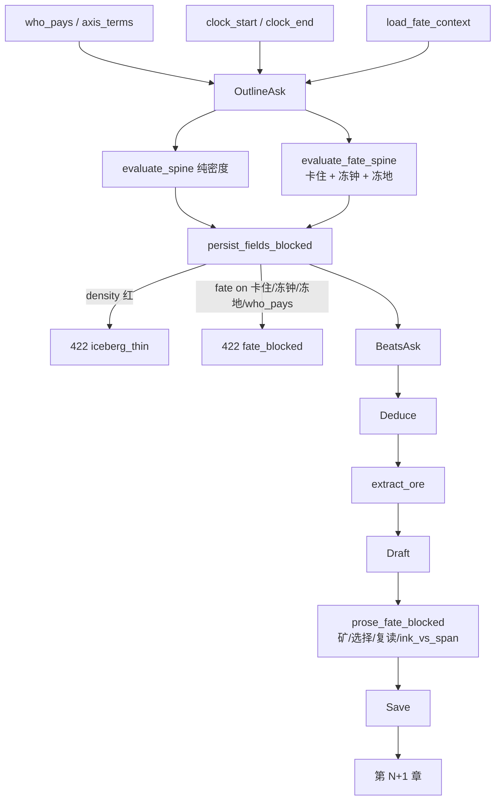

# 小说家视角：从「一场好戏」到「命运变贵」

| 项 | 值 |
|----|-----|
| **文档标题** | 铜炉写章第二刀：跨章卡住 / 故事钟 / 地点 / 演绎矿兑现 / 即兴落户 |
| **作者** | Grok Design（小说家视角） |
| **日期** | 2026-08-16 |
| **状态** | Draft · **rev.8**（词表对齐万界；WAVE-1 功能/世界事实/`goal_off_world`；**默认 WAVE-2 硬开**；记录仪默认开；extra=evaluate_write_contract） |
| **产品** | 铜炉 / tonglu · 代码 `scribe3/` |
| **协议** | `docs/e2e-director-journey-v634-true-chat-full-capability.md` **v6.3.4 rev.6** |
| **宇宙 SSOT** | `docs/worlds/wanjie-probability-war-v7.md`（《万界概率战争》V7.0） |
| **前序（已落地，不推倒）** | `docs/plans/2026-08-15-chapter-spine-closed-loop.md`；`docs/plans/2026-08-15-outline-beats-craft-reform.md` |
| **验收书** | **本次新建 slug** · 入口 `tonglu.qing.blue` · **只打已部署栈** |
| **短名** | `fate-dearer` |

> **口语「13 槽」** = 前序对外合同。实现 `SPINE_SLOTS` 为 **14 键**（`hook` + 可空 `forbid`）。本轮不新增第 15 键。世界命题走 `beats_meta.world_fact`（与 clock/place 同构）。

**rev.8 增量（根因 `docs/audits/2026-08-16-ch8-ch9-structural-root-cause.md`）：**

- `WORLD_VERB` / `WORLD_PHRASE`：`揭开大遮蔽`、`观测伪真空的冗余` 算原子，不必借帘角。
- WAVE-1 新 id：`cast_role_frozen`（挡槽论元角色，不是 2 字碎片）、`world_fact_missing` / `world_fact_same`。
- `cast_function_stuck` 仍在 WAVE-2（弱）。默认 `SCRIBE3_FATE_WAVE=2` 硬开全套。`beat_span_mismatch` 已实现。`world_catalog_empty` 仅轴用语命中万界词且库空时 422。
- `extract_seeds` 停用「青的 / 出来 / 那声 / 掌根」等；废词不触发 `seed_orphan`。
- extra 与 persist 同一验收：`evaluate_write_contract`。产品 ASK 禁止写死母亲咳 / 原样复述 / 必须以时空开头。
- 设定库用 `add_term` / `add_item`，禁止 `add_entity(kind=term)`。`world_catalog_empty` 留 WAVE-2。
- WAVE-1 增 `goal_off_world`：万界轴用语下，本章要与代价必须各点名至少一个 `WORLD_PHRASE`。ASK 末尾【世界合同】压过 extra，禁止 extra 把本章要改成帘/丝/看清水。
- `SCRIBE3_PIPELINE_RECORDER` 读设置 DB，默认开（仅 `0/false/no/off` 关）。

### 现行已取代（F3b / F3c 分批硬闸）

> **现行（2026-08-16 收口）：** 代码与 demo 默认 `SCRIBE3_FATE_DEARER=on` + `SCRIBE3_FATE_WAVE=2` + `SCRIBE3_PIPELINE_RECORDER=1`（设置 DB → env → 目录默认）。WAVE-1 含 `cast_role_frozen` / `world_fact_*` / **`goal_off_world`**；WAVE-2 全套硬开（含 `beat_span_mismatch`）。下文 Rollout 里 F3a「仍 shadow」、F3b「只硬波次 1」、F3c「再开波次 2」是**历史切片**，不要再当部署清单执行。回滚仍可用旗 `off` 或把波次拨回 `1`。
>
> extra 不得当作者：`evaluate_write_contract` + ASK 后置【世界合同】。旧书 `book_e415dfeb` ch8/9 **不重写**。

---

## Overview

章纲短槽、线索密度闸、`beat_off_spine`、`format_must_land`、`bite←prev.hook` 已经证明一件事：**系统能生成一场高密度好戏。** 炉灰记 `book_bdfdcdc4` 按 OpSeq 真写了 3 章，密度与四仪过闸，没有 600 字进场灌肥。

小说家审第 3 章的结论是病灶 SSOT：

> **够写一场好戏，不够撑一部好小说。**

三章同一道侧门拔同一张纸。故事钟停在「还账日当夜」，一分钟的断裂被写成回家再蹲。演绎里有全书心脏，定稿即兴发明了最好的种子，下一章模型记不住。

本设计不新开「小说合同」大表。**加一个纯函数模块 `scribe3/fate_dearer.py`，报告与密度闸并列，禁止并入 `evaluate_spine.errors`。**

场景坐标（rev.7）：

```text
何时（clock） × 何地（place） × 做什么（action / fate）
```

| 轴 | 合同名 | 不管什么 |
|----|--------|----------|
| **戏核 · 命运** | **禁止同轴同幅卡住**（不是可证「更贵」） | 同一物件同一动作连写 |
| **坐标 · 故事钟** | **钟要往前走；笔墨跟跨度走** | 同一分钟写成两章；一天写成指腹巡礼 |
| **坐标 · 地点** | **人要挪窝；同室只许冻一章** | 三章钉死同一道侧门（动作微调也算冻） |
| 不是写章轴 | `GET /timeline`（**章号轴**） | 限知 / 泳道。第 N 章 ≠ 过了几分钟 |

硬闸分批：波次 1 = 卡住 / 冻钟 / **冻地** / span·place 必填 / 矿 / 种子 / who_pays；波次 2 = 选择、复读、详略、书钟、功能、制度。

验收宇宙是万界（柳岸青 / 沈烛 / 赫斯 / 兰因）。炉灰记只作考古，**禁止**续写 `book_bdfdcdc4`。

---

## Background & Motivation

### 现网已经做成的（不要推倒）

| 层 | 落点 | 已证明 |
|----|------|--------|
| 章纲 | `chapter.chapter_spine` · `chapter_spine.v1`（口语 13 / 机检 14 键） | 人读 30 秒能说出要/选/付/线 |
| 密度 | `clue_density.evaluate_spine` / `evaluate_beats` | 口号、无 A vs B、`lines_unbound` 不过闸 |
| 节拍兑现 | `beats_realize_spine` → `beat_off_spine` | **只验本章** choice/decision/cost/escalation 稀有词是否进 GCD blob，**不读上章** |
| 注入 | `_outline_block` / `_ctx_bits` 只灌短槽+GCD | 不再灌肥 synopsis / 千字 `text` |
| 必须落地 | `format_must_land`（8 键，不读五层） | 下游 ASK 看得到短原子 |
| 跨章咬 | `_prev_hook_block` + `resolve_prev_end_hook`（spine.hook 优先） | `bite←prev.hook` 成立 |
| **章号时间线** | `GET /timeline`、`event.story_chapter`、伏笔 setup/payoff 章、弧光 `char_state.chapter` | **已有**：横铺「第几章发生」。**不是**故事分钟，**不分配笔墨** |
| 时辰精修 | `critique` 季节/时辰倒流，report-only | 不挡写、不分配详略 |
| 演绎解析 | `is_layer_heading` 认全角「以为（误读）」 | 不再切成 `role:以为` |
| 工程纪律 | OpSeq、`persist=true`、SPA 三通道、WCG 脚本门槛 | 本轮不改 |

### 病灶（小说家审查 · 必须当 SSOT）

| # | 病灶 | 小说家原话 | 系统当时看见什么 |
|---|------|------------|------------------|
| 1 | 命运不涨价 | 同一道具同一动作连写三章 | Ice1 只验本章密度，不看上章 `goal`/`cost` |
| 2 | 书级合同不进 OpSeq | 「这本书在惩罚谁」 | `intent.reader_feeling` 注入北极星，生成/闸不问 |
| 3 | 演绎矿丢了 | 童年咳、知情者不拔、铜绿追索 | 演绎 ≥5000 过闸；`format_must_land` 不读五层 |
| 4 | 节拍负资产 | 复演第 1 章假铜；新动作没进台阶 | 保留 `beat_off_spine`；**另增** `beat_echo_prev` 才验上章 GCD |
| 5 | 选择没被演 | 正文几乎不犹豫就选 B | 闸只验标签能拆 A/B |
| 6 | 字数地板注水 | 二次蹲守凑水面 | **已决：字数退出通过条件**；改验结构（选择/矿/复读） |
| 7 | 人物功能冻结 | 三人三章同一功能 | `cast` 只是名单 |
| 8 | 制度变氛围 | 场核/大遮蔽当气味 | 设定库有，章纲不强制点名 |
| 9 | 即兴无户口 | 窗台纸是定稿发明 | `save_chapter` 只回填 `end_hook` |
| 10 | 记录仪无体 | headline 有、工件无小说家能审的体 | `ARTIFACT_KINDS` 是注入段 |
| **11** | **故事钟 / 详略** | 同一夜两万字拔一张纸；一分钟写成二次蹲守 | `setting` 只是「后半夜」气氛；**无跨度、无增量、无笔墨纪律**。章号轴帮不上忙 |
| **12** | **地点冻住** | 三章地理半径一条巷、同一道侧门 | `setting` 把时空糊成一句；`event.location` 不进 OpSeq。rev.6 只有 F3c 从散文抠「巷口/侧门」，比冻钟慢一拍 |

### 为什么「再写干一点短槽」不够

短槽是**章内**答题纸。一部小说还要问：是否卡在同一物件同一动作；钟走了没有；人挪了没有；这一段该详还是该略；矿有没有进正文；即兴有没有户口。

拆掉 Ice3/4/6 字数地板之后，若仍不声明时长，模型既没有「必须写满 N 字」，也没有「这段只有九十秒」。**故事钟是字数手段的继任者之一**，与矿/选择并列，不是第三波装饰。

---

## Goals & Non-Goals

### Goals

**波次 1（本轮硬闸 · 戏核 + 钟 + 地 + 矿 + 户口）：**

1. **禁止同轴同幅卡住。** `goal`+`inciting` 不得与上章构成「同一物件 ∩ 同一动作」。`prop_action_stuck` → 422。对外不宣称可证「更贵」。
2. **书级惩罚进入 OpSeq。** ASK 必见 `who_pays` 与 `axis_terms`。波次 1 只硬 `who_pays_missing`；轴用语属波次 2。
3. **故事钟（章级）。** 大纲必填 `clock.span`；`delta=0` 只允许一章，再冻 → `clock_frozen`（可写冻钟理由豁免一章）。
4. **地点（章级，与钟同构）。** 大纲必填 `place.name` + `place_delta`；`place_delta=0` 只允许一章，再冻 → `place_frozen`（围城/密室可写 `stay_reason`）。**不从 `setting` 散文猜地名当硬闸。**
5. **演绎矿必须兑现，且 Ice3 不以字数过闸。** 每人五层齐全 + `extract_ore` ≥1。
6. **即兴落户。** `beats_meta.seeds` only；下章不接 → `seed_orphan`。

**波次 2（算法 F0 就写全，硬闸后开）：**

7. 书钟 `intent.clock_start` / `clock_end` 必填（`clock_book_missing`）。ASK 第 1 章就要看见。
8. **详略跟跨度走**（`ink_vs_span`）。字数地板的继任者，**不是**换皮字数闸。
9. 节拍不得抄上章 GCD；决断稀有词须落在带选的那一拍。
10. Ice4/6：选择被演出 + 矿落地 + 无 `action_reread`。
11. 焦点/对手功能；制度点名 `name`；记录仪 6 工件。`setting_radius_stuck` **仅 shadow**，不与 `place_frozen` 双硬。

### Non-Goals（冻结）

- 不改宣称公式、`may_claim_*`、GATE-B（`synopsis_min_chars=80`）、`GATE_SAVE_MODE`。
- 不改 WCG 门槛数字。不把 `who_pays` 加进 WCG 检查表。
- 不改 SPA 三通道。**禁止** `save_chapter` 自动 `plant_promise`（那是无审批世界写）。
- 不占用 `chapter_brief` / `GET /chapter-brief` / `assemble_chapter_brief`。
- **字数不再作 Ice3/4/6 通过条件**（用户终裁，对齐 Ice1/Ice2）。`DEDUCTION_FLOOR` / `DRAFT_FLOOR` / `PROSE_SURFACE` 可留作 `measures`，**不得**再进 `ok` / skip / 422。详略改由 `clock.span` + `ink_vs_span` 管。
- **不把时间线做成唯一主轴。** 不把 `GET /timeline` 升成 OpSeq 第一步。不给每拍打 ISO/时辰。不线性钟打死闪回。
- **不做全本地图 / 导航网格 / 每拍 GPS。** 地点是场景坐标，不是开放世界产品。不强制先灌 `place:` 实体才能开写（无目录则短名自由文本）。
- 不把 `narrative_contract.v1` 扩成书级合同。
- 跨章 fate id（`who_pays_missing` / `prop_action_stuck` 等）**不**并入 `evaluate_spine.errors`。Ice3/4/6 **结构 id**（`deduction_layers` 等）是字数地板的继任，旗 on 时进 `evaluate_iceberg.missing`（与旧 `deduction`/`draft` 字数 missing 同槽）。
- 不新开 `novel_contract` / `fate_ledger` / `ore` 表。
- 不重写炉灰记库存；不把万界验收写成续写 `book_bdfdcdc4`。
- 不在 Grok 运行机跑全量 pytest / 本机 Surreal / `npm ci`。

---

## 十问盘点：已有 / 半有 / 没有

### 1. 命运变贵 / 跨章升级

| 现落点 | 状态 |
|--------|------|
| `spine.escalation` / `spine.cost` | **半有**（只描述本章） |
| `spine.bite` ← `prev.hook` | **已有**（咬钩 ≠ 卡住） |
| `beat_off_spine` | **半有**（本章稀有词） |
| 「社会代价 / 更贵」机检 | **完全没有** |

**本轮可实现口径：** 禁止同物件同动作卡住 + 代价须点到 `axis_terms` 或设定库专名。不验「更贵」。

### 2. 书级合同

| 现落点 | 状态 |
|--------|------|
| WCG 卷/承诺/母题 | **已有（开书完成门）**，不进 OpSeq |
| `intent` 三段北极星 | **半有** |
| 「惩罚谁 / 代价轴用语」 | **完全没有** |

### 3. 演绎矿

| 现落点 | 状态 |
|--------|------|
| 五层 + ≥5000 | **已有（字数过 ≠ 矿被用）**；本轮 **废除字数通过条件** |
| `format_must_land` | **半有**（不读五层） |
| 矿 → must-land / 下章 bite | **完全没有** |

### 4. 节拍新动作

| 现落点 | 状态 |
|--------|------|
| `beat_off_spine` | **已有（本章）** |
| 与上章 GCD 高相似 | **完全没有** → 新 id `beat_echo_prev` |

### 5–10

选择演出、动作复读、人物功能、制度点名、即兴户口、小说家工件：均为 **完全没有** 或 **喂错层**。实现见 Proposed。

### 11. 故事钟 / 详略（rev.6 补盘）

| 现落点 | 状态 |
|--------|------|
| `GET /timeline` + `story_chapter` | **已有 · 喂错层**（章号连续性，不是故事分钟） |
| `spine.setting`「后半夜」 | **半有**（气氛，无跨度/增量） |
| 精修时辰倒流 | **半有**（advisory，不分配笔墨） |
| 书级终局钟 | **完全没有** |
| 章/拍 `span` + 笔墨纪律 | **完全没有** |
| 「一天略、一分钟详」 | **完全没有**（字数地板曾是失败的代理；已废除） |

**本轮口径：** 钟是场景坐标的时间分量，不是唯一主轴。命运管戏核，钟管「走了多远、该用多少纸」。

### 12. 地点（rev.7 补盘）

| 现落点 | 状态 |
|--------|------|
| `spine.setting` 时空一句 | **半有 / 糊在一起**（时间+地点不可机检拆） |
| `event.location` / `place:` 实体 | **已有 · 喂错层**（事件泳道，不进大纲闸） |
| `setting_radius_stuck`（rev.6） | **半有且弱**：F3c、从散文猜词、三章才红、改称「那扇门」就逃 |
| 章级 `place` + `place_delta` | **完全没有**（rev.7 补） |

**本轮口径：** 地点与钟同构。必填短名+增量；冻地与冻钟同一算法。`setting` 继续给人读。硬闸不靠从 setting 抠「巷口」。

---

## Proposed Design

### 一句话

**一个新模块，零张新表。密度保持纯密度；命运 + 钟 + 地点另调。硬闸挂真入口。默认不种 promise。不把章号时间线/地图当写章爹。**

```text
intent.who_pays / axis_terms          ← 戏核：惩罚谁
intent.clock_start / clock_end        ← 书钟
        ↓ ASK
chapter.clock {span, delta}           ← 过了多久
chapter.place {name, delta}           ← 人在哪、挪没挪
chapter_spine.v1                      ← 形状不动（setting 仍是人话）
        ↓
beats GCD；拍可覆写 span / place
        ↓
deduce → ore（限知主轴，不是时刻表/地图）
        ↓
must-land：时长 + 地点 + 选择/矿
        ↓
draft/final：ink_vs_span + 选择/矿/复读
        ↓
第 N+1 章：禁同动作、禁第三次冻钟、禁第三次冻地
```

### 层次与数据流



---

### 接线铁律（审查核定 · 按此实现）

#### 1. fate 报告与密度报告并列，禁止合成进 `errors`

现网事实：

- `persist_fields_blocked` 只在 `clue_density_mode()=="on"` 时把 `evaluate_spine` missing 变成 422（`iceberg.py` 313–315）。
- `evaluate_iceberg` 无条件 `missing.extend(spine_rep.as_missing())`，`ok = not missing`（188–208）。
- `_reject_thin_iceberg`（`write.py` 63–65）用整份 `evaluate_iceberg.ok` 对 draft/final 发 **409**。
- `_missing_bucket` 只把 `spine_*` / `lines_unbound` 归 spine；生疏 id 会落成自己的桶。

**合同：**

```python
# clue_density.evaluate_spine / evaluate_beats
# 签名不增 prev_*。保持纯密度。禁止 extend fate errors。

# fate_dearer.py
def fate_dearer_mode() -> str:
    """off | shadow | on。对标 clue_density_mode：设置 DB → env → 默认 shadow。"""

def evaluate_fate_spine(spine, ctx: FateCtx) -> FateReport: ...
def evaluate_fate_beats(beats, spine, ctx: FateCtx) -> FateReport: ...
def evaluate_fate_prose(text, ch, ctx: FateCtx, *, kind: str) -> FateReport: ...

# iceberg.evaluate_iceberg
# 另调 evaluate_fate_spine/beats，写入并列键：
#   report["fate"] = {ok, errors, mode, overlap, ore_n, seeds_n}
# 旗 on：WAVE-1 进入 report["missing"] 并挡 persist
# 旗 shadow：只进 report["fate"]，ok 不因 fate 变 False
```

白名单（rev.8 WAVE-1 已含 `cast_role_frozen` / `world_fact_missing` / `world_fact_same`）：

```
FATE_IDS = {
    "who_pays_missing", "axis_terms_missing", "cost_off_axis",
    "cost_private_only", "cost_same_amplitude", "prop_action_stuck",
    "setting_radius_stuck", "world_untouched", "world_catalog_empty",
    "seed_orphan", "cast_function_stuck", "cast_role_frozen",
    "world_fact_missing", "world_fact_same",
    "beat_echo_prev", "beat_decision_homeless",
    "ore_empty", "ore_unlanded",
    "choice_unperformed", "action_reread",
    "clock_required", "clock_frozen", "clock_book_missing",
    "ink_over_span", "ink_under_span", "beat_span_mismatch",
    "place_required", "place_frozen",
}
```

persist 422（大纲/节拍/演绎的 fate 枝）条件：

```
ICEBERG_WRITE 开
∧ clue_density_mode() != "off"
∧ fate_dearer_mode() == "on"
∧ FateReport.errors 含本波次已启用的硬 id
```

`CLUE_DENSITY=off` 或 `ICEBERG_WRITE=0` → fate **不** 422（与密度短路一致）。

#### 2. Ice4/6 **不**挂 `persist_fields_blocked`

现网 `persist_fields_blocked` **只看** spine / beats / synopsis / deductions，从不读 `draft`/`prose`。真实落库口：

| 入口 | draft/prose 怎么落 | 今日闸 |
|------|-------------------|--------|
| REST `POST /generate-stage` | `persist_fn` → `save_chapter_draft` / `save_chapter`（`write.py` 142–165） | **不**调 `persist_fields_blocked` |
| MCP `s3_generate_stage` | 同上直存；`persist_fields_blocked` 只打 outline/beats/deduce | 今日只验地板 → 必须解绑 |
| `thicken_draft` / `thicken_final` | `parse.ok`（今日字数）后 `persist_fn` | 改绑结构 |
| `s3_save_chapter_draft` | 只验 `DRAFT_FLOOR` | **废除字数 422**；旗 on 走 `prose_fate_blocked` |
| `/chat/write` → save | `_reject_thin_iceberg` 看 `evaluate_iceberg.ok`（含字数） | 字数不得再让 `.ok` 变红 |

**禁止再写「persist_fields_blocked 写 draft 时」。**

共享钩子：

```python
# scribe3/fate_dearer.py
def prose_fate_blocked(
    text: str,
    ch: dict,
    ctx: FateCtx,
    *,
    kind: Literal["draft", "final"],
) -> dict | None:
    """None=放行。旗 on 且硬 id 命中 → {code:'fate_blocked', missing, message}。"""
```

调用点（必须同一函数）：

| 调用点 | 何时 | 本轮拦什么 |
|--------|------|------------|
| `thicken_draft` | `parsed["ok"]` 之后、`persist_fn` 之前 | 波次 1：`ore_unlanded`；波次 2：`choice_unperformed` / `action_reread` / `ink_vs_span` |
| `thicken_final` | 同上 | 同上 |
| REST `persist_fn` 在 `save_chapter_draft`/`save_chapter` 之前 | 双保险（thicken 已拦则此处应已过） | 同上 |
| MCP draft/final `persist_fn` | 与 REST 同一包装 | 同上 |

手贴 PATCH 本轮仍可不拦（作者明文覆盖）。`s3_save_chapter_draft` **必须**解绑 `DRAFT_FLOOR`，旗 on 与 generate-stage 走同一 `prose_fate_blocked`（否则字数旁路还在）。

`thicken_*` 遇结构不过：旗 on 返回 `ok=False, code=llm_thin` 或 `fate_blocked`（文案禁「还差 N 字」）。**字数不够绝不 thin。**

#### 3. `load_fate_context`

现网 `persist_fields_blocked(fields, existing=, known_line_ids=)` **没有** `st`/`seq`。`evaluate_iceberg(ch, for_phase=, known_line_ids=)` 也没有。`_blocked_or_none` 有 `st` 但不传章号/上章。

```python
@dataclass
class FateCtx:
    seq: int
    who_pays: str
    axis_terms: list[str]          # 2–3 个必选用语
    clock_start: str               # 书钟起点
    clock_end: str                 # 书钟终点
    prev_clock: dict | None        # 上章 {span, delta, freeze_reason}
    prev2_clock: dict | None
    prev_place: dict | None        # 上章 {name, delta, stay_reason}
    prev2_place: dict | None
    prev_spine: dict | None        # 无 v1 → None
    prev2_spine: dict | None
    prev_beats: list | None
    prev_seeds: list[dict]         # 无则 []
    known_world_names: set[str]    # world_rule/term/item 的 name + 别名
    focalizer: str
    wave: frozenset[str]           # 本波次硬 id；shadow 时空

def load_fate_context(st, seq: int, ch: dict | None = None) -> FateCtx:
    """st is None → 空 ctx（跨章枝 skip，只验能从 ch/intent 夹具传入的本章项）。"""
```

无 prev / 无 v1 spine / 无 seeds = **跨章枝 skip**。本章仍验 `who_pays`（波次 1 硬）。`axis_terms_missing` / `cost_private_only` / `world_untouched` 只进报告，波次 2 才 422。旧章无 v1 **不当** 第 1 章重算，只 skip 比较。

必须改签名的调用点：

| 函数 | 改法 |
|------|------|
| `persist_fields_blocked` | 增 `fate_ctx: FateCtx | None = None`。另调 `evaluate_fate_spine/beats`；**不**把结果并入 density missing。旗 on 则单独 422 `code=fate_blocked` |
| `_blocked_or_none` | 用 `st` + `seq`（thicken 已有）调 `load_fate_context` 再传入 |
| `evaluate_iceberg` | 增 `fate_ctx=None`。有则填 `report["fate"]`，不改 `missing`/`ok` |
| REST `generate_stage` | outline/beats/deduce persist 前：`persist_fields_blocked(..., fate_ctx=load_fate_context(st, seq))`（今日 REST 的 `update_chapter_meta` 枝也要调，否则只靠 thicken 内 `_blocked_or_none`） |
| MCP `s3_generate_stage` | `copy_keys` **+ `beats_meta`**；`persist_fields_blocked(..., fate_ctx=...)` |
| MCP `s3_patch_chapter_plan` | 写 spine/beats 时同样装 ctx |
| 单测夹具 | 不传 `fate_ctx` = 跨章 skip（旧密度测不碎） |

`thicken_outline` / `thicken_beats` 已有 `st`/`seq`：经 `_blocked_or_none` 即可。

#### 4. persist=false 也必须带 `out["fate"]`（F-A 调用点）

现网 `persist=false` **只跑** `thicken_*`，不走 REST/MCP 落库，也 **不调** `evaluate_iceberg`。`persist_fields_blocked` 只返回 `None` 或 422 块，**不会**把 fate 报告塞进 thicken 返回值。F1 若只改 iceberg / `_blocked_or_none` / 旗，F-A「persist=false 响应含 fate」会对空。

**钉死：** 五个 `thicken_*` 在 parse 之后（**skip 路径亦然**）一律：

```python
ctx = load_fate_context(st, seq, ch)
rep = evaluate_fate_spine/beats/prose(..., ctx)   # 按 stage 选
out["fate"] = rep.as_dict()   # 含 mode / ok / errors
# _blocked_or_none / prose_fate_blocked 只在 fate_dearer_mode()=="on" 时 422
# 不负责往 out 塞报告
```

REST `POST /generate-stage` 与 MCP `s3_generate_stage` **原样返回** thicken 的 `out`（含 `fate`），无论 `persist` true/false。F-A 查 JSON：`fate.mode=="shadow"` 且 `fate.errors` 可为 `["who_pays_missing"]`。

#### 5. Ice3/4/6 解绑字数（用户终裁 · 与 Ice1/Ice2 同构）

用户原话：**「我想和大纲/节拍一样，不要用字数来作为手段。」**

现网事实（必须改）：

| 钩子 | 今日 | 终态 |
|------|------|------|
| `parse_deduce_payload.ok` | `dsum >= DEDUCTION_FLOOR`（5000） | 每人五层齐全 + `extract_ore` ≥1 |
| `parse_draft_payload.ok` / `parse_final_payload.ok` | `cn >= 10000` / `>= 5000` | 非空 **且**（旗 on）结构过 |
| `evaluate_iceberg` | `missing` 含 `deduction`/`draft` 字数 | **删除**字数 missing；旗 on 改放结构 id |
| `iceberg_ok_for("deduction"|"draft")` | 看字数 missing | 看结构：演绎=五层+矿；排演=选择+矿+无复读 |
| `thicken_*` skip | `iceberg_ok_for` 字数够就 skip | 结构过才 skip（800 字密排演可 skip；万字空壳不 skip） |
| `persist_fields_blocked` 演绎 | `_check_deductions` 字数 | 旗 on 验 `deduction_layers` / `deduction_ore` |
| `s3_save_chapter_draft` | 只验 `DRAFT_FLOOR` | **废除字数 422**；旗 on 走同一 `prose_fate_blocked` |
| `_reject_thin_iceberg` 409 | `evaluate_iceberg.ok` 含字数 | 字数不再让 `.ok` 变红；旗 on 时结构 id 可让 `.ok` 红 |

常量 `DEDUCTION_FLOOR` / `DRAFT_FLOOR` / `PROSE_SURFACE` **留在** `measures` 与日志（`got` 字数），**禁止**再写入任何 `ok` / skip / 422 条件。

**结构通过条件（可金样）：**

| 层 | missing id | 过 | 不过 |
|----|------------|----|------|
| Ice3 | `deduction_layers` | 在场每人五层标题齐、每层非空 | 缺层 / `role:以为` 噪声当角色 |
| Ice3 | `deduction_ore` | `extract_ore` ≥1（`action_hits`） | 五层有字但抽不出矿 |
| Ice4/6 | `ore_unlanded` | 见矿落地三条 | 「场核很亮」 |
| Ice4/6 | `choice_unperformed` | 结构序 + 窄停顿 | 「他按回碎片」 |
| Ice4/6 | `action_reread` | 无不相邻同指纹 | 二次蹲守同一拔纸 |
| Ice4/6 | `ink_over_span` / `ink_under_span` | 笔墨与 `clock.span` 匹配 | 一天写成指腹巡礼 / 一分钟只写汇报 |

**`parse.ok` / `llm_thin`（吃密度 PR2a 教训，方向相反：解绑字数、改绑结构）：**

| 旗 | `parse.ok` | `llm_thin` | persist 422 |
|----|------------|------------|-------------|
| shadow（F2） | **解绑字数**。非空（有五层正文 / 有排演或定稿正文）即为 ok。结构进 `parsed["struct"]` / `out["fate"]` | **字数不够不 thin**。结构不过也不 thin | 不 422 |
| on（F3b/c） | 结构过才 ok | **结构未过才 thin**（文案「缺五层/矿/选择」，禁止「还差 N 字」） | 本波次硬 id 422 |

空串 = 尚未写 → `ok=false`（继续生成），这不是字数地板。

**skip：** F2 起 `iceberg_ok_for` 看结构，不看字数。结构不过继续 thicken；结构过则 skip（即使远低于旧地板）。

**续写：** 禁止「还差 N 字写新场面」。改为：

```
【续写·情节薄】缺结构原子（选择未演 / 矿未落地 / 同一动作复读）。
禁止用字数凑段。写后果、信息差、关系质变，不要二次蹲守。
```

**短稿灌库风险：** shadow 窗口字数与结构都不 422。F2 验收以 `persist=false` 为主；F3b/c 尽快 on。缓解 = 结构闸先绿（五层/选择/矿），不是回到字数。

---

### 新模块：`scribe3/fate_dearer.py`

纯函数，零 I/O。阈值先金样后锁，**不假装已验证**。

```python
SCHEMA_ORE = "beats_meta.ore.v1"
SCHEMA_SEEDS = "beats_meta.seeds.v1"
WHO_PAYS_MAX = 40
AXIS_TERMS_MIN, AXIS_TERMS_MAX = 2, 3
ORE_CAP, ORE_MAX_CN = 5, 40
SEED_CAP = 3

# 停顿窄表（删除「先/再/还是/对视/停」）
HESITATE_NARROW = ("没伸", "又收回", "手悬", "没敢", "犹豫", "缩回")

# 设定半径：时间词不参与「同一地点」
SETTING_TIME_STOP = frozenset({
    "当夜", "下午", "夜里", "后半夜", "清晨", "当天", "凌晨", "傍晚",
})

# 双字动词袋（ACTION_LEX 无「按回/拔」等）。匹配时比单字优先。
FATE_VERB_BAG = ("按回", "开箱", "焊死", "降温", "找箱", "拔")
# 不入袋「揭纸」：揭 已在 ACTION_LEX；入袋会覆盖单字揭，P3/F0 断言对不上。
```

`fate_dearer_mode()` 对标 `clue_density_mode()`：`get_setting("SCRIBE3_FATE_DEARER")` → env → 默认 `"shadow"`。非法值当 `"off"`。

---

### 书级惩罚（intent 两短字段）

| 字段 | 形状 | 谁写 | 谁读 | 谁闸 |
|------|------|------|------|------|
| `intent.who_pays` | ≤40 字 | `s3_set_intent` / `PUT /intent` | ASK 文首；`evaluate_fate_spine` | 波次 1 硬：`who_pays_missing` |
| `intent.axis_terms` | 2–3 个用语，JSON 列表或 ` / ` 分隔短串 | 同上 | ASK；`cost_off_axis` | 缺或不足 2 个：`axis_terms_missing`（**波次 2**，与 `cost_off_axis` 同波）。F3b **不**因无轴用语 422 |

**禁止**用散文句做零交集（「大遮蔽完整度 / 碳化倒计时 / 场核是否还按得回去」会误杀自己的 ch3）。万界金样：

```
who_pays：柳岸青与被牧场圈住的人类
axis_terms：["大遮蔽", "碳化", "场核"]
```

`reader_feeling` / `emotional_arc` / `red_lines` 保持。WCG 不新增检查。

**写入面（必须一次写全，否则第一关卡死）：**

| 面 | 今日 | 必须加 |
|----|------|--------|
| `store/intent.py` SELECT / MERGE 白名单 | 三段 + 工程键 | `who_pays`, `axis_terms`, `clock_start`, `clock_end` |
| `api/models.py` **`IntentIn`** | 三段 | 四字段（惩罚两句 + 书钟两句） |
| `api/intent_northstar.py` **`IntentIn`**（`PUT /intent` 真入口） | 三段 | **同一组**（漏则静默丢） |
| MCP `s3_set_intent` | 188–196 行只有三段 | 形参 + fields |
| `orchestration/catalog.py` 意图 duty | 三段 | 补两句 |
| `deploy/hermes/SOUL.scribe3_write.md` | 三段 | 补两句 |
| 协议 S2 / 万界 A1 金样 | 三段 | 「请 `s3_set_intent(who_pays=…, axis_terms=["大遮蔽","碳化","场核"])`」 |
| UI `NorthStarBar.jsx` / `BookSection.jsx` | 写死三字段 | **本轮可不改表单**（Open Q3 已决：MCP + SOUL 先教） |

422 文案必须可执行：

```
请先 s3_set_intent(who_pays="柳岸青与被牧场圈住的人类", axis_terms=["大遮蔽","碳化","场核"]) 再写大纲。
```

Schema（与现网 `reader_feeling` 一致，**不要** `option<string>`）：

```surql
DEFINE FIELD IF NOT EXISTS who_pays ON intent TYPE string DEFAULT '';
DEFINE FIELD IF NOT EXISTS axis_terms ON intent TYPE string DEFAULT '';
-- axis_terms 存 JSON 数组字符串或「大遮蔽 / 碳化 / 场核」
```

`apply_schema` 失败 → F0 验收记红，禁止 F1 在无列库上空转。

零兼容：新 slug 无 `who_pays` → 波次 1 Ice1 persist 422。禁止从 `reader_feeling` 启发式填。炉灰记不迁移。

---

### 第二主轴：故事钟（rev.6 融合）

情节主轴仍是「谁付出什么」。时间线**不是**唯一主轴，也**不是**可选项。拆掉字数地板之后，钟是**详略的继任者**和**跨章是否冻住**的检查。

#### 不要做什么（仍否决）

| 方案 | 否决理由 |
|------|----------|
| 时间线当**唯一**主轴，一切先落到钟再演绎 | 演绎主轴是限知。线性钟误杀闪回 / 信史改写 / 观复 |
| 把 `GET /timeline` 升成 OpSeq 第一步 | 章号轴 ≠ 故事分钟。第 3 章和第 30 章没有「该写多细」 |
| 每拍打 ISO / 时辰 | 模型造假钟点；开书无事件表会灌假 event |
| 只靠 `prop_action_stuck`、不加钟 | 拨铜→听门→拔纸能过动作闸，钟仍冻着，详略仍乱 |

#### 书钟（`intent`，与 who_pays 同写入面）

| 字段 | 形状 | 谁闸 |
|------|------|------|
| `intent.clock_start` | ≤40 字 | ASK 第 1 章必见。缺 → `clock_book_missing`（**波次 2 硬**；F3b 只报告） |
| `intent.clock_end` | ≤40 字 | 同上 |

万界金样：

```
clock_start：大泄露当夜
clock_end：十八个月后深渊碰撞
```

炉灰记若重开（本轮不）必须补终局：「账不清则… / 清完钟往哪走」。没有终局钟，章的 `span` 是孤儿。

Schema：`TYPE string DEFAULT ''`，与 `who_pays` 同迁移。两份 `IntentIn` + `s3_set_intent` **同一 PR（F0）** 加上。

#### 章钟（`beats_meta.clock` 或 `chapter.clock`，**不占第 15 槽**）

```python
CLOCK_SPANS = ("beat", "scene", "day", "stretch", "leap")

# {span, delta, freeze_reason?}
# delta: 0=钟没走  1=走了一档  2=跳切
# freeze_reason: 非空则本层允许再冻一章（倒计时 / 同秒多视角）
```

| span | 故事时长（约） | 默认笔墨 |
|------|----------------|----------|
| `beat` | 秒～数分钟 | **详写**肌理、选择停顿、限知 |
| `scene` | 一小时量级 | 中写：走完要/挡/变/付 |
| `day` | 一天～两天 | **略写结果**，禁止分钟复读 |
| `stretch` | 数日～数周 | 只写质变点 |
| `leap` | 月以上 | 一句跳切 + 钩 |

节拍可覆写 `span`：章是 `day`，揭纸那拍标 `beat`——「一天里抽出一分钟详写」。比整章一档准。

`setting` 仍写人话时空（「还账日后半夜」）。`start` 标签可从 setting 抄，**闸不靠 setting 当钟**。

解析：大纲标签「时长：beat」或 JSON；缺档 → `clock_required`。

#### 闸

**`clock_required`（波次 1 硬）**  
本章无合法 `span` → Ice1 persist 422。没有跨度就没有详略尺。

**`clock_frozen`（波次 1 硬 · 第 3 章起）**

```python
def clock_frozen(this: dict, prev: dict | None, *, seq: int) -> bool:
    if seq < 3 or not prev:
        return False
    if this.get("freeze_reason") or prev.get("freeze_reason"):
        return False  # 显式冻钟：倒计时/同秒多视角，豁免这一层
    slow = {"beat", "scene"}
    if this.get("span") not in slow or prev.get("span") not in slow:
        return False
    return int(this.get("delta") or 0) == 0 and int(prev.get("delta") or 0) == 0
```

| # | 情形 | 期望 |
|---|------|------|
| C1 | ch1 beat；ch2 `delta=0` 仍当夜（**允许冻一章**） | **过** |
| C2 | ch3 再 `delta=0` 且 span=beat，无 freeze_reason | **红** `clock_frozen` |
| C3 | ch3 `delta=0` 但 `freeze_reason=同秒双视角` | **过**（豁免一章） |
| C4 | ch3 `delta=1` span=scene（天亮后） | **过** |
| C5 | 炉灰记式：下午→入夜→后半夜仍拔纸，三章 delta 都当 0 | ch3 大纲 **红** |

同一夜三场**不同代价**合法（`prop_action_stuck` 已过 **且** 至多一章 `delta=0`）。同一夜第三次分钟戏默认红。

**`ink_vs_span`（F2 报告，F3c 硬）**  
字数地板的继任，**禁止**写成「day 不得超过 800 字」。

| id | 规则 |
|----|------|
| `ink_over_span` | `span∈{day,stretch,leap}` 且正文出现 ≥2 段不相邻的同一微动作指纹（指腹/门缝/呼吸类）且无新 `choice` 结构序 |
| `ink_under_span` | `span=beat` 且无选择停顿、无矿落地（只有结果句） |

复用 `duplicate_action_fingerprints`；`allow` = cast ∪ 设定库 name。闪回句（`_MEMORY_RE`）不计入 over。

**`beat_span_mismatch`（波次 2 报告，F3c 可硬）**  
章是 `leap`，三拍全是秒级「挡在眼皮外」→ 报告。

**与地点分工：** 冻钟只验时间增量。同巷第三次拔纸由 **`place_frozen` + `prop_action_stuck`** 合杀。`setting_radius_stuck` **不再硬闸**（见下节）。

#### 生成 / 注入

`_OUTLINE_ASK` 加：

```
本书钟：{clock_start or "（未设）"} → {clock_end or "（未设）"}
时长：beat / scene / day / stretch / leap（缺一不可）
增量：0 钟没走 / 1 走了一档 / 2 跳切。delta=0 全章只许一次；第三次冻钟须写冻钟理由。
笔墨：分钟级写肌理与选择；日级以上只写结果与代价，禁止把一天写成蹲门。
```

`format_must_land` 加一行：

```
时长：{setting 短标签} · {span} · delta={n}
```

续写：禁止「还差 N 字」。`day+` 时加「不要再写指腹」。

演绎五层**仍按时序/限知**，不改成按钟点演绎。

#### 金样（F0 必跑）

| # | 夹具 | 期望 |
|---|------|------|
| K1 | 无 span | `clock_required` |
| K2 | ch1/ch2 delta=0 beat；ch3 再 0 | `clock_frozen` |
| K3 | 同上但 ch3 freeze_reason 非空 | 过 |
| K4 | `span=day` 正文两段不相邻「指腹探门缝」无选择序 | `ink_over_span` |
| K5 | `span=beat` 只有「他拔了纸。」无停顿无矿 | `ink_under_span` |
| K6 | 闪回句含「想起那年」+ 微动作 | 不计入 over |

---

### 场景坐标 · 地点（rev.7 · 与钟同构）

地点是坐标的空间分量，**不是**第四个主轴产品。围城/密室/华山当夜连写合法，规则与冻钟对称：**冻一章，第三次要理由。**

#### 不要做什么

| 方案 | 否决理由 |
|------|----------|
| 全本地图 / 导航网格当写章爹 | 爆炸半径；开书没有地图也会假绿或卡死 |
| 每拍 GPS / `place:` 必填才能大纲 | 新书无实体；逼灌假地点 |
| 只从 `setting` 抠「巷口/侧门」硬闸 | 改称「那扇门」就逃；时空糊在一句里 |
| 与 `clock_frozen` 两套不同阈值 | 作者无法预测；rev.6 三章才红太慢 |

#### 章地点（`beats_meta.place` / `chapter.place`，不占第 15 槽）

```python
# {name, delta, stay_reason?}
# name: ≤20 字短名。有设定库 place/term 则优先子串命中 name，不写 place:id
# delta: 0=同室/同一扇门  1=同区（仍在旧库巷，换了墙根/巷口）  2=换域
# stay_reason: 围城 / 密室 / 锁眼当夜 —— 非空则本层允许再冻一章
```

无地点目录 → `name` 自由短文案仍合法（`place_required` 只验非空 + 合法 delta）。有目录则 ASK 列出 **name**，命中可减少「侧门/那扇门」漂移。

节拍可覆写 `place.name`（一章内从巷口走到门缝 = 章 `delta=0` 或 `1`，拍级换名不单独硬闸）。

`spine.setting` **继续写人话**：「还账日后半夜，旧库后墙到巷口」。闸读 `place`，不解析 setting。

#### 闸

**`place_required`（波次 1 硬）**  
无 `name` 或 `delta` 不在 `{0,1,2}` → Ice1 persist 422。

**`place_frozen`（波次 1 硬 · 第 3 章起）**  
与 `clock_frozen` **同一算法**（把 span 的 slow 集换成「本章+上章 delta 都是 0」）：

```python
def place_frozen(this: dict, prev: dict | None, *, seq: int) -> bool:
    if seq < 3 or not prev:
        return False
    if this.get("stay_reason") or prev.get("stay_reason"):
        return False
    return int(this.get("delta") or 0) == 0 and int(prev.get("delta") or 0) == 0
```

| # | 情形 | 期望 |
|---|------|------|
| L1 | ch1 侧门；ch2 `delta=0` 仍侧门缝 | **过**（冻一章） |
| L2 | ch3 再 `delta=0` 无 stay_reason | **红** `place_frozen` |
| L3 | ch3 `delta=0` 但 `stay_reason=密室未破` | **过** |
| L4 | ch3 `delta=1`（巷口→后墙，仍旧库） | **过** |
| L5 | ch2 医院 `delta=2`；ch3 金縢 `delta=2` | **过** |
| L6 | 炉灰记式三章「侧门/巷口/后墙」若都标 `delta=0` | ch3 **红** |

`delta=1` 的定义交给作者：同区挪步。闸不验「侧门」与「后墙」是否同义——**防逃靠增量声明，不靠同义词表。** 谎报 `delta=2` 而正文仍在拔同一道缝，由 `prop_action_stuck` + 矿/选择接；不在地点闸做 NLP 对质。

**`setting_radius_stuck`：退役硬闸。** F0 可留函数做 shadow 诊断（报告「setting 三章地点核重叠」），**F3b/c 均不 422**。避免与 `place_frozen` 双规。

#### 生成 / 注入

`_OUTLINE_ASK` 加：

```
地点：短名（侧门旧库 / 华山北峰 / 金縢密室）
地点增量：0 同室  1 同区  2 换域。delta=0 只许一章；第三次须写留驻理由。
```

`format_must_land` 加一行：`地点：{name} · delta={n}`。

#### 金样（F0）

| # | 夹具 | 期望 |
|---|------|------|
| P1 | 无 name | `place_required` |
| P2 | ch1/ch2 delta=0；ch3 再 0 | `place_frozen` |
| P3 | 同上 + stay_reason | 过 |
| P4 | 三章 setting 都含「侧门」但 place_delta 分别为 0/1/2 | **不**红 place_frozen（增量已报） |

---

### 跨章卡住（波次 1 硬：`prop_action_stuck`）

本轮合同名：**禁止同轴同幅卡住**，不是「更贵」。

#### 切词（全部闸共用）

复用 `clue_density._content_tokens`、**真实** `ACTION_LEX`（由 `_union_action_lex()` 生成，**禁止** F0 单测另造假词表）与 `_action_hit` 纪律：

- `ACTION_LEX` 已按长度降序。单字 `按`/`揭`/`撕`/`开` **直接算动作**（与 `_action_hit` 一致）。
- 仅 `_SINGLE_NEED_NEAR = {还,咳,交,开,关}` 需要邻接 `_OBJECT_NEAR` 才计。
- **不要**再写 `len(w) >= 2` 过滤器——那会让「按回碎片」抽成 `acts=∅`，P2/P3 假绿。
- 另加 `FATE_VERB_BAG`：`按回`/`开箱`/`焊死`/`降温`/`找箱`/`拔`（`拔` 不在现网 `ACTION_LEX`，必须入袋）。**不入袋「揭纸」**：`揭` 已在 `ACTION_LEX`，入袋会覆盖单字，P3/F0 须断言含 `"揭"`。袋内词优先于其子串单字（命中「按回」则不再单计「按」）。

#### `prop_action_stuck`（输入 / 规则 / 金样）

**输入：** `spine.goal + spine.inciting` vs `prev_spine.goal + prev_inciting`。第 1 章或 `prev_spine is None` → skip。

**切：**

```python
def action_hits(text: str) -> set[str]:
    bag = {v for v in FATE_VERB_BAG if v in (text or "")}
    acts = set(bag)
    for w in ACTION_LEX:  # 已按 len 降序；与 _action_hit 同一表
        if w not in text:
            continue
        if any(w != b and w in b for b in bag):
            continue  # 「按」被「按回」覆盖
        if w in _SINGLE_NEED_NEAR:
            i = text.find(w)
            window = text[max(0, i - 2): i + len(w) + 3]
            if not any(o in window for o in _OBJECT_NEAR):
                continue
        acts.add(w)
    return acts

def action_object_pair(text: str) -> tuple[frozenset[str], frozenset[str]]:
    acts = action_hits(text)
    objs: set[str] = set()
    for a in acts:
        i = text.find(a)
        window = text[max(0, i - 4): i + len(a) + 4]
        for tok in _content_tokens(window, min_len=2):
            if tok not in acts and tok not in ("自己", "不是", "没有"):
                objs.add(tok)
    return frozenset(acts), frozenset(objs)
```

**命中：** `acts` 与 `prev.acts` **都非空** 且 `acts == prev.acts` 且 `objs ∩ prev.objs` 非空。  
**禁止**把 `∅ == ∅` 判卡住（否则抽空反而红/假绿）。

| # | 输入摘要 | 期望抽到 | 期望闸 |
|---|----------|----------|--------|
| P1 | ch1「按回碎片」→ ch2「去医院降温 / 连夜找金縢」 | ch1 `{按回}`；ch2 `{降温}`（袋） | **过**（动作变） |
| P2 | 两章都是「把场核碎片按回裂口」 | 两章 `{按回}`，物件含「碎片/裂口/场核」 | **红** `prop_action_stuck` |
| P3 | ch2/ch3「侧门揭纸」（**用揭，不用拔**） | `{揭}`（`ACTION_LEX` 单字）+ 物件「侧门/纸」 | **红** |

F0 单测必须 `from scribe3.clue_density import ACTION_LEX` 跑 P2/P3，断言 `action_hits("把场核碎片按回裂口")` 含 `"按回"`，`action_hits("侧门揭纸")` 含 `"揭"`。禁止手写假 `ACTION_LEX` 让金样假绿。

物件可同、动作必须变（按回 → 找箱 → 开箱）。同物件同动词才红。

#### `cost_same_amplitude` / `cost_off_axis` / `cost_private_only`（波次 2 硬，F0 先金样）

**社会代价（可实现层）：** `spine.cost` 必须点到 `axis_terms` 之一，**或** `known_world_names` 之一。不再用宽 `PUBLIC_COST_LEX`（删「门/名/线/卷/账」）。

| id | 规则 |
|----|------|
| `cost_private_only` | cost 非空，但 0 个 axis_term 且 0 个设定库 name |
| `cost_off_axis` | 有 axis_terms，cost 与全部用语零命中（与 private 可同时记，展示合并） |
| `cost_same_amplitude` | 与 `prev.cost` 的 `_content_tokens` overlap ≥ 工作阈值 **且** 没有新的 axis_term/设定库 name |

万界 **过/不过**（含 `cost_off_axis`，F0 钉死）：

| 章 | cost | axis_terms | 期望 |
|----|------|------------|------|
| 1 | 大遮蔽多撕一指；他被标成移动真真空泡 | 大遮蔽/碳化/场核 | **过**（点到大遮蔽） |
| 2 | 不去医院则碳化提前；金縢仍封 | 同上 | **过**（新用语「碳化」+ 专名金縢） |
| 3 | 开箱则场核方位暴露；焊死则碳化少一条活路 | 同上 | **过**（场核+碳化） |
| 3′ | 开箱读码则封印裂纹；焊死则十八个月少一条活路 | 同上 | **红** `cost_off_axis`（「封印/十八个月」不在 axis_terms，且未点名「场核/碳化/大遮蔽」） |
| 2′ | 大遮蔽又撕了一点 | 同上 | **红** `cost_same_amplitude`（无新轴用语/新专名） |
| 1′ | 他很怕，手在抖 | 同上 | **红** `cost_private_only` |

rev.1 自备 ch3「封印裂纹 / 十八个月」对着旧散文轴会假红——**那条不再当合法金样**。合法 ch3 必须点名 `场核` 或 `碳化` 或 `大遮蔽`。

#### `setting_radius_stuck`（**仅 shadow 诊断 · 不 422**）

rev.6 从 `setting` 抠地点核、三章才红。rev.7 **退役硬闸**：与 `place_frozen` 双规，且「那扇门」能逃。F0 可保留函数 + S1/S2 金样作报告；`wave` **永不**含此 id。地点硬合同只认 `place_required` / `place_frozen`。

#### `world_untouched`（波次 2）

**输入：** `info_gap + cost + lines[].delta` vs `known_world_names`。

`known_world_names` = `list_world_rules()` / `list_terms()` / `list_items()` 的 **`name` 字段**（`store/codex_ext.py` 主键是 name，**禁止**虚构 `world_rule:great-veil` 冒充 `lines.kind`）。别名：name 本身 + 常见短称若写在 note 则不解析——本轮只认 `name` 子串。

书内三类皆空 → skip，warning `world_catalog_empty`（WCG 仍应先绿）。  
`lines.kind` 仍只允许 `promise`/`storyline`。

#### `seed_orphan`（波次 1 硬，第 2 章起）

**输入：** `prev_seeds[].atom` vs 本章 `bite + info_gap + hook + forbid + " ".join(lines.delta)`。

**命中：** 上章 seeds 非空，且无一 atom 的 ≥4 字核（不足 4 则整串）出现在上述槽，也未在 `forbid` 里出现（forbid 出现 = 作废，算已处理）。

---

### 节拍：保留 `beat_off_spine`，另增 `beat_echo_prev`

`evaluate_beats` **密度签名不增** `prev_beats`（避免 fate 错进 density errors）。跨章回声由 `evaluate_fate_beats(beats, spine, ctx)` 另算。

| id | 谁算 | 规则 |
|----|------|------|
| `beat_off_spine` | 现网 `beats_realize_spine` | **保持本章**稀有词合同。docstring 去掉「假铜」特例。可选：`_RARE_MARK` 改为「本章 spine.choice/decision/cost/escalation 的 `_content_tokens`」，不再写死断/咳/焦/假 |
| `beat_echo_prev` | fate | 每拍 `goal+conflict+turn` token 集与上章任一带 Jaccard ≥ 工作阈值 |
| `beat_decision_homeless` | fate | `spine.decision` 稀有词未出现在带合法 `choice` 的那一拍 |

`names_from_cast` 硬编码灰七/婆子别名是密度层债，本轮可选加柳岸青/沈烛/赫斯/兰因（已有一部分），不阻塞 F0。

`beat_echo_prev` / `beat_decision_homeless` 属 **波次 2** 硬闸。

---

### 演绎矿

不改五层标题。**废除**合计 ≥5000 作为通过条件。`_DEDUCE_ASK` 删「全部投影去掉空白后合计 ≥5000」句，改为「每人五层必须齐，且至少抽出 1 条矿」。

```python
def extract_ore(deductions, scene_truth, *, spine=None) -> list[dict]:
    """从「知道 / 没察觉的 / 以为(误读)」切句。
    入选（与卡住闸同一套切词，禁止 ACTION_LEX≥2 过滤器）：
      - action_hits(sent) 非空（袋词 + _action_hit：单字咳 在「海」对象窗内算动作）；或
      - 时间词(多年/后来/童年/夜里) + 对象窗（补充路径，不是唯一入口）。
    去掉已在 spine.info_gap/hook 的子串。
    {atom, who, layer}，atom ≤40，最多 5。
    """
```

写入已有 `beats_meta.ore`。

**谁写（含 skip 旁路 · 必须真进库）：**

现网 `thicken_deduce` 已厚 skip 返回 **没有** `ok`（只有 `skipped`）。MCP 仅当 `persist and stg != "draft" and out.get("ok")` 才 `copy_keys` 落库（`tools_write.py` 1336）。skip 补抽若只塞返回值、不带 `ok: True`，MCP **仍不写**。

1. **新生成：** persist 前 `fields["beats_meta"] = merge_ore(...)`，与 deductions 同一次 persist。返回 `ok: True` + `beats_meta` + `fate`。
2. **已厚 skip：** `load_ore` 空则对已有 `deductions`+`scene_truth` 抽矿。返回值 **必须** 带：

```python
return {
    "ok": True,                    # MCP copy_keys 条件依赖此键
    "skipped": "演绎已达覆盖地板，不覆盖正文；补抽 ore",
    "source": "existing",
    "deductions": (ch or {}).get("deductions"),
    "beats_meta": merge_ore(existing, ore),
    "fate": rep.as_dict(),
}
```

   同时：若调用方传了 `persist_fn`，skip 内也 `persist_fn({"beats_meta": ...})`（REST generate-stage 走这条）。  
3. MCP：`copy_keys` **必须**含 `beats_meta`。条件改为 `persist and stg != "draft" and (out.get("ok") or out.get("beats_meta"))`（双保险；skip 已 `ok: True` 时旧条件也够）。
4. F-B 单测：夹具已厚 deductions、ore 空、假 `persist_fn` / 假 MCP copy，断言写入 `beats_meta.ore`。

禁止「skip 补抽」只改内存、不改 `ok`、不进 copy_keys。

**谁读：**

```python
def format_must_land(spine, ore=None, chapter=None) -> str:
    """ore 缺省时 load_ore(chapter)。不要指望调用方记得传。"""
```

调用方（PR-F2 必须两处都改）：

- `stage_generate._ctx_bits`（有 `meta`/`ch`）→ `format_must_land(spine, chapter=meta)`
- `write_assemble_context._outline_block`（有 `ch`）→ `format_must_land(spine, chapter=ch)`

**落地条件（`ore_unlanded`，波次 1 硬）：** 对每条 atom，下列 **任一** 即落地：

1. atom 的 `action_hits` **与** 一个对象窗（`_content_tokens` 2–4 字且非动作）在正文 **同一句** 同现（单字「咳」+「母亲/口气」算）；或  
2. atom 的 **≥4 字连续核** 在 draft/prose 出现；或  
3. 整条 atom / ≥4 字核已写入本章 `spine.hook` 或下章将读的 `bite`（定稿章：hook；跨章由 seed/hook 接）。

**金样（抽取 + 落地）：**

| 输入 | 期望 |
|------|------|
| 五层原文含「海用他母亲的口气咳」 | `extract_ore` **至少 1 条** atom 含「咳」（`action_hits` 命中；不是 ≥2 过滤器） |
| 定稿「海用他母亲的口气咳了一声」 | `ore_unlanded` **过**（咳+母亲 同句，或 ≥4 字核） |
| 定稿「场核很亮」对矿「沈烛知场核方位、不知他听得见海」 | **红**（无动作命中、无 4 字核「场核方位」） |
| 定稿只写「听见海」 | **红** |

`deduction_ore` / 旧名 `ore_empty`：五层有字但抽不出 1 条 → Ice3 **不过**（不再用 5000 当「够厚」）。旗 shadow 只报告；旗 on（F3b）422。

`brief_only`：`filter_brief_only_fields` 只留 spine。**ore/seeds 禁止走 brief_only。** deduce persist **忽略** `brief_only`（演绎不是 overlay 干章纲），或允许 `beats_meta` 通过过滤器。outline/beats 的 `brief_only` 不得擦掉已有 `beats_meta.ore`。

---

### 选择被演出（波次 2）

删「先/再/还是/对视/停」。要 **结构序**：

```python
def evaluate_prose_choice(prose: str, spine: dict) -> list[str]:
    ab = parse_choice_ab(spine.get("choice"))
    if not ab:
        return []
    a_toks = [t for t in _content_tokens(ab[0]) if len(t) >= 2]
    b_toks = [t for t in _content_tokens(ab[1]) if len(t) >= 2]
    sents = split_sents(prose)
    def hit(sent, toks):
        return any(t in sent for t in toks)
    # 存在 i < k，中间至少一句 j，sents[i] 中 A、sents[k] 中 B（或相反），
    # 且 sents[j] 命中 HESITATE_NARROW
    ...
```

金样：

| 正文 | 期望 |
|------|------|
| 「他按回碎片。」 | **红** `choice_unperformed` |
| 「手伸向沈烛。又收回。他自己按回裂口。」 | **过** |
| 「然后再走，他按回碎片。」（随口「再」） | **红**（「再」已删；无窄表） |

ASK 仍写「先停在未选侧」。闸按结构验，不按「先」字。

---

### 禁止复读（波次 2；字数不作手段）

`build_stage_prompt` 对 draft/final 续写改口（706–718 行今日仍是「还差 N 字写新场面」——**必须删**）：

```
【续写·情节薄】缺结构原子（选择未演 / 矿未落地 / 同一动作复读）。
禁止重写开头，禁止同一只手对同一物件做同一件事写第二遍。
禁止「还差 N 字写新场面」。字数不是通过条件。
```

**persist 只拦自写最小函数**（不升级 critique 精修为 422）：

```python
def duplicate_action_fingerprints(text: str, *, allow: set[str]) -> int:
    """按句抽 (ACTION≥2, 邻接对象窗)。allow = cast 名 ∪ 设定库 name（仪式/专名豁免）。
    不相邻两句同一指纹 → 计 1。返回重复条数。"""
```

- `>= 1` → `action_reread`（波次 2 硬）
- `find_near_duplicate_paragraphs` → **只进 shadow 报告**，不 422
- `find_cross_chapter_repetitions` → **不进 persist**

`parse_draft_payload.ok` / `parse_final_payload.ok`：**禁止**再看 `DRAFT_FLOOR` / `PROSE_SURFACE`。shadow = 非空即 ok；on = 结构过才 ok。字数只进 `parsed["cn"]` / `measures`。

---

### 人物功能（波次 2；收进正文，不再与 Open Q 打架）

`spine.cast` 是顿号名单，无焦点标记。ASK 文案是「焦点 / 对手 / 见证」。

**合同：**

1. 按 ` / ` 或中文「焦点/对手/见证」切开；取 **焦点、对手** 两段的第一名。  
2. 切不出 → 只验 `focalizer` 裸名 + `cast` 按顿号的 **第一名**。  
3. **见证默认不进硬闸。**

`cast_function_map`：从 GCD 栏抽该名出现处的 `ACTION_LEX`(≥2)。连续 2 章动词集 ⊆ 上章且交集非空，第 3 章 `cast_function_stuck`。

金样：沈烛三章只「按腕」→ 红；第三人称旁观三章 → 绿。

---

### 即兴落户（默认不种 promise）

`save_chapter` 在现有 `end_hook` 回填旁（286–299 行）fail-soft：

```python
seeds = extract_seeds(prose, spine, ore=load_ore(ch), known_names=cast|codex)
# 只写 beats_meta.seeds。禁止 plant_promise。
```

**`extract_seeds` 算法（无 NER）：**

```python
def extract_seeds(prose, spine, *, ore, known_names) -> list[dict]:
    spine_blob = " ".join(slot_text(spine.get(k)) for k in SPINE_SLOTS)
    ore_blob = " ".join(x["atom"] for x in ore)
    ban = set(_content_tokens(spine_blob + ore_blob)) | set(known_names)
    # 候选 A：设定库 name 出现在正文且不在 spine_blob
    # 候选 B：正文中出现 ≥2 次的 2 字连续串，且不在 ban，且不是 ACTION/SENSORY/代词
    # 按 (是否设定库, 频次, 长度) 排序，最多 3 条 {atom}
```

下章 `_prev_hook_block` 附：

```
上章无户口种子（必须写进 bite/info_gap/lines/hook，或在禁令里作废）：
窗台多了一张未署名的纸
```

`seed_orphan` 用 **字符串命中**，不依赖 promise id。

若未来要种：必须 `kind=seed` 且 `effective_open_promises` / `open_promise_touch_advisories` / GATE-A 欠账 **显式排除**；并写明「prose_write 副作用，不是 world_write 审批」。**本轮不做。** WCG `promises.ge3` 不是主风险（WCG 在开写前跑）。

---

### 飞行记录仪

`put_artifact` 今日不校验 `ARTIFACT_KINDS`，但仍必须扩 frozenset，避免后续护栏拒写。

| kind | 何时 `put_artifact` | body |
|------|---------------------|------|
| `spine_card` | `thicken_outline` persist 成功后 | `assemble_synopsis_from_spine` |
| `must_land` | outline/beats/deduce persist 成功 | `format_must_land(..., chapter=)` |
| `fate_delta` | outline persist 后 | `prev.cost` / `this.cost` / pair / who_pays / **span·delta** / errors |
| `ore_atoms` | deduce persist **或 skip 补抽** 后 | `beats_meta.ore` JSON |
| `choice_span` | draft/final persist 后 | A/B/窄停顿前后各 1 句；未命中则 `missing=choice_unperformed` |
| `seed_census` | `save_chapter` 抽种后 | seeds 列表（无 promise id） |

```python
def put_fate_artifact(kind, name, body, *, redact="secrets"):
    rec = current_recorder()
    if rec is None or not rec.enabled:
        return
    if kind not in ARTIFACT_KINDS:
        return
    rec.put_artifact(kind=kind, name=name, body=body, redact=redact)
```

`headline_from_spans`：**只读当次 chain 已 put 的 artifact 摘要**（`rec.artifacts` 里 `kind==fate_delta` 的 `body` 首行）。recorder 关 / 无该 kind / produce 失败 → **不加**，回退现网「步骤完成」。禁止「对照齐全」。

6 个新 kind 各短（spine 卡 <400，choice_span 两三句）。cap 16k 按 kind 分条，不与 `fuel_block` 争同一条。若 recorder 关则整段 skip。

**F3a/F4 部署步骤：** demo `/opt/scribe3/app/.env` 确认 `SCRIBE3_PIPELINE_RECORDER=1`（现网默认 `"0"`）。未开则 F-D 记录仪档记 N/A，不挡变贵闸冒烟。

---

### 旗

`SCRIBE3_FATE_DEARER`：`off` | `shadow` | `on`。

| 项 | 落点 |
|----|------|
| `feature_flags.py` `FLAG_REGISTRY` | 与密度同类，`caution`，默认 **shadow** |
| `settings.py` CATALOG | **必须**加一条 `Setting("SCRIBE3_FATE_DEARER", "flags", "str", "shadow", "hot", ...)` |
| `web/src/settings/SettingField.jsx` | 照抄密度 `<select>` 三档（约 43–53 行旁再判 `SCRIBE3_FATE_DEARER`） |
| `fate_dearer_mode()` | `get_setting` → env → `"shadow"` |
| 文案 | **off = 只留密度闸，变贵/矿/选择/复读不 422**。shadow = 报告不 422。on = 本波次硬 id 422 |
| `CLUE_DENSITY=off` 或 `ICEBERG_WRITE=0` | fate 不 422 |
| `parse.ok` / `llm_thin` | 字数不够 **不** thin。旗 on：结构未过才 thin |

---

### 生成 ASK 增量

`_OUTLINE_ASK` 文首加（14 键标签不改）：

```
本书在惩罚：{who_pays or "（未设 — 先 s3_set_intent）"}
代价轴用语：{axis_terms 用 / 拼接}
本书钟：{clock_start} → {clock_end}
上章代价：{prev.cost or "（第 1 章，无）"}
禁止与上章同一物件同一动作；代价须点名轴用语或设定库专名。
时长/增量/笔墨：见故事钟合同（span 必填；delta=0 只许一章）。
地点/地点增量：见地点合同（name+delta 必填；place_delta=0 只许一章）。
```

`_BEATS_ASK` 去掉「假铜」特例：

```
禁止把上章任一带 GCD 换词搬来。本章决断的稀有词必须落在带「选」的那一拍。
```

`_DEDUCE_ASK` 尾：每人「知道 / 没察觉的」至少一句可抽成 ≤40 字把柄。

`_DRAFT_ASK` / `_FINAL_ASK`：选择结构序一句；矿纪律由 `format_must_land` 注入。

`_ctx_bits`：`_open_world_block`（列出 **name** 不是假 id）、seeds、book_verdict 两行。

---

## API / Interface Changes

无新端点。

| 通道 | 必须加上 |
|------|----------|
| 两份 `IntentIn` + `s3_set_intent` + `get/set_intent` | `who_pays`, `axis_terms`, `clock_start`, `clock_end` |
| `s3_generate_stage` `copy_keys` | **+ `beats_meta`** |
| `filter_brief_only_fields` | 不得擦 ore；deduce 忽略 brief_only |
| `GenerateStage` 响应 | `fate: {ok, errors, mode, ...}`（始终可有；shadow 不 422） |
| `save_chapter` | 侧写 `beats_meta.seeds`，不种 promise |
| 记录仪 | 扩 `ARTIFACT_KINDS`；无新路由 |

---

## Data Model Changes

见上 `DEFINE FIELD ... TYPE string DEFAULT ''`（`who_pays` / `axis_terms` / `clock_start` / `clock_end`）。`beats_meta.ore/seeds/clock` 不 DEFINE。不迁 `promise`。不改 `event.story_chapter`。

| 书 | 策略 |
|----|------|
| 万界新 slug | S2 写 who_pays / 轴用语 / 书钟；无 who_pays 或无 span → 波次 1 Ice1 422 |
| 炉灰记 | 不迁移、不验收 |
| apply_schema 失败 | F0 红，停止往后 PR |

---

## Security & Privacy Considerations

- intent 两字段走现网意图写通道（MCP 审批 / PUT /intent），禁止 EMERGENCY。
- **不**在 `save_chapter` 写 promise（维护 SPA：世界写仍要审批）。
- ore 含限知，注入继续带作者视角免责。
- `extract_seeds` 种前（即便只写 meta）仍滤 `iceberg_leak` / `forbid` 词。
- `choice_span` `redact=secrets`。

---

## Observability

- `evaluate_iceberg["fate"]` 并列，不进 `missing`，不进 `may_claim_*`。
- persist 422：`code=fate_blocked`，文案「同物件同动作卡住 / 矿未落地 / 五层不齐 / 选择未演」，**禁止**「写厚」「还差 N 字」。
- `measures.deduction/draft/prose` 仍报字数，仅诊断。
- 记录仪 6 kind；headline 只从当次 artifact 取一行。
- 禁止复用 `density_trace_store` 名。

---

## Rollout Plan

| 阶段 | 内容 | 旗 |
|------|------|-----|
| F0 | 纯函数 + intent 列 + 金样（含 ch3′ `cost_off_axis` 反例） | 无行为切换 |
| F1 | fate **另调** + settings UI + `load_fate_context` + MCP `beats_meta` | **shadow**（历史） |
| F2 | ASK / must-land / 续写改口 / **解绑三层字数**（双轨报告）/ deduce 写矿含 skip 补抽 / 协议 **附录** | 仍 shadow（历史） |
| F3a | 种子只进 `beats_meta` + 6 kind；demo 开 recorder | 仍 shadow（历史） |
| F3b | 波次 1 硬闸：who_pays / 卡住 / 冻钟 / span 必填 / 矿 / 种子 | on（仅这些 id）（**历史切片**，见上文「现行已取代」） |
| F3c | 波次 2：选择 / 复读 / 详略 / 书钟必填 / 功能 / 制度 | on（**历史切片**；现行默认 WAVE=2 已含） |
| F4 | 已部署万界新书 ch1–2 冒烟 | on |
| **现行** | **FATE_DEARER=on + WAVE=2 + RECORDER=1；WAVE-1 含 goal_off_world** | **on / 2 / 记录仪开** |
| 回滚 | 旗 `off` 或 WAVE=1 | intent 列留库无害 |

协议：**Fate 附录**，标 **Should；仅旗 on 且该波次硬 id 才当 Must**。rev.6 Ice3/4/6 **字数 Must 改为结构**（五层+矿 / 选择+矿+无复读）；shadow 时不假红。`intent.total_word_goal` / 可见字带 [18k,24k] **不动**（那是书级规模，不是章闸）。

---

## Key Decisions

1. **不新开表。** 矿/种子/章钟进 `beats_meta`；惩罚与书钟进 `intent`。
2. **场景坐标三分量：** 命运（做什么）× 钟（何时/多久）× 地点（何地/挪没挪）。不是可证「更贵」，也不是时间线/地图唯一主轴。
3. **`GET /timeline` 保持章号视图。** 不升成写章爹。地点不做成开放世界地图。
4. **`evaluate_spine` 纯密度。** fate/钟另调；`.ok`/`missing` 不因 fate 变红。
5. **Ice4/6 挂 `prose_fate_blocked`。** 禁止谎称 `persist_fields_blocked` 能看见 draft。
6. **字数不作 Ice3/4/6 通过条件**（用户终裁）。详略由 `span` + `ink_vs_span` 继任。常量只进 `measures`。
7. **`clock.span` 与 `place.name`+`place_delta` 大纲必填（F3b）。** 钟/地 `delta=0` 各只许一章；第三次红；`freeze_reason` / `stay_reason` 各豁免一层。`setting_radius_stuck` 退役硬闸。
8. **书钟 `clock_start/end` ASK 必见；缺项 F3b 报告、F3c 硬。**
9. **`prop_action_stuck` 对齐 `_action_hit` + `FATE_VERB_BAG`。** 空集不判卡住。
10. **`axis_terms` 2–3 个用语，禁止散文轴。** 波次 2。
11. **默认不 `plant_promise`。** 种子只写 meta。
12. **skip 补抽 ore 必须 `ok: True` + 落库。**
13. **矿抽取/落地共用 `action_hits`。** 「场核很亮」不算落地。
14. **选择要结构序 + 窄停顿表。**
15. **复读 persist 只拦动作指纹。**
16. **只验焦点/对手；见证豁免。**
17. **落地切片：** F3b = who_pays / 卡住 / 冻钟 / **冻地** / span·place 必填 / 矿 / 种子；选择/复读/详略/书钟硬/功能/制度 = F3c。
18. **两份 `IntentIn` + 设置页三档 + `DEFAULT ''`。**
19. **五个 `thicken_*` 无论 persist 都写 `out["fate"]`。**
20. **F3b demo 必须拨设置 DB=on。**
21. **协议 Fate 附录 = Should**（旗 on 且该波次硬 id 才 Must）。
22. **验收万界新 slug。** `book_bdfdcdc4` 不 overlay。

---

## Alternatives Considered

### 方案 A：再加 8 槽书/跨章表（不采纳）

爆炸半径 ≈ 再走一遍 spine。模型会灌第二个「必须发生」。

### 方案 B：只改 ASK（不采纳）

炉灰记第 3 章已经证明问了不验仍复演。

### 方案 C：字数不作手段（**已采纳方向**；落地仍分 shadow→on）

用户终裁与 Ice1/Ice2 同构：废除 Ice3/4/6 字数通过条件。落地不一次硬切——F2 双轨报告（`parse.ok` 已解绑字数、结构只报告），F3b/c 再让结构闸 422。常量留作 `measures`，避免回滚时找不到面积诊断。短稿灌库靠结构闸，不靠把 5000 请回来。

### 方案 D：LLM 当小说家闸（不采纳）

不可金样、贵、缠宣称。

### 方案 E：扩四仪或 WCG（不采纳）

污染 L0 指纹 / 冻结门槛亲戚。

### 方案 F：先做病灶三问，其余第二刀（**采纳为落地切片**）

十个 missing + intent 列 + 记录仪 + 协议，接线仍是全栈，与「只加一个纯函数」叙事不符。

**采纳：** F0 仍实现全部纯函数与金样（含钟 K1–K6、地点 P1–P4）；**硬闸只分批 on**——F3b = who_pays / 卡住 / 冻钟 / **冻地** / span·place / 矿 / 种子；选择/复读/详略/书钟硬/功能/制度 = F3c。

否决「设计里删掉选择/复读」：小说家四问要写全算法，否则第二刀会再发明一套词表。

### 方案 G：时间线当唯一主轴 / 升格 `GET /timeline`（不采纳）

「一天略、一分钟详」作为默认纪律正确，做成**唯一**主轴会把小说写成日程表，并误杀闪回与万界「观复」。现网时间线是**章号轴**，回答「第几章」，不回答「过了几分钟、该写多厚」。

**采纳的是场景坐标：** 命运管戏核；钟管增量与详略；地点管挪窝。书钟+章 `span/delta`+`place` 进 `intent` / `beats_meta`。冻钟/冻地进波次 1，详略进波次 2。

### 方案 H：地点只靠 `setting` 启发式 / 做成地图主轴（不采纳）

从散文抠「巷口」三章才红——改称「那扇门」就逃，且比冻钟慢。全本地图当写章爹会逼假地点、卡开书。

**采纳：** 与钟同构的 `place.name` + `place_delta`；硬闸认增量声明；`setting` 给人读；`setting_radius_stuck` 只 shadow。

---

## Open Questions

1. **（已决 · 用户原话）**「我想和大纲/节拍一样，不要用字数来作为手段。」Ice3 演绎 / Ice4 排演 / Ice6 水面 **废除字数作为通过条件**，对齐 Ice1/Ice2。字数可留 `measures` / 续写参考，不得再进 `parse.ok` / `iceberg_ok_for` / skip / persist 422。  
2. **（已决）默认不自动 `plant_promise`。** 若以后要种，必须从欠账函数排除 `kind=seed`。无需再为 WCG 刷绿纠结。  
3. **（已决）开书 UI 表单本轮不改。** MCP + 两份 IntentIn + SOUL/catalog/S2 种子补两句；Ice1 422 写明工具调用。  
4. **（已决）见证豁免。** 见人物功能合同。  
5. **（已决）库存炉灰记不要 overlay。** `book_bdfdcdc4` 不 overlay、不重跑 OpSeq。命运闸只打万界新 slug。  
6. **（已决）故事钟是场景坐标，不是唯一主轴，也不是 F3c 装饰。** 章 `span`+冻钟进波次 1；书钟 ASK 必见、F3c 硬；详略继任字数手段。  
7. **（已决 · 本轮）地点与钟同构。** `place`+`place_delta` 必填；冻地 F3b；不升格地图；`setting_radius_stuck` 不 422。

宣称 / GATE-B / `GATE_SAVE_MODE` / WCG 门槛仍不在本文决定。

---

## Risks

| 风险 | 严重度 | 缓解 |
|------|--------|------|
| fate 错进 `evaluate_spine.errors` 打穿独立旗 | **高** | 铁律：另调；单测：density on + fate shadow 时 `evaluate_iceberg.ok` 仍 True、不 422 |
| Ice4/6 只改 persist_fields_blocked 空接 | **高** | 调用表；`thicken_*` 单测 persist_fn 前被拦 |
| `prop_action_stuck` 误杀系列物件 | **中** | 物件可同、动作必须变；金样 P1/P2 |
| skip deduce 不抽矿 / MCP 不落 | **高** | skip 返回 `ok: True` + `beats_meta`；MCP 条件 `ok or beats_meta` |
| `prop_action_stuck` 抽空假绿 | **高** | 对齐 `_action_hit` + `FATE_VERB_BAG`；F0 用真 `ACTION_LEX` |
| F3b 代码默认 on、设置 DB 仍 shadow | **高** | 验收第 0 步 GET 设置 = on |
| 解绑字数后短空稿灌库 | **高** | F2 以 persist=false 为主；结构未过 F3 422。**禁止**把 5000 请回通过条件 |
| 无钟则详略失尺 | **高** | `clock_required` F3b；`ink_vs_span` F3c；续写禁「还差 N 字」 |
| 冻钟过严误杀同夜三场 | **中** | 允许一章 `delta=0`；`freeze_reason` 豁免 |
| 谎报 `place_delta=2` 人还在侧门 | **中** | 不靠 NLP 对质；`prop_action_stuck` + 矿/选择接。F4 抽查 |
| 冻地+冻钟同时红归因难 | **低** | 422 `missing` 列出全部 id |
| 把章号时间线/地图当写章主轴 | **中** | 文档钉死视图 ≠ 合同 |
| `iceberg_ok_for` 仍看字数 missing | **高** | F2 删 `deduction`/`draft` 字数 missing；skip 改看结构 |
| 漏改 northstar `IntentIn` | **高** | PR-F0 文件表写死两份 |
| 只注册 FLAG_REGISTRY 拨杆无效 | **高** | CATALOG + SettingField |
| F3 一枪硬闸无法归因 | **高** | 拆 F3a/b/c |
| apply_schema 失败闸永红 | **中** | DEFAULT ''；F0 验收记红 |
| recorder 默认关 | **中** | F3a/F4 查 env |
| 本机重测 | **运维** | 只跑 `test_fate_dearer.py` + `test_chapter_spine.py` |

---

## References

- 协议 rev.6；宇宙 V7；前序 13 槽两文；作者工具 `02-时间线视图.md`（章号轴，勿与故事钟混淆）
- `scribe3/chapter_spine.py` · `clue_density.py` · `stage_generate.py` · `iceberg.py` · `deduce_helpers.py` · `store/intent.py` · `store/promises.py` · `store/chapters.py` · `store/codex_ext.py` · `api/models.py` · `api/intent_northstar.py` · `api/routers/write.py` · `mcp/tools_write.py` · `settings.py` · `web/src/settings/SettingField.jsx` · `pipeline_recorder.py` · `critique/repetition.py` · `critique/_common.py`（`_MEMORY_RE` / `_DAY_BREAK_RE` 复用）

---

## 方案自审（rev.7 · 全文核对）

| 检查 | 结论 |
|------|------|
| 小说家 12 条病灶是否都有落点 | **有。** 1 卡住 2 who_pays 3 矿 4 节拍回声(F3c) 5 选择(F3c) 6 字数/详略 7 功能(F3c) 8 制度(F3c) 9 种子 10 记录仪 11 钟 12 地点 |
| 是否与「未实现就不算治好」一致 | **一致。** 本文是设计；F0 未合前系统病仍在现网 |
| 波次 1 是否过载 | **可接受。** F3b 多了钟/地必填与冻住，与第 3 章实证同级；选择/详略仍 F3c，避免一枪归因失败 |
| 钟与地是否双规 | **已消。** 硬闸只认 `clock_*` / `place_*`；`setting_radius_stuck` 不 422 |
| 字数是否又从后门回来 | **没有。** `ink_vs_span` 验指纹与结构，禁止「day≤800 字」 |
| 宣称 / GATE-B / WCG / SPA / chapter_brief | **未改** |
| 炉灰记 | **不 overlay** |
| 仍治不好的 | 「更贵」不可证；口吻/文风；谎报 delta 的语义对质；好小说本身 |

**剩余张力（不另开 Open Question，实现时按此）：**  
F3b 硬 id 变多，万界 ch1 可能同时缺 who_pays / span / place——422 必须一次列出全部 missing，文案按 intent → clock → place 排序。`iceberg_ok_for` 与 fate `.ok` 分列铁律不变。

---

## PR Plan

每 PR 可独立合入。验证打已部署 demo。每个 PR 验收只写 **该 PR 结束时** 的旗与 HTTP。

### PR-F0 — 纯函数 + intent 列

- **标题：** `feat(fate): 跨章卡住/故事钟/矿/选择纯函数与 intent 短字段`
- **文件：** 新 `scribe3/fate_dearer.py`、`tests/test_fate_dearer.py`（P1–P3 **用真实 `ACTION_LEX`**、五层「口气咳」抽出含咳、万界 cost 过/不过含 ch3′、S1/S2 地点核、**K1–K6 钟金样**、选择三金样、矿「场核很亮」红、种子无 NER）；migration `who_pays`/`axis_terms`/`clock_start`/`clock_end` `TYPE string DEFAULT ''`；`store/intent.py`；**两份** `IntentIn`；MCP `s3_set_intent`
- **依赖：** 无
- **验收：** `action_hits` 金样；矿含「咳」；`clock_frozen` C2 红；`place_frozen` P2 红、P3 过。demo `apply_schema` 成功否则记红停。

### PR-F1 — fate 另调 + 旗 shadow + 白名单

- **标题：** `feat(iceberg): 命运报告并列接入（默认 shadow）`
- **文件：** `iceberg.py`（`persist_fields_blocked`/`evaluate_iceberg` 增 `fate_ctx`，**不** extend density missing）；`stage_generate.py`：**五个 `thicken_*` 在 parse/skip 之后写 `out["fate"]`**（无论 persist）；`_blocked_or_none` 装 `load_fate_context`（只 422，不负责报告）；`feature_flags.py`；**`settings.py` CATALOG**；**`SettingField.jsx` 三选一**；`mcp/tools_write.py` `copy_keys` +`beats_meta`；`s3_patch_chapter_plan` 透传 beats_meta 或文档写明走 meta；`_missing_bucket` fate 白名单（防御）
- **依赖：** F0
- **该 PR 结束旗：** **shadow**
- **验收（档 F-A）：** demo `persist=false` 第 1 章 outline JSON **必有** `fate.mode=="shadow"`；无 who_pays 时 `fate.errors` 可含 `who_pays_missing`，**不 `llm_thin`、不 422**；`evaluate_iceberg.ok` 不因 fate 变 False。设置页能看见三档。

### PR-F2 — ASK / 解绑字数 / 矿含 skip / 协议附录

- **标题：** `feat(iceberg): Ice3/4/6 解绑字数；ASK 带惩罚；must-land 带矿`
- **文件：** `stage_generate.py`（`parse_deduce/draft/final_payload.ok` **不再看 5000/10000/5000**；ASK 删合计≥5000；续写改「缺结构原子」禁止「还差 N 字」；`thicken_deduce` skip 返回 **`ok: True` + `beats_meta`**）；`iceberg.py`（`evaluate_iceberg` **删除** `deduction`/`draft` 字数 missing；`measures` 仍记字数；`iceberg_ok_for` 改看结构；`persist_fields_blocked` `_check_deductions` 不再用字数）；`mcp/tools_write.py` `s3_save_chapter_draft` 废除 `DRAFT_FLOOR` 422；MCP copy 条件 `ok or beats_meta`；`format_must_land(..., chapter=)`；`_outline_block`；协议 **Fate 附录**：Ice3/4/6 字数行改为结构 Should（旗 on 才 Must）
- **依赖：** F1
- **该 PR 结束旗：** **仍 shadow**（禁止本 PR 把默认改 on）
- **验收（档 F-B）：**  
  1. 单测：2000 字但五层+矿齐的 deduce → `parse.ok=true`，**不** `llm_thin`。  
  2. 800 字但选择+矿落地的 draft → `parse.ok=true`（shadow）；`measures.cn` 仍有数字。  
  3. 续写 prompt 无「还差 N 字写新场面」。  
  4. `evaluate_iceberg` missing **无** `deduction`/`draft` 字数项。  
  5. 已厚演绎 skip 补抽 ore 能落库。结构不过 **不** 422。

### PR-F3a — 种子 meta + 记录仪

- **标题：** `feat(fate): 定稿种子只写 beats_meta；小说家 6 件工件`
- **文件：** `store/chapters.py` `extract_seeds`（**无** `plant_promise`）；`_prev_hook_block` 附种子；`pipeline_recorder.ARTIFACT_KINDS` + `put_fate_artifact` 调用点；`headline_from_spans` 读当次 `fate_delta`
- **依赖：** F2
- **该 PR 结束旗：** **仍 shadow**
- **部署：** demo env `SCRIBE3_PIPELINE_RECORDER=1`
- **验收：** save-chapter 后 GET `beats_meta.seeds`；**promise 表不增行**。开 recorder 时 traces `include=artifacts` 能看见新 kind（关则 N/A）。

### PR-F3b — 波次 1 硬闸

- **标题：** `feat(fate): 波次1硬闸 who_pays / 卡住 / 冻钟 / span / 矿 / 种子`
- **文件：** `fate_dearer.py` `wave`；设置默认 `on` 且 wave=波次1：`who_pays_missing` / `prop_action_stuck` / `clock_required` / `clock_frozen` / **`place_required` / `place_frozen`** / `seed_orphan` / `deduction_layers` / `deduction_ore` / `ore_unlanded`（**不含** `axis_terms_missing` / `choice_unperformed` / `ink_*` / `clock_book_missing` / `setting_radius_stuck`）
- **依赖：** F3a
- **该 PR 结束旗：** **on（仅波次 1 所列 id 硬）**
- **部署（与 F3a 查 recorder 同级，必须做）：** `get_setting` **先读设置 DB 再 CATALOG**。F1 上线后若有人在设置页保存过 `shadow`，只改代码默认 **不会**让 demo 变 on。F3b 验收前在 demo：
  1. 设置页确认 `SCRIBE3_FATE_DEARER=on` 并提交；**或**
  2. 部署脚本对该 key 做 `DELETE` 覆盖 / `putSetting(..., "on")`，再 `GET /settings` 读回 `on`。
- **验收（档 F-C）：**  
  0. `GET` 设置确认值为 `on`（不是只看 CATALOG 默认）。  
  1. 无 who_pays 的 ch1 outline `persist=true` → **422** `who_pays_missing`（文案含 s3_set_intent）。无 `axis_terms` **不**因此 422。  
  2. 写好 `who_pays` 后 ch1 outline persist **200**。  
  3. 故意把 ch2 outline 写成 ch1 同一「按回场核碎片」→ **422** `prop_action_stuck`。  
  4. 无 `span` → **422** `clock_required`；无 `place.name` → **422** `place_required`。  
  5. ch1+ch2 钟或地 `delta=0` 后 ch3 再 0 → **422** `clock_frozen` / `place_frozen`。  
  6. 五层缺层或抽不出矿的 deduce persist → **422**（不是因为不够 5000 字）。  
  **不要**把 ch1 全 OpSeq 当合入条件。

### PR-F3c — 波次 2 硬闸

- **标题：** `feat(fate): 波次2硬闸 选择/复读/详略/书钟/功能/制度`
- **文件：** 扩大 `wave`；金样已在 F0
- **依赖：** F3b
- **该 PR 结束旗：** on（全硬 id）
- **验收：** 选择无停顿、`day` 章指腹巡礼、`beat` 章一句汇报、无书钟、二次蹲守指纹 → 对应 422（**不是字数**）。短但结构过且 span 匹配的稿 **200**。不跑全本。

### PR-F4 — demo 冒烟

- **标题：** `docs(session): 万界新书卡住/矿/种子冒烟`
- **文件：** `docs/SESSION.md`；可选 evidence
- **依赖：** F3b 已部署（F3c 可选）
- **验收（档 F-D）：** 新建 slug。S2 写 who_pays + 书钟。ch1 `span=beat` + `place` persist 200；ch2 复用动作 422；ch3 再冻钟或冻地 422。ch1 deduce 有 ore；save 有 seeds。旧书不动。

**合入顺序：** F0 → F1 → F2 → F3a → F3b →（F3c）→ F4。

### 验收分档

| 档 | 何时 | 旗 | 过线 |
|----|------|----|------|
| F-A | F1 结束 | shadow | 有 `fate` 报告；无 who_pays **不** 422、不 `llm_thin`；`.ok` 不因 fate 假红；设置页三档 |
| F-B | F2 结束 | shadow | 字数已解绑 `parse.ok`/`iceberg_ok_for`；续写无「还差 N 字」；短+有结构不 thin；结构不过不 422 |
| F-C | F3b 结束 | on 波次1 | 无 who_pays / 无 span / 无 place / 复用动作 / 第三次冻钟或冻地 → 422 |
| F-D | F4 | on | 已部署 ch1–2 冒烟；旧书不动 |

---

*完 · rev.7。一场戏靠短槽；一部小说靠「做什么别卡住、钟要走、人要挪、笔墨跟跨度走、矿有去处、种子有户口」。章号时间线与地图仍是视图。*
