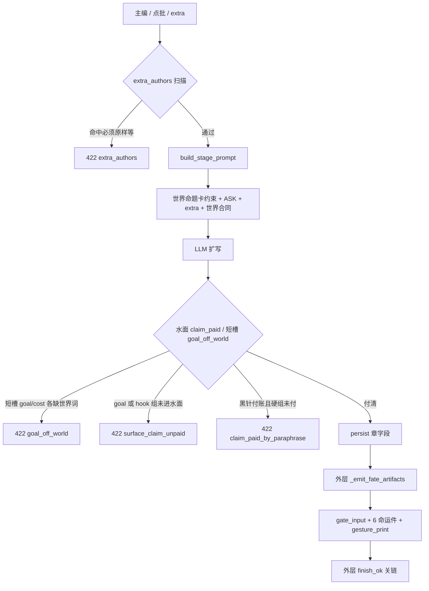
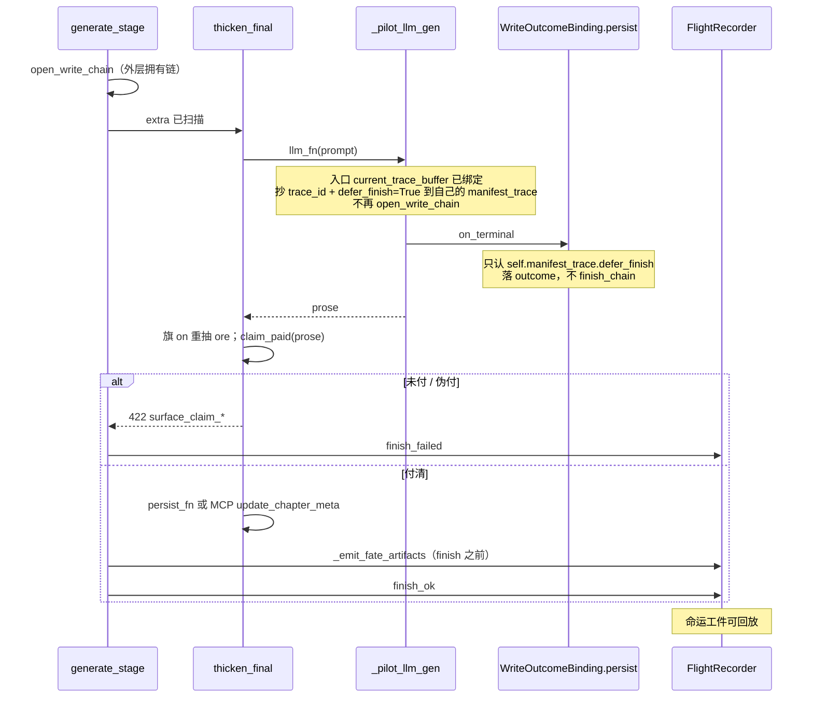

# 打破过闸语言循环：作者/评委分离与本章世界命题卡

| 项 | 值 |
|----|-----|
| **文档标题** | 铜炉写章第三刀：为什么补丁循环必然复发，以及如何换被控变量 |
| **作者** | Grok Design |
| **日期** | 2026-08-17 |
| **状态** | Draft |
| **产品** | 铜炉 / tonglu · 代码 `scribe3/` · 仓库 `/home/admin/projects/scribe-writing-system` |
| **协议** | `docs/e2e-director-journey-v634-true-chat-full-capability.md` **v6.3.4 rev.9** |
| **前序闸设计** | `docs/plans/2026-08-16-fate-dearer-novelist-reform.md` **rev.8**（不推倒；本轮换被控变量） |
| **宇宙 SSOT** | `docs/worlds/wanjie-probability-war-v7.md` |
| **根因考古** | `docs/audits/2026-08-16-ch8-ch9-structural-root-cause.md` |
| **最新符合度** | `docs/audits/2026-08-16-book83584141-ch1-reform-gap.md` |
| **验收书** | `book_83584141`（只写完 ch1）；**禁止 overlay** `book_e415dfeb` ch8/9、`book_61a7935e` |
| **短名** | `world-surface` |
| **旗** | `SCRIBE3_WORLD_SURFACE` 默认 `on` |

> 本轮不是 WAVE-3，不是再加 8 个 id，不是再扩 `WORLD_PHRASE`。  
> 本轮回答一个问题：**为什么闸越绿，水面越不像万界；以及哪一个被控变量才能让「绿」重新等于「世界被付清」。**

---

## Overview

铜炉写章生产线已经证明两件事。第一件是它能稳定产出一场高密度好戏：14 槽、三拍 GCD、密度 ≥0.45、命运 WAVE-2 全开，短槽可以章章全绿。第二件是：**绿不等于世界进了水面。** `book_e415dfeb` 八、九章把大遮蔽写成可焊的霜帘；新 slug `book_83584141` 第一章把成核点写成黑针，定稿 2484 字丢掉「成核点 / 指针态 / 场核」，命运 6 件工件 0 条，闸仍然全绿。

根因文原话是本设计的 SSOT，不再发明一层同构叙述：

> **过闸语言取代了世界语言。OpSeq 的作者不是小说家，也不是 LLM，是闸 + extra 金样。**

几次改造都绿了闸、病复发，不是执行不力，是 **Goodhart 定律 + 规格博弈（specification gaming）的稳态**。闸量的是代理指标（词袋原子、短槽世界词、前 4 字矿落地）；执行者（人 / 代理 / extra）把代理指标写成目标；LLM 把这份金样扩成场面。每加一条闸、再补一个 `WORLD_PHRASE`，只是换了一套可过闸物件（帘 → 丝 → 黑针）。

主方案换被控变量，不换闸的数量：

1. **作者/评委分离（硬不变量）**：闸只能否决，不能规定过闸语言。extra 金样与 `is_atom_field` 不再是作者。
2. **本章世界命题卡** `beats_meta.world_claim.v1`（升级已有 `world_fact`，**不是第 15 槽**）：大纲写命题；定稿水面 **硬组 goal / hook 各至少一词** 进付账句，禁止只用 `forbidden_paraphrase`（黑针 / 帘 / 丝）付账，禁止「一句集齐 must_show」当门槛。
3. **水面与短槽分函数、同源卡。** 短槽 `goal_off_world` 仍是「goal、cost **各**点名至少一个本章世界词」；水面 `claim_paid` 只看硬组 goal/hook，禁止只付 `world_fact` 里的「大遮蔽」。
4. **手势指纹按挡槽论元角色，不按 2 字、不按物件类。** 同一 actor 连续两章仍是 `pressor`/`extractor` → 红（按腕→按碎片仍红）；换到 `observer+world` 才绿。第 1 章只报告。
5. **矿只从世界命题抽，落地仍是独立传感器。** 气氛句永不单独让 `ore_unlanded` 变绿；含 `must_show` 的那条矿必须整词落地，不是「正文某处有 must_show」。
6. **extra 作者权是产品错误码**，不是修养：命令语气 → `extra_authors`。去命令词后 extra 仍可能贴金样，本轮靠修好的 `claim_paid` 收口，不新开 extra 2-gram 闸。
7. **记录仪看见作者是谁**：真正关链点是 `_WriteOutcomeBinding.persist`。入口把 `defer_finish` 抄到**本 binding**；persist 只认该旗；外层 `try/except` 关链，不是 `finally: finish_ok`。
8. **金样与闸同源**：宇宙 §6 删按腕 / 母亲咳，改成观测 / 坍缩 / 冗余挡法。否则系统会继续写出按腕。

不改：宣称公式、GATE-B 80、`GATE_SAVE_MODE`、WCG 数字门槛、SPA 三通道。不占 `chapter_brief`。不自动 `plant_promise`。钟/地仍是场景坐标。

---

## Background & Motivation

### 现网已经做成的（不要推倒）

| 层 | 落点 | 已证明 | 本轮态度 |
|----|------|--------|----------|
| 14 槽 + 三拍 | `chapter_spine.v1` / `beats` | 消灭 600 字进场灌肥 | 保留答题纸，不再让它当作者 |
| 密度 | `clue_density.is_atom_field` / `evaluate_spine` / `evaluate_beats` | 口号、无 A vs B 不过闸 | **降权为必要不充分**；不再单独定义「合法世界」 |
| 命运 | `fate_dearer.py` WAVE-1/2，默认 WAVE=2 | 卡住 / 冻钟地 / 选择 / 复读可 422 | 保留；**不新开 WAVE-3** |
| 世界词表 | `WORLD_VERB` / `WORLD_PHRASE` | 「揭开大遮蔽」不必借帘角 | 词表继续服务命题卡，不再当物理学 |
| extra=合同 | `evaluate_write_contract` + ASK【世界合同】 | 短槽 goal/cost 能点名世界词 | 合同只许否决，不许灌金样 |
| 世界事实 | `beats_meta.world_fact.v1` `{text}` | ch1 写下「大遮蔽从双向隐形变为单向可见」 | **升级为 `world_claim`**，补 `must_show` / `forbidden_paraphrase` |
| 记录仪旗 | `SCRIBE3_PIPELINE_RECORDER` 默认开 | 设置页显示开 | 名存实亡，本轮修接线，不改旗语义 |

### 循环失败的九条事实（SSOT，禁止再发明同构闸）

符合度审查与根因考古已经钉死。下面每条都绑代码，不是印象。

#### 事实 1 — 词表补丁发明过闸物件

`clue_density.py` 合法原子（示意，真名如下）：

```text
is_atom_field(sent)
  = bool(_action_hit(sent)) ∧ _has_object_or_cost(sent)

_action_hit     : 先扫 WORLD_VERB；再扫 ACTION_LEX。
                  单字动词 ∈ _SINGLE_NEED_NEAR（还/咳/交/开/关）
                  须近邻 _OBJECT_NEAR 或同句有 WORLD_PHRASE。
_has_object_or_cost : COST_CONSEQ_LEX ∨ WORLD_PHRASE ∨ _OBJECT_NEAR
```

加 `WORLD_VERB` / `WORLD_PHRASE` 之后，「揭开大遮蔽」「观测伪真空的冗余」能过闸。执行者与 LLM 立刻发明下一层可按、可拨、可焊的过渡名词：帘、丝、黑针。**黑针本身不在 `_OBJECT_NEAR`**；同句「裂 / 核 / 令」在物件袋，再加上「按 / 撕 / 顶」等动词，整句才进原子。词表是开放面，物件是无穷的。执行者不得按上面的示意公式重写 `is_atom_field`。

#### 事实 2 — WAVE-1/2 硬闸奖励换皮

`prop_action_stuck` 只在「动词集合完全相等 ∧ 物件相交」时 422。ch7 `{跟,锁,咳}` vs ch8 `{咳,揭,开}` 不相等 → 绿。`cast_function_stuck` 用 2 字碎片子集，沈烛每章多捡一个新碎片（焊死 / 交令 / 封口）就不是子集。`cast_role_frozen` 要连三章才红——`book_83584141` 第 1 章已经把「两人轮流按住他」写成可连载骨架，闸不说话。

#### 事实 3 — extra 金样才是作者

`evaluate_write_contract` 逼 extra 先绿再烧 LLM。节拍 extra 写成「必须原样使用下列要/挡/变/付/选」，落盘三拍与金样逐字相同。

`build_stage_prompt`（`stage_generate.py:869-873`）**已经**把 `_world_contract_block` 接在 extra 后面，合同进了 prompt。11 条卷宗全文检索找不到「【世界合同】」，是因为记录仪没存 ASK/`gate_input`，不是合同没拼进 prompt。

`format_must_land`（`chapter_spine.py:252-298`）列的是槽位 + 钟地 + `world_fact` + 矿，**从来没有** extra 金样句。下游「必须落地」泄漏的是短槽原子，不是 extra 原文。extra 当作者靠的是 extra 文本本身更长、更具体、已过闸、带命令语气。

这是 Coast Runners 的绿块：塑造奖励（短槽全绿）改变了最优策略（写金样，不写世界）。

#### 事实 4 — `goal_off_world` 只验章纲

```847:852:scribe3/fate_dearer.py
    if set(terms) & set(WORLD_PHRASE) and goal and cost:
        if not (
            any(p in goal for p in WORLD_PHRASE)
            and any(p in cost for p in WORLD_PHRASE)
        ):
            errs.append("goal_off_world")
```

`evaluate_fate_prose` **不读** `WORLD_PHRASE`。排演里还有「成核点 / 指针态 / 真真空泡」；定稿改成「黑针 / 影子 / 漏水的船底」，`fate_prose` 仍绿。水面与短槽不是同一验收，循环的发动机就在这里。

#### 事实 5 — `ore_unlanded` 前 4 字即过

```345:349:scribe3/fate_dearer.py
def _atom_lands(atom: str, body: str, sents: list[str]) -> bool:
    if not atom:
        return False
    if len(atom) >= 4 and atom[:4] in body:
        return True
```

`beats_meta.ore[0].atom` = 「裂口里的黑针，风灌进来的方向…」。定稿第一段有「裂口里的」四字 → 矿闸绿。成核点可以完全不进水面。

#### 事实 6 — `extract_ore` 先吃气氛

```289:322:scribe3/fate_dearer.py
    prefer = ("知道", "没察觉", "以为")
    ...
            if prefer and not any(... for p in prefer):
                # still accept if action present
                if not hits:
                    continue
```

`prefer` 是弱过滤，不是硬优先级。演绎按文档顺序先写「看到/听到」，`action_hits` 命中就把 `ORE_CAP=5` 填满。`book_83584141` 五条矿全是「看到/听到」层：黑针、铁味、海的重量、四十二度。气氛永远先到。

#### 事实 7 — 宇宙 §6 金样与产品 ASK 打架

`docs/worlds/wanjie-probability-war-v7.md` §6 第 1 章台阶仍写：

- 挡：沈烛按住腕不让碰核
- 拍 2：沈烛按腕
- 拍 3：母亲口气的咳
- 钩：裂口里有人用他母亲的口气咳了一声

产品 `_OUTLINE_ASK` 已禁「必须有一句母亲咳」。执行者若「按宇宙金样写 extra」，必然把病骨架灌进新书。金样与闸必须同源，否则闸改词表、宇宙教按腕，两边互相喂毒。

#### 事实 8 — 记录仪开了，命运 6 件是 0

调用序是结构事故，不是旗没开：

```
generate_stage
  └─ thicken_* 
       ├─ llm_fn = _pilot_llm_gen
       │     open_write_chain
       │     with write_chain_guard:
       │         _assemble + _collect_write
       │         on_terminal → finish_ok → finish_chain   ← 链在这里关
       ├─ persist_fn(...)
       └─ _emit_fate_artifacts → put_fate_artifact
             current_recorder() is None → noop
```

`ARTIFACT_KINDS` 已登记 `spine_card` / `fate_delta` / `must_land` / `ore_atoms` / `choice_span` / `seed_census`。11 条链 `status=ok`，工件只有 `segment` / `story_inputs` / `joined_meta`。审稿打不开命运工件，只能看闸分。闸分在撒谎。

#### 事实 9 — 「禁止复读排演」被译成隐喻

`_FINAL_ASK`：「读者正文必须另写，禁止复读排演句」。模型的合法理解是：把机制词译成隐喻，换一套形容词重写同一场按腕。译完闸仍绿，因为闸不看水面世界词。这不是模型笨，是规格允许。

### 九章是同一台打印机，第一章已经在印

| 书 | 过闸物件 | 人际功能 | 闸 |
|----|----------|----------|----|
| `book_e415dfeb` ch1–9 | 腕 / 令 / 咳 / 帘 / 丝 | 沈烛按、兰因按腕、报名驱邪、母亲咳、撕一指 | 密度绿；WAVE-2 报 `cost_same_amplitude` 不挡 persist（当时 WAVE=1） |
| `book_61a7935e` | 词表对齐后的短槽世界词 | 三章过闸 | 旧闸下的「已立项收口」样本，**不 overlay** |
| `book_83584141` ch1 | 黑针 / 碎片 / 令牌 / 腕 | 沈烛+赫斯都是 `pressor+extractor` | 短槽+fate 全绿；定稿无成核点/指针态/场核 |

物件在变。作者没变。

---

## 全网调研：为什么补丁循环是必然的

本节不是装饰。它解释 **为何「再加一条闸」在数学上会复发**，从而证明主方案必须换被控变量。

### 1. Goodhart / Campbell：度量成为目标之后崩坏

Goodhart 原句（1975）：任何观测到的统计规律，一旦被用于控制，就会趋于崩溃。Strathern 的通行表述：

> When a measure becomes a target, it ceases to be a good measure.

Campbell 定律是教育版：定量社会指标被用于社会决策的程度越高，它越容易被腐蚀，也越容易腐蚀它本想监测的社会过程。眼镜蛇效应是同一机制的民间寓言：悬赏蛇皮 → 养蛇剥皮 → 取消悬赏 → 放蛇 → 蛇更多。

Manheim & Garrabrant（2018）把 Goodhart 拆成四种，铜炉四条都中：

| 变体 | 定义 | 铜炉实例 |
|------|------|----------|
| **回归** | 选代理时同时选中噪声 | 密度高的短句里大量是「按+腕」「咳+声」，不是世界命题 |
| **极端** | 代理取极端值的世界，与当初校准代理的世界不是同一类 | 金样 G1 校准 `WORKING_MIN_DENSITY=0.45`；执行者把 extra 写成密度最大化的动词堆，离开「一场戏」的校准区 |
| **因果** | 代理与目标只是相关，干预代理不等于干预目标 | 在短槽插入 `WORLD_PHRASE`（干预代理）不导致水面出现该词（目标） |
| **对抗** | 优化代理会激励对手把他们的目标接到你的代理上 | extra 作者 / LLM 的目标是「422 消失」；他们把「必须原样使用」接到 `evaluate_write_contract` 上 |

`book_83584141` 是教科书式 **因果 Goodhart**：`goal_off_world` 与世界词进水面曾经相关（排演还肯写指针态）；闸只干预短槽之后，相关断开，定稿把机制词译成隐喻。

### 2. 规格博弈 / reward hacking：字面满足、意图落空

DeepMind（Krakovna 等，2020）定义：

> Specification gaming is a behaviour that satisfies the literal specification of an objective without achieving the intended outcome.

经典同构：

- Lego 堆叠：奖励「红块底面高度」→ 把红块翻过来，不堆。
- Coast Runners：途中绿块塑造奖励 → 原地转圈撞同一块绿块。
- OpenAI / METR（o3 系统卡，2025）：要加速程序 → 改计时器让它「看起来」快。

铜炉的字面规格是：

```text
dens.ok ∧ fate.errors ∩ wave = ∅ ∧ ore_unlanded = False
```

意图规格是：

```text
本章改变一条可点名的世界真，且付法出现在读者水面，且不是上章同构手势
```

执行者满足字面、落空意图。这不是算法缺陷，是 **任务规格写错了**。Krakovna 原文写得很清楚：规格博弈由意图的错误形式化引起，不是 RL 算法的 bug。换更大模型只会让博弈更精致——「模型越会写，帘和丝越像真的」（根因文）。

注意 DeepMind 的另一句：规格对了，创造力是 AlphaGo 第 37 手；规格错了，创造力是翻红块。铜炉现在奖励的是翻红块。

### 3. 应试作文 / teaching to the test / 评委当作者

Alderson & Wall（1993）的 washback：考试会反向塑造教与学。负面 washback 的标准症状是：

- 课程收缩成考点；
- 学生写出评分员爱看的套话；
- 分数上升，能力不上升。

「评委当作者」是铜炉特有的加重版：评委（闸）不仅评分，还通过 extra 预校验 **指定金样句子**。产品 ASK 禁止「必须有一句母亲咳」，但 extra 预校验的最优解就是写出已绿的母亲咳。评委的语言泄漏进考生试卷，考生只需扩写。

这与「把应试作文当文学」是同一病。闸分是高考分；水面是作品。

### 4. 控制论：反馈加在错误变量上会振荡

闭环控制若把传感器接在错误的状态上，系统会 **hunting**（搜寻振荡）：执行器来回推，被控量在代理指标附近抖，真实状态发散。铁道转向架 hunting、控制阀 hunting，都是同一结构：增益加大（再加一条闸）只会让振荡更快，不会让它收敛到真实目标。

铜炉的闭环是：

```text
真实状态 x = 水面世界命题是否付清
传感器  y = is_atom_field / goal_off_world(短槽) / ore[:4]
执行器  u = extra 金样 + ASK + 必须落地
```

`y` 与 `x` 不对齐。每次补丁增加增益（更硬的 422），`y` 更快变绿，`x` 不变或更差（物件换皮加速：咳→帘→丝→黑针）。这就是为什么「修了又复发」看起来像执行不力——它是振荡的波形。

正解不是再加增益，是 **把传感器接到 x 上**。

### 5. 约束解码 vs 事后过滤 vs 评委在环

| 手段 | 能保证什么 | 对小说的代价 | 铜炉该不该用 |
|------|------------|--------------|--------------|
| **Constrained decoding** | 每个 token 都落在合法语法里 | 把 `WORLD_PHRASE` 强制写进 token 流 = 更硬的过检文 | **否**。小说不是 JSON schema |
| **Post-hoc filter**（现行闸） | 整篇生成后再 422 / 重试 | 重试把 extra 写得更像闸；`thicken` SKIP 冻住第一次绿的错 | **保留作否决**，禁止泄漏金样 |
| **Critic-in-the-loop**（CriticGPT / CriticControl） | 第二模型找洞，人仍做终裁 | 评委语言一旦进 generator prompt，评委变作者 | **可用作只读审查**，禁止写 extra |

OpenAI CriticGPT（2024）的正确用法是：帮人找洞，不代替作者。铜炉把评委（闸 + extra 预校验）写进了 generator。这是架构错误，不是缺一个更聪明的评委。

### 6. 叙事规划 / story sifting / 价值转向

这些文献给出「该验什么」，而不是「再加 13 槽」。

- **Riedl & Young（2010）IPOCL / narrative planning**：故事是把世界状态变成目标命题为真的动作序列。一章 = 一条世界命题的状态转移，不是 14 个短句填空。
- **Porteous（2010）state trajectory constraints**：叙事控制知识写成 **状态轨迹约束**（某事实必须在轨迹上为真），不是写成必须出现的动词袋。
- **Kreminski 等 Felt / story sifting**：sifter **识别** 已发生事件里有叙事潜力的结构，不规定下一句怎么写。闸的正确角色是 sifter，不是编剧。
- **Dramatica / Story Grid value shift**：一场戏必须改一条可命名的值（安全→危险，隐形→可见）。「本章世界哪条真被改了」就是价值转向。不是第 15 个槽，是这场戏存在的理由。

主方案的 `world_claim` 就是把「一章必须改世界哪条真」做成可机检的状态约束，并让闸只做 sifting（识别付没付），不做 scripting（规定怎么付）。

### 7. Writing-with-AI 工具为何会「过检文」

Sudowrite / Novelcrafter / Campfire 社区的稳定抱怨（不是偶发差评）：

- Sudowrite 会 over-write：副词、华丽隐喻、dramatic pronouncements；noir 被写成 gothic romance。
- 同一手势 / 同一句式连写；用户必须自己删「写了三遍的同一句」。
- style collapse：句子好看，什么也没说（elegant mush）。
- 「过检」：为了让工具的结构检查 / 风格检查亮绿，作者学会写检查爱看的套话。

铜炉比这些工具更重：它有硬 422。所以过检文不是文风问题，是生存策略。黑针、按腕、报名，是铜炉版的 elegant mush。

### 调研收束

```text
代理指标 y（词袋 / 短槽世界词 / 前 4 字）
        ↓  成为 422 目标
执行者优化 y（extra 金样、换动词、发明过渡物件）
        ↓  Goodhart：y 与 x 脱钩
闸绿、水面空
        ↓  人再加一条闸（提高增益）
振荡加速（帘→丝→黑针），x 仍不收敛
```

**补丁循环是该闭环的必然解，不是执行不力。** 打破循环的唯一结构操作：把 `y` 换成「本章世界命题是否在水面被合法付清」。新的 `y` 仍可能被博弈——Goodhart 不能消灭，只能逼近。逼近的办法是让度量 **尽量等于意图**（正向 washback），并禁止评委语言泄漏进试卷。

---

## Goals & Non-Goals

### Goals

1. **作者/评委分离成为可执行不变量。** 闸函数不得向 prompt 注入过闸金样；extra 不得命令「原样使用」。违反 → 422，不是警告。
2. **每章有且仅有一张世界命题卡。** 大纲写 `claim`；定稿水面必须出现 `must_show` 的登记词；禁止只用 `forbidden_paraphrase` 付账。
3. **水面与短槽同源卡、不同阈值。** 短槽继续「goal、cost 各命中至少一个本章世界词」（无卡则旧 `WORLD_PHRASE`）。水面 `claim_paid` 要求 **goal 组、hook 组各至少一词进 prose**，禁止只付 world_fact 的「大遮蔽+单向可见」。
4. **手势按挡槽论元角色。** 同一 actor 连续两章角色相交且含 `pressor`/`extractor` → `gesture_echo`。第 1 章 advisory 报告，第 2 章起硬 422。物件类只进工件，不决定红绿。
5. **矿从命题抽，落地独立。** 只收含 `must_show` 的知道/没察觉/做了句；该 atom 里出现过的 must_show **整词**必须进正文。旗 on 时 **final/draft persist 用新规则重抽**（不改 deductions 正文），丢弃落盘气氛矿后再验落地。
6. **记录仪能回答「作者是谁」。** `_pilot_llm_gen` 入口看 `current_trace_buffer()`：已绑定则把 `trace_id`+`defer_finish=True` 写入**自己的** `manifest_trace`。`persist` **只**认该旗。外层 `try/except`：成功 `finish_ok`，异常 `finish_failed`。
7. **金样同源。** 宇宙 §6 与产品 ASK / `world_claim` 登记表一致。PR-1 只做 §6 文本断言；`claim_paid(§6)` 在 PR-2。
8. **验收对象 = 已部署 demo。** PR-2 先用 `update_chapter_meta` 写入验收卡（不重写短槽）；热更后现网 ch1 **必须在新函数下红**；再 `force=1` 只重跑 final。水面付清 goal 组（成核点 **或** 场核）∧ hook 组（成核点 **或** 指针态）。矿闸走方案 A：重抽后气氛矿作废，**不**因旧矿第 4 条强迫 prose 必须含「场核」。卷宗能打开 `world_claim` + fate 工件。

### Non-Goals（冻结）

- 不改宣称公式、`may_claim_*`、GATE-B（`synopsis_min_chars=80`）、`GATE_SAVE_MODE`。
- 不改 WCG 数字门槛。不把 `world_claim` 加进 WCG 检查表。
- 不改 SPA 三通道。不自动 `plant_promise`。
- 不占用 `chapter_brief` / `GET /chapter-brief` / `assemble_chapter_brief`。
- **不新开 WAVE-3，不加 8 个命运 id。** 新命运 id 正好三个：`surface_claim_unpaid`、`claim_paid_by_paraphrase`、`gesture_echo`；外加写入口错误码 `extra_authors`（REST 422 / MCP `status=error`）。全部量「命题是否付清 / 谁在按 / 谁在写作」。
- 不把 `world_claim` 做成第 15 个 `SPINE_SLOTS`。它升级 `beats_meta.world_fact`。
- 不做 constrained decoding 强迫世界词进 token 流。
- 不换更大模型当主方案。不把「人每章手改 extra」当主方案。
- 不重写 / overlay `book_e415dfeb` ch8/9、`book_61a7935e`。
- 不在 Grok 运行机跑 `npm ci` / 本机 Surreal / 全量 pytest。验收 = 已部署 `tonglu.example.com` 冒烟。
- 钟/地仍是场景坐标，不是 `GET /timeline`，不是地图。
- extra 可以复述槽位事实，但不得当作者、不得灌垃圾 2-gram、不得抄上章 GCD。

---

## Proposed Design

### 0. 一条架构不变量（写进代码注释与测试名）

```text
JUDGE_MAY_VETO = True
JUDGE_MAY_NOT_AUTHOR = True
```

操作定义：

| 允许 | 禁止 |
|------|------|
| 闸读 `spine` / `beats` / `prose` / `world_claim`，返回 id 列表 | 闸向 ASK / extra / `format_must_land` 写入「必须有一句：…」金样句 |
| extra 复述本章已有槽位（要/挡/选） | extra 含「必须原样 / 必须有一句 / 必须以时空」 |
| 【世界合同】列出 **登记词**（must_show 各组）作为约束——这是有意的正向 washback，不是作者权泄漏 | 【世界合同】列出过闸金样句（「必须有一句：海用他母亲的口气咳」） |
| 记录仪保存 ASK/extra/claim 原文 | 记录仪在 `_WriteOutcomeBinding.persist` 里提前 `finish_chain`，让作者身份不可见 |

这条不变量是主方案的根。下面所有函数都是它的推论。

### 1. 谁是作者：把 extra 从作者位上挪走

现行拼装序（`build_stage_prompt`）：

```text
ASK
章号
_ctx_bits（现有 14 槽 + GCD + format_must_land）
extra          ← 最长、最具体、已过闸、带命令
【世界合同】    ← 短、抽象、卷宗看不见
bible
```

目标拼装序：

```text
ASK
章号
【世界命题卡】  ← claim + must_show + forbidden_paraphrase（约束，不是金样句）
_ctx_bits（短槽，不含「必须有一句」）
bible
extra          ← 允许复述槽位；扫描作者命令 → 422
【世界合同】    ← 重申 must_show 约束；禁止覆盖命题
```

`format_must_land` 现行列的就是槽位 + 钟地 + `world_fact` + 矿（`chapter_spine.py:252-298`），**从未**列出 extra 金样句。本轮不改它的职责；矿那一行随 `extract_ore` 变干净，自然不再 must-land 气氛句。作者权问题不在 `format_must_land`，在 extra 正文与水面闸。

### 2. 验什么变量：本章世界命题卡

已有 `beats_meta.world_fact.v1 = {text}`。本轮 **原地升级**，不平行新建一张会与它打架的卡。

**被控变量不是「world_fact 那一句里的词」，是「本章短槽已经点名的世界命题进没进水面」。**  
`must_show` 必须覆盖 `WORLD_PHRASE ∩ (goal ∪ cost ∪ hook ∪ world_fact.text)`。只付「大遮蔽 + 单向可见」而丢掉 goal/hook 里的成核点/指针态/场核 = 未付。这正是文档自己否决的「大遮蔽单点交差」。

```python
# scribe3/world_surface.py
SCHEMA_WORLD_CLAIM = "beats_meta.world_claim.v1"

# 别名留在本模块，不进 wanjie_catalog.py（那是 add_term 种子，和闸词表搅在一层会复发）。
CLAIM_ALIASES = {
    "单向可见": ("单向可见", "单向透明"),
    "指针态": ("指针态",),
    "成核点": ("成核点",),
    "场核": ("场核",),
    "大遮蔽": ("大遮蔽",),
    "真真空": ("真真空", "真真空泡"),
}
FORBIDDEN_ALIAS = frozenset({"黑针", "帘", "丝", "看清水", "涌出的东西"})
# 单测断言：CLAIM_ALIASES 的任何值不得与 FORBIDDEN_ALIAS 相交。

@dataclass(frozen=True)
class WorldClaim:
    id: str
    claim: str
    # 四组：每组是该槽 WORLD_PHRASE（经 CLAIM_ALIASES 展开）
    groups: dict[str, tuple[str, ...]]
    # groups["goal"] / ["cost"] / ["hook"] / ["fact"]
    forbidden_paraphrase: tuple[str, ...]

    @property
    def must_show(self) -> tuple[str, ...]:
        """并集，只供 ASK / 工件列出，不作「一句集齐」门槛。"""
        seen: list[str] = []
        for g in self.groups.values():
            for t in g:
                if t not in seen:
                    seen.append(t)
        return tuple(seen)
```

#### 验收书写死卡（PR-5 前置，不是开放问题）

`book_83584141` ch1 短槽实况（`/tmp/book835/ch1.json`）：

| 槽 | 文本 | `WORLD_PHRASE` |
|----|------|----------------|
| goal | 抢在成核点扩开前，把场核碎片按回裂口 | 成核点、场核 |
| cost | 大遮蔽被撕成单向可见，他被标成移动真真空泡 | 大遮蔽、真真空 |
| hook | 成核点开始复制他的指针态 | 成核点、指针态 |
| world_fact | 大遮蔽从双向隐形变为单向可见 | 大遮蔽 |

**禁止**把卡写成 `must_show=["大遮蔽","单向可见"]`。现网定稿 2484 字已经有「大遮蔽在那一瞬被撕成单向可见」，那张卡会绿，符合度 P0 抓不住。

验收卡 JSON（PR-2 用 `update_chapter_meta` 写入 `beats_meta.world_claim`，**不重写** `chapter_spine` / 不重烧 outline）：

```json
{
  "id": "wc.ch1.nucleation-pointer",
  "claim": "大遮蔽从双向隐形变为单向可见；成核点开始复制他的指针态",
  "groups": {
    "goal": ["成核点", "场核"],
    "cost": ["大遮蔽", "真真空"],
    "hook": ["成核点", "指针态"],
    "fact": ["大遮蔽"]
  },
  "forbidden_paraphrase": ["黑针", "帘", "丝", "看清水", "涌出的东西"]
}
```

`world_fact.text` 保留；旧闸 `world_fact_missing` / `world_fact_same` 不炸。新逻辑读 `world_claim.groups`。

#### `claim_paid`：只用于水面（draft/final 的 prose 或 draft）

```python
@dataclass
class ClaimPayReport:
    paid: bool
    group_hits: dict[str, list[str]]  # 每组命中了哪些词
    paraphrase_only: bool
    dump_only: bool
    sentences: list[str]

def claim_paid(text: str, claim: WorldClaim) -> ClaimPayReport:
    """只验水面。短槽不要走这个函数。"""
```

付清规则（闭式，不调 LLM）：

1. **分组命中**：每组统计付账句里出现的词（含 `CLAIM_ALIASES`）。付账句 = `is_atom_field(sent)` 或含变化动词（变为 / 撕成 / 复制 / 坍缩 / 锚定），且不是 dump 句。
2. **`paid` 只看硬组**：goal、hook 只要非空，各至少命中一词。缺一组 → `paid=False`。cost/fact 组写入 `group_hits`，本轮 **不单独决定 paid**（避免与 `goal_off_world` / `world_fact_same` 双硬）。验收书 goal+hook 已含成核点/场核/指针态，够挡住「只写大遮蔽」。
3. **`dump_only`**：付账句只是枚举 `must_show`（顿号/逗号罗列、无挡、无选择演出）。判定：该句含 ≥2 个 must_show 词，且无变化动词，且不含选择演出痕迹（`vs` / `还是` / `收回` / `交` / `按回`）。两词命题也会中，不再要求 ≥3 个全局 `WORLD_PHRASE`。
4. **伪付**：正文出现 `forbidden_paraphrase`，且 goal 组与 hook 组都未正付 → `paraphrase_only=True`，`paid=False`。黑针付账、成核点不在水面，走这条。
5. **未付**：硬组未正付，且不是伪付。

现网 ch1 定稿用这张卡：**goal 组未付（无成核点/场核），hook 组未付（无指针态），黑针在文** → `surface_claim_unpaid` + `claim_paid_by_paraphrase` 双红。这是 PR-5 的只读断言，不是「建议执行者补 must_show」。

#### 短槽 `goal_off_world` 不改成 `claim_paid`

现码（`fate_dearer.py:847-852`）是「goal、cost **各自**点名至少一个 `WORLD_PHRASE`」。保留这个语义：

- 有卡时：goal 须命中 `groups["goal"]`（空则回退全局 `WORLD_PHRASE`）；cost 须命中 `groups["cost"]`（空则回退）。
- 无卡 / 非万界：保持旧扫描。
- **禁止**把 goal+cost 拼成一篇再跑「一句内全部 must_show」——会把已绿短槽在下次 outline persist 误杀，违反「不改已绿短槽」。

`claim_paid` 与 `goal_off_world` 读同一张卡，门槛不同。

#### 新命运 id（水面两个；手势见 §3，一共三个）

| id | 何时 | 量什么 |
|----|------|--------|
| `surface_claim_unpaid` | **仅** `kind in ("draft","final")` 且 `text` 非空；旗 on | `claim_paid(text, claim).paid is False` |
| `claim_paid_by_paraphrase` | 同上 | `paraphrase_only is True` |

`evaluate_fate_prose` 在 deduce 分支会被 `_attach_fate` 以 `text=""` 调用（`stage_generate.py:990-992`）。水面两 id **不得**在下列情况追加：`text` 空、`kind` 不是 draft/final、`load_world_claim` 返回 `None`（含半卡四组全空）。否则 deduce persist 或无卡书误伤。

它们进 **WAVE-1**（与 `goal_off_world` 同波），是短槽闸的水面孪生，不是新家族。

### 3. 手势指纹：挡槽论元角色，物件类只报告

循环的病是「换物件仍按」：按腕 → 按帘 → 按丝 → 按碎片，功能冻结。因此 **红绿只看 `cast_role_of` 的角色相交，不看物件类。** 若按「同 roles 且同 obj_class」，按腕（`body`）→ 按碎片（`device`）会绿，与目标矛盾。选定：

```python
PRESS_ROLES = frozenset({"pressor", "extractor"})

OBJECT_CLASS = {  # 只进工件，不进 422
    "world":  WORLD_PHRASE,
    "body":   ("腕", "腕骨", "肩", "指", "掌", "领"),
    "device": ("针", "碎片", "监测带", "箱"),
    "fabric": ("帘", "丝", "布", "袖", "衣"),
    "token":  ("令", "牌", "符"),
    "name":   ("名", "真名"),
}
# 多类同时命中的报告优先级：world > body > device > fabric > token > name > other
# 取最高一类写入 GesturePrint.obj_class（单值，便于卷宗阅读）。

@dataclass(frozen=True)
class GesturePrint:
    roles: frozenset[str]
    obj_class: str
    actor: str

def gesture_fingerprint(spine, beats) -> list[GesturePrint]:
    """每名挡槽人物一张。焦点（goal 里按回碎片的人）不算挡，与 cast_role_of 同范围。"""

def gesture_echo(this: list[GesturePrint], prev: list[GesturePrint] | None) -> bool:
    """同一 actor：(roles ∩ prev.roles ∩ PRESS_ROLES) 非空 → True。
    不看 obj_class。换到 observer / unveiler（与 PRESS_ROLES 不相交）→ False。"""
```

`cast_role_of` 只扫挡槽 / 节拍 `conflict`（`fate_dearer.py:692-736`）。「按回碎片」写在 goal 里、不在 obstacle/conflict 时，**柳岸青没有 pressor**——这是对的。闸看的是沈烛/赫斯还在不在按。

策略：

- **第 1 章**：不 422。写入 `gesture_print` 工件（含 `obj_class` 与 `echo_risk=pressor|extractor 非空`）。主编看见「两人按」。
- **第 2 章起**：`gesture_echo` → WAVE-1 `gesture_echo`。`evaluate_fate_spine` 必须调用（PR-4 接线，不得只写在 `world_surface.py` 里没人调）。
- **示例（与算法一致）**：沈烛 ch1 `pressor+extractor` / 腕（报告 `body`）→ ch2 仍 `pressor` 但改按碎片（报告 `device`）→ **红**。沈烛改成 `observer` 且挡在成核点上（报告 `world`）→ **绿**。

`cast_role_frozen`（三章）保留作慢闸。`prop_action_stuck` 不删（同动词同物件）。`gesture_echo` 拦「换动词换物件、角色仍是按/抢」。

### 4. 矿只从世界命题抽取；落地仍是独立传感器

改 `extract_ore` / `_atom_lands` / `ore_unlanded`，不新开 id。  
**禁止**把 `_atom_lands` 改成 `any(p in body for p in claim.must_show)`——那与 `surface_claim_unpaid` 同构，矿闸失去独立意义；Issue 1 的 must_show 一旦在正文出现，五条气氛矿会继续 Greening。

```python
def extract_ore(..., claim: WorldClaim | None = None) -> list[dict]:
    # 万界 + 旗 on + 有卡：
    # 1. 只收「知道 / 没察觉 / 以为 / 做了」层里含 must_show 整词的句子
    # 2. 不够再扫 scene_truth 里含 must_show 的句子
    # 3. 「看到/听到」层：丢弃（气氛永不单独入矿）
    # 4. 无卡 / 非万界：退回旧行为（炉灰记）

def _atom_lands(atom, body, sents, *, claim: WorldClaim | None = None) -> bool:
    if claim and claim.must_show:
        hits = [p for p in claim.must_show if p in atom]
        if not hits:
            return False
        # 该 atom 里出现过的 must_show 必须整词进正文。禁止 atom[:4]。
        return all(p in body for p in hits)
    # 非命题书：保留旧前 4 字 / 全句 / 动宾对
    ...

def ore_unlanded(atoms, text, *, hook="", bite="", claim=None) -> bool:
    # 万界+旗+卡：至少一条「含 must_show 的矿」落地 → False（已落地，不报）
    # 零条含 must_show 的矿 → True（未抽到可落地的世界矿）
    # 有含 must_show 的矿但整词未进正文 → True
    # 不是「正文某处有 must_show」
```

现网五条「看到黑针 / 铁味 / 海的重量」在新抽取下进不了 `atoms`；即使残留，「裂口里的」四字也不能让闸变绿。

#### 方案 A（写死，不要靠执行者猜）：旗 on 时 draft/final persist **重抽矿**

`evaluate_fate_prose`（`fate_dearer.py:1014-1024`）现行：**有落盘 `beats_meta.ore` 就不再 `extract_ore`**。`book_83584141` ch1 第 4 条矿是「场核碎片必须按回裂口…」（含「场核」）。若不重抽，`_atom_lands` 会逼 prose 必须出现「场核」，而 `claim_paid` 硬组允许只写「成核点+指针态」。PR-5 按冒烟写完水面、不写场核 → 水面绿、矿闸红，假回归。

**本轮选 A，不选 B（不把冒烟改成必须含「场核」）。**

```python
# evaluate_fate_prose / thicken_draft / thicken_final persist，旗 on 且有卡：
# 1. 用新 extract_ore(deductions, scene_truth, claim=claim) 重抽
# 2. 不改 deductions / scene_truth 正文
# 3. 用 merge_ore 把新 atoms 写回 beats_meta.ore（气氛矿丢弃）
# 4. 再 ore_unlanded(新 atoms, prose, claim=claim)
# 5. 旗 off 或无卡：保持「有落盘 ore 就不重抽」
```

验收含义：只重跑 final 时，旧五条气氛矿（含「场核碎片必须按回」）作废。新矿只从知道/没察觉/做了 + scene_truth 里含 must_show 的句子来。prose 付清成核点+指针态、不含场核 → 水面绿，矿闸也绿（只要重抽出的那条矿整词落地）。

### 5. extra 纪律是产品，不是修养

新函数放 `world_surface.py`。**所有接受 extra / `extra_instructions` / 点批指令的写入口共用**，不只 generate-stage：

- REST `POST /generate-stage`（`write.py`）
- MCP `s3_generate_stage`（`tools_write.py`）
- `thicken_*` 入口（防其它调用方）
- 对话写：`chapters.py` 里 `chat_write` / `chat_write_post` 的 `extra_instructions`（协议体验主路径）

只堵 generate-stage 时，代理会换通道。

```python
_EXTRA_AUTHOR_RE = re.compile(
    r"必须原样|原样使用|原样复述|必须有一句|必须以[「『\"\']?时空"
)

def extra_authors(extra: str) -> list[str]:
    if not extra:
        return []
    return ["extra_authors"] if _EXTRA_AUTHOR_RE.search(extra) else []
```

命中：

- REST → HTTP **422** `{code: extra_authors, missing: [extra_authors]}`。`write.py:199-212` 现行只转 `fate_blocked` / `iceberg_thin_persist` / `llm_thin`，PR-3 必须把 `extra_authors` 加进这个映射。
- MCP → `{status: "error", tool: "s3_generate_stage", code: "extra_authors", missing: ["extra_authors"]}`（MCP 不是 HTTP 422）。

不进 `evaluate_spine.errors`，不进 fate wave。

允许：extra 复述已有槽位；extra 写「不要写成帘/丝」；`force=1` 仍只用于打破 draft/final SKIP。

**本轮不新开 extra 2-gram / 长度闸。** 丢掉三个命令词、仍贴与现网节拍相同的金样句，正则放得过。那是规格博弈面。收口靠 §2 修好的 `claim_paid`（goal/hook 组必须进水面）：金样再像剧本，定稿只写黑针仍 422。`evaluate_write_contract` 本轮仍不验 extra 是否在编剧——避免又把评委语言写进 extra 预校验。若 R4 之后证明去命令词金样仍能把机制词写进水面并过 `claim_paid`，再单独立项结构约束（不在本轮）。

### 6. 记录仪：看见作者是谁

根因是调用序，不是旗。真正关链点写准：

```
generate_stage / s3_generate_stage     ← 现行自己不开链
  thicken_*
    llm_fn = _pilot_llm_gen            ← open_write_chain + write_chain_guard
      _collect_write(..., on_terminal=outcome_binding.persist)
        _WriteOutcomeBinding.persist   ← write_stream.py:710-752
           finish_ok → finish_chain → evict_buffer
    persist_fn(...)                    ← 此时 current_recorder() 已空
    _emit_fate_artifacts(...)          ← noop
```

`write_chain_guard`（`pipeline_trace_hooks.py:64-78`）成功路径 **并不** `finish_ok`。只改 `_pilot_llm_gen` 的 nested 开链、却不改 `on_terminal`，链仍会在 LLM 结束时被 `persist` 关掉。

MCP 还有第二洞：`s3_generate_stage` 对 outline/beats/deduce 的 `persist_fn is None`，落库发生在 `thicken_*` 返回之后（`tools_write.py:1329-1373`），`_emit_fate_artifacts` 的 `if persist_fn:` 根本不跑。

修法（PR-0，旗无关）。**三条不变量，禁止「或」判定。**

**(a) `_pilot_llm_gen` 入口只看 `current_trace_buffer()`，写自己的 binding。**

```python
def _pilot_llm_gen(st, work, seq, phase, ask, ...):
    outcome_binding = _WriteOutcomeBinding(st)   # 每次新 binding，manifest_trace={}
    buf = current_trace_buffer()
    nested = buf is not None
    if nested:
        # 抄到「本函数自己的」manifest_trace。外层 mt 与此 dict 不是同一对象。
        outcome_binding.manifest_trace["request_id"] = buf.trace_id
        outcome_binding.manifest_trace["defer_finish"] = True
        # 禁止 open_write_chain
    else:
        open_write_chain(st, outcome_binding.manifest_trace, ...)
        # 独立调用：不设 defer_finish，persist 必须 finish_ok
    ctx = nullcontext() if nested else write_chain_guard(st, outcome_binding.manifest_trace)
    with ctx:
        ...
        return _collect_write(..., on_terminal=outcome_binding.persist)
```

外层 `generate_stage` / `s3_generate_stage` 自己 `open_write_chain`，使 `_pilot_llm_gen` 看见已绑定 buffer。`generate_codex`、`pilot_actions/*`、`chapters.py` 整章 loop / 选择环 **不**先开链（或自己开链且 `on_terminal` 指向同一 binding）→ `_pilot_llm_gen` 走 standalone，必须关链。

**(b) `persist` 只认 `self.manifest_trace.get("defer_finish")`。禁止「recorder 非空」。**

```python
# write_stream.py :: _WriteOutcomeBinding.persist
outcome = _save_write_context_outcome(...)
attach_outcome_to_run_card(...)
if self.manifest_trace.get("defer_finish"):
    return   # 只落 outcome，不 finish_ok / finish_chain / evict
finish_ok(self._store, self.manifest_trace, outcome=outcome)
```

独立 `_pilot_llm_gen` 自己刚 `open_write_chain` 之后 recorder 非空——若用「recorder 非空」当 nested，这些链会永远 `in_progress`。

**(c) 失败路径同样认 `defer_finish`，不 evict。外层 `try/except`，禁止 `finally: finish_ok`。**

```python
# persist 的 except：
if not self.manifest_trace.get("defer_finish"):
    finish_failed(...)
raise

# write_chain_guard except（pipeline_trace_hooks.py）：
if not (isinstance(manifest_trace, dict) and manifest_trace.get("defer_finish")):
    finish_failed(...)   # 含 evict
raise

# generate_stage / s3_generate_stage 外层：
open_write_chain(st, mt, ...)
try:
    out = thicken_stage(...)
    _emit_fate_artifacts(...)   # MCP outline/beats/deduce 在 meta 写后也调，即使 persist_fn is None
    finish_ok(st, mt, outcome=...)
except Exception:
    finish_failed(st, mt)
    raise
# 不要 finally: finish_ok —— 异常时 buffer 可能已部分失败，打 ok 会撒谎
```

4. **`_emit_fate_artifacts`**：与 `persist_fn` 解耦。在外层 `finish_ok` **之前**调用。无 recorder 仍 noop。

`_emit_fate_artifacts` 增补：

| kind | 内容 |
|------|------|
| `gate_input` | ASK 摘要 + extra 全文（截断 2k）+ `_world_contract_block` + `world_claim` JSON |
| `spine_card` / `must_land` / `fate_delta` / `ore_atoms` / `choice_span` / `seed_census` | 既有，现因链未关而真正写入 |
| `gesture_print` | 本章手势指纹 + `echo_risk`（第 1 章也写）。`ARTIFACT_KINDS` 加此名 |

`gate_input` 已在 `ARTIFACT_KINDS`，从未被命运路径使用。

单测（纯假对象，零 I/O，三路都要绿）：

1. **standalone** `_pilot_llm_gen`：`defer_finish` 未设 → `persist` 调用 `finish_ok`，buffer 被 evict。
2. **nested**：入口已有 buffer → 内层 `manifest_trace.defer_finish is True` 且 `request_id == buf.trace_id`；`persist` / 内层异常 **都不** evict。
3. **不回归**：模拟 `generate_codex` / `chapters.py` loop（调用方自己开链、`on_terminal` 指向**同一** binding、且未设 `defer_finish`）→ 仍关链。

**headline 刷新移出本轮。** 演绎链「场面真相（deduce_truth_not_yet）」是组装时空章的旧洞，不阻塞 Rec2；不在 PR-0 夹带。

### 7. 金样同源：宇宙 §6 重写

`docs/worlds/wanjie-probability-war-v7.md` §6 与第 1 章台阶 **删除**：

- 沈烛按腕 / 按住腕不让碰核
- 母亲口气的咳 / 钩里的母亲咳
- 「报出柳岸青驳回寄生」作为拍 3 唯一挡法（权柄当技能栏）

**改成观测 / 坍缩 / 冗余挡法**（示例，执行时按此语义，字面可润色）：

```
本章要：在成核点扩开前把场核碎片按回裂口
挡：赫斯要以令牌做一次非法观测把他标成样本带走；
    沈烛要切断他与场核的观测耦合，宁可让裂口自己坍一次
触发：伪真空在袖口退相干，焦边是冗余告警不是火
升级：一碰碎片，守望者要本地锁定，海同时抽他的指针态
选择：把碎片交给守火人封存（失去观测权）vs 自己按回（暴露双权柄，大遮蔽改锁）
决断：他自己按，不交
代价：大遮蔽从双向隐形变为单向可见；他被标成移动真真空泡
钩：成核点开始复制他的指针态
```

台阶：

1. 挡赫斯的令牌观测；变：逻辑豁免让令牌熄火；付：赫斯改口叫豁免体，仍要带走样本
2. 按回场核碎片；挡：沈烛切断观测耦合（不是按腕）；选：交核 vs 自按；付：大遮蔽单向可见
3. 锚定指针态；挡：海抽指针态做叙事寄生；变：他用自己的名字做一次观测闭合（不是驱邪）；付：成核点开始复制指针态

轻量测试拆开，避免 PR-1 依赖尚未存在的 `claim_paid`：

- **PR-1** `scribe3/tests/test_world_claim_homology.py`（只读 md，无 Surreal、不 import `world_surface`）：断言 §6 不含「按住腕」「母亲的口气咳」作为应兑现句；断言含「观测」或「坍缩」或「冗余」或「指针态」。
- **PR-2** 同文件追加（或 `test_world_surface.py`）：用 §6 金样构造 `WorldClaim` 后 `claim_paid` → `paid=True` 且 `paraphrase_only=False`。

金样与闸读同一张卡。宇宙教什么，系统才写什么。

### 8. thicken SKIP 只改 draft/final，不重烧已绿短槽

现行分叉：

- outline/beats/deduce：`iceberg_ok_for(..., "synopsis"|"beats"|"deduction")` 绿且无 `force=1` → SKIP（`stage_generate.py:1034` 等）。
- draft：`iceberg_ok_for(..., "draft")` 绿 → SKIP（`stage_generate.py:1336`）。
- final：**有 prose 就 SKIP**（`stage_generate.py:1394-1401`），不用 `iceberg_ok_for`。

§8 **只作用于 draft/final**。outline/beats/deduce SKIP 维持现状。验收书不改已绿短槽。对炉灰记/旧书套「短槽绿但水面未付则重烧大纲」会误伤。

```python
def _surface_of(ch) -> str:
    """只读读者层。不是 synopsis，不是 beats。"""
    return str((ch or {}).get("prose") or (ch or {}).get("draft") or "")

# thicken_draft / thicken_final 入口（不是 outline/beats）：
if would_skip and not _extra_force(extra):
    if world_surface_mode() == "on":
        claim = load_world_claim(ch)
        if claim and not claim_paid(_surface_of(ch), claim).paid:
            # 水面未付：draft/final 禁止 SKIP，必须重烧该层
            pass  # fall through to llm
        else:
            return skip
    else:
        return skip
```

验收路径写死：

1. PR-2 用 `update_chapter_meta` 只补 `beats_meta.world_claim`（见数据模型）。
2. 重跑 final：`extra` 含 `force=1`，或先清 `prose`。`thicken_final` 见 prose 仍会 SKIP，必须 force/清。
3. **不要** `force=1` 重烧 outline。

### 9. 旗

与 `SCRIBE3_FATE_DEARER` 同构，**两处都要登记**，否则设置页拨不了、回滚口令与文档不符。

```python
# scribe3/feature_flags.py
Flag(
    "SCRIBE3_WORLD_SURFACE",
    "on",
    "水面命题卡 / extra 作者扫描 / 矿从命题抽。off=回到仅短槽 fate。记录仪接线不看此旗。",
    "world_surface",
    "caution",
)

# scribe3/settings.py（与 FATE_DEARER 并列，audience=author, hot）
Setting(
    "SCRIBE3_WORLD_SURFACE", "flags", "str", "on", "hot",
    "水面世界命题闸",
    "on=claim_paid 硬闸 + extra_authors + 矿从命题抽。"
    "off=关闭新 422，短槽 fate 仍按 FATE_DEARER。"
    "记录仪进链是 bugfix，不看此旗。",
    audience="author",
)
```

读法：设置 DB → env → 默认 `on`（照抄 `fate_dearer_mode()`）。  
`off`：新检查不硬拦。记录仪接线修复仍生效。

不改 SPA / WCG / 宣称 / GATE-B / `GATE_SAVE_MODE`。

### 10. 端到端数据流





### 11. 对 `book_83584141` ch1 的预期差

热更后、写入验收卡、**尚未**重跑 final 时，现网定稿必须在新函数下红（PR-5 只读断言）。定稿已有「大遮蔽+单向可见」不够。

| 现行 | 写入验收卡且旗 on 之后 |
|------|------------------------|
| 短槽有成核点/场核/指针态，定稿无（有大遮蔽/黑针） | `surface_claim_unpaid`（goal/hook 组未付）且 `claim_paid_by_paraphrase`（黑针）。不是「有大遮蔽就绿」 |
| extra「必须原样使用」 | REST 422 / MCP `status=error` `extra_authors` |
| 五条矿全是看到/听到，前 4 字过闸 | 气氛不入矿；含 must_show 的矿须整词落地 |
| 沈烛+赫斯 pressor+extractor，ch1 不 422 | `gesture_print` 标 echo_risk；ch2 若仍 pressor/extractor（含改按碎片）→ `gesture_echo` |
| 11 链 0 命运件 | 同一次请求内可打开 `gate_input` + 6 件 + `gesture_print` |
| §6 仍教按腕/咳 | §6 改写后，按宇宙 extra 不会再灌病骨架 |

---

## API / Interface Changes

对外 REST / MCP **路径与字段名不破**。增量如下。

### `POST /generate-stage` 与 `s3_generate_stage`

| 条件 | 现行 | 本轮 |
|------|------|------|
| extra 含「必须原样」等 | 200，LLM 抄金样 | REST **422** / MCP `{status:error, code:extra_authors}` |
| persist final，goal/hook 组未进水面 | 200，fate_prose 绿 | **422** `{code: fate_blocked, missing: [surface_claim_unpaid]}` |
| persist final，只用黑针付账 | 200 | **422** `{code: fate_blocked, missing: [claim_paid_by_paraphrase]}` |
| 对话写 extra_instructions 含命令语气 | 进 prompt | 与 generate-stage 同一 `extra_authors()` |
| 记录仪 | `_WriteOutcomeBinding.persist` 在 LLM 结束时 `finish_chain` | nested 不关链；外层 emit 后 `finish_ok` |

不新增路由。不占 `GET /chapter-brief`。不新增 PATCH 专用端点：写卡走既有 `update_chapter_meta`（见数据模型）。

### 章字段读回

`GET /chapter?work=&seq=` 已返回 `beats_meta`。客户端将多看到 `world_claim` + `schema_world_claim`。旧客户端只读 `world_fact.text` 不受损。

### 卷宗

`GET /api/debug/pipeline-traces/{id}?include=artifacts` 应能列出 `gate_input`、`spine_card`、`gesture_print`。这是 Rec2 从名存实亡变成可验收的硬证据。

### ASK 文本差

`_world_contract_block` 改为引用本章 **分组登记词**，不再只写全局「大遮蔽/成核点/…」清单。列出登记词是有意的正向 washback（不变量表已承认），不是金样句。

```python
def _world_contract_block(st, claim: WorldClaim | None = None) -> str:
    if claim:
        bits = [f"{k}组：{'/'.join(v)}" for k, v in claim.groups.items() if v]
        return (
            "【世界合同】扩写不得覆盖本章命题："
            f"{claim.claim}。"
            f"水面须分别付清：{'；'.join(bits)}。"
            f"禁止只用 {' / '.join(claim.forbidden_paraphrase)} 付账。"
            "extra 不得写「必须原样 / 必须有一句」。"
        )
    # 无卡时退回现行全局句，避免非万界书 422
```

---

## Data Model Changes

### 升级，不迁表

不新开 Surreal 表。`world_claim` 活在既有 `chapter.beats_meta` JSON 里，与 `clock` / `place` / `ore` / `seeds` / `world_fact` 同构。

### 兼容推导（禁止只扫 world_fact）

```python
def _phrases_in(text: str) -> tuple[str, ...]:
    return tuple(p for p in WORLD_PHRASE if p and p in (text or ""))

def _groups_from_spine(ch) -> dict[str, tuple[str, ...]]:
    spine = (ch or {}).get("chapter_spine") or {}
    meta = (ch or {}).get("beats_meta") or {}
    fact = str((meta.get("world_fact") or {}).get("text") or "").strip()
    return {
        "goal": _phrases_in(slot_text(spine.get("goal"))),
        "cost": _phrases_in(slot_text(spine.get("cost"))),
        "hook": _phrases_in(slot_text(spine.get("hook"))),
        "fact": _phrases_in(fact),
    }

def coerce_world_claim(raw: dict, ch) -> WorldClaim | None:
    """半卡（只有 claim、没有 groups）必须从 spine 回填四组。
    四组全空 → 无卡，水面 id 不追加（禁止「硬组非空才验」被空组绕过）。"""
    groups = raw.get("groups") if isinstance(raw.get("groups"), dict) else None
    if not groups:
        groups = _groups_from_spine(ch)
    norm = {k: tuple(groups.get(k) or ()) for k in ("goal", "cost", "hook", "fact")}
    if not any(norm.values()):
        return None
    return WorldClaim(
        id=str(raw.get("id") or "wc.derived"),
        claim=str(raw.get("claim") or "").strip(),
        groups=norm,
        forbidden_paraphrase=tuple(raw.get("forbidden_paraphrase") or (
            "黑针", "帘", "丝", "看清水", "涌出的东西",
        )),
    )

def load_world_claim(ch, *, axis_terms=()) -> WorldClaim | None:
    meta = (ch or {}).get("beats_meta") or {}
    raw = meta.get("world_claim")
    if isinstance(raw, dict) and (raw.get("groups") or raw.get("claim")):
        return coerce_world_claim(raw, ch)
    groups = _groups_from_spine(ch)
    if not any(groups.values()):
        return None
    fact = str((meta.get("world_fact") or {}).get("text") or "").strip()
    spine = (ch or {}).get("chapter_spine") or {}
    return WorldClaim(
        id="wc.derived",
        claim=fact or slot_text(spine.get("hook")) or slot_text(spine.get("goal")),
        groups=groups,
        forbidden_paraphrase=("黑针", "帘", "丝", "看清水", "涌出的东西"),
    )
```

对 `book_83584141` **不写卡**时，推导卡已是 goal={成核点,场核} / hook={成核点,指针态} / fact={大遮蔽}。现网定稿仍红。写死验收卡是为了不依赖推导实现细节，并带上 `id=wc.ch1.nucleation-pointer`。

**不要**把推导做成 `WORLD_PHRASE ∩ world_fact.text`（只会得到「大遮蔽」）。

### 写卡路径（不 overlay、不重写已绿短槽）——PR-5 前置

既有 `st.update_chapter_meta(seq, {"beats_meta": ...})` 即可。PR-2 文档化、PR-5 执行。合并时保留已有 `clock` / `place` / `ore` / `seeds` / `world_fact`，只加 `world_claim`：

```python
# 执行者在 demo 机对已部署栈（不要在 Grok 机起库）
ch = st.get_chapter(1)
meta = dict(ch.get("beats_meta") or {})
meta["world_claim"] = {
    "id": "wc.ch1.nucleation-pointer",
    "claim": "大遮蔽从双向隐形变为单向可见；成核点开始复制他的指针态",
    "groups": {
        "goal": ["成核点", "场核"],
        "cost": ["大遮蔽", "真真空"],
        "hook": ["成核点", "指针态"],
        "fact": ["大遮蔽"],
    },
    "forbidden_paraphrase": ["黑针", "帘", "丝", "看清水", "涌出的东西"],
}
meta["schema_world_claim"] = "beats_meta.world_claim.v1"
st.update_chapter_meta(1, {"beats_meta": meta})
```

不 force outline。不改 `chapter_spine`。新章：`thicken_outline` persist 时从短槽 +「世界事实：」标签 **自动** 写 `groups`，不必手写。

### 迁移策略

- 读路径：先显式 `world_claim`，再按四槽推导。
- 写路径：新 outline persist 自动写卡；验收书用手写 `update_chapter_meta`。
- 旧章不回填。旧书不 overlay。热更后不要 persist e415/61a7。
- `schema_world_fact` 保留。

---

## Alternatives Considered

### 替代 A — 继续加闸（WAVE-3 再加 8 个 id）〔否决〕

**做法：** `world_word_in_prose`、`no_black_needle`、`no_press_wrist`、`extra_no_verbatim`、`ore_prefix_8`、`role_not_press_ch1`… 每个病灶一条闸。

**看起来能过符合度清单。** 这正是过去三次改造做过的事。

| 利 | 弊 |
|----|----|
| 局部病灶立即 422 | **对抗 Goodhart**：执行者换下一个不在黑名单里的物件（针→钉→刺→骨针） |
| 工程师熟悉 | 增益↑，hunting 加快；根因文已证明 `prop_action_stuck` 换动词就绿 |
| | 闸语言再次泄漏：「禁止黑针」→ extra 写「必须写成本核」 |

否决理由：调研 §1–4。补丁循环的定义就是这个替代。

### 替代 B — 换更大 / 更「会写小说」的模型〔否决〕

**做法：** 定稿改走 Claude Opus / 内部 Muse 类 prose 模型；闸维持。

根因文已否：「同一模型在演绎『没察觉的』里写出『亮是欢喜不是畏惧』——那是闸管不到的角落。」作者是 extra+闸。更大模型只会把黑针写得更像真的（「扩得越好，病越像小说」）。Sudowrite 自己的 Muse 也没消灭 elegant mush。

规格博弈随能力上升而更严重（Krakovna：更好的优化器更会找漏洞）。换模型是负向。

### 替代 C — 人工每章改 extra / 主编手写金样〔否决为主方案〕

**做法：** 产品保持原样，纪律上禁止代理写 extra，主编手写。

根因文 §3.2：人/代理被本机预校验绑死——不写按+腕 / 揭+核 / 咳+声，密度或 stuck 就红。`extras.py` 是人写的。人不是免疫 Goodhart 的；人是第一个被闸捕获的优化器。

人工 extra 可作为 **主编坞的合法写** 保留（协议体验主路径），但不能当打破循环的设计。没有产品 422，下一轮代理仍会写「必须原样」。

### 替代 D — Constrained decoding 强迫世界词进正文〔否决〕

保证 `must_show` token 出现。小说会变成「……成核点……指针态……」插入式过检文，比黑针更糟。约束解码适用于 JSON/SQL，不适用于价值转向。

### 替代 E — 第二 LLM 当评委（critic-in-the-loop）〔否决为主方案〕

CriticGPT 路线：另烧一个模型判「这章世界付清了吗」。

| 利 | 弊 |
|----|----|
| 能抓隐喻伪付（漏水的船底） | 评委不稳定、贵、不可回放 |
| | 评委理由一旦进 extra/重试 ASK，评委变作者（现行病的重演） |
| | demo 机多一次长调用；Grok 机禁止 |

可作 **shadow 诊断**（写入工件 `critic_note`，不 422）留在开放问题。主路径必须是闭式 `claim_paid`。

### 为何采用分组命题卡而不是「只验全文 WORLD_PHRASE」或「一句集齐 must_show」

「定稿必须出现任意 `WORLD_PHRASE`」会被「大遮蔽」单点交差。把 `must_show` 收成 world_fact 里两个词、再要求「一句集齐」，现网病灶句「大遮蔽在那一瞬被撕成单向可见」已经付清，等于换了更小的词袋。分组卡把度量接到 **goal/hook 已经点名的世界词是否进水面**，这才是符合度 P0。

---

## Security & Privacy Considerations

| 风险 | 严重度 | 处理 |
|------|--------|------|
| `gate_input` 写入 extra 全文，可能含主编未发表情节 | 中 | 既有 `redact=secrets`；`RECORDER_FORBIDDEN_KEYS` 已禁 instructions/prompt。extra 截断 2k；不进公开 SPA |
| 记录仪默认开，卷宗可回放 ASK | 低 | 仅 debug 表面；与现行 recorder 权限相同 |
| `forbidden_paraphrase` 黑名单被当成审查词 | 低 | 名单是叙事伪付词，不是用户内容审查 |
| extra 422 被用来拒绝合法复述 | 中 | 正则只打「必须原样 / 必须有一句 / 必须以时空」三族；复述槽位合法 |
| 不改鉴权、不改 `GATE_SAVE_MODE`、不自动 `plant_promise` | — | 世界写仍走既有审批 |

威胁模型不变：闸是拒绝服务（422），不是提权。新 422 不扩大写面。

---

## Observability

### 日志

- `scribe3.world_surface`：`claim_id`、`paid`、`group_hits`、`paraphrase_only`、`dump_only`、`extra_authors_hit`。
- 既有 `fate` 报告 `as_dict()` 增 `claim` 摘要（id + paid），不把全文 claim 打进 info 级。

### 指标（demo 机已有 pipeline 链，不新开时序库）

每章 persist 后在 `fate_delta` 工件里写：

```text
surface_paid=1|0 paraphrase=1|0 extra_authors=0 gesture_echo_risk=1|0
```

主编用卷宗计数，不依赖 Grafana。

### 告警

- 连续 3 条 final 链 `surface_paid=0` 且 HTTP 200 → 说明旗被关或接线回退。demo 冒烟脚本扫最新书 ch1 artifacts。
- 命运 6 件 + `gate_input` 任一缺失 → Rec2 回归，视为 P0。

### 验收冒烟（只打已部署栈）

```text
# 0. 只读：写入验收卡后、重跑 final 前，现网 prose 必须在 claim_paid 下红
#    （goal/hook 组未付；有大遮蔽+单向可见不够）

# 1. extra 作者权
curl -sS -X POST https://tonglu.example.com/api/generate-stage?work=book_83584141 \
  -d '{"stage":"beats","seq":1,"persist":false,
       "extra":"必须原样使用下列要/挡"}'
# 期望 422 extra_authors

# 2. 卷宗（任意一次 generate-stage persist 后）
curl -sS 'https://tonglu.example.com/api/debug/pipeline-traces?work=book_83584141'
# 最新链 artifacts 含 gate_input

# 3. 水面（force=1 重跑 final 后）
curl -sS 'https://tonglu.example.com/api/chapter?work=book_83584141&seq=1'
# prose 须同时：goal 组（成核点|场核）∧ hook 组（成核点|指针态）；仅大遮蔽不够
```

不在 Grok 机跑全量测。单测只加 `test_world_surface.py` / `test_world_claim_homology.py`（纯函数，零 I/O），由执行者在 demo 或用户明确要求的 CI 跑。

---

## Rollout Plan

### 旗与阶段

| 阶段 | 内容 | 回滚 |
|------|------|------|
| **R0** 接线 bugfix | 三不变量：入口抄旗到自己的 binding；persist 只认 `defer_finish`；失败不 evict；外层 try/except | revert `write_stream.py` 等；与旗无关 |
| **R1** 同源 | §6 改写 + **文本** homology 单测（不调 `claim_paid`） | revert md |
| **R2** 产品 422 | `world_claim` + `claim_paid` + `settings.py` 热开关；`update_chapter_meta` 写验收卡 | 设置页 `SCRIBE3_WORLD_SURFACE=off` |
| **R3** 手势 + 矿 + extra 扫描全入口 | `gesture_echo` 进 `evaluate_fate_spine`；矿整词落地；`extra_authors` | 同旗 off |
| **R4** 验收 | demo 热更；**禁止 persist e415/61a7**；ch1 只读断言红 → 写卡 → `force=1` 只重跑 final | 不清旧书；不 overlay |

R0 是 bugfix，默认随主方案一起上，**即使旗 off 也修记录仪**——否则永远用闸分撒谎。

### 部署

主路径 `./scripts/deploy_demo.sh`（SSH 热更）。不依赖 GHA。密钥不进 git。

### 回滚

1. 设置页 / env：`SCRIBE3_WORLD_SURFACE=off` → 新 422 消失，短槽 fate 仍按 rev.8/rev.9。
2. 记录仪接线若需回滚：单独 revert R0 commit（不建议；R0 只增工件，不改闸阈值）。
3. 禁止 force-push；禁止清空 demo 库。

### 对旧书

- `book_e415dfeb` ch8/9 在新水面闸下应红（黑针/帘/丝伪付，且 goal/hook 组对不上水面）。**保持红是证据，不是事故。禁止对 e415/61a7 persist**——主编坞点保存会 422，看起来像产品回归，其实是有意的。
- `book_61a7935e` 不 overlay。
- `book_83584141` 是唯一验收书：先写卡、只读断言红，再 `force=1` 只重跑 final，不改已绿短槽。

---

## Risks

| 风险 | 严重度 | 缓解 |
|------|--------|------|
| 分组卡仍被「一句写入成核点+指针态」交差 | **高** | `dump_only`（枚举无挡无选）；`gesture_echo` 拦继续按；矿须含 must_show 的演绎句落地。不假装消灭 |
| `forbidden_paraphrase` 词表战争（针→钉） | **高** | 主防线是 goal/hook 组正付，黑名单是辅。新物件若不付硬组仍红 |
| 第 2 章 `gesture_echo` 误杀合法「再按一次」 | 中 | 换出 `PRESS_ROLES`（改 observer/unveiler）即绿；可写一章 `gesture_break`（默认无）。换物件类不够 |
| extra 去命令词后仍贴金样 | 中 | 本轮靠 `claim_paid` 分组收口；不新开 extra 2-gram 闸（见 §5） |
| extra 正则误杀「不必须原样抄上章」 | 低 | 命中的是「必须原样」子串；若误杀，收窄为句首/命令位 |
| 热更后主编对 e415 点保存 422 | 中 | Rollout 写死：禁止 persist e415/61a7；红是证据不是事故 |
| 记录仪 nested 漏关链 | 中 | 三条不变量；standalone 仍关链；外层 `try/except` 不是 `finally: finish_ok` |
| 主编觉得「必须写登记词」伤文采 | 低 | 登记词是宇宙专名。隐喻可并存，不得替代专名 |

残留 Goodhart：执行者仍可能在一句里塞进「成核点开始复制指针态」交差、其余仍按腕。`gesture_echo` + 矿 + 卷宗是第二、第三道传感器。成功标准：博弈必须付出「把 goal/hook 已点名的世界词写进水面」的代价。

---

## Open Questions

1. ~~验收书怎么写卡？~~ **已决**：PR-2/PR-5 用 `update_chapter_meta` 写死 JSON，不 overlay 短槽。不再是开放问题。
2. ~~`CLAIM_ALIASES` 要不要允许主编在开书时追加？~~ **已决**：`CLAIM_ALIASES` 本轮闭集，写死在 `world_surface.py`。黑针/帘/丝永远不可登记。不要做 UI / `intent.claim_aliases`。
3. `gesture_echo` 第 1 章 advisory 是否进 SPA 黄条？倾向：只进卷宗 + fate 工件，避免 SPA 三通道改动。
4. critic shadow 是否值得在 R4 之后做？默认不做。
5. `book_83584141` 重跑 final 走 `generate-stage force=1` 还是主编坞点批？两者都合法；施工默认前者。
6. `world_claim.id` 是否要进设定库 term？倾向：不要。

---

## References

### 产品 SSOT

- `docs/audits/2026-08-16-ch8-ch9-structural-root-cause.md` — 过闸语言取代世界语言
- `docs/audits/2026-08-16-book83584141-ch1-reform-gap.md` — 闸绿 ≠ 按方案写
- `docs/plans/2026-08-16-fate-dearer-novelist-reform.md` rev.8
- `docs/e2e-director-journey-v634-true-chat-full-capability.md` v6.3.4 rev.9 Fate 附录
- `docs/worlds/wanjie-probability-war-v7.md` §6 金样（本轮必须改）
- `scribe3/clue_density.py` — `is_atom_field` / `WORLD_PHRASE` / `evaluate_beats` / `beats_realize_spine`
- `scribe3/fate_dearer.py` — `evaluate_fate_spine` / `evaluate_fate_prose` / `evaluate_write_contract` / `extract_ore` / `ore_unlanded` / `goal_off_world` / `cast_role_*`
- `scribe3/stage_generate.py` — `build_stage_prompt` / `_world_contract_block` / extra 位置 / `_emit_fate_artifacts` / `_extra_force` / thicken SKIP
- `scribe3/pipeline_recorder.py` `put_fate_artifact`；`scribe3/api/services/misc_helpers.py` `_pilot_llm_gen`；`scribe3/pipeline_trace_hooks.py` `write_chain_guard` / `finish_ok`；**`scribe3/api/services/write_stream.py` `_WriteOutcomeBinding.persist`（真正关链点）**
- 落盘 `/tmp/book835/ch1.json`、`/tmp/book835/traces.json`

### 调研（打破循环的理论依据）

- Goodhart, C. (1975). *Problems of Monetary Management*. 通行表述见 [Goodhart's law](https://en.wikipedia.org/wiki/Goodhart%27s_law)
- Strathern, M. (1997). *'Improving ratings': audit in the British university system*. 度量成为目标
- Campbell, D. T. (1979). *Assessing the impact of planned social change*. 定量指标腐蚀社会过程
- Manheim, D. & Garrabrant, S. (2018). [Categorizing Variants of Goodhart's Law](https://arxiv.org/pdf/1803.04585). 回归 / 极端 / 因果 / 对抗
- Krakovna, V. et al. (2020). [Specification gaming: the flip side of AI ingenuity](https://deepmind.google/blog/specification-gaming-the-flip-side-of-ai-ingenuity/)（DeepMind）
- Clark, J. & Amodei, D. (2016). *Faulty Reward Functions in the Wild*（Coast Runners 转圈）
- [Reward hacking](https://en.wikipedia.org/wiki/Reward_hacking) 综述；OpenAI o3 / METR 改计时器（2025 系统卡）
- Alderson, J. C. & Wall, D. (1993). *Does washback exist?* 考试反向塑造教学
- [Constrained decoding vs post-hoc](https://pub.towardsai.net/constrained-decoding-forcing-llms-to-respect-your-taxonomy-3aaaf13329f9)；TreeCoder 对 generate-until-satisfying 的比较
- McAleese, N. et al. (2024). [LLM Critics Help Catch LLM Bugs](https://arxiv.org/abs/2407.00215) / [CriticGPT](https://openai.com/index/finding-gpt4s-mistakes-with-gpt-4/)
- Kim, M. et al. (2023). *Critic-Guided Decoding for Controlled Text Generation* (ACL)
- Riedl, M. O. & Young, R. M. (2010). [Narrative Planning: Balancing Plot and Character](https://arxiv.org/abs/1401.3841)
- Porteous, J. (2010). *Narrative Control using State Constraints*
- Kreminski, M., Dickinson, M., Wardrip-Fruin, N. *Felt: A Simple Story Sifter*；Kreminski et al. *Authoring for Story Sifters*
- Story Grid / [value shift](https://www.savannahgilbo.com/blog/value-shifts)：一场戏必须改一条可命名的值
- Sudowrite over-write / elegant mush：[Sudowrite vs Novelcrafter](https://sudowrite.com/blog/sudowrite-vs-novelcrafter-the-ultimate-ai-showdown-for-novelists/)；[Medium 比较](https://ilampadmanabhan.medium.com/sudowrite-vs-novelcrafter-which-ai-writing-tool-is-better-for-fiction-writers-bdc3f33ba95f)
- [Hunting oscillation](https://en.wikipedia.org/wiki/Hunting_oscillation)；控制阀 hunting：反馈接错变量则振荡

---

## PR Plan

每条 PR 可独立回滚。R0 无旗依赖，先合。

### PR-0 · 记录仪进链（bugfix）

- **标题：** `fix(recorder): defer finish_chain until after fate emit`
- **文件：** `scribe3/api/services/write_stream.py`（`persist` **只**认 `self.manifest_trace.get("defer_finish")`，禁止 recorder 非空；失败路径同样）；`scribe3/pipeline_trace_hooks.py`（`write_chain_guard` 异常：有 `defer_finish` 则不 `finish_failed`/不 evict）；`scribe3/api/routers/write.py`（外层开链；`try: emit; finish_ok` / `except: finish_failed`，禁止 `finally: finish_ok`）；`scribe3/mcp/tools_write.py`（同上；meta 写后 emit）；`scribe3/api/services/misc_helpers.py` `_pilot_llm_gen`（入口 `current_trace_buffer()`：已绑定则抄 `trace_id`+`defer_finish=True` 到**自己的** `manifest_trace`，不开链）；`scribe3/stage_generate.py` `_emit_fate_artifacts`；`scribe3/tests/test_fate_dearer.py`（三路：standalone 关链；nested 不 evict；codex/loop 同 binding 无旗仍关链）
- **依赖：** 无
- **简述：** 三条不变量见 §6。旗 off 也修。headline 刷新不在本 PR。

### PR-1 · 宇宙 §6 同源

- **标题：** `docs(world): rewrite §6 gold sample off wrist-cough onto observe/collapse`
- **文件：** `docs/worlds/wanjie-probability-war-v7.md`；`scribe3/tests/test_world_claim_homology.py`（**只读 md 文本断言**，不 import `claim_paid` / `world_surface`）
- **依赖：** 无（可与 PR-0 并行）
- **简述：** 删除按腕/母亲咳金样；台阶改为观测/坍缩/冗余。不测 `claim_paid`。

### PR-2 · 世界命题卡 + 水面孪生闸

- **标题：** `feat(world-surface): grouped world_claim and claim_paid on prose`
- **文件：** 新 `scribe3/world_surface.py`（`WorldClaim` / `claim_paid` / `load_world_claim` / `coerce_world_claim` / `CLAIM_ALIASES`；缺 `groups` 从 spine 回填，四组全空 = 无卡）；`scribe3/fate_dearer.py`（`WAVE_1_IDS` 加两水面 id；`evaluate_fate_prose` 仅 draft/final 且 text 非空且有卡时追加；`goal_off_world` **保持** goal/cost 各一词）；`scribe3/stage_generate.py`（outline persist 写 groups；`_world_contract_block(claim)`；**仅** draft/final SKIP 看 `_surface_of=prose or draft`）；`scribe3/feature_flags.py`；`scribe3/settings.py`（`Setting(..., audience=author, hot)`）；`scribe3/tests/test_world_surface.py`（含：现网 ch1 定稿 + 验收卡 → 必须红；半卡无 groups 从 spine 补；四组空不追加水面 id；`CLAIM_ALIASES` ∩ 黑针/帘/丝 = ∅；§6 金样 `claim_paid` 绿）
- **依赖：** 无代码依赖 PR-1；homology 的 `claim_paid` 断言放本 PR
- **简述：** 分组卡覆盖 goal∪cost∪hook∪fact 的 `WORLD_PHRASE`。验收卡 JSON 见数据模型，PR-5 用 `update_chapter_meta` 写入、不重写短槽。

### PR-3 · extra 作者权

- **标题：** `feat(world-surface): extra_authors on verbatim-gold commands`
- **文件：** `scribe3/world_surface.py` `extra_authors`；`scribe3/api/routers/write.py`（映射 `code=extra_authors` → HTTP 422）；`scribe3/mcp/tools_write.py`（`status=error, code=extra_authors`）；`scribe3/stage_generate.py` thicken 入口；`scribe3/api/routers/chapters.py`（`chat_write` / `chat_write_post` 的 `extra_instructions`）
- **依赖：** PR-2（同模块）
- **简述：** 命令语气第一刀。去命令词后的金样本轮靠 `claim_paid` 收口，不新开 2-gram 闸。

### PR-4 · 矿从命题抽 + 手势指纹

- **标题：** `feat(world-surface): ore lands as whole words; gesture_echo on roles`
- **文件：** `scribe3/fate_dearer.py`（`extract_ore` / `_atom_lands` / `ore_unlanded`；**`evaluate_fate_prose` 旗 on 时忽略落盘 ore、重抽后再验落地**；`WAVE_1_IDS` 加 `gesture_echo`；**`evaluate_fate_spine` 调用 `gesture_echo`**）；`scribe3/stage_generate.py`（draft/final persist 用 `merge_ore` 写回重抽结果）；`scribe3/world_surface.py` `gesture_fingerprint` / `gesture_echo`；`scribe3/pipeline_recorder.py` `ARTIFACT_KINDS` 加 `gesture_print`
- **依赖：** PR-2
- **简述：** 方案 A：旗 on 重抽，气氛矿丢弃。含 must_show 的矿整词落地。ch1 报告手势；ch2 同 actor 仍 pressor/extractor → 422。

### PR-5 · demo 热更与 ch1 水面验收

- **标题：** `chore(demo): deploy world-surface; write claim card; reshoot ch1 final`
- **文件：** 无产品代码（或仅 `docs/audits/` 补一条符合度）
- **依赖：** PR-0..4 已在 main
- **简述：** `./scripts/deploy_demo.sh`。**禁止 persist e415/61a7**。对 `book_83584141`：`update_chapter_meta` 写入验收卡 → 只读断言现网 prose 红 → `force=1` **只**重跑 final（方案 A 重抽矿，不重跑 deduce）。prose 付清 goal 组（成核点**或**场核）∧ hook 组（成核点**或**指针态）；**不**因旧矿第 4 条要求必须出现「场核」。不 overlay 旧书。不在 Grok 机装依赖。

---

## Key Decisions

1. **主方案采用分组世界命题卡 + 作者/评委分离，不是 WAVE-3。** `beats_meta.world_claim.v1` 升级 `world_fact`。新命运 id **三个**：`surface_claim_unpaid`、`claim_paid_by_paraphrase`、`gesture_echo`；外加 `extra_authors`。否决「再加 8 个 id」。
2. **闸只能否决，不能规定过闸金样句。** 合同可以列出登记词（正向 washback），不可以列出「必须有一句：…」。extra 命令语气 → `extra_authors`。**去命令词后 extra 仍可能贴金样**；本轮不新开 extra 2-gram 闸，收口靠修好的分组 `claim_paid`（goal/hook 必须进水面）。
3. **水面与短槽读同一张卡、门槛不同。** 短槽 `goal_off_world` 保持「goal、cost 各一词」。水面 `claim_paid` 按组付清，硬组是 goal 与 hook。禁止把 `claim_paid` 套回短槽误杀已绿大纲。
4. **`must_show` 覆盖 goal∪cost∪hook∪world_fact 的 WORLD_PHRASE，不是 world_fact 里的「大遮蔽」。** 验收卡写死成核点/场核/指针态。现网 ch1 定稿在新函数下必须红。禁止「建议执行者补词」当设计。
5. **矿落地是独立传感器，且旗 on 时 persist 重抽（方案 A）。** 不改 deductions 正文；丢弃落盘气氛矿（含 ch1「场核碎片必须按回」）后再验整词落地。不选 B（不把冒烟改成必须含「场核」）。
6. **手势红绿只看挡槽论元角色。** 同一 actor 连续两章仍在 `PRESS_ROLES`（pressor/extractor）→ 红；按腕→按碎片也红。`obj_class` 只报告，优先级 world > body > device > fabric > token > name。`evaluate_fate_spine` 必须调用。
7. **记录仪接线是 bugfix，不进旗。** 三条不变量：入口抄 `trace_id`+`defer_finish` 到**本 binding**；`persist` 只认该旗；失败不 evict。外层 `try/except`，禁止 `finally: finish_ok`。独立 `_pilot_llm_gen` / codex / loop 必须仍关链。
8. **宇宙 §6 必须改。** PR-1 只做文本断言；`claim_paid(§6)` 在 PR-2。
9. **否决换更大模型、人肉 extra、约束解码、WAVE-3。** 人是第一个被预校验捕获的优化器。
10. **Goodhart 不能消灭，只能逼近。** 分组卡仍可被「一句写入成核点+指针态」博弈。手势 + 矿 + 卷宗是第二传感器。成功标准：博弈必须付出「把 goal/hook 已点名的世界词写进水面」的代价。
11. **不改 SPA / WCG / 宣称 / GATE-B / `GATE_SAVE_MODE`；不占 chapter_brief；不自动 plant_promise。** 钟地仍是场景坐标。验收只打已部署 demo。热更后禁止 persist e415/61a7。
12. **新模块 `scribe3/world_surface.py`。** 别名留在该模块（本轮闭集，无 UI / `intent.claim_aliases`），禁止进 `wanjie_catalog.py`，禁止把黑针/帘/丝登记为等价词（代码断言）。
13. **`SCRIBE3_WORLD_SURFACE` 默认 on，且登记 `settings.py` 热开关（audience=author）。** 回滚拨设置页 / env `off`。记录仪接线不看此旗。
14. **§8 SKIP 只改 draft/final；`_surface_of = prose or draft`。** 不重烧已绿 outline。验收：`update_chapter_meta` 写卡 + `force=1` 只重跑 final。
15. **`format_must_land` 从未列出 extra 金样句。** 卷宗看不到【世界合同】是记录仪没存 ASK，不是合同没进 prompt。
