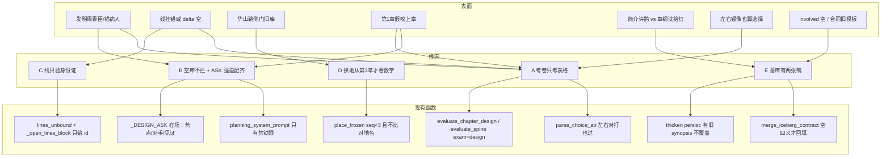
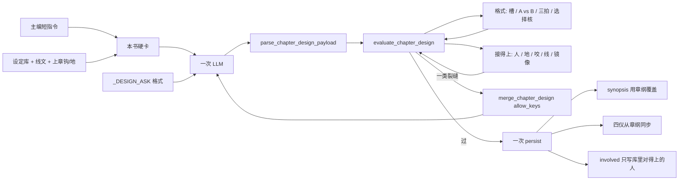

# 章设计从「表格填满」改成「这一章接得上这本书」

| 项 | 值 |
|----|-----|
| **文档标题** | 铜炉写章：设计一层过检必须等于这本书连得上 |
| **作者** | Grok Design |
| **日期** | 2026-08-17 |
| **状态** | Implemented · 用户已拍板：简介=章纲 · 现网冒烟 `book_21f2dca9` |
| **产品** | 铜炉 / tonglu · 代码 `scribe3/` · 仓库 `/home/admin/projects/scribe-writing-system` |
| **前序** | `docs/plans/2026-08-17-outline-beats-merge.md`（大纲/节拍已融成一道设计；本文件是下一刀） |
| **宇宙** | `docs/worlds/wanjie-probability-war-v7.md` |
| **证据书** | demo `book_44eb8789`《万界概率战争》三章《华山成核》《金縢箱锁》《双锚伪真空》。只作考古，**不 overlay** |
| **验收环境** | 只打已部署 demo `tonglu.qing.blue`（`ubuntu@82.157.130.140` `/opt/scribe3/app`） |
| **短名** | `design-book-continuity` |
| **旗** | 扩 `SCRIBE3_CHAPTER_DESIGN=on` 的过检语义；另加可关的 `SCRIBE3_DESIGN_BOOK`（默认 **on**，hot） |

---

## 人话摘要

上一轮已经把「写这一章讲什么」和「分几场戏」收成一次交卷。格式过了：有选择、有三场戏、挂了一条线的编号、钟和地点格子里有字。你打开书，故事还是烂的。

**为什么会这样（一句）：** 系统只检查卷子填没填满，不检查这一章是不是还在写**这本书**。设定库没人，它还逼模型配齐对手和见证，于是第 1 章发明了守观老道周青臣，第 3 章发明了锚病人和两个抬箱人。两条该办的事，一条只抄了编号、推进是空的，另一条（箱子那条）三章都没碰——尽管第 2 章标题就是箱锁。第 1 章在华山北峰，第 2 章突然跳到「侧门旧库」，系统看数字以为没换地方。第 3 章章纲已经是沈拾灯，卡片上的简介还躺着另一本旧稿的许鹘、唐绞。

上一轮三刀修的是「能交卷」。交卷绿了，书仍然接不上。

**改完你打开书会看到什么：**

- 在场的人要么是这本书里已经有的，要么对手/见证就是箱子、灯亭、缝、机制本身。不会再凭空冒出一个三字人名来挡门。
- 换了地方必须写怎么到的；没换必须还叫上章那个地。箱子不会自己搬到另一本巷库书里。
- 第 1 章不再假装「接上一口余烬」。后面的章必须咬住上一章真正留下的钩（金縢账、灯亭热、箱缝）。
- 动哪条线必须是本章正在办的那条，并且用一句人话写出本章实际推进了什么。标题叫箱锁却去挂「复制指针态」、推进还是空的——过不了。
- 卡片上的简介就是这一章的章纲，不会一边沈拾灯、一边许鹘。

**怎样算做完：** 另开一本新书写三章设计（不要去改那本已经烂掉的证据书）。三章都过检之后，人是这本书里的（或用箱子/缝当对手），地接得上，线对题，简介和章纲是同一份。文采、主题深不深，本轮仍然不管。

---

## Overview

`SCRIBE3_CHAPTER_DESIGN` 已经把 Ice1+Ice2 收成一道节点：一次 LLM、一次 persist、一道 `evaluate_chapter_design`。

证据书 `book_44eb8789` **不要写成「三章都绿」**。仓库 `docs/SESSION.md` L75 记的是：该书 ch1 `stage=design persist=true` 多轮 422（当时还是 `spine_density` / `beat_gcd` / `beat_leak`），**未落库**。`docs/audits/`、`docs/evidence/` 没有该书三章切片；公网 `GET /chapter` 要登录，本设计不以未核对的库内行当事实。用户口述的十二条裂缝（周青臣、侧门旧库、许鹘、线挂空）当作**待登录复核的现象**；下面五条根因全部由**现网函数必然推出**，不依赖那三章是否已经落库。禁止 overlay 该书。

根因不是「再少两个动词」或「再加一张词表」。过检合同验的是**表格形状**，生成合同给的是**空许可 + 强迫配齐**，落库还有**第二张嘴**（章纲改了，简介和四仪可以不改）。

本设计把设计检查从「14 槽有字」改成「这一章接得上这本书」。仍是一道设计、一次 LLM、一次落库。不过就整份按**裂缝类别**补，不重骰已对齐的格。不自动建人物、不自动种线、不拆回两次考。

---

## Background & Motivation

### 上一轮做成了什么（不要推倒）

`docs/plans/2026-08-17-outline-beats-merge.md` 已落地：

- 规范阶段 `design`；旗 on 时 `outline → design`；单独 `beats` → `stage_merged` / SKIP。
- `thicken_chapter_design` 一次 LLM + `merge_chapter_design` 只补没过的格 + 一次 persist。
- `evaluate_chapter_design` = `evaluate_spine` ∧ `evaluate_beats` ∧ 选择核（`choice_not_staged` / `second_choice`）。
- 设计考卷（`exam="design"`）**故意跳过** `spine_atoms` / `spine_density` / `beat_gcd`，只考格式、内容载荷、staged choice。这是「考戏不考动词」那一刀。
- `planning_system_prompt()` 收成一页禁令：禁对白/街景/烟巷/锁眼。
- persist 时 `synopsis` **仅当章上尚无简介才**从章纲拼装（融合设计 §2.1、现网 L1782–1784）。这在当时是「不覆盖作者旧简介」；现网证明它把旧稿许鹘冻在了第 3 章卡片上。

格式合同绿了，故事仍可以完全不连。三刀修不到「这本书连不连得上」，因为那根本不在考卷上。

### 代码必然推出的裂缝（证据书只作考古）

用户口述的 `book_44eb8789` 三章现象（周青臣 / 侧门旧库 / 许鹘 / 线挂空）**尚未用已登录 GET 钉死**。SESSION 只证明该书 ch1 一度 422 未落库。下表每条都能从现网函数推出来——有没有那三章落库，合同都是这样。禁止 overlay 该书。

| # | 必然裂缝 | 现网为什么放行 |
|---|----------|----------------|
| 1 | 设定库 0 人仍可发明三字对手 | 过检不看 `characters()`；`_DESIGN_ASK` L1022 强迫「焦点 / 对手 / 见证」 |
| 2 | 线只挂 id、delta 可空；标题咬箱锁也可抄第一条 | `lines_unbound` 只验 id；`_LINE_RE` 的 delta 整组可选；`_open_lines_block` 只给 id；ASK 写「只抄 id」 |
| 3 | 第 2 章可把地名换成另一本书的地，且 `place.delta=0` | `place_frozen`：`seq<3` 直接 False，且从不比对 `place.name` |
| 4 | 设定库空壳、另造机制词，点到「场核/金縢」就算有内容 | `_has_content_payload`；`setting_completeness` 从不进设计检查 |
| 5 | 线文与本章动作可以完全不是一回事 | 过检不读 `list_promises()[].text` / storyline `title` |
| 6 | 第 1 章可写「接上一口余烬」 | ASK 原文「接哪一口余烬」；过检不看 seq |
| 7 | 选择核只验 A vs B 能拆开 | 不验目的/代价是否同一件事（本轮也不验，留给作者） |
| 8 | 「左半身留下 vs 右半身留下」也算选择 | `parse_choice_ab` 只认分隔符 |
| 9 | 章纲改了，卡片简介可以仍是旧稿 | persist **有旧 `synopsis` 就不覆盖**（L1782–1784）；UI 读 `synopsis` |
| 10 | 标签 `增量：2` 且同地、无理由，今日不拦 | `clock_frozen` 管的是连续两章 delta=0，不管「自己承认跳切却不交代」 |
| 11 | 四仪可以是冰山旧模板 | `merge_iceberg_contract` **空四义才回填** |
| 12 | 设计落库后 `involved_characters` 仍可 `[]` | `thicken_chapter_design` 从不写这个字段（只有演绎才写） |

---

## Goals & Non-Goals

### Goals

1. **过检 = 这一章接得上这本书。** 仍一次 `evaluate_chapter_design`。在格式合同之上加四条连续性：人、地、咬、线。选择两条后果不得只是左右镜像。
2. **写之前先发这本书的硬卡。** 规划提示必须带：已有人名 / 空库禁令、可绑定线的 **id+正文**、上章钩、上章地名。禁止再发「你可以编」的空许可。
3. **简介和四仪跟章纲同一张嘴。** 设计落库时 `synopsis` 必须从本章纲覆盖；`narrative_contract` 的 desire/obstacle/turn/cost 从同一份章纲同步（作者锁除外）。
4. **只补没过的那一类裂缝。** `merge_chapter_design` 加 `allow_keys`：按 error 类白名单覆盖，补丁里多出来的格丢掉。修理轮 ASK 只列该类标签，不再附整页 14 槽。简介错不调模型。禁止因线错把已对的选择盖掉。
5. **空库可写。** 对手/见证可以用已有物件/地点/机制（箱锁合法）。禁止因此自动 `plant_promise`、自动建人物。
6. **兼容。** 旧书读路径不重烧。写路径旗 on 才吃新过检。`book` 上下文缺席时（纯函数单测）仍只跑格式考，G1 金样不炸。

### Non-Goals（冻结）

- 不改宣称、GATE-B 80、`GATE_SAVE_MODE`、WCG、SPA。
- 不占用 `chapter_brief` / `GET /chapter-brief`。
- 不自动 `plant_promise`，不自动建人物卡。
- 不 overlay `book_e415dfeb` ch8/9、`book_61a7935e`、`book_83584141`、`book_bdfdcdc4`、`book_718fe88f`、`book_44eb8789`。
- 不拆回大纲/节拍两次考；不加第四套洪水（禁词表打「指腹」「侧门」、再开一轮应试、WAVE-3）。
- 不把字数限制加回来；不把 `setting_completeness == 0` 当成「先建完设定库才能写章」。
- 不为第 3 章简介单独做人工补丁。
- 不验文采、主题深度、金縢全书收束的哲学分寸（只验本章 delta 是否在说这条线）。
- 不在 Grok 运行机跑全量 npm / pytest / 本机 Surreal；不为验收再起一套库。

---

## 根因（五条，不是十二条症状）

### 根因图



### 根因 A — 考卷只考表格，不考这本书

**对应症状：** 1（人可以是编的）、2（线可以跑题）、3（地可以跳）、4（术语另造也绿）、5（分寸）、6（假咬）、7（目的代价拧）、8（镜像选择）、10（三天同一条缝）。

**钉到代码：**

`evaluate_chapter_design`（`clue_density.py` L492–520）只是把 `evaluate_spine` 与 `evaluate_beats` 的 errors 拼起来。设计考卷走 `exam="design"`（L278、L542）：

- 必填槽非空、`parse_choice_ab` 能拆出两边、`lines` 至少一条 **id 在库里**、钩非空。
- **跳过** `spine_atoms` / `spine_density` / `beat_gcd`（L301–310、L553–559）。这是上一轮「考戏不考动词」的本意，副作用是：只要「本章要/代价」命中动作+物件或 `WORLD_PHRASE`（`_has_content_payload` L254–259），故事可以完全不连。
- `parse_choice_ab`（`chapter_spine.py` L88–105）只认分隔符。`左半身留下 vs 右半身留下` 两边都有字，就算选择。
- 不读 `characters()`，不读地名，不读上章钩，不读线正文，不读 `synopsis`，不读 `narrative_contract`。

`setting_completeness`（`store/character_arc.py` L98–165）算得出 `total_chars=0`、缺规则/势力/地点，**设计链从未调用它**。分数 0 不是绿灯，是没人看。

**为什么三刀修不到：** 三刀改的是「怎么交卷、怎么补格、怎么少考动词」。考卷上根本没有「这本书」。

### 根因 B — 设定库空也不拦，提示词还强迫配齐对手/见证

**对应症状：** 1（周青臣/锚病人/抬箱人）、4（空壳设定库）、12（`involved_characters=[]`）。

**钉到代码：**

```113:118:scribe3/stage_generate.py
def planning_system_prompt() -> str:
    return (
        "你在写章设计，不是读者正文。"
        "只输出标签行。禁止对白、街景、气味、烟巷凑段。"
        "禁止写锁眼、匙孔、门芯。"
    )
```

没有「人必须来自设定库 / 地必须接下章 / 线必须对题」。

`_DESIGN_ASK` L1022 写死：`在场：焦点 / 对手 / 见证`。角色 0 时模型要交这一格，只能发明人。

`build_stage_prompt` 规划枝（L1191–1208）只置顶：可绑定线 id、写清口号、上章钩。**不**挂 `_world_name_block`、**不**挂 `_world_contract_block`、**不**挂人物名单（那些在 `if not planning` 才进，L1211–1230）。`thicken_chapter_design` 调 LLM 时 `bible=""`（L1703–1706）。主编 extra 被 `extra_gold` / `extra_authors` 卡成短指令（`world_surface.py` L186–217：不能塞 14 槽金样，不能写「必须有一句」），典型只剩「焦点沈拾灯」。其余全靠模型填空。

`thicken_chapter_design` 从不写 `involved_characters`。演绎路径才会按 `store.characters()` 解析（L1872–1940）。设计落库后这个字段保持 `[]` 是结构结果，不是偶发。

空库被当成「你可以编」，不是「你必须先有人，或者用箱子当对手」。

**为什么三刀修不到：** 三刀把 ASK 收成一页格式纸，反而把「在场必须三人称」留成了硬格式。空库 + 硬格式 = 必然发明人。

### 根因 C — 线只验身份证，不验办事

**对应症状：** 2（第一条 delta 空/跑题、第二条整本不碰）、5（金縢分寸）、部分 7/8（本章目标没做成）。

**钉到代码：**

```285:290:scribe3/clue_density.py
    bound = normalize_bound_lines(src.get("lines"))
    if not bound:
        errs.append("lines_unbound")
    elif known_line_ids is not None:
        if any((it["kind"], it["id"]) not in known_line_ids for it in bound):
            errs.append("lines_unbound")
```

`normalize_bound_lines`（`chapter_spine.py` L108–132）里 `delta` 可空。`_LINE_RE`（L53–56）`delta` 整组可选。id 对上就绿。

`_open_lines_block`（`stage_generate.py` L811–822）只拼 `kind:id`，**不给线正文**。`_DESIGN_ASK` L1032 与 `_design_fail_hint` L1126–1127 都写「只抄可绑定的线完整 id」。模型的最优策略永远是抄排序后的第一条（`7mlc0hskmmndl0cmyxkg`），第 2 章标题「金縢箱锁」也不会去碰 `9g8pq9n16fbt1o9ungh3`。

禁止自动 `plant_promise` 仍然成立——问题不是没线，是有线不办事。

**为什么三刀修不到：** 三刀把「挂一个存在的 id」当成线合同的全部。id 是身份证，不是办事条。

### 根因 D — 换地检查从第 3 章才开始，且只看数字不看名字

**对应症状：** 3（侧门旧库）、6（第 1 章假咬）、10（跳三天还在同一条缝）。

**钉到代码：**

```269:274:scribe3/fate_dearer.py
def place_frozen(this: dict, prev: dict | None, *, seq: int) -> bool:
    if seq < 3 or not prev:
        return False
    if this.get("stay_reason") or prev.get("stay_reason"):
        return False
    return int(this.get("delta") or 0) == 0 and int(prev.get("delta") or 0) == 0
```

第 2 章 `seq=2` 直接放行。即便开到第 3 章，它比的是「连续两章 delta 都是 0」，**从不读 `place.name`**。所以「华山北峰」→「侧门旧库」且 `delta=0` 仍然绿。`parse_clock_place_labels`（L1185–1226）会把地名收到 `beats_meta.place.name`，只是没人拿它比对。

`clock_frozen`（L258–266）同样 `seq<3` 才看；且只看 span∈{beat,scene} 且两边 delta=0。`时长：day` + 跳三天不在冻结语义里。没有「跳切必须交代怎么还在同一条缝」。

`_DESIGN_ASK` L1023：`咬上章：接哪一口余烬`。第 1 章没有上章，这句本身就是教模型假装有上章。`_prev_hook_block` 对 `seq<=1` 返回空（L832–833），过检也不拦「接上一口」。

**为什么三刀修不到：** 三刀把钟地当「标签能解析」。第 2 章最容易乱地，偏偏从第 3 章才开始看数字。

### 根因 E — 落库有两张嘴

**对应症状：** 9（简介许鹘）、11（contract 冰山旧模板）、12（involved 空）。

**钉到代码：**

```1782:1784:scribe3/stage_generate.py
    existing_syn = str((ch or {}).get("synopsis") or "").strip()
    if parsed.get("synopsis") and not existing_syn:
        fields["synopsis"] = parsed["synopsis"]
```

章壳上只要先有过简介（旧稿、点批、上一轮失败留下的许鹘/唐绞），设计过检之后**故意不覆盖**。`assemble_synopsis_from_spine` 算出来了，丢在地上。

UI 读的就是这份简介，不是章纲：

- `ChapterCard.jsx` L54–59：卡片墙 `chapter.synopsis`
- `Outliner.jsx` L26–33：大纲表
- `ChapterMetaPane.jsx` L194、L484：章前契约预览
- `scenePaper.js` L49–70：四仪读 `narrative_contract`，目标才回落到 `spine.goal`

`merge_iceberg_contract`（`narrative_contract.py` L480–515）注释写明「空四义才回填」。旧模板里只要 desire/obstacle/turn/cost 有字，章纲改成周青臣挡门吞核，contract 仍可以说「成核点复写指针态挡验」。

**为什么三刀修不到：** 三刀修生成与过检。落库第二张嘴不在那三刀里。融合设计还把「仅空时拼装 synopsis」写成了已决。本设计推翻这一条。

---

## Proposed Design

仍是一道设计、一次 LLM、一次落库。不新开第二次应试。



### 1. 写之前先发这本书的硬卡

#### 1.1 `planning_system_prompt` 补规则，不补金样句

在现有禁锁眼之后追加（正向约束，禁止写成「必须有一句：…」）：

```
在场只能用设定库已有人名；库空则对手/见证必须是已有物件/地点/机制，禁止新造人名。
第1章「咬上章」= 本章开始前的状态，禁止假装有上一章。
动哪条线：从可绑定列表里选本章正在办的那条；delta 必须是一句本章实际推进，禁止只抄 id。
seq>1：上章钩必须成为本章咬上章。
地点：换了必须报换域并写怎么到的；没换必须沿用上章地名。
```

不自动种线、不自动建人。库空用箱锁当对手是合法的。

#### 1.2 规划提示置顶硬卡（动态，来自 store）

新纯拼装 `_book_card_block(st, ch, *, extra="")`，由 `build_stage_prompt` 在 `planning` 枝 **插到 ASK 之前**（与 `_open_lines_block` 同级，替换后者只给 id 的版本）。

硬卡内容：

| 块 | 来源 | 空时写什么 |
|----|------|------------|
| 已有人名 | `st.characters()` 的 name（≤24） | `已有人名：无。禁止新造人名。对手/见证用物件或地点或机制。` |
| 已有物件 / 地点 / 术语 | `list_items` 的 name；地点走 `all_entities()` 里 **`kind == "place"`** 的 name（`Entity.kind`，`ontology.py` L20；`store/misc.py` L23 构造是 `Entity(..., "place", name)`。现网无 `list_places()`。**禁止**写 `type==place`，那个字段不存在，名单会空）；`list_terms` 的 name | 有则列名；全空不假装「可以编专名」 |
| 可绑定的线 | promise 用 `text`；storyline 用 `title`，空则 `notes`。**不要**读 `storyline.text`（没有这个字段） | 现网「尚无 promise」句保留 |
| 上章钩 | 已有 `_prev_hook_block`（seq>1） | seq=1 不出现「上章钩」 |
| 上章地点 | `load_place(prev).name` + prev spine.setting | seq=1 不出现 |

`_open_lines_block` 改成：

```python
# 现在（L821-822）：只给身份证
bits = [f"{kind}:{pid}" for kind, pid in sorted(ids)]

# 改为
# promise:<id> 成核点开始复制他的指针态
# promise:<id> 金縢箱锁未开，谁先碰谁付账
```

删掉 ASK / fail hint 里的「只抄 id」。改成「选本章正在办的那条，id 后必须跟一句本章推进」。

`_DESIGN_ASK` 四处改合同，不改 14 槽形状：

| 标签 | 现在 | 改为 |
|------|------|------|
| 在场 | `焦点 / 对手 / 见证` | `焦点=已有人名或主编点名的焦点；对手/见证=已有人名，库空则写物件/地点/机制；禁止新造三字人名` |
| 咬上章 | `接哪一口余烬` | `第1章写章前状态，禁止「接上章/上一口/余烬」。第2章起必须咬上章钩里的核心物` |
| 动哪条线 | `只抄完整 id` | `抄本章正在办的那条的 id，后面跟一句本章实际推进` |
| 地点 | 举例里带「侧门旧库」当示范 | 示范改成「沿用上章地名 / 换域须写怎么到的」。**不要**用禁词表打「侧门」 |
| 增量 / 地点增量 | 第三次冻钟才写理由 | 另加一句：`增量：2`（自己承认跳切）且地点没换，必须写留驻或跳切理由。**不要**把 `时长：day` 说成跳了三天 |

主编 extra 仍只能短指令。硬卡不是 extra，是系统给的本书户口，不走 `extra_gold`。

### 2. 过检加「接得上」——仍一次 `evaluate_chapter_design`

#### 2.1 保持零 I/O：把书的户口当入参

`clue_density.evaluate_*` 继续零 I/O。书的户口做成显式上下文（抄 `FateCtx` 的边载法，不并入 fate WAVE）：

```python
@dataclass(frozen=True)
class BindableLine:
    kind: str   # promise | storyline
    id: str
    text: str   # promise.text；storyline = title or notes

@dataclass(frozen=True)
class DesignBook:
    seq: int = 1
    title: str = ""
    focus_names: tuple[str, ...] = ()
    character_names: frozenset[str] = frozenset()
    item_names: frozenset[str] = frozenset()
    place_names: frozenset[str] = frozenset()
    term_names: frozenset[str] = frozenset()
    bindable_lines: tuple[BindableLine, ...] = ()
    prev_place_name: str = ""
    prev_hook: str = ""
    prev_setting: str = ""
```

`load_design_book(st, seq, ch, extra="")` 放 `stage_generate.py`（I/O 边）。地点名单写死：

```python
place_names = frozenset(
    str(e.name) for e in (st.all_entities() or [])
    if getattr(e, "kind", None) == "place" and e.name
)
```

`Entity` 字段是 `kind`（`character / item / place / faction`），不是 `type`。`all_entities()`（`store/misc.py` L20–23）地点行是 `Entity(f"place:{local}", "place", name)`。写 `type == "place"` 会得到空名单，硬卡「已有地点」整块空白。不要新造 `list_places()`；禁止在 `clue_density` 里查库。

**`focus_names` 抽取（写死，空库可写的支柱）：**

```python
_FOCUS_RE = re.compile(r"焦点[:：\s]*([\u4e00-\u9fff]{2,4})")

def extract_focus_names(extra: str, ch: Mapping | None) -> tuple[str, ...]:
    out: list[str] = []
    foc = str((ch or {}).get("focalizer") or "").strip()
    if foc.lower().startswith("role:"):
        foc = foc.split(":", 1)[-1]
    if 2 <= cn_len(foc) <= 4:
        out.append(foc)
    for m in _FOCUS_RE.finditer(extra or ""):
        out.append(m.group(1))
    # 「焦点沈拾灯」无冒号：[:：\s]* 可空，抽出「沈拾灯」
    # 禁止把 extra 全文当名字
    return tuple(dict.fromkeys(out))
```

金样：`extra="焦点沈拾灯"` + `character_names=frozenset()` + cast=`沈拾灯；金縢箱锁` → 不过 `cast_invented`。

`evaluate_chapter_design` 签名写死（地/钟**必须**走参数，禁止函数里猜 `ch["beats_meta"]`——它常常拿不到本次补丁）：

```python
def evaluate_chapter_design(
    spine, beats, *,
    known_line_ids=None,
    designated_beat=None,
    book: DesignBook | None = None,
    clock: dict | None = None,   # load_clock 形状：span / delta / freeze_reason
    place: dict | None = None,   # load_place 形状：name / delta / stay_reason
) -> DensityReport: ...
```

- `design_book_mode()=="off"` → 只跑现网格式考（忽略 `book` / `clock` / `place`）。
- `book is None` **且调用方没有 store**（纯函数单测）→ 只跑格式考（G1 不炸）。地/钟连续性在 `clock is None and place is None` 时同样跳过（格式金样不传）。
- **有 store 却 `book is None` 且旗 on → fail-loud**（调试断言或 422 `design_book_missing`）。禁止默默退回格式考。
- `place_name_mismatch` / `place_travel_unsaid` / `clock_jump_unsaid` **只读这两个参数**。spine 没有「地点增量」槽；不从 `beats_meta` 暗取。

`persist_fields_blocked` 签名加可选 `book=None`。有 store 的调用方必须传。禁止在 `clue_density` 里 `st.characters()`。

**地/钟从哪进函数（写死，漏传 = 地/钟检查永不响）：**

| 入口 | 取出 | 传入 |
|------|------|------|
| `thicken_chapter_design` 每轮 `evaluate` | 本轮维护的 `best_clock` / `best_place`（见下，**禁止**对拼接 `raw` 再 `parse_clock_place_labels`） | `clock=best_clock, place=best_place` |
| `persist_fields_blocked` | `fields.get("beats_meta")` 优先，缺则 `existing.get("beats_meta")`；用已有 `load_clock` / `load_place`（认 `beats_meta.clock` / `.place`） | 同上两个 kwargs |
| `patch_chapter_gcd_fields` | 本次不改 meta 则用 `ch["beats_meta"]`；若 patch 带了 meta 用新的 | 必须传；今日 L554 只传 spine+beats，地/钟会假绿 |
| `director._patch_plan` / `s3_patch_chapter_plan` / `s3_generate_stage` persist | 与 persist 相同：fields 否则 existing | 经 `persist_fields_blocked` |

**thicken 修理轮：地名以本轮补丁为准，禁止拼接稿 first-match。**

现网 L1731 `raw = raw + "\n" + raw2`，L1791 `parse_clock_place_labels(raw)`。`parse_clock_place_labels`（`fate_dearer.py` L1198–1218）是 `re.search` **先匹配的赢**。第一稿 `地点：侧门旧库`，修理稿 `地点：华山北峰`，落库仍是侧门旧库。`merge_chapter_design` 今日只回 spine+beats，管不到 clock/place。

写死：

```python
# 首轮
best_clock = parsed.get("clock") or {}
best_place = parsed.get("place") or {}

# 每一修理轮：只解析 raw2（本轮补丁），禁止 parse(raw+raw2)
patch_clock, patch_place = parse_clock_place_labels(raw2)
best_clock, best_place = merge_clock_place_patch(
    best_clock, best_place, patch_clock, patch_place,
    allow_keys=该类允许的 meta 键,   # 与 §3 同一张表
)

# 过检
dens = evaluate_chapter_design(
    best_spine, best_beats, ...,
    book=book, clock=best_clock, place=best_place,
)

# persist：用 best_* 进 merge_clock_place，禁止再 parse 拼接 raw
```

`merge_clock_place_patch(base_c, base_p, patch_c, patch_p, *, allow_keys)`：只把 `allow_keys` 里出现的键（`place.name` / `place.delta` / `place.stay_reason` / `clock.span` / `clock.delta` / `clock.freeze_reason`）用补丁里**非空**值盖上。`allow_keys is None` = 补丁非空全盖（与今日 `merge_chapter_design` 无白名单时同）。`parse_chapter_design_payload` 已从 preamble 抽出 clock/place（L590–606），修理轮不要丢掉这两格。

金样：底稿 `地点：侧门旧库` + `地点增量：0`；补丁只写 `地点：华山北峰`（`allow_keys` 含地点）→ `best_place["name"]=="华山北峰"`，persist 的 `beats_meta.place.name` 必须是华山北峰，**不得**仍是侧门旧库。

**全部写路径（PR-3 一张表，漏传 = 旗 on 也只考表格）：**

| 入口 | 今日 | 本设计 |
|------|------|--------|
| `thicken_chapter_design` → 每轮 evaluate | 只传 spine+beats | 再传 `book` + **`clock=best_clock, place=best_place`**（本轮补丁合并，禁止拼接 raw first-match） |
| `thicken_chapter_design` → `_blocked_or_none` | 传 `known_line_ids` | 再传 `book`；persist 用 `best_*` 写 `beats_meta` |
| `iceberg.persist_fields_blocked` | `book` 不存在 | 新参 `book`；从 `fields` 否则 `existing` 的 `beats_meta` 取出 clock/place 再传入 evaluate |
| `chapters.patch_chapter`（`PATCH /chapter`） | 有 `known_line_ids` | 传 `book`；clock/place 从 merged `beats_meta` 取 |
| `chapters.patch_chapter_gcd_fields` L544–554 | **直接** `evaluate_chapter_design`，不走 persist，**不传** `known_line_ids` / clock / place | 必须 `load_design_book` + `known_line_ids` + 从 `ch["beats_meta"]`（或本次 patch 的 meta）取出 clock/place |
| `director._patch_plan` L369–373 | 走 persist，**不传** `known_line_ids` | 必须 `book` + ids；clock/place 经 persist 从 beats_meta 取 |
| `mcp/tools_write.s3_patch_chapter_plan` | 有 ids | 再传 `book` |
| `mcp/tools_write.s3_generate_stage` persist 边 L1407–1413 | 有 ids | 再传 `book` |

`fate_dearer` 已 import `clue_density`。人名切分写在 `clue_density.cast_person_tokens`，规则与 `_cast_blocker_names` 相同，**禁止**从 `clue_density` 回导入 `fate_dearer`。

#### 2.2 切词与四条连续性（实现写死，禁止猜）

全部新 id 进 `evaluate_chapter_design` 的 errors，走同一道 `llm_thin` / persist 422。**不**进 `WAVE_*`。

**禁止用 `_content_tokens` 做线/咬/错绑。** 现网 `_content_tokens`（`clue_density.py` L350–358）是 `[\u4e00-\u9fff]{2,6}` **非重叠贪婪块**：线文「金縢箱锁未开，谁先碰谁付账」→ `金縢箱锁未开` + `谁先碰谁付账`，与标题「金縢箱锁」不相交。同文件 `_char_ngrams(s, n=2)`（L376–378）才是二字窗。

##### 2.2.0 共用切词（线 / 咬 / 错绑）

```python
_TOPIC_STOP = frozenset({
    "开始", "复制", "他的", "未开", "谁先", "这个", "那个",
    "没有", "一个", "他们", "她们", "自己", "还是", "不是",
    "挂上", "一句", "本章", "推进", "门外", "门里", "一分",
})  # 封闭。禁止往里塞「指腹」「侧门」。禁止扩 WORLD_PHRASE。

def _book_proper_grams(book: DesignBook | None, extra_text: str = "") -> set[str]:
    bag: set[str] = set()
    for p in WORLD_PHRASE:
        bag |= _char_ngrams(p, 2)
    if book:
        for name in book.item_names | book.place_names | book.term_names:
            bag |= _char_ngrams(str(name), 2)
        for ln in book.bindable_lines:
            bag |= _char_ngrams(ln.text, 2)
    if extra_text:
        bag |= _char_ngrams(extra_text, 2)
    return bag - _TOPIC_STOP

def topic_grams(text: str, book: DesignBook | None = None, *, line_text: str = "") -> set[str]:
    grams = _char_ngrams(text or "", 2) - _TOPIC_STOP
    proper = _book_proper_grams(book, line_text)
    hit = grams & proper
    return hit if hit else grams   # 书里没有专名时退回去停用词后的二字窗

def topics_overlap(a: str, b: str, book: DesignBook | None = None) -> bool:
    return bool(topic_grams(a, book, line_text=b) & topic_grams(b, book, line_text=a))
```

金样（按这个函数钉，不要让实现者换切词）：

| A | B | 相交？ |
|---|---|--------|
| 标题 `金縢箱锁` | 线文 `金縢箱锁未开，谁先碰谁付账` | 是（`金縢`/`箱锁`/`縢箱`） |
| 标题 `金縢箱锁` | 线文 `成核点开始复制他的指针态` | 否（`开始/复制/他的` 已停） |
| 咬 `金縢箱缝还在渗` | 上章钩 `金縢账还没人认` | 是（`金縢`） |
| delta `他把账本翻到下一页` | 线文指针态 | 否 → `line_off_topic` |
| delta `箱锁开了一缝，账还没人认` | 线文箱锁 | 是 → 同题 |

##### 2.2.1 人 — `cast_invented`

切分写死（不要直接复用 `names_from_cast`：它不剥「两个」）：

1. 与 `_cast_blocker_names` 相同：去掉每段前缀 `焦点`/`对手`/`见证`，按 `[、，,；;/]+` 切。
2. 每段再去数量词前缀：封闭 `两个/一名/几个/一位/两名/三名`。
3. 判定：
   - **3 字默认当人**（钉死 `周青臣` / `锚病人` / `抬箱人`）。
   - 2 或 4 字：整词落在 `WORLD_PHRASE` 或允许集 → 不是人；否则若以封闭机制尾 `箱/锁/核/缝/灯/门/库/峰/亭/口/锚` 收尾 → 当物件/地；否则当人。
   - 去数量词后仍长于 4 字：再扫连续三字窗，三字默认当人（钉死「守观老道周青臣」里的 `周青臣`）。
4. `两个抬箱人`：切完仍是一段 → 去「两个」→ `抬箱人`（3 字）→ 人。必须进负例。
5. 允许集 = `character_names ∪ focus_names ∪ item_names ∪ place_names ∪ term_names ∪ WORLD_PHRASE`。
6. 落在允许集之外的「人」→ `cast_invented`。
7. 二字 `林峰`/`王门` 以机制尾收尾，不当人（已知误伤，接受；不扩尾表）。
8. 不因 `involved_characters==[]` 不过。

##### 2.2.2 地 — `place_name_mismatch` / `place_travel_unsaid`

**只读入参 `place`**（`load_place` 形状）。`place is None` → 本条与 `place_travel_unsaid` 跳过（格式金样）。`seq>=2` 也验。比较前两边地名都裁到 20 字（与 `parse_clock_place_labels` L1218 同一帽）。上章地名来自 `book.prev_place_name`，不要回头去读 store。

```python
_PLACE_SUFFIX = ("伪真空口", "灯亭", "裂口", "边缘")  # 封闭，长的在前。禁止「一类」。

def place_core(name: str) -> str:
    t = cn_strip(name)[:20]
    for suf in _PLACE_SUFFIX:
        if t.endswith(suf) and len(t) - len(suf) >= 2:
            return t[: -len(suf)]
    return t

def same_landmark(a: str, b: str) -> bool:
    ca, cb = place_core(a), place_core(b)
    if not ca or not cb:
        return False
    short, long_ = (ca, cb) if len(ca) <= len(cb) else (cb, ca)
    if len(short) < 2:
        return False
    return short in long_   # 包含：华山北峰 ⊂ 华山北峰伪真空口
```

| A | B | 同一地标？ |
|---|---|------------|
| `华山北峰` | `华山北峰伪真空口` | 是（剥封闭后缀后相等 / 包含） |
| `华山北峰灯亭` | `华山北峰` | 是 |
| `华山北峰` | `华山西峰` | **否**（互不包含） |
| `华山北峰` | `侧门旧库` | 否 |

- `delta==0` 且非 `same_landmark` → `place_name_mismatch`。
- `delta>=1`：`setting` 或地点句须含位移封闭集 `到/下山/搬/运/换域/抬往/送至`。只报数字 → `place_travel_unsaid`。
- **不改** `place_frozen`（它管连续两章 delta=0 = 待太久）。

##### 2.2.3 钟 — `clock_jump_unsaid`（不要误杀次日同地）

**只读入参 `clock`**（`load_clock` 形状）。`clock is None` → 本条跳过。

只在 **`int(clock["delta"]) >= 2`**（标签自己承认跳切）且 `same_landmark(place.name, book.prev_place_name)` 且 `clock` 无 `freeze_reason`、`place` 无 `stay_reason` 时拦。

**不要**把 `span=day` / `stretch` / `leap` 单独当跳切。`时长：day` 是单位，不是「跳了三天」。第 2 章「次日仍在华山北峰、增量 0 或 1」必须绿。散文里的「三天」本轮明确不验。

ASK 同步：`增量：2` 且地点没换，必须写留驻或跳切理由。

##### 2.2.4 咬 — `bite_false_prev` / `bite_off_hook`

- `seq==1`：`bite` 含「上章 / 上一口 / 余烬 / 接上」→ `bite_false_prev`。不把「余烬」加进全书禁词表。
- `seq>1`：`topics_overlap(bite, prev_hook, book)` 为假 → `bite_off_hook`。上章钩「金縢账还没人认」与咬「金縢箱缝还在渗」必须绿。

##### 2.2.5 线 — `line_delta_empty` / `line_off_topic` / `line_wrong_bind`

- 至少一条绑定 id 的 `delta` 非空，否则 `line_delta_empty`。
- 该条 `topics_overlap(delta, 那条线.text, book)` 为假 → `line_off_topic`。
- **错绑硬拦（标题优先，禁止 `title+goal` 拼成一根探针）：**

```python
def line_wrong_bind(spine, book: DesignBook, bound: list[dict]) -> bool:
    """True = 应报 line_wrong_bind。"""
    title = str(book.title or "")
    goal = slot_text(spine.get("goal"))
    bound_ids = {(it.get("kind"), it.get("id")) for it in bound}
    bound_texts = [
        ln.text for ln in book.bindable_lines
        if (ln.kind, ln.id) in bound_ids
    ]
    unbound_texts = [
        ln.text for ln in book.bindable_lines
        if (ln.kind, ln.id) not in bound_ids
    ]

    def hits_any(probe: str, texts: list[str]) -> bool:
        return any(topics_overlap(probe, t, book) for t in texts)

    # 1) 标题自己能咬住某条未绑线，且咬不住已绑那条 → 硬拦。
    #    这一步禁止把 goal 拼进来。现网「本章要」必带世界词，
    #    title=金縢箱锁 + goal=按场核成核 会同时咬两条，拼在一起永远不响。
    if title.strip() and hits_any(title, unbound_texts) and not hits_any(title, bound_texts):
        return True
    # 2) 仅当标题与所有线都不相交，再单独用 goal 做同一判断。
    title_hits_any_line = hits_any(title, [ln.text for ln in book.bindable_lines])
    if not title_hits_any_line and hits_any(goal, unbound_texts) and not hits_any(goal, bound_texts):
        return True
    return False
```

钉死：`title=金縢箱锁`，`goal=按场核成核确认成核点`，绑指针态那条 → **仍** `line_wrong_bind`（标题咬箱锁、不咬指针态；不得因 goal 带「成核」放行）。`title=金縢箱锁` 绑箱锁那条且 delta 同题 → 过。无标题、goal 只咬箱锁却绑指针态 → 也拦。
- 不要求绑齐所有 open 线。不自动 `plant_promise`。

##### 2.2.6 选择 — `choice_mirror`（只剥左右，不经动词表）

`_verb_stems` / `_CHOICE_VERBS` **不准**进这条。根因病句是「左半身留下 vs 右半身留下」——「留下」不在动词表里。

```python
_LR_MARK = ("左半身", "右半身", "左手", "右手", "左边", "右边", "左", "右")  # 长的先剥

def _strip_lr(s: str) -> str:
    t = _ab_norm_side(s)
    for m in _LR_MARK:
        t = t.replace(m, "")
    return cn_strip(t)

def choice_is_mirror(ab: tuple[str, str]) -> bool:
    a, b = _strip_lr(ab[0]), _strip_lr(ab[1])
    return bool(a) and a == b
```

| 选择 | 镜像？ |
|------|--------|
| `交核 vs 自按` | 否 |
| `左半身按进缝 vs 右半身按进缝` | 是 |
| `左半身留下 vs 右半身留下` | 是 |

不把「本章目标没做成也没认账」做成独立检查。

#### 2.3 过检前后对照

| 现在绿 | 改后绿 | 仍然不拦 |
|--------|--------|----------|
| 14 槽有字 | 仍要 | 文采、比喻好不好 |
| A vs B 能拆开 | 仍要，且两条后果不能只是左右镜像 | 选择「深刻不深刻」 |
| ≥3 拍、指定拍演同一个选择 | 仍要 | 拍写得美不美 |
| 挂了一个存在的线 id | 至少一条 **delta 非空且与线文同题**；**标题**咬住的线不能绑成别条（goal 带成核也不救人）；标题对不上任何线时才看本章要 | 要不要在本章把第二条线也推进 |
| 钟地标签能解析 | 仍要；另验地名与数字一致、第 1 章不假咬；**仅** `clock.delta>=2` 且同地无理由才拦跳切 | `时长：day`、散文「三天」、次日同地过夜 |
| 本章要点到场核/金縢 | 仍要 `_has_content_payload` | 用不用烛照/相位锚/逻辑豁免（不禁另造八盏灯，也不逼登记词堆砌） |
| 设定库 0 人 | **禁止新造人名**；箱子/缝当对手合法 | 不强迫先建完世界再开写 |
| 有旧简介也可以过 | 落库后简介必须 = 本章纲 | 作者锁住的四仪（`locked` / `source=author`） |
| `involved_characters=[]` | 仍允许（空库诚实）；有卡则设计落库写入对得上的 id | 不因空列表不过 |

### 3. 只补没过的那一类裂缝（合并器合同，不是劝）

现网 `merge_chapter_design`（L612–646）规则是：**补丁格非空就覆盖**。主 ASK 仍写「必须先写【章】全部标签」；`looks_like_13slot` 要填满 ≥8 槽才算结构 ok。修理提示若只写「只输出要改的标签行」，模型仍常整份重交——已对齐的选择会被非空补丁盖掉。只改 hint **不是**合同。

**写死 `allow_keys`：**

```python
def merge_chapter_design(..., *, allow_keys: set[str] | None = None):
    # allow_keys 是 spine 槽名 + 可选 beat 槽名。
    # None = 今日行为（单测 / 旗 off）。
    # 有 allow_keys：补丁里不在集合内的非空格丢掉，底稿保留。
```

| errors 命中 | `allow_keys`（只这些能被补丁盖） |
|-------------|----------------------------------|
| `cast_invented` | `cast`；拍的 `conflict`/`goal`（只改点到非法人名的拍） |
| `place_*` / `clock_jump_unsaid` | spine：`setting`；clock/place 走 **`merge_clock_place_patch`**（键：`place.name` / `place.delta` / `place.stay_reason` / `clock.span` / `clock.delta` / `clock.freeze_reason`）。修理轮标签：时空/地点/地点增量/时长/增量/留驻理由/冻钟理由。**禁止**把 clock/place 塞进 `merge_chapter_design` 的 spine 字典 |
| `bite_*` | `bite` |
| `line_*` | `lines` |
| `choice_mirror` / `spine_choice` / `choice_not_staged` | `choice` + 指定拍的 `choice` |
| 简介/四仪 | 不调模型 |

修理轮 **不要附整页 14 槽 ASK**。换成该类标签清单（例如线错只给「动哪条线：」一行形状）。`_design_keep_block` 仍列出已过格，但合并器不靠模型自觉。

金样：底稿选择 =「交核 vs 自按」；补丁交回整份且选择改成「左半身留下 vs 右半身留下」；`allow_keys={"lines"}` → 合并后选择仍是「交核 vs 自按」。

一类裂缝一轮；现网最多 2 轮 `_repair`，保持 2。两轮后仍红 → 整份 `llm_thin`，禁止半稿落库。

### 4. 落库改成一张嘴

`thicken_chapter_design` persist 字段：

```python
fields["synopsis"] = assemble_synopsis_from_spine(parsed["chapter_spine"])
# 删除「有旧简介就不写」的 L1782–1784
```

`sync_design_surface(fields, existing)` 仅当 **本次 `fields` 含 `chapter_spine`**（或 `stage=design` 成功写入 spine）**且** `design_book_mode()=="on"`：

- `synopsis` ← 本章纲拼装（帽仍 `ASSEMBLED_SYNOPSIS_CAP=400`）。
- `narrative_contract`：若 `locked` 或 `source=="author"` → 不动。否则用 `extract_contract_from_spine` **覆盖** desire/obstacle/turn/cost，`source="iceberg"`。不要再走「空四义才回填」那条设计落库路径。
- `involved_characters`：把 `cast` 里对得上 `store.characters()` 的名字写成 `role:名`。对不上的不编 id。空库 → `[]`。

**只改 `synopsis` 的 `PATCH /chapter`**（卡片「让主编写梗概」）保持今日行为，不走覆盖。简介没有对等的 `locked`；本轮不另开锁字段。

`involved_characters` 政策：设计落库写入是**作者可见的设计结果**，不是演绎静默推断。D10（`pilot_actions/deduce.py` L97：只内存推断、不静默 patch）仍只约束 deduce/pilot。`test_pilot.py` 的 D10 用例不应被 design persist 带红。

禁止为某章简介单独写补丁脚本。旧书不重烧；作者 `force=1` 重跑 design 才会被新嘴覆盖。

PR-1 必须看 `design_book_mode()`：旗 off 时不覆盖简介，否则设置页「关掉只检查表格」撒谎。PR-1 先上 demo ≠ 设计层已愈——force 重跑仍可能发明人、挂错线，只是简介不再是旧稿。

### 5. 与已有融合设计的关系

| 融合设计已决 | 本设计 |
|--------------|--------|
| 一道 `design`、一次 LLM、一次 persist | **不动** |
| 14 槽 + ≥3 拍，禁止第 15 槽 | **不动** |
| `evaluate_chapter_design` 一次验收 | **扩语义**，不新开函数当第二场考 |
| `merge_chapter_design` 只补空格 | **加 `allow_keys`**，修理轮不再附整页 ASK |
| 旗 off = 旧两步 | **不动** |
| `synopsis` 仅空时拼装 | **推翻**：设计落库必须覆盖 |
| 设计考跳过 atoms/gcd | **保持**（不退回考动词） |
| 不自动 `plant_promise` | **保持** |
| extra 金样 / 命令语气 | **保持**；硬卡不是 extra |

### 6. 旗

| 旗 | 默认 | 作用 |
|----|------|------|
| `SCRIBE3_CHAPTER_DESIGN` | on（已有） | 节点仍是一道 design。off = 整段退回 outline→beats，**本设计的接得上也一起关**（旧两步没有 `book` 上下文）。 |
| `SCRIBE3_DESIGN_BOOK` | **on**，hot，`audience=author` | 只关「接得上」四条 + 硬卡 + 简介覆盖。节点仍融合。给回滚用，不是给灰度拖着不关病。 |

**为什么要第二根细旗、为什么默认 on：**

- 接得上过检可能让正在写的半新书 `force` 重跑时变红。需要能只关连续性、不拆回两次考。
- 默认 on：否则 demo 继续绿表格、烂故事。空/非法值：`on`（与 `CHAPTER_DESIGN` 空→on 对齐）。typo → off（避免写错当开）。
- **读路径不看这两根旗。** 旧章 GET 原样。不写回 `schema_design`，不批处理重烧名单里的旧书。
- 单测不传 `book` → 行为与今日格式考相同。新测传 `DesignBook` 金样。

设置页文案（人话）：「写章设计时，检查这一章是否还接得上这本书（人、地、线、简介）。关掉则只检查表格填没填满。」

`FLAG_REGISTRY` + `settings.py` 与 `CHAPTER_DESIGN` 同档登记。

---

## API / Interface Changes

对外 HTTP/MCP 路径不变：`POST /generate-stage stage=design`、`s3_generate_stage`、`s3_patch_chapter_plan`、`PATCH /chapter`、`PATCH /chapters/{seq}/gcd-fields`、主编 `_patch_plan`、`/chat/write`。有 store 的入口必须传 `book=`（见 §2.1 表）。

内部签名：

```python
def evaluate_chapter_design(
    spine, beats, *,
    known_line_ids=None,
    designated_beat=None,
    book: DesignBook | None = None,   # 新增：人/咬/线/镜像
    clock: dict | None = None,        # 新增：clock_jump_unsaid；形状同 load_clock
    place: dict | None = None,        # 新增：place_* ；形状同 load_place
) -> DensityReport: ...

def persist_fields_blocked(
    fields, *, existing=None, known_line_ids=None,
    fate_ctx=None, chapter=None,
    book=None,                         # 新增
) -> dict | None: ...
# persist 内部：clock, place = load_clock(merged), load_place(merged)
# merged 的 beats_meta 取 fields 优先否则 existing，再传给 evaluate_chapter_design
```

新错误 id（进 `density.errors` / persist `missing`）：

`cast_invented` · `place_name_mismatch` · `place_travel_unsaid` · `clock_jump_unsaid` · `bite_false_prev` · `bite_off_hook` · `line_delta_empty` · `line_off_topic` · `line_wrong_bind` · `choice_mirror`

对外仍是 422，`code=llm_thin` 或沿用 `iceberg_thin_persist`；`missing[].id` 带上表。不要新造顶层 `code=book_blocked`（避免第三条嘴）。

`_design_fail_hint` 为每个新 id 写一句人话（给模型，不是给用户设置页）：

- `cast_invented`：在场里的人名必须来自硬卡；库空把对手改成物件/地点
- `line_wrong_bind`：本章**标题**咬住的那条线必须绑上；标题对不上任何线时，再看本章要。delta 写本章推进
- `place_name_mismatch`：delta=0 必须沿用上章地名；换了就报换域并写怎么到的

---

## Data Model Changes

**无新表、无迁移。**

| 字段 | 变？ |
|------|------|
| `chapter.chapter_spine` / `beats` / `beats_meta.clock|place` | 形状不变 |
| `chapter.synopsis` | **写语义变**：仅当本次带 `chapter_spine` 且旗 on 才覆盖。只 PATCH 简介不覆盖 |
| `chapter.narrative_contract` 四义 | **写语义变**：同上，从章纲覆盖（锁除外） |
| `chapter.involved_characters` | 设计落库可写库内对得上的人（作者可见，不是 D10 静默推断）；空库仍 `[]` |
| `beats_meta.schema_design` | 仍 `chapter_design.v1` |

旧书不回填。作者重跑 design 才换嘴。

---

## Alternatives Considered

### 替代 A — 只改提示，不改检查〔否决〕

把硬卡和 ASK 改完，过检仍只验表格。

| 利 | 弊 |
|----|----|
| 改动面小，单测几乎不动 | 现网合同已经保证：过检不看人/地/线文。只改提示挡不住发明人、抄第一条 id。提示是劝，过检才是合同 |
| | 简介两张嘴完全修不到 |

否决作主方案。提示是第 1 刀，必须有第 2 刀过检。

### 替代 B — 设定库不齐不许写章〔否决〕

`setting_completeness_score==0` 或 `characters()==[]` → 设计 422。

| 利 | 弊 |
|----|----|
| 周青臣绝迹 | 用户已裁定不要「先建完世界再开写」；第 2 章用箱锁当对手是合法戏剧 |
| | 等于逼系统或作者自动建卡，踩「不自动建人物」红线 |

否决。空库合法，编人非法。

### 替代 C — 本方案：空库可用物件当对手 + 接得上四条〔采纳〕

写之前发硬卡；过检验人/地/咬/线/镜像；落库一张嘴；只补裂缝类别。

代价：`evaluate_chapter_design` 多 `book` / `clock` / `place` 三个入参；persist 调用方要多传 `book`，并从 `beats_meta` 取出钟地。这是把 `known_line_ids` 已经在做的事做完整，不是新架构。

### 替代 D — 把连续性塞进 fate WAVE-3〔否决〕

| 利 | 弊 |
|----|----|
| `FateCtx` 已有 prev_place / prev_spine | 用户点名禁止再开 WAVE；fate 管的是命运/钟/待太久，不管「简介是不是同一稿」 |
| | 简介/四仪根本不走 fate |

`place_frozen` 只收紧「待太久」。地名对不上是设计合同，不是命运闸。

### 替代 E — 扩 `WORLD_PHRASE` / 禁「侧门」「指腹」当切词〔否决〕

对照本刀采纳的切词：已有 `_char_ngrams(2)` + 封闭停用词 + 书内专名（`WORLD_PHRASE ∪ item/place/term ∪ 该条线文`）。

| 利 | 弊 |
|----|----|
| 实现者少写函数 | 又一张词表；「侧门」误伤真地名，「指腹」误伤真动作；标题「金縢箱锁」仍对不上贪婪 `_content_tokens` |
| | 用户点名禁止再加词表洪水 |

否决。不复用 `_ab_same` 做线/地（那是选择左右是否同一组戏）。

---

## Security & Privacy Considerations

- 不新开写通道。合法写仍是主编 / 点批 / generate-stage / `/chat/write`。
- 硬卡来自本书 store，不把评委金样写进 extra。`extra_gold` / `extra_authors` 不改口径。
- 不因空库去调 `plant_promise` 或建 `role:`。invented 人名只否决，不落成角色行。
- 锁章 / `narrative_contract.locked` / `source=author` 的四义不覆盖。
- 不扫描用户正文禁词表（「指腹」「侧门」）当根治——会误伤华山侧门、真指腹动作。

---

## Observability

| 信号 | 落点 | 用途 |
|------|------|------|
| `density.errors` 新 id | generate-stage 响应 + 记录仪 `gate_input` | 一次看是人/地/咬/线哪类红 |
| `design_book=on/off` | `gate_input` JSON | 回滚可对 |
| persist 后 `synopsis` 与 spine.goal 同源 | demo `GET /chapter` | 卡片简介不再是旧稿 |
| `involved_characters` | GET | 有卡才非空；空库空列表是诚实 |

不新增 metrics 后端。沿用 `SCRIBE3_PIPELINE_RECORDER`。告警：新书三章设计若 `cast` 出现硬卡以外的三字人名且 persist 成功 → P0。

---

## Rollout Plan

1. 本机只改代码 + 纯函数单测。禁止本机 `npm ci` / 全量 pytest / 本机 Surreal。
2. `./scripts/deploy_demo.sh` 热更已部署 backend。
3. 设置页确认 `SCRIBE3_CHAPTER_DESIGN=on`、`SCRIBE3_DESIGN_BOOK=on`。
4. **新书三章设计冒烟**（不要 overlay 名单里的旧书）：
   - 建书、intent、两条 promise（成核指针态 / 金縢箱锁）——**手种，不自动 plant**。
   - 人物卡：可以 0 张。主编 extra 只写「焦点沈拾灯」。
   - 三章各一次 `POST /generate-stage stage=design persist=true`。
   - `GET /chapter`：在场无新造三字人名；第 2 章若换地则 delta≥1 且有怎么到的；第 2 章绑金縢那条且 delta 非空同题；第 1 章咬槽无「上一口余烬」；`synopsis` 由章纲拼出，不含许鹘/唐绞。
   - 再打一次不带 force → SKIP。
   - 人造负例（点批）：在场写「对手周青臣」→ 422 `cast_invented`；第 2 章绑指针态那条、标题含箱锁 → 422 `line_wrong_bind`。
5. 回滚：设置页拨 `SCRIBE3_DESIGN_BOOK=off`（只退连续性）或 `CHAPTER_DESIGN=off`（退回两次考）。已写入字段不用回滚。

---

## Testing Plan

纯函数，零 Surreal。扩 `scribe3/tests/test_chapter_design.py`。禁止本机全量 pytest。

| 用例 | 期望 |
|------|------|
| `evaluate_chapter_design(G1, gold, known=KNOWN)` 不传 book / clock / place | 仍 ok（格式考；地/钟连续性跳过） |
| `extra="焦点沈拾灯"` + 空 `character_names` + cast=`沈拾灯；金縢箱锁` | ok |
| 空库，cast=`周青臣；沈拾灯`，focus=`沈拾灯` | `cast_invented`（周青臣） |
| 空库，cast=`两个抬箱人；沈拾灯`，focus=`沈拾灯` | `cast_invented`（抬箱人） |
| 空库，cast=`守观老道周青臣` | `cast_invented`（三字窗扫到周青臣） |
| seq=2，prev=`华山北峰`，place=`侧门旧库` delta=0 | `place_name_mismatch` |
| seq=2，prev=`华山北峰`，place=`华山北峰伪真空口` delta=0 | ok |
| seq=2，prev=`华山北峰`，place=`华山西峰` delta=0 | `place_name_mismatch` |
| seq=2，place.delta=2，setting 无到/搬/换域 | `place_travel_unsaid` |
| seq=2，`span=day`，`clock.delta=0`，同地，无理由 | **ok**（次日同地） |
| seq=2，`clock.delta=2`，同地，无理由 | `clock_jump_unsaid` |
| seq=1，bite=`接上一口余烬` | `bite_false_prev` |
| seq=1，bite=`灯亭已热，箱未开` | ok |
| seq=2，prev_hook=`金縢账还没人认`，bite=`金縢箱缝还在渗` | ok（`topic_grams` 交 `金縢`） |
| seq=2，prev_hook=`成核点开始复制他的指针态`，bite=`箱缝还在渗` | `bite_off_hook` |
| 绑指针态，delta 空 | `line_delta_empty` |
| 绑指针态，delta=`他把账本翻到下一页` | `line_off_topic` |
| title=`金縢箱锁`，goal 空，绑指针态那条 | `line_wrong_bind` |
| **title=`金縢箱锁`，goal=`按场核成核确认成核点`，绑指针态那条** | **仍 `line_wrong_bind`**（标题优先；不得因 goal 带成核放行） |
| title=`金縢箱锁`，绑箱锁那条，delta=`箱锁开了一缝，账还没人认` | ok |
| title 与所有线不相交，goal 只咬箱锁，绑指针态 | `line_wrong_bind`（退到 goal 单独判断） |
| 底稿 `地点：侧门旧库`，补丁只写 `地点：华山北峰`，`allow_keys` 含地点 | `best_place.name` 与 persist `beats_meta.place.name` 都是华山北峰（禁止拼接 raw first-match） |
| choice=`左半身按进缝 vs 右半身按进缝` | `choice_mirror` |
| choice=`左半身留下 vs 右半身留下` | `choice_mirror` |
| choice=`交核 vs 自按` | 不是 mirror |
| 底稿选择「交核 vs 自按」，补丁整份改成镜像，`allow_keys={"lines"}` | 合并后选择仍是「交核 vs 自按」 |
| persist 已有 synopsis=`许鹘…`，本次 fields 含 spine，旗 on | synopsis 来自章纲，不含许鹘 |
| 只 PATCH synopsis，不含 spine | 不覆盖，保持今日 |
| 旗 off | 不覆盖简介 |
| 空库 design 后 | `involved_characters==[]` |
| 有卡且 cast 命中沈拾灯 | involved 非空；D10 deduce 用例不红 |
| `_open_lines_block` | promise 用 text；storyline 用 title/notes |
| 有 store 不传 book 且旗 on | fail-loud，不默默格式考 |

旧两步用例保持 `SCRIBE3_CHAPTER_DESIGN=off`。

### Demo 冒烟（只打已部署栈）

见 Rollout §4。禁止为冒烟再起 Surreal。禁止 overlay 证据书。

---

## Risks

| 风险 | 严重度 | 缓解 |
|------|--------|------|
| 人名启发式放过「两个抬箱人」或「守观老道周青臣」 | 中 | 先去数量词；3 字默认当人；长段扫三字窗。金样钉死这两条 |
| `line_wrong_bind` 用 `title+goal` 拼探针，现网「本章要」必带世界词，错绑假绿 | 高 | **标题优先**，这一步禁止拼 goal；金样钉死 title=金縢箱锁 + goal=按场核成核 + 绑指针态 → 仍红 |
| 修理后地名吃拼接稿第一处「地点：」 | 高 | thicken 维护 `best_place`，只 parse **本轮** `raw2`；禁止 `parse_clock_place_labels(raw+raw2)`。金样：侧门旧库→华山北峰 |
| 硬卡把规划提示再次灌肥，模型又薄 | 中 | 硬卡只列名与线文一句，帽 24 名 / 8 条线；仍跳 structure_diversity / continue_snapshot |
| 旧章 force 重跑被新过检打回 | 低 | 预期。不重烧。可拨 `DESIGN_BOOK=off` |
| 简介覆盖踩到作者手写梗概 | 中 | 设计落库覆盖是本设计的点：卡片简介必须 = 章纲。作者要另写读者简介，应走四仪锁或正文，不占用这张嘴 |
| 两轮 repair 不够同时修人+地+线 | 中 | 保持 2 轮；仍红则整份重写。不要加到 4 轮把一次节点拖成四次应试 |

---

## Open Questions

无未决。

1. **设计落库覆盖简介，是否允许「作者手写梗概」另留一个字段？** **RESOLVED（用户 2026-08-17 拍板，已锁）。** 卡片简介必须就是这一章的章纲。主编重写设计时直接覆盖简介。不另开「作者手写梗概」字段。不占 `chapter_brief`，不加第 15 槽。以后要读者简介再另案。

其余此前已决：线错绑硬拦、空库可写、不 overlay 证据书、验收用新书。

---

## References

- 前序融合：`docs/plans/2026-08-17-outline-beats-merge.md`
- 命运/钟地：`docs/plans/2026-08-16-fate-dearer-novelist-reform.md`
- 水面：`docs/plans/2026-08-16-world-surface-break-the-loop.md`
- 宇宙：`docs/worlds/wanjie-probability-war-v7.md`
- 会话：`docs/SESSION.md`（`book_44eb8789` 建书记录）
- 代码：
  - `scribe3/stage_generate.py` — `planning_system_prompt` L113；`stage_spec` L131；`_DESIGN_ASK` L1015；`merge_chapter_design` L612；`thicken_chapter_design` L1658；synopsis 覆盖 L1782；`build_stage_prompt` L1143；`_open_lines_block` L811
  - `scribe3/clue_density.py` — `evaluate_spine` L270；`_has_content_payload` L254；`evaluate_chapter_design` L492；`evaluate_beats` L523
  - `scribe3/chapter_spine.py` — `parse_choice_ab` L88；`normalize_bound_lines` L108；`assemble_synopsis_from_spine` L164；`known_line_ids_from_store` L344
  - `scribe3/fate_dearer.py` — `place_frozen` L269；`clock_frozen` L258；`parse_clock_place_labels` L1185
  - `scribe3/iceberg.py` — `persist_fields_blocked` L327
  - `scribe3/narrative_contract.py` — `merge_iceberg_contract` L480；`extract_contract_from_spine` L385
  - `scribe3/world_surface.py` — `extra_gold` L186；`extra_authors` L212
  - `scribe3/store/character_arc.py` — `setting_completeness` L98
  - `scribe3/store/promises.py` — `list_promises` L148；`plant_promise` L72（本设计不调用）
  - `scribe3/store/storyline.py` — `_storyline_row` L166–176（`title`/`notes`，无 `text`）
  - `scribe3/store/misc.py` — `all_entities` L20–23（地点名单；`Entity(..., "place", name)`，字段是 `kind`）
  - `scribe3/ontology.py` — `Entity.kind` L20
  - `scribe3/api/routers/chapters.py` — `patch_chapter` L449；`patch_chapter_gcd_fields` L544–554
  - `scribe3/api/routers/director.py` — `_patch_plan` L369–373
  - `scribe3/mcp/tools_write.py` — `s3_patch_chapter_plan`；`s3_generate_stage` persist L1407
  - `scribe3/web/src/ChapterCard.jsx` L54；`Outliner.jsx` L26；`ChapterMetaPane.jsx` L194

---

## PR Plan

| PR | 标题 | 文件 | 依赖 | 简述 |
|----|------|------|------|------|
| **PR-0** | `feat: DesignBook + DESIGN_BOOK 旗` | `feature_flags.py`；`settings.py`；`clue_density.design_book_mode` + `DesignBook` + `BindableLine`；`test_chapter_design.py` 旗/空 book 金样 | — | 先落旗。无 store 不传 book = 今日格式考 |
| **PR-1** | `feat: 设计落库一张嘴` | `sync_design_surface`（**仅** fields 含 `chapter_spine` 且 `design_book_mode()==on`）；thicken 删「有旧 synopsis 不写」；单测许鹘覆盖 / 只 PATCH 简介不覆盖 / 旗 off 不覆盖 | PR-0 | 可先热更。验收文案**不要**写成「简介病已愈 = 设计层已愈」 |
| **PR-2+3** | `feat: 硬卡 + 接得上四条 + allow_keys` | 提示：`planning_system_prompt` / `_DESIGN_ASK` / `_book_card_block`（地点 `kind==place`）/ `_open_lines_block`。过检：`evaluate_chapter_design(..., book=, clock=, place=)`；`topic_grams` / 人 / 地 / 钟 / 咬 / 线（**标题优先** `line_wrong_bind`）/ 镜像；`merge_chapter_design(allow_keys=)` + **`merge_clock_place_patch`**；thicken 用 `best_clock`/`best_place`，禁止对拼接 `raw` first-match。传 `book`+clock/place：`_blocked_or_none`、`patch_chapter`、**`patch_chapter_gcd_fields`**、**`director._patch_plan`**、`s3_patch_chapter_plan`、**`s3_generate_stage` persist**。有 store 不传 book → fail-loud | PR-0 | **同一提交或同一热更**。禁止只发硬卡在 demo 过夜。原 PR-4 并进本 PR |
| **PR-Doc** | `docs: SESSION + 本设计落地注记` | `docs/SESSION.md`；本文入 `docs/plans/2026-08-17-design-book-continuity.md` | PR-2+3 | 不改宣称 / GATE-B |
| **PR-Demo** | `chore: 热更 + 新书三章设计冒烟` | `scripts/deploy_demo.sh`；证据 `docs/evidence/` | PR-1 与 PR-2+3 都热更后 | 新书。禁止 overlay 名单旧书 |

PR-1 可先合。PR-2 与过检 **同一提交或同一热更**，不要「同周」。Demo 冒烟以 PR-1 + PR-2+3 为准。

---

## Key Decisions

1. **过检从「格子填满」改成「接得上这本书」。** 仍一道 `evaluate_chapter_design`，不新开第二次应试，不并入 fate WAVE。
2. **五条根因：表格考、空库强迫配齐、线只验身份证、换地 seq&lt;3 且不看名字、落库两张嘴。** 十二条表面症状都收进这五条。
3. **空库可写，编人不可写。** 对手/见证可以是箱锁/灯亭/缝。不自动建人物，不自动种线。焦点可以只靠主编点名。
4. **线：id + 非空 delta + 与线文同题。** `line_wrong_bind` **标题优先**：标题与未绑线相交、与已绑线不相交 → 硬拦，**这一步禁止把 goal 拼进探针**。仅当标题与所有线都不相交，再单独用 goal 做同一判断。现网「本章要」必带世界词，拼在一起会让第 2 章标题箱锁、goal 写成核时永远不响。不要求绑齐所有 open 线。
5. **地：seq=2 也验。** `delta=0` 用包含（最短一侧 ≥2）+ 封闭后缀表比同一地标；`华山北峰` vs `华山西峰` 不是同一地。`delta≥1` 必须写怎么到的。不改 `place_frozen`。
6. **第 1 章禁止假咬上章。** ASK 不再写「接哪一口余烬」。seq>1 用同一套 `topic_grams` 咬上章钩。
7. **选择不禁左右，禁镜像后果。** 先剥封闭左右标记再比是否相同。**不经** `_verb_stems` / `_CHOICE_VERBS`。
8. **设计落库覆盖 `synopsis`，同步四义（锁除外）。** 仅当本次带 `chapter_spine` 且旗 on。只 PATCH 简介不覆盖。不另开字段。**用户 2026-08-17 已确认：卡片简介必须就是章纲；主编重写设计时直接覆盖；以后要读者简介另案。**
9. **`involved_characters` 只写库里对得上的人。** 空库保持 `[]`。这是作者可见的设计结果，D10 仍只约束 deduce/pilot。
10. **`merge_chapter_design(allow_keys=)` 按 error 类白名单覆盖。** 修理轮只列该类标签。线错不能盖掉选择。最多 2 轮。
11. **旗：`SCRIBE3_DESIGN_BOOK` 默认 on。** 关它只退连续性（含简介覆盖）。读路径不重烧旧书。
12. **不改**宣称 / GATE-B / WCG / SPA / `chapter_brief` / 字数地板。不 overlay 名单里的旧书。验收 = 新书三章设计，只冒烟已部署 demo。
13. **替代 A（只改提示）、B（先建完设定库）、D（WAVE-3）、E（扩词表/禁侧门）否决。** 本方案是 C。
14. **PR-1 可先合。PR-2 与过检同一提交或同一热更。** 禁止只发硬卡在 demo 过夜。gcd-fields / director / generate-stage persist 必须传 `book=`，并从 `beats_meta` 传入 `clock`/`place`。
15. **连续性怎么比字（已决）：** `_char_ngrams(2)` + 封闭停用词 + 书内专名。不用 `_content_tokens`。不新开「指腹/侧门」禁词表。镜像只剥左右。地点同一地标 = 包含 + 封闭后缀。`clock_jump_unsaid` 只认 `clock.delta>=2`。
16. **地/钟进 `evaluate_chapter_design` 的 `clock=` / `place=`，不暗读 beats_meta。** persist / gcd-fields 从 `fields` 否则 `existing` 的 `beats_meta` 取出。thicken 维护 `best_clock` / `best_place`，只把**本轮** `raw2` 解析结果按 `allow_keys` 盖上。禁止对拼接 `raw` 做 `parse_clock_place_labels`（first-match 会把侧门旧库冻死）。
17. **地点名单用 `Entity.kind == "place"`。** 禁止 `type==place`。
